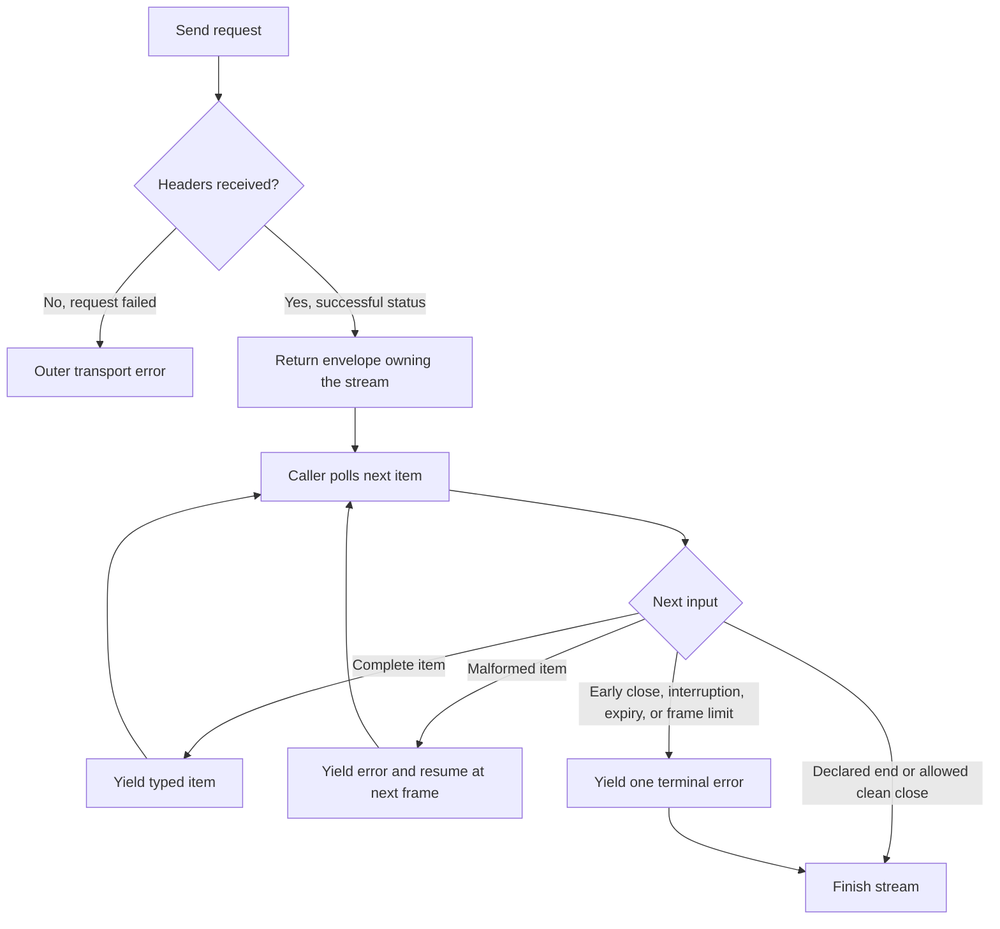

---
$schema:
    status: |-
        enum(
            draft-spec,
            finalized-spec,
            planned,
            implemented,
            review-findings,
            human-in-the-loop,
            completed,
            on-hold,
            abandoned
        ) -> an indicator of progress for this specification
    reviewed: boolean -> indicates whether the specification file has been reviewed by another agent from the one which created the spec
    reviewed_by: string -> the agent and model used in the spec review
    reviewed_on: date -> the date the spec was reviewed
    review_iterations: number -> the number of implementation reviews have taken place in the review/fix cycle
    clarified: boolean -> indicates whether the specification was built -- _in part_ -- with the 'clarify.md' prompt
    implemented: boolean -> indicates whether this spec's plan has been implemented
    implemented_by: string -> the agent who implemented the plan
status: draft-spec
reviewed: true
reviewed_by: codex/gpt-6.1-sol
reviewed_on: 2026-10-11
review_iterations: 0
clarified: false
implemented: false
human_review: false
message_to_agent: ''
parent: ../../reviews/2026-07-31-macro-review/spec.md
depends_on:
    - 2026-10-15-schematic-definition-vocabulary
refresh_required: false
related: []
next_spec: 2026-10-17-schematic-websocket
---

# Schematic response model v2 and GraphQL

> **Reader's note — refresh, 2026-10-22.** Specs 1–3, 4a
> (`2026-10-14-schematic-definition-api`), and 4b
> (`2026-10-15-schematic-definition-vocabulary`) have landed; 4b's review 1 recorded
> the author's six rulings on 2026-10-22, all accepting the implemented behavior. This
> refresh binds the spec to the landed code. No requirement is withdrawn; the
> corrections are:
>
> - **Builders.** 4a's response placeholders landed as `Success(ApiResponse)` in
>   `schematic/define/src/builders.rs` (`Success::json(TypeDesc)`, `text()`, `binary()`,
>   `empty()`) with `.returns(Success)`, `.returns_json::<T>(ctx)`, `.returns_text()`,
>   `.returns_binary()`, and `.returns_empty()`. A second `.returns(..)` currently fails
>   endpoint build ("several success shapes arrive with response model v2"); this spec
>   lifts that rule. `ErrorSet` has only `ErrorSet::none()` and `.errors(_)` stores
>   nothing. No shipped definition calls `.errors(..)`, so R24's preserved opt-out has
>   no existing call sites. Typed registration is `DefinitionContext`
>   (`define/src/registration.rs`); a registered JSON shape takes a `TypeDesc` from it,
>   so the `Success::json::<T>()` spelling in examples below is illustrative.
> - **Definition fields from 4b.** `Endpoint` now also carries `rate_limit`,
>   `retry_guidance`, `deprecated`, and `auth` (`EndpointAuth`), and `RestApi`
>   carries `rate_limit` and `retry_guidance` (`define/src/metadata.rs`). The x-schematic
>   document and operation extensions (`define/src/openapi/extensions.rs`) already carry
>   rate-limit and retry guidance. Deprecation and endpoint authentication are exported as
>   standard OpenAPI `deprecated`, `security`, and `securitySchemes` and are not duplicated
>   in the extension (adopted for R26; see there).
> - **Bundle.** The definition bundle is `DefinitionBundle` (`define/src/bundle.rs`),
>   version 1: `format_version`, `api` (ordered schema components with their Rust bindings
>   inside `api.schemas`), and optional `models` (4b review 1, ruling 3). Its strict
>   loader rejects unknown members and explicit `null` outside schema data. R44's new
>   fields extend that loader and its matrix within version 1 (adopted; there are no
>   external consumers of the format yet).
> - **Baselines.** 4a's JSON baselines and the historical comparison live in
>   `schematic/gen/tests/l1/definition_baseline.rs` with fixtures under
>   `gen/tests/fixtures/definition-baseline/`; the named-change mechanism is its
>   `adoptions()` list and per-API normalizations. `artifact_drift` and
>   `definition_bundles` are the other byte comparisons R22 and R44 update.
> - **Runtime.** `schematic-runtime` (`schematic/runtime`) is at `ABI = 5`; 4b changed
>   `RequestParts::query` to `Vec<(String, QueryValue)>` to preserve encoded bytes. Spec 2
>   names used below exist as assumed: `EndpointSpec`, `ErrorBody`, `ErrorKind`,
>   `NoDeclaredError`, `Decode`, `SupportsHooks`, `send_raw`. This spec increments `ABI`
>   by one when generated code needs its new runtime items.
> - **Counts and endpoints.** 18 REST APIs with 539 endpoints (4b inventory); OpenAI has
>   258. The OpenAI `?beta=true` twins are merged; `GetResponse` returns `BetaResponse`
>   (R32b). Streaming endpoints are declared with `.returns_binary()` rather than
>   annotated by comments (problem 1).

## Problem

Today an endpoint's response is one value of
[`ApiResponse`](../../define/src/response.rs) in the `schematic-define` package: `Json(Schema)`, `Text`, `Binary`, or
`Empty`. That is too small for the APIs the repository already defines. The
facts below come from the parent review, `2026-07-31-macro-review` (sections 5
and 5b, and decisions D6 and D36-D38), unless marked as checked in code.

1. **Streaming has no representation.** Ollama's and LM Studio's streaming
   endpoints are declared with `.returns_binary()` and describe their streaming only
   in prose (checked 2026-10-22: `schematic/definitions/src/ollama/mod.rs` and
   `schematic/definitions/src/lmstudio/mod.rs`, for example LM Studio's
   "Chat completion with SSE streaming support"). Anthropic's
   `CreateMessage` declares a plain JSON response that cannot decode once the
   request sets `stream: true`. ElevenLabs' `StreamSpeech` is declared exactly
   like its non-streaming sibling, so the generated method buffers the whole
   body (parent section 5). The parent reports ten Ollama types stranded by
   this; that count is unverified here.
2. **One address can reply with different shapes.** Ollama and Anthropic stream
   or not depending on a request-body field (`stream`); OpenAI's
   `GET /responses/{response_id}` does the same with a query parameter. Bitbucket's
   `/src/{commit}/{path}` returns a JSON directory listing or raw file bytes
   depending on what the repository path names. An endpoint is its
   `(method, path)` and holds one response declaration, so today each of these
   is either mistyped or split into duplicate endpoints that validation rejects.
3. **Error bodies have no home.** `ApiResponse` is a single value, not a
   status-to-shape map. The exporter can emit only 200 and 204. A correct,
   tested type such as `artificial_analysis` `RateLimitError` exists with no slot
   to live in.
4. **Text and binary responses carry no content type** although their request
   twins do. The OpenAPI exporter reports every ElevenLabs audio endpoint as
   `application/octet-stream`, and import collapses `audio/mpeg` into the same
   variant.
5. **There is no GraphQL support.** Nothing under `schematic/` references
   GraphQL. sniff calls GitHub's GraphQL API with hand-written code
   (checked: `sniff/lib/src/remote/check_status.rs`, `focused.rs`,
   `blocking.rs`), including the check-status query whose fixtures live in
   `sniff/lib/tests/fixtures/remote/graphql_check_status/`. GitHub.com serves
   REST at the base address and GraphQL at `/graphql`; GitHub Enterprise serves
   REST under `/api/v3` and GraphQL under `/api/graphql`.
6. **The type change breaks everything that reads it.** Changing the type of
   `Endpoint::response` breaks the vendor-extension format, both exporters, the
   importer, and the generator (parent section 5b item 2). Files that name
   `ApiResponse` today include `schematic/define/src/openapi/export/responses.rs`,
   `schematic/define/src/openapi/import/mappings/responses.rs`,
   `schematic/define/src/openapi/extensions.rs`,
   `schematic/gen/src/export/openapi.rs`, `schematic/gen/src/export/postman/`,
   `schematic/gen/src/validation.rs`, and the `schematic/gen/src/codegen/`
   modules (checked by search; the list is a starting point, not exhaustive).

## Goal and non-goals

**Goal.** An API author can say, in the definition, what an endpoint really
returns: one or more success shapes (JSON, text, binary, empty, or a stream),
each with an optional content type, plus a typed list of error shapes mapped from
status codes. An endpoint stays one `(method, path)` with one request type; when
its address can reply in several shapes (streaming or not, a directory or a
file), it declares every shape and its success type is a tagged enum the caller
matches on. A GraphQL operation is a first-class definition item that generates
into the same client crate and reports GraphQL errors as typed failures. The
generated client, the OpenAPI and Postman exporters, and the OpenAPI importer all
agree on the new vocabulary, and the migrated Ollama, LM Studio, Anthropic, and
ElevenLabs definitions use it.

**Non-goals.**

- WebSocket (`2026-10-17-schematic-websocket`), GraphQL subscriptions, and
  incremental GraphQL delivery (`@defer`, `@stream`, or multipart replies).
  This draft supports one JSON response per query or mutation.
- Exporter and importer fidelity beyond what the vocabulary change forces: the
  schemars bridge, the `x-schematic` round trip, Postman example bodies, and the
  AsyncAPI exporter belong to `2026-10-18-schematic-fidelity-polish`.
- Parsing or validating GraphQL documents (D17: the string is sent as written).
- GraphQL batching (D34 says no decision addresses it; this spec does not add it).
- Retiring sniff's hand-written GitHub or GitLab client (tracked by sniff's own
  spec, starting after the pagination spec; D50 item 6).
- Changing the envelope, `TransportError`, credentials, deadline, or cross-origin
  runtime (spec `2026-10-12-schematic-runtime-envelope`), the pagination model (spec
  `2026-10-13-schematic-pagination`), the builder and registration machinery (spec
  `2026-10-14-schematic-definition-api`, 4a), or the definition vocabulary (spec
  `2026-10-15-schematic-definition-vocabulary`, 4b), except to extend them as stated below.
- Rewriting any definition other than the four named APIs (Ollama, LM Studio,
  Anthropic, ElevenLabs) and the two named endpoints of R32a and R32b (Bitbucket's
  source endpoint and OpenAI `GetResponse`). The other roughly 530 endpoint
  definitions (539 endpoints in all; OpenAI alone has 258) were rewritten once by
  spec 4a and are not touched again here.
- Generating typed convenience wrapper methods per endpoint (D53 rules none are
  generated; nothing in this spec adds or promises them).

## Background: decisions this spec implements

Provenance: related review `2026-07-31-macro-review`, in its design-decisions
section unless noted. The text below restates what the implementer needs; the parent is
not required reading.

- **D6. Response vocabulary v2 (success set plus error set).** Each endpoint
  declares one or more success shapes and a separate list of error shapes. A
  success shape is one of: JSON with a type, text, binary, empty, or a stream
  with SSE or NDJSON framing and an item type; each has an optional content
  type. The generated success type is a plain type for the common case, or a
  small generated enum when several success shapes exist. Declared error bodies
  decode on demand from the error; per D57 item 10 this means the runtime decodes
  them when the response arrives, into `ErrorKind::Declared(E)`, with the raw body
  kept on the envelope, and the caller performs no decode. This replaces the type of `Endpoint::response`
  and is breaking for both exporters, the importer, and all endpoint definitions.
- **D3 and D7 (context from earlier specs).** Every send returns
  `Result<Response<T, E>, TransportError>`; `T` is the declared success type and
  `E` the declared failure type; the envelope holds status, headers, metadata,
  and an outcome of `Success(T)` or `Failure(ApiError<E>)`, with the raw body
  kept. One generic send serves every endpoint including streaming and GraphQL
  (typed-send spike, `spikes/typed-send/findings.md`; reported, not re-run).
- **D25 and D26.** A 2xx body that fails to decode is a failure inside the
  envelope with its real status and kind `MalformedSuccess`; a body cut off after
  the headers is a failure inside the envelope with kind `BodyInterrupted`, status,
  headers, and partial bytes.
- **D36 (superseded by the author ruling of 2026-10-12, `2026-10-11-schematic-generation-integrity`
  review 1, item 1).** The parent's D36 split same-address streaming and
  non-streaming replies into two endpoints told apart by a request-body
  **selector**. That design is withdrawn. The ruling, which this spec
  implements:
  1. An endpoint is its `(method, normalized path)`, permanently. No selector,
     parameter, or parameter value joins the uniqueness key; two endpoints on one
     key fail validation (spec 1's rule, unchanged).
  2. Each endpoint has one request type and enumerates its possible responses.
     When one address can reply in several shapes, the definition declares every
     shape and the generated success type is a tagged enum (D6). Cause and effect
     ("returned when `stream=true`") is documentation only; the client never
     routes on, injects, or checks request values. An undeclared reply is an
     error.
  3. Declared shapes must be distinguishable on the wire by status code,
     `Content-Type`, a JSON discriminator field, or JSON shape (array versus
     object); shapes that no tag separates fail validation.
  4. Query, body, and header inputs behave alike; location is mechanics, not
     identity (spec 4a owns parameter locations).
- **D37. Stream end.** The definition declares the end condition from a small
  vocabulary: **data line equals X** (OpenAI `[DONE]`), **event named X**
  (Anthropic `message_stop`), **field equals X** (Ollama `done=true`), or
  **connection close** (the default). A stream that closes before its declared
  end yields an explicit "ended early" error item. Planning details left open:
  exact names of the forms and the shape of the "ended early" item.
- **D38. Error shape mapping.** The API declares a default error list of
  (status or range to shape); endpoints add, override, or opt out (a
  `no_declared_errors` form); the most specific wins (exact status over range
  over default); an unmatched status is an `Undeclared` failure that keeps the raw
  body. Planning details left open: range syntax and overlapping ranges. This
  supersedes the spike's endpoint-level status range (S8).
- **D48 (context).** An endpoint with no declared error body uses an uninhabited
  placeholder error type, so error replies arrive as kind `Undeclared` with
  status, headers, and raw body.
- **D17. GraphQL authoring.** A GraphQL operation is a string held in the
  definition with typed variables and typed response data. Schematic does not
  parse or validate GraphQL; the provider's server is the validator. A mismatch
  between the declared data type and the reply surfaces as a decode failure in
  the envelope.
- **D29. GraphQL errors and partial data.** Errors and partial data inside an
  HTTP 200 reply go on the **failure** side as
  `Declared(GraphQlFailure { errors, partial_data })`, with status 200 and the raw
  body kept, so `?` and `into_result()` cannot silently ignore them.
- **D34. GraphQL home.** GraphQL lives inside `schematic-define` (an operation
  primitive) and `schematic-gen` (generated into the same client crate), reusing
  the envelope, credentials, cross-origin rule, deadline, and pagination. Typed
  variables and data bind through the D2 definition context. Planning details:
  the primitive's name, the pagination vocabulary for GraphQL connections;
  batching is not addressed.
- **D35. GraphQL address.** The definition carries a rule that derives the GraphQL
  address from the client's base address (GitHub.com: append `/graphql`; an
  Enterprise base ending in `/api/v3`: replace that ending with `/api/graphql`),
  and the caller may override it. Planning details: how the rule is represented
  and how it recognizes the Enterprise base.
- **D2 and D44 (context from spec 4a).** Typed registration through a definition
  context; defaults come from the type; containers reuse the element's
  registration; `serde_json::Value` registers no component; aliases are explicit.
- **D14, D42, D43 (context from spec 3).** The pagination model has four strategy
  kinds, request inputs that may target the query, a header, or a JSON path in the
  body, and item selection by path (for example `edges[*].node`). The parent
  research names Relay connections as a pattern the model must cover.
- **D10 backstop (context from spec 1).** A declared feature must either reach the
  selected output or produce a diagnostic identifying API, endpoint, feature, and
  unsupported target.
- **D49 item 5 (context from spec 2).** Spec 2 removes the `ResponseKind` runtime guard
  and adds no `UnexpectedContentType`. This spec builds nothing against the guard.
- **D56 (author rulings, 2026-10-11).** (1) Stream end marker: consumed by default,
  `keep` modifier delivers it; Ollama uses `keep`. (2) `Bytes` is a third framing, set
  non-exhaustive. (3) When no credential resolves the client sends anonymously and reports
  `Anonymous` (D56-1); no `MissingCredential` path exists. (4) Per-request time under a
  deadline is `min(remaining, per-request timeout)` (D56-3). The runtime trait is
  `EndpointSpec`. Pager-managed inputs are exempt from "required" (D55-5).
- **D57 (author rulings, 2026-10-11).** Items that apply here: (9) the client-global
  `pre_response_json` hook runs only on successful JSON bodies and is skipped for
  non-2xx, text, binary, and stream bodies; GraphQL wire bodies are JSON and are seen
  by it. (10) Declared error bodies are decoded when the response arrives, into
  `ErrorKind::Declared(E)`, with the raw body kept. (14) For streams the per-request
  timeout bounds time to headers and, after headers, is an idle bound between items;
  a shared `Deadline` still bounds the whole stream. (15) GraphQL requests send
  `Accept: application/json` only; every non-2xx reply takes the REST error path.
  (16) A success shape may optionally declare exact statuses (`.status(202)`);
  without them, selection uses media type plus the 204-empty rule. (17) SSE and
  NDJSON enforce a per-frame byte limit, 16 MiB by default, settable on the managed
  builder; `Bytes` framing is unaffected. (18) Provider error events inside an HTTP
  200 stream are typed item variants. (23) Postman exports each GraphQL operation as
  a runnable `POST`, owned by `2026-10-18-schematic-fidelity-polish`; OpenAPI skips
  it with a diagnostic.
- **D50 and D51.** This is spec 5 of 8 (1 generation integrity, 2 runtime envelope,
  3 pagination, 4a definition API, 4b definition vocabulary, 5 this spec, 6
  websocket, 7 fidelity polish). It depends on spec 4b, which depends on 4a, whose
  builders already expose placeholders (`.returns(...)`, `.errors(...)`) that this
  spec widens. The spec is implemented unattended, then reviewed ("review 1").
- **D53 (context from spec 4a).** No per-endpoint typed convenience wrapper methods
  are generated.

## Requirements

Each requirement is testable. "Validated by" names the kind of test and the
package. L1 means `just test`; L2 means `just test-l2` and must never take window
focus. Package names are the crates under `schematic/`: `schematic-define`
(`define/`), `schematic-definitions` (`definitions/`), `schematic-gen` (`gen/`),
`schematic-schema` (`schema/`, generated), and the runtime package created by spec
2 (working name `schematic-runtime`; use whatever name spec 2 landed).

### Success shapes (D6)

**R1.** An endpoint declares a non-empty set of success shapes. Each shape is
exactly one of JSON-with-type, text, binary, empty, or stream (with a framing and
an item type, except raw byte framing whose item type is fixed as `bytes::Bytes`), and may carry an optional content type. A definition with an empty
set, or two shapes that cannot be told apart by the rules in R3, R3a, and R3b,
fails validation with a diagnostic naming the API and endpoint. Declared media
types must be valid concrete media types; wildcard media ranges are not
supported (the one exception is the fallback shape of R3c). An empty shape
has no media type. Comparison uses the normalized effective media type.
*Validated by:* L1 unit tests in `schematic-define` (construction and validation).

**R2.** The generated success type `T` is the shape's plain type when the endpoint
declares one shape (JSON: the registered Rust type; text: `String`; binary: bytes;
empty: `()`; stream: an item stream), and a generated enum with one variant per
shape when it declares several.
*Validated by:* L1 generator-output assertions in `schematic-gen` (one single-shape
and one multi-shape fixture); compile check of the generated fixture crate.

**R3.** For a multi-shape endpoint the client chooses from effective media types:
explicit content types, or the defaults listed in the OpenAPI export requirement.
Comparison ignores parameters and media-type case. An empty shape is selected by
HTTP 204 before media-type matching; it has no content type, and at most one empty
shape is allowed. For example, JSON plus empty accepts JSON on a body-bearing 2xx
and `()` on 204 even when that reply has no `Content-Type`. A non-empty shape on
204, or an empty shape on a body-bearing status in a multi-shape endpoint, is not
selected. Two non-empty shapes with the same effective media type are ambiguous
and fail validation unless R3a or R3b separates them. Missing, invalid, conflicting, or unmatched response content
types produce `UnexpectedContentType` inside the envelope, with status, headers,
and raw bytes retained. This proposed runtime error-kind addition applies only to
multi-shape selection; it does not restore the removed response-kind guard.

A single-shape endpoint keeps the earlier runtime's status and decoding behavior:
no content-type check, and an undecodable success is `MalformedSuccess`.

**R3a. Optional success statuses (D57 item 16).** A success shape may optionally
declare one or more exact 2xx statuses (`.status(202)`). A shape without declared
statuses is selected exactly as in R3 (media type plus the 204-empty rule); an
endpoint that declares no statuses behaves as before. When some shapes declare
statuses, a reply whose status one of them declares chooses among those shapes by
the R3 media-type rule; any other 2xx status chooses among the status-less shapes
(Proposed). A 2xx status that selects no shape is `UnexpectedContentType` with
status, headers, and raw bytes retained (Proposed). Two shapes declaring the same
status with the same effective media type, or a declared status outside 200-299,
fail validation. On a single-shape endpoint declared statuses are documentation and
export data only and do not change the runtime behavior above (Proposed). This makes
distinct JSON schemas selectable by status (for example a 200 record and a 202 job
receipt).
*Validated by:* L1 local mock-server tests covering JSON plus stream, JSON plus 204,
media-type parameters and case, and missing or conflicting content types; a
multi-shape endpoint with a 200 JSON shape and a 202 JSON shape of different types
selecting each by status; validation tests cover default-media-type collisions and
duplicate or out-of-range declared statuses.

**R3b. JSON discriminator and JSON shape (author ruling 2026-10-12, item 1.3).**
Two JSON shapes that share a status and effective media type are distinguishable
only by one of these declared tags, checked after the media-type rule:

- **Discriminator field:** every JSON shape in the group declares the same
  top-level field name with a distinct scalar value (Proposed builder
  `.tagged("type", "commit_directory")`). The reply's value for that field
  chooses the shape.
- **JSON shape:** at most one shape in the group has a top-level array and at
  most one a top-level object (Proposed `.json_array()`/`.json_object()`,
  inferred from the registered type when it is a sequence or a struct). The
  reply's first non-whitespace byte chooses the shape.

For example, GitHub's contents endpoint replies with an array for a directory
and an object for a file. A group neither tag separates fails validation. A
reply whose tag matches no shape, or that lacks the discriminator field, is
`UnexpectedContentType` (the R3 kind) with status, headers, and raw bytes
retained; a reply that matches a shape but does not decode as it is
`MalformedSuccess`.
*Validated by:* L1 validation tests (separable and inseparable groups, mixed
tags, duplicate discriminator values) in `schematic-define`; L1 mock-server tests
selecting by discriminator value and by array versus object, plus the unmatched
and missing-field cases.

**R3c. Fallback shape (Proposed, Default D-31).** One text or binary shape per
endpoint may be marked as the fallback (Proposed `.fallback()`); it is selected
for a body-bearing 2xx reply whose media type no other shape matches, and it has
no declared content type. It exists for replies whose media type is chosen by
the stored resource rather than by the API (Bitbucket returns a file with the
file's own media type, R32a). A fallback on a single-shape endpoint is redundant
and fails validation.
*Validated by:* L1 validation test (second fallback, fallback on a single-shape
endpoint); L1 mock-server test where `image/png` selects the fallback and
`application/json` selects the JSON shape.

**R4.** Binary and text shapes record a content type that the OpenAPI exporter
reports (R27) and the importer preserves (R28). A declared content type is
documentation and a selection input for R3; it does not cause the client to reject a
binary or text body whose actual content type differs.
*Validated by:* L1 in `schematic-define`/`schematic-gen` (export) plus the R3 mock
test with a mismatched content type on a single-shape binary endpoint.

**R5.** The `ElevenLabs` text-to-speech, sound-generation, history-audio, and
voice-sample endpoints that currently declare `ApiResponse::Binary` declare a
binary shape with an audio content type, where the provider documents an audio media type. Do not infer a fixed type from
the endpoint name: query-controlled codecs and archive downloads may require
`application/octet-stream` or an archive type. For each migrated endpoint, record
the documented default format and source; export that media type when supported
by evidence, and preserve format-changing query parameters. Content type remains
documentation, not transcoding or a single-shape runtime restriction.
*Validated by:* L1 export test in `schematic-gen` over the real `schematic-definitions`
ElevenLabs API.

### Streams (D6, D37)

**R6.** A stream shape declares SSE, NDJSON, or raw byte framing and an end
condition. SSE and NDJSON register a JSON item type; raw byte framing always yields
`bytes::Bytes` and requires no JSON schema registration. The generated success type for it is a stream of
`Result<Item, StreamError>` (names are proposed; see Design). It is `Send`, owned,
and usable after the originating client handle is dropped; it need not be `Clone`
or `Sync`. This extends the earlier runtime’s owned response contract.
*Validated by:* L1 generator-output assertion plus the mock-server tests below.
Hook-capable codecs (`2026-10-12-schematic-runtime-envelope` review 1, item 2):
if the NDJSON codec implements the hook marker, it overrides `decode_hooked`
and ships a test proving registered hooks run on its output; R12 applies the
same obligation to every codec in this spec that implements the marker.

**R7.** Items are delivered incrementally: a mock server sends several events or
lines with deliberate delays and the test observes the first decoded item before the
mock has finished sending.
*Validated by:* L1 mock-server test in the runtime package and one through a
generated fixture client in `schematic-gen`.

**R8.** The end condition is one of: data line equals X, event named X, field equals
X, or connection close (the default). For each form, a mock stream that reaches the
declared end finishes cleanly with no error item. The definition chooses per stream
whether the end marker is consumed or kept, with a general end modifier `keep`
(**Decided**, D56-7 refining D37; the modifier name `keep` is a Proposed default). By
default the matching terminator (data line, event, or field-equals item) is consumed as
the end marker and not delivered: OpenAI `[DONE]` and Anthropic `message_stop` rely on
that. With `keep` the matching line, event, or item is delivered as the last item and
then the stream finishes cleanly. Ollama's definition uses `keep` so its final
`done=true` line, which carries the token statistics (for example `eval_count`), is
delivered as the LAST item (Default D-18).
*Validated by:* L1 mock-server tests, one per form, in the runtime package, plus two
fixture-driven tests: a stream whose terminator is consumed by default (`[DONE]` data
line; the last delivered item is the one before it) and an Ollama-style NDJSON fixture
ending in a `done=true` line with `eval_count`, declared with `keep`, whose last
delivered item is that line with the statistics intact.

**R9.** A stream that closes before its declared end yields exactly one explicit
"ended early" error item and then ends. It is distinct from a clean end, from a
malformed item, and from a transport interruption. A connection-close stream never
reports "ended early".
*Validated by:* L1 mock-server test (mock closes early) in the runtime package.

**R10.** A malformed item yields a distinct error item that keeps the raw bytes of
the item, and the stream continues at the next complete frame (Default D-5). A malformed retained terminator yields that
one error and then ends; a consumed data or event terminator is recognized before
JSON decoding, so `[DONE]` is not mistaken for malformed JSON. A response
whose status is not 2xx is never decoded as a stream; it takes the error path.
*Validated by:* L1 mock-server tests in the runtime package.

**R11.** A stream endpoint's envelope is available as soon as response headers
arrive; `elapsed` is the time to headers (the spike's recommendation; spec 2 owns
the field).
*Validated by:* L1 mock-server test asserting the envelope is returned before the
mock finishes sending.

**R11a.** A stream inherits the call's shared deadline (**Decided**, D56-3: per-request
time under a deadline is `min(remaining, per-request timeout)`); neither a new item nor
a new poll extends the shared deadline. For a stream the per-request timeout (default
30 s) bounds time to headers, and after headers it is an idle bound between items:
`next()` waiting longer than the timeout since the previous item (or since headers,
for the first item) yields a terminal timeout (**Decided**, D57 item 14, extending
D56-3). It is not a total lifetime, so a healthy stream that keeps producing items
runs past it; only the shared `Deadline` bounds the whole stream. Expiry after headers
yields one terminal stream error, preserving the distinction between shared-deadline
expiry and per-request timeout, then ends. It never becomes a new outer
`TransportError` after the envelope has been returned. Before headers, the earlier
runtime's transport-error rules apply.
*Validated by:* L1 local mock-server tests for expiry before headers and during a
stream under a shared deadline; a stream producing an item every second that
outlives a 2 s per-request timeout; and a stream silent for longer than the
per-request timeout that ends with a terminal timeout error (D57 item 14).

**R11b. Framing and ownership.** HTTP chunks are not item boundaries. SSE decoding
handles split UTF-8 and split delimiters, CR/LF line endings, comments, and joined
`data:` lines. End matching uses the assembled event data or event name, rather
than one physical line. No automatic reconnection or replay is added. NDJSON accepts
LF and CRLF, skips blank lines, and decodes a final nonblank line at clean EOF even
without a trailing newline. A truncated JSON line yields `Malformed`; if a required
terminator was not reached, clean EOF then yields `EndedEarly`. A transport break
yields only `Interrupted`, not an additional `EndedEarly`.
[The SSE parsing standard](https://html.spec.whatwg.org/multipage/server-sent-events.html#event-stream-interpretation)
is the framing reference.

Validate end-condition compatibility: data/event terminators are SSE-only, JSON
field matching works with SSE or NDJSON, and raw bytes support connection-close
only. Field paths use the existing pagination path vocabulary without array fan-out;
a missing field does not match. Raw chunks preserve byte order but have no stable
size. Streams own the body, deliver on caller polling, and retain no complete-body
copy or background queue. Dropping one releases that body without spawning work;
it need not close a shared HTTP/2 connection. This bounds retention by the pending
frame and delivered item. SSE and NDJSON framing enforce a per-frame byte limit,
**16 MiB** by default and settable on the managed builder (**Decided**, D57 item 17);
a pending frame that exceeds it yields one terminal limit-exceeded stream error that
keeps only bounded diagnostic bytes, then the stream ends. `Bytes` framing assembles
no frame and is unaffected. Raw malformed-item bytes live on the item error. Stream failures after headers
cannot rewrite the previously returned envelope. Buffered HTTP failures still keep
their raw bodies as the earlier runtime requires.
*Validated by:* L1 framing fixtures split at awkward byte boundaries, end-condition
validation, clean and interrupted EOF, a local test that dropping a stream stops
consumption without an application background task, and a mock-server test in which
an unterminated SSE event over the frame limit (set low on the builder) ends with a
limit error (D57 item 17). No provider or multi-host performance benchmark is
required.

**R11c. Provider error events (D57 item 18).** A provider error event sent inside an
HTTP 200 stream is a typed variant of the stream's registered item type, delivered as
`Ok(item)`; it is not a terminal transport or envelope failure and not a
`StreamError`. For the migrated providers (R30-R33), every documented error event is
included in the item type or recorded in the implementation log as unsupported; none
is silently ignored. Without an explicit terminator, a subsequent close follows the
existing stream-end rule. User-facing docs distinguish "stream item decoded" from
"provider operation succeeded".
*Validated by:* L1 mock-server test in which an SSE stream sends an error event after
HTTP 200 and the caller receives it as the typed error variant of the item.

**R12.** Spec 2 owns the hook mechanism (a marker trait implemented by
JSON-decoded endpoints). The `ResponseKind` guard is removed by spec 2, so nothing here
builds against it. This spec only extends that mechanism to the new codecs: the stream codecs (`Sse`, `Ndjson`,
`Bytes`) do not implement the marker, so a hook registered for a text, binary, or
stream endpoint is a compile error in the generated client, not a silent no-op; the
`GraphQl<D>` codec implements it per R41. A multi-shape codec supports a typed
JSON mutator only when every alternative is JSON; otherwise registering that
mutator is a compile error. The client-global `pre_response_json` hook runs only on
successful (2xx) JSON bodies and is skipped for every other response, including
non-2xx, text, binary, and stream bodies (D57 item 9); in a multi-shape endpoint it
runs only when the selected alternative is JSON. Any existing definition among the four
migrated APIs that has such a hook is fixed (D-26).
*Validated by:* compile-fail test (trybuild) in the runtime package or
`schematic-gen`; an L1 search-based test that no definition in
`schematic-definitions` carries such a hook; an L1 mock-server test that the global
hook is not called for a stream or non-2xx reply; and, for each codec here that
implements the marker (`GraphQl<D>`, a JSON-only multi-shape codec), an L1 test
that registered hooks run on its output. The provided `decode_hooked` ignores
hooks, so a codec that implements the marker without overriding it compiles and
silently never runs them (`2026-10-12-schematic-runtime-envelope` review 1,
item 2).

### Several shapes at one address (author ruling 2026-10-12)

R13 to R15 originally implemented the parent's D36 selector pairs. The author
ruling of 2026-10-12 (`2026-10-11-schematic-generation-integrity` review 1,
item 1) withdrew that design; the numbers are kept so cross-references stay
valid, and R13a states what replaces them.

**R13. Withdrawn** (author ruling 2026-10-12). Was: two endpoints on one method
and path told apart by a request-body selector. No selector exists; see R13a.

**R13a. One endpoint per address; shapes carry their cause as documentation.**
Endpoint identity is `(method, normalized path)`, spec 1's uniqueness key,
unchanged; no request value enters it. When an address replies in different
shapes, whether because of a request value (`stream`) or because of server data
(a directory or a file), the endpoint declares every shape (R1) and its success
type is the generated enum (R2), chosen by the wire tags of R3 to R3c. A shape
may carry a short note on when it is returned (Proposed builder
`.note("returned when stream is true")`); the note appears in the enum
variant's rustdoc and in the exported OpenAPI response description, and the
runtime never reads it. Fields such as `stream` are ordinary request fields that
the caller sets or omits; the client sends them as given.

```rust
// Pseudo-code; the builder names are Proposed.
Endpoint::post("CreateMessage", "/v1/messages")
    .body::<CreateMessageBody>()            // `stream: Option<bool>` is a plain field
    .returns(Success::json::<Message>().note("returned when `stream` is false or omitted"))
    .returns(Success::sse::<MessageStreamEvent>()
        .ends_at_event("message_stop")
        .note("returned when `stream` is true"));

// Generated: one request type; the success type is an enum.
match client.send(CreateMessageRequest::new(body)).await?.into_result()? {
    CreateMessageResponse::Json(message) => { /* ... */ }
    CreateMessageResponse::Stream(events) => { /* ... */ }
}
```

*Validated by:* L1 validation test that two endpoints on one `(method, path)` still
fail; L1 generator-output test that a note reaches the variant rustdoc and the
OpenAPI response description; L1 mock-server test of a JSON-plus-SSE endpoint that
records the caller's `stream` value unchanged and returns each variant by
`Content-Type`.

**R14. Withdrawn** (author ruling 2026-10-12). Was: selector injection into the
request body. The client injects nothing; request fields go out as the caller
set them (R13a).

**R15. Withdrawn** (author ruling 2026-10-12). Was: merging a selector pair into
one OpenAPI operation. A multi-shape endpoint is already one operation and exports
by R27; re-import yields the same multi-shape endpoint (R28), so no identity or
reinjection loss arises.

### Error shapes (D38)

**R16.** A `RestApi` declares a default error list of (status match, shape) entries.
A status match is exact (`404`) or an inclusive range (`400..=499`, also
written `4xx`), limited to statuses 400 through 599 (Default D-6, D-8). Bounds must be ordered and
in range. Error shapes may be registered JSON, text, binary, or empty; streams
are not allowed on the HTTP-error path. Reuse the same media-type defaults and
registration rules as successes. Duplicate shapes are identified by their complete
registered descriptor, not merely a short Rust name.
*Validated by:* L1 unit tests in `schematic-define`.

**R17.** An endpoint may add entries, replace an entry with the same status match,
or opt out entirely with a `no_declared_errors` form. An opted-out endpoint that also
adds entries fails validation. The effective table for an endpoint is the API
default list overlaid by the endpoint's entries (same match replaces; opt-out
empties it).
*Validated by:* L1 unit tests in `schematic-define`.

**R18.** Lookup chooses the most specific match: an exact status beats a range, and a
narrower range beats a wider one; this applies to the merged effective table, so an
endpoint's range does not displace an API-level exact entry for a status inside that
range (Default D-7). Two ranges of equal width that overlap on some status, and two
identical matches at one level, fail validation, naming the API, the endpoint (if any),
and the overlapping statuses.
*Validated by:* L1 unit tests (lookup matrix and the overlap diagnostics) in
`schematic-define`.

**R19.** At run time, lookup uses the merged table and the exact-then-narrower-range
precedence above. API-level defaults are entries, not a third fallback match kind. The matched body decodes to the entry's shape when the
response arrives and is delivered as `Declared(E)`; the caller performs no decode
(D57 item 10). A body that does not decode as the matched shape is kind
`MalformedError` with the raw body. A status matched by nothing, or any status on an
opted-out endpoint, is kind `Undeclared` with status, headers, and raw body. In every
case the raw body is kept.
*Validated by:* L1 mock-server tests (one status matching an API exact entry and endpoint ranges; opt-out;
unmatched; undecodable declared body) in `schematic-gen`/runtime.

**R20.** The generated failure type `E` is the matched shape's type when the
effective table has one distinct shape, a generated enum with one variant per
distinct shape when it has several, and the uninhabited placeholder (D48) when the
endpoint is opted out or the table is empty.
*Validated by:* L1 generator-output assertions in `schematic-gen`; compile check of
the fixture crate.

**R21.** The OpenAPI exporter lists every declared error status on each operation
(R27); status 2xx shapes and error shapes never share a response key.
*Validated by:* L1 export test.

### Exporters, importer, and the vocabulary change

**R22.** `Endpoint::response` no longer has the pre-v2 type. Spec 4a owns the plain serde
derives on `RestApi`, `Endpoint`, `EndpointParams`, and `ParamDef` and their JSON
snapshots; this spec updates 4a's JSON baselines and its allow-list when
`Endpoint::response` changes. The earlier frozen tests may differ only for that
response field and other new API/endpoint fields explicitly named in the reviewed
baseline allow-list.
Record each expected serialization change, including API default errors and GraphQL
operations/address rules; do not accept an unrestricted rebaseline. Everything that read it
compiles against the new vocabulary: the generator (client, request structs, enum,
module docs, traits), validation, the OpenAPI exporter and importer, the Postman
exporter, and the vendor-extension serializer.
*Validated by:* affected-package builds through the repo recipes (`just test` from
`schematic/`, and `just test {pkg}` from the root for touched dependents) and the existing L1 suites of
`schematic-define` and `schematic-gen`.

**R23.** Validation's duplicate rule stays spec 1's `(method, normalized path)`
(R13a; author ruling 2026-10-12) and endpoint ids stay unique. Validation also
rejects: an SSE/NDJSON stream with a missing registered item type, an incompatible
stream end condition, a multi-shape endpoint whose shapes are indistinguishable by
R3 to R3b, and a fallback that violates R3c.
*Validated by:* L1 unit tests in `schematic-gen` validation.

**R24.** Every endpoint in `schematic-definitions` still builds. Only the four named
APIs' definitions (Ollama, LM Studio, Anthropic, ElevenLabs) and the two endpoints of
R32a and R32b (Bitbucket source, OpenAI `GetResponse`) are edited; every other
endpoint keeps its call site untouched, because the `.returns`/`.errors` placeholders
spec 4a created are widened to accept the new vocabulary without changing existing
calls, and every generated single-shape JSON, text, binary, and empty endpoint keeps its
current Rust type. Existing explicit `ErrorSet::none()` remains an opt-out,
while an omitted endpoint error policy inherits API defaults. Only a migration
that deliberately opts into declared errors changes that endpoint’s failure type.
*Validated by:* L1 diff-style test: regenerate `schematic-schema` and assert the set
of changed public types equals the migration list recorded in the implementation log;
spec 4a's source-scan test (no hand-written literal survives outside the builders)
stays green.

**R25.** `schematic-schema` is regenerated with the generator, never hand-edited, and
compiles; `just lint-schema` passes.
*Validated by:* `just lint-schema` and the L1 generated-code compile check from spec 1.

### OpenAPI and Postman (forced by the vocabulary change)

**R26.** The vendor extension (`x-schematic`) serializes the new response vocabulary
without panicking or dropping fields. It must carry the new response fields, the error
table, the R3b tags, the fallback marker, shape notes, and (from specs 4a, 4b, and 2) rate-limit, endpoint
`cross_origin`, and request-id, so that spec 7's subset covers them. Rate-limit and retry
guidance are already carried (4b). *Refresh 2026-10-22, adopted:* deprecation and the
endpoint auth override are exported by 4b as standard OpenAPI `deprecated`, `security`,
and `securitySchemes`, which spec 7's mapping treats as authoritative, so the extension
does not duplicate them. Reading it back is out of scope (the round trip
is `2026-10-18-schematic-fidelity-polish`).
*Validated by:* L1 serialization test in `schematic-define`.

**R27.** The OpenAPI exporter emits, per operation: one response object per success status (a shape's declared statuses when it has
them, R3a and D57 item 16; otherwise `200` for body-bearing shapes, `204`
for empty), merging every media type under that object rather than overwriting it, a `content` entry per
shape's content type (`application/json` default for JSON, `text/event-stream` for
SSE, `application/x-ndjson` for NDJSON, the declared type for text and binary,
`text/plain` and `application/octet-stream` only when none is declared), and one
response per declared error status. Class-aligned ranges export as `4XX`/`5XX`; other
ranges export as the expanded exact statuses (Default D-25). Export represents the resolved table,
not unresolved overlapping entries: if an exact or narrower match supersedes part
of a class range, expand that affected class into exact statuses with the winning
shape at each status. Keep `4XX`/`5XX` only where this preserves lookup semantics.
Two JSON shapes under one status and media type export as a `oneOf` in that
media entry, with an OpenAPI `discriminator` naming the field when R3b declares
one; the R3c fallback exports under the `*/*` media range; shape notes join the
response description. Byte streams export as
a binary string, SSE/NDJSON as an item schema plus framing/end metadata in
`x-schematic`.
[OpenAPI’s response map](https://spec.openapis.org/oas/v3.0.3#responses-object)
permits one response object per status key and multiple content entries within it.
*Validated by:* L1 export tests in `schematic-gen` with `openapiv3` round-trip parse of
the output.

**R28.** The OpenAPI importer maps: `text/event-stream` to an SSE stream; `application/x-ndjson`
and `application/jsonl` to an NDJSON stream; `text/*` to text with that content type;
other non-JSON media types to binary with that content type; several content types
under one status to a multi-shape success; a JSON `oneOf` whose members R3b can
separate (a declared `discriminator`, or array versus object) to several JSON
shapes, otherwise the existing single-schema import plus a diagnostic; `*/*` to the
R3c fallback; exact 400–599 responses and `4XX`/`5XX` to endpoint-level error
entries. Normalize media types before classification; detect NDJSON before general
JSON, and treat `application/json` and `application/*+json` as JSON. Import followed by export preserves content types (the ElevenLabs audio case)
and does not hoist common errors to the API list (Default D-20).
Without a usable item schema, SSE/NDJSON items use `serde_json::Value` and
connection-close termination, with a diagnostic; content type alone never proves
a provider-specific terminator. Imported 204/no-content responses become empty.
Deduplicate identical success shapes across statuses; if different success schemas
share a media type under different 2xx statuses, import them as shapes declaring
those exact statuses (R3a, D57 item 16; Proposed mapping) instead of silently picking
one. OpenAPI `default`, 1xx/3xx response schemas, and multiple error media
types that require different schemas cannot be represented by the current table:
report each with API, operation, feature, and import target. Do not pretend `default`
means success or an API-wide default error. If an operation has no representable
success, report an import error rather than inventing an empty response.
*Validated by:* L1 import/export round-trip tests in `schematic-define`/`schematic-gen`.

**R29.** The Postman exporter compiles against the new vocabulary and records the first
success shape's content type; it needs no new fidelity beyond that.
*Validated by:* existing Postman golden tests in `schematic-gen` (updated as needed).

### Migration of definitions

**R30.** Ollama's native streaming endpoints (generate, chat, pull, push, create, and
any other that streams by default) are migrated to NDJSON stream shapes with registered item
types and the `done=true` end condition where the reply says so, declared with `keep`
(R8) so the final `done=true` line, carrying the token statistics, is delivered as the
last item. Generate and chat, which also support `stream: false`, stay one
endpoint each with two success shapes (R13a): the NDJSON stream and the
non-streaming JSON reply, chosen by `Content-Type` (R3; expected
`application/x-ndjson` and `application/json`, unverified), each with a note on
its cause. Their request keeps `stream` as an ordinary optional field; omitting it
streams, which is Ollama's default. Ollama's OpenAI-compatible
chat and completion endpoints use SSE with the data-line `[DONE]` end condition. The
ten stranded Ollama types referenced by the parent become reachable (each is used by a
registered endpoint shape or is recorded in the log as still unused with the reason).
Unverified: the exact endpoint list; the implementer derives it from
`schematic/definitions/src/ollama/mod.rs`.
*Validated by:* L1 definition tests in `schematic-definitions` (shape of each migrated
endpoint) plus generated-output compile; mock-server test through the generated Ollama
client for one NDJSON and one SSE endpoint.

**R31.** LM Studio's two endpoints annotated `// SSE streaming` become SSE stream shapes
with an item type and end condition verified for that endpoint. Native model-load and prompt-processing
events must not inherit the OpenAI-compatible `[DONE]` convention without evidence;
use connection-close when no explicit terminator is documented, and log the source.
*Validated by:* L1 definition tests in `schematic-definitions`.

**R32.** Anthropic `CreateMessage` stays one endpoint with two success shapes
(R13a): the JSON message (`application/json`, returned when `stream` is false or
omitted) and an SSE stream (`text/event-stream`, returned when `stream` is true)
whose item type covers the Messages stream events and whose end condition is the
event named `message_stop`. The request keeps `stream` as an ordinary optional
field.
*Validated by:* L1 definition tests plus mock-server tests through the generated
Anthropic client receiving each variant.

**R32a. Bitbucket source endpoint.** The single Bitbucket endpoint on
`GET /repositories/{workspace}/{repo_slug}/src/{commit}/{path}`, left returning
`Binary` by spec 1's fix cycle, declares two success shapes: `Directory`, the JSON
`PaginatedResponse<SourceEntry>` listing, and `File`, the R3c binary fallback.
**Open research (Human review agenda):** Bitbucket serves a file with the file's
own media type, so a committed `.json` file arrives as `application/json` and
selects `Directory`; decoding then fails as `MalformedSuccess`, which keeps the raw
bytes but misreports a file as a malformed listing. The implementer checks what
Bitbucket actually sends (a distinguishing header, a discriminator in the listing
such as its `values`/`pagelen` object versus arbitrary JSON, or the `format=meta`
parameter) and records the finding. If no wire tag separates the two, the endpoint
keeps this shape set, and the limitation goes into the shape note and the log.
*Validated by:* L1 definition test; mock-server tests returning a JSON listing and
a `text/x-rust` file body.

**R32b. OpenAI `GetResponse` streaming.** `GetResponse`
(`GET /responses/{response_id}`, whose query parameter `stream` replays the
response as server-sent events) declares a second success shape: an SSE stream of
the registered `BetaResponseStreamEvent`, beside the existing `BetaResponse` JSON
shape, each with a note on its cause. The end condition is taken from OpenAI's
documentation (connection close unless a terminator is documented; unverified) and
its source is logged. *Refresh 2026-10-22:* spec 4a merged the beta twins, and
`GetResponse` landed with `BetaResponse`, so the stream item is the matching
`BetaResponseStreamEvent` (both in `schematic/definitions/src/openai/types.rs`).
*Validated by:* L1 definition test; mock-server test receiving each variant.

**R33.** ElevenLabs `StreamSpeech` declares a streaming binary shape so the generated
method no longer buffers the whole body (Default D-17: byte-chunk framing with a declared
content type, a third framing on the same `Stream` shape; **Decided**, D56-8, an
extension of D6; the framing set stays non-exhaustive). The
timestamps stream variant is NDJSON when its reply is line-delimited JSON; otherwise
it stays a JSON or text shape and the implementer logs why. Unverified: ElevenLabs'
reply framing; verify against current provider documentation as well as the existing definitions.
The repository research page calls audio streaming `text/event-stream`, whereas
[the provider’s streaming endpoint](https://elevenlabs.io/docs/api-reference/text-to-speech/stream)
describes audio output with a configurable codec. That research label is not evidence
of SSE framing; preserve the decided raw-byte framing and record this discrepancy.
*Validated by:* L1 definition test; mock-server test that the first audio chunk is
observed before the mock finishes.

**R34.** Dependents of `schematic-schema` that call a migrated endpoint compile and
pass their tests: `sniff/lib`, `biscuit-speaks/lib`, `model-citizen/lib`, and the five
homelab crates (`homelab/lib`, `eversolo-integration`, `arcam-amp-integration`,
`sony-receiver-integration`, `unfolded-integration-helper`). Per the parent, the
listed three have no Rust references to `schematic_schema` as of 2026-10-09
(unverified now); the implementer greps and edits only call sites whose success or
failure type changed.
*Validated by:* `just test {pkg}` from the repo root for each dependent package; the
implementation log lists every call site changed.

### GraphQL (D17, D29, D34, D35)

**R35.** `schematic-define` has a GraphQL operation primitive holding: an id, a
description, the document string, a variables type, a data type, and optional
pagination, operation name, and an endpoint-style error policy (inherit, overlay,
or explicit opt-out). Variables and data types are registered through the D2 definition context
(spec 4a); a variables value of the wrong type fails to compile at the call site, and a
data type that was never registered is a validation error. Operations belong to a
`RestApi` (the same API that owns the base address and auth). REST endpoint ids and
GraphQL operation ids share the generated naming space; validate collisions after
applying the existing module-path and request-suffix rules, including response/error
enums and imported body types. Variables must serialize to a JSON object, except
`()` which omits `variables`; a non-object value fails before transmission. Typed
registration does not establish that Rust serialization produces an object.
*Validated by:* L1 unit tests in `schematic-define`; compile-fail test for the wrong
variables type; L1 validation test for the unregistered data type.

**R36.** `schematic-gen` generates a typed request for each operation into the same
client crate as the REST endpoints, sent through the same generic send, with the same
credentials, cross-origin rule, deadline, and envelope. When no credential resolves, the
operation is sent anonymously and the envelope reports `Anonymous` (D56-1), as for REST.
Queries and mutations use POST with `Content-Type: application/json` and
`Accept: application/json` only (**Decided**, D57 item 15); the client does not
negotiate `application/graphql-response+json`. The
[GraphQL-over-HTTP draft](https://http-spec.graphql.org/draft/#sec-POST)
is the transport reference; this spec does not claim complete conformance to that
evolving draft. The wire body is
`{"query": <document>, "variables": <typed variables>}` (and `operationName` only when
the author sets one; Default D-21). The document is sent exactly as written; the
generator does not parse it.
*Validated by:* L1 mock-server test asserting the recorded request body and the
`Accept: application/json` header; a test that a syntactically invalid document is
sent unchanged.

**R37.** Decode the JSON wrapper before attempting typed data. On a 2xx response,
a valid non-empty `errors` array always produces a declared GraphQL failure, even
when `data` is absent, null, or fails typed decoding. Keep the errors and raw body;
set `partial_data` only for non-null data that decodes as the declared type. This
ordering prevents a data mismatch from hiding the server’s errors. With absent or
empty `errors`, present non-null typed `data` is success; missing/null data,
malformed wrapper fields, or a data decode failure is `MalformedSuccess`.
Accepting empty `errors` is a compatibility choice. HTTP 200 remains the common
case, but all 2xx statuses use this classification and keep their actual status.
[GraphQL’s response rules](https://spec.graphql.org/September2025/#sec-Response)
distinguish execution data from request errors.

A non-2xx reply takes the REST error path (R19) using the operation’s effective
HTTP error table. Redirect refusal and body interruption retain the earlier
runtime’s classifications. Every non-2xx reply takes this REST path and no non-2xx
body is decoded as a GraphQL wrapper, whatever its media type (D57 item 15).

The generated failure type can hold both `GraphQlFailure<D>` and the effective HTTP
error type: proposed `GraphQlOperationError<D, H> { GraphQl(GraphQlFailure<D>),
Http(H) }`. When HTTP errors are undeclared, `H` is the runtime’s uninhabited
placeholder; GraphQL errors remain declared even after an HTTP-error opt-out.
`into_result()` returns `Err` for either branch. Applying `?` to `send().await`
propagates transport failures only; callers must use `into_result()` to propagate
an error inside a received response envelope.
*Validated by:* L1 mock tests for success, partial data, errors with undecodable
or null data, errors-only, invalid wrapper/error entries, HTTP 403 JSON permission
errors, typed HTTP failures, and opt-out.

**R38.** `GraphQlFailure` carries `errors` (each: message, optional path, optional
locations, optional extensions as JSON) and `partial_data: Option<D>`. Path
segments are field-name strings or nonnegative array indices; locations have
positive line and column numbers. Message is required. Preserve unknown error
fields in a flattened JSON map, including GitHub’s top-level `type`; it carries
rate-limit information in the sniff fixtures and is not inside `extensions`.
Do not collapse missing data and decoding failure into a promise of usable partial
data; the original body remains available in the surrounding error. Unknown
response-level extensions remain accessible through that raw body.
*Validated by:* L1 deserialization tests against the sniff fixtures
(`passed.json`, `partial_errors.json`, `request_wide_errors.json`,
`permission_failure.json`, `null_rollup.json`).

**R39.** The GraphQL address is derived from the client's base address by a rule in the
definition: for each rule in order, the first that matches wins. The GitHub rules are:
a base whose path ends in `/api/v3` has that ending replaced by `/api/graphql`;
otherwise `/graphql` is appended. Rules operate on parsed URL path segments,
ignore a trailing slash, and preserve any reverse-proxy prefix (`/prefix/api/v3/`
becomes `/prefix/api/graphql`). Query/fragment components are not concatenated into
a path; reject them in a derived base unless the earlier base-URL contract already
defines their treatment. Preserve scheme, host, and port. Invalid override URLs
fail at builder validation. The caller may override the full address on the client
builder (the managed builder from spec 2); an override beats the rule. An override on a
different origin than the base is subject to the API's cross-origin policy like any
other request (Default D-11).
*Validated by:* L1 tests with two mock bases (`.../api/v3` and a GitHub.com-style base
without it) asserting the final path for REST and GraphQL; override test; override to a
foreign origin under `same_origin` is refused.

**R40.** A GraphQL operation may declare pagination using the Relay connection pattern
through the existing pagination model (spec 3): a cursor strategy whose request inputs
are JSON paths into the request body (`variables.first`, `variables.after`), whose end
signal is `pageInfo.hasNextPage`, whose cursor is read from `pageInfo.endCursor`, and
whose items are selected by path (`nodes` or `edges[*].node`) under the operation's
data root (Default D-12). The generated pager exposes only the knobs the strategy
authors (as for REST). Pager-managed inputs (`variables.first`, `variables.after`, and the
backward-leg equivalents) are exempt from the "required" check (D55-5), exactly as for
REST pagination inputs: the pager supplies them, so the caller is not forced to.
All response paths are relative to decoded `data`, not the wire wrapper: a root
`repository.issues` makes the end path `repository.issues.pageInfo.hasNextPage`.
Generate a concrete variables type with optional pager-managed fields, then inject
them after serde serialization; no new untyped public variables surface is added.
Null/omitted initial cursors are valid. Missing or invalid continuation follows the
existing pager’s incomplete-result rules; a GraphQL failure stops paging and never
adds its partial data to successful collected items. Existing page limits, repeated
cursor detection, and the shared deadline apply.
*Validated by:* L1 mock-server test paging a two-page connection to the end and a
compile-fail test that an unauthored knob is not callable.

**R41.** Hooks on a GraphQL operation run on the typed `data`, not on the
`{data, errors}` wrapper: a response mutator receives the decoded data type, and the
client-global pre-response JSON hook is documented as seeing the wire body (the wrapper)
for GraphQL (D57 item 9: GraphQL wire bodies are JSON). The global hook runs once
before decoding/classification on a 2xx wire wrapper and is skipped for non-2xx
replies. A successful-data mutator runs only after a failure-free typed
data decode; it never mutates partial data or erases an errors array. Hook failures
use the earlier runtime’s hook error and preserve original bytes. HTTP-failure
replies and stream alternatives follow the earlier runtime’s hook policy.
*Validated by:* L1 test that a mutator receives the data type (compile-checked) and
that the wire-level hook sees the wrapper.

**R42.** GraphQL operations are not emitted by the OpenAPI or Postman exporters in this
spec. Each export that skips an operation produces a diagnostic identifying the API,
the operation, the feature ("GraphQL operation"), and the target output; the diagnostic
does not fail the run (D10 backstop). The OpenAPI skip is permanent (D57 item 23). The
Postman skip is interim: `2026-10-18-schematic-fidelity-polish` owns the Postman form,
which exports each operation as a runnable `POST` with `{query, variables,
operationName}` (D57 item 23), and removes this spec's Postman diagnostic when it lands.
*Validated by:* L1 test in `schematic-gen` exporting an API that has an operation and
asserting the diagnostic.

**R43.** A test-only GitHub check-status operation is generated in
`schematic-gen`; shipped GitHub definitions and sniff code are unchanged. It uses
the document and variables from [sniff’s query implementation](../../../sniff/lib/src/remote/check_status.rs)
and nullable data fields matching the query. Pass every fixture through the generated
client against a local mock and explicitly assign HTTP status and content type:

| Fixtures | Mock response | Required envelope outcome |
| --- | --- | --- |
| `success`, `passed`, `changed_head`, `null_rollup` | HTTP 200, JSON | Typed success; head changes and null check results remain domain data |
| `partial_errors` | HTTP 200, JSON | Declared GraphQL failure with usable partial data |
| `request_wide_errors`, `rate_limit` | HTTP 200, JSON | Declared GraphQL failure; preserve errors and GitHub `type` |
| `permission_failure` | HTTP 403, JSON | HTTP failure with raw permission body, not a GraphQL wrapper |

**Reader’s note:** fixture names are not transport classifications. Sniff can derive
an unknown pull-request check status from a valid GraphQL success and can inspect
partial data from an error. This test proves those inputs are preserved, not that
Schematic duplicates sniff’s domain decisions. The query aliases several pull
requests inside one GraphQL operation; this is not unsupported HTTP request batching.
*Validated by:* L1 generated-client mock tests with fixture reads declared using
the repository forms in the `rust-testing` skill and `docs/cicd/test-inputs.md`.

### Cross-cutting

**R44.** Spec 4a owns the plain serde derives on `RestApi`, `Endpoint`, `EndpointParams`,
and `ParamDef` and the JSON snapshots. Every new definition type this spec adds (success
shapes, stream framing and end conditions including the `keep` modifier, status matches,
the error set, the R3b tags, the fallback marker, shape notes, the GraphQL operation and address rule) derives
`Serialize`, `Deserialize`, and `PartialEq` (and `Debug`/`Clone` as the surrounding types
do) so that 4a's derives and round-trip test cover `Endpoint::response` and the `RestApi`
error set and GraphQL operations. Extend the self-contained definition bundle
introduced by the definition-vocabulary draft: register and serialize success,
error, stream-item, variables, and GraphQL data schemas and structural models.
Built-in byte streams and the no-variables unit marker need no catalog entry.
*Refresh 2026-10-22:* the bundle is 4b's `DefinitionBundle` (`define/src/bundle.rs`,
`format_version` 1); the new fields extend its strict loader and its input matrix
within version 1.
Loading in isolation rejects a dangling reference with API/operation/type context.
This spec updates JSON baselines only for the response, error, and GraphQL
fields it introduces, with a per-field explanation (R22).
*Validated by:* spec 4a's definition round-trip test over the real
`schematic-definitions`, including the four migrated APIs, the R32a/R32b endpoints, and a GraphQL fixture bundle loaded without
the Rust registry; repeat serialization must be byte-identical.

The stream’s ownership and termination rules are illustrated below. Once headers
have arrived, later errors are delivered through the stream; the envelope is already
in the caller’s hands.



## Design

All symbol names are **Proposed** unless marked Decided (the runtime trait `EndpointSpec`
is Decided). “Decided” identifies existing author rulings restated in “Background.” Inline
review additions clarify the proposed design; they do not claim new author rulings. Where specs 4a and 4b have already fixed a name or
signature (builder methods, the definition context), conform to it and log the
difference.

### `schematic-define` (package: schematic-define)

- **Success vocabulary (Proposed).** `ResponseShape` with variants `Json(Schema)`,
  `Text`, `Binary`, `Empty`, `Stream { framing: StreamFraming, end: StreamEnd }` with
  registered item descriptors held by SSE/NDJSON framing only. The existing public
  `Success` builder from the definition-API draft is widened in place, with a stored `SuccessShape { shape: ResponseShape, content_type:
  Option<String>, statuses: Vec<u16>, json_tag: Option<JsonTag>, fallback: bool,
  note: Option<String> }` if a separate stored form is needed (empty
  `statuses` means none declared; builder form `.status(202)`, D57 item 16;
  `JsonTag` is `Field { name, value }` or `Array`/`Object`, R3b; `fallback` is R3c;
  `note` is R13a documentation);
  an endpoint holds a non-empty `Vec<SuccessShape>`. `StreamFraming` is `Sse`,
  `Ndjson`, and (Default D-17, **Decided** D56-8, extension of D6) `Bytes`, which carries a
  declared content type; the framing set stays non-exhaustive.
  The definition struct is `Endpoint` in `schematic-define`; any new type here must not
  reuse that name. The runtime trait that generated request types implement is
  `EndpointSpec` (the runtime draft’s decided name), never `Endpoint`. New public
  enums follow the package’s `#[non_exhaustive]` convention.
- **`StreamEnd` (Proposed).** `DataLineEquals(String)`, `EventNamed(String)`,
  `FieldEquals { field: String, value: serde_json::Value }` (a dotted path allowed),
  `ConnectionClose` (the default). An `End` modifier named `keep` (Proposed name; the
  behavior is Decided, D56-7) applies to the three terminator forms: with it the matching
  line, event, or item is delivered as the last item instead of being consumed. Builder
  form: `.keep_end()` after the end form.
- **Error vocabulary (Proposed).** `StatusMatch` (`Exact(u16)`, `Range(RangeInclusive<u16>)`,
  with a `class(4)` constructor); the error set is spec 4a's `ErrorSet`
  (not `ErrorTable` or `ErrorRule`), widened here to hold (`StatusMatch`, shape)
  entries, on `RestApi` (default list) and on `Endpoint` (additions, plus a
  `no_declared_errors` flag); a pure function that merges and resolves them. The
  `.returns`/`.errors` placeholders spec 4a created are widened to accept this
  vocabulary without touching any existing call site.
- **Validation (Proposed, Decided in rule).** Overlap and uniqueness checks of R16-R18
  and R23 live beside the types so the generator and the importer can reuse them.
- **GraphQL (Proposed).** `GraphQlOperation { id, description, document: String,
  variables: Schema-or-unit, data: Schema, pagination: Option<..>, operation_name:
  Option<String>, errors: ErrorSet }`; `GraphQlAddress` as an ordered list of `AddressRule`
  (`ReplaceSuffix { suffix, with }`, `Append(path)`) on `RestApi`, plus the API-level
  setting that a GraphQL surface exists. Registration of `variables` and `data` goes
  through the D2 context (spec 4a).
- **Replaced (Decided by D6).** `ApiResponse` and `Endpoint::response`. Whether
  `ApiResponse` survives as a thin constructor for the single-shape case (Proposed:
  yes, as builder sugar only) is left to the shape of spec 4a's builders; log it.

### `schematic-runtime` (package created by spec 2; extend it)

- **Codecs (Proposed).** `Sse<T>`, `Ndjson<T>`, `Bytes stream`, `GraphQl<D>`, and the
  shared multi-shape machinery (a content-type dispatcher with the empty-on-204 rule that the generated enum calls).
  Spec 2 may already have created `Json`, `Text`, `Binary`, `Empty`; check first and
  extend rather than duplicate (Default D-22).
- **`StreamError` (Proposed).** Item errors for a stream: `Malformed { raw }`,
  `EndedEarly`, `Interrupted` (a body break mid-stream), timeout/deadline expiry
  (the per-request idle bound and the shared deadline, D57 item 14), and frame limit
  exceeded with bounded diagnostic bytes (D57 item 17). Provider error events are item
  variants, not `StreamError` (D57 item 18).
- **Frame limit setting (Proposed name; Decided by D57 item 17).** A managed-builder
  setting for the SSE/NDJSON per-frame byte limit, default 16 MiB.
  Interrupted errors preserve pending frame bytes and safe structured causes;
  do not store HTTP-library error strings that may contain credentials.
- **`GraphQlFailure<D>` and `GraphQlError` (Proposed names; shape Decided by D29).**
- **Error decode (Proposed).** The runtime resolves a status against the endpoint's
  effective error table (generated as a constant lookup) and returns `Declared`,
  `MalformedError`, or `Undeclared`.

### `schematic-gen` (package: schematic-gen)

- **Client and request codegen (Proposed).** Per endpoint: `type Success`, `type
  Failure`, and the codec constant; a generated enum for multi-shape success and for
  multi-shape failure, with shape notes as variant rustdoc; no per-endpoint wrapper
  method (spike cost finding: about 7 s extra per 550 calls).
- **Hooks.** Spec 2 owns the marker-trait mechanism; this spec extends it to the stream
  and GraphQL codecs (R12) and adds no mechanism of its own.
- **GraphQL codegen (Proposed).** A request type per operation implementing the same
  endpoint trait with the `GraphQl<D>` codec; address resolution from the rule and
  the caller override.
- **Validation (Proposed).** `validation.rs` gets the new duplicate rule, shape checks,
  and the skipped-feature diagnostics of R42.
- **Exporters (Proposed).** OpenAPI and Postman exporters read the new vocabulary;
  `oneOf`/`discriminator` and `*/*` fallback export (R27); status expansion for ranges.

### OpenAPI import (package: schematic-define, `openapi/import`)

- **Mapping (Proposed).** `import/mappings/responses.rs` and `import/builder.rs` build
  `SuccessShape`s and endpoint error entries per R28.

### `schematic-definitions` (package: schematic-definitions)

- **Migration (Decided in scope by D6; shapes Proposed).** Ollama, LM Studio, Anthropic,
  ElevenLabs as in R5, R30-R33, plus the Bitbucket source and OpenAI `GetResponse`
  endpoints (R32a, R32b). No other definitions are edited. API-level default error lists are added only where the API already
  has a documented shared error type (Default D-19).

## Suggested phases

The plan may refine this outline. Every phase leaves the tree green (builds, L1 tests
for touched packages pass). Phases 2–4 are additive; phase 5 is the single atomic
switch of `Endpoint::response`. GraphQL definition and runtime types are introduced
in those additive phases; the later GraphQL phase completes integration and tests,
so earlier generated fixtures do not depend on absent types.

1. **Baseline and inventory.** Read specs 4a and 4b outcomes (refresh notes). Record in the
   log: counts of endpoints per current `ApiResponse` variant, endpoints whose request
   body has a `stream` field, definitions with hooks, spec 2's runtime codec inventory,
   and the sniff fixtures present. No code change.
2. **Vocabulary and validation in `schematic-define`.** New types, error table
   resolution, R3b tags and the R3c fallback, validation, all behind unit tests; the old `ApiResponse`
   path still compiles.
3. **Runtime codecs.** Sse, Ndjson, Bytes, GraphQl, end conditions, multi-shape
   dispatcher, error-table decode, `StreamError`, with mock-server tests in the
   runtime package.
4. **Generator.** Emit success and failure types, enums with note rustdoc, hook
   compile error, GraphQL requests and address; test against a generated fixture
   crate. The old path still works for definitions not yet migrated.
5. **Switch and migrate.** Change `Endpoint::response` to the new vocabulary; update
   validation, exporters, importer, Postman, extension serializer; migrate all
   the four named APIs and the R32a/R32b endpoints by hand (no other definition is
   edited); update spec 4a's JSON
   baselines and byte-comparison allow-list; regenerate `schematic-schema`; fix
   dependents. Land only when the workspace builds.
6. **Exporters and importer behavior.** R27-R29, R42 with their tests, including the
   ElevenLabs content-type case and the `oneOf`/`discriminator`/`*/*` export.
7. **GraphQL.** Primitive, address rule, failure decode, pagination vocabulary,
   hooks on data, test-only check-status parity (R43).
8. **Docs, skills, drift, final verification.** Update README, `schematic/docs`
   topic pages, and `.claude/skills/schematic-define` (and any other affected skill);
   comment/docs drift pass; run the full recipes.

## Acceptance criteria and definition of done

The spec is "implementation complete, ready for review" when all of these hold:

1. Every requirement in “Requirements,” including stream expiry and framing,
   has the named passing checks. A logged deviation is disclosed work still needing
   review, not permission to report a missing required check as satisfied.
2. The workspace builds and tests pass on macOS, Linux, native Windows, and WSL2 per
   the repository rules. The unattended run proves what its host can prove and records
   which environments were not exercised; it does not claim others (load the `os` skill
   before saying an OS cannot be tested from the current host).
3. `just test` and `just lint` pass for `schematic` and for every affected dependent
   package; `just lint-schema` passes; `just test-l2` is run where an affected package
   has L2 tests, and never takes window focus.
4. `schematic-schema` is regenerated by the generator (never hand-edited) and the
   regeneration is idempotent (a second run produces no diff).
5. Every dependent crate builds and its tests pass (R34).
6. README files, `schematic/docs` topic pages (the audience is a developer with no
   repository experience: lead with what the reader can do, a compact example per rule,
   a Mermaid diagram for the stream and error-resolution flows), and affected skills
   (`.claude/skills/schematic-define/` at least) describe the new behavior. A page that
   describes behavior that no longer exists is a defect of this change. `docs/` pages
   never name this feature by path or date.
7. A comments and docs drift pass is done for every symbol whose behavior changed;
   where code and comment disagree the code is assumed right and the drift is logged.
8. The implementation log (`implementation-log.md` in this directory) exists and lists
   every item of the Human review agenda.
9. The agent makes no commits without an explicit user instruction, and never moves this spec
   to `_completed`.
10. The D57 stream checks pass: a stream producing an item every second outlives a 2 s
    per-request timeout; one silent for longer than the timeout ends with a timeout error;
    an unterminated SSE event over the frame limit ends with a limit error (R11a, R11b;
    D57 items 14 and 17). The other D57 rulings that apply here (items 9, 10, 15, 16, 18,
    and 23) have the checks named in R3a, R11c, R12, R19, R36, R37, and R42.

## Pre-authorizations

Confirmed by the author on 2026-10-21 (D50 item 8). The run does the following
without pausing and logs each use:

- Regenerate `schematic-schema` with the generator, including deleting generated files
  the generator itself reports as obsolete and owned.
- Add or extend codecs, types, and tests in the existing runtime package created by
  spec 2; add dev-dependencies needed for mock-server and compile-fail tests (use the
  mock-server crate spec 2 chose; default `wiremock`) and update `Cargo.lock`.
- Delete the stale `schematic/gen/schematic` tree only if it still exists and nothing
  references it (spec 1 may already have removed it).
- Edit dependent crates (`sniff`, `biscuit-speaks`, `model-citizen`, the five homelab
  crates) only where a migrated endpoint's success or failure type forces a change, and
  log each edit. Do not otherwise refactor them.
- Rewrite the endpoint definitions of the four named APIs (Ollama, LM Studio,
  Anthropic, ElevenLabs) and the Bitbucket source and OpenAI `GetResponse` endpoints
  (R32a, R32b) in `schematic-definitions` by hand. No other definitions are edited.
- Update `schematic/docs/`, READMEs, and `.claude/skills/` pages as required by
  Drift Maintenance.
- Run the repo recipes (`just test`, `just test-l2` when it does not take window focus,
  `just lint`, `just lint-schema`, and `just test {pkg}` from the repo root).

Not pre-authorized: committing, pushing, changing CI configuration or scope, editing
sniff beyond forced call sites, adding a new workspace package, and modifying the
parent spec.

## Dependencies and ordering

- **Requires, landed first:** `2026-10-15-schematic-definition-vocabulary` (spec 4b),
  which in turn requires `2026-10-14-schematic-definition-api` (spec 4a): builders, the
  definition context and typed registration (D2, D44), the `.returns`/`.errors`
  placeholders, and the removal of the old pagination types. If those surfaces landed
  differently from what this spec assumes, conform to what landed and log it.
- **Transitively requires:** spec 2 (`2026-10-12-schematic-runtime-envelope`: envelope,
  typed send, the `EndpointSpec` trait, codecs, hook marker trait, managed builder,
  `send_raw`, cross-origin; the `ResponseKind` guard is removed), spec 3
  (`2026-10-13-schematic-pagination`: the pagination model GraphQL pagination uses), and spec 4a.
  Spec 4b depends on them, so they are expected to be landed; the baseline phase
  verifies this and the run stops (and logs) if spec 2's envelope is absent. The
  frontmatter lists only spec 4b; the transitive needs (2, 3, 4a) are stated here.
- **Blocks:** spec 6 (WebSocket; independent of REST internals once spec 4a lands) and
  spec 7 (fidelity and polish), which refresh from this spec's review 1. Sniff retiring
  its hand-written provider client starts after spec 3 and reads this spec's GraphQL
  result.
- **Landing:** landing 2 (D30, D50 item 7).

## Planning-time details assigned to this spec

The parent assigns P9 (selector, end conditions, error mappings, GraphQL names) for
D34-D38 to this spec; the selector part was withdrawn by the author ruling of
2026-10-12. Each default below is adopted by the implementer and logged. They
are not decisions until the author confirms them in review 1.

- **D-1, D-2, D-3: withdrawn** (author ruling 2026-10-12). They covered selector
  syntax, naming the two request types of a selector pair, and the merged OpenAPI
  request schema. One endpoint per address leaves nothing to decide: the endpoint
  keeps its id and request type, and multi-shape export is R27. The numbers are
  kept so later references stay valid.
- **Default D-4 (end-condition names).** *Default if not ruled before planning:*
  `StreamEnd::{DataLineEquals, EventNamed, FieldEquals, ConnectionClose}`; builder forms
  `.ends_at_data_line("[DONE]")`, `.ends_at_event("message_stop")`,
  `.ends_when_field("done", true)`, and the implicit default.
- **Default D-5 (the "ended early" item and item errors).** *Default if not ruled before
  planning:* the stream yields `Result<Item, StreamError>`; `StreamError` is
  `#[non_exhaustive]` with `Malformed { raw }`, `EndedEarly`, `Interrupted`, timeout/deadline expiry, and
  frame limit exceeded (D57 item 17). After
  `EndedEarly` or `Interrupted` or expiry or the frame limit the stream ends; after `Malformed` it continues, except
  when the malformed frame was a retained terminator.
- **Default D-6 (range syntax).** *Default if not ruled before planning:* `Exact(u16)` and
  inclusive `Range(lo..=hi)` with a `class(n)` shorthand (`class(4)` is `400..=499`);
  OpenAPI’s `4XX`/`5XX` import as class ranges; `default` has no matching form
  in this version and requires an import diagnostic.
- **Default D-7 (overlapping ranges and level precedence).** *Default if not ruled before
  planning:* ranges may overlap; specificity is exact, then narrower range, then wider
  range; equal-width partial overlaps and duplicates are validation errors; an endpoint
  entry replaces an API entry only when the match is identical; otherwise specificity
  decides across the merged table. (See the Human review agenda: the parent says both
  "endpoints override" and "most specific wins".)
- **Default D-8 (error-status domain).** *Default if not ruled before planning:* 2xx is
  the success path; any other status is the failure path; declared matches are limited to
  400 through 599. A 3xx the managed client reports as a refused redirect keeps spec 2's
  kind.
- **Default D-9 (GraphQL primitive name).** *Default if not ruled before planning:*
  `GraphQlOperation` (the parent's illustrative name), with a `GraphQlOperation::query(id,
  document)` / `::mutation(id, document)` constructor pair (the kind is documentation
  and an OpenAPI-skip label only; it does not change the wire).
- **Default D-10 (address rule representation).** *Default if not ruled before planning:*
  `GraphQlAddress` is an ordered `Vec<AddressRule>`; the GitHub preset is
  `[ReplaceSuffix { "/api/v3" -> "/api/graphql" }, Append("/graphql")]`. A base is
  recognized as Enterprise purely by its path ending in `/api/v3` (trailing slash
  ignored).
- **Default D-11 (override and cross-origin).** *Default if not ruled before planning:* a
  client-builder method sets a full GraphQL URL; it is still checked against the API's
  cross-origin policy, so overriding to another origin requires a policy that allows that
  origin.
- **Default D-12 (GraphQL pagination vocabulary).** The pagination spike's default:
  Relay-style cursor via the existing Cursor strategy with JSON-path inputs (Relay-style
  cursors appear only in the pagination spike files, not as a parent decision). *Default if not ruled before
  planning:* a preset constructor `Strategy::relay_forward(root_path)` that expands to
  the cursor strategy of R40 (inputs `variables.first`/`variables.after`, more-signal
  `pageInfo.hasNextPage`, cursor `pageInfo.endCursor`, items `nodes`), a
  `.with_edges()` variant (items `edges[*].node`), and an optional backward leg
  (`last`/`before`, `hasPreviousPage`, `startCursor`). The variable names are
  overridable. Page-size maximum is author-declared as in D14.
- **Default D-13 (batching).** Not addressed by any decision. *Default if not ruled before
  planning:* not supported; log it as out of scope.
- **Default D-14 (multi-shape selection).** Parent is silent. *Default if not ruled before
  planning:* effective Content-Type match, with HTTP 204 selecting the empty
  alternative first. Optional declared success statuses (D57 item 16) refine this
  as R3a states; JSON shapes sharing a media type are separated by the R3b tags
  (author ruling 2026-10-12, item 1.3); the R3c fallback takes any unmatched media
  type. Shapes no rule separates fail validation.
- **Default D-15 (multi-shape enum naming).** *Default if not ruled before planning:*
  `<EndpointId>Response` with variants named after the shape (`Json`, `Text`, `Binary`,
  `Empty`, `Stream`), or after the content type when two shapes share a kind
  (`Json`/`JsonProblem`) -- the author may name variants in the definition, and
  does so for R3b groups and R32a (`Directory`, `File`).
- **Default D-16 (content type checks).** *Default if not ruled before planning:* none for
  single-shape endpoints; only R3 for multi-shape. SSE and NDJSON decoding do not require
  the matching response `Content-Type`.
- **Decision D-17 (raw byte streams; Decided, D56-8, extension of D6).** A third stream
  framing `Bytes` (byte chunks with a declared content type) on the same `Stream` shape;
  the framing set stays non-exhaustive. ElevenLabs `stream_speech` uses it.
- **Decision D-18 (stream end marker; Decided, D56-7, refines D37).** See R8. The
  matching end-marker line is consumed by default (OpenAI `[DONE]`, Anthropic
  `message_stop`); the general `keep` modifier (name is a Proposed default) delivers it as
  the last item instead. Ollama's definition uses `keep` so its final `done=true` line,
  with `eval_count` and the other token statistics, reaches the caller.
- **Default D-19 (migration scope).** *Default if not ruled before planning:* hand-migrate
  Ollama, LM Studio, Anthropic, and ElevenLabs, plus the two named endpoints of R32a
  and R32b; any other endpoint found with streaming (a `stream` field or an SSE/NDJSON
  reply, for example OpenAI chat completions) or with several reply shapes is
  recorded in the log and its definition is not edited. API-level default error lists are added only for APIs that already define a
  shared error type.
- **Default D-20 (importer mapping).** See R28. Error entries stay endpoint-level; no
  hoisting to the API list.
- **Default D-21 (GraphQL `operationName`).** *Default if not ruled before planning:*
  omitted unless the author sets it on the operation.
- **Default D-22 (codec home).** *Default if not ruled before planning:* codecs and the
  dispatcher live in the runtime package; the generator emits only constants, marker
  impls, and the multi-shape and failure enums.
- **Default D-23 (failure enum naming).** *Default if not ruled before planning:*
  `<EndpointId>Error` with one variant per distinct shape named after the shape's type.
- **Default D-24 (`x-schematic` output).** *Default if not ruled before planning:* serialize
  the new types with serde in the extension; no stability promise beyond this spec.
- **Default D-25 (range export).** See R27: class-aligned ranges as `4XX`/`5XX` only when that
  preserves effective lookup; overlapping non-class ranges expanded to winning exact
  statuses as explained in the OpenAPI export requirement.
- **Default D-26 (hooks on migrated definitions).** *Default if not ruled before
  planning:* an existing definition with a hook on a text, binary, or stream endpoint has
  the hook removed and the removal logged.
- **Default D-27 (no-variables operation).** *Default if not ruled before planning:* `()` as
  the variables type serializes to an omitted `variables` field.
- **Default D-28 (sniff-facing checks).** See R43: a test-only parity definition, no sniff
  edit.
- **Default D-29 (GraphQL in exporters).** See R42: skip with a diagnostic. OpenAPI
  skips permanently; the Postman form is owned by `2026-10-18-schematic-fidelity-polish`
  (D57 item 23).
- **Default D-30 (error `Debug` and redaction).** *Default if not ruled before planning:*
  error bodies follow D22 (stored metadata and `Display` are credential-free; a decoded
  error body prints as received in `Debug`); GraphQL `errors` are not redacted.
- **Default D-31 (fallback shape).** *Default if not ruled before planning:* R3c as
  written: at most one text or binary fallback per multi-shape endpoint, no declared
  content type, exported as `*/*`. Alternative considered: a wildcard media range on
  any shape, rejected because it reopens R1's ambiguity rule.

## Open Questions

All five earlier open questions were ruled in D57:

- Success-shape statuses: ruled in D57 item 16 (see R3a).
- Stream frame-size limit: ruled in D57 item 17 (see R11b).
- Provider error events inside a successful stream: ruled in D57 item 18 (see R11c).
- Per-request timeout on a stream after headers: ruled in D57 item 14 (see R11a).
- GraphQL `Accept`: ruled in D57 item 15 (see R36 and R37).

## Risks and failure modes

- **Spec 4a's builder surface may not fit.** If the `.returns(...)` and `.errors(...)`
  placeholders were shaped for a narrower vocabulary, widening them could force edits to
  the roughly 530 other endpoint definitions (OpenAI alone has 258) that spec 4a already rewrote,
  which D50's condition forbids. Mitigation: phase 1 compares the two and logs a mismatch
  before any edit; widening must leave call sites untouched and spec 4a's source-scan test
  green.
- **The `Endpoint::response` switch is large and atomic.** Phase 5 breaks the workspace
  until generator, exporters, importer, the four migrated definitions, spec 4a's JSON
  baselines, and dependents all compile.
  Mitigation: phases 2-4 are additive; phase 5 lands only when the build is green.
- **Behavior change on migration.** Making Ollama's `stream` default explicit can change
  wire behavior (Ollama streams by default when the field is omitted). Mitigation: no
  default is made explicit; `stream` stays an optional field sent only when the caller
  sets it, and both reply shapes are declared, so either default decodes (R13a); mock
  tests record the bodies.
- **Callers match on a variant they did not ask for.** A caller who sets
  `stream: true` still matches on the JSON variant too (accepted by the author
  ruling of 2026-10-12). Generated convenience accessors are not added here.
- **Unverified provider facts.** The reply framing and end conditions of Ollama (including
  whether its final `done=true` line carries the statistics as the migration assumes),
  LM Studio, Anthropic, and ElevenLabs are
  taken from the parent and from the repository's research documents, not re-verified
  against live providers. Treat them as unverified and flag them in review 1.
- **Compile-time and binary-size cost.** Per-endpoint wrapper methods cost about 7 s at
  550 calls in the spike (reported). Pagers add about 1.77 MB at 157 endpoints
  (reported). GraphQL adds codecs but no per-endpoint wrapper.
- **GraphQL contract rests on the author's declared types.** With no validation (D17), a
  wrong data type without server errors surfaces as `MalformedSuccess` at run time;
  with valid server errors it remains a declared GraphQL failure without typed partial data. A reply that is mostly good
  but carries an error is on the failure side; callers wanting partial data inspect
  the GraphQL branch of the declared operation error.
- **Mock-server coverage is not provider coverage.** No test here contacts a real provider.
  The existing spike did not prove HTTP/2 cancellation or non-UTF-8 headers.
  This draft requires releasing a dropped response body without application background
  work; it does not require closing a pooled connection or add an HTTP/2 test matrix.
- **OpenAPI limits.** The `openapiv3` crate models OpenAPI 3.0, which has no streaming item
  schema; streams export with the item schema and an extension. Round-trip fidelity for
  streams is limited (R28 maps content types only).
- **sniff's migration depends on this work but not on this spec's code in place.** The
  parity test (R43) is the only guard that the generated GraphQL path can carry sniff's
  query; sniff's own spec starts after spec 3 and may find gaps this spec did not.
- **Windows and WSL2.** Mock-server tests bind local ports; the `os` skill lists the
  Windows and WSL2 traps. Load that skill before deciding an environment is
  unavailable; reuse qualifying evidence and record coverage honestly. This adds no
  CI environments or execution bans.

## Process

(Confirmed by the author; D50 and D51.)

1. This spec has a 1:1 plan. The plan is implemented end to end, phase by phase,
   **without a human in the loop**.
2. Then **review 1**: time is set aside for the author to review the decisions made during
   implementation and any open design questions.
3. Then the **next** spec and its plan (here: `2026-10-17-schematic-websocket`, and
   `2026-10-18-schematic-fidelity-polish`, which also reads this spec's exporter outcomes) are refreshed
   from the outcomes of review 1.
4. Then fix and review cycles repeat until the reviewer deems the spec production ready.
5. An agent's terminal state is "implementation complete, ready for review". Only the
   author moves a spec to `_completed`; the agent never does, and never runs
   `just complete`.

Because no human is available while the plan runs, the implementer:

- treats this spec as self-contained (the parent is provenance, not required reading);
- adopts every "Default if not ruled before planning" above and **logs it** when adopted;
- never pauses for a question; where something is not covered, chooses the smallest
  option consistent with Rule 2 (Simplicity First), logs it, and keeps going;
- logs each item of the Human review agenda **as it occurs**, not at the end, in
  `implementation-log.md` in this directory (frontmatter in the style of the worktree
  feature log: stable specification identifier, local plan filename, `implemented_by`, source files per phase, docs updated
  or created per phase, skills updated per phase, packages touched).

## Human review agenda

For review 1, `implementation-log.md` must record each of the following, with the phase,
what was chosen, the alternatives considered, and why:

1. **Every default adopted** (D-4 through D-31; D-1 to D-3 are withdrawn), including any that was changed because the
   code made the default unworkable.
2. **Every design choice not dictated by this spec**: symbol names and signatures that
   differ from the Proposed names; where each codec and type finally lives; builder-surface
   differences from specs 4a and 4b; the shape of `StreamError`, `GraphQlFailure`, and the
   generated enums.
3. **Every deviation** from a requirement, a decision, or a parent criterion, with the
   test that stands in for it. Known candidate: expanding non-class ranges on export
   (D-25).
4. **Every open design question found**, including the Proposed details of the D57
   rulings (R3a's status-less fallback and unmatched-status kind, the importer's status
   mapping in R28, and the frame-limit setting's name), plus:
   - **`UnexpectedContentType` (R3):** this spec's PROPOSED addition to the
     `#[non_exhaustive]` `ErrorKind`, for multi-shape selection only; spec 2 adds none.
   - **Malformed stream item (R10):** a malformed item yields an error item and the stream
     continues with the next item; confirm that continuing is wanted.
   - **Level precedence (D-7):** the parent says both "endpoint overrides" and "most
     specific wins"; whether endpoint entries should win outright (endpoint-first) or
     specificity decides across the merged table.
   - **Bitbucket JSON files (R32a):** what Bitbucket sends that separates a JSON file
     from a directory listing, if anything, and the source of that finding.
   - **R3b tag inference:** whether array/object tags inferred from registered types
     held for every migrated group, or needed an explicit declaration.
   - Also: how the ElevenLabs
   `output_format` query parameter relates to the declared audio content type; whether a
   stream's `elapsed` should mean time to headers; what GraphQL batching would need.
   (Whether GraphQL operations appear in exporter output is ruled in D57 item 23; see R42.)
5. **The inventory results** of phase 1 and **the final list of changed public types** (R24),
   plus every dependent call site edited (R34).
6. **Unverified provider facts** assumed in the migrations (Ollama, LM Studio, Anthropic,
   ElevenLabs, Bitbucket, and OpenAI `GetResponse` framing, end conditions, and content
   types) and which research document or
   code each came from.
7. **Any hook removed** (D-26).
8. **Which environments were exercised** (macOS, Linux, native Windows, WSL2) and which were
   not, with the reason.
9. **Any gap or contradiction found in the parent** while implementing.

## Refresh notes

*Refreshed 2026-10-22 (`refresh_required: false`); see the reader's note at the top for
what changed. The list below is kept as the checklist that refresh followed; Phase 1
still verifies each item against the code before Phase 2 edits it.*

This spec was a draft (`refresh_required: true`). Before its plan runs, refresh it from the
outcomes of the earlier specs' review 1:

- **Spec 2 (runtime and envelope):** the final names and locations of `EndpointSpec`
  (Decided), the codecs, `StreamError`-like types, `NoDeclaredError`, `ErrorKind` (which
  is `#[non_exhaustive]`; this spec's PROPOSED `UnexpectedContentType` stands, since spec
  2 adds none), the hook marker trait (spec 2's; this spec only extends the marker to
  stream and GraphQL codecs; the `ResponseKind` guard is removed), the deadline
  `min(remaining, per-request timeout)` rule for streams, the managed builder (where the
  GraphQL address override goes), `send_raw`, whether stream responses are acceptable as
  non-`Clone`/non-`Sync`, and `elapsed` for streams. Any of these may replace a Proposed
  name or remove a requirement.
- **Spec 3 (pagination):** the final pagination types and Relay preset; D-12 may be
  already satisfied, replaced, or require an input location for GraphQL variables that
  the model did not have.
- **Specs 4a and 4b (definition API and vocabulary):** the builder methods for responses
  and errors (the `.returns`/`.errors` placeholders and `ErrorSet`), the registration
  context API, the JSON baselines and byte-comparison allow-list this spec must update,
  the definition serialization round-trip test (R44), and the 4b vocabulary
  (rate-limit, deprecated, auth override, `cross_origin`, request-id) that R26's
  extension must carry. This is the largest source of change.
- **Spec 1 (generation integrity):** the diagnostics format for skipped features (R42)
  and the validation structure this spec extends. Its review 1 ruling (2026-10-12,
  item 1) is already applied here: same-API duplicate routes are errors, GitHub's tree
  pair is one endpoint, and Bitbucket's source pair is one `Binary` endpoint that R32a
  upgrades. Confirm the landed endpoint ids.
- **Spec 4a's OpenAI beta merge:** whether the seven `?beta=true` endpoints merged into
  their twins and what response type `GetResponse` landed with (R32b).
- **Author rulings in review 1** on any default adopted by earlier specs that overlaps
  this one (cross-origin overrides, redaction, deadline), and on any of this spec's
  defaults the author has already seen.
- Re-check the counts and file lists stated as unverified (the ten stranded Ollama types,
  the files that name `ApiResponse`, dependents' call sites).
