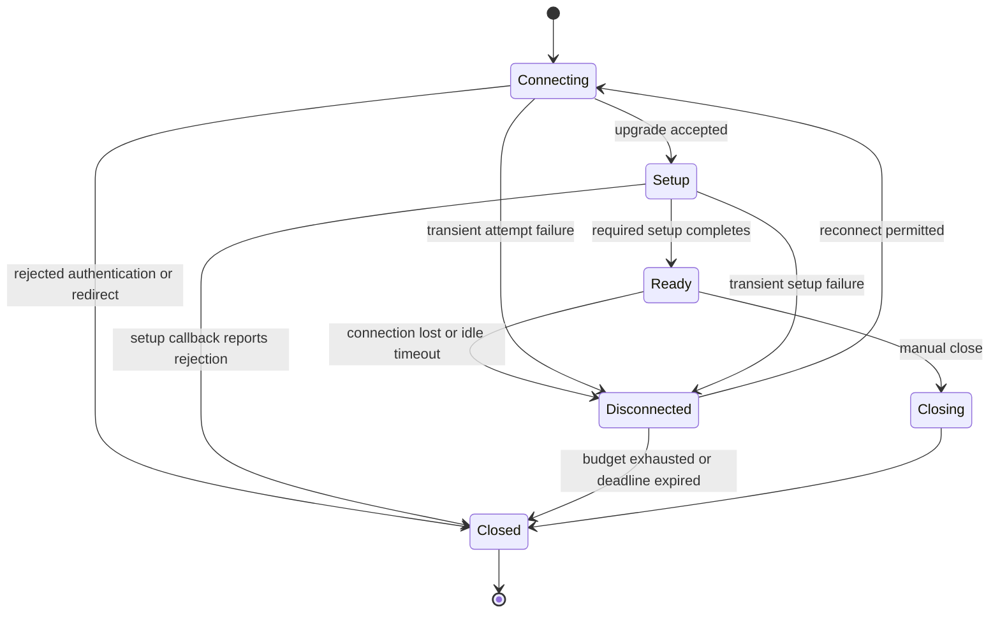

---
$schema:
    status: |-
        enum(
            draft-spec,
            finalized-spec,
            planned,
            implemented,
            review-findings,
            human-in-the-loop,
            completed,
            on-hold,
            abandoned
        ) -> an indicator of progress for this specification
    reviewed: boolean -> indicates whether the specification file has been reviewed by another agent from the one which created the spec
    reviewed_by: string -> the agent and model used in the spec review
    reviewed_on: date -> the date the spec was reviewed
    review_iterations: number -> the number of implementation reviews have taken place in the review/fix cycle
    clarified: boolean -> indicates whether the specification was built -- _in part_ -- with the 'clarify.md' prompt
    implemented: boolean -> indicates whether this spec's plan has been implemented
    implemented_by: string -> the agent who implemented the plan
status: draft-spec
reviewed: true
reviewed_by: codex/gpt-6.1-sol
reviewed_on: 2026-10-11
review_iterations: 0
clarified: false
implemented: false
human_review: false
message_to_agent: ''
parent: ../../reviews/2026-07-31-macro-review/spec.md
depends_on:
    - 2026-10-16-schematic-response-model-graphql
refresh_required: true
related: []
next_spec: 2026-10-18-schematic-fidelity-polish
---

# Schematic WebSocket

This draft is a child specification of the review identified by
`2026-07-31-macro-review`; the `parent` frontmatter names that review.
It covers the WebSocket stage of the eight-specification sequence. It must be
refreshed after the preceding response-model specification's first human
review and before implementation (see "Refresh notes"). The dependency chain
also supplies generation validation, shared runtime services, and the REST
definition vocabulary that this work reuses.

Requirement labels such as **R5** are lookup labels in "Requirements" below.
Decision labels such as **D11** identify settled author decisions in the parent
review's section 15; each decision used here is described in words. Planning
item numbers refer to "Planning-time details assigned to this spec". They are
not substitutes for the behavior stated here.

> **Reader's note from the inline review, 2026-10-11.** Reusing REST building
> blocks is intentional; combining REST and WebSocket definitions is not.
> This review fills in connection-state, credential-placement, parameter,
> host-role, and migration contracts. "Open Questions" identifies the larger
> choices that need an author decision before the affected implementation.
> It withdraws one draft default as unsafe (declaration-order decoding);
> its recommendations are proposals, not decisions.
>
> *Update, 2026-10-11 (D57).* The author ruled the three Open Questions by
> adopting the recommended options: declared message selectors (D57 item 19),
> a typed setup callback for message-based authentication (D57 item 20), and
> caller-managed heartbeats documented in rustdoc, without a
> generation warning (D57 item 21, as revised). The rulings are
> written into R3, R10, R13 and Design below.

## Problem

Schematic generates a Rust WebSocket client and a server-side "host" for
each of five WebSocket API definitions. The transport already has a supervisor loop, request/response correlation,
and backoff, but the generated
clients are wrong or inert in the ways listed below, and the definitions are
five dialects of the same vocabulary. Facts below come from the parent
(sections 8 and 10, ledger rows 3 and 9 to 12) and were re-checked against the
tree on 2026-10-11 where marked **verified**; everything else is the
parent's July evidence and is marked **parent**.

1. **Wrong URL (ledger row 3).** The Unfolded Circle Core definition sets
   `base_url: "ws://remote.local/ws"` and its first endpoint `CoreWs` has
   `path: "/ws"`, so the client connects to `ws://remote.local/ws/ws`
   (**verified** in `schematic/definitions/src/unfolded_circle/core_ws/mod.rs`,
   lines 144 and 182). The same definition's other endpoints use `/intg` and
   `/profiles` (**verified**), so they inherit the same base-URL error in a
   different form. The [official Core WebSocket definition](https://raw.githubusercontent.com/unfoldedcircle/core-api/main/core-api/websocket/UCR-core-asyncapi.yaml)
   (version `0.45.0-beta`, reviewed 2026-10-11) lists `/ws`, `/intg`, and
   `/profiles` as separate channels. Keep those endpoint paths and make the
   base URL the origin. Do not add `/ws` to the other two paths.
2. **Reconnect counter never resets; lifecycle open never re-sent (row 9).**
   In the generated supervisor the attempt counter is set to zero only for the
   first stream and is incremented after a *successful* redial, so the
   supervisor gives up after N lifetime reconnects, not N consecutive
   failures (**verified** in `schematic/gen/src/ws_codegen/client.rs`, around
   lines 636 to 682). The state is set to `Ready` straight after a redial and
   the lifecycle open message is not re-sent, so a "reconnected" stream can be
   protocol-dead while reporting `Ready` (**parent**). The current client
   template exposes opening-message helpers but sends no automatic opening
   payload on the initial connection either (**verified**); the lifecycle
   requirement below therefore specifies initial setup as well as replay.
3. **Dormant `E0308` in the Bearer host template (row 10).** The Bearer branch
   of the generated host's auth check ends an `else` arm with a trailing `;`
   after `Err(...)`, so the arm yields `()` against a `Result` tail
   (**verified** at `schematic/gen/src/ws_codegen/shared.rs`, around lines 526
   to 534). It survives because `validate_code` is grammar-only and the unit
   test asserts substrings (**parent**). It is dormant because none of the five
   shipped definitions emits a Bearer host (**parent**).
4. **Env auth never applied (row 11).** The generator emits an `EnvMapping`
   (**verified**, `client.rs` around line 154) but connect-time header
   building never consults it, so no generated client sends an
   environment-derived credential, while the Dock module's docs advertise
   `UCR_DOCK_TOKEN` (**parent**).
5. **Diagnostics discarded (row 12).** `lower_to_plan` returns
   `Result<WsRuntimePlan, GeneratorError>` and the plan carries
   `WsDiagnostic { severity, path, message }` values with severities
   `Info`, `Warning`, `Error` (**verified**, `plan.rs`). The assembler does
   `Err(_) => return None` (**verified**, `schematic/gen/src/output/ws_modules.rs`
   around line 123), so a failing definition yields no file and no message, and
   the plan's diagnostics are never printed.
6. **`receive_timeout` accepted and ignored.** `WsClientOptions` exposes it;
   the supervisor reads it into an unused variable behind a `TODO`, and the
   planner pushes an `Info` diagnostic saying so (**verified**,
   `client.rs` around line 617 and `plan.rs` around line 471).
7. **Typed messages computed, never emitted.** The plan holds the client,
   server and bidirectional message lists, but the generated surface is
   `send(serde_json::Value)` and `next_event() -> Option<Result<Value, _>>`
   (**parent**).
8. **Name-matching instead of a declared link.** Correlation is inferred when
   an endpoint has messages literally named `RequestEnvelope` and
   `ResponseEnvelope`, with the field names `id` and `req_id` hard-coded
   (**verified**, `plan.rs` lines 188 to 206). `CorrelationHints` and
   `HeartbeatHints` have no users (**parent**), so Samsung's declared
   `RequestIdType::String` is dead.
9. **Forked vocabulary.** `WebSocketApi` already reuses the REST
   `AuthStrategy` (**verified**), but connection parameters are a
   WebSocket-only pair `ConnectionParam` / `ParamType` (**verified**,
   `schematic/define/src/websocket/params.rs`) instead of the REST `ParamDef`,
   the REST `EnvMapping` and header types are not used by the definition, and
   `env_auth: Vec<String>` is a second source of truth. The five definitions
   disagree with each other: identical auth handshakes are prose in one module
   and `AuthFlowHints` in its sibling, and `integration_ws` marks all six
   messages `Bidirectional` to trip a generator heuristic, with a test
   asserting the contortion (**parent**).
10. **Unfolded-Circle assumptions baked into the generic host.** The host
    generator emits a struct literally named `UnfoldedCircleEventHub` for
    every host and answers authentication with a fixed
    `authentication_success_response()` (**verified**,
    `schematic/gen/src/ws_codegen/host.rs`). The homelab consumers
    of these names are `homelab/lib` (`src/samsung_tv.rs`, the Samsung
    WebSocket client) and the four integration crates `eversolo-integration`,
    `arcam-amp-integration`, `sony-receiver-integration` and
    `unfolded-integration-helper` (the last consumes
    `unfolded_circle_integration_ws`); `homelab/cli` and `homelab/server` have
    none (**verified** by grep, listed in R15).

One parent claim did not hold when checked: the parent says ElevenLabs'
WebSocket types "do not use `schematic_define` at all". In the tree, the
ElevenLabs WebSocket *definition* **does** use `schematic_define::WebSocketApi`
(`schematic/definitions/src/elevenlabs/mod.rs`, line 189; **verified**). Only
the *message payload types* are standalone types that do not use
`schematic_define`. The implementer confirms the payload-type finding (see
R13) and logs it.

## Goal and non-goals

**Goal.** Make the generated WebSocket clients correct and honest: right URL,
a supervisor that recovers repeatedly and replays its opening message,
connect-time credentials resolved by the shared runtime rules, enforced
timeouts, loud diagnostics, typed message enums, an explicit declared
response link, and one shared vocabulary for parameters, auth, env mapping and
headers across the five definitions and the homelab consumers.

**Non-goals** (each is decided or deferred elsewhere):

- Full REST/WebSocket unification under one definition type is **rejected**
  (D8). `WebSocketApi` stays its own type with its own generator.
- The AsyncAPI **exporter** is spec 7 (D47). This spec must not break the
  existing AsyncAPI *importer* (`schematic/gen/src/asyncapi_import.rs`), but
  does not extend it.
- No contact with real devices or real providers. Every test uses a local mock
  WebSocket server.
- No change to REST definitions, the REST generator, pagination, or the
  response model (specs 1 to 5).
- No redesign of the WebSocket transport core (supervisor structure,
  correlation machinery, backoff curve) beyond the fixes listed.
- Hooking a WebSocket into HTTP-only features (shared deadline for a long-lived
  socket, pagination, redirect following) is out of scope unless a requirement
  below names it.

## Background: decisions this spec implements

Restated in full so the implementer does not need the parent. Provenance is
the parent spec named in the frontmatter, section 15 unless noted.

- **D8. WebSocket extent: fixes plus shared building blocks.** Fix the
  defects (wrong URL, reconnect counter reset, lifecycle replay, env auth,
  dropped diagnostics, the dormant Bearer-template compile error). Emit the
  typed message enums. Replace the `RequestEnvelope` string match with an
  explicit link. Make WebSocket reuse the REST parameter, auth-policy,
  env-mapping and header types, replacing `ConnectionParam`/`ParamType`.
  `WebSocketApi` stays its own type with its own generator, and the five
  definitions are normalized. Rejected: full REST/WS unification under one
  definition type, for this work.
- **D46. Stage order.** WebSocket is landing 3 and follows REST vocabulary
  (landings 1 and 2); fidelity and polish (spec 7) follows it.
- **D47 (boundary only).** The AsyncAPI exporter is in landing 4, after
  WebSocket reuses the REST types. It is not part of this spec.
- **D50 (spec 6 line).** "WebSocket. D8, D46. Independent of REST internals
  once spec 4 lands." Each spec leaves the whole repo green on macOS, Linux,
  native Windows and WSL2 and ends at "implementation complete, ready for
  review"; an agent never moves a spec to `_completed`.
- **D51.** The per-spec process, restated under "Process".
- **D11 (credentials), as it applies to connection setup.** Precedence is per
  call, then client level, then environment policy, then anonymous. The
  environment policy scans the definition's ordered list of variable names
  once before sending, selects the first non-empty variable, and sends exactly
  that one credential. There is a single attempt: no chain of different keys,
  no retry, no silent anonymous retry if the credential is rejected. Every
  result reports the auth method used (per call, client level, the variable's
  name, or anonymous), never the value.
- **D48 and D40 (redaction), as they apply to connection setup.**
  `AuthMethod = PerCall | ClientLevel | EnvVar(name) | Anonymous`, never a
  value. Built-in secret names: headers `Authorization`, `Proxy-Authorization`,
  `Cookie`, `Set-Cookie`, `X-Api-Key`, `X-Auth-Token`, `Api-Key`; query
  parameters `api_key`, `apikey`, `access_token`, `token`, `key`, `signature`.
  Secrets are marked from auth strategies (for example an `ApiKeyParam` name),
  by an explicit `.secret()` marker, and by the built-in list. Redacted values
  show `[redacted]`.
- **D23 (URL in error text), as it applies to connection setup.** Error text
  may include the URL, composed from Schematic's redacted URL, and never a raw
  query-string secret.
- **D28 and D31 (cross-origin and managed transport), as they apply to the
  handshake.** Credentials attach only to an allowed origin; the default is
  `same_origin`; Schematic follows redirects itself according to the policy.
  For a WebSocket handshake the author ruled (D56, 2026-10-11): the client
  never follows a redirect; a 3xx upgrade response is an error with the
  `Location` header visible (R7, planning item 8). **Decided.**
- **D56 (author rulings, 2026-10-11), as they apply here.** (a) No credential
  resolving is not an error: the connect call proceeds anonymously and reports
  `Anonymous`, exactly as REST does (D11 literally). (b) The runtime trait is
  `EndpointSpec`. (c) Any per-call override that tightens a shared setting
  uses the simple subset rule (D56-2). (d) Under a deadline, per-request time
  is `min(remaining, per-request timeout)` (D56-3).
- **D57 (author rulings, 2026-10-11), as they apply here.** (19) Inbound
  messages are selected by selectors declared on existing wire fields
  (`.matches("kind", "resp").matches("msg", "pong")`), with at most one
  `.fallback()` message per direction; untagged declaration-order decoding is
  not used, and the AsyncAPI exporter serializes the selectors. (20) An
  endpoint with a challenge flow takes a typed setup callback
  (`connect_with_setup(opening, |session| async { .. })`) that runs on every
  dial, including redials, before the client reports `Ready`. (21) Heartbeats
  are caller-managed and documented in the generated client's rustdoc (no
  generation warning), and the exporter keeps the metadata.
  (24) The endpoint role (`Client`, `Host`, `Both`) introduced here is exported
  as `x-schematic-role` on the AsyncAPI channel and is part of the round-trip
  equality owned by `2026-10-18-schematic-fidelity-polish`.
- **D39.** The shared runtime lives in a hand-written package (working name
  `schematic-runtime`; spec 2 fixes the final name, which this spec uses
  verbatim). Generated clients depend on it and stay thin.
- **D15 / D2 / D44 (vocabulary context).** REST definitions are built with
  builders and typed registration after spec 4. WebSocket reuse must follow
  whatever shapes spec 4 left (see "Refresh notes").

## Requirements

Each requirement is testable. "Mock server" means a local WebSocket server
bound to `127.0.0.1` on an ephemeral port, started inside the test (see
"Design" for the harness). None of these tests may open a window or take
focus; they use no terminal. Test levels follow the `rust-testing` skill: L1
runs under `just test`; L2 under `just test-l2` and must never take window
focus.

### Defect fixes

**R1. Core WebSocket URLs are correct.** After the change the generated
client for `unfolded_circle_core_ws` builds `ws://remote.local/ws` for the
`CoreWs` endpoint (not `.../ws/ws`), and each other endpoint's URL equals the
URL documented for the Unfolded Circle Core API. A generator validation
emits a Warning diagnostic only when a `base_url` path ends with a segment
that is exactly equal to the endpoint path's first segment (an exact
duplicated path segment, such as `/ws` plus `/ws`). It never rejects by
substring or prefix, and never produces an Error, because repeated segments
alone are not proof of a bad URL (a legitimate `/api/api` path exists; parent
D10 and generation-integrity R11).
Validated by: L1 unit test in `schematic-definitions` asserting
`base_url` and each endpoint `path`; L1 test in `schematic-gen` asserting the
composed URL for all endpoints of all five definitions; L1 test in
`schematic-gen` that a fixture definition with an exact duplicated segment emits
the Warning, and that a base path that merely contains or prefixes an
endpoint segment as a substring (for example `/api` and `/apikeys`) emits
nothing; L1 mock-server test in `schematic-schema` connecting the
generated client to the mock and asserting the request target the server saw.

**R2. The reconnect attempt counter counts consecutive failures.** The
supervisor resets its attempt counter to zero after every successful
dial and required opening-message write. The initial dial is separate from
the reconnect budget; `Some(0)` disables redials, `Some(n)` permits at most
`n` consecutive failed redials, and `None` imposes no attempt limit. `max_attempts` therefore bounds consecutive failed attempts, not
lifetime reconnects. With `max_attempts = 2`, a mock server that accepts a
connection and then drops it five times in a row, and accepts each redial,
does not stop the supervisor; a mock server that refuses two consecutive
redials does stop it, and the connection state becomes `Closed`.
Validated by: L1 mock-server test in `schematic-schema`
(`schematic/schema/tests/ws_runtime.rs` or a sibling file).

**R3. The lifecycle open message and setup callback are re-run on every
reconnect.** If an
endpoint declares a lifecycle open message, the supervisor sends it after each
successful redial and before publishing state `Ready`. If the open message
cannot be written, the attempt counts as a failed attempt (R2 semantics), the
state is not `Ready`, and an error event is delivered to the caller. The same setup runs on the initial
connection. A schema describes a payload type, not an actual payload: the
connect call takes the endpoint's typed opening payload when one is declared,
retains its serialized form privately, and reuses it on redial. It never
constructs an arbitrary default payload. Endpoints without an opening message
need no payload. A later explicit opening-message helper does not silently
replace the retained payload or cause an extra automatic send.
**Message-based authentication (D57 item 20).** An endpoint with a challenge
flow takes a typed setup callback, `connect_with_setup(opening, |session|
async { .. })`, that runs on every dial, the initial one and each redial,
before the client reports `Ready`. `Ready` therefore means the protocol
session is usable, not only that the upgrade completed. Credentials are
resolved by the shared runtime (R5) before the callback runs, and the whole
setup (opening write and callback) is bounded by the same per-attempt timeout.
Flows stay per endpoint. A rejection reported by the callback is terminal,
with no alternative-key or anonymous fallback; a transient setup failure counts
against the R2 budget. Missing credentials still permit an anonymous upgrade
(R6); a subsequent protocol rejection is reported, not bypassed. An opening
payload containing an auth field must not become a second independent
credential source; the plan states whether that field is filled from the
resolved credential or rejected on conflict, and logs the choice.
Validated by: L1 mock-server test: the server records the first text frame
after each of three connections and asserts it is the open message each time;
a second case where the server closes during the open write; a
challenge-success-redial test in which, after a forced redial, the setup
callback runs again and completes its exchange before `Ready` is observed; a
challenge-failure test (terminal, one exchange, no retry or anonymous
fallback); and a setup stall bounded by the attempt timeout.

**R4. The Bearer host template compiles.** The generated host module for a
Bearer-authenticated WebSocket API compiles and its auth check returns
`Ok(response)` for a matching bearer token and an `Err` response with status
401 for a missing or wrong token. The existing substring-asserting unit test
is replaced or supplemented by a compile test.
Validated by: L1 test in `schematic-gen` that generates a host module from a
fixture `WebSocketApi` with `AuthStrategy::BearerToken` into a temporary
crate and compiles it (use the isolated fresh-output compile check from spec
1 if it is reusable; mark the test `slow_` per the testing guide if it is
slow); L1 mock-server test connecting an unauthenticated and an authenticated
client to the generated host.

**R5. Connect-time credentials follow the shared precedence.** The
runtime-envelope spec owns the precedence rules, redaction and the managed
builder; this requirement applies them to the handshake. Each generated
WebSocket client resolves its handshake credential once, before dialing, in
this order: per-connect-call value, client-level value, environment policy
(the first non-empty variable in the declared ordered list, from the
definition's `EnvMapping`), anonymous. Exactly one credential is sent. A
rejected handshake (HTTP 401 or 403 on upgrade) is not retried with another
credential or anonymously. The client reports the auth method used through an
accessor returning `AuthMethod`; it never exposes the value.
Placement follows the definition's `AuthStrategy`: Bearer and API-key to a
header, `ApiKeyParam` to its declared query **or cookie** location, Basic to the
`Authorization` header using the shared resolver's username/password rules.
A cookie key is merged with existing cookies without duplicating its name.
An effective policy selecting `AuthStrategy::None` does not attach an
environment credential.
Use the retained REST `AuthPolicy` to select one method; do not send every
method it lists. Resolve once per explicit connect operation and retain that
choice for its redials; environment changes require a new explicit connect.
A 401, 403, or refused redirect during a redial closes the supervisor without
another attempt. Transient dial failures use the reconnect budget.
Validated by: L1 mock-server tests in `schematic-schema` with sentinel
tokens set at every level (the server sees exactly one credential, in the
stated order; removing the winner makes the next level win); a 401 case
asserting the server received exactly one upgrade request; one test per auth
strategy asserting placement (header, query, or cookie); Basic credentials
remain one selected username/password pair under the shared resolver; changing
the environment after connecting does not change a redial credential; a 401
on redial is terminal and produces only one rejected upgrade.

**R6. No resolvable credential connects anonymously.** (Decided, D56; REST
and WebSocket behave the same.) If the definition's auth strategy is not
`None` and no credential resolves at any level, `connect_*` proceeds without
an auth header or query credential and reports `AuthMethod::Anonymous`. It
does not fail before dialing. If the server rejects the anonymous handshake,
the rejection arrives as the handshake error carrying the HTTP status and
response headers (no retry, per R5). No public explicit-anonymous option is
added by this spec; a way to state anonymous explicitly exists only if the
managed builder from the runtime-envelope spec already provides one, and then
this spec passes it through.
Validated by: L1 mock-server test: an authenticated API with no credential at
any level connects and the server sees an upgrade request with no auth header
and no credential query parameter, and the client reports `Anonymous`; L1
mock-server test: a server that answers the upgrade with 401 yields a
handshake error exposing status and headers, and the server saw exactly one
upgrade request.

**R7. Secrets never leak from connection setup; the handshake never leaves
its origin.** (Never following a redirect is Decided, D56; it is
stricter than the `same_origin` policy.) The sentinel credential value appears in no `Display` or
error text, no logged URL, and no stored diagnostic metadata of the WebSocket client.
Credentials and serialized opening payloads must exist privately to perform
reconnects; that required storage is excluded from the metadata promise.
Their `Debug` output is redacted. The promise concerns Schematic-controlled
metadata and formatting, not arbitrary caller payloads or server text that
happens to echo a secret. This matches the shared runtime's redaction boundary.
It applies to query and cookie API keys, refused connections, and stalled
handshakes. The handshake follows no redirect: a
3xx upgrade response is an error naming the status with the `Location` header
visible through shared redaction (including secrets in its URL), no second request is made, and no credential reaches any other origin (the mock "other origin"
records zero requests).
Validated by: L1 mock-server tests with a sentinel in the query string:
connection refused (closed port), handshake stall past the timeout, and 302
to a second mock server; assertions on error text, `Debug`/`Display` of
client options, and the second server's request count. Note the parent's D22
carve-out: only Schematic's stored metadata and `Display` are guaranteed
credential-free; a server-echoed value in a body is not covered.

**R8. `receive_timeout` is enforced.** When `WsClientOptions.receive_timeout`
is `Some(d)`, the supervisor treats `d` of inbound silence (no frame of any
kind, including ping and pong) as a lost connection: an error event
`ReceiveTimeout` is delivered and the reconnect policy applies. With `None`
nothing changes. The planner no longer emits the "not yet enforced"
diagnostic.
Validated by: L1 mock-server test with a server that sends one frame and goes
silent (assert the error event and a redial); a case where periodic pings keep
the connection alive past `d`.

**R9. Plan diagnostics are surfaced through the shared diagnostics
mechanism.** The generation-integrity spec owns the diagnostics format, the
severities, the two-phase writer and the per-output validation; this spec
defines none of its own. Every `WsDiagnostic` produced while lowering a
definition (including a `lower_to_plan` `Err`) is mapped onto that format
(API, path, message, severity) and reported through it. Whether an Error
blocks writes, and what happens to the other outputs and to existing files, is
decided by that spec's writer and its per-output validation, and the WebSocket
output reuses them unchanged; this spec adds no "fail before any write" rule of
its own. Info diagnostics follow that spec's verbosity rule.
Validated by: L1 test in `schematic-gen` with a fixture definition that
produces an `Error` (for example a duplicate message name or an unresolved
`responds_with`): asserts the diagnostic appears in the shared format with the
right severity and that the shared writer's behavior for an Error applies; L1
test that a Warning is reported and does not fail generation; L1 test that a
`lower_to_plan` failure is no longer swallowed (`Err(_) => return None` is
gone).

### Typed messages and the declared response link

**R10. Typed message enums are emitted and used.** For each endpoint the
generator emits an inbound enum (messages with direction `Server` or
`Bidirectional`) and an outbound enum (`Client` or `Bidirectional`), with one
variant per `MessageSchema` named after `MessageSchema.name` and carrying the
payload type that the message's `Schema` names. The generated client's primary
surface becomes typed: `send(outbound)` and `next_event()` yielding the
inbound enum (a decode failure yields an error event carrying the raw text;
the connection continues). The untyped surface remains as an explicit escape
hatch (`send_value(serde_json::Value)`, `next_value_event()`). The name
deliberately differs from REST `send_raw` (D45), which has different semantics
(it returns status, headers and bytes); the names are a Proposed default. Lifecycle messages (open, close, keepalive) remain
separate and are not variants. Enum serialization writes only the payload,
with no generated variant wrapper or extra discriminator on the wire.
`events()` uses the same typed decoding as `next_event()`; an explicitly named
value-stream counterpart is retained. Typed and value receive methods consume
one shared queue: each incoming application message is delivered once, with
no implicit broadcast or second subscription. Empty directional message sets
produce an uninhabited enum and still compile. Derives must respect payload
capabilities; do not require `Eq` or `Clone` that a payload does not implement.
JSON text and JSON binary framing remain distinct. Unsupported raw-binary or
mixed framing must produce a named generation diagnostic under the shared
validation rules rather than silently encode bytes as JSON. Binary decode
errors retain bytes instead of claiming to retain text.
**Message selection (D57 item 19).** Messages declare selectors on existing
wire fields, for example `.matches("kind", "resp").matches("msg", "pong")`,
with at most one `.fallback()` message per direction. An inbound frame is
matched against the selectors once, before its payload is decoded, and is
decoded only as the message its selector names; a frame matching no selector
goes to the direction's fallback, or, with no fallback, yields the
decode-failure error event. Untagged declaration-order decoding is not used,
and no new wire tag is added. Validation (Error): more than one fallback in a
direction; conflicting selectors in a direction (at least identical ones);
in a direction with more than one inbound message, a non-fallback message with
no selector. Selectors are part of the definition's serialized form so the
AsyncAPI exporter in `2026-10-18-schematic-fidelity-polish` can export them.
Validated by: L1 generated-output assertions in `schematic-gen` (variant
names and directions); L1 compile-fail test (trybuild or the repo's existing
compile-fail pattern) that sending a value of the wrong type does not
compile; L1 mock-server test decoding every inbound message type of each of
the five definitions from a recorded fixture frame and asserting the selected
variant, not only that decoding succeeded; L1 test that overlapping fixtures
(for example a Core pong that would also decode as the generic response)
decode to the variant their selectors name, and that a frame matching no
selector reaches the fallback; L1 plan tests for each selector Error; L1 test
that a malformed frame yields the error event with raw text and does not
close the connection.

**R11. An explicit `responds_with` link replaces the string match.**
`MessageSchema` gains `responds_with: Option<String>`: on a request message
(direction `Client` or `Bidirectional`), the name of the message, in the same
endpoint, that answers it. The generator pairs request and response only
through this link and the endpoint's `CorrelationHints` (the current API-level runtime hints have
no correlation field; this spec adds no API-level fallback). No code compares a
message name to `"RequestEnvelope"` or `"ResponseEnvelope"`. The hint-less
inference of field names `id` and `req_id` is removed; the definitions that
relied on it declare `CorrelationHints` explicitly with the same values.
Where correlation is active, the declared `RequestIdType` is honored: with
`RequestIdType::String` the generated request ids are JSON strings, with
`U64` JSON numbers. Validation (Error): `responds_with` is set on a server-only message, names no message in
the endpoint, names a message whose direction cannot be received, or is set
with no endpoint `CorrelationHints`. Validation (Warning): a
explicitly declared `RequestIdType` or `CorrelationHints` that nothing consumes.
An implicit default ID type on an uncorrelated endpoint produces no Warning.
Validated by: L1 test in `schematic-gen` that the source tree contains no
string literal `"RequestEnvelope"`/`"ResponseEnvelope"` in the planner (a
grep-style test over `plan.rs`, acceptable here because the property is
absence); L1 plan tests for each Error and Warning; L1 mock-server test of a
correlated request in which the server echoes the id and the test asserts the
JSON type (string versus number) the server received; L1 test that renaming
the envelope messages in a fixture does not change correlation.

### Shared vocabulary and normalization

**R12. WebSocket reuses the REST parameter, auth, env-mapping and header
types.** `schematic_define::websocket::ConnectionParam` and `ParamType` no
longer exist in the public API. `WebSocketEndpoint` uses
REST `ParamDef` values in location-aware parameter containers, preserving
parameter location and typed path parameters as specified under Design. `WebSocketApi` declares authentication with the REST
`AuthStrategy`, `EnvMapping` (explicit field, not derived at generation time
from `env_auth`), and the REST header type for constant handshake headers.
It carries the retained REST `AuthPolicy`, as already decided by the author
and restated in the definition-API and definition-vocabulary specifications. `env_auth` follows whatever spec 4 did to the REST
equivalent (retirement of `env_auth[0]`-as-password).
Validated by: L1 compile-level check in `schematic-define` (a doc-test or
trybuild case showing the old names do not resolve through
`schematic_define::websocket`); L1 tests that the five definitions build and
that `lower_to_plan` succeeds on each; L1 serde round trip of a
`WebSocketApi` (the type derives `Serialize`/`Deserialize` today); a
compile-time or unit check asserting that `ParamDef`, `QueryParamType` and
`ParamStyle` implement `Serialize` and `Deserialize` (the derives are owned by
the definition-API spec, 4a; this spec asserts them and does not add them).

**R13. The five definitions are normalized onto the shared vocabulary.** All
five (`unfolded_circle` core and dock, Samsung remote, `integration_ws`,
ElevenLabs) declare: connection parameters as `ParamDef`; auth as
`AuthStrategy` plus `EnvMapping`; handshake challenge flows with
`AuthFlowHints` (never as prose only); message directions that are true to
the protocol (no `Bidirectional` used to trip a heuristic, and the test that
asserts that contortion is removed or rewritten to assert the true
directions); explicit endpoint roles that preserve required hosts; correlation with explicit `CorrelationHints` and `responds_with`
where the protocol correlates, and nothing where it does not; and heartbeat
with `HeartbeatHints` where the protocol has one. The ElevenLabs *definition* already
uses `schematic_define::WebSocketApi`. Its payload structs remain ordinary
Serde payload types, just as the other APIs' payloads do; register or resolve
them through the shared schema mechanism without making them definition types.
Declaring hints is not evidence that the generated runtime honors them. The
challenge exchange itself is performed by the setup callback (R3, D57 item
20), not driven by the hints. Application heartbeats are caller-managed (D57
item 21): declared `HeartbeatHints` are kept as metadata (the AsyncAPI
exporter keeps them on export) but the client does not schedule them and no
generation warning is produced. The generated client's rustdoc states each
declared heartbeat (interval and expected message) so callers know to send it. The receive timeout (R8) and control-frame pongs are
unaffected.
Validated by: L1 definition-conformance test in `schematic-definitions`
iterating all five and asserting the rules mechanically (no prose-only auth
flow; every `responds_with` resolves; assert each role and message direction
against a per-definition expected table kept in the test; do not try to infer
author intent solely from `Bidirectional` values); L1 plan test that a
definition declaring `HeartbeatHints` generates with no warning and its
client rustdoc names the heartbeat interval and message.

**R14. The generated host carries no Unfolded Circle assumptions.** The host
module's event hub is named from the API (`{ApiName}EventHub`, where
`{ApiName}` is the PascalCase API name the generator already uses for client
and host struct names), not the literal `UnfoldedCircleEventHub`. The host no
longer sends a hard-coded Unfolded Circle authentication success envelope:
post-authentication behavior is a handler hook (see Design), implemented in
the Unfolded Circle integration crates, not in the generator.
Validated by: L1 generated-output test in `schematic-gen` over a non-Unfolded
fixture definition: no `UnfoldedCircle` string appears in its host module;
L1 mock-server test: a client authenticates to a generated host whose handler
returns a custom post-auth message and receives exactly it, and a handler that
returns none sends no extra frame. The hook runs once per successfully
authenticated connection, after authentication and before application traffic;
failed authentication never invokes it. Multi-endpoint hosts use
endpoint-specific hook methods so their outbound types remain unambiguous. A hook write failure closes that
connection and is reported. Host inbound messages use the client-message enum;
host outbound messages use the server-message enum.

### Dependents, harness and documentation

**R15. Homelab consumers are migrated and every dependent builds.** These
consume the generated WebSocket modules and are migrated in this spec:
`homelab/lib` (`src/samsung_tv.rs`, which imports
`schematic_schema::samsung_smart_tv_remote_ws`) and the four integration
crates `homelab/eversolo-integration`, `homelab/arcam-amp-integration`,
`homelab/sony-receiver-integration` and `homelab/unfolded-integration-helper`
(consumer of `unfolded_circle_integration_ws`). `homelab/cli` and
`homelab/server` have no WebSocket client consumers (**verified**) and are not
migrated. Each migrated package builds and its tests pass. `sniff`,
`biscuit-speaks` and `model-citizen` (path dependents of `schematic-schema`)
still build and pass their tests.
Validated by: `just test {pkg}` from the repo root for each named package
area on the current host; a grep-based L1 or script check that the removed
names (`UnfoldedCircleEventHub` as a generated name, `ConnectionParam`,
`ParamType`, untyped `send(Value)` as the primary surface of generated WS
clients) no longer appear in non-generated source.

**R16. The mock-server harness exists and is focus-safe.** A reusable test
helper starts a loopback WebSocket server on port 0 that can: record upgrade
requests (path, query, headers), script per-connection behavior (accept, drop
after N frames, refuse, stall, redirect, send frames), count connections, and
shut down deterministically. It is used by every mock-server requirement
above. It binds only to `127.0.0.1`, uses no fixed port, needs no terminal and
no external network, and no test it supports takes window focus. Tests that need no
terminal are L1; there is no L2 test in this spec unless the implementer finds
one is required (then it follows the L2 focus rule and is logged).
Validated by: the harness's own L1 tests (records a request, scripted drop,
port 0 reuse safety); the CI parity rule that tests pass on macOS, Linux,
Windows and WSL2 (no Unix-only sockets, no fixed ports, no reliance on
timing under 100 ms margins without a tolerance; see the `os` skill).

**R17. Generated output, docs and skills are current.** `schematic-schema` is
regenerated with the generator, never hand-edited, and `just lint-schema`
passes. The `schematic` README, the relevant `schematic/docs` topic pages,
and the affected `.claude/skills` entries (`schematic-define`, `homelab`,
`unfolded-circle`, and any that describe the WebSocket surface) describe the
new behavior; docs do not link to or name this spec.
Validated by: `just lint-schema`; the repo's drift check
(`artifact_drift`, run through nextest with the required ignored-test filter;
do not use the existing `just check-drift` recipe while it invokes `cargo test`); a manual
pass recorded in the log listing each doc and skill touched.

## Design

Marked **Decided** only where the parent decided it; everything else is
**Proposed** and is the default adopted and logged by the implementer.

| Symbol | Package | What it does | Status |
|---|---|---|---|
| `WebSocketApi` (fields) | `schematic-define` | Gains `env_mapping: Option<EnvMapping>`, constant handshake `headers` (REST header type), and the retained REST `auth_policy`; `env_auth` follows REST. Keeps `auth: AuthStrategy`. Stays its own type. | Own type: Decided (D8). Field set: Proposed |
| [`WebSocketEndpoint` parameters](../../define/src/websocket/mod.rs) | `schematic-define` | Reuse REST parameter types with location and defaults preserved; see Design. | Shared types: Decided (D8). Container shape: Proposed |
| [`ConnectionParam`, `ParamType`](../../define/src/websocket/params.rs) | `schematic-define` | Removed from the public API. | Decided (D8) |
| `ParamDef` serde | `schematic-define` | `ParamDef`, `QueryParamType`, `ParamStyle` derives are owned by spec 4a (they derived no serde traits when checked). This spec only asserts they exist (compile-time or unit check) because `WebSocketApi` derives `Serialize`/`Deserialize`; it does not add them. | Owned by 4a; assertion Proposed |
| `MessageSchema::responds_with` | `schematic-define` | Optional name of the answering message (R11). | Link: Decided (D8). Name and shape: Proposed |
| Message selectors (`.matches(field, value)`, `.fallback()`) | `schematic-define` | Declared on existing wire fields; at most one fallback per direction; serialized with the definition (R10). | Decided (D57 item 19). Validation details: Proposed |
| `CorrelationHints`, `RequestIdType`, `HeartbeatHints`, `AuthFlowHints` | `schematic-define` | Existing hint types; correlation is consumed. The challenge exchange runs in the setup callback, not from the hints (D57 item 20). `HeartbeatHints` are kept, not scheduled, and documented in the client rustdoc with no warning (D57 item 21). Other unsupported declarations warn or error under the shared validation rules. | Heartbeat documentation: Decided (D57 item 21). Rest: Proposed |
| `WsDiagnostic`, `WsSeverity` | `schematic-gen` | Existing; gain an `api` field (API name) if needed, and are mapped onto the generation-integrity spec's diagnostics format. No WebSocket-specific format. | Proposed |
| `lower_to_plan` | `schematic-gen` | Collects all diagnostics (not only the first error), returns them with the plan or the failure. | Proposed |
| `ws_modules` assembler | `schematic-gen` | Propagates `Err`; reports diagnostics through the shared mechanism; reuses the generation-integrity spec's two-phase writer and per-output validation. | Proposed |
| Message enum emitters | `schematic-gen` (`ws_codegen/client.rs`) | Emit `{Endpoint}ServerMessage` and `{Endpoint}ClientMessage`, select by declared selectors before decoding (D57 item 19), with the raw frame retained for the error path. | Selection: Decided (D57 item 19). Rest: Proposed |
| Supervisor loop template | `schematic-gen` (`ws_codegen/client.rs`) | Reset-on-success counter, open replay and setup callback before `Ready`, idle receive timeout. | Behavior: Decided (D8 defect list; setup callback D57 item 20). Details: Proposed |
| `connect_with_setup(opening, \|session\| async { .. })` | `schematic-gen` (`ws_codegen/client.rs`) | Typed setup callback for endpoints with a challenge flow; runs on every dial, including redials, before `Ready` (R3). Ownership and cancellation of the session handle: Proposed. | Decided (D57 item 20) |
| Handshake credential resolution | `schematic-gen` (`client.rs`) emitting calls into `schematic-runtime` | Resolve once with D11 precedence, place per `AuthStrategy`, report `AuthMethod`. | Rules: Decided (D11, D48). Reuse of runtime functions: Proposed |
| Bearer host template | `schematic-gen` (`ws_codegen/shared.rs`) | Remove the trailing `;` defect; add a compile test. | Decided (fix); test shape Proposed |
| Host module | `schematic-gen` (`ws_codegen/host.rs`) | Event hub named `{ApiName}EventHub`; `WsHandler` gains `on_authenticated` hook returning an optional endpoint-specific server message; no fixed envelope. | Proposed |
| `WsClientOptions` | `schematic-schema` (generated `ws_shared`, from `ws_codegen/shared.rs`) | `receive_timeout` enforced; gains credential setters. No explicit-anonymous option unless the runtime's managed builder already has one (R6). | Proposed |
| Runtime trait | `schematic-runtime` | The runtime trait generated clients implement is `EndpointSpec`. | Decided (D56) |
| Mock WS server helper | `schematic-schema` tests (and `schematic-gen` tests that need it) | See R16. Built on `tokio-tungstenite`, already a dependency of `schematic-schema`. | Proposed |

Notes for the implementer:

- Generated clients keep depending on the shared runtime (D39). If the runtime
  exposes credential resolution and redaction only in HTTP-shaped functions,
  extract the transport-neutral part inside `schematic-runtime` rather than
  copying it into generated text, and log that you did so.
- Typed enum payload types come from each message's `Schema` name. Resolve
  names the way spec 4 resolves REST schema names (typed descriptors, D2 and
  D44) if spec 4 extended that to `MessageSchema`; otherwise keep today's
  name-based resolution and log the gap.
- Enum decoding has no declared discriminator today (the parent models none).
  The former default of untagged decoding in declaration order is withdrawn;
  selection uses declared selectors (R10, D57 item 19). Fixtures must assert
  the chosen variant, not just that deserialization succeeds.

### Contracts needed to make the requirements implementable

These are proposed defaults within the requirements above. They do not add a
second transport architecture.

- **Host selection and directions (shared vocabulary and host requirements).**
  In `schematic-gen`, [the current role inference](../../gen/src/ws_codegen/plan.rs)
  emits a host only when all messages are bidirectional. Replace that heuristic
  with an explicit endpoint role (`Client`, `Host`, or `Both`) in
  `schematic-define`'s [WebSocket endpoint definition](../../define/src/websocket/mod.rs),
  defaulting to `Client`. Declare the integration endpoint's actual role and
  preserve the client/host outputs its consumers require. Message directions
  are always from the client perspective: client messages are host input,
  server messages are host output. Add a fixture with `Both` and accurate
  one-way directions proving that a host is still emitted. Update the AsyncAPI
  importer to set the role explicitly where known or retain the client default.
  The role is part of the definition's serialized form: the AsyncAPI exporter
  in `2026-10-18-schematic-fidelity-polish` exports it as `x-schematic-role`
  on the channel and includes it in round-trip equality (D57 item 24), so keep
  the role names stable.
- **Parameters and URL assembly (URL and shared-vocabulary requirements).**
  `schematic-define`'s [ParamDef](../../define/src/params/param_def.rs)
  carries no parameter location today, and neither does the old
  connection-parameter type; the planner infers path versus query from the
  path template's placeholders. Reuse the settled REST location containers
  and typed path parameters, rather than put path and query parameters in one
  location-free list; document the final shape.
  Required values become connect arguments; optional values
  are omitted when absent. Percent-encode substituted path values as one
  segment and serialize query values using the shared style rules. Reject
  missing placeholders, unsupported styles, a query embedded in an endpoint
  path, and an endpoint that supplies another origin. Do not let a leading
  slash erase a legitimate base-path prefix. Test a path value containing `/`,
  spaces, and `?`, an omitted optional query, and repeated query
  values. The Samsung `token` query parameter stays redacted (it is on the
  built-in secret list).
- **Correlation ownership (declared-response requirement).**
  In `schematic-gen`, [the request generator](../../gen/src/ws_codegen/client.rs)
  currently returns an arbitrary JSON value. Emit a typed request operation
  for each declared request/response pair, returning the linked response
  payload, and retain `request_value` as the explicit value escape hatch.
  A request ID is allocated and inserted by the runtime; accept only the
  declared response type with the matching ID. A different message with the
  same ID remains an ordinary event and cannot complete that request. Keep
  IDs unique across redials and never reset them for a new stream. Remove a
  pending entry on serialization failure, send failure, timeout, cancellation,
  and disconnect. Wake pending callers with `Disconnected` on connection loss;
  never replay their requests, since replaying a command could execute it
  twice. Exercise cancellation and send failure under a small pending limit,
  so a leaked entry is observable. Correlation paths use the existing syntax;
  this spec does not invent nested-path support silently.
- **Reconnect and shutdown (supervisor requirements).** A manually closed or
  dropped client never redials. Close must interrupt backoff, dial, or setup;
  test closing during a stalled reconnect. Only the opening payload is replayed;
  queued application commands belonging to a lost connection are discarded
  and not written to the replacement stream. Sending while disconnected
  returns `Disconnected`. `Ready` is cleared immediately on connection loss.
  An exhausted reconnect budget closes the event stream after any pending
  error event. An expired connect deadline prevents further redials under
  that deadline; a shared deadline is not renewed by reconnect. After the
  first `Ready`, later recovery uses the per-attempt timeout, without an
  overall lifetime deadline.
- **Timeouts and bounded queues (receive-timeout requirement).** Idle timing
  begins after setup and resets on inbound frames, not on outbound activity.
  A slow outbound write or a full inbound event queue must not prevent the
  supervisor from noticing timeout or manual close. Preserve bounded queues;
  do not solve this by making them unlimited. Notify waiting requests and
  publish state changes independently of a blocked event consumer. Flush the
  transport's automatic pong responses so periodic server pings actually
  keep a connection alive. Tests cover a full event queue and verify pongs
  at the server, not just that the client remains open.
- **Headers and redaction (handshake requirements).** Resolve constant headers
  and programmatic overrides using shared precedence, then attach the one
  selected credential. Reject conflicting explicit credential sources instead
  of sending both. Do not allow user headers to overwrite the WebSocket
  upgrade headers managed by the transport. Retain rejected-handshake status
  and redacted headers in a structured error; never retain a transport error's
  raw formatted URL. Test a redirect whose `Location` contains a secret query
  value and a response with `Set-Cookie`. Authentication-method reporting
  describes the resolved source, not proof that the server accepted it.
- **Test ownership and evidence (harness and acceptance requirements).**
  Use the [Test Toolkit](../../../tools/test-toolkit/README.md) for environment
  restoration and test tracing. Environment-sensitive tests must isolate all
  resolver candidate variables; no test may read the developer's actual token.
  Register new test modules in the existing test targets so nextest lists
  them. Use scripted server barriers or an injectable failing writer for
  opening-write failures; a peer closing a socket does not reliably make the
  next local write fail. Reuse qualifying OS evidence according to repository
  rules. An unreachable host is recorded as unverified and required evidence
  remains outstanding; do not describe incomplete coverage as a passing matrix.

The supervisor's intended state flow is shown below. "Setup" includes the
opening write and, for an endpoint with a challenge flow, the setup callback
(R3, D57 item 20); completing the HTTP upgrade alone does not prove the
application session is ready.

Manual close or dropping the client also terminates Connecting, Setup, and
Disconnected without a redial. Transient setup failures count against the
same consecutive-failure budget as failed dials.

## Open Questions

All three questions this section held were ruled by the author on 2026-10-11
by adopting the recommended option; the ruled behavior is in the requirements.

- How an inbound frame selects its typed message: ruled in D57 item 19
  (declared selectors; see R10).
- Who performs message-based authentication on each connection: ruled in D57
  item 20 (typed setup callback; see R3).
- Whether heartbeat metadata starts an automatic heartbeat: ruled in D57 item
  21 (caller-managed, documented in rustdoc, no warning; see R13).

## Suggested phases

An outline; the plan may refine it. Each phase leaves the tree green. A phase
that changes generator output regenerates `schematic-schema` in that same
phase so `just lint-schema` and the drift test pass at the phase boundary.

1. **Harness and diagnostics (R16, R9).** Build the mock-server helper with
   its own tests. Surface `WsDiagnostic`s through the shared diagnostics
   mechanism.
   Remove the `receive_timeout` TODO diagnostic only in phase 3.
2. **Quick defects (R1, R4).** Correct the Core URLs using the documented
   channel paths, add the base-path overlap Warning, fix the Bearer template, add the
   compile test. Regenerate.
3. **Supervisor (R2, R3, R8).** Counter reset, open replay, receive timeout;
   mock-server tests; regenerate.
4. **Shared vocabulary (R12, R13).** Change `schematic-define`, update the
   five definitions, the planner, the AsyncAPI importer's construction of
   `WebSocketApi`, and the README; remove `ConnectionParam`/`ParamType`. This
   is the widest compile change, so it is one phase with no behavior change
   beyond the vocabulary. Make endpoint roles explicit before correcting
   directions so generated hosts do not disappear. Migrate every source
   consumer of removed definition types in this phase. Regenerate.
5. **Handshake auth (R5, R6, R7).** Credential resolution, placement, auth
   method accessor, redaction, no-redirect behavior. Apply the settled
   authentication-setup choice and connect its ordering to lifecycle replay.
   Regenerate.
6. **Declared link (R11).** `responds_with`, explicit correlation hints,
   removal of the name match, request-id type honored, validations. Update
   definitions that relied on inference. Regenerate.
7. **Typed surface and host (R10, R14).** Emit enums, typed `send`/`next_event`
   and value escape hatch, `{ApiName}EventHub`, `on_authenticated`. Migrate
   affected homelab consumers in this same phase before declaring it green.
   Regenerate.
8. **Dependents (R15).** Verify the homelab migrations already made with their
   breaking changes; build and test every dependent.
9. **Docs, skills, drift pass, matrix (R17).** README, topic pages, skills;
   comment-drift pass over every symbol whose behavior changed; run the full
   acceptance matrix; finish the implementation log.

## Acceptance criteria and definition of done

The spec is done ("implementation complete, ready for review") when all of
the following hold and are recorded in `implementation-log.md`:

- R1 to R17 each have a passing validating test or, for R17, a recorded manual
  pass.
- The workspace builds and its tests pass on macOS, Linux, native Windows and
  WSL2 per the repo rules. Evidence is gathered with the `os` skill (hosts and
  methods); where a host cannot be reached, the log says "not verified on X"
  and why instead of pausing. CI is not triggered speculatively (repo CI
  discipline); local runs may be as wide as useful.
- `just test`, `just test-schema`, `just doctest`, and `just lint` pass for the `schematic`
  area, and `just lint-schema` passes. The generated schema crate has its own
  manifest and is excluded from ordinary workspace tests; `just test` alone
  does not execute its mock-server tests.
- `schematic-schema` was regenerated by the generator, never hand-edited, and
  the drift check is clean.
- Every dependent builds and passes its tests: `sniff`, `biscuit-speaks`,
  `model-citizen`, and the homelab crates in R15.
- README, `schematic/docs` topic pages and affected `.claude/skills` are
  updated for changed behavior; docs describe behavior and never name this
  spec; behavior decided but unbuilt is marked **planned**.
- A comments and docs drift pass covers every symbol whose behavior changed
  (code wins over comment; drift found and how it was resolved is logged).
- Overlapping fixtures decode to the variant their selectors name, and a
  definition violating the selector rules (two fallbacks in a direction,
  conflicting selectors) fails validation (R10, D57 item 19).
- After a forced redial the setup callback runs again before `Ready` is
  reported; a callback rejection is terminal (R3, D57 item 20).
- A definition declaring `HeartbeatHints` generates with no warning, its
  client rustdoc names the heartbeat interval and message, and the metadata is
  retained in the definition (R13, D57 item 21).
- Each endpoint's role (`Client`, `Host`, `Both`) is explicit and survives a
  `WebSocketApi` serde round trip, so the exporter can carry it (D57 item 24).
- Ledger rows 3 and 9 to 12 are each recorded closed with the test that
  proves it, or recorded as an accepted gap with a reason (parent D20 requires
  this).
- No commit, push, pull request, `just complete`, or move to `_completed` is
  performed by the agent unless the plan says otherwise.

## Pre-authorizations

These steps would otherwise pause an unattended run. The author confirmed
them on 2026-10-21 (D50 item 8); they are in force. The specifics are listed
below.

- Regenerating `schematic-schema` with the generator, repeatedly, in the
  phases listed.
- Editing dependent crates as R15 requires: the five homelab packages named
  there, and (only if a build break requires it) `sniff`, `biscuit-speaks`,
  `model-citizen`, with the minimal edit.
- Removing public API: `ConnectionParam`, `ParamType`, the untyped
  `send(Value)`/`next_event()` as primary surface, the generated name
  `UnfoldedCircleEventHub`.
- Adding a minimal transport-neutral function to `schematic-runtime` if
  needed (see Design notes). The serde derives on REST parameter types are
  owned by spec 4a and not added here; if they are missing, the log records an
  open question and the work stops short of adding them.
- Adding dev-dependencies only from crates already used in the workspace
  (for example `tokio-tungstenite`, `tokio`); no new third-party crate is
  pre-authorized. If one is truly needed the implementer logs it as an open
  question and proceeds without it where possible.
- Editing definitions in `schematic-definitions` for the five WebSocket APIs.
- Editing the README, `schematic/docs` and `.claude/skills` as R17 requires.
- Running builds and tests on other OS hosts reachable per the `os` skill
  (build, test and read only).
- Not pre-authorized: deleting stale files under `gen`/`schematic` output
  (stale-output deletion is not authorized by this spec); contacting a real device or provider; committing;
  pushing; running the full-scope CI; weakening or deleting a test other than
  the one that asserts the `Bidirectional` contortion (R13); bypassing signing.

## Dependencies and ordering

- **Frontmatter dependency:** `2026-10-16-schematic-response-model-graphql`
  must have landed and passed its review 1. It sits after the definition-API
  spec (builders, typed registration, `oauth_scopes`/`auth_policy` decision),
  so this spec needs the settled REST vocabulary. The parent's own D50 line
  says WebSocket needs only the definition-API spec; the stricter ordering
  here is the author's.
- **Transitive prerequisites** (landed through the chain, not listed in
  `depends_on`; specs 1, 2, 4a and 4b): the generation-integrity spec (its
  isolated fresh-output compile check, diagnostics format, two-phase writer and
  per-output validation, used by R4 and R9) and the runtime-and-envelope spec
  (the `schematic-runtime` package, credential precedence, the managed builder
  and its TLS settings, redaction, `AuthMethod`, used by R5 to R7). The
  definition-API and definition-vocabulary specs (4a, 4b) own the REST
  parameter, auth and header types this spec reuses.
- **Followed by** the fidelity-and-polish spec, whose AsyncAPI exporter
  exports the five definitions in the shape this spec leaves. Anything this
  spec renames or removes is that spec's input. That exporter serializes the
  message selectors (D57 item 19), keeps `HeartbeatHints` (D57 item 21), and
  exports the endpoint role as `x-schematic-role` within its round-trip
  equality (D57 item 24), all owned by
  `2026-10-18-schematic-fidelity-polish`.
- Sniff's retirement of its hand-written provider client (D20) does not
  depend on this spec.
- **`ws_shared` into the runtime (candidate).** Partial generation keeps two
  compatibility checks: the `schematic-runtime` ABI marker, and a byte
  comparison of the generated `shared.rs` and `ws_shared.rs`, which the marker
  does not cover. The direction set by
  `2026-10-12-schematic-runtime-envelope` review 1, item 6 is to move shared
  helpers into `schematic-runtime` as features touch them, and to delete the
  byte comparison once no generated shared helper file remains. While this
  spec reworks `WsClientOptions` and the other `ws_shared` types (generated
  from `ws_codegen/shared.rs`), consider moving them into the runtime, and
  log the choice.

## Planning-time details assigned to this spec

Routine items below have defaults adopted and logged unless the author rules
otherwise. Message selection is ruled (D57 item 19) and is not a default.

1. **Shape and name of the explicit response link (P10).** *Default if not
   ruled before planning:* `MessageSchema.responds_with: Option<String>` on the
   request message, naming the answering message in the same endpoint; no
   many-to-many form; one request has at most one declared response message.
2. **Correlation without hints.** *Default:* correlation is active only when
   endpoint-level `CorrelationHints` exist; `responds_with`
   without hints is an Error; hints without any `responds_with` pair
   correlate nothing and Warn.
3. **Diagnostics format and failure behavior (P10 item, parent question 14).**
   *Default:* the generation-integrity spec owns the format, severities,
   two-phase writer and per-output validation. Map `WsDiagnostic` onto that
   format and reuse the writer and validation; add no WebSocket-specific
   format or write rule. Log the mapping. If that spec's outcome is unavailable
   at planning time, stop and refresh this item rather than inventing a format.
4. **Which side of the double `/ws` is fixed.** *Default:* `base_url` becomes
   the origin (`ws://remote.local`) and each endpoint `path` is the full
   documented path; the other Core endpoints (`/intg`, `/profiles`) take the
   documented paths.
5. **Reconnect counter semantics.** *Default:* reset to zero on a successful
   dial and open-message write; incremented on each failed dial or failed open
   write; `max_attempts` bounds consecutive failures.
6. **Where the open message is replayed.** *Default:* after the dial succeeds
   and before `Ready`. **Decided (D57 item 20):** an endpoint with a challenge
   flow runs its typed setup callback on every dial, including redials, before
   `Ready`; the challenge exchange is the callback's, not generated from
   `AuthFlowHints`. *Default:* the order of the opening write relative to the
   callback, and the ownership and cancellation of the callback's session
   handle, are chosen at planning and logged.
7. **Missing credential behavior (R6).** **Decided (D56):** when no credential
   resolves, connect proceeds anonymously and reports `Anonymous` (D11
   literally), the same as REST. There is no fail-before-dialing rule and no
   new public explicit-anonymous option.
8. **Handshake and the cross-origin policy.** **Decided (D56):** no
   `cross_origin` field on `WebSocketApi`; the client connects only to its
   configured base origin plus endpoint path, never follows a redirect, and
   treats a 3xx upgrade response as an error with `Location` visible. Possible
   follow-up, only if a real device needs it: reuse the REST `cross_origin`
   policy on `WebSocketApi`. Not part of this spec.
9. **`receive_timeout` semantics (R8).** *Default:* idle inbound timeout
   across all frame types, including ping and pong, reset on every inbound
   frame; expiry is an error event then the reconnect policy.
10. **Typed enum naming and decoding.** *Default:* `{Endpoint}ServerMessage`
    and `{Endpoint}ClientMessage`; variants named by `MessageSchema.name`;
    `Bidirectional` messages appear in both. **Decided (D57 item 19):**
    selection uses declared selectors with at most one fallback per direction;
    declaration order is not used. Decode failure yields an error event
    retaining the original text or bytes.
11. **Untyped surface.** *Default:* keep `send_value(Value)` and
    `next_value_event()` as explicit escape hatches; the unsuffixed names become
    typed. `send_raw` is not used because D45 gives that name to the REST
    escape hatch with different semantics (status, headers, bytes).
12. **`WebSocketApi` field set after reuse.** *Default:* add `env_mapping` and
    `headers`; include the retained `RestApi::auth_policy`
    vocabulary (already ruled by the author); `env_auth` follows REST.
13. **Mapping the removed `ParamType` onto `QueryParamType`.** *Default:*
    `String`, `Integer`, `Boolean` map by name; `Float` maps to `Number`
    (**verified**: the REST type has `Number`, not `Float`). Path placeholders
    use `ParamDef` too unless spec 4 introduced a distinct typed path-parameter
    type, in which case use it.
14. **Host post-authentication behavior.** *Default:* `WsHandler` gains an
    `on_authenticated` hook returning `Option<outbound message>`, default
    `None`; the Unfolded Circle integration handlers in homelab implement it
    to send what the hard-coded envelope sent.
15. **Event hub name.** *Default:* `{ApiName}EventHub` using the PascalCase
    API name the generator already applies to client and host names.
16. **TLS acceptance for `wss://` to LAN devices.** *Default:* the
    accept-invalid-certificates option, if the Samsung migration needs it, comes
    from the runtime builder's opt-in setting (owned by the runtime-envelope
    spec) and is passed through; this spec adds no WebSocket-only switch. If the
    runtime builder has no such setting, do not add one, and log.
    (`homelab/lib/src/samsung_tv.rs` sets `danger_accept_invalid_certs(true)`
    on its REST client for HTTPS; whether its `wss://` path works today without
    an equivalent is **unverified**.)
17. **Samsung correlation.** *Default:* declare `CorrelationHints` and
    `responds_with` for Samsung only if the protocol notes in the repo
    (`schematic/docs/research/samsung-design.md`) show request and response
    ids; otherwise declare no correlation, and the dead `RequestIdType` then
    triggers the "unconsumed declaration" Warning, resolved by removing an explicit declaration or documenting the implicit default.
18. **Test levels.** *Default:* all mock-server tests are L1 (loopback, no
    terminal); no L2 test is added.
19. **Mock server construction.** *Default:* build the helper on
    `tokio-tungstenite`'s server side, in `schematic-schema`'s test support,
    shared with `schematic-gen` tests through test-only source inclusion
    where useful; a crate's integration-test module is not a library export,
    and `schematic-gen` must not gain a cyclic dependency on generated output; no new third-party crate.
20. **Timing under a deadline and overrides (D56-2, D56-3).** *Decided:* when a
    deadline is in force, the time allowed for one connect attempt (dial,
    handshake, and open-message write) is `min(remaining, per-request
    timeout)`, and a reconnect attempt uses the same rule, so connect and
    reconnect timing are computed identically from the runtime's single
    helper. A long-lived socket has no overall deadline after it is `Ready`
    (see Non-goals). Any per-connect override that tightens a shared setting
    (for example a shorter timeout) follows the simple subset rule; this spec
    adds no override that loosens one.
21. **ElevenLabs normalization scope.** *Default:* normalize what the
    `WebSocketApi` definition declares (params, auth, env mapping) and resolve
    its payload types using the same schema-registration rules as other APIs.
    Payload structs need not use `schematic_define`; do not change their wire
    behavior merely because they are ordinary Serde structs.

## Risks and failure modes

- **Overlapping payload shapes break untagged decoding.** A message may decode
  as the wrong variant. Declared selectors (D57 item 19) settle the mechanism;
  the remaining risk is a missing or wrong selector in a definition, which the
  overlapping-fixture tests in R10 must catch.
- **Spec 4 or 5 may have moved the REST types.** `ParamDef`, `EnvMapping`,
  `AuthPolicy` names and serde support may differ from the tree today. See
  "Refresh notes".
- **Changing generated public names breaks homelab at compile time.** Intended;
  R15 migrates them. Order matters: regenerate and migrate at every
  breaking-change phase boundary, or keep the tree green with a temporary shim that
  is removed in the same spec.
- **Timing flakiness on Windows and WSL2.** Reconnect, timeout and stall tests
  depend on timers. Use generous tolerances, injected short backoffs, and
  deterministic server scripts; follow the `os` skill.
- **A credential over cleartext `ws://`.** Local devices use `ws://`; the
  credential is sent in clear. Not changed here (D28 does not address it);
  documented in the topic page. **Unverified** whether the author wants a
  warning.
- **Remaining verification.** Whether Samsung
  `wss://` requires the runtime's opt-in TLS setting. The Core paths and lack
  of auth-flow handling in the client template were checked during this review;
  do not repeat them as unanswered facts.
- **Silent skip of the compile test.** If the isolated compile check is slow
  and gated, R4 could pass by not running. The log records the command and
  result of the compile run.
- **Scope creep into the exporter.** Renames made here change what the
  AsyncAPI exporter (next spec) reads, now including selectors and the
  endpoint role (D57 items 19 and 24). Keep names stable once chosen; this
  spec does not write the exporter.

## Process

This spec is built for the following process (D51, user-confirmed):

1. Each spec has a 1:1 plan. The plan is implemented end to end, phase by
   phase, **without a human in the loop**.
2. Then **review 1**: time is set aside for the author to review the decisions
   made during implementation and any open design questions.
3. Then the **next** spec and plan are refreshed from the outcomes of review 1.
4. Then fix and review cycles repeat until the reviewer deems the spec
   production ready.

An agent's terminal state is "implementation complete, ready for review". Only
the author moves a spec to `_completed`; an agent never does and never runs
`just complete`.

Because no human is available while the plan runs: this spec restates every
decision the implementer needs (above); every remaining planning-time detail
has a default flagged "Default if not ruled before planning", which the
implementer adopts and logs; and the implementer records the items in the
agenda below in `implementation-log.md` **as they occur**, not at the end. For routine details, adopt the safest reading, log the choice, and continue.
The former Open Questions are ruled (D57 items 19 to 21); do not silently
turn any other recommendation into an approved design.

## Human review agenda

The implementer logs each of these in `implementation-log.md` for review 1:

1. Every default adopted from "Planning-time details assigned to this spec",
   with the number, the alternative considered, and why the default held.
2. Every design choice not dictated by this spec (names, field shapes,
   error kinds, file layout, helper placement).
3. Every deviation from this spec or the parent's decisions, and the reason.
4. Every open question found, with the evidence and the safest reading used.
5. Specifically (anonymous upgrade behavior, refusal to follow redirects,
   and the runtime trait name are already ruled and are not review items, nor
   are message selection, the setup callback, heartbeat ownership, and role
   export, ruled in D57 items 19 to 21 and 24): the response-link shape
   (planning item 1), the selector-conflict rule (R10), the setup callback's
   ordering, ownership and cancellation and the opening-payload auth field
   (R3, item 6), the `send_value` / `next_value_event` naming (item 11), TLS
   for `wss://` (item 16), the retained `auth_policy` integration (item 12), the Samsung
   correlation decision (item 17), the corrected device paths and their
   evidence (item 4), and the ElevenLabs finding (definition uses
   `WebSocketApi`; payload types standalone).
6. Any `schematic-runtime` change made on behalf of this spec.
7. Which OS hosts produced evidence and which did not.
8. Each ledger row (3, 9, 10, 11, 12) with its closing test or accepted gap.
9. Any test that could not be made deterministic, and what was done.
10. Doc and skill files touched, and any drift found and its resolution.

## Refresh notes

This spec depends on earlier specs' review 1 outcomes and must be refreshed
before its plan runs. Things that may change it:

- **From the response-model-and-GraphQL spec and the definition-API spec:**
  final names and serde support of `ParamDef`, header types, `EnvMapping`;
  the retained `AuthPolicy` builder shape; builder shapes (the five WebSocket
  definitions may need builders or a context parameter, D15 and D2); the
  `env_auth[0]` retirement; typed path parameters.
- **From the runtime-and-envelope spec:** final runtime package name, whether
  credential resolution, redaction and `AuthMethod` are reusable outside HTTP
  send, `TransportError` kinds (the handshake-rejection kind carrying status and
  headers, R6 and R7), the
  managed-builder TLS option name (item 16), and any middleware hooks.
- **From the generation-integrity spec:** the validation-diagnostic format
  (item 3) and the isolated fresh-output compile check (R4).
- **From any review 1:** author rulings on items in the agenda above, which
  replace the defaults here.
- The parent's open items P1 (cross-origin details) and P10 may be ruled
  before planning; if so they replace items 3 and 8.
