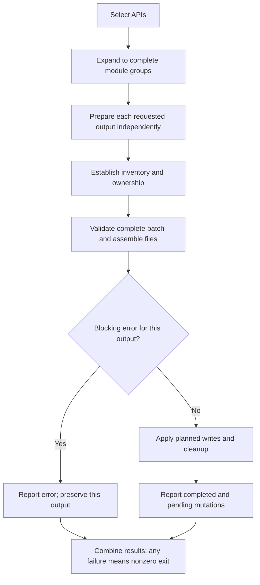

---
$schema:
    status: |-
        enum(
            draft-spec,
            finalized-spec,
            planned,
            implemented,
            review-findings,
            human-in-the-loop,
            completed,
            on-hold,
            abandoned
        ) -> an indicator of progress for this specification
    reviewed: boolean -> indicates whether the specification file has been reviewed by another agent from the one which created the spec
    reviewed_by: string -> the agent and model used in the spec review
    reviewed_on: date -> the date the spec was reviewed
    review_iterations: number -> the number of implementation reviews have taken place in the review/fix cycle
    clarified: boolean -> indicates whether the specification was built -- _in part_ -- with the 'clarify.md' prompt
    implemented: boolean -> indicates whether this spec's plan has been implemented
    implemented_by: string -> the agent who implemented the plan
status: implemented
reviewed: true
reviewed_by: codex/gpt-6.1-sol
reviewed_on: 2026-10-11
review_iterations: 3
clarified: false
implemented: true
human_review: true
human_review_items:
  - |-
    **Delete the leftover folder `schematic/gen/schematic/` (requirement R30) — the one requirement still open.**

    This folder holds five old files, left behind years ago when the code generator was run from the wrong directory. Nothing builds or reads them; they only look like real generated output and can mislead people. The spec makes deleting them part of this work, but only after you confirm "pre-authorization item 2". That confirmation was never recorded, and the automated session's own safety layer also refused to run the delete. So the folder is still there and R30 is the only unmet requirement. It has to be settled before this work can be accepted as complete.

    - **Option A: confirm the deletion (recommended).** You, or an agent you authorize, run `git rm -r schematic/gen/schematic` and commit it with the rest. *Pros:* closes R30; removes a misleading duplicate; no build, test, or CI step uses it (checked). *Cons:* none in practice, since the files stay in git history.
    - **Option B: keep the folder and drop R30.** *Pros:* nothing to do. *Cons:* the misleading copy stays; the spec says only this spec may delete it, so no later spec would clean it up.
    - **Option C: delete later in a separate change.** *Pros:* keeps this review smaller. *Cons:* needs a new authorization, because the spec grants the deletion only to this spec.

    Related: `checks/cargo-machete.txt` (a saved report outside this area) still mentions the folder. No script regenerates it, so it was left untouched. Re-capturing it after the deletion is your call.

    **Recommendation: Option A.** It is the change the spec intended, it is fully reversible through git, and every check that it is safe has been done.
  - |-
    **Old "ignored" end-to-end tests and the `just test-e2e` recipe (pre-authorization item 7) were never cleaned up.**

    Three slow tests in `schematic/gen/tests/l1/e2e_generation.rs` are switched off by default (`#[ignore]`). They compile and lint the generated code, which the new always-on "fresh-output guard" now does more thoroughly, across all 18 APIs instead of only OpenAI. The `just test-e2e` recipe that runs them uses `cargo test`, which this repository's testing rules do not allow (it uses nextest). The plan defaulted to removing them, but that needed your confirmation (item 7), which never came. So they were left as they were.

    - **Option A: remove the three ignored tests and the `test-e2e` recipe (recommended).** *Pros:* no duplicate coverage; no recipe that breaks the test-runner rule. *Cons:* loses the clippy-on-generated-code check, although `just lint-schema` already runs clippy on the committed generated code.
    - **Option B: keep the tests but switch `test-e2e` to nextest.** *Pros:* keeps every test. *Cons:* keeps tests that duplicate the guard, and they stay off by default.
    - **Option C: leave everything as is.** *Pros:* no work. *Cons:* the rule violation and the duplication remain.

    **Recommendation: Option A.** The guard replaced what these tests were for, and a small follow-up change can do the removal.
message_to_agent: |-
  All seven phases are implemented (see implementation-log.md "## Phase 7" for the final ledger, defaults table, and consolidated review agenda). For a review/fix agent:
  - R30 is the only incomplete requirement: `schematic/gen/schematic/` (5 tracked files) still exists. All preconditions are verified (not a workspace member, not a test or CI input), but the delete was refused by the session permission layer and pre-authorization item 2 is unconfirmed. Do not delete it without the author's confirmation (see human_review_items). Plan Task 7.1 stays unchecked for that reason.
  - Phase 7 changed one generator doc comment (codegen/request_enum.rs: into_parts now documents the 5-tuple and the Header error), regenerated (doc-only diff in 15 schema/src files), fixed doc and skill drift, and added an offline-cache fetch hint to the fresh-output test helper with the L1 test `fresh_output_compile::offline_cache_misses_name_the_fetch_that_fills_the_cache`.
  - Platform evidence: the guard passes natively on macOS, native Windows, and WSL2. On build-linux it fails because that host's Cargo cache lacks `cc v1.2.52` (fix: `cargo fetch --manifest-path schematic/schema/Cargo.toml` on that host). No hosted CI run contains this work yet.
  - All 8 dependents pass `just test`. On this macOS host sniff needs `LIBGIT2_NO_PKG_CONFIG=1` (a stale Homebrew libgit2 path; documented in the os skill macos.md).
parent: ../../reviews/2026-07-31-macro-review/spec.md
depends_on: []
refresh_required: false
related: []
next_spec: 2026-10-12-schematic-runtime-envelope
completed: true
---

# Schematic generation integrity

## Problem

`schematic-gen` turns API definitions into the `schematic-schema` client crate, OpenAPI documents, and Postman collections. Today the generator can destroy work silently, drop declared request data silently, and publish an invalid document. Each item below is verified against the parent review or the code unless marked **unverified**.

1. **Single-API generation deletes the other clients.** `generate --api <one>` against the real output directory builds its expected-file set from only the requested API and removes every generator-owned file not in it. The parent measured 24 files and directories shrinking to 10, and `lib.rs` is rewritten consistently, so the result still compiles and nothing signals the loss (`schematic/gen/src/output/mod.rs`, `collect_expected_files` and `cleanup_stale_files`). `schematic/gen/README.md` documents the invocation as normal usage and the `generate-one` recipe in `schematic/justfile` runs it.
2. **Declared request data is dropped without a diagnostic.**
    - Text and binary request bodies (`ApiRequest::Text`, `ApiRequest::Binary`) produce no body field, and `into_parts` returns `RequestBody::Empty` for them (`gen/src/codegen/request_structs/into_parts.rs`). The generated runtime enum `RequestBody` already has a `Raw { content_type, bytes }` variant (`schematic/schema/src/shared.rs`); the generated send helper already sends its bytes and declared `Content-Type` ([`schematic-gen` body dispatch](../../gen/src/codegen/client/methods.rs)); the missing step is generating the body field and conversion, with runtime tests still required.
    - `AuthStrategy::ApiKeyParam` (key in query or cookie) is never injected. Header resolution is header-only, `headers_satisfy_fallback` returns `false` for it, so such an API cannot authenticate and reports a misleading "authentication required" error (`gen/src/codegen/client/helpers.rs`). The legacy env mapping also drops it (`schematic/define/src/types.rs`, `legacy_env_mapping_for`).
    - `EndpointParams.header` and `EndpointParams.cookie` have no readers in the generator.
    - Live counts verified by the parent on 2026-10-11: text bodies 0, binary bodies 0, `ApiKeyParam` 0, header or cookie parameters 0, multipart about 29. The July figure "six endpoints POST empty bodies" is a different measure and is not reconciled with "about 29". No shipped definition uses the zero-count features, so tests need purpose-built fixture definitions.
3. **Query parameters are formatted into the path string.** `generate_path_format` (`gen/src/codegen/request_structs/shared.rs`) builds one `path` string containing the query, and `RequestParts` is `(method, path, body, headers)` (`schematic/schema/src/shared.rs`). Later work must redact secret query values from URLs and error text, which needs the query pairs kept separate from the path.
4. **`openapi/ollama.json` has duplicate `operationId` values** (`Embeddings` and `ListModels`, each on two paths), which the [OpenAPI 3.0.3 operation contract](https://spec.openapis.org/oas/v3.0.3.html#operation-object) forbids. The grouped merge (`gen/src/export/openapi.rs`) deduplicates on `(path, method)` and never checks ids. Verified by a duplicate scan of the committed file on 2026-10-11.
5. **Validation is incomplete and not per output.** `validate_api` (`gen/src/validation.rs`) checks identifiers and body-type collisions but not duplicate endpoint ids or duplicate `(method, path)`. Nothing validates the whole batch for each output before writing.
6. **Nothing on a normal test run compiles freshly generated code.** `generated_code_compiles` and the clippy test in `gen/tests/l1/e2e_generation.rs` are `#[ignore]`d. `just lint-schema` compiles the committed crate, which is not the same as compiling what the generator emits now.
7. **A stale git-tracked duplicate output tree** exists at `schematic/gen/schematic/` (five tracked files under `schema/`, residue of a wrong-cwd run). It is easy to mistake for real output.

## Goal and non-goals

**Goal.** After this spec, regenerating any subset of APIs is safe and honest; every declared request-side input the supported APIs can send reaches the generated Rust client; the generator never publishes a duplicate id or an invalid batch; and a normal test run proves freshly generated code compiles offline in isolation.

**Non-goals (owned by other specs or later work):**

- The runtime package, the response envelope, typed send, credential precedence, redirects, deadline, and redaction implementation (the runtime/envelope follow-up). This spec only separates query parameters so redaction can be built later.
- Pagination (the pagination follow-up), definition API and builders (the definition-API follow-up), response model v2, selectors, and GraphQL (the response-model/GraphQL follow-up), WebSocket (the WebSocket follow-up), fidelity and polish including feature flags, the module-path resolver unification, and the generated-docs honesty pass (the fidelity/polish follow-up).
- Query-parameter `required`, style, `explode`, and enum fidelity (the definition-API follow-up).
- Any edit to the roughly 519 endpoint literals in the definitions (openai alone has 265), or to a dependent crate's source (sniff, biscuit-speaks, model-citizen, the homelab crates). This spec is generator-only. The nine endpoints that put `?` in a path template are not migrated here (R33; the definition-API follow-up owns the migration).

## Background: decisions this spec implements

Provenance: the parent review `2026-07-31-macro-review`, section 15, under this area's `reviews/` directory. Its decisions are restated here so the implementer does not need to open it; the D-numbers are traceability aids. The related feature specifications share that parent; `parent` does not imply that another feature's unfinished design overrides this draft.

- **D9. Partial generation (confirmed 2026-10-10).** Regenerating one API regenerates its whole resolved module group, keeps every other module, rebuilds shared files and exports from the retained inventory, deletes only stale files it can prove it owns, and fails before writing anything if the inventory cannot be established safely. Example: selecting `OllamaNative` also regenerates `OllamaOpenAI` because they share a module, and keeps the other 16 APIs. Full generation may remove obsolete owned modules; unowned files stay protected. Atomic writes protect individual files, not a multi-file update, so failures must be reported without claiming the whole crate was updated. An incompatible shared-runtime change requires full generation or an actionable error before any mutation; preserving files while removing their exports does not satisfy the contract. Rejected: refusing single-API generation unless the output is isolated; removing the single-API option.
- **D10. Request-side feature support (confirmed 2026-10-10).** Implement, rather than reject, every input type the supported APIs can send: text and binary request bodies with content type, API key in query or cookie (`ApiKeyParam`), and header and cookie parameters, each tested against local mock servers that verify the actual request. Backstop kept: per-output validation. The whole batch for each output (Rust, OpenAPI, Postman) is validated before writing; an error names the API, endpoint, feature, and output; one output's gap never blocks another output. Invalid Rust type syntax is an error; valid generic types and qualified paths (`Vec<Model>`, `serde_json::Value`) stay accepted. Wire parameter names are preserved while generated Rust identifiers are sanitized and checked for collisions. Repeated base and path segments alone are not proof of a bad URL; validate the declared composition rule, do not reject a legitimate `/api/api` path by substring.
- **D33. Landing (confirmed 2026-10-11).** The D10 features are generator-only work in landing 1, with no definition edits. A temporary fixture can model inputs that shipped definitions do not use.
- **D49 item 1. Isolated compile check (confirmed 2026-10-11).** Freshly generated code is compiled in an isolated temporary crate, offline, with no live provider requests and no change to the checkout. It guards every later generator change and runs on a normal test run; compile-only checks are L1 (use the `slow_` prefix when the testing guide requires), not L2 merely because they are slow. Removing `#[ignore]` is an implementation choice, not the success criterion.
- **D57 item 1. Fresh-output compile check in CI (confirmed 2026-10-11).** The isolated compile check runs on the CI build job, which already holds the toolchain, before the test archive is produced; archive-only test jobs skip it. This narrow CI change is pre-authorized for this spec (R35). Rejected: giving test jobs a toolchain; keeping the check local only with a recorded gap.
- **D49 item 6.** The "six endpoints" and "about 29 multipart" figures are unreconciled; the live count is established when D33 is implemented.
- **D23 (prerequisite only).** Network-error text will keep the URL with secret query values masked; that needs the generator to keep query parameters out of the path string (S6 / P7). This spec delivers the split; the masking belongs to the runtime/envelope follow-up. The nine legacy templates with embedded queries remain warning-only until the definition-API follow-up migrates them (D55).
- **D36 (forward hook only).** In the response-model/GraphQL follow-up, two endpoints on the same method and path will be told apart by a selector. This spec's duplicate check keeps one place to extend the uniqueness rule, and must not implement a selector.
- **D40 (relevant fact).** An `ApiKeyParam`'s name will be a secret automatically; the generated client must therefore never print the key value. Provider response bodies remain governed by the later runtime redaction contract.
- **D50 spec 1 scope.** Generation integrity: D9, per-output validation, D49 compile check, duplicate `operationId` fix, D33, query-parameter split, and deletion of the stale tree (a pre-authorization the author must confirm, item 2). Generator only; no dependent crate changes.
- **D20 (whole-work rule).** Every defect-ledger row is closed or recorded as an accepted gap. This spec closes rows 1 (text and binary bodies), 2 (`--api <one>` deletion), 5 (`ApiKeyParam`), 6 (duplicate `operationId`), 16 (`#[ignore]`d compile test), and 18 (stale tree). A green test run alone does not close an unmet requirement.

## Requirements

Each requirement is testable. Numbered requirement references below refer to the entries in this Requirements section; numbered defaults refer to Planning-time details assigned to this spec. "L1" means `just test` in `schematic/`; "L2" means `just test-l2`, which must never take window focus. Nothing here needs L2 except where stated; none does by default.

### Partial generation (D9)

**R1. Whole module group.** Generating a subset of APIs regenerates the entire resolved module group of every selected API. Selecting `OllamaNative` alone regenerates `OllamaOpenAI` too (both declare `module_path: Some("ollama")` and distinct request suffixes in [the `schematic-definitions` Ollama module](../../definitions/src/ollama/mod.rs)) and leaves every unselected module group byte-identical (API count and module-group count differ because groups can contain multiple APIs).
Validated by: L1 integration test in `schematic-gen` that generates all APIs into a temp directory, copies it, runs a one-API generation into the copy, and compares file contents.

**R2. Shared files rebuilt from the retained inventory.** After a partial run `lib.rs`, `prelude.rs`, and every other generated shared file and export list name all 18 APIs (or, more generally, all retained plus regenerated APIs), and the crate compiles.
Validated by: the R1 test asserting the export lists, plus the fresh-output compile check in requirement R16 below on the resulting directory.

**R3. Deletion only of provably owned stale files.** Within the regenerated groups, a stale file the writer provably owns (the existing generated-header and owned-directory proofs) is deleted; an unowned file in the same directory survives; nothing outside the regenerated groups is deleted by a partial run. A full run may remove obsolete owned modules (today's behavior). Ownership permits deletion, not overwriting: an unowned file occupying a planned output path causes an error before mutation, including shared files and the generated manifest. Never follow symlinks for ownership or recursive cleanup; an unreadable entry or directory-enumeration error means ownership cannot be proven. Treat a file-to-directory conversion containing unowned content as a conflict and leave it intact.
Validated by: L1 test in `schematic-gen/src/output/mod.rs` tests or `tests/l1` with a planted owned stale file, a planted hand-written file, and a hand-written `bin/` directory.

**R4. Unsafe inventory fails before any write.** If the existing output's inventory cannot be established (for example a corrupt or hand-edited `lib.rs`), a partial run returns an actionable error naming the cause and telling the user to use full generation or an isolated output directory, and the output directory is byte-identical afterward.
Validated by: L1 test that compares relative filenames and file bytes before and after; no hashing dependency is needed.

**R5. Incompatible shared-runtime change.** If a partial run would change a shared file (for example `shared.rs`) in a way that retained, unregenerated modules may not match, the run fails before any write with an error that requires full generation. The detection rule is a planning default (see Planning-time details, default 4).
Validated by: L1 test that alters the stored `shared.rs` and asserts the error and an untouched directory.

**R6. Honest failure reporting.** If a write or cleanup fails midway, the returned error lists the files already written or deleted and the pending writes and deletions, the CLI exits non-zero, and no message claims the crate was updated. All validation, code assembly, syntax check, and formatting finish before the first write so a failure mid-run can only be an I/O failure. Cleanup and file/directory conflict removal are mutations too: plan and validate them before the first write, delete obsolete paths only after replacement files are ready, and include them in failure reporting. This boundary also includes `Cargo.toml` and shared WebSocket files when the invocation generates them. A dry run uses the same plan and diagnostics and changes no files, including creating no output directories.
Validated by: L1 test that injects a write failure (read-only target file or directory on Unix; an equivalent that works on Windows, such as a directory occupying a target filename) and asserts the error content. Prefer an injectable filesystem failure or a directory at a planned filename; do not rely on Unix permission bits, which behave differently under elevated users. The injection must be portable to macOS, Linux, Windows, and WSL2 (see `os` skill).

**R7. OpenAPI and Postman follow the same group rule.** A partial run rewrites OpenAPI and Postman artifacts only for the regenerated groups and leaves the rest untouched. On an empty output directory, selection expands to complete groups and creates only those groups plus their shared exports; an absent directory is not an unsafe existing inventory. A nonempty directory missing required inventory evidence fails before mutation. Rust and artifact-only invocations establish safety independently for their own output roots. (Default 22.)
Validated by: L1 test over `--openapi-out` and `--postman-out` temp directories.

### Per-output validation (backstop of D10)

**R8. Whole batch, per output, before writing.** For each selected output (Rust client, OpenAPI, Postman) the generator validates the entire selected batch before writing that output. If any output has a blocking error, no file of that output is written.
Validated by: L1 test with a batch of one valid and one invalid API asserting zero files written for the failing output.

**R9. Diagnostics identify their scope.** Every validation diagnostic identifies the API, the endpoint when applicable, the feature, and the output it concerns (for example `api=Foo endpoint=UploadFile feature=binary-request-body output=openapi`). Format and machine readability are planning defaults (default 1, 2).
**This spec owns the validation-diagnostic format and its severities (`error` blocks the output, `warning` is reported and does not block) and exposes them as a public, reusable surface (the diagnostic type, a severity enum, and the per-output validator entry points) so that the WebSocket follow-up maps its validation onto them rather than inventing a second format.** Each diagnostic carries its severity in the rendered line and in the serialized form.
Validated by: L1 unit tests on the diagnostic type, the severity, and the rendered text; a test that a downstream caller outside `validation.rs` can construct and emit both severities.

**R10. Outputs are independent.** A feature one output lacks fails validation for that output only; the others still generate. A Rust-client gap never blocks OpenAPI or Postman, and the reverse. Use a fixture with malformed Rust type syntax to prove independence: Rust generation fails while exports that carry that name as data can still succeed. Do not add a test-only feature to the public definition model. Process every requested output and report a final nonzero exit status if any output failed; successful outputs are named individually. Warnings alone do not cause a nonzero exit.
Validated by: L1 mixed-output test with malformed Rust type syntax asserting no Rust mutations, successful independent OpenAPI and Postman artifacts, complete diagnostics, and a nonzero CLI exit. Add a warning-only invocation that exits successfully.

**R11. Type syntax and identifiers.** For Rust output, parse request and response `type_name` as Rust types and `module_path` as the supported definitions-module path grammar, not as a type. A resolved output filename must be one safe module component, not an absolute path or a traversal outside the output root. Invalid syntax is a validation error; `Vec<Model>`, `serde_json::Value`, and qualified paths stay accepted. Wire parameter names are preserved while generated identifiers are sanitized and checked for collisions, including header and cookie parameter names added by R25 and R26. Check collisions across path, query, header, cookie, body, multipart fields, generated helper fields, builders, and method names after the same transformations code generation uses. Do not reject type names in an export solely because they are not Rust syntax. **Never reject by substring:** a repeated base or path segment is not itself an error (a legitimate `/api/api` stays accepted). Only an exact duplicated segment produced by the declared base-plus-path composition rule (for example a base ending in `/v1` joined to a path beginning `/v1`) may be reported, and then as a `warning`, never an `error`. Add checks only where a gap is found; record each in the implementation log.
Validated by: L1 tests in `gen/src/validation.rs` (accept and reject tables, plus a `/api/api` path accepted).

**R12. Duplicate endpoint ids.** Two endpoints with the same id in one API fail validation. Across APIs in a shared module, check the actual emitted Rust names, including request suffixes and API-local namespaces; equal raw endpoint ids alone are allowed. The existing Ollama and EMQX definitions rely on this distinction.

> **Reader note:** rejecting raw ids across the entire module would reject supported APIs and contradict whole-group regeneration. Rust name collisions and OpenAPI document-wide `operationId` collisions require separate checks; the latter are resolved by the export rename rule below.
Validated by: L1 unit tests in `gen/src/validation.rs`, including valid Ollama and EMQX shared groups and a fixture whose emitted request names actually collide.

**R13. Duplicate `(method, path)` with a selector hook.** Two endpoints in one API with the same HTTP method and the same path (compared after normalizing path-parameter names) fail validation. Across group members, preserve the existing OpenAPI behavior: equivalent operations with differing authentication merge their security alternatives, while incompatible operations occupying the same method and path fail that export. Do not make cross-API overlap a Rust-wide error. Centralize the current `(method, normalized_path)` key in one function that the response-model/GraphQL follow-up can extend with a selector. No selector type, field, or syntax is added now.
Validated by: L1 unit tests showing that `/items/{id}` and `/items/{name}` collide on the same method, while different methods do not; both checks use the same key function.

### Duplicate `operationId` (ledger row 6)

**R14. Unique ids in every exported document.** The grouped OpenAPI merge produces a document in which every `operationId` is unique. The first occurrence keeps its id; a later operation with a clashing id and a different `(path, method)` is renamed by the default rule (default 7), deterministically. Rename only distinct operations after compatible same-path operations have merged. Reserve all original operation ids before allocating renamed ids, so a new name cannot displace a later operation's unique original id. Update any in-document references to renamed operations, including link `operationId` values. After merging, a final scan fails the export if any duplicate remains. Per-API (ungrouped) documents are checked by the same scan.
Validated by: L1 unit test on the merge in `gen/src/export/openapi.rs` with two member APIs sharing ids; L1 artifact test (beside `openapi_strict_completeness.rs` / `artifact_drift.rs`) that scans every committed `schematic/openapi/*.json` for duplicate ids.

**R15. Committed artifacts regenerated.** `schematic/openapi/ollama.json` is regenerated by the generator so it contains no duplicate ids; no other OpenAPI file changes in content except as R14's rename rule demands. This is produced by running the generator, never by hand.
Validated by: the R14 artifact test, and `artifact_drift` passing.

### Isolated fresh-output compile check (D49)

**R16. Isolated crate, offline, checkout untouched.** A test generates the client crate into a temporary directory outside the checkout, with a generated `Cargo.toml`, and compiles it with no network access to crates registries or providers (`cargo check --offline` or equivalent; mechanism is default 8). The checkout is unchanged afterward, proven without depending on a clean worktree (the cargo target directory is build output and is exempt).
Validated by: L1 test in `schematic-gen` (a new file under `gen/tests/l1/`), using `slow_` in the test name so `sanity` skips it. Does not need `just test-l2`. Use a small copied input tree and compare its relative file list and bytes before and after, with output and target directories elsewhere. Do not scan or hash the whole monorepo: unrelated concurrent work would make that assertion flaky and expensive. Set explicit output, manifest, and target paths and exercise the public generation entry point. Repository reads use runtime-remapped paths from the test toolkit. In CI the check runs on the build job, not on archive consumers (R35, D57 item 1); the check must not silently skip when Cargo is absent. A dirty worktree is a normal precondition: the assertion is before-versus-after equality, never `git status` being empty or unchanged text.

**R17. Runs on a normal test run.** The check is not `#[ignore]`d; `just test` runs it. The pre-existing `#[ignore]`d `generated_code_compiles` and clippy tests in `gen/tests/l1/e2e_generation.rs` are either superseded by it and removed, or retained and still runnable through `just test-e2e`; the choice and the `test-e2e` recipe consequence are logged (default 9).
Validated by: `just test` output listing the new test; the test-audit filters in the `rust-testing` skill (`tier-filters.md`) classify it as slow L1, not L2.

**R18. Negative control.** A deliberately broken generator output (for example a test hook that injects a type error into one emitted module) makes the check fail with the compiler error shown.
Validated by: L1 test using the same helper with a broken input and `#[should_panic]`-style or result assertion on the failure.

**R19. Coverage.** After request-side support lands, the check compiles (a) a small fixture crate set with purpose-built definitions covering JSON, multipart form, URL-encoded, text body, binary body, each auth strategy (Bearer, ApiKey header, Basic, `ApiKeyParam` query, `ApiKeyParam` cookie, OAuth where the generator supports it), header parameters, cookie parameters, and query parameters; and (b) the full set of 18 real APIs (default 17).
Validated by: the same L1 test file; assertions list the covered fixture names.

**R20. Determinism, no checkout rewrite.** The check also compares the fresh 18-API output with the committed `schematic/schema/src` and `schematic/openapi`, `schematic/postman` content and fails with a diff summary if they differ, without writing into the checkout (this is the drift check `artifact_drift` partly provides; reuse it rather than duplicate if it already covers the same ground, and log which).
Validated by: L1 test comparing in-memory or temp output with committed files.

**R35. CI placement (D57 item 1).** The CI build job, which already holds the toolchain, runs the fresh-output compile tests (R16 to R20) before it produces the test archive, and a failure there fails CI. Archive-only test jobs skip those tests by an explicit exclusion, not by detecting a missing Cargo: no hosted archive job runs them, and none silently skips them or reports them as passing. Because the archive consumers have no Cargo, any fixture runtime test that the R16 helper must compile (default 10) is placed with the compile tests on the build job. This is the only CI configuration change this spec is authorized to make (pre-authorization item 9); it adds no environment, matrix cell, or gate.
Validated by: inspection of the changed CI workflow showing the build-job step ordered before archive production and the archive-side exclusion; a CI run (or `just ci-local --plan` plus the workflow diff where a run is not available) showing the fresh-output tests reported from the build job, absent from every archive job's executed and expected-test listings, and the package's completion record still passing.

### Request-side features (D10, D33)

All of R21 to R27 are exercised against purpose-built fixture definitions through a local mock HTTP server that records the raw request. The mock server must be local and must not bind a fixed port (bind port 0). `wiremock` is the repo-standard choice (see the `wiremock` skill). It and `serial_test` are already dev-dependencies of `schematic-schema` and its manifest template, but not of `schematic-gen`; reuse the fixture manifest dependencies when the server lives there, and log any dependency added (update `schematic/docs/dependencies.md`).

**R21. Text request body.** An endpoint declaring `ApiRequest::Text { content_type }` generates a request struct with a `body: String` field; `into_parts` yields the body verbatim under that content type; the server sees the exact text and the declared `Content-Type`.
Validated by: L1 codegen assertion in `gen/src/codegen/request_structs/tests.rs` plus a mock-server runtime test. The runtime test runs in a compiled fixture crate (reuse the R16 mechanism) or in the generated `schematic-schema` crate's tests; the plan chooses (default 10).

**R22. Binary request body.** Same for `ApiRequest::Binary { content_type }` with a `body: Vec<u8>` field; the server sees the exact bytes and the declared `Content-Type`, including bytes that are not valid UTF-8.
Validated by: as R21.

**R23. `ApiKeyParam` injection.** For an API whose auth is `AuthStrategy::ApiKeyParam { name, location }`: with `location` query, the key is appended to the query string under `name` on every request (merged with the endpoint's own query parameters, preserving unrelated names; the credential owns any matching name); with `location` cookie, the server sees `Cookie: name=value` (merged with any cookie parameters). The key is percent-encoded where the location requires it.
Validated by: mock-server runtime test.

**R24. `ApiKeyParam` credential source and errors.** **Temporary:** the explicit `with_api_key_param` setter and the generator-local env scan are interim mechanisms; the runtime/envelope follow-up owns credentials (D11) and removes both. The key can be supplied explicitly (default 16) or resolved from the API's `env_auth` list, first non-empty variable winning, with the env fallback mapping carrying the parameter-style key. The silent drop at `legacy_env_mapping_for` is closed in the way default 15 states. When no key is available and auth is required, the existing "authentication required" error is returned, and when a key is available it is no longer returned. `headers_satisfy_fallback` is consistent with this. Resolve the effective authentication policy through [`RestApi::effective_auth_policy`](../../define/src/types.rs) in `schematic-define`, including explicit-method and fallback overrides; do not bypass it by reading only the legacy `auth` field. An explicit parameter key wins over environment fallback, and policy-disabled fallback stays disabled. Validate invalid header names and values through HTTP types and return errors without echoing credential values.
Validated by: mock-server runtime tests (explicit key, env key, empty-then-nonempty env list, no key) using the test toolkit's `EnvGuard` to restore env values and `serial_test` to coordinate all tests touching the same variables, or isolated child-process environments that avoid process-wide mutation; L1 unit tests in `schematic-define` if the mapping changes there.

**R25. Header parameters.** Each `EndpointParams.header` entry becomes a request-struct field and `with_*` builder, sent under its exact declared wire name; only set values are sent; endpoint headers declared on the endpoint still win over API headers as today. Match names case-insensitively. A set header parameter overrides a static endpoint header of the same name; an unset parameter preserves that static value. Invalid header values fail before sending and their contents are not included in diagnostics.
Validated by: codegen test and mock-server runtime test.

**R26. Cookie parameters.** Each `EndpointParams.cookie` entry becomes a request-struct field sent in one `Cookie` header (`a=1; b=2`) under its declared name, merged with an `ApiKeyParam` cookie without duplicating the header. Merge existing API and endpoint Cookie headers too; preserve distinct names and let a set endpoint parameter replace the same named static cookie. The resolved authentication key owns its declared name: replace conflicting query or cookie values rather than sending two competing credentials. Query-key matching and cookie-name matching are case-sensitive; header-name matching is case-insensitive. Arrays use comma-separated values for headers and cookies in this interim implementation, while query arrays retain repeated keys; reject unsupported nested array shapes during validation rather than dropping them.
Validated by: mock-server runtime test.

**R27. The key never appears in debug output.** With a sentinel key, `format!("{:?}", client)` (and the request struct) does not contain it, for header, query, and cookie strategies. This covers the request-input features only; the broader redaction contract (D22, D23, D40) is the runtime/envelope follow-up.
Validated by: L1 sentinel test.

### Query-parameter split

**R28. Query pairs separate from the path.** `into_parts` returns the path (path parameters substituted, with no query contributed by declared query parameters) and the query pairs as a separate collection, preserving array parameters as repeated keys, and the generated client applies them when building the URL. `RequestParts` changes accordingly (default 12). Declared query parameters and `ApiKeyParam` query additions go through the same separation, so a later redaction layer can mask exactly the secret pairs. Until the definition-API follow-up migrates the nine legacy templates, their embedded query suffix remains in the path and its existing escaping and order are preserved; report the warning specified below. Do not parse and decode that suffix as if it were newly declared query data. Header and cookie values remain in the headers element, not in the query collection.
Validated by: codegen tests in `gen/tests/l1/query_params_codegen.rs`, `path_substitution.rs`, `http_client.rs` updated for the new shape.

**R29. Wire equivalence.** For every existing endpoint with query parameters, the URL that reaches the server (path plus encoded query, parameter order, array encoding, encoding of reserved characters) is identical before and after the split. The current generator uses `urlencoding::encode`, including `%20` for spaces. Moving to `reqwest::RequestBuilder::query` may encode spaces as `+`; retain the existing encoder for appended query pairs if necessary to meet byte equivalence. Values in the returned query collection are unencoded and encoded exactly once at URL assembly. Preserve existing literal and base-URL queries when appending pairs. Include spaces, plus signs, percent signs, Unicode, empty values, repeated keys, and a legacy embedded query in the representative fixtures. Evidence is a mock-server test over representative endpoints plus the unchanged expectations of the existing query tests, not only string comparison of generated code.
Validated by: L1 mock-server tests comparing against golden request lines captured from the pre-change generator (capture them in the first phase, before changing any code).

### Cleanup, regeneration, and scope

**R30. Stale tree deleted.** `schematic/gen/schematic/` (five tracked files under `schema/`) is deleted from git. No workspace member, CI input, or test reads it (the root `Cargo.toml` `exclude` list names only `schematic/schema`). References outside spec and plan snapshots are updated: `checks/cargo-machete.txt` lists it; treat that file by default 18.
Validated by: the stale files are absent from disk and appear as deletions in the diff; before staging, `git ls-files` still lists deleted tracked paths and is not an absence check. `rg` finds no maintained reference inside this area; an outside-area reference retained under the stated scope exception is logged; `just test` and `just lint` pass.

**R31. Regeneration only through the generator; generator-only blast radius.** `schematic-schema` is regenerated with `just generate` (never hand-edited) after the generator changes land; the committed diff is explained entirely by R28 (query split) and R14 (ids), plus any feature the live definitions already use. No file in a dependent crate (sniff, biscuit-speaks, model-citizen, the homelab crates) changes, and each still builds and passes its tests. A search for `into_parts` and `RequestParts` outside `schematic/` was run while drafting (excluding `schematic/gen` and `schematic/schema`) and found none; the implementer repeats it before changing `RequestParts`. If a dependent breaks, stop and record it (this contradicts the spec's premise) rather than editing the dependent.
Validated by: `just test-schema`, `just lint-schema`, and `just test {pkg}` from the repo root for each dependent package (list them with `sniff repo packages`; the dependents named by the parent are sniff, biscuit-speaks, model-citizen, and the five homelab crates).

**R32. Live feature counts recorded.** The implementer measures, from the definitions at hand, how many endpoints use text bodies, binary bodies, multipart bodies, `ApiKeyParam`, header parameters, and cookie parameters, and records the numbers in `implementation-log.md` next to the parent's figures, including a note reconciling or not reconciling "six" against "about 29" (D49 item 6).
Validated by: a small read-only script or existing registry traversal output pasted in the log; there is no pass/fail assertion beyond the numbers being recorded. The endpoint literal count is about 519 (openai alone 265); record the measured total next to it.

**R33. `?` in a path template is a warning (forward hook for the definition-API follow-up).** Parent recommendation 3 lists `?` in path templates among the silent drops to surface in `validate_api`: a query parameter smuggled into a path string cannot be separated, redacted, or typed. A path template containing `?` produces a `warning` diagnostic (severity `warning` in this spec's own diagnostic format; feature `query-in-path`, default 20) that names the API and endpoint, for every output. It does not fail generation. Nine endpoints currently do this: Gitea `GetGitTreeRecursive` (`?recursive=true`), the GitLab `/projects/{id}/repository/files/{file_path}?ref={git_ref}` endpoint, and seven OpenAI `/responses` endpoints (`?beta=true`). Per the author's ruling (2026-10-11, D55), this spec migrates none of them and edits no endpoint definition. The check is a forward hook: the definition-API follow-up (definition-api) raises the severity to `error` and migrates all nine in the same change, so the severity must be a single value in one place that the definition-API follow-up can change.
Validated by: L1 unit tests in `gen/src/validation.rs` (a `?` path yields one `query-in-path` warning naming its endpoint, a clean path yields none); a test over the live definitions that generation yields exactly nine `query-in-path` warnings, one per named endpoint, and still succeeds; a test that the check's severity is read from one constant.

**R34. Shared-interface compatibility extension point.** Keep the comparison of retained and newly assembled shared interfaces in one generator function. A source constant cannot describe the version of files already on disk, so this draft uses a conservative file comparison until a real persisted marker is defined. Initially, any byte difference in a shared runtime-bearing file blocks a partial update that would retain unregenerated modules. Include shared WebSocket support when applicable; export-list changes caused by adding or regenerating a group are handled by inventory validation rather than this runtime comparison. This function is the interface through which the runtime/envelope follow-up's generator/runtime compatibility marker (D39) drives the "require full generation" outcome; that follow-up defines and persists the marker and replaces the conservative comparison there. Do not add a speculative marker constant or an unused future selector type now.
Validated by: L1 tests for identical shared interfaces, changed shared interfaces with retained modules, and full generation after a compatibility error. Test marker semantics when the later feature defines their contract.

## Design

Decided means a parent decision fixes it. Proposed is this spec's suggestion; the implementer may adopt a better one and logs the change.

Each selected output has its own preparation and publication result:

| Symbol (package) | What it does | Status |
| --- | --- | --- |
| Whole-group regeneration in [`output::generate_and_write_all`](../../gen/src/output/mod.rs) (`schematic-gen`, `src/output/mod.rs`) | Resolves the selected apis to module groups, regenerates each group completely, keeps others | Decided (D9) |
| Inventory reader (`schematic-gen`, new function in `src/output/`) | Establishes the retained module set from the existing output before any write; any failure aborts | Decided as a requirement (D9); mechanism Proposed (default 3) |
| [Ownership checks and conflict removal](../../gen/src/output/mod.rs) (`schematic-gen`) | Keep the existing proof-of-ownership checks | Decided (D9): preserve proof of ownership |
| Two-phase writer (`schematic-gen`) | Phase 1 builds, validates, formats everything in memory; phase 2 writes group files, then shared files, then `prelude.rs` and `lib.rs` last, reporting completed and pending writes and deletions on failure | Proposed |
| `ValidationDiagnostic` and a `Feature` enumeration (`schematic-gen`, `src/validation.rs` or new `src/diagnostics.rs`) | One diagnostic with severity, api, optional endpoint, feature, output, message; `Display` and `Serialize` | Fields Decided (D10); type Proposed |
| Per-output validators `validate_rust_client`, `validate_openapi`, `validate_postman` (`schematic-gen`) | Validate the whole selected batch for one output before that output writes | Behavior Decided (D10); names Proposed |
| [`validate_api`](../../gen/src/validation.rs) additions: duplicate generated names and duplicate `(method, normalized_path)` (`schematic-gen`) | Reject actual name collisions and same-API duplicate routes | Rules Decided; code shape Proposed |
| `endpoint_uniqueness_key(endpoint)` (`schematic-gen`) | The single function the response-model/GraphQL follow-up extends; no selector API is introduced here | Proposed |
| [OpenAPI grouped merge](../../gen/src/export/openapi.rs) (`schematic-gen`) | Rename clashing later ids, then verify none remain | Requirement Decided; rename rule Proposed (default 7) |
| `fresh_output` test helper and `slow_` tests (`schematic-gen`, `tests/l1/`) | Generate to a temp crate, `cargo check --offline`, compare with committed output | Requirement Decided (D49); mechanism Proposed |
| CI build-job step for the fresh-output tests and the matching archive-job exclusion (CI workflow) | Runs the compile tests where the toolchain exists, before the archive is produced; archive jobs exclude them explicitly | Placement Decided (D57 item 1); step and filter shape Proposed |
| Text/binary body fields and [`into_parts` conversion](../../gen/src/codegen/request_structs/into_parts.rs) (`schematic-gen`, `codegen/request_structs/{body,into_parts}.rs`) | Emit body fields and convert them to `RequestBody::Raw` | Decided (D10, D33); field types Proposed |
| [`ApiKeyParam` authentication handling](../../gen/src/codegen/client/helpers.rs) (`schematic-gen`) | Inject key into query or cookie, env resolution, fix `headers_satisfy_fallback` | Decided (D10); structure Proposed |
| [`legacy_env_mapping_for`](../../define/src/types.rs) (`schematic-define`) | Possible additive change only if default 15 permits | Proposed |
| `with_api_key_param` and the generator-local `ApiKeyParam` env scan (`schematic-gen`) | Supply and inject query/cookie keys under the effective authentication policy | **Temporary**: the runtime/envelope follow-up owns credentials (D11) and removes both |
| Diagnostic severities and public validator surface (`schematic-gen`) | Owned here; the WebSocket follow-up maps its validation onto the same type, severities, and entry points | Decided as ownership; shape Proposed |
| `query-in-path` warning check (`schematic-gen`) | Report legacy embedded queries without changing definitions | Decided (D55): warning here; the definition-API follow-up makes it an error and migrates the nine endpoints |
| Shared-interface comparison function (`schematic-gen`, new function) | Centralizes the retained-output compatibility check; a later runtime marker can replace it | Conservative comparison now; marker design belongs to the runtime/envelope follow-up |
| Header and cookie parameter fields and builders (`schematic-gen`, `codegen/request_structs/`) | Preserve wire names and serialize supplied parameter values | Decided (D10, D33) |
| [`RequestParts`](../../schema/src/shared.rs) and [`into_parts`](../../gen/src/codegen/request_structs/into_parts.rs) query separation (`schematic-gen` template for `schematic-schema/src/shared.rs`, and `codegen/request_structs/{into_parts,shared}.rs`) | Keep declared query values separate until URL assembly | Query-separation requirement decided (S6, D23 prerequisite); shape Proposed (default 12) |
| Deleted tree `schematic/gen/schematic/` | Remove the duplicate generated files and check maintained references | Decided (D50); deletion authority is owned by this spec only |

## Suggested phases

The plan may refine this. Each phase ends with `just test` and `just lint` green in `schematic/` and nothing committed.

1. **Baseline and safety net.** Capture golden request lines (R29) and the live feature counts (R32) from the current generator. Add the isolated compile-check helper and its negative control (R16 to R18), initially compiling supported fixtures and the 18 APIs as they are. Add each currently unsupported fixture only alongside its implementation, so the baseline phase can pass. Add the CI build-job step and archive-job exclusion for these tests (R35, D57 item 1). This phase guards every later generator change (the reason the parent puts it first).
2. **Validation foundation.** `ValidationDiagnostic`, per-output validators, duplicate id and `(method, path)` checks with the selector hook, type and identifier checks (R8 to R13), the `?`-in-path warning (R33), and the diagnostic severities exposed for the WebSocket follow-up.
3. **Duplicate `operationId`.** Merge fix, final scan, artifact test, regenerate `openapi/ollama.json` (R14, R15).
4. **Partial generation.** Inventory reader, two-phase writer, group-only cleanup, shared-file rebuild, runtime compatibility rule and the shared-interface comparison in requirement R34 below, failure reporting, OpenAPI and Postman group rule, README and `generate-one` docs (R1 to R7).
5. **Query split.** Change `RequestParts` and the client URL building; wire equivalence against the golden lines (R28, R29). Run `just generate` and inspect the schema diff.
6. **Request-side features.** Text and binary bodies; header and cookie parameters; then `ApiKeyParam` injection, env mapping, and Debug safety (R21 to R27), each with fixtures and mock-server tests.
7. **Cleanup and close.** Delete `schematic/gen/schematic/` (R30), full regeneration, dependent builds (R31), docs, skills, and README drift pass, implementation log finalized.

## Acceptance criteria and definition of done

Done means the agent reaches "implementation complete, ready for review". The agent never runs `just complete` and never moves this directory to `_completed`.

- Every requirement R1 to R35 has a passing validation or, for R32, a recorded measurement.
- Builds and tests pass on macOS, Linux, native Windows, and WSL2 per repo rules. The implementer runs what the current host can and records, per the `os` skill, which hosts produced evidence and which did not; it does not claim an OS is untestable without loading that skill. CI runs only the environments its schedule assigns; the agent does not change CI scope beyond the build-job placement of the fresh-output compile check (D57 item 1).
- The CI build job runs the fresh-output compile tests before archiving, and no hosted archive job runs or silently skips them (R35, D57 item 1).
- `just test`, `just lint`, `just lint-schema`, `just test-schema`, and `just test-l2` (no window focus, no new L2 tests expected) pass in `schematic/`.
- `schematic-schema` was regenerated by `just generate`; no generated file was hand-edited. `just check-drift` (or the `artifact_drift` test) is clean.
- Every dependent crate builds and its tests pass (sniff, biscuit-speaks, model-citizen, the five homelab crates), with no source change in any of them.
- Documentation drift pass done: `schematic/README.md`, `schematic/gen/README.md` (the single-API usage text), `schematic/docs/` topic pages for the changed behavior (partial generation, validation diagnostics, request-side features, query separation; write a developer-facing page with examples and a Mermaid diagram of the generation flow, and do not link the page to this spec), `schematic/docs/dependencies.md` if a crate was added, and the affected skills (`schematic/skill/`, `.claude/skills/` entries for schematic if present, verified locations include `schematic/skill/` and `.claude/skills/schematic-define/`). Code comments and `///` docs on every changed symbol were reviewed per the repo's comment-drift rule; where a comment and the code disagreed, the code was treated as correct and the drift was logged.
- No commits by the agent unless the user explicitly requests them; a generated plan cannot grant that permission. If the user requests a commit, commit rules in the repo `CLAUDE.md` apply (author identity, signed, no agent attribution, `git verify-commit HEAD`).
- `implementation-log.md` exists, is current, and covers every item of the Human review agenda.

## Pre-authorizations the author must confirm before the unattended run (D50 item 8)

These are requests, not grants. They would otherwise pause an unattended run, they come from the parent's unattended-implementation authorization list (D50 item 8) and from this spec's content, and none is in force until the author confirms it when approving the plan; the plan restates them. Items marked **conditional** apply only if the stated condition holds.

1. Regenerate `schematic-schema`, `openapi/`, and `postman/` with `just generate` (a large tree diff is expected and acceptable).
2. Delete the git-tracked stale tree `schematic/gen/schematic/` (R30). **This spec alone owns that deletion; no other spec carries any deletion authorization for it or any other tree.**
3. `checks/cargo-machete.txt` (outside the area): keep the default (default 18): **conditional**, edit it only if it is a generated file with a regeneration recipe; otherwise leave it and log the stale line as a finding. This is a narrow exception to "no edits outside the area" and needs the author's explicit confirmation.
4. **Conditional:** add a dev-dependency to `schematic-gen` or `schematic-schema` for the mock server or `serial_test` only if it is not already present; update `docs/dependencies.md`.
5. Run the offline compile check in a temp directory outside the checkout, and create files under the system temp directory and the cargo target directory.
6. Change the public shape of the generated `RequestParts` and `into_parts` in `schematic-schema` (R28). No dependent uses them (verified by search while drafting).
7. Remove or rename `#[ignore]`d tests in `gen/tests/l1/e2e_generation.rs` and adjust the `test-e2e` recipe (R17).
8. **Conditional:** an additive field or function in `schematic-define` only if the environment-mapping default in Planning-time details allows; that default currently requires no new `EnvMapping` field.
9. **Already confirmed (D57 item 1):** the narrow CI change of R35: a build-job step that runs the fresh-output compile tests before the test archive is produced, and the matching exclusion of those tests from archive-only test jobs. Nothing else in CI configuration or scope.

Not pre-authorized, so the implementer stops and logs rather than proceeds: editing any dependent crate; changing CI configuration or scope beyond item 9 (D57 item 1); creating the `schematic-runtime` package; touching the roughly 519 endpoint literals in the definitions (including the nine `?`-in-path endpoints, which the definition-API follow-up migrates); adding a selector syntax; committing, unless the user explicitly requests it.

## Dependencies and ordering

- `depends_on: []`. This is first in order (D50).
- The subsequent feature specifications depend on this one: the runtime/envelope follow-up needs the query split (D23), the `ApiKeyParam` key being a distinct query pair or cookie (so later redaction can identify its value, D40), and the compile check as the guard for every later generator change. The response-model/GraphQL follow-up extends the uniqueness key with a selector (D36).
- Interaction with later specs: the runtime/envelope follow-up replaces client injection, the envelope, and the send path, and will rework `RequestParts` again. Keep R28 minimal so that rework is cheap. The fidelity/polish follow-up owns feature flags, which interact with partial generation; this spec does not add flags.

## Planning-time details assigned to this spec

Query-parameter separation and validation diagnostic format are owned here. The remaining defaults fill gaps in partial generation, request inputs, and fresh-output compilation. Numbered defaults referenced elsewhere in this document are listed in this section. Each default is adopted by the implementer if the author has not ruled before planning, and logged.

1. **Diagnostics format.** Default if not ruled before planning: a `ValidationDiagnostic { severity, api, endpoint, feature, output, message }` rendered by `Display` as one line `severity=<severity> api=<api> endpoint=<endpoint> feature=<feature> output=<output>: <message>`. Use an optional endpoint for API/group-level diagnostics, rendered as `endpoint=<none>`; include all contributing API names for a group collision. Do not invent an endpoint to fill a required string.
2. **Machine readability.** Default if not ruled before planning: the diagnostic type also derives `serde::Serialize`; no new CLI flag; the CLI prints the diagnostic lines to stderr and exits nonzero only for errors or generation failures, not warnings. The fidelity/polish follow-up can add a flag.
3. **Inventory source for partial generation.** Default if not ruled before planning: the retained inventory is the set of module files and directories in the existing output that carry the generator-owned proof, matched to the in-process definitions by resolved module path; the existing `lib.rs` is parsed only to confirm the module list and a parse failure aborts. Exports for retained modules are re-emitted from the in-process definitions, not copied from old text. Unknown generator-owned modules, missing declared members, conflicting file/directory representations, or inconsistent exports cause an abort, not a skip. Unowned files outside planned output paths are preserved and are not inventory members; their presence alone does not cause an abort. Compare the existing public export declarations for retained groups with those that would be emitted from current definitions; if they differ, require full generation before mutation. Do not silently replace retained exports with exports for definitions those retained files do not implement. Preserve shared WebSocket inventory and exports, whether the selection targets REST or WebSocket output.
4. **"Incompatible shared-runtime change" rule (the runtime package check belongs to the runtime/envelope follow-up).** Default if not ruled before planning: a partial run aborts with a "run full generation" error when any newly assembled runtime-bearing shared file differs byte-for-byte from its retained counterpart and at least one retained module is not being regenerated. Identical runtime-bearing shared files let the compatibility check pass; inventory and export checks still apply.
5. **Write order and reporting.** Default if not ruled before planning: write group modules first, then `shared.rs`, then `prelude.rs`, then `lib.rs` last; on I/O failure return completed and pending writes and deletions, including generated manifests and layout conversions. Never clean unrelated groups before writing selected ones.
6. **Duplicate endpoint id scope.** Default if not ruled before planning: raw ids checked within each API; across APIs sharing a generated module group, check emitted names with suffixes and namespaces as described in requirement R12, not raw ids.
7. **Merged `operationId` rename rule.** Default if not ruled before planning: the first occurrence in deterministic merge order keeps its id; iterate member APIs in stable registry declaration order, paths in document order, and methods in one fixed order. A later clash is renamed by prefixing the owning API's name in PascalCase (for example `OllamaOpenAIListModels`), and if that clashes too, a numeric suffix is appended. The rename is applied only in the grouped merge, not in per-API documents.
8. **Compile-check mechanism.** Default if not ruled before planning: write a generated `Cargo.toml` and sources to a `tempfile` directory, derive a lockfile in the temporary crate from the relevant existing lockfile (the workspace lock for workspace members and `schematic/schema/Cargo.lock` for the excluded generated crate). Resolve any necessary temporary package entry with `cargo generate-lockfile --offline`, then run `cargo check --offline --locked`; never fall back to online resolution. Use the generator's manifest builder with explicit paths to local dependencies and TOML-safe path serialization on Windows. Shared fixture types must be provided by the temporary crate, not added to production definitions, and fixture-only dependencies must be declared there. Invoke compiled fixture runtime tests through nextest, not `cargo test`. Clear inherited archive-only Cargo target/runner settings when constructing a native child build, with a reusable target directory distinct from the outer nextest build directory to avoid Cargo lock contention; do not run competing child compilations against that directory in parallel. Respect the configured Cargo target location rather than assuming a literal checkout `target/` directory. CI placement is R35 (D57 item 1); this local mechanism does not authorize installing a compiler on archive consumers. If a host's cargo cache cannot satisfy `--offline`, the test fails with an explanatory message and does not silently skip.
9. **Disposition of the `#[ignore]`d e2e compile tests.** Default if not ruled before planning: keep `generated_code_compiles` only if it tests something the new check does not; otherwise remove it and the clippy duplicate (clippy already runs in `just lint-schema`) and point `test-e2e` at remaining ignored tests or delete the recipe if none remain.
10. **Where request-side runtime tests run.** Default if not ruled before planning: in an isolated fixture crate built by the R16 helper (so they exercise freshly generated code), using a mock server; the 18 real APIs are not given new runtime tests.
11. **Text and binary field types.** Default if not ruled before planning: the request struct field is `body: String` for text and `body: Vec<u8>` for binary, and `into_parts` emits `RequestBody::Raw { content_type, bytes }`.
12. **`RequestParts` shape.** Default if not ruled before planning: keep a tuple and add a fifth element `Vec<(String, String)>` for query pairs, the path element containing no query contributed by `EndpointParams.query`. Header parameters join the existing headers element; cookie parameters join as one `Cookie` header entry.
13. **Cookie serialization.** Default if not ruled before planning: `name=value` pairs joined by `; ` in declaration order. Preserve legal cookie-value ASCII bytes; percent-encode disallowed bytes using UTF-8, uppercase hex, and `%20` for spaces. Validate cookie names rather than encoding invalid names. Never assume a server automatically decodes a cookie value: document this serialization and test the exact bytes. No CR/LF or separator supplied as a value may create another header or cookie.
14. **Header and cookie parameter typing.** Default if not ruled before planning: reuse the query parameter type mapping (`QueryParamType` to Rust type), generate `Option<T>` fields with `with_*` builders, and do not honor `required` (query-parameter `required`, style, `explode`, and enum fidelity are the definition-API follow-up).
15. **`ApiKeyParam` env fallback mapping.** Default if not ruled before planning: generator-local and **temporary** (the runtime/envelope follow-up owns credentials and removes it). The generator reads the API's `env_auth` list only when the effective policy enables parameter-key environment fallback and emits the env names directly into the generated client, leaving `EnvMapping` in `schematic-define` unchanged (64 construction sites of `EnvMapping {` were counted outside generated code, **unverified** how many use `..Default::default()`). The doc comment at `legacy_env_mapping_for` is updated to say where parameter-style keys are resolved.
16. **Explicit `ApiKeyParam` key.** Default if not ruled before planning: generated clients for an `ApiKeyParam` API get a builder method `with_api_key_param(value)` storing the key in a field excluded from `Debug`. This is new public surface that is **temporary**: the runtime/envelope follow-up replaces this temporary credential surface; flag it for review 1.
17. **Compile-check scope.** Default if not ruled before planning: two `slow_` tests, one over the fixture set and one over the full 18-API output.
18. **`checks/cargo-machete.txt`.** An explicit author-confirmed pre-authorization item (item 3). Default if not ruled before planning: if the file has a regeneration recipe (look in the root `justfile` and `just/` recipes), regenerate it; if not, leave it and log the stale line as a finding for the author.
19. **Docs page location.** Default if not ruled before planning: `schematic/docs/generation/` with one page for partial generation and validation and one for request-side features.
20. **Feature identifiers.** Default if not ruled before planning: kebab-case strings from a `Feature` enum (`text-request-body`, `binary-request-body`, `api-key-param`, `header-parameter`, `cookie-parameter`, `duplicate-endpoint-id`, `duplicate-method-path`, `invalid-type-syntax`, `duplicate-operation-id`, `query-in-path`). `query-in-path` is a warning-severity feature id here (R33); the definition-API follow-up raises it to an error.
21. **Naming of new tests and files.** Default if not ruled before planning: `gen/tests/l1/fresh_output_compile.rs`, `gen/tests/l1/partial_generation.rs`, `gen/tests/l1/request_side_features.rs`; tests use `slow_` only where they invoke cargo. Add every new L1 file as a module in `gen/tests/l1/main.rs`: `autotests = false` means a file alone is never run. Keep to the `rust-testing` skill's layout rules (`test_layout.rs` enforces some).
22. **Partial generation for OpenAPI and Postman.** Default if not ruled before planning: artifacts are written only for regenerated groups, named by the group's resolved module path as today. The two divergent module-path resolvers are the fidelity/polish follow-up's, so if they disagree for some name (the `PagerDutyApi` case) log it and do not fix it here.

## Open Questions

- Where the fresh-output compile check runs in CI was ruled in D57 item 1 (now R35). Record local compile evidence separately from CI build-job evidence. No new performance spike is needed: record the elapsed time of one ordinary local compile-check run on one host; the earlier synthetic trait timing does not estimate this real build.

## Risks and failure modes

- **Partial writes.** A multi-file update is not transactional. Mitigation: all work precedes the first write; the write order puts `lib.rs` last; failures are reported with written and unwritten lists (R6). A crash between writes can still leave a mixed tree. Test idempotence by running a successful partial generation twice; separately inject a mid-write failure and assert that retry either completes safely or requests full generation without further mutation. Do not promise that every crash state is recoverable by a partial retry, because inventory validation may correctly reject it.
- **False ownership.** Deleting a file the generator did not write loses user work. Mitigation: only the existing proofs; tests plant hand-written files (R3).
- **Offline compile unavailable.** A local build host whose cargo cache lacks the generated crate's dependencies cannot pass `--offline`. CI archive consumers lack the compiler itself; R35 (D57 item 1) keeps the check on the build job, so this is not a cache issue. A silent skip would void the guard, so the test fails loudly; log the first host where it fails.
- **Archive coverage accounting.** CI producers compare an expected-test listing with their reports, and a test that leaves no report fails the cell. If the R35 exclusion removes the fresh-output tests from the archive run but not from that listing, the archive cell fails; if it removes them silently some other way, the guard is lost. Mitigation: exclude them from both, and verify the build-job report carries them (R35, D57 item 1).
- **Compile time.** Compiling the 18 APIs is slow (the parent measured about 11 s for a synthetic 550-endpoint trait, which does not estimate this actual build). Use a shared target directory and `slow_`.
- **Query split alters the wire.** Percent-encoding or ordering may change when `reqwest` builds the query. Mitigation: R29 golden lines captured before the change.
- **`ApiKeyParam` surface churn.** The explicit-key builder (default 16) may be replaced by the runtime/envelope follow-up. Flagged for review 1.
- **Cookie and query merging.** An `ApiKeyParam` cookie and cookie parameters must share one `Cookie` header; a bug yields two headers that servers treat differently.
- **Env mutation in tests.** Env-based key tests race; use `serial_test`.
- **Hidden dependents.** A crate outside the searched set could use `into_parts` or `RequestParts`. The search covered `.rs` files repo-wide outside `schematic/gen` and `schematic/schema`; the implementer repeats it.
- **Fixture drift.** Fixtures exercise features no shipped definition uses, so the generated 18-API output may not change at all for R21 to R27; do not mistake an unchanged schema diff for missing work.
- **Retained output can be old.** Ownership headers prove that the generator wrote a file, not that it matches current definitions. Mitigation: check retained membership and export declarations, reject unclassifiable inventory, and require full generation if shared interfaces changed. A later persisted compatibility marker must preserve these checks rather than bypassing them.

## Process

These specs are built for the following loop, confirmed by the author:

1. Each spec has a 1:1 plan. The plan is implemented end to end, phase by phase, **without a human in the loop**.
2. Then **review 1**: time is set aside for the author to review decisions made during implementation and any open design questions.
3. Then the **next** spec and plan are refreshed from the outcomes.
4. Fix and review cycles repeat until the reviewer deems the spec production ready.

An agent's terminal state is "implementation complete, ready for review". Only the author moves a spec to `_completed`; an agent never does and never runs `just complete`.

Because no human is available while the plan runs, this spec (a) is self-contained: decisions are restated above with D-numbers and the parent review identifier as provenance; (b) gives a default for every remaining planning-time detail, each flagged "Default if not ruled before planning", which the implementer adopts and logs; and (c) lists a Human review agenda below. **The implementer writes each agenda item into `implementation-log.md` as it occurs, not at the end.** If a requirement cannot be met as written, the implementer records why, takes the safest alternative within authorized scope, and continues independent work; unmet requirements remain incomplete and a green tree alone is not acceptance; it does not stop to ask unless an item on the "not pre-authorized" list in the confirm-before-the-run section is the only way forward.

### Human review agenda

Record every one of these in `implementation-log.md` for review 1:

- Every default adopted (defaults 1 to 22), with the value actually used and any change from the stated default.
- Every design choice not dictated by this spec (names, module layout, error types, test file layout, fixture content).
- Every deviation from a requirement or from the Proposed design, with the reason.
- Every open design question found, including:
    - whether the inventory reader and the "incompatible shared-runtime change" rule are adequate once the runtime/envelope follow-up introduces a runtime package version check;
    - the explicit `ApiKeyParam` key setter's public surface (default 16);
    - the `RequestParts` shape choice (default 12) and what the runtime/envelope follow-up will need;
    - the disposition of the `#[ignore]`d e2e tests (default 9);
    - whether the offline compile check worked on every host that was available, and which hosts were not available;
    - the CI build-job step and archive-job exclusion added for R35 (D57 item 1), the filter used, the build-job run time it adds, and where fixture runtime tests compiled by the R16 helper were placed;
    - the measured feature counts and whether "six" and "about 29" reconcile (R32);
    - the compile-check run time added to `just test`;
    - any generated-file diff in `schematic-schema` not explained by R14 and R28;
    - any finding in `checks/cargo-machete.txt` or other references to the deleted tree;
    - the interim retained-inventory default (default 3), confirmed or replaced;
    - the shared-interface byte comparison and its future replacement by a persisted runtime compatibility marker;
    - `with_api_key_param` (default 16), a temporary public surface for the runtime/envelope follow-up to remove;
    - whether the offline compile check works on Windows and WSL2 (not only macOS and Linux), recorded per host;
    - confirmation that the definition-API follow-up owns raising `query-in-path` to an error and migrating the nine endpoints, and that this spec's warning count (nine) matches the live definitions;
    - runtime verification that the existing `RequestBody::Raw` send branch receives and sends the generated text and binary bodies with their declared `Content-Type`, with the mock-server evidence.
- Every dependency added, every file touched outside `schematic/`, and every dependent crate build result.
- Any comment-versus-code drift found and how it was resolved (code assumed correct).

## Refresh notes

None: first in order. `refresh_required` is `false`; `depends_on` stays `[]`.

Later specs may be affected by this spec's outcomes, recorded here so the refresh of the subsequent feature specifications knows where to look: the final `RequestParts` shape and the explicit `ApiKeyParam` setter (the runtime/envelope follow-up); the `endpoint_uniqueness_key` hook (the response-model/GraphQL follow-up); how partial generation treats shared files and the "incompatible shared-runtime change" rule (the runtime/envelope follow-up's runtime-package version check and the fidelity/polish follow-up's feature flags, which parent question 11 says interact with partial generation); the `query-in-path` check (R33; the definition-API follow-up raises it from warning to error and migrates the nine endpoints that put `?` in a path template, per D55); and the diagnostics format and severities (the WebSocket follow-up maps WebSocket validation onto them; the fidelity/polish follow-up may add a machine-readable flag).

Interim items later specs replace, recorded here for their refresh:

- `with_api_key_param` and the generator-local `ApiKeyParam` env scan are **temporary**; the runtime/envelope follow-up owns credentials (D11) and removes them.
- The partial-generation compatibility function initially compares generated shared interfaces byte-for-byte. The runtime/envelope follow-up defines and persists a compatibility marker and replaces that conservative comparison; marker format and migration are decided there.
