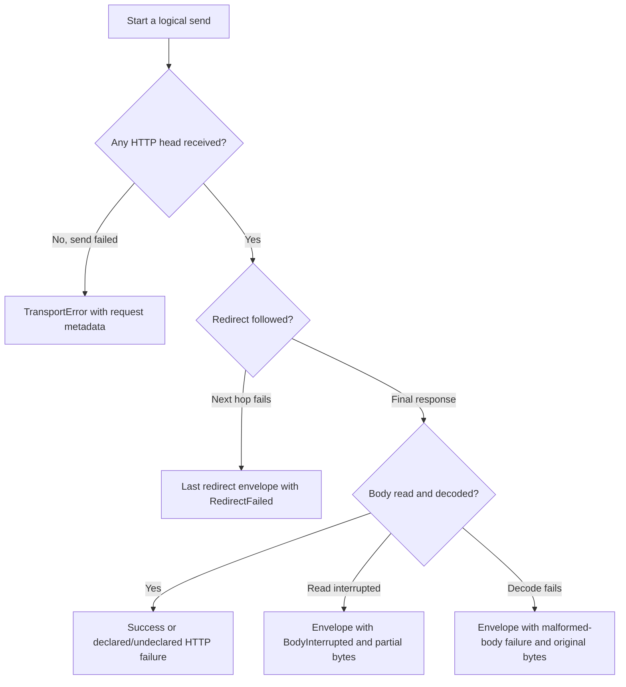

---
$schema:
    status: |-
        enum(
            draft-spec,
            finalized-spec,
            planned,
            implemented,
            review-findings,
            human-in-the-loop,
            completed,
            on-hold,
            abandoned
        ) -> an indicator of progress for this specification
    reviewed: boolean -> indicates whether the specification file has been reviewed by another agent from the one which created the spec
    reviewed_by: string -> the agent and model used in the spec review
    reviewed_on: date -> the date the spec was reviewed
    review_iterations: number -> the number of implementation reviews have taken place in the review/fix cycle
    clarified: boolean -> indicates whether the specification was built -- _in part_ -- with the 'clarify.md' prompt
    implemented: boolean -> indicates whether this spec's plan has been implemented
    implemented_by: string -> the agent who implemented the plan
status: implemented
reviewed: true
reviewed_by: codex/gpt-6.1-sol
reviewed_on: 2026-10-11
review_iterations: 3
clarified: false
implemented: true
human_review: false
parent: ../../reviews/2026-07-31-macro-review/spec.md
depends_on:
    - 2026-10-11-schematic-generation-integrity
refresh_required: false
related: []
next_spec: 2026-10-12-schematic-endpoint-methods
message_to_agent: |-
  All 8 phases are implemented; see implementation-log.md "Phase 8" (Wave 16, Wave 17, Completion state) and the consolidated "Human review agenda" and "Requirement traceability" sections above it. Every local gate is green (schematic test/lint/doctest/test-schema/lint-schema/test-l2; sniff, biscuit-speaks, homelab, model-citizen test+lint), generation is deterministic, and schematic-runtime passed on macOS, Linux, native Windows, and WSL2 via cross-check (no receipts: uncommitted tree).
  For the reviewer: (1) Phase 8 changed code, not only docs: Client::send/send_raw are now `fn -> impl Future` returning Box::pin of the former async bodies (Phase 7 review item 1), pinned by runtime test send::send_futures_stay_small_enough_to_join_many; homelab's consumer-side Box::pin was removed. (2) R18 is a proposed gap for the author's ruling (connect-timeout effect not observed by a mock; 4 TLS builder tests ignored on native Windows). (3) The definitions crate-doc endpoint counts were corrected, so `just doctest` is green for the first time on this branch. (4) Follow-up defects found but not fixed are listed under "Remaining items for the author (Phase 8 additions)"; the obsolete uncompiled generator files still need a human to delete them.
completed: true
---

# Schematic runtime and response envelope

## Reading this specification

This document specifies the shared request runtime used by generated REST
clients. `schematic-gen` generates those clients; `schematic-schema` contains
the generated code; `schematic-define` describes APIs. The new
`schematic-runtime` package will own request execution and response handling.
None of its symbols exist in source yet; each is marked Decided or Proposed in
“Design.”

The `parent` frontmatter names the review `2026-07-31-macro-review`. Its
numbered decisions (D-numbers) are settled authority for this spec; their
current wording is restated here, and the originals are in that review's
section 15, “Decisions and Open Questions.”
Requirement identifiers are defined in “Requirements”; planning-detail
identifiers are defined in “Planning-time details assigned to this spec.”

**Inline review note (2026-10-11).** This review preserves the intended breaking
change to typed sends and managed transport. It clarifies evidence retention,
credential handling, deadlines, and test requirements. “Open Questions” records
major choices that still need the author's review, with conservative defaults
for an unattended implementation. Those defaults are recommendations, not new
author rulings. *Update, 2026-10-11:* D57 (author) ruled every question that
section raised; the rulings are written into the requirements below.

## Problem

Every generated Schematic client (`schematic-schema`, one module per API)
sends requests through code that the generator emits as template text and that
is too thin for the consumers that depend on it. Verified facts, from the
parent review (`2026-07-31-macro-review`, called "the parent" below) unless marked otherwise:

- **A caller can ask for the wrong response type.** The generic
  `request<T>` compiles with any `T`
  (`client.request::<WrongType>(ListModelsRequest::default())`). The shared
  trait `EndpointSpec` already has an associated `Response` type with 547
  generated impls, but no send method uses it (parent section 12, "Related
  fact for D3"). Verified in this tree: `EndpointSpec` is declared in
  `schematic/schema/src/shared.rs`.
- **Errors discard evidence.** `SchematicError::ApiError` carries only
  `status` and `body`; response headers (for example `Retry-After`,
  `x-ratelimit-remaining`) are lost on a non-2xx reply and are not exposed on
  success either. Pagination needs headers on success (gap A1).
- **No credential evidence and no credential policy.** The client resolves
  environment variables internally, never reports which one (or none) it
  used, and has no per-call credential (gaps A3, A4). sniff works around this
  with a hidden anonymous retry (gap A5).
- **No origin boundary.** Nothing checks that a request or a followed
  redirect stays on the configured origin before a credential is attached
  (gaps A6, A7). Default reqwest redirect behavior applies.
- **No shared deadline.** There is a fixed 30 s per-request timeout; an
  operation that spans several requests cannot share one budget (gap A8).
- **Client injection defeats any policy.** The generator emits `with_client`
  and `with_client_and_base_url`, so a caller-built `reqwest::Client` (whose
  redirect behavior is fixed at build time) can bypass any origin rule.
  Verified in this tree: `with_client_and_base_url` is called at
  `homelab/lib/src/eversolo.rs:62` and `homelab/lib/src/samsung_tv.rs:120`;
  the Samsung site also calls `danger_accept_invalid_certs(true)`
  (`samsung_tv.rs:116`) for a self-signed device certificate.
- **The logic is template text.** The runtime that must be correct is emitted
  by `schematic-gen` into `schematic-schema` and is therefore tested only
  through regenerated text.

This spec is the large breaking change of the whole body of work (parent D50,
spec 2 of 8): it moves the runtime into a hand-written package, introduces the
response envelope and typed send, and migrates **every** dependent crate in the
same run.

## Goal and non-goals

### Goal

When this spec's plan is complete and reviewed:

1. A new hand-written package `schematic-runtime` holds the shared runtime
   (envelope, `TransportError`, typed send, credentials, managed HTTP builder,
   cross-origin and redirect logic, shared deadline, redaction, `send_raw`).
2. Every generated request type declares its response type, and the only
   public send path is typed by it. The free generic `request<T>` is gone.
3. Every send returns the `Response<T, E>` envelope (or a `TransportError`
   when no HTTP response head arrived), with the metadata and redaction rules
   below.
4. Credentials follow per-call, client-level, environment, then anonymous
   precedence and are reported; the runtime never retries authentication.
5. Generated clients have no injected HTTP client; a Schematic-managed
   builder replaces it; the cross-origin policy therefore always holds.
6. All 18 API definitions carry the `cross_origin` field (default
   `same_origin`).
7. All dependents (sniff, biscuit-speaks, model-citizen, and the five homelab
   crates; eight crates) build and pass their tests against the new surface.

### Ownership decided for this spec

Boundaries between this spec and its neighbors. They are assignments made
for the eight-spec split; the author confirms them at review 1.

- **Credentials, all of it, including `ApiKeyParam`.** This spec owns
  credential resolution, the credential type, and the `ApiKeyParam` handling.
  It **removes** spec 1's temporary `with_api_key_param` and the
  generator-local environment scan, and migrates their users (R33).
- **The hook mechanism and the `ResponseKind` guard disposition.** The
  mechanism is a marker trait implemented by the codecs that support hooks;
  spec 5 extends it to the stream and GraphQL codecs. `ErrorKind` is
  `#[non_exhaustive]`, so spec 5 adds `UnexpectedContentType` without a
  breaking change (PD17).
- **Plain serde derives on `RestApi`, `Endpoint`, `EndpointParams`, and
  `ParamDef`** are spec 4a's (D56). This spec adds fields to `RestApi` but adds
  no serde derive to any of those types and makes no claim about them.
- **`request_id_header` and `secret_names`**: semantics and the API-level
  fields. Spec 4a owns only builder sugar and the per-parameter `.secret()`
  marker.
- **The area's justfile and its gates**: adding `schematic-runtime` to the
  recipes (R37) and naming `test-schema` as the gate for generated-crate
  mock-server tests.

### Non-goals (other specs own these)

- Pagination model, pagers, `collect_all`, `with_session` (spec 3). This spec
  supplies only the primitives spec 3 needs (page number slot in metadata,
  link-origin check, deadline handle, `InvalidArgument` kind).
- Builders, typed registration, per-endpoint cross-origin override, the
  `oauth_scopes` / `auth_policy` choice (specs 4a and 4b; D56 keeps `auth_policy`
  with a builder form and removes `oauth_scopes`, both spec 4a's; this spec preserves the existing `auth_policy` behavior
  while deferring its builder redesign). **No endpoint literal
  (547; openai 265) is edited in this spec** (parent D42, D30).
- Response model v2 (success and error sets, stream end
  conditions, error mapping), GraphQL primitive and codec, SSE/NDJSON codecs
  (spec 5). The `Decode` trait shape defined here must *allow* them (R30), but
  this spec ships only the JSON, text, binary, and empty codecs.
- Generation integrity, partial generation, the isolated compile check, the
  query-parameter split, and request-side features (spec 1, a dependency).
- WebSocket (spec 6) and fidelity work (spec 7). The session-close grace
  after a deadline expires belongs to spec 3.
- sniff retiring `FocusedProviderClient` (tracked by sniff's own spec,
  starts after spec 3). This spec migrates sniff's *existing uses of the
  generated clients* to the new surface only.
- A generic middleware / hooks mechanism (parent D31 "later hooks
  mechanism"). Only the two existing hooks are preserved (R29).
- Per-endpoint wrapper methods. The parent rules (D53) that none are
  generated (an accepted gap); no later spec is promised them.

## Background: decisions this spec implements

Each decision is restated so the implementer need not open the parent. The
parent is `2026-07-31-macro-review`; its section 15 (“Decisions and Open
Questions”) contains the original numbered decisions. Where a later decision amended an earlier one, only the current
wording is given.

**D3 (typed request only; amended by D7).** Each generated request type
declares its response type; its primary send method is typed by it. The free
generic `request<T>` is removed from the public surface. The send returns the
`Response<T, E>` envelope (D7), not the bare type. The generator must preserve
concrete endpoint types rather than erase them.

**D7 (envelope).** Every send returns `Result<Response<T, E>, TransportError>`.
`Response<T, E>` is a struct with public metadata fields plus an inner enum
`Success(T)` or `Failure(E-bearing error)`, read through `data()` and
`error()` (both `Option`) plus `into_result()`. `T` is the endpoint's declared
success type and `E` its declared failure type. Metadata is present in both
outcomes. Any HTTP status, including a malformed or undeclared error body, is
reported inside the envelope with the raw body retained. Home crate: D39.

**D21 + D48 (envelope metadata).** The envelope carries: status; HTTP method;
full URL with secrets in the query redacted; request headers (redacted);
response headers; query parameters; auth method used; elapsed time; page
number (only when the call is part of a paginated operation); the provider's
request id (only when the definition names that header, via
`request_id_header("...")`; otherwise `None`).

**D48 (details).** An endpoint with no declared error body uses an
uninhabited placeholder error type, so a `Declared` error cannot exist; error
replies arrive as kind `Undeclared` with status, headers, and raw body.
`AuthMethod = PerCall | ClientLevel | EnvVar(name) | Anonymous`, never a
value. Built-in secret names: headers `Authorization`, `Proxy-Authorization`,
`Cookie`, `Set-Cookie`, `X-Api-Key`, `X-Auth-Token`, `Api-Key`; query
parameters `api_key`, `apikey`, `access_token`, `token`, `key`, `signature`.
Redacted values show `[redacted]`.

**D40 (secret marking).** Secrets are marked automatically from auth
strategies (for example an `ApiKeyParam`'s name), by an explicit `.secret()`
marker on any header or parameter in the definition, and by the built-in list.
The redaction set is the union of the three.

**D22 (narrowed promise).** Only Schematic's *stored metadata* and its
`Display` output are guaranteed free of credentials. A provider's decoded error
body is printed as received by `Debug`; a provider that echoes a credential in
an error message can leak it through `Debug` logging. The raw body stays in the
error as evidence and is not altered. The limitation must be stated in the
generated crate's docs for the error types and in the `schematic/docs/` topic
page for the envelope.

**D23 (URL in network-error text).** Network-error text keeps the URL. The
text is composed by Schematic from (1) its own redacted URL (secret query
values show `[redacted]`) and (2) the HTTP library's message with the
library's raw URL removed. The library's own error text is never stored or
shown. A sentinel-key test must prove a query-string key never appears in any
error text. (Requires the query/path split delivered by spec 1.)

**D24 (failures before anything is sent).** These are the outer
`TransportError` with specific kinds (for example
`CrossOriginRejected`, `InvalidArgument`, `Timeout`) and still carry request
metadata. Named cases: page size above the declared
maximum, origin rejected, invalid argument. The parent's "missing credential"
case and sniff's "auth required" `TransportError` kind are superseded by D56
(author, 2026-10-11): no credential resolving is not a failure before sending
(see D11 below); sniff's "auth required" branch reads the server's 401 from
the envelope.

**D25 (undecodable 2xx).** A 2xx reply that cannot be decoded is a Failure
inside the envelope with the real status kept, kind `MalformedSuccess`, raw
body and headers kept, plus an `is_decode_failure()` helper. (A corporate
proxy's HTML login page returned with status 200 is the example.)

**D26 (cut-off body; governing rule).** A reply whose body is cut off after
the headers arrived is a Failure inside the envelope, kind `BodyInterrupted`,
with status, headers, and the partial bytes, plus `is_interrupted()`.
**Governing rule: an envelope exists if and only if an HTTP response head
(status line and headers) was received. The outer `TransportError` means no
response head arrived.** Applied to redirects (**D57 item 7**, author,
2026-10-11, extending D26 and D32): a logical send includes every redirect hop,
so if a later hop fails before its head arrives, the last received redirect
response is retained and the failure is reported inside its envelope as kind
`RedirectFailed { target, category }`, not misreported as the target server's
response. `RedirectRefused` stays a policy refusal.

**D32 (refused redirect or link).** One test: did this call receive an HTTP
response? A redirect refused by the policy (a 3xx was received) is a Failure
inside the envelope, kind `RedirectRefused`, with the redirect status and
`Location` visible. A refused next-page link (no request for it was started)
is the outer `TransportError`, kind `CrossOriginRejected`.

**D11 (credentials).** Callers may pass credentials programmatically at (1)
client level (set once, used by later requests) and (2) per call (overrides
client level). Precedence: per call, then client level, then environment
policy, then anonymous. Environment policy applies only when nothing was set
programmatically: the definition's ordered list of environment variable names
is scanned **once** before sending, the first non-empty variable is selected
(an empty variable counts as unset), and exactly that one credential is sent;
a caller may supply their own ordered list at client level, which replaces the
definition's order. Single attempt: no chain of keys, no retry, and no silent
anonymous retry if rejected; a consumer may make a separate anonymous call.
Every envelope reports the auth method (never the value). Credentials are
resolved once per request, so the report matches what was sent.
**D56 (author, 2026-10-11), D11 literally:** when no credential resolves, the
client sends anonymously and reports `AuthMethod::Anonymous`. For an API whose
definition requires authentication, the server's 401 arrives in the envelope
with its evidence. REST and WebSocket behave the same. There is no
before-sending failure for a missing credential.

**D28 + D30 (cross-origin policy).** The policy for requests to a different
origin is authored in the API definition (a `schematic-define` primitive) and
governs both redirects and followed next-page links. Five values:

| Value | Meaning |
|---|---|
| `same_origin` | Follow only to the same origin (scheme, host, effective port). Anything else is refused. |
| `allow_origins([...])` | Follow to the listed exact origins; credentials are also sent to those. No wildcards, no domain matching. |
| `allow_without_credentials` | Follow to any origin; strip credentials when the origin differs. |
| `allow_any` | Follow anywhere with credentials. Risky; requires an explicit, clearly named opt-in. |
| `deny` | No redirects and no followed cross-links. |

Default when the definition says nothing: `same_origin`. A caller may tighten
the policy but never loosen it beyond the definition. **D56 (author,
2026-10-11), amending D28: tighten-only is one simple rule.** A caller may
choose `deny`, `same_origin`, or an `allow_origins` list that is a subset of
the definition's own list; every other choice is rejected at client
construction. **D57 item 6 (author, 2026-10-11), amending D56 item 2:** the
one exception is a `deny` definition, over which only `deny` may be chosen;
requesting `same_origin` over `deny` is rejected at client construction with a
`BuildError` naming both policies. D28's “never loosen” holds without
exception.
Credentials attach only to allowed origins. Because policies require
Schematic to follow redirects itself, the HTTP client is built with redirects
disabled and Schematic follows them hop by hop: hop limit, per-hop origin
re-check, credential stripping when leaving the origin, and method/body rules
for 301, 302, 303, 307, 308. Landing 1 (specs 1-3) holds the runtime and the
API-level `cross_origin` field on the 18 API definitions; the per-endpoint
override is spec 4a, so **in this spec an endpoint cannot override the policy**.

**D31 (no injected HTTP client; amends D4, D12).** `with_client(reqwest::Client)`
and `with_client_and_base_url` are removed. A Schematic-managed builder covers
proxy, TLS root certificates, timeouts, user agent, default headers, a
shareable connection pool, and a base URL for tests. Author ruling after the
evidence note: the builder also gains an explicitly named, opt-in "accept
invalid certificates" setting for local devices (the Samsung TV with a
self-signed certificate on a home network). The two homelab call sites are
migrated in this spec. **D57 item 8 (author, 2026-10-11), amending D31:**
shared connection state is a `SharedTransport` built once with its proxy and
TLS settings; clients attach with `.transport(&t)` (replacing `.pool(..)`). A
client attached to a shared transport that also sets a conflicting per-client
proxy or TLS option is rejected at construction. Clients without a shared
transport keep per-client settings.

**D13 (shared deadline).** Opt-in. A caller sets one overall deadline for an
operation (all requests it spans) on a monotonic clock. Each request gets the
remaining time, **amended by D56 (author, 2026-10-11): each request under an
opted-in deadline gets `min(remaining budget, the client's per-request
timeout)`**, the per-request timeout defaulting to 30 s and settable on the
managed builder. Once spent, no further request is sent and a `DeadlineExceeded`
error reports the completed requests and elapsed time. Dropping the call
cancels in-flight work and spawns no detached tasks. The 30 s per-request
default is unchanged for callers who do not opt in. Example: a 120-second
deadline whose first request hangs: that request times out at 30 s, leaving
90 s of budget. **D57 item 14 (author, 2026-10-11), extending D56 item 3:** for
stream bodies the per-request timeout bounds time to headers, and after headers
it is an idle bound between items: `next()` waiting longer than the timeout
since the previous item yields a terminal timeout. A shared `Deadline` still
bounds the whole stream.

**D39 (runtime home).** A new hand-written package (working name
`schematic-runtime`) holds the envelope and metadata, `TransportError`,
redirect-following and cross-origin logic, the shared deadline, the pager (spec
3), and redaction. Generated clients depend on it and stay thin. Author-stated
cost: one more package and coordinated versions with the generator.

**D6 as read by D57 item 10 (author, 2026-10-11).** Declared error bodies are
decoded when the response arrives, into `ErrorKind::Declared(E)`; the raw body
stays on the envelope. “Decode on demand” means the caller does not perform
the decode; there is no lazy `err.decode::<E>()`.

**D57 item 9 (client-global `pre_response_json`).** The client-global hook
runs only on successful JSON bodies and is skipped for every other response,
including non-2xx, text, binary, and stream bodies (today's behavior). GraphQL
wire bodies are JSON and are seen by it.

**D45 (`send_raw`).** A clearly named `send_raw` returns status, headers, and
bytes (with a JSON convenience) through the same credentials, cross-origin
rule, deadline, and redaction. Typed sends stay strict. Whether the erasing
request enum remains is left to planning.

**D49 item 5 (`ResponseKind` guard).** The generated client's `ResponseKind`
runtime guard follows the new response model in landing 1: kept, changed, or
removed as that model requires. The behavior on an unexpected response kind
must be covered by a test under the new model, or the guard is gone and the
test list says so. **D56 (author, 2026-10-11): the guard is removed.** A server
reply whose content does not match the endpoint's declared kind is
`MalformedSuccess` with status, headers, and raw body kept.

**D50 (plan structure).** This is spec 2 of 8. Each plan is implemented end to
end without a human in the loop; the tree must be green (macOS, Linux, native
Windows, WSL2; every dependent builds and passes) when the plan ends; the
terminal state is "implementation complete, ready for review"; only the author
moves a spec to `_completed`.

**D53 (no per-endpoint wrappers).** The parent rules that no per-endpoint
wrapper methods are generated; this is an accepted gap.

**D20 item 2.** After each landing, every dependent crate builds and passes its
tests: sniff, biscuit-speaks, model-citizen, and the five homelab crates
(`homelab/lib`, `eversolo-integration`, `arcam-amp-integration`,
`sony-receiver-integration`, `unfolded-integration-helper`).

### Spike evidence (reported by the parent, not re-run by this spec)

Two throwaway prototypes under
`schematic/reviews/2026-07-31-macro-review/spikes/` informed these shapes:

- `typed-send/`: 28 fixture tests, 5 ported sniff call-site tests, 8
  compile-fail cases. One generic `send` covered every fixture including
  streaming and GraphQL (no `send_stream`). Wrong types failed to compile
  with readable errors. Compile cost: today's `EndpointSpec` x550 11.54 s;
  new trait (the spike named it `EndpointSpec`; here `EndpointSpec`) x550 11.70 s; x550 plus 550 `send` calls 18.54 s (about 7 s
  extra), so **do not generate a wrapper method per endpoint**. Incremental
  rebuild cost was not measured. macOS only; HTTP/2, Linux, Windows, WSL2, the
  generator, and real providers were untested.
- `pager-surface/`: deadline (150 ms pages, 400 ms budget: third request cut
  off, error reported 2 completed pages and elapsed, each request received the
  remaining budget, nothing sent afterwards; D56 now bounds each request by
  `min(remaining, per-request timeout)`); drop-cancel on HTTP/1.1 only
  (server saw the connection close, live tasks 1 to 0); host policy (link
  differing in port, scheme, or host rejected with zero requests to the other
  server; a declared extra origin followed). Pager content belongs to spec 3.

## Requirements

Each requirement is testable. Tests follow the Test Toolkit and the
`rust-testing` skill: loopback mocks are ordinary unit/integration tests,
with fixture-owned sockets and shutdown on failure. Use `EnvGuard` (with
`#[serial_test::serial]`, per the skill's fixture pattern) for environment
changes; `serial_test` does not coordinate separate nextest processes, so do
not rely on it for cross-process ordering. Tests reading repository documents use a resolvable
repository-relative path as described in `docs/cicd/test-inputs.md`.
"L1" means `just test` in the named package area;
"L2" means `just test-l2` (must never take window focus; this spec expects no
L2 tests). Mock servers are local; nothing contacts a real provider. "Sentinel
token" means a distinctive fake credential value that must be absent where
stated.

### Package and typed send

**R1. Runtime package exists and owns the shared runtime (D39).** A hand-written
package `schematic-runtime` exists; `schematic-schema` depends on it; the
generator no longer emits the envelope, `TransportError`, redirect logic,
deadline, or redaction as template text into `schematic-schema` (a search of
generator output for those items finds only references to the runtime).
Validated by: L1 in `schematic-gen` (a generation test asserts the generated
`shared.rs` contains no definition of these types) and L1 in
`schematic-runtime` (the types exist and are tested there); workspace
package-list check (`sniff repo packages` lists the new package).

**R2. Typed send; no free `request<T>` (D3).** Each generated request type
implements the runtime's `EndpointSpec` trait (declared success type, failure type,
decoder, endpoint id). The public API of the generated crate and of
`schematic-runtime` exposes no generic `request<T>` that takes a caller-chosen
response type. A call that names a response type other than the declared one
fails to compile. Validated by: compile-fail (trybuild or `compile_fail`
doctests) in `schematic-runtime` covering a wrong success type, a foreign
request type, an impl with a missing associated type, and the absence of
`request<T>`; plus one compile-fail in `schematic-schema`'s test set (or the
isolated generated crate, whichever spec 1 established) showing `request::<T>`
is absent.

**R3. Envelope shape (D7).** `Response<T, E>` has public metadata and an inner
`Success(T)` / `Failure(ApiError<E>)` enum. `data()` returns `Some(&T)` on
success and `None` on failure; `error()` the reverse; `into_result()` agrees.
`into_parts()` returns the metadata with the outcome (so success metadata is
not lost). Validated by: L1 in `schematic-runtime` against a wiremock server
for one success and one failure request.

**R4. Metadata fields (D21, D48).** For a success, a failure, and a
transport-failure result, the metadata holds: status (not on transport
failure), method, redacted URL, redacted request headers, response headers
(not on transport failure), query parameters, `AuthMethod`, and `elapsed`.
`page` is `None` unless the call is marked part of a paginated operation (the
slot exists; spec 3 sets it). `request_id` is `Some(value)` when the
definition's `request_id_header` is present in the response, else `None`; with
no such definition field it is always `None`. Validated by: L1 in
`schematic-runtime` and an end-to-end L1 in `schematic-schema`'s tests for the
request-id case using a definition fixture that sets the field.

**R5. Redaction in stored metadata and `Display` (D21, D22, D40, D48).** With a
sentinel in a built-in secret header, a built-in secret query parameter, an
`ApiKeyParam` name, and a name marked secret in the definition, the sentinel is
absent from every stored metadata field, from the `Display` of the envelope,
the error, and the transport error, in the success, declared-failure,
undecodable-success, and transport-failure cases; the secret values show
`[redacted]`; a non-secret header or parameter (for example `page=2`) keeps
its real value. The built-in names are exactly the D48 lists. Secret values are never stored in metadata (inspect fields, not only printed
text). Raw body bytes and decoded provider values are retained unchanged and
are outside this promise, as required by the error-evidence contract below. Validated by: L1 in
`schematic-runtime` with wiremock; includes a table test over every built-in
name.

**R6. The `Debug` limitation is documented, not denied (D22).** A mock answers
401 with the sentinel in the body. The test asserts the raw body keeps it
(evidence preserved) and that stored metadata and `Display` do not contain it,
and makes no assertion about `Debug` of the decoded body. The limitation text
appears in the runtime's error-type rustdoc and in the `schematic/docs/` topic
page. Validated by: L1 in `schematic-runtime`; a grep-style L1 or doc check
that the text exists in both places.

**R7. Network-error text keeps a redacted URL (D23).** With a secret query
parameter whose value is the sentinel, (a) a connection to a closed port and
(b) a mock that stalls past the timeout each produce a `TransportError` whose
`Display` and `Debug` contain no sentinel, show the URL with the secret value
as `[redacted]`, and still show a non-secret parameter. The HTTP library's raw
URL appears nowhere in stored fields or text. Validated by: L1 in
`schematic-runtime` (closed-port and stalled-server cases).

### Failure placement and kinds

**R8. Governing rule (D26, D32).** If a call received an HTTP response head the
result is `Ok(Response)`; if not it is `Err(TransportError)`. Validated by: L1
table test in `schematic-runtime`: connection refused gives `TransportError`;
a 500 with an empty body, a 200 with an undecodable body, and a body cut off
after headers each give an envelope.

**R9. Pre-send failures are `TransportError` with request metadata (D24).**
An origin rejected by policy and an invalid argument each
return `Err(TransportError)` with its specific kind, carrying redacted request
metadata and `elapsed`, and the mock records zero requests. Validated by: L1 in
`schematic-runtime`, one case per pre-send kind in PD7 (the page-size-above-max
kind is exercised through the `InvalidArgument` constructor spec 3 will call).

**R10. `MalformedSuccess` and `is_decode_failure()` (D25).** A mock answering a
JSON endpoint with status 200, `Content-Type: text/html`, and an HTML body
yields a Failure inside the envelope: status 200, kind `MalformedSuccess`, raw
body and headers kept, `is_decode_failure()` true, `into_result()` `Err`.
`is_decode_failure()` is false for a failure of any other kind and for a
success. Validated by: L1 in `schematic-runtime`.

**R11. `BodyInterrupted` and `is_interrupted()` (D26).** A raw-socket mock sends
a 200 with `Content-Length` larger than the bytes written, writes part of the
body, and closes. The result is an envelope Failure of kind `BodyInterrupted`
with status and headers present and partial bytes equal to what was sent;
`is_interrupted()` true and false for every other kind. Validated by: L1 in
`schematic-runtime` using a `tokio::net::TcpListener` mock (wiremock cannot
cut a body). Platform behavior of an abrupt close may differ on Windows
(unverified); see Risks.

**R12. `Undeclared` and the uninhabited placeholder (D48).** For an endpoint
with no declared error body, a `Declared` error value cannot be constructed
(compile-fail test on the placeholder type), and a 4xx or 5xx reply arrives as
kind `Undeclared` with status, headers, and raw body. Validated by:
compile-fail plus L1, both in `schematic-runtime`.

**R13. Declared failures decode when the response arrives (D6 groundwork, D7,
D57 item 10).** For a fixture endpoint whose failure type is a real struct, a
declared 4xx body is decoded by the runtime when the response arrives, into
`Declared(E)` with status and headers, and the raw body stays on the envelope;
the caller performs no decode step. An undecodable body for a
declared status yields kind `MalformedError` with the raw body kept. (No
shipped definition declares an error body until spec 5; this requirement
proves the trait path with a runtime-test fixture.) Validated by: L1 in
`schematic-runtime`.

### Credentials

**R14. Precedence (D11).** With sentinel tokens present at per-call, client
level, an environment variable, and nowhere, the mock sees exactly one
credential per request, in the order per-call, client-level, environment,
anonymous; removing the winner makes the next one win. With nothing resolving, the mock
receives one request with no credential and the envelope reports
`AuthMethod::Anonymous`, for an API whose definition requires authentication as
well (D56); a mock 401 arrives as an envelope Failure with its status, headers,
and raw body. Validated by: L1 in
`schematic-runtime` (generic) and one L1 through a generated client in
`schematic-schema`'s test set.

**R15. Environment scan (D11).** With several variables listed, the first
non-empty one is sent (an empty one is skipped); a caller-supplied ordered
list at client level replaces the definition's order. Validated by: L1 with
process-environment isolation using the Test Toolkit's `EnvGuard`;
all background work using that environment finishes before the guard drops.

**R16. Resolved once; single attempt; reporting (D11, D48).** Changing the
environment variable between resolution and the response does not change the
reported auth method; when the mock answers 401 it has received exactly one
request (no second request with another key or none); the reported auth method
is exactly one of `PerCall`, `ClientLevel`, `EnvVar(name)`, `Anonymous`, and
the sentinel is absent from stored metadata and `Display` (provider bodies
remain unchanged). Validated by: L1 in
`schematic-runtime`.

### Managed builder and client injection

**R17. No injected client (D31).** The generated clients have no constructor
that accepts a `reqwest::Client`; `with_client` and `with_client_and_base_url`
are absent from the public API of `schematic-schema` and `schematic-runtime`.
Validated by: compile-fail test; and a generation test asserting the generator
no longer emits those names.

**R18. Builder surface (D31, D57 item 8).** The managed builder supports: base URL (for
tests), per-request timeout (default 30 s), connect timeout, proxy, extra TLS
root certificates, user agent, default headers, attachment to a
`SharedTransport` (`.transport(&t)`, replacing `.pool(..)`),
and a named opt-in accept-invalid-certificates setting. A `SharedTransport` is
built once with its proxy and TLS settings, always by Schematic with redirects
disabled. A client attached to one that also sets a conflicting per-client
proxy or TLS option is rejected at construction with a typed `BuildError`; a
client without a shared transport keeps per-client settings. Each is observed by a
local mock: a proxy setting routes through a mock proxy; a custom root
certificate lets a local TLS mock be reached and its absence fails; the
timeouts, user agent, and default headers are observed by the mock; two
clients attached to one `SharedTransport` reuse a connection (sequential, fully
drained HTTP/1.1 requests to a keep-alive mock that counts accepted
connections; reuse across different origins is not expected); attaching a
shared transport and also setting a per-client proxy fails construction; a
test base URL redirects calls to the mock; accepting invalid
certificates reaches a self-signed local TLS mock and the default does not.
Validated by: L1 in `schematic-runtime` (local TLS and proxy mocks are
dev-dependencies; see PD33).

**R19. No path produces a client that follows redirects by itself.** For every
constructor and builder combination, the cross-origin tests (R22 to R26) pass,
and the underlying HTTP client is built with redirects disabled. Validated by:
L1 in `schematic-runtime` (a test builds clients through every public
constructor and asserts a 302 to another origin is not followed unless the
policy allows).

### Cross-origin

**R20. API-level field on all 18 definitions (D28, D30).** `RestApi` gains a
`cross_origin` field of a `schematic-define` type with the five values; all 18
API definitions in `schematic-definitions` set it; a definition that sets
nothing explicit behaves as `same_origin`; the generated client reads it from
the definition. In this spec an endpoint cannot override it. Validated by: L1 in
`schematic-define` and `schematic-definitions` (all 18 carry the field); L1 in
`schematic-gen` (generated code carries the policy); and a positive test of
the current public surface of `schematic-define` (the endpoint type exposes
no cross-origin setter, and no GraphQL primitive is exported). That surface
test is frozen to today's API: specs 4a and 5 retire or update it when they
add the per-endpoint override and the GraphQL primitive (see Refresh notes
and the Human review agenda). It is deliberately not a compile-fail test,
which would fail for the wrong reason once those specs land.

**R21. Allowed-origin rules (D28).** An origin is the exact (scheme, host,
effective port). `same_origin` allows only the base origin. `allow_origins`
allows the base plus the listed origins; a sibling subdomain and a different
port are not allowed. `deny` follows no redirect and no cross-origin link.
Validated by: L1 table test in `schematic-runtime` over base origin A and
origins B, B-sibling-subdomain, B-different-port, scheme change, default-port
spelling (`:443` explicit versus implicit).

**R22. Redirect matrix (D28).** Run once with two mock origins A (base) and B,
with B reached by a redirect from A:

- `same_origin`: B receives zero requests; the result is an envelope Failure
  kind `RedirectRefused` with the 3xx status and `Location` visible in the
  response headers (D32); a same-origin redirect is followed.
- `allow_origins([B])`: B is followed and receives the credential; an unlisted
  origin receives zero requests.
- `allow_without_credentials`: B is followed and receives no credential in any
  form (`Authorization` header, `Cookie`, and a query-string API key); a
  same-origin hop keeps its credential.
- `allow_any`: B is followed and receives the credential. The opt-in is
  explicitly and clearly named (compile-level check that no default or typo
  reaches it).
- `deny`: no redirect is followed (zero requests beyond the first).
- A chain A to A to B is re-checked at each hop.
- Default (nothing set) behaves exactly as `same_origin`.

Validated by: L1 in `schematic-runtime` with two wiremock servers.

**R23. Link check for spec 3 (D32, D28).** The runtime exposes a function that
checks a would-be next-page URL against the policy *before* any request for it
starts and returns `TransportError` kind `CrossOriginRejected` on refusal.
Under `same_origin` a link to origin B yields that error with zero requests to
B; a same-origin link passes under every value including `deny` (PD2).
Validated by: L1 in `schematic-runtime`. Spec 2 has no pager, so this is
tested on the function and through one generated-client call that follows an
absolute URL; the pager integration is spec 3's.

**R24. Redirect mechanics.** Hops are limited (PD3); exceeding the limit is an
envelope Failure kind `RedirectRefused` with the last 3xx visible. 301 and
302 on POST, and 303 on any method except HEAD, change the method to GET and
drop the body and body headers; 307 and 308 preserve method and body (PD4). A
redirect with no `Location`, or an unparsable one, is an envelope Failure
kind `RedirectRefused`. Each followed hop re-decides whether the
already-resolved credential is attached for the new URL (D11: credentials are
resolved once per request, not once per hop). A followed hop that fails before
its response head arrives (connection refused, TLS failure, timeout, or
deadline expiry) is an envelope Failure of kind
`RedirectFailed { target, category }` (D57 item 7) describing the last
received 3xx: its status, headers including `Location`, and URL stay in the
metadata; `target` is the redacted URL of the failed hop and must not replace
the URL describing the last received response; `category` is a sanitized
failure category. The last response's body is retained if it was read; if
reading it fails first, the result is `BodyInterrupted`. A policy,
invalid-`Location`, or hop-limit refusal stays `RedirectRefused`. Validated by: L1 in `schematic-runtime` (one case per status;
a mock 302 to a refused port yields `RedirectFailed` with the 302's status and
`Location` kept, and a policy refusal of the same 302 still yields
`RedirectRefused`).

**R25. Tighten-only override (D28, D56, D57 item 6). Decided: D56 and D57 item 6
(author, 2026-10-11).** A
caller may set the policy to `deny`, to `same_origin`, or to an `allow_origins`
list that is a subset of the definition's own `allow_origins` list, except that
over a `deny` definition only `deny` may be chosen. Every other
choice (any value when the definition's value is not `allow_origins` and the
choice is not `deny` or `same_origin`; an `allow_origins` list containing an
origin the definition does not list; `allow_without_credentials`; `allow_any`;
`same_origin` over a `deny` definition)
is rejected at client construction with a typed `BuildError`, and no request is
sent. The `BuildError` for `same_origin` over `deny` names both policies. A
choice equal to the definition's own value passes only if it is one of
the three allowed forms. Validated by: L1 table test in `schematic-runtime`
(each allowed form takes effect; each rejected form fails construction with zero
requests at the mock; `allow_origins` subset accepted, superset and disjoint
list rejected; `same_origin` over `deny` is a construction error naming both
policies, while `same_origin` over `same_origin` and over `allow_*`
definitions succeeds).

### Deadline, raw, hooks, guard

**R26. Shared deadline (D13, D56). Decided: D56 (author, 2026-10-11).** A
deadline object created once can be passed to several sends. Each request under
an opted-in deadline gets `min(remaining budget, the client's per-request
timeout)`; the per-request timeout defaults to 30 s and is settable on the
managed builder. Across N requests to a mock that delays each response, a
deadline smaller than the sum stops the operation: no request is sent after the
deadline and a `DeadlineExceeded` `TransportError` reports the completed
request count and elapsed time when no head arrived during that send.
If a head has arrived, expiry produces `BodyInterrupted`, or
`RedirectFailed` when between hops (D57 item 7), inside the envelope; for a
stream body, expiry after headers is a terminal stream-item timeout (D57
item 14). Worked example: a 120-second deadline and a
first request to a mock that hangs: the first request times out at 30 s before any head arrives
(`Timeout`), leaving 90 s of budget for the next request (the test uses scaled
short controlled durations and checks that the per-request timeout leaves
budget for another send rather than asserting an exact remainder). A deadline
shorter than the per-request timeout bounds the request at the remaining time
(the mock records the effective timeout or the time it gave up). Dropping the
future cancels in-flight work (use a still-running HTTP/1.1 body to observe
connection close; an already-reusable idle connection need not close) and
no task keeps running (a runtime shutdown completes promptly). Without a
deadline the per-request timeout applies unchanged. Validated by: L1 in
`schematic-runtime`. The monotonic-clock property is validated by inspection of
the use of `Instant` (a wall-clock-moving test is not portable).

**R27. `send_raw` (D45).** `send_raw` returns status, headers, and bytes
(with a JSON convenience) through the same credential resolution, cross-origin
policy, deadline, and redaction as typed sends: sentinel absent from stored
metadata and `Display`; a cross-origin redirect refused under `same_origin`;
a deadline honored. Typed sends still fail to compile for a wrong response
type. Validated by: L1 in `schematic-runtime`.

**R28. `ResponseKind` guard removed (D49, D56). Decided: D56 (author,
2026-10-11).** The runtime guard and its error are removed; this spec adds no
`UnexpectedContentType` (spec 5 may add it). A server reply that does not match
the endpoint's declared kind (a JSON endpoint receiving non-JSON content) is
`MalformedSuccess` (R10) with status, headers, and raw body kept; a text or
binary endpoint decodes any content type. The implementation log lists the
tests that replace the guard. Validated by: L1 in `schematic-runtime` and
`schematic-schema`, plus a search showing the guard and its error are gone.

**R29. Existing hooks preserved (typed-send spike, Q2). Proposed: the parent
decides neither the hook types, the mechanism, `ErrorKind::Hook`, nor the
compile error below.** `pre_response_json`
(client-global) and `mutate_response::<R>` keep working for JSON endpoints
through the typed send, with a mutator typed by the endpoint's declared success
type. A typed mutator registered on a text, binary, or empty endpoint is a compile
error (today it is silently never run); the mechanism is a marker trait
implemented only by the JSON codec, which spec 5 extends to the stream and
GraphQL codecs. A hook that fails yields kind `Hook` with the original bytes retained.
The client-global hook has no endpoint type at registration, so the
compile-error promise covers typed mutators only. **Decided (D57 item 9):** the
client-global hook runs only on successful JSON bodies and is skipped for every
other response, including non-2xx, text, binary, and stream bodies (today's
behavior); GraphQL wire bodies are JSON and are seen by it. Ordering, as
today: JSON body, then client-global hook, then success decode, then typed
mutator. Declared-error decoding and raw sends bypass both hooks. JSON parse
failures remain `MalformedSuccess` or `MalformedError`; hook failures are
`Hook`, with raw evidence preserved and safe `Display` text.
Validated by: L1 and compile-fail in `schematic-runtime` (including a
registered global hook that runs on a 2xx JSON body and is not run for a 4xx
JSON error body or a text endpoint's body); existing generated
hook tests in `schematic-schema` still pass or are migrated and listed in the
log.

**R30. The `Decode` trait allows later codecs (spike Q1). Proposed: the
trait detail is the spike's recommendation, not a parent decision.** The `Decode` trait
receives the live response (not a pre-buffered body) and returns a success
value of an arbitrary associated type, so a stream of items and a generated
multi-shape enum are expressible. The decoder receives the expiration state
that D57 item 14 needs for stream bodies (per-request timeout as an idle bound
between items after headers, shared `Deadline` over the whole stream).
Validated by: L1 in `schematic-runtime` with
two test-only decoders (an incremental line stream where the first item is
observed before the mock finishes sending, and a two-shape enum). No SSE,
NDJSON, or GraphQL codec ships in this spec.

### Generator, migration, hygiene

**R31. Generated clients are typed and thin.** Per endpoint the generator emits
the request type, the `EndpointSpec` impl, and constants; it emits **no wrapper
method per endpoint** that forwards to `send` (compile-cost evidence above;
parent D53), with no exception. A fresh
generation compiles in the isolated crate established by spec 1, which now
includes `schematic-runtime`. Validated by: L1 in `schematic-gen` (generated
output assertions) and the spec-1 isolated compile check.

**R32. Runtime and generator versions are checked (D39, P4).** The generated
crate fails to compile, with a readable message, against a `schematic-runtime`
whose ABI marker differs from the one the generator was built for (PD11).
Validated by: L1 in `schematic-gen` (a test generates against a doctored
marker and asserts the isolated compile fails), and a second test that a
differing marker drives spec 1's partial-generation check to require full
generation (spec 1 defines that interface; this spec supplies the constant).
The constant and the check are Proposed (PD11); the parent does not decide
them.

**R33. Dependents migrate and pass.** sniff, biscuit-speaks, model-citizen,
`homelab/lib`, `eversolo-integration`, `arcam-amp-integration`,
`sony-receiver-integration`, and `unfolded-integration-helper` build and pass
their own tests, with no remaining use of `request<T>`, `with_client`,
`with_client_and_base_url`, the old `SchematicError` variants, or an injected
`reqwest::Client` for a generated client. `homelab/lib/src/eversolo.rs` and
`homelab/lib/src/samsung_tv.rs` use the managed builder (the Samsung site uses
the opt-in accept-invalid-certificates setting only when HTTPS is used, as
today; the 5 s connect timeout and 10 s request timeout are preserved).
The migration list also includes spec 1's temporary `with_api_key_param`
and generator-local environment scan: this spec removes both and migrates every
user of them onto the runtime's credential handling (R14 to R16). Behavior is
preserved: sniff's anonymous retry stays in sniff (PD31); sniff's
"auth required" branch reads the server's 401 from the envelope (D56: no
credential resolving sends anonymously; there is no `MissingCredential`).
Validated by: `just test {pkg}` from the repo root (or `just test` in the
package area), plus `just lint` in each affected package area; a search for the removed names across the dependents.

**R34. Sentinel never leaks in the migrated consumers' logs.** No migrated
consumer formats a response header map or a request URL from the generated
client with a path that bypasses the redacted metadata. Validated by: L1 in
sniff (existing log/evidence tests still pass) and review of the call-site
inventory in the implementation log (not mechanically testable beyond that;
stated as such).

**R35. Generated WebSocket modules still compile (spec 6 groundwork).** The
generated WebSocket template modules compile after the shared runtime moves
into `schematic-runtime`. Validated by: the spec-1 isolated compile check
over a fresh generation that includes the WebSocket modules, plus `just
lint-schema`.

**R36. Withdrawn (D56, author, 2026-10-11).** The rule that a send fails before
sending when no credential resolves is deleted; see D11. The number is kept so
that R references stay stable. The anonymous behavior is covered by R14 and R16.

**R37. Area justfile and gates.** `schematic-runtime` is added to the
`schematic/justfile` recipes that enumerate packages (`sanity`, `test`, `lint`,
and the other per-package recipes there, for example `build`, `test-l2`,
`doctest`), and `test-schema` is named as the gate for the generated-crate
mock-server tests. Read-only verification, 2026-10-11: the CI planner
(`scripts/ci/affected_scope.py`) reads workspace members from
`cargo metadata` and derives the package area from the manifest directory, so a
workspace member at `schematic/runtime/` is discovered in area `schematic`
without a CI change. This was established by reading the planner, not by
running it; phase 1 confirms with `just ci-local --plan` and records the
result. CI is not changed by this spec. Validated by: the recipes run the new
package; `sniff repo packages` lists it.

## Design

Packages and key symbols. **Decided** means a parent decision covers it (cited).
**Proposed** means the spike recommended it or this spec proposes it; the
implementer adopts it unless a design problem is found and logs either way.

### `schematic-runtime` (new, hand-written, `schematic/runtime/`)

Decided: the package exists and holds the shared runtime (D39). Name and
location are Proposed (PD11).

| Symbol | What it does | Status |
|---|---|---|
| `EndpointSpec` trait | Links a request type to `Success`, `Failure`, `Decode`, `ENDPOINT_ID`, `DECLARED_ERROR_STATUSES` (default `400..=599`). Named `EndpointSpec` for continuity with the existing generated trait and to avoid colliding with the `schematic-define` struct `Endpoint`. | Name Decided (D56, author, 2026-10-11); `Decode` detail and `DECLARED_ERROR_STATUSES` Proposed (typed-send spike); typed association Decided (D3) |
| `Decode<E>` trait | Async decode of the live response into `Output`; one impl per codec; a multi-shape success is a generated enum returned by a decoder. | Proposed (not a parent decision) |
| Codecs `Json<T>`, `Text`, `Binary`, `Empty` | Built-in decoders. SSE, NDJSON, GraphQL codecs are spec 5. | Proposed |
| `Response<T, E>` { `meta`, `outcome` } | The envelope; `data()`, `error()`, `into_result()`, `into_parts()`, `is_decode_failure()`, `is_interrupted()`. | Decided (D7, D25, D26); `into_parts` Proposed |
| `Outcome<T, E>` = `Success(T)` / `Failure(ApiError<E>)` | Inner enum. | Decided (D7) |
| `ApiError<E>` { `kind`, `body: Bytes` } | Failure with raw body always kept. | Decided (raw body, D7); shape Proposed |
| `ErrorKind<E>` (`#[non_exhaustive]`) | `Declared(E)`, `Undeclared`, `MalformedError`, `MalformedSuccess`, `BodyInterrupted`, `RedirectRefused`, `RedirectFailed { target, category }`, `Hook`. | `Declared`, `Undeclared`, `MalformedSuccess`, `BodyInterrupted`, `RedirectRefused` Decided (D25, D26, D32, D48); `RedirectFailed` Decided (D57 item 7); `MalformedError`, `Hook`, `#[non_exhaustive]` Proposed (S17 unratified); spec 5 may add `UnexpectedContentType` (this spec adds none; D56) |
| `NoDeclaredError` | Uninhabited placeholder failure type. | Decided (D48); name Proposed |
| `ResponseMeta` / `RequestMeta` | Metadata fields of D21/D48, all redacted, plus `endpoint_id`. | Decided (field set); struct layout Proposed |
| `AuthMethod` | `PerCall`, `ClientLevel`, `EnvVar(name)`, `Anonymous`. | Decided (D48) |
| `TransportError` { `request`, `kind`, `elapsed` } | Outer error, no response head. Kinds: PD7. | Decided (D24 existence); kind list Proposed |
| Redaction module | Union of built-ins (D48), definition-marked names, and auth-strategy names; produces `[redacted]`; builds the Display text of D23. | Decided |
| `Credential` and `CallOptions` | Client-level and per-call programmatic credentials, caller ordered env list, per-call deadline, explicit anonymous mode. Policy tightening is builder-only in this spec. | Decided (D11, D13, D28); names and explicit anonymous mode Proposed (PD28) |
| `ClientBuilder` / `Client` | Managed transport; redirects disabled in the HTTP client; follows redirects itself. | Decided (D31); surface Proposed (PD8) |
| `SharedTransport` | Shared connection state built once with its proxy and TLS settings; clients attach with `.transport(&t)`; a conflicting per-client proxy or TLS option on an attached client is a construction error. | Decided (D57 item 8); builder detail Proposed (PD8) |
| `OriginPolicy` | Runtime form of the five-value policy plus `check_link`. | Values Decided; runtime type and `check_link` Proposed (PD29, PD30) |
| `ABI` constant | `pub const ABI: u32` checked by generated code and read by spec 1's partial-generation check. | Proposed (PD11) |
| `Deadline` | Monotonic (`Instant`) shared deadline handle. | Decided (D13); form Proposed |
| `send`, `send_raw`, `RawResponse` | Typed and raw send. | `send_raw` Decided (D45); signature Proposed (PD14) |
| Hook types (`PreResponseJsonHook`, mutators) and the marker trait | Moved from generated text; the marker trait gates which codecs accept hooks. | Proposed (types, mechanism, and the compile error of R29); spec 5 extends the marker trait |

The contracts in the next five subsections refine the numbered requirements:
API identity refines typed-send checks; credential construction refines
precedence and migration; redirect evidence refines the origin and failure
checks; deadline ownership refines timeout/decoder checks; raw completeness
refines `send_raw`. Include their representative cases in those existing
suites rather than creating separate test campaigns. The former “Open
Questions” defaults were ruled by D57 (items 6 to 9) and are written in as
decided.

### Request construction, credentials, and API identity

**Preserve the effective authentication policy.** In `schematic-define`,
[`RestApi::effective_auth_policy`](../../define/src/types.rs) selects an
explicit policy when present and otherwise translates the legacy strategy.
[`AuthPolicy`](../../define/src/auth.rs) describes accepted programmatic
methods separately from the environment fallback. The generator already
uses this distinction in
[`generate_auth_helper_methods`](../../gen/src/codegen/client/helpers.rs)
(`schematic-gen`). Moving execution to the runtime must preserve it; the
later builder rewrite does not authorize ignoring it now. Generate runtime
configuration from the effective policy, without making the runtime depend
on `schematic-define`. OAuth access tokens are supplied out of band; this
spec neither acquires nor refreshes them.

`Credential` is a redacted enum distinguishing bearer/OAuth access token,
API-key value, and Basic username/password. A mismatched explicit credential
is a typed construction error at client level or `InvalidArgument` before
sending at call level. Preserve custom bearer headers and API-key prefixes.
Environment fallback selects the first non-empty value from the selected
method's configured list, including `EnvMapping` overrides. For Basic auth,
resolve username and password once, independently; if either is absent, send
anonymously. `AuthMethod::EnvVar(name)` names the selected password variable;
it carries no username or password. Programmatic Basic credentials supply
both fields. The runtime metadata enum named `AuthMethod` reports the source;
it is distinct from the existing definition enum of the same name, which
selects the method. Imports and public docs must qualify the two clearly.

`CallOptions` includes an explicit anonymous mode, mutually exclusive with a
per-call credential. This bypasses client and environment credentials and
removes authentication header/query/cookie values from the assembled request.
Without it, omission of a per-call credential means normal precedence, not
anonymous mode. This lets sniff make its separate anonymous retry without
changing process environment or unexpectedly resending a rejected key.

Normalize auth supplied through existing `Headers`/variant APIs into the
same resolver during migration. Generic default headers must not create a
second credential source: reject auth-bearing defaults with a typed error
and direct callers to credential configuration. Reject collisions between an
injected API key and an already supplied query/cookie value of that name;
do not append duplicate credentials. Ordinary duplicate query values remain
ordered and supported. Tests cover Basic, custom headers/prefixes,
query/cookie keys, explicit policies differing from legacy strategies, and
forced anonymous calls as well as bearer-token precedence.

A generated client's `send` and `send_raw` accept only request types for that
API, using an associated API marker on `EndpointSpec` or an equivalent
compile-time bound. Endpoint names alone are not globally unique. Runtime
hook lookup includes API identity and endpoint identity, so two APIs sharing
an endpoint name cannot invoke each other's mutators. Compile-fail coverage
must pass an actual generated request from one API to another API's client;
an arbitrary type missing `EndpointSpec` proves only the trait bound.

### Redirect construction and retained evidence

The configured base URL establishes the base origin, including for local
mocks. Validate it and configured allowlist entries at construction: HTTP(S)
only, a host, no username/password, and allowlist entries consisting of an
origin only (no non-root path, query, or fragment). Compare parsed origins,
including effective ports, rather than raw strings. Resolve relative
`Location` values against the URL of the response that carried them. Remove
fragments before sending. A destination containing user information or a
non-HTTP(S) scheme is refused before any credential is attached.

Reconstruct each hop from request parts, not from a previously authenticated
URL or header map. Apply the already-resolved credential only when the target
is permitted to receive it. Under `allow_without_credentials`, this decision
compares each target with the configured base origin, not the previous hop:
A → B → B remains credential-free on both B requests; returning to A may
reattach the credential. Strip auth-strategy headers and secret-marked
headers/query values as well as Authorization and Cookie when leaving A.
Do not forward an explicit Host header from A. Proxy authorization belongs
only to proxy configuration. No cookie jar is enabled by this spec.

On method-changing redirects, remove body-specific headers, including
Content-Length, Content-Type, Content-Encoding, and Transfer-Encoding; HEAD
stays HEAD on 303 and has no body. Typed request bodies remain replayable;
streamed request uploads are outside scope. A destination rejected by the
policy must receive zero requests, not merely zero credentials.

Metadata describes the final received hop (or last received hop on failure),
with request method, URL, query values, and headers matching that hop and auth
source reported as `Anonymous` when its credential was stripped. Elapsed time
covers the whole logical send. Preserve repeated response headers instead of
collapsing them to a single value. Request metadata captures the assembled
application-level request; it does not promise access to headers added
internally by the HTTP implementation.

**Reader's note: redaction preserves evidence without storing credentials in
metadata.** Header-name masking alone is insufficient for `Location`, which
can contain a secret query parameter. Sanitize URL-valued Location headers
using the same query-name rules as request URLs; keep non-secret destination
information visible. Request IDs copied from a secret-marked header must
also be redacted. Network and hook diagnostics must use safe categories and
redacted context, never retain an unchecked library error/source chain or a
hook's arbitrary error string. Raw body bytes and decoded provider values
remain unchanged; `RawResponse::Debug`, like provider-body `Debug`, can expose
those values. Their `Display` implementations omit body contents.

### Deadline and decoder ownership

Compute one expiration instant at the start of a logical send:
`min(start + per_request_timeout, shared_deadline_expiration)` when a shared
deadline is present. Redirects, response-head waits, and buffered body reads
all consume this same budget; a hop never restarts it. Before any head,
expiration is `DeadlineExceeded` if the shared deadline is limiting, otherwise
`Timeout`. After a head, body-read expiration is `BodyInterrupted`; expiration
between redirects is `RedirectFailed` (D57 item 7, R24). Stream bodies differ
after the head (D57 item 14): the per-request timeout becomes an idle bound
between items rather than part of this single budget, and only the shared
deadline, when present, still bounds the whole stream.

`Deadline` clones share the same monotonic expiration and a thread-safe
completed-request counter. Count one completed logical send after its outcome
has been classified, including an HTTP failure; do not count redirect hops,
pre-head transport failures, or dropped sends. Report the count preceding the
failed send and elapsed time since handle creation in deadline failures.
A request with an exhausted budget is rejected before network work begins.
This count concerns requests; pagination translates it to completed pages
where appropriate. Test redirect budget consumption and pre-head versus
post-head expiration with short controlled mock delays and readiness signals.
Do not assert an exact 9-second remainder or depend on fixed readiness sleeps.

The runtime owns response classification and constructs metadata before
passing the live response to a decoder. A decoder must preserve partial bytes
on buffered read failure and original bytes on parse/hook failure; a naked
`Result<Output, reqwest::Error>` cannot satisfy this contract. Buffering codecs
retain original bytes independently of any JSON-hook transformation. Text
uses the existing text-decoding semantics; binary returns bytes; Empty drains
the body under the same budget and returns `()` (unexpected body bytes are
ignored after draining). JSON uses successful parsing as the validity check;
a misleading content-type header alone does not reject valid JSON.

A test-only streaming decoder returns an owned stream carrying the response,
cancellation, and expiration state; it cannot borrow a soon-to-be-dropped
`send` stack frame. Later read failures are stream-item errors because the
envelope has already been returned. Its expiration state follows D57 item 14:
`next()` waiting longer than the per-request timeout since the previous item
yields a terminal timeout item, and a shared `Deadline` bounds the whole
stream. Stream-item shape and provider error
selection are deferred to the later response-model spec. In this spec prove
ownership and first-item delivery without defining an SSE/NDJSON protocol.

The response-head boundary determines which result can retain HTTP evidence:

### Raw response contract

`RawResponse` has one metadata record, bytes, and a completion disposition:
complete, body interrupted, redirect refused, or redirect following failed
(the raw form of `RedirectFailed`, D57 item 7).
Do not maintain independent status/header fields that can disagree with
`meta`; expose convenience accessors instead. HTTP 4xx/5xx remain complete raw
responses, with no status-based decode classification. The other dispositions
preserve the same evidence as typed sends and never become an outer transport
error after a head. `json::<T>()` refuses an incomplete response before parsing,
even if its partial bytes happen to form valid JSON; a separate explicit
inspection of `body` remains available. Raw sends do not invoke JSON hooks or
success mutators. Tests cover incomplete bodies, refused redirects, and a
failure connecting after a redirect, not only complete 200 responses.

### `schematic-define`

- `CrossOrigin` (name Proposed, PD6/PD29): five-value enum; `allow_origins`
  holds exact origin strings. **Decided** (D28 values, default).
- `RestApi` gains `cross_origin: CrossOrigin`, `request_id_header:
  Option<String>`, and `secret_names: Vec<String>` (extra header and query
  names treated as secret). The first is **Decided** (D30); the second is
  **Decided** as to the facility (D48) with the field form **Proposed**; the
  third is **Proposed** (PD25: per-parameter `.secret()` markers wait for spec
  4a so that no endpoint-literal edit (547) happens here). This spec
  owns the semantics of `request_id_header` and `secret_names` and the
  API-level fields; spec 4a owns only builder sugar and the per-parameter
  `.secret()` marker.

### `schematic-definitions`

- Each of the 18 API definitions sets the new fields (`cross_origin`, and
  `request_id_header` where the provider is known to send one; absent
  otherwise). **Decided** (D30, D48). Which APIs set a request-id header and
  which set `allow_origins` (for example GitHub's upload host) is a content
  decision: Default in PD25.

### `schematic-gen`

- The client generator emits per-request `EndpointSpec` impls and constants that
  reference `schematic_runtime`; stops emitting the shared runtime text; stops
  emitting `with_client*`; emits the cross-origin and secret-name data from
  the definition; emits the ABI marker check; keeps or removes the erasing
  request enum per PD13. Package: `schematic-gen`. **Decided** (D3, D31, D39);
  details Proposed.
- Generated `Cargo.toml` of `schematic-schema` gains the runtime dependency
  (generator-owned file; regenerate, never hand-edit).

### `schematic-schema`

Regenerated only (parent rule: never hand-edited). It remains excluded from
the root workspace (`exclude` in the root `Cargo.toml`, verified); dependents
reach it by path.

### Dependents

Eight crates: `sniff/lib`, `biscuit-speaks/lib`, `model-citizen/lib` (a
manifest dependency only, no Rust references; confirm and log), and the five
homelab crates (`lib`, `eversolo-integration`, `arcam-amp-integration`,
`unfolded-integration-helper`, `sony-receiver-integration`) migrate call sites
mechanically (R33). Raw grep of `.request(` and `request::<` finds about 60
sites (not filtered to generated clients): sniff remote github 10, gitea 8,
bitbucket 8, gitlab 7; homelab `eversolo.rs` 24, `samsung_tv.rs` 2;
biscuit-speaks `elevenlabs.rs` 1. The phase 0 inventory filters these to
actual generated-client uses.

## Suggested phases

The plan may refine these. Every phase ends with the tree green: `just lint`
in affected package areas and `just test {pkg}` from the repo root for the
touched packages, and the
dependents building. Because `schematic-schema` is regenerated wholesale and
dependents consume it, the schema regeneration and dependent migration are one
phase (phase 6); earlier phases add the runtime without changing the
generated crate.

0. **Inventory and baseline.** Record the call-site inventory (every use of
   `request<T>`, `with_client*`, `SchematicError`, `EndpointSpec`, hooks) in
   `implementation-log.md` for the eight dependent crates; run each dependent's
   `just test` for a baseline. Verify spec 1's outcomes (query split, isolated
   compile check, any runtime-compat hook) and log any difference from this
   spec's assumptions.
1. **Runtime skeleton.** Create `schematic-runtime` (workspace member): errors,
   metadata, redaction, `Response`/`ApiError`/`TransportError`, `AuthMethod`,
   with unit tests (R3 to R8, R5, R6). Add the package to the area justfile
   recipes and confirm CI planner discovery with `just ci-local --plan`
   (R37).
2. **Transport.** Managed `ClientBuilder`, credentials, single-attempt send,
   deadline, `Decode`/`EndpointSpec` and the four codecs, kinds (R9 to R16, R18,
   R26, R30), tests against wiremock and raw-socket mocks.
3. **Cross-origin runtime.** `OriginPolicy`, redirect follower, credential
   stripping, `check_link`, tighten-only (R19 to R25). Add `CrossOrigin` and
   the new `RestApi` fields to `schematic-define` and set them on the 18
   definitions (R20) in this phase, while keeping the runtime independent of
   `schematic-define`: generator tests prove translation from definition data
   to runtime configuration; runtime tests use runtime configuration directly.
4. **`send_raw`, hooks, guard disposition** (R27 to R29).
5. **Generator.** Emit typed impls, remove `with_client*` and template text,
   add the ABI marker; extend the spec-1 isolated compile check to include the
   runtime (R1, R2, R17, R31, R32). Generator golden tests updated.
6. **Regenerate and migrate.** Regenerate `schematic-schema` with the
   generator; migrate sniff, biscuit-speaks, model-citizen, the five homelab
   crates (R33), including the two builder call sites; run every dependent's
   tests.
7. **Docs and skills.** READMEs, `schematic/docs/` topic page for the envelope
   (including the D22 limitation), `.claude/skills/schematic-define` and any
   other affected skill, `docs/dependencies.md` for new crates, comment/doc
   drift pass.
8. **Final gates.** Full `just test`, `just test-l2`, `just lint`, `just
   lint-schema` and `just test-schema` in `schematic/`; every dependent; `git status` clean of stray generated
   edits; log completion and the Human review agenda.

## Acceptance criteria and definition of done

The spec is done ("implementation complete, ready for review") when all hold:

1. Every active requirement R1 through R37 passes its named validation, or
   the implementation log proposes it as an accepted gap with the reason, for
   the author's ruling at review 1 (decidable by reading the log: no
   requirement is missing from it). Withdrawn requirements are identified as
   such. A proposed gap is not accepted until the author rules on it.
2. The build and tests pass on macOS, Linux, native Windows, and WSL2 per the
   repo's rules. Locally, run what the current host can and use the `os` skill
   to determine which hosts can produce evidence for the others; record in
   the log which OS evidence was produced and which was left to CI. A test
   that is red on exactly one OS is investigated with the `os` skill, not
   skipped.
3. `just test` and `just lint` pass in `schematic/` (all schematic packages,
   including `schematic-runtime`) and in each dependent's package area;
   `just lint-schema` passes (generated crate compiles and is clippy-clean
   with `-D warnings`) and `just test-schema` passes (generated-crate
   mock-server tests).
4. `schematic-schema` is regenerated by the generator (`just generate` or the
   area's recipe), never hand-edited; regeneration is deterministic
   (re-running produces no diff).
5. Every dependent crate builds and its tests pass: sniff, biscuit-speaks,
   model-citizen, `homelab/lib`, `eversolo-integration`,
   `arcam-amp-integration`, `sony-receiver-integration`,
   `unfolded-integration-helper`.
6. Documentation is updated for changed behavior: `schematic-runtime` README
   and crate docs; the affected package READMEs; `schematic/docs/` topic pages
   (a page describing the envelope, errors, credentials, cross-origin policy,
   builder, and deadline, written for a developer new to the repo with a
   compact example per rule and a Mermaid diagram for the
   envelope-versus-`TransportError` decision and for the redirect flow); the
   affected skills under `.claude/skills/` (at least `schematic-define`, plus
   any skill that documents the generated client or sniff's provider stack);
   `docs/dependencies.md` for new crates and per-area dependency docs. Docs
   state behavior in their own words and **never name or link a feature or fix
   spec**.
7. A comments-and-docs drift pass over every symbol whose behavior changed
   (`///`, `//!`, inline `//`); drift is resolved assuming the code is correct,
   and each instance is logged.
8. No commits or pushes unless the user explicitly requests them; a generated
   plan does not grant that authorization. A requested commit is signed, uses
   the author's name/email, carries no agent attribution, and is verified with
   `git verify-commit HEAD`, per repo rules.
9. `implementation-log.md` exists in this directory with the Human review
   agenda (below) filled in. The agent does not move the spec to `_completed`
   and does not run `just complete`.
10. The D57 cases hold (parent criteria for D57, spec 2): building a client
    with `same_origin` over a `deny` definition is a construction error, while
    `same_origin` over `same_origin` or an `allow_*` definition succeeds
    (R25); a mock 302 to a refused port yields `RedirectFailed` with the
    302's status and `Location` kept, and a policy refusal still yields
    `RedirectRefused` (R24); two clients attached to one `SharedTransport`
    reuse a connection, and attaching while also setting a per-client proxy
    is a construction error (R18).

## Pre-authorizations

Pre-authorizations the author must confirm before the unattended run (parent
D50 item 8, plus items specific to this spec). Until confirmed, none is
granted. Anything not listed that would require a human decision is logged and
the run continues with the default or stops at the nearest safe point if no
default exists.

- Regenerate `schematic-schema` (large tree change; generated output is never
  hand-edited).
- Create the `schematic-runtime` package at `schematic/runtime/`, add it to the
  root workspace and to the area justfile recipes (R37), and add it to the
  generated crate's dependencies.
- Edit the dependent crates: sniff, biscuit-speaks, model-citizen, and the five
  homelab crates, including their `Cargo.toml` files if a dependency edit is
  needed.
- Edit the 18 API definitions in `schematic-definitions` to set
  `cross_origin`, `request_id_header`, and `secret_names`; edit `RestApi` and
  its struct-literal construction sites (definitions, tests, doctests) for the
  three new fields. **Do not edit the endpoint literals (547; openai
  265).**
- Add dev-dependencies `trybuild` (compile-fail tests), `rcgen` and
  `tokio-rustls` (local TLS mocks, PD33), and any runtime dependency the
  transport needs, documenting each in `docs/dependencies.md`.
- Update `.claude/skills/` files affected by the changed behavior (at least
  `schematic-define`, plus any skill documenting the generated client or
  sniff's provider stack).

Deleting the stale git-tracked `schematic/gen/schematic/` tree is spec 1's
only; this spec does not delete it.

Not pre-authorized: committing, pushing, moving the spec to `_completed`,
changing CI scope or workflows, contacting real providers, or any
destructive action outside the files above.

## Dependencies and ordering

- **Requires** `2026-10-11-schematic-generation-integrity` implemented and
  reviewed. Verified by its review 3 on 2026-10-12: `RequestParts` is
  `(method, path, body, headers, query)`, with ordered, unencoded
  `Vec<(String, String)>` query pairs last. Text/binary bodies, header/cookie
  parameters, and query/cookie API keys are generated and exercised through
  compiled clients against local servers. Temporary `with_api_key_param`
  and `shared::resolve_request_auth` exist; this spec removes that setter
  and replaces the shared resolver and its environment scan (R33).
- Extend `gen/tests/common/fresh_output.rs`, used by the four `slow_` tests
  in `gen/tests/l1/fresh_output_compile.rs`. It builds temporary crates with
  generated manifests, copied `schema/Cargo.lock`, offline workspace updates,
  and offline locked Cargo/nextest commands. `just test` runs the separate
  `test-fresh-output` recipe; CI runs it on build owners before archiving,
  with archive consumers excluding it. Add the runtime path dependency to
  this helper and the manifest builder instead of duplicating the harness.
- `gen/src/output/inventory.rs::shared_runtime_compatibility` currently
  compares `shared.rs` and `ws_shared.rs` byte-for-byte when REST modules are
  retained. Inventory comes from owned Rust module files and parsed
  `lib.rs`/`prelude.rs`; there is no serialized inventory or persisted ABI
  marker. This spec defines and persists the marker and replaces that
  comparison (R32), preserving ownership, inventory, and export checks.
- The stale `schematic/gen/schematic/` tree is deleted. Current output has
  18 REST APIs and 547 endpoint implementations, after the author-required
  GitHub and Bitbucket merges. Measured request features: text 0, binary 0,
  multipart 16, `ApiKeyParam` 0, header parameters 7, cookie parameters 0;
  the earlier “six” and “about 29” figures remain unreconciled.
- Preserve the prerequisite's consumer migration: sniff sends
  `GetGitTreeRequest` with `.with_recursive(true)` at both GitHub tree sites and
  uses binary `GetSource` for Bitbucket, decoding directory JSON or file
  text in the consumer. These are the new behavior-preservation baseline.
- The author's review-1 ruling withdraws REST selectors: endpoint identity
  remains method plus normalized path. Later response-model work uses one
  endpoint with multiple wire-distinguishable responses, without routing on
  request values. WebSocket message selectors remain a separate mechanism.
  This does not bring response-model implementation into this spec.
- **Blocks** the pagination spec (spec 3, which needs the envelope, deadline,
  `check_link`, `InvalidArgument`), and transitively specs 4a to 7.
- sniff's retirement of `FocusedProviderClient` is outside this spec and
  starts after spec 3.
- Order inside the run: runtime and tests before generator; generator before
  regeneration; regeneration and dependent migration together.

## Planning-time details assigned to this spec

These are the parent's P-items (P1 to P7 parts, plus P9 parts) that D50 assigns
here. Each has a default. **Default if not ruled before planning** means the
implementer adopts it and logs it in the Human review agenda; nothing here is
a decision of the author.

**PD1. Tighten-only rule (P1; R4, R25). Decided: D56 (author, 2026-10-11),
amending D28.** A caller may choose `deny`, `same_origin`, or an `allow_origins`
list that is a subset of the definition's own list; everything else is rejected
at client construction as a typed `BuildError` (the definition's policy is
data, so a compile error is not feasible). There is no reach or
credential-target partial order. **D57 item 6 (author, 2026-10-11):** over a
`deny` definition only `deny` may be chosen; `same_origin` over `deny` is a
`BuildError` naming both policies.

**PD2. `deny` and same-origin next-page links (P1; R23).** Default if not ruled
before planning: `deny` still follows same-origin next-page links (it forbids
redirects and cross-origin links only), so same-origin paging keeps working.

**PD3. Redirect hop limit (P1; R24).** Default if not ruled before planning:
10 hops (reqwest's own default), counting each followed redirect; the 11th
redirect response is refused as `RedirectRefused`. Constant lives in
`schematic-runtime`.

**PD4. Method and body rules (P1; R24).** Default if not ruled before planning:
301 and 302 turn POST into GET and drop the body and body-describing headers;
303 turns any method except HEAD into GET and drops the body; 307 and 308
preserve method and body. Request bodies are held as replayable bytes in the
typed path, so 307/308 replay is possible; a non-replayable body (a streamed
upload, if any exists) on a 307/308 is refused as `RedirectRefused`.

**PD5. Refusal at a later hop of a chain (P1; R22).** Default if not ruled
before planning: the envelope shows the 3xx response of the hop that was
refused (its status and headers including `Location`), with `meta.url` being
the URL of the request that received it; earlier hops are not listed. Log
whether callers need the chain (a `redirects` field is not added here).

**PD6. Cross-origin naming and public API (P1; R20).** Default if not ruled
before planning: type `CrossOrigin` in `schematic-define` with constructors
`CrossOrigin::same_origin()`, `allow_origins(iter)`,
`allow_without_credentials()`, `danger_allow_any()` (the `danger_` prefix is
the "clearly named opt-in"), `deny()`; field `RestApi::cross_origin`; generated
clients expose `ClientBuilder::cross_origin(policy)` as the tighten-only
override.

**PD7. `TransportError` kinds (P2; R9).** Default if not ruled before planning
(`#[non_exhaustive]`): `CrossOriginRejected`,
`InvalidArgument` (also used for a page size above the declared maximum, set
by spec 3), `InvalidUrl`, `Connect` (DNS failure, connection refused or reset
before a response head), `Tls`, `Timeout` (per-request timeout fired before a
response head arrived), `DeadlineExceeded`, `Cancelled` is *not* a kind (drop
cancels silently), and `Other(String)` for unclassified library errors with
the library URL stripped. There is no `MissingCredential` kind: no other
pre-send case needs it (D56). A timeout after a response head is `BodyInterrupted`
(an envelope), not `Timeout`.

**PD8. Managed builder surface and names (P3; R18).** Default if not ruled
before planning, on `schematic_runtime::ClientBuilder`: `base_url`, `timeout` (the per-request timeout, default 30 s; D56),
`connect_timeout`, `proxy`, `add_root_certificate` (PEM or DER bytes),
`user_agent`, `default_header`, `transport(&SharedTransport)` (D57 item 8;
replaces the earlier `pool(&SharedPool)`),
`danger_accept_invalid_certificates()`, `credentials`, `cross_origin`,
`env_order`. `SharedTransport` has its own builder carrying the proxy and TLS
settings (`proxy`, `add_root_certificate`,
`danger_accept_invalid_certificates()`); those builder names are Proposed. Each generated client exposes `Client::builder()` pre-seeded from
the definition and `Client::new()` for the all-defaults case.

**PD9. Accept-invalid-certificates form (P3; R18).** Default if not ruled
before planning: a no-argument `danger_accept_invalid_certificates()` builder
method (reads as a deliberate opt-in; off by default). Samsung HTTPS call
sites call it; no other site does.

**PD10. Middleware / hooks mechanism (P3). Proposed.** Default if not ruled
before planning: no general middleware is built. Only `pre_response_json` and
`mutate_response` are preserved (R29), through a marker trait implemented by
the JSON codec only (spec 5 extends it to the stream and GraphQL codecs). A request for middleware found during migration is logged as
an open question.

**PD11. Runtime package name, location, versioning, compatibility (P4; R1,
R32). The ABI constant and its check are Proposed, not parent decisions.**
Default if not ruled before planning: package `schematic-runtime`, at
`schematic/runtime/`, workspace member, version `0.1.0`, path dependency.
Compatibility: the runtime exports `pub const ABI: u32`; the generator embeds
the value it was built against; generated `lib.rs` contains a `const _: () =
assert!(schematic_runtime::ABI == N)` with a readable message; and the
generator's partial-generation inventory check (spec 1) treats a differing
marker as "incompatible shared-runtime change: require full generation". The
generated `Cargo.toml` uses a path dependency, no version pin beyond the
workspace version.

**PD12. What lives in the runtime versus generated code (P4).** Default if not
ruled before planning: runtime holds `EndpointSpec`, `Decode`, the four codecs, all
envelope and error types, redaction, credentials, builder, redirect/origin
logic, deadline, hooks, `send`, `send_raw`. Generated code holds per-endpoint
request types, their `EndpointSpec` impls and constants, the per-API client struct
(thin: holds a runtime `Client`, definition data), and no per-endpoint
wrapper methods (D53).

**PD13. The erasing request enum (P5; S13).** Default if not ruled before
planning: keep the generated per-API request enum **only if** `into_parts` or
per-client scoping still needs it; it must not be reachable from any public
send path (typed send takes the concrete request type). If it is not needed,
delete it. Record which in the log.

**PD14. `send_raw` signature (P5; R27). Proposed.** Default if not ruled
before planning: `client.send_raw(request, &CallOptions) ->
Result<RawResponse, TransportError>`, where the request is a generated typed
request. `RawResponse` keeps metadata, bytes, and completion disposition as
specified in “Raw response contract.” Any received head yields `Ok`, including
4xx/5xx or an interrupted/refused redirect outcome. `json::<T>()` is a
convenience for complete bodies only. The richer completion disposition
clarifies the earlier proposed boolean, which could not distinguish an
interrupted body from a refused redirect. Record this change for author review.

**PD15. Client-global `pre_response_json` (P5; S14). Decided: D57 item 9
(author, 2026-10-11).** It stays client-global and runs only on successful JSON
response bodies, before success decode; it is skipped for non-2xx, text,
binary, and stream bodies. Document that it sees the raw JSON of every
endpoint's successful response, including GraphQL wire bodies.

**PD16. Stream responses `Clone`/`Sync` (P5; S15).** Default if not ruled
before planning: accepted as not `Clone` and not `Sync`; documented.

**PD17. `ErrorKind` shape (P5; S17).** Default if not ruled before planning:
`#[non_exhaustive]`; variants as in Design; `UnexpectedContentType` is
**not added here; spec 5 may add it** (the enum is `#[non_exhaustive]`, so the
addition is not breaking). A wrong content type on a JSON endpoint is
`MalformedSuccess` per D25 in this spec.

**PD18. `into_result` versus `into_parts` (P5).** Default if not ruled before
planning: provide both. `into_result() -> Result<T, ApiError<E>>` discards
metadata; `into_parts() -> (ResponseMeta, Outcome<T, E>)` keeps it.

**PD19. `elapsed` for streams (P5).** Default if not ruled before planning:
time to the response head; no stream endpoint ships in this spec, so this is
documented on the `Decode` trait for spec 5.

**PD20. Value-only convenience (P5).** Default if not ruled before planning:
none is added (`data()` and `into_result()` cover it).

**PD21. Redaction of response headers beyond `Set-Cookie` (P5).** Default if
not ruled before planning: one redaction set applies by header name to request
and response headers alike (built-in list, auth-strategy names, and
`secret_names`).

**PD22. Placeholder error type name (P5).** Default if not ruled before
planning: `NoDeclaredError`.

**PD23. Deadline arithmetic (P6; R26). Decided: D56 (author, 2026-10-11),
amending D13.** Each request under an opted-in deadline gets `min(remaining
budget, the client's per-request timeout)`; the per-request timeout defaults to
30 s and is settable on the managed builder (`timeout`, PD8). Example: a
120-second deadline with a hung first request: the first request times out at
30 s, leaving 90 s. The deadline is a `Deadline` handle created once
(`Deadline::after(duration)`) and passed in `CallOptions`. The session-close
grace after expiry belongs to spec 3.

**PD24. HTTP/2 cancel wording (P6; S16).** Default if not ruled before
planning: the cancel criterion accepts "stream reset" as the HTTP/2 form of
"connection close". Tests are HTTP/1.1 only (HTTP/2 untested; stated in Risks).

**PD25. Request-id marker and secret marker forms; which APIs set them (P9
part; R4, R5).** Default if not ruled before planning: `RestApi::request_id_header:
Option<String>` set by the 18 definitions only where the provider's
documented request-id header is known from the existing definition files or the
provider's docs available offline (GitHub `x-github-request-id` is the
parent's example); all others `None`. `RestApi::secret_names: Vec<String>`
(case-insensitive for headers, exact for query names) is the only definition
secret marker in this spec; per-parameter `.secret()` waits for spec 4a. Each
API's `cross_origin` is `same_origin` except where an existing definition or
documented behavior requires another origin (for example GitHub's upload host
via `allow_origins`); if no evidence exists in the tree, leave `same_origin`
and log.

**PD26. `ResponseKind` guard (P5; D49; R28). Decided: D56 (author,
2026-10-11).** The runtime guard and its error are removed. A server mismatch
is `MalformedSuccess` with status, headers, and raw body kept; this spec adds no
`UnexpectedContentType`. The log lists the tests that replace the guard.

**PD27. Status classification (R3, R10).** Default if not ruled before
planning: a final response with status 2xx is decoded as success; any other
final status (including a 304 or a 3xx that was not followed and not refused,
and 1xx never surfaces) is a Failure; a status inside
`DECLARED_ERROR_STATUSES` is decoded as `Declared` when `E` is declared,
otherwise `Undeclared`; a non-2xx status outside that range is `Undeclared`.

**PD28. Programmatic credential type (R14). Proposed.** `Credential` is a
redacted enum for access tokens, API keys, and Basic username/password; apply
it through the effective policy's accepted method rather than always using
the legacy strategy. Its `Debug` and `Display` print `[redacted]`. See “Request
construction, credentials, and API identity” for method validation,
environment fallback, and explicit anonymous mode. Per-call:
`CallOptions::credential`; client level: `ClientBuilder::credentials`.
No caller-supplied auth label (PD34).

**PD29. Where the policy type lives (R20).** Default if not ruled before
planning: `schematic-define` owns `CrossOrigin` (data); `schematic-runtime`
owns `OriginPolicy` (behavior) and does not depend on `schematic-define`; the
generator translates one to the other as generated constants.

**PD30. Link-check primitive for spec 3 (R23). Proposed.** Default if not ruled before
planning: `Client::check_link(&Url) -> Result<(), TransportError>`, usable
before building a request, applying the same comparison as redirects.

**PD31. Call-site migration policy (R33).** Default if not ruled before
planning: preserve behavior. sniff's anonymous retry (gap A5) is kept in sniff
as a separate second call; sniff's status policy (401, 403/429 rate limit,
404 as absent) is rebuilt over the envelope's status and headers; hand-written
`Retry-After` handling moves to reading the failure's headers. Users of spec
1's temporary `with_api_key_param` and environment scan move to the runtime's
credential handling.

**PD32. Withdrawn.** The parent rules (D53) that no per-endpoint wrapper
methods are generated, so there is nothing to default. The number is kept so
that PD references stay stable.

**PD33. Test infrastructure for TLS and proxy mocks (R18).** Default if not
ruled before planning: dev-dependencies for compile-fail tests (`trybuild`),
for generating a self-signed certificate (`rcgen`) and for a local TLS
acceptor (`tokio-rustls`), and a
hand-rolled TCP proxy mock; document each in `docs/dependencies.md`. If a
dependency cannot be resolved offline, log it and cover the case with a
loopback HTTP proxy test and a documented gap for TLS.

**PD34. Caller-supplied auth label (R16).** The parent's D7 text allows "a
caller-supplied label" for the auth method while D48 fixes `AuthMethod` to four
values with no label. Default if not ruled before planning: follow D48 (no
label).

**PD35. Withdrawn (D56, author, 2026-10-11).** With no credential resolved the
client sends anonymously and reports `AuthMethod::Anonymous` (D11 literally);
the number is kept so that PD references stay stable.

## Open Questions

None remain. D57 (author, 2026-10-11) ruled each question this section raised;
the ruled behavior is written into the requirements:

- Keeping a deny policy effective: ruled in D57 item 6 (R25, PD1).
- Failure after following a redirect: ruled in D57 item 7 (R24, R26).
- Sharing connections without sharing unrelated configuration: ruled in D57
  item 8 (R18, PD8).
- Client-global JSON hooks: ruled in D57 item 9 (R29, PD15).

## Risks and failure modes

- **Largest breaking change; no human in the loop.** Mitigation: phases keep
  the tree green; the dependents are migrated in one phase together with
  regeneration; the call-site inventory is recorded first.
- **Call-site counts are raw.** The parent's "about 27 call sites outside
  sniff" is not itemized. A raw grep finds about 60 `.request(` / `request::<`
  sites across eight dependent crates, not filtered to generated clients (see
  Design, Dependents); the phase 0 inventory establishes the real set and
  sniff's exhaustive matches. model-citizen holds a manifest dependency only
  (confirm in phase 0).
- **Compile-time regression.** Evidence (550 endpoint impls, synthetic; 547 endpoint literals) is for the
  trait only; real-schema and incremental builds were not measured. Mitigation:
  no wrapper per endpoint (R31); log compile time of `schematic-schema` before
  and after on this host (one sample each; no benchmark campaign).
- **Redirect-following is new, security-sensitive code.** Risks: credential
  leakage on a hop, method/body mishandling, a loop, a failed hop misreported
  as the target's response or as a policy refusal. Mitigation: R22 to R24
  matrix with zero-request assertions on the refused origin; credential
  stripping asserted for all forms; `RedirectFailed` and `RedirectRefused`
  asserted as distinct kinds (D57 item 7).
- **Shared transport misconfiguration.** Attaching clients with conflicting
  proxy or TLS settings to one transport could weaken TLS checks or route
  through the wrong proxy. Mitigation: the conflict is a construction error
  (D57 item 8, R18).
- **`Debug` credential leak through decoded error bodies** remains by D22;
  documented, not mitigated.
- **A 2xx on the failure side surprises callers** (D25: `into_result()` is
  `Err` for an undecodable 2xx); documented.
- **OS differences.** An abrupt connection close (R11) and connection-refused
  timing differ across macOS, Linux, native Windows, and WSL2; the spike ran on
  macOS only. Process-environment handling in the
  environment-scan tests uses isolated fixtures with `EnvGuard`. HTTP/2 is
  untested.
- **Local TLS and proxy mock dependencies** may not resolve offline (PD33).
- **Version skew between generator and runtime** (R32) if the ABI marker is
  forgotten on a breaking runtime change; mitigated by the doctored-marker test.
- **Interaction with later specs.** Spec 3 consumes `check_link`,
  `InvalidArgument`, `Deadline`, and the `page` slot, and maps `RedirectFailed`
  as it maps `TransportError` (D57 item 7); spec 5 consumes `Decode`,
  `ErrorKind`, and the stream expiration state (D57 item 14); spec 4a needs the secret and request-id facilities to take a
  builder form. Changes here that break those are flagged in Refresh notes.
- **Landing size (P11).** Landing 1 is the largest landing (specs 1 to 3);
  this spec is the largest spec in it. If the run cannot finish, stop at the
  last green phase, record state in `implementation-log.md`, and set
  `message_to_agent` accordingly (the plan owns that mechanism).

## Process

Each spec has a 1:1 plan. The plan is implemented end to end, phase by phase,
**without a human in the loop**. Then **review 1** runs, with time set aside for
the author to review decisions made during implementation and any open design
questions. Then the next spec and plan are refreshed from the outcomes. Then
fix/review cycles repeat until the reviewer deems the spec production ready.
An agent's terminal state is "implementation complete, ready for review"; only
the author moves a spec to `_completed`.

Because no human is available while the plan runs, this spec is self-contained
(decisions and requirements are restated above), gives a default for every
remaining planning-time detail (PD1 to PD35), and lists in the Human review
agenda the entries the implementer must record. The implementer **logs each
entry in `implementation-log.md` as it occurs**, not at the end.

## Human review agenda

Record in `implementation-log.md`, for review 1, as they occur:

1. **Every default adopted** from "Planning-time details" (PD1 to PD35), with
   the PD number and whether the implementation matched it exactly.
2. **Every design choice not dictated by this spec**, with the alternatives
   considered (for example: struct layout of `ResponseMeta`, module layout of
   `schematic-runtime`, how `send` is generic over `EndpointSpec`, error `Display`
   wording, how the follower tracks credentials per hop).
3. **Every deviation** from a requirement or a Decided item, with the reason.
4. **Every open question found**, including: anything in the parent that
   contradicted this spec, any spec 1 outcome that differed from the
   assumptions in Dependencies, any case where middleware or a feature outside
   scope was needed by a dependent.
5. **Call-site inventory and migration notes**: counts per dependent, behavior
   preserved or changed (especially sniff's status policy and anonymous
   retry), and any dependent that needed more than a mechanical change.
6. **Evidence by OS**: which of macOS, Linux, native Windows, and WSL2 produced
   test evidence, and which tests were platform-sensitive.
7. **Measurements**: `schematic-schema` compile time before and after (one
   sample each); any binary-size observation in a dependent.
8. **Departures from docs**: any `docs/` page corrected because the code
   departed from what was planned.
9. **Requirements not met** and accepted gaps (R-number and reason).
10. **Parent contradictions or gaps noticed** (see Refresh notes for the ones
    already known).
11. **Items for the author's ruling at review 1** (each is a default or a
    Proposed item, not a decision). Ruled by D56 (author, 2026-10-11) and so
    not on this list: tighten-only (PD1), deadline arithmetic (PD23), the
    `ResponseKind` guard removal (PD26), the `EndpointSpec` name, and the
    no-credential rule (R36, PD35 withdrawn). Ruled by D57 (author,
    2026-10-11) and so not on this list either: the `deny` exception (item 6;
    R25, PD1), `ErrorKind::RedirectFailed` (item 7; R24), `SharedTransport`
    (item 8; R18, PD8), the client-global hook's scope (item 9; R29, PD15),
    decoding declared errors on arrival (item 10; R13), and the stream idle
    bound (item 14; R26, R30):
    - PD14: `send_raw` signature and the interrupted-body result.
    - The `SharedTransport` builder names and whether connect timeout belongs
      to the shared transport or stays per-client (PD8; D57 item 8 names only
      proxy and TLS).
    - The hook mechanism by name: a marker trait implemented by the JSON
      codec, extended by spec 5 (R29, PD10).
    - Proposed items that the parent does not decide: the hook types,
      `ErrorKind::Hook`, R29's compile error for hooks on non-JSON endpoints,
      the ABI constant, `check_link`, the `Decode` trait detail,
      `DECLARED_ERROR_STATUSES`.
    - The R20 surface test is frozen to today's API and must be retired or
      updated by specs 4a (endpoint-level override) and 5 (GraphQL primitive).

## Refresh notes

`refresh_required: false`. Review 3 of `2026-10-11-schematic-generation-integrity`
verified the prerequisite outcomes on 2026-10-12; “Dependencies and ordering”
records the actual interfaces. At implementation entry, recheck them if the
source has changed. The evaluated refresh questions were:

- Whether spec 1 delivered the query-parameter split in `RequestParts` in the
  shape R5 and R7 assume (path and query separate, query as ordered key/value).
- The exact isolated compile-check harness, so R31 extends it rather than
  duplicating it, and whether it can resolve the new `schematic-runtime`
  dependency offline.
- Whether spec 1's partial-generation inventory check already has a hook for an
  "incompatible shared-runtime change" (PD11), and what marker it reads.
- Whether spec 1 removed the stale `schematic/gen/schematic/` tree (owned by that earlier spec).
- Whether spec 1's request-side features changed `RequestParts` or the
  generated request types in ways that affect the `EndpointSpec` impl emission.
- The counts spec 1 established for D33 features (the "six" versus "about 29"
  figures are unreconciled in the parent, D49 item 6).

Also carry forward:

- The R20 surface test is frozen to the current public surface; specs 4a
  and 5 retire or update it when they add the per-endpoint override and the
  GraphQL primitive.
- The session-close grace after the deadline expires (parent S10) is spec 3's
  to decide; this spec's `Deadline` supplies expiration and completed-request
  accounting, not session cleanup.
- Whether the existing generated convenience methods for non-JSON endpoints
  disappear (D53: none are generated); the phase 0 inventory finds any use.
- Whether the temporary `with_api_key_param` and generator-local environment
  scan from spec 1 exist as this spec assumes, and who uses them (R33).

Known gaps and contradictions in the parent that the refresh should resolve or
keep flagged:

- D7 mentions "a caller-supplied label" for the auth method; D48 fixes four
  `AuthMethod` values with no label (PD34).
- D24 lists `Timeout` among failures "before anything is sent", but a timeout
  that fires after sending and before any response head is also "no head
  arrived" (PD7 treats it as `TransportError::Timeout`).
- D32 puts a refused next-page link in `TransportError`, but pagers are spec 3;
  this spec can only test the link check on a function (R23).
- D40 asks for a `.secret()` marker "on any header or parameter", which touches
  `ParamDef` and header tuple types, while D42 forbids touching the endpoint
  literals (547) in landing 1; PD25 resolves this with an API-level list
  and defers per-parameter markers to spec 4a (the parent leaves the owner of
  this P9 item unassigned).
- D49 item 5 puts the `ResponseKind` guard disposition in landing 1 "with the
  new response model", but the response model v2 arrives in spec 5; PD26
  (Decided, D56) removes the guard against the spec 2 model.
- The parent maps "middleware hooks" to P3 (spec 2) while D31 calls the hooks
  mechanism "later"; PD10 builds none.
- The parent does not say whether `schematic-runtime` is a workspace member
  (`schematic-schema` is excluded from the workspace); PD11 makes it a member.
- The "about 27 call sites" figure and sniff's count of exhaustive matches are
  not itemized in the parent (unverified).

## Refresh log

### 2026-10-12 — generation-integrity review 3

- Replaced prerequisite assumptions with verified request-part, authentication, inventory, and compile-harness interfaces so implementation extends the shipped mechanisms.
- Recorded that no persisted ABI marker or serialized inventory exists; this runtime feature creates the marker and replaces the conservative shared-file comparison.
- Updated current endpoint counts to 547 and recorded measured request-feature counts, stale-tree deletion, and the GitHub/Bitbucket consumer migration baseline. Historical synthetic 550-endpoint spike measurements remain unchanged.
- Carried forward the author's withdrawal of REST selectors without changing runtime scope or pipeline order.
- Cleared refresh_required and added the implementation handoff note; no unresolved author decision was introduced by this refresh.
