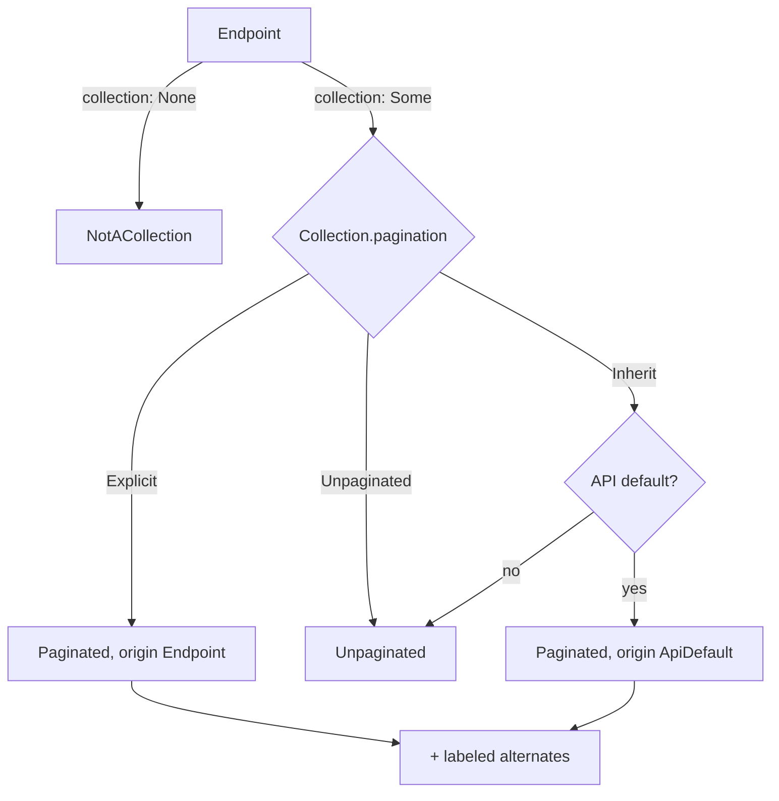
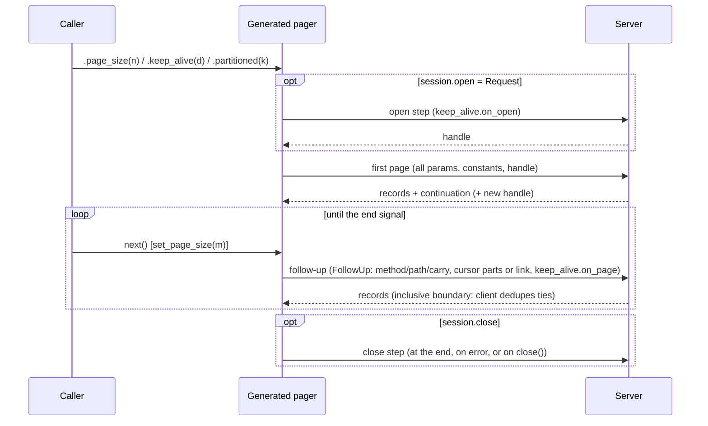

# Pagination model for `schematic-define`: design spike

Spike dates: 2026-10-09; revised 2026-10-10 after the ruling that every
pattern the first draft called "not expressible" or "deliberately
unsupported" must be handled by a generalization, not a special case.

Inputs: [research.md](research.md) (strategy catalog) and
[inventory.md](inventory.md) (how our 18 REST APIs really paginate, S1-S14).
Prototype: [prototype/](prototype/), a standalone crate depending only on
serde and serde_json. It has 56 tests, all passing; see
[Prototype results](#14-prototype-results).

Nothing outside this directory was changed. This document proposes the
model; it does not schedule the work.

## 1. The idea

A list endpoint is unpaginated until someone says otherwise.

- **Mark the response as a collection.** The author marks the response as a
  **`Collection`**. Its **`ItemSelector`** finds the items, through any
  number of array fan-outs and with a projection.
- **Only collections can paginate.** Pagination sits inside the collection,
  so a paginated non-array endpoint can't be represented.
- **Choose a policy.** A collection's **`Pagination`** is one of:
  - `Inherit`: the default. Use the API default if there is one, otherwise
    unpaginated.
  - `Unpaginated`: opt out.
  - `Explicit(Strategy)`: use this strategy.
- **The one enumeration.** A **`Strategy`** wraps **`PageStrategy`**, which
  is keyed on *how the client builds the next request*. There are four ways:
  - increment a page index;
  - advance an item index;
  - copy one or more response values into request inputs (a cursor);
  - request a URL the server returned.
- **Shared dimensions.** The `Strategy` wrapper carries the dimensions every
  kind shares:
  - constants;
  - totals;
  - terminal values;
  - the follow-up request shape;
  - a server-side session lifecycle;
  - parallel partitioning.
- **Smaller supporting types.** Composite cursors with boundary semantics,
  page-size rules (including mid-iteration changes), more-signals, and link
  trust are small supporting types.
- **The caller surface.** The generated client exposes exactly what was
  authored. `caller_knobs()` computes that surface from the definition, so
  principle 4 is testable.



A paginated iteration, with every optional dimension shown:



## 2. Principles mapped onto the model

| Principle | Where it lives |
| --- | --- |
| 1. Primitives in schematic-define, authored in schematic-definitions | Plain serde data plus builders. No runtime types. |
| 2. Array endpoints are unpaginated by default | `Pagination::Inherit` is the `Default` and resolves to `Unpaginated` without an API default. Pagination lives only inside `Collection`. |
| 3. Add strategies; API default; override; opt out | `RestApi.default_pagination`, `Collection::paginate`, `::unpaginated`, `::or_paginate(label, ..)` |
| 4. The caller sees only what was authored | `caller_knobs(&Resolved) -> Vec<Knob>` is the generator contract. Each knob maps to an authored field (table in §7). |
| 5. One enumeration that generalizes well | `PageStrategy` (4 variants) plus the shared dimensions in §3. Coverage in §§10-12. |

## 3. Dimensions

| Dimension (general principle) | Type | Values |
| --- | --- | --- |
| **How the next request is built** (the discriminator) | `PageStrategy` | `PageNumber`, `Offset`, `Cursor`, `NextLink` |
| Where a request input goes | `InputParam` | `Query`, `Header`, `Body(JsonPath)` |
| Where a response value is read | `ValueSource` | `Body(JsonPath)`, `Header` |
| **Item selection**: records reached through N array fan-outs, then projected | `ItemSelector { record: Vec<Step>, projection }` | `""` is a root array; `data` is `data[*]`; `edges[*].node`; `responses[*].hits.hits[*]._source` |
| **Index origin** of page and item indexes | `IndexBase` on `PageNumber` and `Offset` | `ZeroBased`, `OneBased` |
| **Cursor arity and boundary**: a cursor is a tuple of parts (sort key plus tiebreakers), and the server's position predicate is exclusive or inclusive | `CursorLeg { parts: Vec<CursorPart>, boundary }` | `Exclusive`; `Inclusive { identity }`, where the client dedupes ties |
| Cursor part origin | `CursorSource` | `Field`, `LastItem`, `FirstItem` (item paths read the record) |
| Direction | `Cursor.backward`, `NextLink.prev` | present means `prev()` exists |
| Continuation and end detection | `MoreSignal`, or the continuation's own absence | `Flag`, `Present`, `LinkRel`, `Total`, `NonEmptyPage`, `FullPage` |
| **Terminal values**: what counts as "no continuation" | `Strategy.terminal_values` | missing, null, `""`, plus authored sentinels (`"null"`) |
| **Page-size mutability** | `PageSize.adjustable` | fixed for the iteration (default), or changeable between pages |
| **Follow-up request shape**: follow-ups may differ from the first request in method, path, and which ordinary inputs are re-sent | `FollowUp { method, path, carry }` | `Carry::All`, `Only(names)`, `AllExcept(names)`, `Nothing` |
| **Session lifecycle**: a server-side result set with open, keep-alive/renew, a handle that may change per page, and close | `Session` | open by first page or by a separate step; in-band keep-alive (`on_open`/`on_page`) or an out-of-band `renew` step; `close` step |
| **Partitioning**: disjoint slices iterated in parallel | `Partition { index, count, max }` | `.partitioned(n)` |
| Strategy-enabling constants | `Strategy.constants` | `pagination=keyset` |
| Total exposure | `Strategy.total`, or `MoreSignal::Total` | `total()` |
| Link trust | `NextLink.trust` | `SameOrigin` (default) or `AllowOrigins` |

The bold rows are new in this revision. Each replaces a draft-1 "unsupported"
verdict with a dimension that applies to every strategy kind, not only to the
vendor that exposed it (§9).

## 4. Types (abridged; `prototype/src/lib.rs` is complete)

```rust
pub struct JsonPath(Vec<String>);                      // segments; dotted keys allowed via segments()
pub enum Step { Key(String), Each }
pub struct ItemSelector { pub record: Vec<Step>, pub projection: JsonPath }

pub enum InputParam { Query(String), Header(String), Body(JsonPath) }
pub enum ValueSource { Body(JsonPath), Header(String) }
pub enum Method { Get, Post, Put, Delete }
pub enum IndexBase { ZeroBased, OneBased }
pub enum Polarity { TrueMeansMore, TrueMeansLast }
pub enum CountUnit { Items, Pages }

pub struct PageSize {
    pub param: InputParam,
    pub server_default: Option<u32>,   // documentation only
    pub min: u32,
    pub max: Option<u32>,
    pub adjustable: bool,              // may change between pages
}

pub enum MoreSignal {
    Flag { source: ValueSource, polarity: Polarity },
    Present { source: ValueSource },
    LinkRel { rel: String },
    Total { source: ValueSource, unit: CountUnit },
    NonEmptyPage,
    FullPage,
}

pub enum CursorSource { Field { source: ValueSource }, LastItem { path: JsonPath }, FirstItem { path: JsonPath } }
pub struct CursorPart { pub param: InputParam, pub source: CursorSource }
pub enum Boundary { Exclusive, Inclusive { identity: JsonPath } }
pub struct CursorLeg { pub parts: Vec<CursorPart>, pub boundary: Boundary }

pub enum LinkSource { LinkHeader { rel: String }, Field { source: ValueSource } }
pub enum LinkTrust { SameOrigin, AllowOrigins(Vec<String>) }

#[non_exhaustive]
pub enum PageStrategy {
    PageNumber { page: InputParam, base: IndexBase, size: Option<PageSize>, more: MoreSignal },
    Offset     { offset: InputParam, base: IndexBase, size: Option<PageSize>, more: MoreSignal },
    Cursor { forward: CursorLeg, backward: Option<CursorLeg>, size: Option<PageSize>,
             more: Option<MoreSignal>, resumable: bool },
    NextLink { next: LinkSource, prev: Option<LinkSource>, size: Option<PageSize>, trust: LinkTrust },
}

pub enum Carry { All, Only(Vec<String>), AllExcept(Vec<String>), Nothing }
pub struct FollowUp { pub method: Option<Method>, pub path: Option<String>, pub carry: Carry }

pub struct SessionStep { pub method: Method, pub path: String,
                         pub handle: Option<InputParam>, pub constants: Vec<FixedParam> }
pub enum SessionOpen { FirstPage, Request { step: SessionStep, handle: ValueSource } }
pub struct KeepAlive { pub default: String, pub on_open: Option<InputParam>,
                       pub on_page: Option<InputParam>, pub adjustable: bool }
pub struct Session {
    pub open: SessionOpen,
    pub pages: Option<(Method, String)>,         // where page requests go while open
    pub handle_from_page: Option<ValueSource>,   // latest handle wins
    pub send_handle_as: Option<InputParam>,      // None: the continuation carries it
    pub keep_alive: Option<KeepAlive>,
    pub renew: Option<SessionStep>,
    pub close: Option<SessionStep>,
}
pub struct Partition { pub index: InputParam, pub count: InputParam, pub max: Option<u32> }

pub struct Strategy {
    pub kind: PageStrategy,
    pub constants: Vec<FixedParam>,
    pub total: Option<ValueSource>,
    pub terminal_values: Vec<String>,
    pub follow_up: Option<FollowUp>,     // None: Carry::All, or for NextLink: verbatim GET
    pub session: Option<Session>,
    pub partition: Option<Partition>,
}

pub enum Pagination { Inherit, Unpaginated, Explicit(Strategy) }
pub struct Alternate { pub label: String, pub strategy: Strategy }
pub struct Collection { pub items: ItemSelector, pub pagination: Pagination, pub alternates: Vec<Alternate> }
// Planned additions: Endpoint.collection: Option<Collection>, RestApi.default_pagination: Option<Strategy>.
// Removed: EndpointParams.{pagination, response_pagination}, PaginationStyle, PaginationResponse.
```

**Why sessions, follow-ups, and partitions are fields, not `PageStrategy`
variants.** Each of them combines with any kind:

- A scroll is a `Cursor` inside a session.
- A PIT is a keyset `Cursor` inside a session, with partitions.
- Salesforce `queryMore` is a `NextLink` whose session the server expires on
  its own.
- Shopify's restricted follow-ups are a `NextLink` with a `Carry`.

Making them variants would multiply the enumeration by every combination.

## 5. Authoring (schematic-definitions)

### Core cases (unchanged from draft 1)

```rust
// API default, inherited by every `Collection::root()` endpoint (Gitea)
fn gitea_pages() -> Strategy {
    Strategy::page_number("page", MoreSignal::link_rel("next"))
        .page_size(PageSize::new("limit").server_default(30).max(50))
        .total(ValueSource::header("X-Total-Count"))
}
RestApi { default_pagination: Some(gitea_pages()), .. }
Endpoint { collection: Some(Collection::root()), .. }                          // inherit
Endpoint { collection: Some(Collection::root().unpaginated()), .. }            // opt out
Endpoint { collection: Some(Collection::at("tree")                             // override
    .paginate(gitea_pages().with_page_size(PageSize::new("per_page")))), .. }

// Bidirectional id cursor (Anthropic)
Strategy::cursor("after_id", CursorSource::body("last_id"))
    .backward("before_id", CursorSource::body("first_id"))
    .more_when(MoreSignal::has_more("has_more"))
    .page_size(PageSize::new("limit").server_default(20).max(1000))
    .resumable()

// Link following plus a selectable alternate (GitLab)
Collection::root().or_paginate("keyset",
    Strategy::next_link(LinkSource::link_header("next"))
        .page_size(PageSize::new("per_page").max(100))
        .constant("pagination", "keyset").constant("order_by", "id").constant("sort", "asc"))
```

The new dimensions are authored in §9, next to their rules.

## 6. Runtime rules the generated client follows (planned)

1. **First request**: ordinary params, constants, session handle, and only
   the knobs the caller set. The page size is never sent implicitly.
2. **Follow-ups** are built from `FollowUp`:
   - **Method**: default is the endpoint method; for `NextLink` it is GET.
   - **Path**: default is the endpoint path; for `NextLink` it is the link;
     with a session, `Session.pages`.
   - **Ordinary inputs**: filtered by `Carry`.
   - **Always sent**: continuation inputs, the session handle,
     `keep_alive.on_page`, and an adjusted page size.
   - **NextLink**: carried names are set onto the link's query string,
     replacing any value already there.
3. **PageNumber** increments by one from `base`. **Offset** starts at `base`
   and advances by the number of records received.
4. **Cursor** copies every part together. All parts must be present, or all
   absent; a mix is a `MissingContinuation` error. Query and header targets
   take scalars; body targets take any JSON value.
   - **Exclusive boundary**: send the values as they are.
   - **Inclusive boundary**: a `BoundaryTracker` (prototyped) remembers the
     identities delivered at the last key and drops them when the server
     returns them again. A page made only of re-delivered ties is a
     `BoundaryNoProgress` error, which tells the caller the page size is
     smaller than the tie.
5. **End of iteration**:
   - A continuation that is missing, null, `""`, or a `terminal_values`
     entry ends the iteration.
   - `PageNumber` and `Offset` also end on an empty page.
   - `Cursor` and `NextLink` do not: Slack and Graph return empty pages
     mid-stream.
   - A "more" flag with no continuation is a `MissingContinuation` error.
   - When an authored total is absent, the client falls back to
     `NonEmptyPage`.
6. **Stall guard**: the same continuation twice in a row is a
   `PaginationStalled` error.
7. **Sessions**:
   - **Open**: by the first page, or by the open step before it.
   - **Handle**: the latest `handle_from_page` replaces it.
   - **Keep-alive**: `on_open` goes on the opening request and `on_page` on
     every later page request.
   - **Renew**: `renew()` issues the renew step.
   - **Close**: the close step runs when the end signal arrives, on any
     error, and from `close()`. The pager is `#[must_use]`. What happens on
     an early drop is open question Q4.
8. **Partitions**: `.partitioned(n)` returns `n` independent pagers. Pager
   `i` sends `index = i` and `count = n` on every page request. A partitioned
   session opens one shared session, and the first pager to finish does not
   close it; the last one does.
9. **Link trust** (prototyped): relative links resolve against the base URL.
   Absolute links must be same-origin or on an `https` allow-list. Userinfo,
   scheme-relative cross-origin links, and downgrades are refused.
   Credentials never leave the API origin.

## 7. Caller-facing generated surface

The generator emits one pager type per paginated endpoint, with only the
methods its knobs call for. An unauthored knob is a compile error, not a
runtime error.

| Knob | Generated method | Present when authored |
| --- | --- | --- |
| `StartPage { base }` | `.page(n)` | `PageNumber` |
| `StartOffset { base }` | `.offset(n)` | `Offset` |
| `ResumeCursor { direction, parts }` | `.after(c)` / `.before(c)`; a tuple argument when `parts > 1` | `Cursor` with `resumable` |
| `PageSize` | `.page_size(n) -> Result<Self, PageSizeError>` | `PageSize` |
| `AdjustPageSize` | `pages.set_page_size(n)` between pages | `PageSize.adjustable` |
| `KeepAlive { default }` | `.keep_alive(d)` | `Session.keep_alive.adjustable` |
| `Partitions { max }` | `.partitioned(n) -> Vec<Pager>` | `Strategy.partition` |
| `Next` | `pages.next().await -> Result<Option<Page<T>>>` | always, when paginated |
| `Prev` | `pages.prev().await` | `Cursor.backward` or `NextLink.prev` |
| `Total` | `page.total()` | `Strategy.total` or `MoreSignal::Total` |
| `Renew` | `pages.renew().await` | `Session.renew` |
| `Close` | `pages.close().await` | `Session.close` |
| `Alternate { label, knobs }` | `.using_<label>()` | each alternate |

Some knobs are not exposed even when the dimension is used:

- **Follow-up shape, terminal values, boundary semantics, constants, and a
  non-adjustable keep-alive** are behavior, not knobs.
- **A session with no `close` step** gives the caller nothing to call.
- **An inclusive boundary** dedupes silently.

```rust
// Unpaginated: today's surface
let tags = ollama.list_models().await?;

// Page number + Link signal (GitHub)
let mut pages = github.list_issues(req).page_size(50)?.page(2).pages();
while let Some(page) = pages.next().await? { for issue in page.items() { /* .. */ } }

// Opaque cursor (OpenAI ListRoles): no .after(), no prev()
let mut pages = openai.list_roles(req).pages();

// Adjustable size (Shopify)
let mut pages = shopify.list_products(req).page_size(50)?.pages();
pages.next().await?;
pages.set_page_size(250)?;            // exists only because `adjustable`

// Session (Elasticsearch scroll)
let mut pages = es.search_scroll(req).page_size(1000)?.keep_alive("2m").pages();
while let Some(page) = pages.next().await? { /* .. */ }   // closes at the end
// on early exit: pages.close().await?;

// Session + partitions (Elasticsearch PIT): no keep_alive() (not adjustable)
let pagers = es.search_pit(req).page_size(1000)?.partitioned(4);

// Composite resumable keyset
let mut pages = api.list_events(req).after((created_at, id)).pages();
```

## 8. Validation

Every rule rejects a definition that would loop forever, send an input the
server can't accept, or expose a knob that lies. Each rule has a test in the
prototype.

| Error | Rejects |
| --- | --- |
| `CursorWithoutEndSignal` | A cursor whose parts are all item-derived, with no `more` |
| `FullPageOnCursor`, `FullPageWithoutPageSize` | Short-page end detection where it is unreliable or can't be computed |
| `PageCountOnNonPageNumber` | `Total{Pages}` outside `PageNumber` |
| `InvalidPageSize` | `min` of 0, `max < min`, or a default outside the bounds |
| `DuplicateInput` | Two inputs with the same location and name: page, cursor parts (both legs), size, constants, partition inputs, session handle, keep-alive `on_page` |
| `BodyInputOnGet` | A body input on a GET request, checked per request: first request, follow-up, and each session step |
| `CollidesWithEndpointParam` | A strategy input that is also a plain query param |
| `AlternatesWithoutPrimary`, `AlternatesOnUnpaginated`, `DuplicateLabel`, `InvalidLabel` | Alternates that are malformed |
| `InvalidTrustedOrigin` | An allow-list entry that is not an `https` origin |
| `EmptyCursorLeg` | A cursor leg with no parts |
| `InclusiveBoundaryNeedsItemKey` | An inclusive boundary with a non-item part: there is no key to dedupe against |
| `AdjustablePageSizeOnPageNumber` | Size changes on page numbers: page *k* at a new size is not the page after *k-1* |
| `AdjustableLinkSizeNotQuery` | Size changes on a link whose size input is not a query param the client can override |
| `NextLinkWithFollowUpPath` | A follow-up path on `NextLink`, where the link is the path |
| `NextLinkMethodUnspecified` | `NextLink` on a non-GET endpoint without an explicit follow-up method |
| `UnknownCarryParam` | A carry name that is neither an ordinary query param nor the page size (checked on GET endpoints) |
| `UnknownPathParam` | A follow-up, session-page, or session-step path that uses a parameter the endpoint does not have |
| `SessionHandleUnreachable` | A first-page-opened session with no `handle_from_page` |
| `SessionHandleNotSent` | A handle never sent: no `send_handle_as`, and neither a cursor part nor a link carries it |
| `SessionStepNeedsHandle` | A renew or close step with no handle input |
| `KeepAliveWithoutInput` | A keep-alive with neither `on_open` nor `on_page` |
| `InvalidPartitionMax` | `max` of 0 |

## 9. The generalizations, one by one

Each subsection gives the general principle, the authoring code, the caller
surface, the validation, and the tests in `tests/generalizations.rs`.

### G1. Session lifecycle (was: ES scroll/PIT "deliberately unsupported")

**Principle.** Some result sets are server-side state with a lease. The
lifecycle is a set of independent optional facts:

- how it opens: the first page, or a separate step that returns a handle;
- where page requests go while it is open;
- how the handle evolves: it may change per page, and the latest wins;
- where the handle is sent, unless the continuation already carries it;
- how the lease is extended: in-band keep-alive on the open and page
  requests, or an out-of-band renew step;
- how it is released: a close step.

Any "open a result set, then page it" API fits this, whatever the
continuation kind. Salesforce `queryMore` (REST) is a `NextLink` whose
server expires the locator, so it needs no session at all.

```rust
// Scroll: first page opens; follow-ups go elsewhere with a new body
Strategy::cursor(InputParam::body("scroll_id"), CursorSource::body("_scroll_id"))
    .more_when(MoreSignal::NonEmptyPage)
    .page_size(PageSize::new("size").max(10_000))
    .follow_up(FollowUp::to(Method::Post, "/_search/scroll"))      // Carry::Nothing
    .session(Session::opened_by_first_page()
        .handle_from_page(ValueSource::body("_scroll_id"))
        .keep_alive(KeepAlive::new("1m").on_open("scroll").on_page(InputParam::body("scroll")).adjustable())
        .close(SessionStep::new(Method::Delete, "/_search/scroll").handle(InputParam::body("scroll_id"))))

// PIT: separate open, pages at /_search, handle refreshed per page, sliced
Strategy::cursor(InputParam::body("search_after"), CursorSource::last_item("sort"))
    .more_when(MoreSignal::NonEmptyPage)
    .session(Session::opened_by(SessionStep::new(Method::Post, "/{index}/_pit"), ValueSource::body("id"))
        .pages_at(Method::Post, "/_search")
        .handle_from_page(ValueSource::body("pit_id"))
        .send_handle_as(InputParam::body("pit.id"))
        .keep_alive(KeepAlive::new("1m").on_open("keep_alive").on_page(InputParam::body("pit.keep_alive")))
        .close(SessionStep::new(Method::Delete, "/_pit").handle(InputParam::body("id"))))
    .partition(Partition { index: InputParam::body("slice.id"), count: InputParam::body("slice.max"), max: None })
```

**Surface.** Scroll exposes `page_size`, `keep_alive`, `next`, `total`, and
`close`. PIT exposes `close` and `partitioned`, but not `keep_alive`,
because its keep-alive is not adjustable. `renew` appears only with a renew
step.

**Validation.** `SessionHandleUnreachable`, `SessionHandleNotSent`,
`SessionStepNeedsHandle`, `KeepAliveWithoutInput`, `UnknownPathParam` on any
step, and `BodyInputOnGet` per step.

**Tests.** `g1_scroll_*`, `g1_pit_*`, `g1_session_validation`,
`g1_renew_step_becomes_a_knob`.

### G2. Composite cursors with explicit boundary semantics (was: time windows "partial")

**Principle.** A seek position is a *tuple*: a sort key plus tiebreakers,
each copied from the last record into its own input. The server's predicate
is either exclusive (`>`) or inclusive (`>=`). Exclusive needs nothing more.
Inclusive needs client-side dedupe on an identity field. Keyset (`id_after`),
SQL-style (`created_before` + `id_before`), time windows (`since`), and ES
`search_after` are all the same construct, differing only in arity and
boundary.

```rust
// Exclusive keyset with tiebreaker, resumable with a tuple
Strategy::cursor("created_before", CursorSource::last_item("created_at"))
    .tiebreak("id_before", CursorSource::last_item("id"))
    .more_when(MoreSignal::NonEmptyPage).resumable()

// Inclusive time window: the server only supports `since >= t`
Strategy::cursor("since", CursorSource::last_item("updated_at"))
    .inclusive("id").more_when(MoreSignal::NonEmptyPage)
```

**Surface.** `ResumeCursor { parts: 2 }` becomes
`.after((created_at, id))`. Inclusive dedupe is invisible to the caller.

**Validation.** `EmptyCursorLeg`, `InclusiveBoundaryNeedsItemKey`, and
`DuplicateInput` between parts.

**Runtime proof.** `BoundaryTracker` drops re-delivered ties across pages
and reports `NoProgress` when a page is all ties. Tests:
`g2_exclusive_composite_keyset`, `g2_inclusive_time_window_needs_item_keys`,
`g2_boundary_tracker_drops_redelivered_ties_and_detects_no_progress`.

### G3. Follow-up request shape (was: Shopify "partial")

**Principle.** A follow-up request may differ from the first request along
three axes:

- **method**;
- **path**: a different resource, such as `/_search/scroll`;
- **which ordinary inputs are re-sent**: everything, an allow-list, a
  deny-list, or nothing.

Continuation and session inputs are always sent. Examples:

- Shopify allows only `limit` and `fields` on `page_info` requests:
  `Only([limit, fields])`.
- AIP-158's `skip` must apply once: `AllExcept([skip])`.
- Scroll replaces the whole request: `to(POST, "/_search/scroll")`.
- A POST search that returns GET links: `NextLink` plus `.method(Get)`.

```rust
Strategy::next_link(LinkSource::link_header("next"))
    .page_size(PageSize::new("limit").max(250).adjustable())
    .follow_up(FollowUp::carry(Carry::Only(vec!["limit".into(), "fields".into()])))
```

**Surface.** None directly; carry is behavior.

**Validation.** `UnknownCarryParam`, `UnknownPathParam`,
`NextLinkWithFollowUpPath`, `NextLinkMethodUnspecified`, and
`BodyInputOnGet` against the follow-up method. Draft 1's blanket
`NextLinkOnNonGet` rule is gone, replaced by the explicit-method rule.

**Tests.** `g3_*`, plus `next_link_on_post_must_state_the_follow_up_method`.

### G4. Multi-level item selection (was: two-level projection "unsupported")

**Principle.** Items are reached through a path with any number of `[*]`
fan-outs, whose results are flattened in document order. The element at the
last fan-out is the record; anything after it is a projection. Item-derived
cursors read the record, and the caller receives the projection.

**Authoring.** Examples:

- `Collection::at("data.children[*].data")` (Reddit)
- `Collection::at("edges[*].node")` (Relay)
- `Collection::at("responses[*].hits.hits[*]._source")` (multi-search)

**Surface.** Item types follow the projection.

**Validation.** None needed: any selector has at least one fan-out by
construction.

**Tests.** `g4_selector_parses_records_and_projection`, `p07`, `p17`.

### G5. Page size changed mid-iteration (was: "unsupported")

**Principle.** A knob's *mutability during iteration* is a property of the
continuation mechanism:

- **Offset** advances by records received, so changing the size is safe.
- **Cursor** tokens may or may not bind the size; the author says which.
  AIP-158 says a changed size must be honored; Graph's `$top` is frozen in
  the link.
- **NextLink** can take a new size only by overriding a query param on the
  link (Shopify).
- **PageNumber** can't: page *k* at a new size is not the continuation of
  page *k-1*.

**Authoring.** `PageSize::new("limit").adjustable()`.

**Surface.** `pages.set_page_size(n)`.

**Validation.** `AdjustablePageSizeOnPageNumber`,
`AdjustableLinkSizeNotQuery`.

**Tests.** `g5_adjustable_page_size_rules`, and Shopify in `g3`.

### G6. Terminal sentinel values (found by the external check)

**Principle.** "No continuation" is a set: missing, null, empty string, plus
authored sentinels.

**Authoring.** Salesforce Bulk 2.0 sends `Sforce-Locator: null` as a
literal string: `.terminal_value("null")`.

**Validation.** None needed.

**Tests.** `g6_salesforce_bulk_locator_null_string_is_terminal`.

### G7. Index origin for offsets (found by the external check)

**Principle.** 0- or 1-based origin is a property of any index, not only of
page numbers. SCIM's `startIndex` is 1-based (RFC 7644 §3.4.2.4).

**Authoring.** `Strategy::offset("startIndex", ..).one_based()`.

**Surface.** `StartOffset { base }`.

**Tests.** `g7_scim_one_based_start_index`.

### G8. Partitioned iteration (research.md §2 "Parallelism")

**Principle.** A collection may be split into `n` disjoint slices, each
iterated with its own continuation by sending (slice index, slice count).
This composes with any kind and with sessions.

**Authoring.** `.partition(Partition { index, count, max })`.

**Surface.** `.partitioned(n) -> Vec<Pager>`.

**Validation.** `DuplicateInput`, `InvalidPartitionMax`.

**Tests.** PIT in `g1`.

## 10. Coverage: inventory.md

Unchanged from draft 1, except that `ItemSelector` replaces the item path and
the OpenAI and EMQX gaps are classified. Prototyped in `tests/inventory.rs`.

| Strategy / family | Endpoints | Expressed as |
| --- | --- | --- |
| S1 GitHub | 9 | API default `PageNumber{page, 1-based, per_page 30/100, LinkRel next}`; ListWorkflowRuns overrides at `workflow_runs` with a total |
| S2 GitLab offset | 9 + ListIssueParticipants | API default `PageNumber{per_page 20/100, Present(header X-Next-Page)}`, total `X-Total` |
| S3 GitLab keyset | 2 | alternate `keyset`: `NextLink{LinkHeader next}` + constants |
| S4 / S4b Gitea | 8 + 2 | default `page`/`limit` 30/50, `LinkRel`; tree override `per_page`, `Flag(truncated)`; GetTagReference opt-out |
| S5 Bitbucket | 9 | default `NextLink{body next, prev previous, pagelen 10/100}`, total `size` |
| S6 Anthropic | 1 | `Cursor{after_id <- last_id; before_id <- first_id; has_more; limit 20/1..1000; resumable}` |
| S6 OpenAI | 38 | API default `Cursor{after <- last_id, has_more}`; `before` legs and `LastItem(id)` overrides where needed |
| S7 / S8 OpenAI | 9 / 11 | `Cursor{after <- next}` / `Cursor{page <- next_page}` |
| OpenAI RetrieveVectorStoreFileContent, SearchVectorStore | 2 | **Provider gap, not a model gap.** The reply has `has_more` + `next_page`, but OpenAI documents no request input that consumes it. If one existed, the model already expresses it (test `openai_vector_store_search_would_be_expressible_if_documented`). Until then: `unpaginated()`. |
| S9 / S10 / S11 ElevenLabs | 3 | history cursor; voices token + total; shared voices `PageNumber` zero-based |
| S12 EMQX basic and bearer | 8 + 8 | default `PageNumber{page, limit, Flag(meta.hasnext)}`, total `meta.count`; config lists opt out. **ListAuthUsers is a definition gap, not a model gap:** its response type is a root array but the server returns `{data, meta}`. Fixing the response type is enough to make it inherit the default. |
| S13 / S14 Hugging Face | 6 / 3 | `NextLink{LinkHeader next, limit}`; `PageNumber{p, zero-based}` with `NonEmptyPage` or `Total(count)` |
| Unpaginated collections (AA, LM Studio, Ollama×2, ElevenLabs×4, OpenAI ListModels) | | collections with no default, or opt-out |
| Not collections (CritPt, Eversolo, Samsung, Unfolded Circle, WebSockets) | | `collection: None` |

## 11. research.md §6 awkward patterns: verdicts after revision

| # | Pattern | Verdict | Construct |
| --- | --- | --- | --- |
| 1 | Next URL in body | Supported | `NextLink{Field}`, trust-checked |
| 2 | Cursor in request body | Supported | `InputParam::Body` |
| 3 | `has_more` with separate or derived cursor | Supported | `Cursor{Field or LastItem, more: Flag}` |
| 4 | Inverted polarity | Supported | `Polarity::TrueMeansLast` |
| 5 | Nested cursor path | Supported | `JsonPath` |
| 6 | Bidirectional | Supported | `backward` leg / `prev` |
| 7 | Sort-value array cursors | Supported | `LastItem("sort")` into `Body`, record-relative |
| 8 | Empty / short-page end | Supported, guarded | `NonEmptyPage`, `FullPage` |
| 9 | Stateful snapshots | **Supported (G1)**, was unsupported | `Session` |
| 10 | Link rel variants | Supported | `LinkHeader{rel}` |
| 11 | Total variants | Supported | `Total{Body or Header, Items or Pages}` |
| 12 | Time-window paging | **Supported (G2)**, was partial | composite `CursorLeg` + `Boundary::Inclusive` |
| 13 | Mixed strategies per API | Supported | override, opt-out, alternates |
| 14 | Constant enabling params | Supported | `constants` |
| 15 | Params forbidden on follow-up | **Supported (G3)**, was partial | `FollowUp.carry` |
| 16 | Size not selectable or capped; changing size mid-iteration | **Supported (G5)**, was partly unsupported | omit `PageSize`; `max`; `adjustable` |
| 17 | Per-item wrapping, two levels | **Supported (G4)**, was partial | `ItemSelector` |
| 18 | Header carry-over, cross-origin | Supported | headers re-applied; `LinkTrust` |

## 12. Generalization check against patterns outside research.md and inventory.md

All of these are in `tests/generalizations.rs`. "No change" means they
validate with constructs that existed before the pattern was considered.
Verification: **[V]** = fetched this session; **[M]** = from memory.

| Pattern | Construct | Model change needed? |
| --- | --- | --- |
| Google AIP-158 (`page_token` / `next_page_token`; empty ends; a changed `page_size` must be honored; `skip` applies once) [V] | `Cursor` + adjustable size + `Carry::AllExcept([skip])` | **No** (uses G3/G5, which were designed for Shopify and the ES scroll follow-up) |
| Mastodon (`Link` next/prev carrying `max_id`/`min_id`; or `max_id`/`min_id` directly) [V] | `NextLink{LinkHeader}`, or a bidirectional `Cursor{LastItem/FirstItem id}` | **No** |
| X API v2 (`pagination_token` from `meta.next_token`, `max_results` 5..100) [M] | `Cursor{Field(meta.next_token)}` + size min 5 | **No** |
| WordPress REST (`X-WP-TotalPages`, `X-WP-Total`) [M] | `PageNumber{Total(Pages, header)}` | **No** |
| OData `$skiptoken` in `@odata.nextLink` [M; Graph form V in research] | `NextLink{body_segments(["@odata.nextLink"])}` | **No** |
| Azure Cosmos DB (`x-ms-continuation` header out and in, `x-ms-max-item-count`) [M] | `Cursor{Header -> Header}` | **No** |
| Salesforce REST query (`nextRecordsUrl` relative, `done`, `totalSize`) [M] | `NextLink{Field}` with a relative link | **No** |
| Reddit listings (`data.after`/`data.before`, items `data.children[].data`) [M; fetch blocked] | `Cursor` both directions + G4 selector | **No** (uses G4) |
| SCIM RFC 7644 (`startIndex` **1-based**, `count`, `totalResults`, `Resources`) [V] | `Offset.one_based()` | **Yes**: G7 index origin on `Offset`. Draft 1 had `base` only on `PageNumber`. |
| Salesforce Bulk 2.0 results (`Sforce-Locator` header -> `locator` query; literal `"null"` at end; `maxRecords`) [V via secondary sources; Salesforce page 403] | `Cursor{Header -> Query}` + `terminal_value("null")` | **Yes**: G6 terminal values |

Of the 10 checked, 8 needed no change. The 2 that did (index origin and
terminal values) were generalized as dimensions, not vendor flags.

## 13. What remains unsupported, and why

Nothing in research.md §6 or the inventory remains unexpressible because of
the model. The remaining limits are boundaries of the pagination concept or
gaps in the providers and definitions:

- **Provider gap: OpenAI RetrieveVectorStoreFileContent and
  SearchVectorStore.** No documented request input continues the iteration.
  The model would express one immediately (tested).
- **Definition gap: EMQX ListAuthUsers.** The response type is wrong (root
  array vs `{data, meta}`). Correct it, and the endpoint inherits the EMQX
  default.
- **Long-running jobs before paging.** Salesforce Bulk 2.0 job creation and
  polling, and BigQuery jobs, are an asynchronous-operation concern ("create,
  then poll until ready"). Paging the finished job's results *is* expressed
  (G6). Folding polling into `Session.open` would merge two lifecycles with
  different failure modes; it belongs in a separate long-running-operation
  feature.
- **Non-JSON bodies.** Header-borne continuations work for any body (the
  Bulk 2.0 CSV locator), but `ItemSelector` and body `ValueSource`s are JSON
  paths. Paging S3's XML `NextContinuationToken` needs the response decoder
  to expose another path syntax. The model's shape would not change; only
  the path type would need a format-aware sibling.
- **Silent restart on an expired cursor** (Drive, Slack `invalid_cursor`) is
  deliberately not automated. Restarting would re-deliver items, so the
  client surfaces the API error and the caller decides.

## 14. Alternatives rejected

1. **A request enum and a response enum side by side** (today). The two are
   coupled, and nonsense pairs can't be validated as a unit.
2. **One variant per provider style.** It is combinatorial and bakes wrong
   facts into presets.
3. **A fully generic bag of role-tagged inputs and signals.** Invariants
   become runtime checks, and the caller surface can't be derived.
4. **Link following as only a signal.** Following a URL differs in client
   behavior, so `LinkRel` is kept only as a presence signal.
5. **`Session`, `Keyset`, `TimeWindow`, or `Scroll` as `PageStrategy`
   variants.** Each combines with other kinds (scroll is a cursor, PIT is a
   keyset cursor, queryMore is a link), so making them variants multiplies
   the enumeration. As fields or leg properties they compose.
6. **Parameter names as classifiers.** OpenAI's `page` is a cursor.
7. **A one-off `project` field for one level of wrapping** (draft 1).
   Replaced by `ItemSelector`, which handles N levels and separates record
   from item.
8. **A per-vendor "only these params on follow-up" flag on `NextLink`.**
   Replaced by `FollowUp.carry` on every kind.
9. **Adjustable size as a global boolean on the API.** Mutability depends on
   the continuation kind, so it lives on `PageSize` and is validated per
   kind.
10. **Automatic close on `Drop` via a spawned task.** It needs a runtime
    handle inside the pager and hides failures. See Q4.

## 15. Open questions (for the user)

**Q1. How is an endpoint marked as a collection?**

- (a) Explicitly on every list endpoint.
- (b) Inferred for `Vec<T>` responses.
- (c) Explicitly, with a warning for any unmarked `Vec<T>` response.
- **Recommendation: (c).** Inference would wrongly paginate root-array write
  results such as Unfolded Circle `UploadResource`.

**Q2. GitHub, Gitea, and GitLab offset: increment page numbers, or follow
links?**

- (a) `PageNumber` + `LinkRel`/`Present` (prototyped).
- (b) `NextLink` everywhere links exist.
- (c) (a) with a `NextLink` alternate.
- **Recommendation: (a)** for these, and `NextLink` for Bitbucket, Hugging
  Face, and GitLab keyset.

**Q3. Labeled alternates in v1?**

- (a) Generate them.
- (b) Use separate endpoint ids instead.
- (c) Model now, generate later.
- **Recommendation: (c).**

**Q4. What happens when a pager with a session `close` step is dropped
early?** Rust has no async drop.

- (a) Document "call `close()` or let it run to the end"; make the pager
  `#[must_use]`; log a leak warning on `Drop`. The server lease (keep-alive)
  bounds the cost.
- (b) Spawn the close on `Drop` through a stored runtime handle. Pro: no
  leaks. Con: couples the generated client to a runtime, and close errors
  vanish.
- (c) Expose sessions only through a scoped API,
  `endpoint.with_session(|pages| async { .. })`, which always closes. Pro:
  leak-proof. Con: less ergonomic, and awkward to hold across await points.
- **Recommendation: (a), with (c) also generated.** It costs little and
  gives a leak-proof option.

**Q5. How strict is next-link trust?**

- (a) Same-origin only.
- (b) Same-origin plus a per-strategy `https` allow-list (prototyped).
- (c) Follow any link, with credentials stripped.
- **Recommendation: (b).**

**Q6. Do we author strategies the inventory marks unverified (U)?**

- (a) Author them all now.
- (b) Author only the verified ones; leave U endpoints unpaginated until
  checked.
- (c) Author them all, with a `verified` marker.
- **Recommendation: (b).** Unpaginated is the safe default, and no
  validation can catch a wrong signal name.

**Decided without asking, flagged for veto:**

- **`server_default` is documentation only.** All four declared forge
  defaults are wrong.
- **An over-max `page_size(n)` returns a typed error.** The client does not
  clamp silently. (Draft-1 Q4, demoted to make room for the session-drop
  question.)
- **Long-running-job polling is out of pagination scope** (§13).

## 16. Migration sketch (planned)

- Replace `EndpointParams.pagination`/`response_pagination` and
  `PaginationStyle`/`PaginationResponse` with `Endpoint.collection` and
  `RestApi.default_pagination`. The generator adds strategy inputs itself,
  and `CollidesWithEndpointParam` flags leftovers.
- The OpenAPI importer maps S6, S7, and S8 into strategies instead of plain
  params.
- Box large variants. Clippy's `large_enum_variant` fires twice, and
  definitions are built once, so this is cosmetic.

## 17. Prototype results

`prototype/` has its own `Cargo.toml` with an empty `[workspace]` table and
depends only on serde and serde_json. It was run with
`CARGO_TARGET_DIR=<scratchpad>/pagination-target cargo test`, so no
`target/` is in the repo.

- `src/lib.rs`:
  - the types and per-kind builders;
  - `resolve`, `validate_strategy`, `validate_endpoint`, `validate_api`,
    `caller_knobs`, `strategy_knobs`;
  - runtime pieces worth proving now: `ItemSelector::records/items`,
    `Strategy::is_terminal`, `Strategy::effective_carry`, `BoundaryTracker`,
    `is_link_trusted`.
- `tests/inventory.rs` (16 tests): all 18 inventory APIs authored, with
  exact resolved strategies and knob lists.
- `tests/patterns.rs` (23 tests): research.md §6 patterns, precedence,
  draft-1 validation, link trust, and the serde shape.
- `tests/generalizations.rs` (17 tests):
  - G1-G8: authoring, surface, validation, and the `BoundaryTracker` runtime
    proof;
  - the external-pattern check;
  - the OpenAI provider-gap demonstration.

```text
     Running tests/generalizations.rs
test result: ok. 17 passed; 0 failed; 0 ignored; 0 measured; 0 filtered out
     Running tests/inventory.rs
test result: ok. 16 passed; 0 failed; 0 ignored; 0 measured; 0 filtered out
     Running tests/patterns.rs
test result: ok. 23 passed; 0 failed; 0 ignored; 0 measured; 0 filtered out
```

**Total: 56 passed, 0 failed.** `cargo clippy --all-targets` reports only 2
`large_enum_variant` warnings.

Not prototyped: the async pager, the generator, and OpenAPI import/export.
