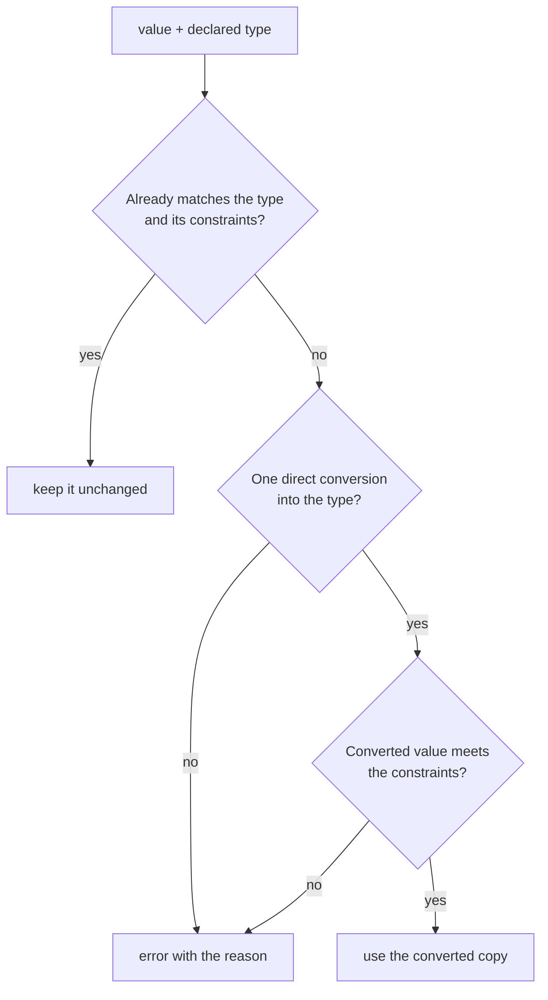

# Conversion

Soft validation converts a value that is almost right (the text `"4"` for a `number`) before judging it. This page lists exactly which conversions apply.

## Type Coercion

When a frontmatter value is not the type its property declares but converts
to it without changing its meaning, soft validation (`validate_soft`, and
Darkmatter's ordinary validation) converts the value and accepts it. Function
arguments go through the same conversion engine with the same rules, so a
type means the same thing in `$schema` and in a function signature. Soft
validation always converts and the rules cannot be configured; to judge a
value without any conversion, use `validate_strict` (see
[Strict and Soft Validation](./validation.md)). Conversion
covers inline `$schema`, baseline-merged fields, trigger payloads, and raw
JSON Schema documents. This section is the one description of that engine;
other pages link here.

The rule behind every conversion: a value is converted only when the
conversion cannot change what the author meant. `"4"` given to a `number`
means 4, so it converts; `"pear"` does not, so it is an error.

### Two Interfaces of a Type

A type answers two questions, and they are worth keeping apart:

| Interface | Question | Example for `number` |
|---|---|---|
| **Accepts** | Which values may an author or caller supply? | `4`, `"4"`, `" 4 "` |
| **Delivers** | What does the document, or the function, end up holding? | the number `4`, always |

For most types the two differ only by conversion: a `number` property
accepts numeric text but always holds a real number afterward, so a later
reader never has to ask whether it was written `4` or `"4"`.
[`numberlike` and `boolish`](#numberlike-and-boolish-keep-what-was-written)
exist for the case where that difference matters: they accept exactly what
`number` and `boolean` accept but deliver the value as written.

### Three Actions per Value

For each value the engine takes exactly one of three actions:



In frontmatter the error is a validation error on the property; in a function
call it is a type error and the function does not run.

Constraints are enforced, never repaired: `"2.5"` against `number(integer)`
is an error, not `2`, and `"ABCD"` against `string(max(3))` is never
truncated. The original value is never mutated; compose writes back a
converted copy, and validation-only calls write nothing.

### Conversion Rules

These are the only conversions, and they are never chained:

| From | To | Example |
|---|---|---|
| number | text (`string`, `date`, `url`, `file`, `enum(...)`, string `literal`, `expression`, `shell`, ...) | `version: 1.2` against `string` → `"1.2"`; `n: 2` against `enum("1", "2")` → `"2"` |
| boolean | text | `true` → `"true"` |
| text | `number` | `" 4 "`, `"+4"`, `"-3.5"`, `"1e3"`, `".5"`, `"1_000"` → a number |
| text | `boolean` | `true`/`false`, `yes`/`no`, `on`/`off`, `1`/`0`, any letter case → a boolean |
| object, list, number, or boolean | `json` / `yaml` | a mapping → its JSON (written key order) or YAML text |

A refined text type (`date`, `url`, `email`, `file`, `enum`, a string literal)
first receives the text and then runs its own check, so `2026` against `date`
becomes `"2026"` and then fails the date check. A number or boolean literal
accepts the matching text: `"2"` against `literal(2)` becomes `2`.

Text given to `json` or `yaml` is already content: it is validated (JSON
rejects duplicate keys and numbers such as `1e400`) and kept as written,
never quoted again.

These are **never** converted:

- a boolean to a number (`true` is not `1`), or a native number to a boolean;
- `null` to anything (`0`, `""`, `"null"`, `false`, or omission);
- a single value into a list (`"a"` is not `["a"]`);
- text into an object or list (`"[1, 2]"` stays text);
- text that is not a number (`"pear"`, `"NaN"`, `"0x10"`, `"1,000"`, `"5."`);
- a number or boolean into `alphanumeric`, which must already be text;
- anything into `unknown`, which keeps every value as written.

Whole numbers must be held exactly: `"9007199254740993"` and the native YAML
`9007199254740993` are errors with the reason "cannot be represented
exactly", `"1e400"` is "not finite", and `"1e-400"` would become `0`, which is
also an error. `number(integer)` means a whole number below 2^64 in
magnitude (the compiled schema carries `x-darkmatter-integer: true`); a raw
JSON Schema `integer` has no such ceiling. See [Numbers](../../../darkmatter/docs/topics/numbers.md).

### `numberlike` and `boolish` Keep What Was Written

`numberlike` accepts exactly what `number` accepts, and `boolish` exactly what
`boolean` accepts, but neither converts: the value is validated and kept as
written. `zip: "02134"` against `zip: numberlike` stays the text `"02134"`;
`flag: "On"` against `boolish` stays `"On"`; `zip: "pear"` fails. They compile
to `{ "type": ["number", "string"], "format": "darkmatter-numberlike" }` and
`{ "type": ["boolean", "string"], "format": "darkmatter-boolish" }`, whose
formats use the same parser as the engine.

### Nested Values

Conversion follows the declared structure at every depth: lists, tuples,
inline objects, unions inside them, `numberlike`/`boolish` fields, and the
values under pattern keys (`<string>: number`). The container rules:

- a list or object is converted all or nothing, and an error names the
  failing path (`meta.inner.count`, `values[2]`);
- a missing optional tuple position stays missing, never `null`, and a
  missing required position is an error at its path;
- a single value is never wrapped into a list;
- a plain `object` or `unknown` declares no structure, so its contents are
  kept as written.

```yaml
$schema:
    meta: "{ inner: { count: number }, scores: { <string>: number } }"
    pair: "tuple([string, number])"
meta:
    inner: { count: "3" }
    scores: { a: "4" }
pair: ["Ada", "36"]
# composes as
meta:
    inner: { count: 3 }
    scores: { a: 4 }
pair: ["Ada", 36]
```

Each top-level property is its own value. When one property fails, the
others still convert, and a missing required property never stops a sibling
from converting: presence is reported by validation, not by conversion.

### Choosing a Union Option

A union chooses its option the same way everywhere, and the order the
options are written in never matters:

1. A value an option already accepts is kept.
2. Otherwise, the options the value converts into (with constraints met) are
   *reachable*. One reachable option wins.
3. When several are reachable with different results, exactly two
   tie-breakers apply: a number beats a boolean (`"1"` against
   `number | boolean` becomes `1`), and JSON beats YAML (a mapping against
   `json | yaml` becomes JSON text). They apply field by field inside
   objects. Any other tie is an error that names each reading.

| Declared type | Value | Result |
|---|---|---|
| `string \| number` | `"4"` | `"4"` (already a string) |
| `string \| string[]` | `2026` | `"2026"` (only `string` is reachable) |
| `number(min(5)) \| boolean` | `"1"` | `true` (`1` fails `min(5)`) |
| `{ id: number } \| { id: boolean }` | `{ id: "1" }` | `{ id: 1 }` |
| `{ a: number, b: boolean } \| { a: boolean, b: number }` | `{ a: "1", b: "1" }` | error naming both readings |
| `(boolean \| number)[]` | `["2", "yes"]` | `[2, true]` |

A root-level union picks its arm by the same rule; an arm's conversions are
written back only when the converted document satisfies that arm.

### Function Calls: Bind, Then Compute

An [expression function](../../../darkmatter/docs/topics/darkmatter-expressions.md#functions) declares
its parameters with the same types (see
[Function Signatures](language/unions.md#function-signatures)). Ordinary eager calls run in two
steps:

1. **Bind.** The engine checks every argument against its parameter, keeping
   or converting it by the rules above. A call whose arguments do not all
   bind is a **type error**, and the function never runs.
2. **Compute.** The function receives values of exactly its declared types
   and does its work. Only a function marked `fallible` can fail here, with
   a domain error such as a failed network request.

`and` and `or` bind operands only as short-circuit evaluation reaches them.
`map` and `filter` bind their iterable argument once; the evaluator then binds
an immutable local frame and evaluates the inline callback for each visited
item. A callback is syntax in an argument position, not a value converted by
the coercion engine. These calls still use the shared signatures and passive
call checks. See [Inline collection callbacks](../../../darkmatter/docs/topics/darkmatter-expressions.md#inline-collection-callbacks).

```md
{{ min("4", 5) }}      ⇒ 4         "4" binds as the number 4
{{ upper(2026) }}      ⇒ 2026      a number binds as text
{{ min("pear", 5) }}   ⇒ type error; min never runs
```

No function converts its own arguments, so the declared signature is a
complete statement of what a function accepts. Parameters follow the
property rules with two differences: a parameter is required unless it is
written `name?: T`, and it accepts `null` only when its type says so
(`number | null`). Omitting an optional argument is not the same as passing
`null`.

A function with several signatures (overloads) binds to one of them. A
signature that accepts every argument without conversion wins over one that
needs conversion; otherwise exactly one signature must bind. Two equally
good signatures are an ambiguity error, none binding is a type error that
lists every signature, and the order they are written in never matters.

Before a document is composed, Darkmatter also checks its calls against the
declared types without running anything, and rejects a call no value could
ever bind. See [Call Check](../../../darkmatter/docs/inline/call-check.md).

### Type Errors

The engine checks every value before it reports, so one error names every
value that failed, not just the first. A type error carries:

- for a call, the function and its signature (every signature, for an
  overload), and each failing parameter's name and position;
- for frontmatter, the property's path and its line and column;
- the expected type with its constraints, the value received, and the reason:
  no conversion from that type, the conversion failed, a constraint is not
  met, the number cannot be represented exactly, or a union or overload is
  ambiguous.

With `low: number` unset and `high: string` set to `pear`,
`{{ min(low, high) }}` fails on both arguments:

```text
min: invalid arguments for min(a: number, b: number): number a (argument
1): expected number; received null; the parameter does not declare |
null b (argument 2): expected number; received text "pear"; conversion
failed: not a number
```

A frontmatter failure names the path inside the value:

```yaml
---
$schema:
    values: number[]
    tags: string[]
values: ["1", "2", "x"]
tags: "a"
---
```

```text
- ✗ the document doc.md failed schema validation:
    - values/2 "x" is not of type "number" (at line 5, column 20)
    - tags "a" is not of type "array" (at line 6, column 7)
```

### Converting Through Raw JSON Schema

A raw JSON Schema converts through `type` (including type arrays), `const`,
`enum`, `properties`, `patternProperties`, `additionalProperties`, `items`,
`prefixItems`, `anyOf`, `oneOf`, local `$ref` with `$defs`/`definitions`
(honoring `$id` and `$anchor`), numeric bounds, and string and list lengths.
The complete schema still decides: a converted value is kept only if every
assertion accepts it, including keywords that drive no conversion (`allOf`,
`not`, `if`/`then`/`else`, `multipleOf`, `dependent*`, `propertyNames`,
`contains`, `unevaluated*`). So `{ "oneOf": [{ "type": "number" }, { "type":
"integer" }] }` rejects `"3"` (the converted `3` matches both), and with
`{ "type": "number", "multipleOf": 2 }` the text `"4"` converts while `"3"`
fails. A key matching both `properties` and `patternProperties` must satisfy
both. Remote references are never fetched.

### Recursive Types

A [recursive named type](language/objects-and-named-types.md#recursive-named-types), or a raw
`$ref` cycle that passes through a child value (a property, a list item, a
tuple position, a pattern or additional property), converts at every depth:

```yaml
$schema:
  item: "{ value: string(required), children: item[](required) }"
  tree: item(required)
tree:
  value: root
  children:
    - value: a
      children:
        - value: 42      # converts to "42", however deep it sits
          children: []
```

The same rules apply at every level: a value with no conversion is an error at
its own path, an ambiguous union is never coerced, and if any value in a
property fails, that property is kept as written. The engine walks values up
to 64 levels deep (every object and list counts one level). A value deeper
than that is an error that says the limit was reached, never silently
accepted. A raw `$ref` cycle that never reaches a child value (`{ "anyOf": [
{ "type": "number" }, { "$ref": "#/$defs/a" } ] }` inside `a`) drives no
conversion at the self-reference; the complete schema judges that part.

### Values Waiting on Composition

A value that still holds `$(...)` or an unresolved `{{ ... }}` is not
converted or judged yet; it is checked after shell expansion and
interpolation, while its resolved siblings convert now.

### Changes for Existing Documents

Frontmatter conversion now uses the same engine as function calls, which
changes some results on purpose. There is no compatibility mode. A document
written for the earlier rules may see:

| Value | Before | Now |
|---|---|---|
| `"yes"`, `"no"`, `"on"`, `"off"`, `"1"`, `"0"` against `boolean` | rejected as ambiguous | converted |
| boolean words in mixed case (`"tRuE"`) | only `true`/`True`/`TRUE` and the `false` equivalents | any letter case |
| `" 4 "`, `"+4"`, `"1e3"`, `".5"`, `"1_000"` against `number` | rejected | converted |
| a number `f64` cannot hold exactly (`9007199254740993`, `"1e400"`) | silently rounded | an error; see [Numbers](../../../darkmatter/docs/topics/numbers.md) |
| a root-level union | the first arm, in written order, that validated | the [union rule](#choosing-a-union-option), whatever the order |
| a property-level union | converted only when exactly one option validated | the union rule |
| unions, `numberlike`/`boolish`, and pattern-key values inside a nested object | not converted | converted at every declared depth |
| a number or boolean against `enum(...)` or a string literal | rejected | converted to text, then checked (`2` against `enum("1", "2")` becomes `"2"`) |
| a value below the fourth level of a recursive raw `$ref` | validation-only, never converted | converted at every depth, up to the [64-level limit](#recursive-types) |
| a raw JSON Schema | converted through a few keywords | converted through every keyword listed in [Converting Through Raw JSON Schema](#converting-through-raw-json-schema) |
| a mapping serialized into `json`/`yaml` | keys sorted alphabetically | keys in written order |
| `numberlike` and `boolish` values | numeric text became a number, `"true"`/`"false"` a boolean | validated, then kept exactly as written |
| text `numberlike` / `boolish` accepts | only `-?digits(.digits)` / only `true`/`false` spellings | the same spellings as `number` / `boolean` |

Validation-only calls still write nothing, and compose still writes
converted values back in the same shape.
