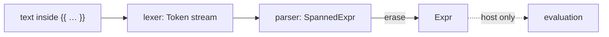

# Expression Syntax

`simplified_schema::expression` reads the expression language written inside
`{{ … }}` (and in condition fields such as `when:`) into a tree, **without
evaluating it**. Use it when you need to know whether text is a well-formed
expression, or what shape it has, and you have no host to run it in.

```rust
use simplified_schema::expression::{Expr, parse};

// Nothing defines `unknown_fn`; parsing only checks the syntax.
let expr = parse("unknown_fn(1)").unwrap();
assert_eq!(
    expr,
    Expr::FunctionCall { name: "unknown_fn".into(), args: vec![Expr::NumberLiteral(1.0)] }
);

let error = parse("unknown_fn(").unwrap_err();
assert_eq!(error.position, 11); // a byte offset into the supplied text
```

## What "syntax only" means

Parsing never resolves a variable, looks up or calls a function, checks a
function's arity, or runs a callback. `shell("rm -rf /")` parses as a call
named `shell` with one string argument; nothing runs. Evaluation, scopes, and
the function catalog belong to the host (Darkmatter).



## Entry points

| Function | Reads | Returns |
| --- | --- | --- |
| `parse` | an expression | `Expr` |
| `parse_spanned` | an expression | `SpannedExpr` (every node carries a byte span) |
| `parse_callback`, `parse_callback_spanned` | callback argument (`x => x.name`) | `Callback` |
| `lex_spanned` | an expression | `Vec<Spanned<Token>>` |

`SpannedExpr::erase` turns a spanned tree into the plain `Expr`; both come
from one grammar, so they always agree.

## Logical OR

There is one grammar for every surface: `{{ … }}` text and a condition such as
`when:` parse the same way. Infix `||` builds an `Expr::LogicalOr` node, while
`&&` lowers to a call named `and`:

| Text | Tree | Value when a host evaluates it |
| --- | --- | --- |
| `a \|\| b` | `LogicalOr { left: a, right: b }` | the deciding operand: `a` when truthy, otherwise `b` |
| `a && b` | `FunctionCall { name: "and", args: [a, b] }` | a boolean |

```rust
use simplified_schema::expression::{Expr, parse};

let expr = parse("items || []").unwrap();
assert!(matches!(expr, Expr::LogicalOr { .. }));
```

Schema checks of `expression`-typed values use `parse` too.

## Object literals and spread

An object literal builds a new object from a comma-separated list of
entries. Each entry is one of:

| Entry | Example | Meaning |
| --- | --- | --- |
| field | `color: 'blue'`, `'first name': 'Ada'` | the key and its value |
| shorthand field | `id` | `id: id` (identifier keys only; a quoted key has no shorthand) |
| spread | `...base` | every field of `base`, copied at this point in the order |

A spread lets you start from an existing object and change part of it, or
layer several objects:

```text
{ ...base, color: 'blue' }
{ ...defaults, ...overrides }
```

The parser keeps entries in written order as `ObjectEntry::Field { key, value }`
and `ObjectEntry::Spread { operand }` (`SpannedObjectEntry` in the spanned
tree). A spread's span is its operand's; the `...` token is not part of it.

```rust
use simplified_schema::expression::{Expr, ObjectEntry, parse};

let expr = parse("{ ...base, color: 'blue' }").unwrap();
let Expr::ObjectLiteral(entries) = expr else { unreachable!() };
assert!(matches!(&entries[0], ObjectEntry::Spread { operand } if *operand == Expr::Variable("base".into())));
assert!(matches!(&entries[1], ObjectEntry::Field { key, .. } if key == "color"));
```

### What the parser accepts

- **The operand is a whole expression.** It runs to the next `,` or `}`, so
  `{ ...a || b }` spreads `a || b` and `{ ...load_data('x.yaml') }` spreads
  the call's result. Spreads nest: `{ ...{ ...inner, k: 1 }, outer: { ...x } }`.
- **A written key may appear only once.** Two written fields with the same
  key are a parse error, even when a spread separates them, and a shorthand
  or quoted key counts as written. The error is reported at the second key:

  | Text | Result |
  | --- | --- |
  | `{ a: 1, ...rest, a: 2 }` | error: duplicate object key "a" |
  | `{ a, ...rest, a }` | error: duplicate object key "a" |
  | `{ a, ...rest, "a": 2 }` | error: duplicate object key "a" |
  | `{ a: 1, ...a }`, `{ ...a, ...a }` | parses; a spread's keys are unknown until it runs |

- **`...` is accepted only at the start of an object entry.** `...a`,
  `[...items]`, `f(...a)`, `{ k: ...a }`, `{ ... }`, and `{ ...a: 1 }` are
  parse errors. Array spread is not supported; `[...items]` says so in its
  message.
- **Trailing commas are rejected**, after a spread as after a field:
  `{ ...a, }` is an error.
- **The `{{ }}` closing rule is unchanged.** In `{{ {...base, nested: {k: 1}}}}`
  the literal's own braces close before the `}}` delimiter (see
  [`expression::scan`](./foundations.md#expression-scan-expressionscan)).
- **Literal examples refuse spread.** The result of a function type's inline
  `example(call => result)` must be a literal, and a spread is not one at any
  depth: `example(f(1) => {a: {...base}})` fails with "`...base` is not a
  literal; a spread is not allowed in a literal example".

### How a host evaluates a spread

Parsing never evaluates anything; these rules are what Darkmatter, the host
that runs expressions, does with the tree.

- **Entries run once each, in written order, and the last entry that
  supplies a key wins.** Every operand is evaluated exactly once, from left
  to right, even when later entries overwrite all of its keys. A key keeps
  the position where it first appeared, and the copy is shallow: a nested
  object is replaced whole, never merged.

  | Expression (`base` is `{ color: 'red', size: 2 }`) | Value |
  | --- | --- |
  | `{ ...base, color: 'blue' }` | `{ color: 'blue', size: 2 }` |
  | `{ color: 'blue', ...base }` | `{ color: 'red', size: 2 }` |
  | `{ ...{ n: { x: 1 } }, ...{ n: { y: 2 } } }` | `{ n: { y: 2 } }` |

- **The operand must be an object or `null`.** `null` contributes no fields,
  so `{ ...maybe, id: 1 }` gives `{ id: 1 }` when `maybe` is `null`. Any
  other value is an error with the code `dm.expression.invalid_spread_operand`, reported at
  the operand. The code is Darkmatter's, not this library's. When the
  operand's declared type proves it can never be an object or `null`
  (`{ ...5 }`, `{ ...[1, 2] }`, a `number(required)` variable), Darkmatter
  rejects the document passively, before anything runs. Otherwise the value
  is checked when the spread is evaluated. See
  [Object spread operands](../../../darkmatter/docs/inline/call-check.md#object-spread-operands)
  for both checks.
- **Type inference follows the same order.** With `size: number(required)`
  declared and `undeclared` unknown to the schema:

  | Expression | Inferred type |
  | --- | --- |
  | `{ a: size, ...{ a: 'x' } }` | `a` is `'x'`: a known later field replaces an earlier one |
  | `{ ...undeclared, a: size }` | `a` is a number: a later written field sets its type |
  | `{ a: size, ...undeclared }` | `a` is unknown: the spread may overwrite it |
  | `{ a: size, ...obj }`, where `obj` is a declared object that may supply `a` | `a` widens to a number or `obj`'s type for `a` |

  A spread whose keys are unknown leaves the result open, so reading any
  other member of it (`x.z`) is not reported as undeclared. A spread whose
  keys are known keeps the result closed.

## Spans and errors

Spans and error positions are byte offsets into the exact string you passed.
Nothing is normalized first: CRLF is two bytes of whitespace, and a Windows
path inside a string literal is opaque data.

```rust
use simplified_schema::expression::{SpannedExprKind, parse_spanned};

let source = "f(\r\n  'C:\\\\dir')";
let call = parse_spanned(source).unwrap();
let SpannedExprKind::FunctionCall { args, .. } = &call.kind else { unreachable!() };
assert_eq!(&source[args[0].span.clone()], "'C:\\\\dir'");
```

A `ParseError` carries a message, its byte `position`, and whether it concerns
inline-callback syntax (`diagnostic_code()` then returns
`INVALID_CALLBACK_CODE`). A lexer failure, such as an unterminated string,
reaches you as a `ParseError` at the offending byte.

## Numbers

A number literal is admitted by [`numeric`](./foundations.md#numbers-numeric)
from its written spelling, so `9007199254740993` is a syntax error (it has no
exact `f64`) rather than a silently rounded value.

## Where Darkmatter fits

Darkmatter re-exports these items under
`darkmatter::markdown::compose::expression` with the same types, and keeps
everything that needs a document or a runtime: `ExpressionFinder` (which skips
Markdown code blocks before handing text to [`expression::scan`](./foundations.md#expression-scan-expressionscan)),
the evaluator, the function catalog, and `ExpressionError`.
