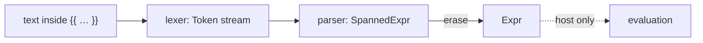

# Expression Syntax

`simplified_schema::expression` reads the expression language written inside
`{{ … }}` (and in condition fields such as `when:`) into a tree, **without
evaluating it**. Use it when you need to know whether text is a well-formed
expression, or what shape it has, and you have no host to run it in.

```rust
use simplified_schema::expression::{Expr, parse_condition};

// Nothing defines `unknown_fn`; parsing only checks the syntax.
let expr = parse_condition("unknown_fn(1)").unwrap();
assert_eq!(
    expr,
    Expr::FunctionCall { name: "unknown_fn".into(), args: vec![Expr::NumberLiteral(1.0)] }
);

let error = parse_condition("unknown_fn(").unwrap_err();
assert_eq!(error.position, 11); // a byte offset into the supplied text
```

## What "syntax only" means

Parsing never resolves a variable, looks up or calls a function, checks a
function's arity, or runs a callback. `shell("rm -rf /")` parses as a call
named `shell` with one string argument; nothing runs. Evaluation, scopes, and
the function catalog belong to the host (Darkmatter).



## Entry points

| Function | Dialect | Returns |
| --- | --- | --- |
| `parse` | interpolation | `Expr` |
| `parse_spanned` | interpolation | `SpannedExpr` (every node carries a byte span) |
| `parse_condition` | condition | `Expr` |
| `parse_condition_spanned` | condition | `SpannedExpr` |
| `parse_callback`, `parse_callback_spanned` | callback argument (`x => x.name`) | `Callback` |
| `lex_spanned` | either (`ParseMode`) | `Vec<Spanned<Token>>` |

`SpannedExpr::erase` turns a spanned tree into the plain `Expr`; both come
from one grammar, so they always agree.

## The two dialects

The dialects differ only in `||`:

| Text | Interpolation (`parse`) | Condition (`parse_condition`) |
| --- | --- | --- |
| `a \|\| b` | fallback: `b` when `a` is falsy | logical OR, lowered to a call named `or` |
| `a && b` | logical AND (call named `and`) | logical AND (call named `and`) |

Every other construct (literals, member and index access, arithmetic,
comparison, ternary, calls, inline callbacks) is the same in both. A text
valid in either dialect parses in condition mode, which is why schema checks
of expression-typed values use `parse_condition`.

## Spans and errors

Spans and error positions are byte offsets into the exact string you passed.
Nothing is normalized first: CRLF is two bytes of whitespace, and a Windows
path inside a string literal is opaque data.

```rust
use simplified_schema::expression::{SpannedExprKind, parse_spanned};

let source = "f(\r\n  'C:\\\\dir')";
let call = parse_spanned(source).unwrap();
let SpannedExprKind::FunctionCall { args, .. } = &call.kind else { unreachable!() };
assert_eq!(&source[args[0].span.clone()], "'C:\\\\dir'");
```

A `ParseError` carries a message, its byte `position`, and whether it concerns
inline-callback syntax (`diagnostic_code()` then returns
`INVALID_CALLBACK_CODE`). A lexer failure, such as an unterminated string,
reaches you as a `ParseError` at the offending byte.

## Numbers

A number literal is admitted by [`numeric`](./foundations.md#numbers-numeric)
from its written spelling, so `9007199254740993` is a syntax error (it has no
exact `f64`) rather than a silently rounded value.

## Where Darkmatter fits

Darkmatter re-exports these items under
`darkmatter::markdown::compose::expression` with the same types, and keeps
everything that needs a document or a runtime: `ExpressionFinder` (which skips
Markdown code blocks before handing text to [`expression::scan`](./foundations.md#expression-scan-expressionscan)),
the evaluator, the function catalog, and `ExpressionError`.
