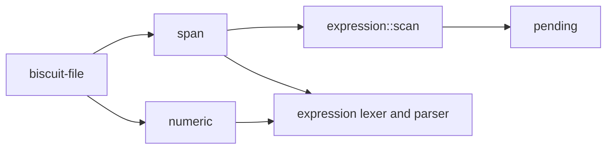

# Foundations

Four small modules sit underneath every other part of the crate. Hosts such
as Darkmatter re-export them, so a value produced by one crate is the same
type in the other.



The expression lexer and parser built on these are described in
[Expression syntax](./expression-syntax.md).

## Numbers (`numeric`)

Every number is a finite `f64`. A number enters the model only through this
module, which decides from its **written spelling** whether it can be held:

- a whole value must be exact in any spelling, so `9007199254740993`,
  `9007199254740993.0`, and `9.007199254740993e15` are all rejected;
- a fractional value takes the nearest `f64`, so `0.1` is admitted;
- a non-zero value that would become `0` is rejected (underflow), and one
  that overflows is rejected as not finite.

```rust
use simplified_schema::numeric::{admit_integer, NumericAdmissionError};

assert_eq!(admit_integer(1 << 53), Ok(9_007_199_254_740_992.0));
assert_eq!(admit_integer((1 << 53) + 1), Err(NumericAdmissionError::Inexact));
```

The loaders apply the same rules to whole documents and say where a number
failed: `load_admitted_yaml` reports the property path, line, and column;
`admit_json_text_numbers` and its JSON5 counterpart `admit_json5_text_numbers` report a
JSON Pointer, line, and column;
`reject_non_finite_json5` rejects `Infinity`, `NaN`, and overflowing literals
that JSON5 would otherwise store as `null`.

## Spans (`span`)

A span is a byte range (`SourceSpan`, which is `biscuit-file`'s
`Range<usize>`) into the **exact** text the caller supplied. Nothing is
normalized first, so offsets stay valid against CRLF documents.
`line_col_of_offset` treats LF, CRLF, and lone CR as line breaks and returns a
1-based **byte** column.

```rust
use simplified_schema::line_col_of_offset;

let source = "a: C:\\dir\r\nb: x";
assert_eq!(line_col_of_offset(source, source.find('b').unwrap()), (2, 1));
```

## Expression scan (`expression::scan`)

`scan` finds three kinds of span in text, without evaluating anything:

| Spelling | Result field | Meaning |
| --- | --- | --- |
| `{{ name }}` | `expressions` | an expression, trimmed |
| `{{{ text }}}` | `literals` | text kept verbatim |
| `{{!data:v1:…}}` | `tokens` | a literal token (see below); never an expression |

An odd run of backslashes before `{{` escapes it; an even run does not. The
scanner knows nothing about Markdown: a host that must skip code blocks
passes their byte ranges as the `excluded` argument, and `scan_plain`
excludes nothing.

```rust
use simplified_schema::expression::scan::scan;

let result = scan("{{ a }}  {{ b }}", &[(0, 9)]);
assert_eq!(result.expressions[0].expression, "b");
```

## Literal tokens (`pending`)

`{{!data:v1:<payload>}}` stores one string as data: the payload is the
string's UTF-8 bytes in unpadded URL-safe base64, so it never needs YAML
escaping and can never be read as an expression. A token counts only when it
is an entire string value.

- `encode` / `decode` convert between a string and its token.
- `decode_leaf` classifies one string: `None` (no token), `Some(Ok(text))`
  (the whole string is a token), or `Some(Err(_))` (a malformed token, or one
  embedded in other text).
- `holds_pending_syntax` says whether a string still holds `{{` or `$(`
  syntax a later pass could resolve; a whole-string token never does.
- `decode_literal_tokens` replaces every whole-string token in a JSON value,
  reporting the path of the first malformed one.

```rust
use simplified_schema::pending::{encode, holds_pending_syntax};

assert!(holds_pending_syntax("{{ area }}"));
assert!(!holds_pending_syntax(&encode("{{ area }}")));
```

Deciding *whether* a value is pending, for example because it came from a
document still being composed, is the host's job; this module is lexical.
