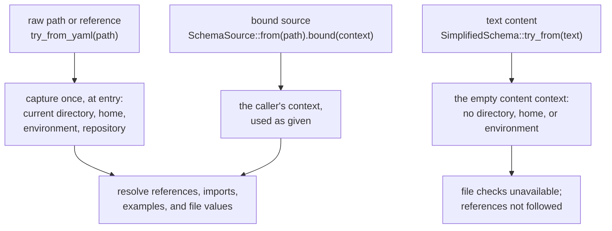

# Host Capabilities

Most of a schema is judged from the value alone: a `number` is a number
whatever machine you run on. A few checks need more from the host: a file
system to read, a directory to resolve relative paths from, and sometimes the
repository a path lives in. This page says which checks those are, what the
library does when it cannot run them, and the one place it reads the running
process to find out where it is.

## Checks That Need a Host

| Written in a schema | Needs | Without it |
| --- | --- | --- |
| `file` (lazy) | nothing: the value's syntax is checked | runs everywhere |
| `file(eager)` | a file context and a file system: the reference is resolved and the file must exist | an unavailable check |
| `file(match(...))` on a [root-union](./language/unions.md#root-level-unions) arm | a file context and a file system: an existing file must match the arm's globs | an unavailable check |
| `$schema: ./page.yaml`, `Name@./types.yaml`, `example(./x.md)` | reading those files while the schema is built | the schema cannot be prepared |
| a repository-relative reference (for example `^schemas/page.yaml`) | the repository root and its packages, found by repository discovery | the reference cannot be resolved |
| an `http://` or `https://` reference | not supported in any build | always `SchemaError::RemoteUnsupported` |

Glob *patterns* written in a schema are checked for syntax while it is
parsed, in every build; only judging a value against them needs a file
system.

When a check cannot run, the library never reports the value as valid:

- **An unavailable value check** (`file(eager)`, `match(...)`) makes
  `validate_strict` and `validate_soft` return
  `ValidationFailure::UnavailableCheck`: the value was neither accepted nor
  shown to be invalid. Beside a real violation, the failure is `InvalidData`
  and `ValidationProblem::is_unavailable_check` marks which problems are
  which. Malformed file syntax is a real violation in every build.
- **An unreadable reference** in the schema makes building fail with
  `SchemaError::Unresolved` (cause `FileReferenceError::ResolutionUnavailable`)
  from the lower-level resolver, or, for a `SimplifiedSchema` built from text,
  keeps the schema inspectable and makes each validation return
  `ValidationFailure::Unprepared` with that error.

See [Strict and Soft Validation](./validation.md#failures) for the failure
kinds.

## Which Builds and Schemas Have a Host

Two things decide whether those checks can run: the `file` Cargo feature, and
whether the schema was built from a file or from text.

| | Built from a file | Built from text (`SimplifiedSchema::try_from`) |
| --- | --- | --- |
| **Default build (`file` on)** | every check runs | references cannot be followed; `file(eager)` and `match(...)` are unavailable |
| **`default-features = false`** | the file factories do not exist | the same as with `file` on |

```rust
use serde_json::json;
use simplified_schema::{SimplifiedSchema, ValidationFailure};

// Text has no file context, in every build.
let schema = SimplifiedSchema::try_from("$schema:\n  source: file(eager)\n")?;
let failure = schema.validate_strict(&json!({ "source": "./README.md" })).unwrap_err();
assert!(matches!(failure, ValidationFailure::UnavailableCheck { .. }));
```

To judge file values, build the schema from its file
(`SimplifiedSchema::try_from_yaml` and the other
[file factories](./schema-object.md#files-one-argument-raw-or-bound)), or
compile a lowered schema yourself with `Prepared::new` and a context you
supply. A build without `file` also drops repository discovery, so its
dependency graph holds no `gix`, `walkdir`, or `sniff`; see
[Cargo features](./features.md).

## Where the File Context Comes From

Every file check resolves in a `biscuit_file::FileResolutionContext`: the
directory relative paths start from, the home directory, the environment
variables a reference may name, and the repository the request is in. The
library gets that context in exactly one of three ways, decided by how the
schema was built:



- **A raw path captures.** A file factory given a plain path or reference
  string reads the process once, before it resolves or reads anything: the
  current directory, the home directory, the environment, and, through
  repository discovery, the repository root and its packages. Not being in a
  repository is fine; failing to read the current directory is
  `SimplifiedSchemaError::Context`, and failing discovery is
  `SimplifiedSchemaError::Discovery`. Everything after that point works from
  the snapshot, so changing the current directory or an environment variable
  later cannot redirect the request. This is the only place the library reads
  the process.
- **A bound source captures nothing.** `SchemaSource::bound(context)` uses a
  context the caller already holds, such as a host's per-request context.
  A server or editor that handles many requests binds each one, so no request
  depends on the server's own current directory.
- **Text never reads the process.** A schema built from text gets one fixed,
  empty context with no directory, home, or environment. It cannot resolve
  anything, so its file checks are unavailable rather than wrong, and
  building it reads nothing.

The lower-level entry points (`Prepared::new`,
`validate::build_validator_in_context`, the `resolve` functions) take the
context as an argument and never build one. What that context reads is the
caller's choice: `FileResolutionContext::new(dir)` snapshots the home
directory and environment, and `FileResolutionContext::from_snapshot` takes
them as arguments.

The crate's own tests keep this boundary in place: they fail if production
code reads the process outside the raw-path capture, resolves paths or the
home directory without the shared helpers, or depends on a crate that
consumes this library.
