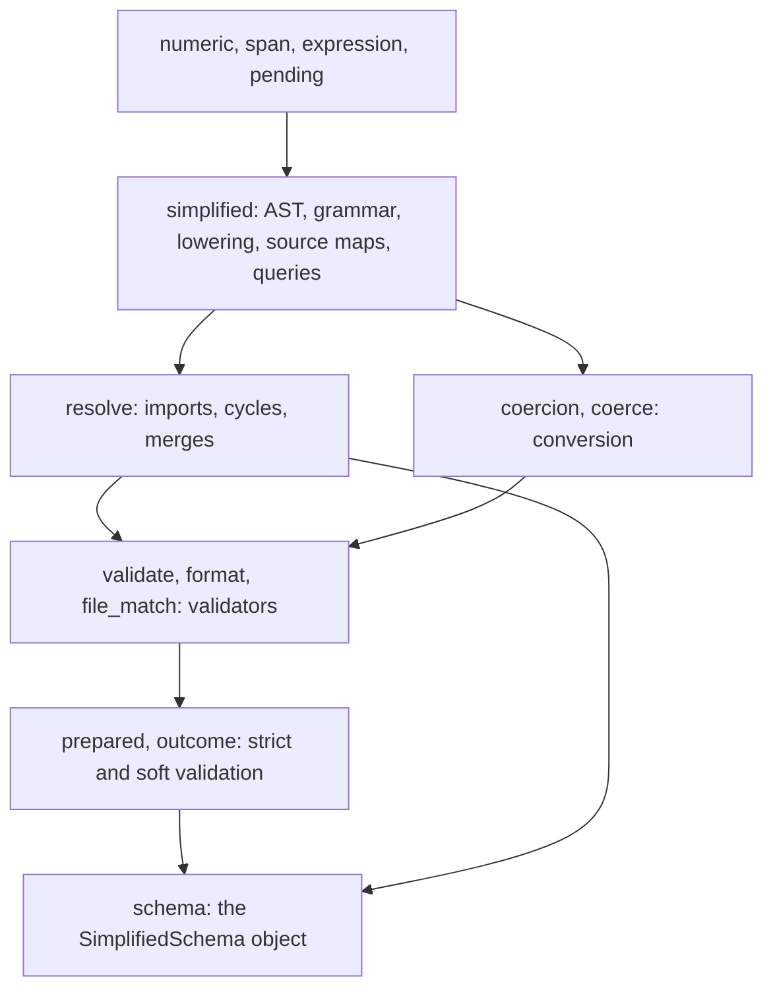

# Language Core

The crate parses SimplifiedSchema text into an AST, lowers it to Draft
2020-12 JSON Schema, resolves the named types it imports, and judges values
with the result. Nothing here reads a Markdown document, runs an expression,
or decides which values are still waiting on a template: a host (Darkmatter)
owns those decisions and calls in here.

```rust
use serde_json::json;
use simplified_schema::{parse_yaml_schema, to_json_schema, validate::build_structural_validator};

let yaml: serde_yaml_ng::Value = serde_yaml_ng::from_str("name: string(required)\nage: number(min(0))").unwrap();
let root = parse_yaml_schema(&yaml).unwrap();          // a SchemaRoot
let schema = to_json_schema(&root).unwrap();            // Draft 2020-12
let validator = build_structural_validator(&schema).unwrap();
assert!(validator.is_valid(&json!({ "name": "Ada", "age": 36 })));
```

## Modules



| Module | What it holds |
| --- | --- |
| `simplified` | `SchemaRoot` (one shape, or a root union of arms), `SchemaShape`, `PropertyDef`, `TypeExpr`; the type grammar; `to_json_schema`; source maps (`SchemaSourceMap`), editor cursors, suggestion queries, serializers, subtyping |
| `resolve` | `resolve_schema` and its YAML and schema-root variants, named-type expansion (`expand_named_types`), cycle and use-site checks, `merge_baseline` (the layer merge: a higher layer replaces a whole property) |
| `coercion` | The conversion engine over shapes (`bind`, `bind_with`, `check_exact`) |
| `coerce` | Frontmatter conversion against a lowered JSON Schema (`coerce_frontmatter`) |
| `validate`, `format`, `file_match` | Compiled validators and their cache, the `darkmatter-*` formats, the `x-darkmatter-*` keywords, and `file(match(...))` globs |
| `schema` | `SimplifiedSchema` (build from content or a file, validate, layer, query, export), `SchemaSource`, `TypeDefinition`, `FunctionView`, `SimplifiedSchemaError`; see [The `SimplifiedSchema` Object](./schema-object.md) |
| `prepared`, `outcome` | `Prepared` (a schema compiled once, with `validate_strict` and `validate_soft`), `ValidationSuccess`, `ValidationFailure`; see [Strict and Soft Validation](./validation.md) |
| `validation`, `positions` | `ValidationProblem` and its codes, JSON Pointers, and where a problem sits in its source text |
| `completion`, `frontmatter_shape` | Which definition governs a frontmatter path, and union-aware completion choices |
| `errors` | `SchemaError` |

`SchemaRoot` is the parsed `$schema` itself: a root union stays a union, never
flattened to one property map.

## Supplied Sources

The resolver reads only what the caller hands it: the schema value, the
directory it was written in, schema roots for bare file names, a
`biscuit_file::FileResolutionContext`, and a `ShippedSources` table.

A host may reserve a namespace for documents compiled into its binary.
Darkmatter supplies `darkmatter:` over its shipped catalog, so
`stack@darkmatter:lifecycle` names `stack` in its `lifecycle` partial and no
file is read. With `ShippedSources::NONE` that spelling is an ordinary file
reference.

```rust
use simplified_schema::embedded::{EmbeddedDocument, ShippedSources};

const DOCUMENTS: &[EmbeddedDocument<'static>] = &[EmbeddedDocument {
    path: "host/partials/talk.yaml",
    text: "kind: schema\ntypes:\n  greeting: \"{ say: string }\"\n",
}];
const HOST: ShippedSources = ShippedSources::new("host:", "host/partials", DOCUMENTS);

// `x: greeting@host:talk` resolves among DOCUMENTS:
// resolve_yaml_schema(&value, base_dir, &context, HOST)
```

An `http://` or `https://` schema, import, or example reference is
`SchemaError::RemoteUnsupported`.

## What a Host Keeps

- **Baseline and layering policy.** Which schemas layer under a document, and
  in what order, is the host's; `SimplifiedSchema::layer_under` /
  `layer_over`, `resolve::merge_baseline`, and `layered_property_shape` do the
  merging it asks for.
- **Pending values.** The host decides which `{{ … }}` templates are still
  pending and hands their paths in (`coerce::NestedTemplates`); the library
  never asks.
- **Trigger origins.** `SchemaOrigin` records a trigger layer by its
  `SchemaSourceId`; mapping that back to a trigger file is the host's.
- **Terminal output.** `SchemaError` renders in a terminal only with the
  opt-in `terminal` feature.

Without the default `file` feature, nothing that needs a file on disk passes;
see [Cargo features](./features.md).
