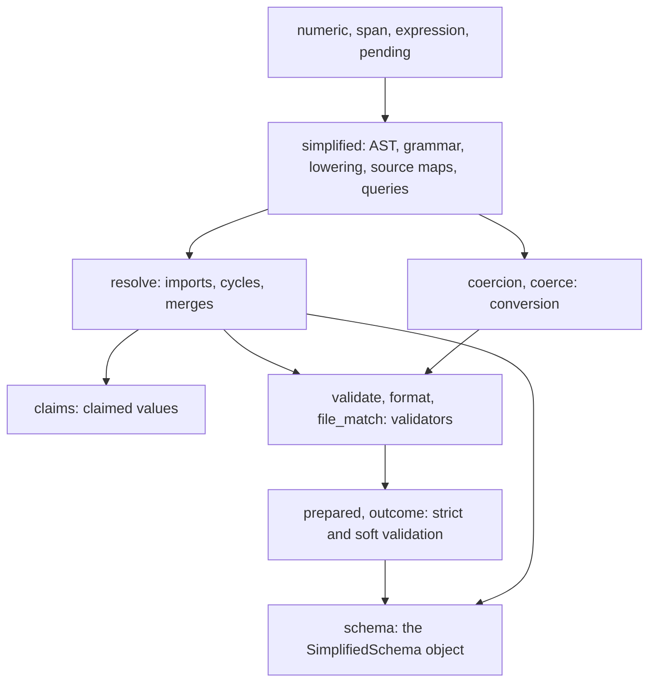

# Language Core

The crate parses SimplifiedSchema text into an AST, lowers it to Draft
2020-12 JSON Schema, resolves the named types it imports, and judges values
with the result. Nothing here reads a Markdown document, runs an expression,
or decides which values are still waiting on a template: a host (Darkmatter)
owns those decisions and calls in here.

```rust
use std::sync::Arc;
use biscuit_file::FileResolutionContext;
use serde_json::json;
use simplified_schema::{Prepared, parse_yaml_schema, to_json_schema};

let yaml: serde_yaml_ng::Value = serde_yaml_ng::from_str("name: string(required)\nage: number(min(0))").unwrap();
let root = parse_yaml_schema(&yaml).unwrap();          // a SchemaRoot
let schema = to_json_schema(&root).unwrap();            // Draft 2020-12
let prepared = Prepared::new(Arc::new(schema), None, FileResolutionContext::new("/work")).unwrap();
assert!(prepared.validate_strict(&json!({ "name": "Ada", "age": 36 })).is_ok());
```

## Modules



| Module | What it holds |
| --- | --- |
| `simplified` | `SchemaRoot` (one shape, or a root union of arms), `SchemaShape`, `PropertyDef`, `TypeExpr`; the type grammar; `to_json_schema`; source maps (`SchemaSourceMap`), editor cursors, suggestion queries, serializers, subtyping |
| `resolve` | `resolve_schema` and its YAML and schema-root variants, named-type expansion (`expand_named_types`), cycle and use-site checks, `merge_baseline` (the layer merge: a higher layer replaces a whole property) |
| `claims` | `claimed_values`, `ClaimProblem`, `ClaimCause`: the strings a resolved schema claims for one property; see [Claimed Values](#claimed-values) |
| `coercion` | The conversion engine over shapes (`bind`, `bind_with`, `check_exact`), and `ConversionError::located_failures`, one record per failing location; see [Located failures](conversion.md#located-failures) |
| `coerce` | Frontmatter conversion against a lowered JSON Schema (`coerce_frontmatter`) |
| `validate`, `format`, `file_match` | Compiled validators and their cache, the `darkmatter-*` formats, the `x-darkmatter-*` keywords, and `file(match(...))` globs |
| `schema` | `SimplifiedSchema` (build from content or a file, validate, layer, query, export), `SchemaSource`, `TypeDefinition`, `FunctionView`, `SimplifiedSchemaError`; see [The `SimplifiedSchema` Object](simplified-schema-struct.md) |
| `prepared`, `outcome` | `Prepared` (a schema compiled once, with `validate_strict` and `validate_soft`), `ValidationSuccess`, `ValidationFailure`; see [Strict and Soft Validation](./validation.md) |
| `envelope` | The compiled definitions of the `kind: schema` and `kind: yaml-schema` envelopes (`ENVELOPE_DEFINITIONS`) and `admit_envelope_text`, which judges a standalone document against its definition; see [Admission](./language/schema-documents.md#admission-checking-an-envelope-against-its-definition) |
| `validation`, `positions` | `ValidationProblem` and its codes, JSON Pointers, and where a problem sits in its source text (`PositionMap::byte_range`) |
| `completion`, `frontmatter_shape` | Which definition governs a frontmatter path, and union-aware completion choices |
| `errors` | `SchemaError` |

`SchemaRoot` is the parsed `$schema` itself: a root union stays a union, never
flattened to one property map.

## Claimed Values

`claimed_values(&resolved, property)` answers "which values of this property
does the schema accept?" when the answer must be a finite list of names, such
as the document kinds a schema claims through its `kind`. It reads the
resolved lowering, so inline arms, local aliases, `Name@file` imports, and
file arms are judged alike, and it is the check that completes the parse-only
[`property(...)` declaration option](./language/schema-types.md#narrowing-a-declaration).

```rust
use std::path::Path;
use biscuit_file::FileResolutionContext;
use simplified_schema::{claimed_values, embedded::ShippedSources, resolve::resolve_yaml_schema};

let dir = Path::new("/work");
let declaration: serde_yaml_ng::Value =
    serde_yaml_ng::from_str("- kind: enum(a, b; required)\n- kind: literal(c; required)\n- kind: literal(a; required)\n").unwrap();
let resolved = resolve_yaml_schema(&declaration, dir, &FileResolutionContext::new(dir), ShippedSources::NONE).unwrap();
assert_eq!(claimed_values(&resolved, "kind").unwrap(), ["a", "b", "c"]);
```

Every root arm (or the single root) must be an object that lists the
property in `required` and declares it, free of `null`, as a `const`, an
`enum`, or a union of those, each choice a non-empty string. The result is
the union of every arm's choices in first-seen order, repeats removed. A file
arm that is itself a root union contributes each of its arms. The first arm
that fails is returned as a `ClaimProblem { property, arm_index, cause, path }`:

| `ClaimCause` | The arm | Example declaration of `kind` |
| --- | --- | --- |
| `NotObject` | is not an object schema | a file arm whose schema is `{"type": "string"}` |
| `Missing` | does not declare the property | `name: string` (no `kind`) |
| `NotRequired` | declares it optional, including through a `null` alternative | `literal(a)`, `null \| literal(a; required)` |
| `NullAdmitted` | requires it, but its JSON Schema admits `null` | a raw JSON Schema `anyOf` with a `{"type": "null"}` arm |
| `NotEnumerable` | declares a type that is not a finite set | `string(required)` |
| `NonStringChoice` | has a choice that is not a string | `literal(1; required)` |
| `EmptyChoice` | has an empty string choice, or an empty `enum` | `literal(""; required)` |

`arm_index` is `None` for a single root; an arm reached through a file arm
keeps the referencing arm's index. `path` addresses the property (or, for
`NotObject`, the arm) as if it were declared inline. Its message is the same
for every cause, `` root-union arm 1: `kind` must be declared as `literal(...)` or `enum(...)` ``,
so read `cause` to tell them apart.

A host that defines YAML document kinds with
[`kind: yaml-schema`](./language/schema-documents.md#kind-yaml-schema) files
prepares an embedded one with `resolve::prepare_embedded_yaml_schema` and
reads the kinds it claims with `claimed_values(&resolved, "kind")`.

## Supplied Sources

The resolver reads only what the caller hands it: the schema value, the
directory it was written in, schema roots for bare file names, a
`biscuit_file::FileResolutionContext`, and a `ShippedSources` table.

A host may reserve a namespace for documents compiled into its binary.
Darkmatter supplies `darkmatter:` over its shipped catalog, so
`stack@darkmatter:lifecycle` names `stack` in its `lifecycle` partial and no
file is read. With `ShippedSources::NONE` that spelling is an ordinary file
reference.

```rust
use simplified_schema::embedded::{EmbeddedDocument, ShippedSources};

const DOCUMENTS: &[EmbeddedDocument<'static>] = &[EmbeddedDocument {
    path: "host/partials/talk.yaml",
    text: "kind: schema\ntypes:\n  greeting: \"{ say: string }\"\n",
}];
const HOST: ShippedSources = ShippedSources::new("host:", "host/partials", DOCUMENTS);

// `x: greeting@host:talk` resolves among DOCUMENTS:
// resolve_yaml_schema(&value, base_dir, &context, HOST)
```

An `http://` or `https://` schema, import, or example reference is
`SchemaError::RemoteUnsupported`.

## What a Host Keeps

- **Baseline and layering policy.** Which schemas layer under a document, and
  in what order, is the host's; `SimplifiedSchema::layer_under` /
  `layer_over`, `resolve::merge_baseline`, and `layered_property_shape` do the
  merging it asks for.
- **Pending values.** The host decides which `{{ … }}` templates are still
  pending and hands their paths in (`coerce::NestedTemplates`); the library
  never asks.
- **Trigger origins.** `SchemaOrigin` records a trigger layer by its
  `SchemaSourceId`; mapping that back to a trigger file is the host's.
- **Terminal output.** `SchemaError` renders in a terminal only with the
  opt-in `terminal` feature.

Without the default `file` feature, nothing that needs a file on disk passes;
see [Cargo features](./features.md).
