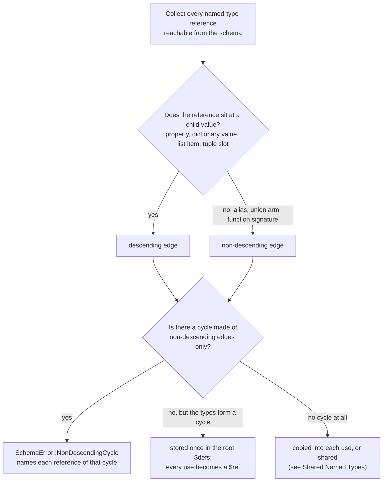
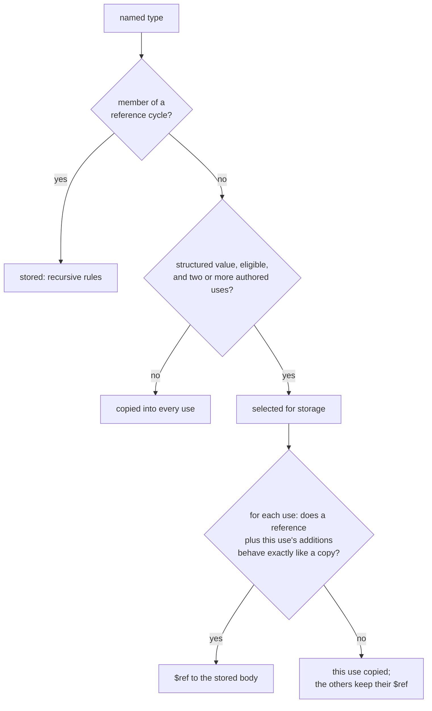

# Objects and Named Types

Inline object literals type a nested mapping in one string; named types let one definition be reused, imported from another file, or refer to itself.

## Inline Object Literals

The type-expression grammar accepts an **inline object literal** — a single string scalar that declares the shape of a nested object. This is the way to type object-typed properties and arrays of objects without dropping down to an external JSON Schema file. The motivating case is the typed object array:

```yaml
$schema:
    authors: "{ name: string(required), email: email }[]"
```

### Forms

An inline object appears wherever a type expression is valid: as a single property, a property-level union arm, or the item type of an array.

```yaml
$schema:
    # Array of typed objects — the motivating case
    entries: "{ foo: string(required), bar: string }[]"

    # Optional single typed object
    config: "{ host: string(required), port: number(default(8080)) }"

    # Required single typed object — the postfix constraint applies to config
    config_required: "{ host: string }(required)"

    # Multi-line for readability (whitespace inside braces is ignored)
    endpoints: "{
        url: url(scheme(https); required),
        method: enum(GET, POST, PUT, DELETE; required),
        timeout: number(default(30))
    }[]"

    # Nested objects
    database: "{
        primary: { host: string(required), port: number(default(5432)) },
        replicas: { host: string, port: number }[]
    }"

    # Required non-empty array — postfix constraints after [] apply to replicas
    replicas: "{ host: string }[](min(1); required)"

    # Inline object as a union arm
    payload:
      - "{ type: enum(foo; required), foo_id: string(required) }"
      - "{ type: enum(bar; required), bar_count: number(required) }"

    # Mixed: inline object array or a plain string fallback
    metadata:
      - "{ key: string(required), value: string(required) }[]"
      - "string"
```

The inline object body parses identically in single-line and multi-line form because the parser strips whitespace after `{`, around `,` and `:`, and before `}`. Braces are not allowed inside constraint argument lists, so there is no ambiguity with the existing constraint syntax.

### Identifier Rules

Inline object property names are always **unquoted string-layer identifiers** — unquoted ASCII alphanumeric characters plus `-` and `_`, including leading digits. The same scanner is used elsewhere in the grammar.

Accepted: `name`, `foo_id`, `x-custom`, `api2_version`, `123abc`.

Rejected: `display name`, `@type`, `x.custom`, `"x-custom"`. There is no quoted-property-name form in this feature; rename the property to a valid identifier or drop down to a JSON Schema file for richer naming needs.

### Descriptions

Each property inside `{ ... }` may carry a `-> description` suffix that follows the same four syntax forms as top-level properties. Inside an inline object, **descriptions terminate at the next top-level comma or closing brace** at the current nesting level. Commas inside an inline property description are not supported by this feature — keep descriptions comma-free inside `{ ... }`. A description is plain prose: quotes and square brackets in it mean nothing, so `{ a: string -> (it's fine), b: number }` and `{ a: string -> plain [x, b: number }` both end `a`'s description at the comma before `b`. Top-level descriptions (outside any inline object) still consume the rest of the scalar string after `->` exactly as before.

### Postfix Constraints

Inline objects support the same postfix constraints as primitive atoms.

- A **single inline object** with a postfix constraint — `{ host: string }(required)` — applies the constraint to the containing property. `required` hoists to the parent `required` array; `default(...)` sets a default on the object property.
- An **inline object array** with constraints after `[]` — `{ name: string }[](min(1); required)` — applies those constraints to the array property itself (`minItems`, parent `required`). Constraints on nested properties remain inside the inline object fragment and become JSON Schema constraints on each `items` object.
- A trailing comma after the last property is allowed: `{ foo: string, }` is identical to `{ foo: string }`.

### Nesting Depth

The inline object parser enforces a hard maximum of **32 nesting levels** of inline objects. Exceeding that depth returns `SchemaError::Grammar`. The limit is the same for single inline objects, inline object arrays, and unions whose arms contain inline objects — depth is counted at every level of nested `{ ... }`.

```yaml
$schema:
    # OK: 3 levels of nesting
    a: "{ b: { c: { d: string } } }"

    # Error at depth 33: SchemaError::Grammar
    deep: "{ a: { a: { a: { a: { a: { a: { a: { a: { a: { a: { a: { a: { a: { a: { a: { a: { a: { a: { a: { a: { a: { a: { a: { a: { a: { a: { a: { a: { a: { a: { a: { a: string } } } } } } } } } } } } } } } } } } } } } } } } } } } } } } } }"
```

The cap limits how deeply one type string is written, not how deeply a document may nest. For a structure that repeats at every level, such as a tree, declare a [recursive named type](#recursive-named-types). Otherwise, if you need deeper typing, reference an external JSON Schema file with `$schema: ./path/to/schema.yaml` (or use a root-level union whose arm is a file reference).

### `additionalProperties: false`

Every inline object compiles to a JSON Schema fragment that sets `additionalProperties: false`. This is the intended default — declaring an inline object is a signal that the author wants shape restriction. It differs from the root schema default (`additionalProperties: true`) and from the opaque `object` type, which still compiles to `{ "type": "object" }` with no `additionalProperties: false`. Authors used to the root default may be surprised; this is documented behavior. A future `lenient` constraint on the inline object body may opt back to `true`.

### YAML Mapping vs. Inline Object

A YAML mapping at a property position is still a `SchemaError::Grammar`. Inline object syntax is recognized **only** when the property value is a **quoted string scalar** that the string-layer grammar parser recognizes as an inline object body. Authors who want typed nested objects must quote the object body as a string; YAML-native mapping schemas are a separate, future feature.

```yaml
$schema:
    # OK: string scalar recognized as inline object
    config: "{ host: string(required) }"

    # Error: YAML mapping at a property position is still reserved
    # config:
    #     host: string
```

### JSON Schema Output

An inline object compiles to the same Draft 2020-12 JSON Schema shape a hand-written `{ "type": "object", "properties": ..., "required": ..., "additionalProperties": false }` would produce, with `required` populated from per-property `required` constraints and the inline object's own `required` postfix hoisted to the parent `required` array.

For an array of inline objects, the `items` sub-schema is the inline object fragment and `minItems` / `maxItems` / `uniqueItems` / `required` come from the postfix constraints after `[]`.

## Composition Primitives

Four primitives compose named types, dictionaries, and content-format strings on top of the base grammar. They are additive — a schema that uses none of them parses and compiles exactly as before.

### `example(...)` Constraint

`example(...)` attaches one or more **example artifacts** to a property. Examples are documentation, like a richer `description` — they do **not** constrain the annotated property's value. Comma-separated file references resolve relative to the referencing schema file (magic paths and `this` are honored, mirroring `$schema` resolution).

```yaml
$schema:
    today: "date(required; example(./ctx/today-example.yaml)) -> Local date"
    demo:  "string(example(./a.yaml, ./b.yaml))"
```

Each referenced file is validated at **schema-load time** — a missing, malformed, or invalid example is a schema-load error (fail loud; the point is trustworthy examples). Validation has two layers:

1. The common **envelope** validates against the built-in example schema (`kind`, `invocation`, `returns`, `description`).
2. Target-specific fields such as `parameters` validate against the inherited target shape (for expression-function examples, an array of single-key `name → value` maps).

Resolved example objects are emitted onto the JSON Schema as the `x-darkmatter-example` extension so downstream consumers (`md schema about`, DMLS hover) read them without re-reading disk. Unchanged example files are cached by content hash across warm loads.

A `function` type also takes inline examples, `example(call => result)`; see
[Function Signatures](unions.md#function-signatures). The `=>` tells the two forms apart,
and the inline form on any other type is a schema-load error.

### Cross-File Named-Type Imports (`Name@file`)

`Name@fileref` gives the use site the definition of the named type `Name` from the referenced file — structural substitution: each use validates exactly as if the definition were written there. In the generated JSON Schema most uses are such a copy. Two kinds of type are stored once and referenced instead: a type that refers back to itself (see [Recursive Named Types](#recursive-named-types)), and a structured type that two or more places use (see [Shared Named Types](#shared-named-types)). A schema file's **`types` entries are its named types** when that table is present beside an exported `$schema`; without a separate table, the mapping payload's top-level entries serve as both properties and named types (see [Standalone Schema Documents](schema-documents.md#standalone-schema-documents)). Each is a full SimplifiedSchema definition (scalar, enum, union, or an inline object with literal or pattern keys).

A type defined in the same schema may be referenced by its **bare name**: `type` and `type@this` are the same reference. See [Local Type References](local-type-references.md) for where local names live, built-in collisions, and why a bare name inside an imported definition still resolves in its defining file.

```yaml
$schema:
    type:       type@./types.yaml        # inlines types.yaml's `type` definition
    parameters: parameter[]@./types.yaml # array of the inlined `parameter` map
    value:      kind                     # the `kind` defined in *this* schema
    other:      kind@this                # the same reference, spelled explicitly
    kind:       enum(a, b)
```

Grammar: `type_ref := ident ('(' constraints ')')? ('[]' ('(' constraints ')')?)? ('@' fileref)?`. A bare `ident` that is a built-in type keyword is the built-in; any other bare `ident` is a local reference. Postfix composes **outward**:

- `Name[]@file` — an array of the inlined `Name`.
- `Name(constraints)@file` — the inlined type with `constraints` merged into its own (see [Merging use-site constraints](#merging-use-site-constraints)).
- `Name[](constraints)@file` — an array of the inlined `Name`, with `constraints` on the array.
- `Name -> description` — a use-site description replaces the inherited one; omitting it keeps the inherited description.
- `@this` (or no `@` at all) — the current schema (self-target), including inline top-level documents.
- `@darkmatter:<stem>` — a type from one of the schema partials Darkmatter ships, wherever the importing schema lives (see [Reserved Darkmatter References](#reserved-darkmatter-references-namedarkmatterstem)).

A constraint list before `[]` (`Name(c)[]`) parses, but only a union-typed named type accepts one, and only its property markers; on any other named type it is a schema error, so write the list's constraints after `[]`. Adding `[]` to a named type that is already an array is an error. A reference to a **union-typed** named type accepts `[]` with list constraints, the `required`, `generated`, and `eager` markers (before or after `[]`), and a description, in all three forms (bare, `@this`, and `Name@file`); any other constraint on it is an error. See [Named Union References](unions.md#named-union-references).

The file reference is read as written up to the next `->`, `,`, or `}`, whichever comes first. No other punctuation in it has meaning, so `Name@./a(b.yaml` names the file `./a(b.yaml`, and `Name@./a{b.yaml -> the shared shape` names `./a{b.yaml` and describes it. Inside a YAML flow sequence, quote an arm whose filename contains `[` or `{`, because YAML ends a plain flow scalar there: `['Name@./a{b.yaml', string]`.

Rules:

- The right side resolves as a `biscuit_file::FileReference` whose `cwd` is the schema file's directory, in the request's file-resolution context when one is supplied — the same resolution as root-union file refs and `$schema`.
- The target must be a SimplifiedSchema file whose payload is a mapping with a matching named type. Importing from a raw JSON Schema file, from a root-union schema file, from a file whose whole payload is a reference to another file, or from a missing file is a schema error. A name the target does not define is `SchemaError::UnknownNamedType`, naming the type, the schema searched, and the property that holds the reference.
- **Every constraint of the definition survives the reference**, including `required` and `generated`. An inherited `required` keeps its scope: on `people: person[]` it makes `people` required, and inside one arm of a property-level union it is hoisted to the property like any arm's `required`. Requiring a field *inside* an object type does not require the property that holds the object.
- Expansion is **eager, bounded, and cycle-checked**. A named type may refer back to itself, directly or through other named types in the same or other files, as long as every cycle passes through a child value; see [Recursive Named Types](#recursive-named-types). A type that does not recurse is either copied into each use or, when it is structured and used from two or more places, stored once and referenced (see [Shared Named Types](#shared-named-types)); either way it accepts and rejects the same values. A chain of non-repeating references deeper than 32 is rejected (`SchemaError::ImportCycle`) — the same protection as the inline-object nesting cap.
- Each import of another file is a **dependency edge** recorded on the resolved schema (`ResolvedSchema.imports`) so the schema cache and DMLS index can invalidate when an imported file changes. A local reference adds no edge.
- An inherited `example(...)` reference resolves from the file that declared it, not from the importing schema.
- `to_json_schema` rejects any unresolved import that reaches conversion, exactly as it rejects unresolved root-union file arms — imports are always expanded by the resolver first.

#### Shared Tables and Independent Imports

Importing several names from one file does not copy that file's entire type
library for each reference. Within one import-expansion operation, the resolver
keeps one immutable table of the file's unexpanded definitions. The first
lookup, later lookups, and `@this` lookups inside that file share the same
table. The root document has its own table, copied once before expansion so
local references can still read its original definitions. Declaration order is
preserved.

Each use receives its own selected definition before its constraints,
description, and array modifier are applied. For example, given a type library
whose `name` is an optional string:

```yaml
# types.yaml
kind: schema
types:
    name: string
```

```yaml
$schema:
    primary: name(required)@./types.yaml
    backup:  name@./types.yaml
```

`primary` is required, while `backup` remains optional. Neither use changes
`name` in the library. A reference written inside an imported definition reads
that definition's own file for `@this` and bare local names, even if the root
document declares a type with the same name. Recursive types and repeated
structured types share their compiled bodies as described in
[Recursive Named Types](#recursive-named-types) and
[Shared Named Types](#shared-named-types); use-site modifiers still do not
mutate those bodies.

There are two cache lifetimes. The expansion's namespace cache ends with that
operation. Separately, the running process keeps one entry per imported file
path: the hash of the contents it last parsed successfully and the parsed
table. Every new expansion still reads and hashes the file first, so edits and
deletions are observed; a matching hash saves parsing, rather than suppressing
the read.

- **An unchanged file is reused, however many files the process imports.**
  Editing one file reparses that file alone; other entries are untouched.
- **A changed file replaces its entry.** An operation that already holds the
  earlier table keeps using it until it finishes.
- **A failure is never served.** A file that cannot be read, decoded, or
  parsed fails the import with its own error and loses its entry; fixing the
  file parses it again.
- **Entries are not evicted.** Memory grows with the number of distinct file
  paths a process imports, not with how often they are edited.

```text
resolve (a, b, c imported)   parses a, b, c
resolve again                parses nothing
edit b; resolve              parses b only
break c; resolve             error for c; c's entry dropped
repair c; resolve            parses c
```

Expansion state, dependency tracking, and use-site modifications remain local
to each operation.

This sharing reduces copying and repeated parsing. It does not remove file
resolution, selected-definition copying, or expansion work, and it does not
promise a fixed end-to-end speedup. Schemas without named references skip the
import-expansion machinery.

#### Reserved Darkmatter References (`Name@darkmatter:<stem>`)

`Name@darkmatter:<stem>` names the type `Name` in the schema partial
`darkmatter/schemas/partials/<stem>.yaml` that Darkmatter ships. Like `this`,
`darkmatter:<stem>` is a reserved word, not a file reference, so it means the
same thing whoever writes it and wherever the schema lives:

```yaml
# schemas/notify.yaml, in any repository
kind: schema
types:
    talk: communicate@darkmatter:lifecycle   # exactly one communicate action
    tally: count@darkmatter:lifecycle        # a non-negative integer or a whole-value {{ … }}
    steps: md-stack@darkmatter:md-lifecycle -> what md runs for this event
```

- **The disk is never read.** The partial comes from the copy compiled into
  the library, whether the importing schema is a file on disk, a schema
  Darkmatter embeds, or a document in a host's embedded schema bundle. The
  reference therefore works the same in a checkout, in an installed binary,
  and in a directory that holds only the host's own files.
- **The partial's own references stay inside the shipped partials.**
  `md-lifecycle.yaml` writes `info-short@./lifecycle.yaml`; that always
  reaches Darkmatter's `lifecycle.yaml`, even when the importing schema's
  folder holds a `lifecycle.yaml` of its own.
- **It is not a file dependency.** A shipped partial adds no edge to
  `ResolvedSchema.imports`, and DMLS does not watch it.
- **`<stem>` is a bare file stem**, with no folder and no `.yaml`. A stem no
  shipped partial has (`darkmatter:bogus`, `darkmatter:fm.yaml`,
  `darkmatter:../fm`) is `SchemaError::NoMatch`, whose message names the whole
  reference. A known stem without the type is `SchemaError::UnknownNamedType`.
- Use-site constraints, `[]`, and a `->` description compose exactly as they
  do on `Name@file`.

Darkmatter ships the partials `fm`, `style`, `context-variables`, `error`,
`timing`, `lifecycle`, and `md-lifecycle`. The two lifecycle partials are the
ones written for reuse by other schemas; see
[Lifecycle Event Typing](../../../../darkmatter/docs/topics/schemas/definition.md#lifecycle-event-typing).

#### Merging use-site constraints

Constraints written at a use site combine with the constraints the named type
already carries. This is a merge inside one reused type; it is unrelated to
[schema layering](../../../../darkmatter/docs/topics/schemas/authoring-schemas.md#schema-layering), where the winning
schema's whole property definition replaces lower layers.

```yaml
# types.yaml
kind: schema
types:
    label: string(min(3))
    site: url(scheme(http, https))
```

```yaml
$schema:
    title: label(max(80))@./types.yaml       # 3..80 characters
    short: label(min(5))@./types.yaml        # at least 5 characters
    home: site(scheme(https))@./types.yaml   # https only
```

| Situation | Result | Example |
|---|---|---|
| Different constraints | Both apply | `label` + `max(80)` → 3..80 characters |
| Repeated lower bound | The larger (stricter) wins | `min(3)` + `min(5)` → `min(5)` |
| Repeated upper bound | The smaller (stricter) wins | `max(80)` + `max(50)` → `max(50)` |
| Contradictory bounds | `SchemaError::ConstraintConflict` | `min(10)` + `max(5)` |
| Flags (`not-empty`, `integer`, `unique`, `eager`, `required`, `generated`) | Idempotent | `required` twice = `required` |
| Repeated `pattern(…)` | Every pattern applies | `pattern(^a)` + `pattern(z$)` accepts `az`, rejects `ab` and `bz` |
| Repeated `match(…)` | Groups intersect | `file(match('*.md'))` + `match('guide*')` offers `guide-intro.md`, not `notes.md` or `guide.txt` |
| Repeated `scheme(…)` | Intersection; empty is a `ConstraintConflict` | `scheme(http, https)` + `scheme(https)` → `https` |
| Repeated `default(…)` | Must be equal; different values are a `ConstraintConflict` | `default(3)` + `default(3.0)` is fine; `default(3)` + `default("3")` is not |
| Repeated `suggest(…)` | Error: at most one `suggest` per property | |
| Repeated `example(…)` | All kept, inherited first | each resolves from the file that declared it |
| `alphanumeric` options | The same canonical set is accepted; a different set is a `ConstraintConflict` | `slug(allow-dashes; max(10))` over `slug: alphanumeric(allow-dashes)` is fine; `slug(allow-periods)` is not (see [Alphanumeric Strings](types.md#alphanumeric-strings)) |

The rules in detail:

- **Bounds compare per kind:** string length (`min`/`max` on a string),
  number (`min`/`max` on a number), item count (`min`/`max` on an array), and
  key count (`min-keys`/`max-keys`). Equal lower and upper bounds are valid.
- **Bounds are read against the resolved target.** Parsing a reference does
  not know its target type, so `label(max(80))` means a length when `label`
  is a string and a numeric maximum when it is a number. On a named type that
  is already an array, such as `tags: string[](max(5))`, a use-site `min` or
  `max` is an item count: `tags(min(6))` conflicts with the inherited
  `max(5)`. A fractional length bound on a string target is an error.
- **Item and container constraints never merge.** A named `string(min(3))`
  used as `label[]` requires each item to have at least three characters;
  `label[](min(1))` also requires at least one item. The two minima stay
  separate.
- **Patterns are conjunctive.** `not-empty` counts as a pattern. With a single
  pattern-producing constraint the JSON Schema keeps one `pattern` keyword;
  with several, each becomes its own entry in an `allOf` beside the base
  `type`, `format`, bounds, and `x-darkmatter-*` annotations. Patterns are
  never combined into one regular expression, and Darkmatter does not try to
  prove that they can all match.
- **`match` groups intersect.** Each `match(...)` keeps its own positive and
  `!` exclusion list, and a path must satisfy every group. An exclusion in one
  group never applies to another group's positives. Groups are not
  concatenated, because a combined list would widen the choices instead of
  narrowing them. As with a single `match`, the groups only shape completion
  in a single schema and reject no value there; in a
  [root union](types.md#files) an existing file must satisfy every group of an arm
  for that arm to apply. An empty intersection is not detected at schema-load
  time, which would need a file search: the schema loads, and completion
  offers no files.
- **Defaults compare after number normalization**, so `3` equals `3.0`, while
  `"3"` and `3` differ. Existing type-specific default checks still apply.
- **One `suggest` per property.** The limit covers the whole property,
  including the arms of a union reached through different named types.
  Use-site `suggest(...)` candidates are checked against the resolved target,
  which must be exactly `string` or `number`.
- **The definition owns the target type.** A use site cannot replace enum
  members or a literal value, or change the type. A constraint the resolved
  type does not accept is rejected, as on any property.

A `ConstraintConflict` names the property, the kind of conflict (`Bounds`,
`Scheme`, `Default`, or `Options`), and every declaration involved as a
`SchemaConstraintParticipant`, in merge order (inherited first). Each
participant has two fields:

- `origin: SchemaConstraintOrigin`: where the constraint was declared: its
  source (a file or the inline document), path, keyword, occurrence, and, for
  a file, the byte span of the constraint. In a multi-hop chain the origin
  points at the declaration that introduced the value.
- `constraint: Constraint`: the complete value that took part in the conflict.

With `label: string(min(10))` in `./types.yaml` and
`title: label(max(5))@./types.yaml` in the document, the error reads:

```text
title: contradictory bounds on named type `label`: `min(10)` in `./types.yaml` and `max(5)` in the inline `$schema`
```

The terminal status block lists the same values, one line per participant
(`` `min(10)` at label in ./types.yaml ``), and DMLS relates each declaration
as `` `max(5)` is declared here `` (see
[DMLS Schema Support](../../../../darkmatter/docs/topics/schemas/dmls-schema-support.md#named-type-references)).

Which value a participant holds depends on the kind:

| Kind | Participant values |
|---|---|
| `Bounds` | the surviving (strictest) bound of each side, such as `min(10)` and `max(5)`; equal bounds keep the first origin |
| `Default` | each `default(…)` as declared, keeping its JSON type: `default('3')` and `default(3)` are different values, as are `default('null')` and `default(null)` |
| `Options` | the named type's option set and the use site's, such as `alphanumeric(allow-dashes)` and `alphanumeric(allow-periods)` |
| `Scheme` | the inherited scheme list as it stood just before the failing intersection, and the use site's list |

Two values need care when you read them:

- **Effective schemes.** An inherited scheme list can already have been
  narrowed by earlier, successful merges. With `link: url(scheme(http, https))`
  and the use `narrow: link(scheme(https, ftp); scheme(ftp))`, the first
  intersection leaves `https` and the second is empty. The inherited
  participant is `scheme(https)`, even though its origin still points at the
  `scheme(http, https)` declaration that introduced the group.
  The value is the effective constraint at the failing merge, not the
  authored text, and DMLS words every scheme participant that way.
- **Empty options.** A named type declared as bare `alphanumeric` takes part
  as `Constraint::Options` with an empty set, rendered `alphanumeric`. It
  has no option token, so its origin has no span and points at the type's
  declaration instead.

Messages never format values by hand. Each one is
`Constraint::diagnostic_excerpt()`: the constraint's canonical schema text
(`Constraint::to_schema_text(None)`), with line breaks, tabs, and other
control characters escaped (`\n`, `\t`, `\u{1b}`), shortened to at most 160
Unicode scalar values including a final `…`. The same excerpt appears in
`Display`, the terminal block, and DMLS, always inside a code span, so schema
text cannot become terminal markup. Paths and sources are not part of the
limit, and the structured `constraint` keeps the full value. A compound
default that only Rust code can build, such as an object, is rendered as
compact JSON (`default({"a":1})`); that is a diagnostic spelling, not schema
grammar.

When the conflict arises inside a schema the document references,
`SchemaError::ReferencedSchema` wraps it.

The same contradictions on a single atom, with no reuse involved, are errors
too: `string(min(10); max(5))`, `url(scheme(http); scheme(ftp))`, and two
different defaults are each a `SchemaError::Convert` naming the property.

Because a named type can be *any* definition and `@` substitutes it, composition (named types + `@` + `[]` + unions + pattern keys) **is** the type system — SimplifiedSchema's ergonomic answer to JSON Schema `$ref` / `$defs`.

### Recursive Named Types

A named type can describe a structure that nests to any depth — a tree, a
linked list, a grammar whose items hold more items — by referring to itself.
There is no new syntax: the bare name, `Name@this`, and `Name@file` spellings
work in a cycle exactly as they do anywhere else.

```yaml
$schema:
  item: "{ value: string(required), children: item[](required) }"
  tree: item(required)
tree:
  value: root
  children:
    - value: a
      children: []      # an empty list is a finite leaf
```

Every level is checked against the same definition: each `item` needs a
`value` and a `children` list, and `children: []` ends the branch. A missing
`children` or `children: null` four levels down fails at that node. The schema
has no depth setting; a document may nest as deeply as its values do. A tool
that needs a nesting limit enforces it in its own parser.

This describes finite values, not unlimited resources. Existing parser and
conversion limits still apply, and exhausting a traversal limit is an error;
it never makes an unchecked remainder valid. Recursion stores each cyclic body
once; a type outside any cycle follows the rules in
[Shared Named Types](#shared-named-types). Neither promises compact output for
every possible schema.

#### Supported cycles

| Cycle | Example |
|---|---|
| Direct | `item: "{ children: item[] }"` |
| Mutual, in one file | `group: "{ members: member[] }"` and `member: "{ name: string, group: group }"` |
| Across two files | `a.yaml`: `node: "{ name: string(required), next: leaf(required)@./b.yaml }"`; `b.yaml`: `leaf: "{ back: node[](required)@./a.yaml }"` |
| Alias into a cycle | `node: "{ kids: node[] }"`, then `tree: node -> A tree` |

Both files of a two-file cycle are dependency edges of the resolved schema
(`ResolvedSchema.imports`), including the one reached only by the reference
that closes the cycle, so a change to either file is seen by the schema
cache and by DMLS. A
repeated import of the same recursive type shares one definition.

#### The child-value rule

Every cycle must pass through a **child value**, because only then does each
round of the recursion judge a smaller part of the document. Four positions
are child values:

| Position | Example |
|---|---|
| Object property | `item: "{ next: item }"` |
| Dictionary value | `item:` with the YAML mapping `<string>: item` |
| List item | `item: "{ children: item[] }"` |
| Tuple slot | `item: "tuple([string, item?])"` |

Nothing else counts. An alias and a union arm stand for the same value, and a
type inside a `function(...)` signature describes a parameter, not part of the
document. A cycle made only of those would ask the same question about the
same value forever, so it is rejected with `SchemaError::NonDescendingCycle`:

| Rejected schema | Why |
|---|---|
| `a: b` and `b: a` | An alias cycle never reaches a value. |
| `a: [a, string]` | A self-union, rejected even though the `string` arm could accept a value. |
| `f: "function(parameters(x: f); returns(string))"` | A cycle through a callable signature. |

Admission looks at the whole group of types that reach each other: after
setting aside every child-value edge, no cycle may remain. Finding one
child-value edge somewhere in the group is not enough.



So a group holding a good cycle and a bad one reports only the bad one.
`a: [b, "{ x: a }"]` with `b: a` is rejected, and the error names the two
references `b → a` and `a[0] → b`; the descending `x: a` is not mentioned.
Change `b` to `"{ y: a }"` and the same group resolves.

The error names every reference of each rejected cycle, with the schema it is
written in and the schema of its target. `md schema validate` prints:

```text
SchemaError: non-descending type cycle
┃ b in the inline $schema refers to a from the inline $schema
┃ a in the inline $schema refers to b from the inline $schema
```

Each entry is a `CycleReference` carrying the reference site (source and
path), the target name and source, and, for a reference written in a schema
file, the byte span of the name, so a cycle between two files has a span in
each. DMLS shows the error as a schema diagnostic on the cycle's first
reference in the open document and lists the others as related locations.
When the cycle sits in a schema the document references,
`SchemaError::ReferencedSchema` wraps it, as for other named-type errors.

#### Definitions and use sites

A recursive type is stored once, as a **definition**, and each property that
uses it is a **use site**. The definition holds the value's shape: its
properties, item types, and its own bounds. Everything about the property
holding the value belongs to the use site:

- **presence:** `required`, `generated`, and `eager`;
- **nullability:** an optional property accepts a missing value or `null`,
  while a list element of the same type does not;
- **annotations:** the description and `default`;
- **extra bounds** such as `min-keys(1)` or, on a list, `min(1)`.

```yaml
$schema:
  item: "{ value: string(required), children: item[](required) }"
  root: item(required)       # must be present and not null
  optional: item             # may be missing or null
  list: item[]               # elements must be items; [null] is rejected
  wide: item(min-keys(1))    # a bound beside the shared definition
```

Markers written on the definition are inherited by every use, exactly as for
an inlined type, so `node: "{ kids: node[] }(required)"` makes every property
typed `node` required. They apply to the property, never to the shared body.
The other inherited rules hold too:

- Two uses with different constraints share one unchanged definition.
- A use-site bound that contradicts the definition's own bound is a
  `SchemaError::ConstraintConflict` naming the definition first, then the use.
- A definition that admits `null` (`link: [null, "{ next: link(required) }"]`)
  is never required at any use, whatever its markers say.
- `[]` on a definition that is already a list is an error, as for any named
  type, and `suggest(...)` at a use site of a recursive type is a
  `SchemaError::Grammar`.

A definition's identity is the schema that declares it plus its name. The
`item` in a document's inline `$schema` and the `item` in `types.yaml` are two
different definitions, and each inline arm of a root union is its own
namespace. A bare name inside a definition still resolves in its defining
file (see [Local Type References](local-type-references.md)).

In JSON Schema, a use lowers to a `$ref` into the schema's root `$defs`, with
the use site's annotations and bounds beside it. With `node: "{ kids: node[]
}"` and `tree: node -> A tree`, the property `root: tree(required)` lowers to
`{ "$ref": "#/$defs/node", "description": "A tree" }`, `root` joins the
root's `required` list, and the `node` body appears once under `$defs`. An
optional use wraps the reference with a `null` arm. Generated `$defs` keys
follow the type name (`item`, then `item-2` for a second, different `item`),
are the same on every run, and never contain a file path.

#### Where recursive types reach

- **Validation** follows a reference at every depth, and an error deep inside
  keeps its JSON path and its line and column in the document:
  `tree/children/0/children/0/value [42] is not of type "string" (at line 10, column 18)`.
- **Phases.** Launch and Completion apply each property's own markers at
  every level below a recursive reference; one definition can serve an eager
  and a deferred property at once. See
  [Universal Constraints](types.md#universal-constraints).
- **Conversion** continues at every depth, up to the conversion engine's
  64-level limit; see [Recursive Types](../conversion.md#recursive-types) under Type Coercion.
- **Merges.** Each schema keeps its own `$defs`: a root-union arm that names
  another schema file, a trigger payload, and a baseline each bring theirs to
  the merged root, and a key two of them share with different bodies is
  renamed in the schema that joins (`item` becomes `item-2`) along with that
  schema's own references, so a reference never binds to another layer's
  type. A key two of them share with an equal body is kept once. Shared
  acyclic definitions (see [Shared Named Types](#shared-named-types)) merge by
  the same rules. A raw JSON Schema baseline or trigger payload stays a simple
  object schema with no root `$ref` or root union; see
  [JSON Schema Baseline Restrictions](../../../../darkmatter/docs/topics/schemas/definition.md#json-schema-baseline-restrictions).
- **Function types** are still not allowed anywhere a document schema can
  reach: a `function(...)` property inside a recursive definition is a
  `SchemaError::Convert` at the use-site path, such as `root.f`.
- **Editors.** Completion and hover descend through a recursive type one level
  at a time, following the cursor's path, and never expand recursive branches
  the cursor is not in. A whole-type display names the back-reference
  (`kids: node[]`) instead of expanding it forever. See
  [Completing inside a union value](../../../../darkmatter/docs/topics/schemas/definition.md#completing-inside-a-union-value) for the
  library API and [DMLS Schema Support](../../../../darkmatter/docs/topics/schemas/dmls-schema-support.md) for the
  editor.

### Shared Named Types

A structured named type that a schema uses in two or more places is stored
once in the generated JSON Schema, and each use points to it, even when the
type never refers back to itself. This keeps a schema that reuses large
objects or unions from growing with every reference. It is automatic: there is
no syntax to request or prevent it, and it never changes which values a schema
accepts, where an error is reported, or what an editor offers. Only the shape
of the JSON Schema changes, which matters if you read `md schema` output or a
resolved schema's JSON directly.

```yaml
# types.yaml
kind: schema
types:
    contact: "{ name: string(required), email: email }"
    slug: alphanumeric(allow-dashes)
```

```yaml
$schema:
    author:   contact@./types.yaml              # stored once, referenced here
    reviewer: contact(required)@./types.yaml    # ... and here
    handle:   slug(min(3))@./types.yaml         # copied: a primitive alias
    nickname: slug@./types.yaml                 # copied
```

`contact` is an object used twice, so its body appears once under the root
`$defs` and both properties refer to it. Each use keeps its own presence,
description, and added bounds beside the reference, exactly as for a
[recursive type](#definitions-and-use-sites): `reviewer` is required, while
`author` is optional and wraps its reference with a `null` arm.
`slug` is a primitive alias, so each use is copied and stays flat and readable
with its own narrowing (`minLength: 3` on `handle` only):

```json
{
  "properties": {
    "author":   { "anyOf": [{ "type": "null" }, { "$ref": "#/$defs/contact" }] },
    "reviewer": { "$ref": "#/$defs/contact" },
    "handle":   { "type": "string", "minLength": 3, "pattern": "…" },
    "nickname": { "anyOf": [{ "type": "null" }, { "type": "string", "pattern": "…" }] }
  },
  "required": ["reviewer"],
  "$defs": { "contact": { "type": "object", "properties": { … }, "required": ["name"] } }
}
```

#### Which types are shared

A named type outside any reference cycle is shared when **both** hold:

1. **Its value is structured.** Arrays and unions are judged by what they
   contain, and an alias by the type it names.

   | Shared | Never shared |
   |---|---|
   | an object, such as `"{ name: string }"` | a primitive or primitive alias: `alphanumeric(allow-dashes)`, `string(min(3))` |
   | a pattern-key dictionary (`<string>: number`) | a list of primitives: `string[]` |
   | a tuple: `tuple([string, number])` | a union of primitives only: `[string, number]`, and a list of one |
   | a list of structured items: `"{ n: string }[]"` | a `function(...)` signature |
   | a union with at least one structured arm: `["{ n: string }", number]` | |

2. **Two or more distinct authored references reach it** (see
   [Counting uses](#counting-uses)).

Some structured types are still never shared, because what they mean depends
on the place that uses them and a reference beside an unchanged body could not
carry it:

- a type whose top level admits `null`, such as `[null, "{ n: string }"]`, or
  carries `operands(...)` or `deferred`;
- a union whose arms carry `required`, `generated`, `default(...)`, or
  `suggest(...)`, admit `null`, include a `file` arm (a list of files is
  fine), or refer to a recursive type.

A `file(match(...))` in the body does not stop sharing. Its glob keeps
suggesting at every use, also in a [root union](types.md#files) arm, where only a
recursive type's globs are enforced.

[Global catalog](../../../../darkmatter/docs/topics/schemas/definition.md#the-built-in-baseline) declarations, the built-in baseline
`fm` among them, follow the same rules: a type a declaration uses at two or
more sites is stored once in that declaration's definition table. The
lifecycle stacks `composed`, `failed`, `cancelled`, and `finalize` of the
built-in baseline all use `md-stack`, so it is stored once and referenced four
times.

#### Counting uses

A use is one reference written in a schema file or inline `$schema`,
identified by where it is written and the type it names:

- **Two places that write the reference count twice**, whether both are
  properties (`author` and `reviewer` above), two references inside one type's
  body, or two aliases of the type.
- **A reference inside another type counts once**, however often that type is
  used. With `team: "{ lead: contact }"` used by three properties, `contact`
  has one use from `team`'s body; `team` itself has three.
- **Unused declarations and callable signatures count for nothing.** A library
  type no reference reaches, and a type named only inside a `function(...)`
  signature, add no uses.
- **A type is its file plus its name.** `entry@./a.yaml` and `entry@./b.yaml`
  are two different types with one use each, so neither is shared. Two
  spellings of one file (`entry@./a.yaml` and `entry@a.yaml`) name the same
  type, so it has two uses and is shared. Each inline arm of a root union is
  its own namespace.
- **Counts belong to one resolution.** The baseline, each trigger payload, and
  the document's `$schema` are resolved separately and never pool their uses.
  Two triggers that each import `contact` once do not share it, even when both
  apply to the same document.

#### When one use is copied instead

Being shared is decided once per type. Each use then keeps the reference only
when the reference plus the use's own additions behaves exactly as a copy
would; otherwise that one use is copied, and the other uses stay references.
The schema stays exactly as valid or as invalid as before: a contradictory
constraint is still a `SchemaError::ConstraintConflict`, never turned into a
copy to make it pass.

A use keeps its reference when it adds only presence and annotation markers
(`required`, `generated`, `eager`, `default(...)`, `example(...)`, a
description) and, on an object, `min-keys`/`max-keys`, or on a list,
`min`/`max`/`unique`. A use is copied when it:

- adds `suggest(...)` or any other value constraint;
- adds `uncounted-keys(...)` that changes how the body's own key bounds count;
- is an arm of a union and either carries a postfix or names a union, a list,
  or a type with presence markers. Copying keeps the enclosing union's
  alternatives one flat list, with markers hoisted as usual (see
  [Named Union References](unions.md#named-union-references));
- names an alias of a shared type with a postfix the reference cannot carry.
  The whole alias chain down to the body is copied.

Key exclusion shows why a reference cannot always stand in for a copy. In a
type library:

```yaml
# types.yaml
kind: schema
types:
    entry: "{ value: string, note: string }(max-keys(1))"
```

```yaml
$schema:
    ordinary:  entry@./types.yaml
    annotated: entry(uncounted-keys(note))@./types.yaml
```

| Value | `ordinary` | `annotated` |
|---|---|---|
| `{ value: v }` | valid | valid |
| `{ value: v, note: n }` | invalid: two keys, above `max-keys(1)` | valid: `note` is not counted |

Copied, `annotated` merges its `uncounted-keys(note)` with the inherited
`max-keys(1)` into one count. A reference cannot: the stored body keeps
counting `note`, and a sibling constraint cannot loosen a bound inside the
definition. So `annotated` is copied and `ordinary` stays a reference. Had the
body already declared `uncounted-keys(note)`, the same use would keep its
reference.



#### What the output looks like

- Shared bodies sit in the root `$defs` beside recursive ones. Keys follow the
  type name (`contact`, then `contact-2` for a different `contact`), are the
  same on every run, and never contain a file path.
- A body is emitted only if some surviving reference reaches it. When every
  use of a selected type is copied, the schema has no `$defs` entry for it.
- Validation, phases, conversion, and editors follow a shared reference as
  they follow a recursive one (see
  [Where recursive types reach](#where-recursive-types-reach)), so problem
  codes, document paths, and line and column positions are those of the copy.
  Only internal JSON Schema keyword paths can move into `$defs`.
- Merged layers keep their own `$defs`: an equal body under the same key is
  kept once, and a different body is renamed with the references that layer
  wrote. Two layers that each store the same imported type therefore end up
  with one body.
- The 32-level import-chain limit applies exactly as for copied types, so
  sharing never makes a rejected chain valid.

### Pattern / Dictionary Keys

Inside an inline object (or a YAML-block schema object), keys may follow a **pattern** instead of a fixed literal set. This types dictionaries — objects whose keys are data, not a known vocabulary.

```yaml
$schema:
    headers: "{ <string>: string }"                 # any string key → string value
    parameter:
        "<string>": unknown                         # any string key → any value
```

Key forms:

| Form                    | Meaning                                              | JSON Schema                          |
|-------------------------|------------------------------------------------------|--------------------------------------|
| `<string>`              | Any string key (catch-all).                          | `additionalProperties: <valueType>`  |
| `<starting::PREFIX>`    | Keys beginning with the **literal** string `PREFIX`. | `patternProperties` (`^PREFIX`)      |
| `<ending::SUFFIX>`      | Keys ending with the **literal** string `SUFFIX`.    | `patternProperties` (`SUFFIX$`)      |
| `<pattern::RE>`         | A raw ECMA-262 regex escape hatch.                   | `patternProperties` (`RE`)           |

Rules:

- **Literal keys win** over pattern keys. Because JSON Schema's `patternProperties` also applies to declared `properties`, the converter subtracts literal names from each emitted non-catch-all pattern with a negative lookahead. For example `<starting::x->` alongside literal key `x-kind` emits a pattern equivalent to `^(?!(?:x-kind)$)x-`. If wrapping would make a user-supplied `<pattern::RE>` invalid, conversion fails loudly rather than silently double-validating.
- Multiple pattern keys are allowed (multiple `patternProperties`).
- A pattern-keyed object is **closed** by default (`additionalProperties: false`) unless a `<string>` catch-all is present, in which case the catch-all lowers to `additionalProperties: <valueType>`.
- A pattern-keyed object whose value type is a `@`-import sidesteps the one-level inline-object nesting cap — cross-file named types are the depth escape hatch.

Schemas that emit a lookaround-bearing pattern are validated with `jsonschema`'s `fancy-regex` engine **per schema**; every other schema keeps the ReDoS-safe linear engine.

### Object Arity Constraints (`min-keys` / `max-keys`)

Pattern-keyed objects match `0..N` keys; some shapes need a bounded count. `min-keys(n)` / `max-keys(n)` are the object analog of the array `min` / `max`, lowering to JSON Schema `minProperties` / `maxProperties`. They apply only to object atoms — using them on a non-object type or an array-level constraint position is a schema error.

They can be authored as **postfix constraints** or via the reserved **`$constraints`** block key — one canonical model, two surfaces:

```yaml
$schema:
    # Postfix form — exactly one key/value pair
    parameter: "{ <string>: unknown }(min-keys(1); max-keys(1))"

    # $constraints block form — identical desugaring
    parameter:
        "<string>": unknown
        $constraints:
            min-keys: 1
            max-keys: 1
```

`$constraints` (dollar-prefixed, mirroring `$schema`) is **reserved only inside authored schema objects**: it is stripped before shape assembly and never participates in literal/pattern key matching. Flag constraints are written `name: true`. This does **not** reserve `$constraints` in user frontmatter data — only the schema-authoring language uses the sentinel.

The block and the postfix are one scope. Key bounds from a `$constraints` block, from the object's postfix, and from a use site that reuses the object as a named type merge under the [merge rules](#merging-use-site-constraints): the stricter bound wins, and a minimum above the maximum is an error whichever spelling declared it.

#### Keys the count leaves out (`uncounted-keys`)

`uncounted-keys(a, b)` names keys that `min-keys` and `max-keys` do not count.
Use it when an object holds exactly one entry of one kind with optional
companion keys beside it. A lifecycle action, for example, is one verb, with
`when` and `no_error` allowed beside it:

```yaml
$schema:
    action:
        info: string
        stop: null
        when: string
        no_error: boolean
        $constraints:
            min-keys: 1
            max-keys: 1
            uncounted-keys: [when, no_error]
```

| `action` value | Valid? | Why |
|---|---|---|
| `{ info: hi }` | yes | one counted key |
| `{ info: hi, when: x, no_error: true }` | yes | `when` and `no_error` are not counted |
| `{ when: x }` | no | no counted key: below `min-keys(1)` |
| `{ info: hi, stop: null, when: x }` | no | two counted keys: above `max-keys(1)` |

The postfix spelling is `{ … }(min-keys(1); max-keys(1); uncounted-keys(when, no_error))`.
It needs `min-keys` or `max-keys` on the same object and names one to eight
distinct keys. JSON Schema counts every key, so it lowers to an `allOf` with one
`if`/`then` condition for each combination of the named keys present, each
raising both bounds by the number present, plus an `x-darkmatter-uncounted-keys`
annotation (`{ keys, min, max }`) from which Darkmatter's conversion engine
reads the same count directly.

What else a block may hold depends on where it sits:

| Block on | Accepted keys | Anything else |
|---|---|---|
| an object-typed property | `min-keys`, `max-keys`, `uncounted-keys`, `required`, `generated` | schema error ("`$constraints` key `…` is not valid on an inline object") |
| the root schema, or one arm of a root union | `min-keys`, `max-keys`, `uncounted-keys` | schema error ("… is not valid on the root object") |

On a property's object, `required: true` and `generated: true` mean exactly the same as the postfix spelling: they apply to the property, so this `author` is required:

```yaml
$schema:
    author:
        name: string
        $constraints:
            required: true
```

### Content-Format Types (`yaml` / `json`)

`yaml` and `json` type a **string whose content must parse** as a structured document. They join the string-with-format family (`date`, `datetime`, `time`, `email`, `url`, `file`) — the same custom-format seam, not a new mechanism.

```yaml
$schema:
    invocation:
        - string(required)
        - { frontmatter: yaml }   # a frontmatter block expressed as a YAML string
    config: json                  # a string of strict JSON
```

- They compile to `{ "type": "string", "format": "darkmatter-yaml" }` / `"darkmatter-json"`, with validators that parse the value through biscuit-file's YAML / strict-JSON facilities. A parse failure is a validation error.
- **String or native.** The value may be a YAML/JSON **string** *or* a **native** mapping, sequence, number, or boolean, so `frontmatter: yaml` accepts both `"title: Foo"` and a native `{ title: Foo }`. How a native value becomes text, and why text is kept as written, is part of [Type Coercion](../conversion.md#conversion-rules).
- **`json` is strict; `yaml` is a superset.** JSON is valid YAML, so `yaml` accepts JSON; `json` rejects YAML-only syntax.
- Validation-only APIs stay **non-mutating** — they validate against a transient converted copy and leave the caller's frontmatter untouched. Only the composing/write-back path exposes the serialized value.
- Embedded sub-schema constraints (`yaml(schema(<ref>))`) are deferred to a future extension.
