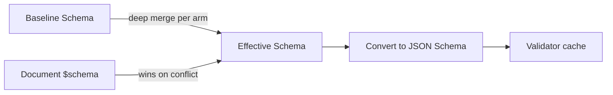
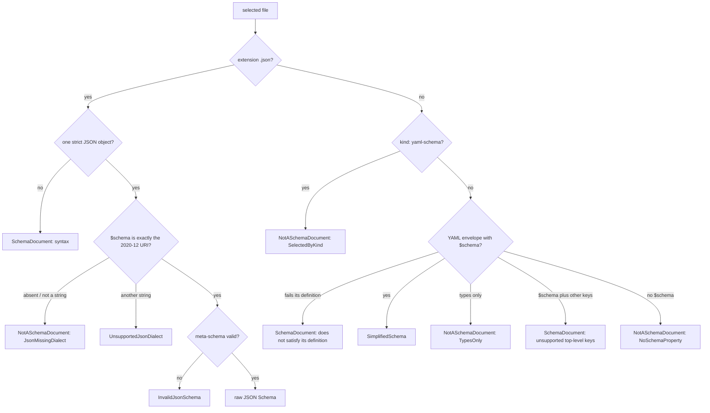
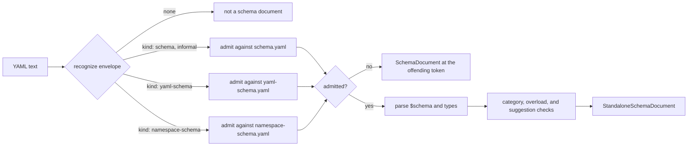

# Schema Resolution and Standalone Documents

How a schema reference finds its file, how a standalone YAML file declares that it holds a SimplifiedSchema (or defines a YAML document kind, or declares a host namespace), and how the library checks that file before reading it.

## Schema Resolution



The resolution rules:

1. **Inline mapping** at `$schema` — parsed directly as SimplifiedSchema.
2. **String reference** at `$schema` — resolved via `FileReference`, then the
   file must be a [schema definition](#what-a-schema-reference-may-target):
   - a `.json` file (any letter case) is a JSON Schema object that declares
     `"$schema": "https://json-schema.org/draft/2020-12/schema"`;
   - any other file is YAML in a [standalone envelope](#standalone-schema-documents)
     that has a top-level `$schema`, other than a
     [`kind: yaml-schema`](#a-yaml-schema-is-selected-by-kind-never-referenced)
     file.
   - Anything else is an error naming the file.
3. **YAML sequence** at `$schema` — root union; each arm is resolved by the same rules above.
4. **No `$schema`** — the baseline alone applies; `md schema validate` and `md compose` use the [built-in baseline](../../../../darkmatter/docs/topics/schemas/definition.md#the-built-in-baseline) unless told otherwise. With no baseline either, validation succeeds vacuously and `pretty` mode prints a note saying so (suppressed by `--quiet`).

Path references in `$schema` resolve like implicit file references: a bare path is
tried **from the document's directory first, then the repository root**, while an explicit
`./`/`../` reference resolves from the document's directory only. A bare **name**
(`$schema: claudine.yaml`, no path separator) instead resolves to the first of the
five [schema roots](../../../../darkmatter/docs/topics/schemas/definition.md#schema-roots) that holds that file; write `./claudine.yaml` for a
file beside the document. The same lookup applies to a bare name in an import
(`Name@claudine.yaml`) or `example(claudine.yaml)`. A name no root holds is an
error, which suggests `./claudine.yaml` when a file of that name sits beside the
document. When no root is searched at all (none of the five folders exists,
trigger discovery is off with `--disable schema-triggers`, or `md` is checking a
document outside a repository), a bare name resolves like any other bare path.
No ambient current working directory is read.

Every consumer selects the file through one function,
`simplified_schema::resolve::select_schema_file`, so validation and an
editor's links agree on the file. Its `SchemaFileSelection` reports the
outcome, every location probed in order, and, for a clean miss, the path the
file would be created at: the first schema root for a bare name, else the
reference's first candidate (beside the document for `./x.yaml`). A
malformed, remote, or unresolvable reference offers no path. See
[Selecting a Schema File](../selecting-schema-files.md) for every outcome and
for inspecting the selected file.

```rust
use simplified_schema::resolve::{select_schema_file, SelectionOutcome};

let selection = select_schema_file("claudine.yaml", &document_dir, &roots, &context);
match selection.outcome {
    SelectionOutcome::Found(path) => println!("uses {}", path.display()),
    SelectionOutcome::Missing { creation: Some(path), .. } => println!("create {}", path.display()),
    _ => {}
}
```

Remote (`http://` / `https://`) references are **not supported** in v1 and produce a clear `SchemaError::RemoteUnsupported` directing the user to download the schema locally.

## What a Schema Reference May Target

A document's `$schema: ./file` (and a schema file that delegates with
`$schema: ./other.yaml`, each file arm of a root union, and a trigger payload)
accepts exactly two kinds of file. Every other file is an error that names it,
so a typo or a stray YAML file can never silently constrain nothing.



| File content | Result |
|---|---|
| YAML with `$schema` (informal, or `kind: schema`) that [satisfies its definition](#admission-checking-an-envelope-against-its-definition) | accepted |
| `kind: yaml-schema`, well formed or not | `NotASchemaDocument` (`SelectedByKind`); [selected by `kind`](#a-yaml-schema-is-selected-by-kind-never-referenced), never referenced |
| `kind: schema` with only `types` | `NotASchemaDocument` (`TypesOnly`); its types still import as `Name@file.yaml` |
| a recognized envelope its definition rejects (`types: [a, b]`, `description: ""`, a misspelled `typed:`) | `SchemaDocument` "the `kind: schema` envelope does not satisfy its definition ..." |
| YAML mapping without `$schema` | `NotASchemaDocument` (`NoSchemaProperty`) |
| YAML that is not a mapping, or a JSON value that is not an object | `NotASchemaDocument` (`NotAMapping`) |
| YAML with `$schema` and a key outside `$schema`, `types`, `description`, `categories` (no `kind: schema` or `kind: yaml-schema`) | `SchemaDocument` "unsupported top-level key(s): ..." |
| YAML or JSON that does not parse (duplicate key, trailing content, a second YAML document, JSON5 comments or trailing commas) | `SchemaDocument` with the parser's location; a duplicate key at its second spelling |
| JSON object without a string `$schema` | `NotASchemaDocument` (`JsonMissingDialect`) |
| JSON `$schema` other than exactly `https://json-schema.org/draft/2020-12/schema` (including `""` and a trailing `#`) | `UnsupportedJsonDialect` |
| JSON declaring 2020-12 that fails the dialect's meta-schema | `InvalidJsonSchema` |

The meta-schema check runs offline; nothing is fetched. These rules apply only
to a `$schema` target. A named-type import (`Name@file.yaml`) reads any
`kind: schema` or informal envelope, a `types`-only one included, but never a
`kind: yaml-schema` file. Other kinded YAML, such as ordinary data
(`kind: roster`) or a [schema trigger](#who-owns-each-definition)
(`kind: schema-trigger`), is never a target either: it fails with one of the
rows above.

### Migrating Raw JSON Schema Written in YAML

A raw JSON Schema written as YAML is no longer a `$schema` target. The error
says so when the file's `$schema` is a `json-schema.org` URI:

```yaml
# schema.yaml: rejected — unsupported top-level key(s): type, properties
$schema: https://json-schema.org/draft/2020-12/schema
type: object
properties:
  title: { type: string }
```

Write it as `schema.json`, declaring the dialect, and point `$schema` at that
file:

```json
{
  "$schema": "https://json-schema.org/draft/2020-12/schema",
  "type": "object",
  "properties": { "title": { "type": "string" } }
}
```

A YAML map of SimplifiedSchema types written without the envelope
(`title: string(required)`) is wrapped under `$schema:` instead.

## Standalone Schema Documents

A standalone YAML file can be a SimplifiedSchema authoring document, recognized by **content** — not by filename, glob, or consumer discovery. The library classifier `parse_standalone_schema_document()` recognizes four envelopes:

| Envelope | Recognized by | Carries | Its definition | A `$schema` target or `Name@file` source? |
|---|---|---|---|---|
| [informal](#informal-envelope) (`StandaloneSchemaEnvelope::Pure`) | a mapping with `$schema` and no key other than `$schema`, `types`, `description`, `categories` | `$schema`, and optionally `types`, `description`, `categories` | `schema.yaml`, judged as if it declared `kind: schema` | yes |
| [`kind: schema`](#kind-schema) (`Tagged`) | `kind: schema` | `$schema`, `types`, or both, and optionally `description`, `categories`; a `types`-only file may also carry a `name` | `schema.yaml` | yes; a `types`-only file is an import source only |
| [`kind: yaml-schema`](#kind-yaml-schema) (`YamlSchema`) | `kind: yaml-schema` | `$schema` (required), and optionally `types`, `description`, `categories` | `yaml-schema.yaml` | no: [selected by `kind`](#a-yaml-schema-is-selected-by-kind-never-referenced) |
| [`kind: namespace-schema`](#kind-namespace-schema) (`NamespaceSchema`) | `kind: namespace-schema` | `namespace` and `$schema` (required), and optionally `description`, `types` | `namespace-schema.yaml` | no: [a host's catalog input](#kind-namespace-schema) |

`StandaloneSchemaEnvelope::kind()` returns the `kind` that claims an
envelope: `Some("schema")`, `Some("yaml-schema")`, `Some("namespace-schema")`,
or `None` for the informal one. Before its payload is read, every recognized envelope is
[admitted](#admission-checking-an-envelope-against-its-definition) against its
definition, so a misspelled key or a metadata value of the wrong shape is
reported where it was written.

### Informal Envelope

A YAML mapping with `$schema`, an optional reusable `types` mapping, an
optional `description` string, an optional [`categories`](#categories) list,
and no other key:

```yaml
description: A person record
$schema:
    name: string(suggest(Bob, Mary, Sam))
    age: number(integer; min(0); suggest(21, 30, 40))
```

`description` is text with content (`""` and whitespace-only text are
rejected). Editors show it when hovering a `$schema` value that names the
file. A number or boolean is read as its text (`description: 123` reads as
`"123"`), the same [soft conversion](../conversion.md) frontmatter receives;
a list or a mapping is rejected, and `description: null` is the same as
leaving it out. A mapping with any other top-level key is not this
envelope (see [Migrating Raw JSON Schema Written in YAML](#migrating-raw-json-schema-written-in-yaml)).

The `$schema` value is the SimplifiedSchema payload. A mapping payload is usable both as a whole-file schema and as the namespace for `Name@fileref` named imports. A sequence payload is a root-level schema union for whole-file use only (it supplies no named-import namespace).

When `types` is present, it supplies the local namespace and named imports
instead. Its definitions do not become properties of documents using the
exported `$schema`. Local definitions and cross-file imports can be used
together:

```yaml
$schema:
    contacts: person[]
types:
    person:
        name: string(required)
        id: identifier(required)@./shared.yaml
```

Here `person` is defined in this file and `identifier` is imported. A document
using this file has a `contacts` property; it does not gain a `person` property.

A `types` table holds named declarations and nothing else, in every envelope
(with or without `$schema`, and in `kind: yaml-schema`). It is not an object,
so the object-only keys of a schema mapping have nothing to apply to there:

| Written directly under `types:` | Result |
|---|---|
| `person: { name: string }` | a named object type |
| `$extends: string` | a type named `$extends` (see [Object Composition](objects-and-named-types.md#object-composition-name-and-extends)) |
| `$constraints: { min-keys: 1 }` | grammar error at `types.$constraints`: "a `types` table holds named declarations; `$constraints` belongs inside a declaration's object" |
| `"<string>": number` | grammar error at `types.<string>`: the same message, naming the pattern key |

Move such a key into the declaration it was meant for:
`types: { person: { name: string, $constraints: { min-keys: 1 } } }`.

### `kind: schema`

A YAML mapping containing `kind: schema` and at least one of an exported
`$schema` and a `types` mapping, plus optionally `description` and
`categories`:

```yaml
kind: schema
description: Reusable person fields
types:
    name: string(suggest(Bob, Mary, Sam))
    age: number(integer; min(0); suggest(21, 30, 40))
```

A `types`-only document is a library: its types import as `Name@file.yaml`,
but a document's `$schema` cannot target it (`NotASchemaDocument`,
`TypesOnly`). With `$schema`, that export supplies document properties and
`types`, when present, supplies reusable definitions; a `kind: schema`
document with only `$schema` behaves like the informal envelope. A document
with neither fails its definition. Category and overload checks apply to a
`types` table only.

#### A library's `name`

A `types`-only library may carry a `name`, a display label that diagnostics
and listings show beside the file's path:

```yaml
kind: schema
name: shared-people
types:
    member:
        name: string(required)
```

- It is a kebab-case identifier: lowercase letters, digits, and inner single
  dashes, starting with a letter (`^[a-z][a-z0-9]*(?:-[a-z0-9]+)*$`), compared
  exactly. `""`, `Shared`, `shared--people`, and `shared-` are refused.
- It must be a written string. `name: null`, `name: 5`, and `name: [a]` are
  refused, although other optional metadata reads `null` as absent.
- Only the `types`-only form admits it: `name` beside an exported `$schema`
  is refused (an explicit `$schema: null` still reads as `types`-only).
- It is never a reference. `Name@file` imports and every lookup still name
  the file by its path. `StandaloneSchemaDocument::name` returns it.
- Within one schema root it must be unique among the triggers and `types`-only
  libraries that declare one (see [A label is unique within its schema
  root](#a-label-is-unique-within-its-schema-root)).

A host's global catalog (such as Darkmatter's `darkmatter.yaml`) is an
ordinary `kind: schema` envelope with `$schema` declarations. The host
registers it through its own loader; named by a document's `$schema`, it is
read like any other schema document.

### `kind: yaml-schema`

A `kind: yaml-schema` file defines a YAML document **kind**. Its `$schema` is
the contract every document of that kind must meet, and the `kind` property
of that `$schema` names the kinds the file claims. It carries the same
`description`, `categories`, and `types` namespace as `kind: schema`:

```yaml
kind: yaml-schema
description: A team roster
types:
    member:
        name: string(required)
        role: enum(lead, engineer, designer; required)
$schema:
    kind: literal(roster; required) -> the kind this file defines
    team: string(required)
    members: member[](required)
```

A document such as this one is then a `roster`, judged against that
`$schema`:

```yaml
kind: roster
team: Platform
members:
    - name: Ada
      role: lead
```

`$schema` is required, and it must declare `kind` as a
[`literal(...)` or `enum(...)`](./schema-types.md#narrowing-a-declaration)
that is `required` and admits no `null`; `literal(roster)` without `required`
is rejected. The `types` entries are local names for `$schema`, not
properties of a `roster`.

A `yaml-schema` is a definition for a host to apply by `kind`; the library
does not discover documents or decide which kinds a host serves. To prepare
one that a host compiles into its binary, call
`resolve::prepare_embedded_yaml_schema(path, documents, shipped)`, which
returns the resolved `$schema` and refuses any document that is not a
`yaml-schema` (`NotASchemaDocument`). Read the kinds it claims with
[`claimed_values`](../language-core.md#claimed-values):

```rust
use simplified_schema::claimed_values;
use simplified_schema::embedded::{EmbeddedDocument, ShippedSources};
use simplified_schema::resolve::prepare_embedded_yaml_schema;

const KINDS: &[EmbeddedDocument<'static>] =
    &[EmbeddedDocument { path: "host/kinds/roster.yaml", text: include_str!("roster.yaml") }];

let resolved = prepare_embedded_yaml_schema("host/kinds/roster.yaml", KINDS, ShippedSources::NONE)?;
assert_eq!(claimed_values(&resolved, "kind").unwrap(), ["roster"]);
```

The `SimplifiedSchema` [content and file factories](../simplified-schema-struct.md) load
a `yaml-schema` directly (loading a file is not referencing it), and
`to_simplified_yaml()` writes it back with `kind: yaml-schema`.

#### A `yaml-schema` Is Selected by `kind`, Never Referenced

Naming a `yaml-schema` file anywhere a schema file is referenced is an error:

- as a document's `$schema` target, or the target of a schema file that
  delegates with `$schema: ./other.yaml`;
- as a file arm of a root union;
- as a `Name@file` import source;
- as the `$schema` target of a document a host embeds.

Each fails with `SchemaError::NotASchemaDocument` holding
`NotSchemaReason::SelectedByKind`, even when the `yaml-schema` is itself
malformed, because naming it is the mistake to fix first:

```text
`kinds/roster.yaml` is not a valid schema definition: it is a `yaml-schema`; it is selected by `kind`, not referenced
hint: move shared types into a `kind: schema` file and import them from there
```

Types that a `yaml-schema` and a Markdown schema both need belong in a
`kind: schema` file that each of them imports:

```yaml
# shared/people.yaml
kind: schema
types:
    member:
        name: string(required)
        role: enum(lead, engineer, designer; required)
```

```yaml
# kinds/roster.yaml
kind: yaml-schema
$schema:
    kind: literal(roster; required)
    members: member[]@../shared/people.yaml
```

A host that reads a referenced file itself, such as an editor building an
import catalog, parses it with `resolve::parse_referenced_schema_document(text, path)`,
which applies the same refusal, and
[`inspect_schema_target`](../selecting-schema-files.md#inspecting-the-selected-file)
classifies a `yaml-schema` the same way.

### Categories

Every envelope may also declare a `categories:` list beside `types:`. Each
entry is a name, optionally followed by `-> description`; a description may
span lines. Documentation shows categories in list order.

```yaml
kind: schema
categories:
    - Math -> Arithmetic on numbers.
    - Devops
    - |-
        Filesystem ->
        Questions about files and paths.
types:
    min: |-
        function(
            parameters(a: number, b: number);
            returns(number);
            category(Math);
        ) -> Returns the smaller of two numbers.
```

When a file declares `categories:`, every `category(X)` in its `types` must
name a listed category, compared exactly (`math` is not `Math`). Without the
list any name is accepted; `categories: null` is the same as no list, and an
empty `categories: []` is rejected. A blank name and a repeated name are
schema-load errors naming the entry, such as `categories[1]`. `categories`
must be a list (a single string is not wrapped into one); a number entry is
read as its text, so `- 5` is the category `5`, while a `null` or mapping
entry is rejected.

### Whole-File References and Named Imports

A Markdown document references a standalone schema file via `$schema`:

```yaml
---
$schema: ./schemas/person.yaml
name: Bob
age: 30
---
```

Referencing a file whose `$schema` is a mapping, in the informal or
`kind: schema` envelope, validates the document against that mapping's complete object shape. The `Name@fileref` named-import syntax extracts a single named type from the file's `types` table (or, without one, its `$schema` mapping) and inlines it:

```yaml
$schema:
    display-name: name@./schemas/person.yaml
    ages: age[]@./schemas/person.yaml
```

### `kind: namespace-schema`

A namespace schema declares one host namespace: the global a host's
expressions read, such as `seq` or `loop`. It is an input to a host's global
catalog and nothing else:

```yaml
kind: namespace-schema
namespace: loop
description: The current iteration of a loop.
$schema:
    count: "number(integer; min(1)) -> The one-based iteration."
    item: entry
types:
    entry: "{ id: string, label: string }"
```

| Key | Rule |
|---|---|
| `kind` | `namespace-schema` |
| `namespace` | required string, compared exactly and case-sensitively |
| `$schema` | required, written as one mapping (an object schema, so `$extends` and `$constraints` compose as usual); `$schema: {}` declares a namespace with no properties. A reference string or a root-union list is refused |
| `description` | optional string |
| `types` | optional mapping of named types, `{}` included; private to this file |

No other key is allowed, and neither `description` nor `types` may be written
as `null`: omit the key instead. Which names a host reserves (its own
globals, expression roots) is the host's check, not this library's.

Opened as a whole YAML document (`md schema validate loop.yaml`, or the file
open in the editor), a namespace file is first judged by
`namespace-schema.yaml`, which reads a `null` optional field as absent and
admits a reference `$schema`. Its `namespace-schema` kind check then runs the
same preparation a host's registration runs
([`prepare_namespace_document`](#resolving-a-namespaces-payload)), so the
file is reported exactly as registering it would refuse it:

```text
kind: namespace-schema
namespace: thing
description:           # kind check: `description`: must not be null; omit it instead
$schema:
    item: Missing      # kind check: unknown named type `Missing` in the inline `$schema`
```

This checks the file itself; naming it from another document is still
refused (see below).

Read one with `parse_namespace_schema_document(text, path)`, which admits it
against `namespace-schema.yaml` and returns a `NamespaceSchemaDocument`:
`namespace`, `description`, the `$schema` object as `schema` with its
`source_map`, the private `local_types`, and `path`, the file the host
resolves its imports from and reports against. It reads no file and resolves
nothing; `Ok(None)` means the text claims another kind.

#### Resolving a namespace's payload

A host turns a namespace file into the declaration of its one global with
`resolve::resolve_namespace_payload(text, path, &context, shipped)`. It
resolves `$schema` as one object whose properties are the namespace's
members, with the file's `types` as the names `$schema` can use. The
namespace file is the origin of everything in it: its imports resolve from
the file's folder, and an error points into the file.

```yaml
# registration/loop.yaml
kind: namespace-schema
namespace: loop
$schema:
    count: number(integer; min(1))
    item: entry               # a private type, from `types` below
    owner: person@./shared.yaml # an import, resolved beside this file
types:
    entry: "{ id: string, label: string }"
```

```rust
use simplified_schema::resolve::resolve_namespace_payload;
use simplified_schema::{SchemaRoot, parse_namespace_schema_document};

let document = parse_namespace_schema_document(&text, &path)?.expect("a namespace schema");
let resolved = resolve_namespace_payload(&text, &path, &context, shipped)?;
let Some(SchemaRoot::Single(members)) = resolved.simplified else { unreachable!() };
// `document.namespace` is "loop"; `members` holds `count`, `item`, and `owner`.
```

Envelope admission is the caller's step (`parse_namespace_schema_document`);
`resolve_namespace_payload` reads only `$schema` and `types`, and refuses a
`$schema` that is not a mapping. `resolve::prepare_namespace_document(text,
path, &context, shipped)` is the two steps together, plus the check that the
result is one object: it returns the `NamespaceSchemaDocument`, the resolved
object, and its `ResolvedSchema`, or a `NamespaceDocumentError` saying which
step refused the file. Every reader that judges a namespace file calls it, so
they all accept and refuse the same files. An empty `$schema: {}` resolves to an object
with no members. A host that loads the namespace from a checked bundle runs
this inside the bundle's scope, so its imports follow
[path-based imports](#path-based-imports-inside-a-bundle).

A namespace file is never a schema in its own right:

- naming it as a `$schema` target or a root-union file arm, or importing
  `Name@./loop.yaml` from it, fails with `SchemaError::NotASchemaDocument`
  holding `NotSchemaReason::NamespaceCatalog`, even when the file is
  malformed;
- the `SimplifiedSchema` content and file factories refuse it the same way;
- it is not a YAML document kind selector.

```text
`loop.yaml` is not a valid schema definition: it is a `namespace-schema`; it declares a host namespace and is read only by a host's catalog
hint: move shared types into a `kind: schema` file and import them from there
```

### Trigger labels and local types

A `kind: schema-trigger` file may carry a `name`, a `description`, and a
`types` table beside `kind`, `match`, and `$schema`:

```yaml
kind: schema-trigger
name: titled-notes
description: Notes with a title.
match:
    title: string(required)
$schema:
    title: headline
types:
    headline: string(min(3))
```

- `name` follows the [library `name`](#a-librarys-name) rules: kebab-case,
  a written string, a display label only. Diagnostics name a labeled trigger
  as `titled-notes (schemas/titled.yaml)`; machine output keeps the path and
  the span.
- `description` is a string.
- `types` is a mapping of named types, `{}` included. They are local to the
  trigger: its inline `$schema` names them (here `headline`), and no other
  file can import them, because a trigger file is never an import source.
  With a `types` table, the `$schema` entries are not named types themselves,
  as in a `kind: schema` document. Shared types belong in a `types`-only
  library.
- None of the three may be written as `null`; omit the key instead. Any other
  key is refused.

#### A label is unique within its schema root

A `name` only helps a reader if it points at one file, so discovery refuses a
label that two files of one source share. The check runs per schema root and
per embedded bundle, before filename shadowing: two files of one root (a
trigger and a trigger, or a trigger and a `types`-only library) that declare
the same `name` are both reported, each at its own `name`, and neither is
installed as a trigger.

```yaml
# schemas/first.yaml
kind: schema-trigger
name: twin
match:
    alpha: string(required)
```

```yaml
# schemas/library.yaml
kind: schema
name: twin
types:
    Id: string
```

Each file gets an invalid-trigger finding at its `name` value (line 2,
column 7 here). Its message names the file as `twin (schemas/first.yaml)`
and its cause names every other participant (paths shortened here):

```text
`name`: `twin` is also declared by `schemas/library.yaml` in the same schema source; every file declaring it is ignored
```

- The same name in two different roots is allowed; each root is judged on
  its own.
- A file shadowed by a same-named file in an earlier root still counts toward
  its own root's names. It is read for its `name` only.
- A `types`-only library that takes part in a duplicate is reported as an
  invalid schema trigger too, and its types still import as `Name@file`,
  because imports name files by path, never by label.

### Path-based imports inside a bundle

A host can load triggers, `types`-only libraries, and namespace files from a
*bundle*: a folder whose member files the host has already read and checked,
such as a published host registration. While the host resolves those files
under the bundle's scope, a file reference reaches another file only by its
path relative to the file that writes it, never by a label or a search:

```yaml
# schemas/composition.yaml, a member of the bundle
kind: schema-trigger
match:
    prompt: string(required)
$schema:
    $extends: common-attributes@./shared.yaml # a listed member: served from its checked bytes
    owner: person@../people/person.yaml       # people/person.yaml: fine when listed
```

| Written in a bundle member | Result |
| --- | --- |
| `Name@./shared.yaml`, `Name@../lib/base.yaml` landing on a listed member | resolved from that member's checked bytes |
| a `./` or `../` path to a file in the folder that is not listed | refused without reading it |
| a `../` path that leaves the bundle | refused |
| a bare name (`Name@shared.yaml`), `~/`, an absolute path, or a schema-root lookup | refused |
| a host's built-in name, such as `Name@darkmatter:lifecycle` | resolved as always |

A refusal is a `SchemaError::BundleBoundary` that names the reference and the
bundle:

```text
schema reference `shared.yaml` is refused: bundle `claudine`: a bundle file is referenced only as `./…` or `../…` from the file that names it
```

This keeps a bundle meaning the same thing wherever it is copied: no member
can depend on a schema root, the home folder, or a file someone added after
the check. The same rules cover `$schema` file targets, `$extends` and
`...spread` operands, and `example(file)`. See
[Resolving inside a bundle](../selecting-schema-files.md#resolving-inside-a-bundle)
for the API and every refusal.

### Admission: Checking an Envelope Against Its Definition

The envelopes are part of the SimplifiedSchema language, so the library
defines them in SimplifiedSchema itself and checks every recognized envelope
against its definition before reading its payload. This is called
**admission**. It applies on every load path: the `SimplifiedSchema`
factories, a `$schema` target, a `Name@file` import, a document a host
embeds, and `parse_standalone_schema_document`.



A file *referenced* as a schema is refused as
[selected by `kind`](#a-yaml-schema-is-selected-by-kind-never-referenced)
before admission when it is a `yaml-schema`, and as a
[catalog input](#kind-namespace-schema) when it is a `namespace-schema`.

#### Who Owns Each Definition

| Definition | Defines documents of | Owner |
|---|---|---|
| `simplified-schema/schemas/schema.yaml` | `kind: schema` (and the informal envelope) | this library |
| `simplified-schema/schemas/yaml-schema.yaml` | `kind: yaml-schema`, itself included | this library |
| `simplified-schema/schemas/schema-trigger.yaml` | `kind: schema-trigger` | this library |
| `simplified-schema/schemas/namespace-schema.yaml` | `kind: namespace-schema` | this library |

All four are compiled in as
`simplified_schema::envelope::ENVELOPE_DEFINITIONS`, keyed by the virtual
paths `SCHEMA_DEFINITION_PATH`, `YAML_SCHEMA_DEFINITION_PATH`,
`SCHEMA_TRIGGER_DEFINITION_PATH`, and `NAMESPACE_SCHEMA_DEFINITION_PATH`;
admission reads no file. All four are `kind: yaml-schema` documents, and
together they seed every YAML document-kind registry
(`simplified_schema::yaml_documents::KindRegistry`). `schema.yaml`,
`yaml-schema.yaml`, and `namespace-schema.yaml` admit envelopes. The trigger
definition is a kind definition like one a user writes: it validates a
trigger file when that file is opened as a YAML document, while trigger
discovery (`simplified_schema::triggers`) reads triggers with its own parser.
A host prepares the four for its registry with its own `ShippedSources`
(`yaml_documents::prepare_shipped_definitions`) and may record the prepared
form in its own shipped artifact; Darkmatter does. This is the definition
of a `yaml-schema`:

```yaml
kind: yaml-schema
description: |-
    The definition of a `kind: yaml-schema` document: a YAML file that defines
    a YAML document kind. Its `$schema` is the contract every document of the
    claimed kind must meet.
$schema:
    kind: literal(yaml-schema; required) -> the document kind that claims this definition
    description: string(not-empty) -> what the kind is for
    categories: string[](not-empty) -> the category names `category(...)` constraints in `types` may use, each `Name` or `Name -> description`
    $schema: schema(required; property(kind, type-definition(forms(literal, enum); declared-required))) -> the contract for documents of the claimed kind; its `kind` declaration names the kinds claimed
    types: schema(mapping; not-empty) -> reusable named types for `$schema`; these names are not document properties
    $constraints: { closed: true }
```

`schema.yaml` has the same keys, with `kind: literal(schema; required)`, as
a root union of two closed arms: the first requires `$schema`, the second is
the `types`-only form, which requires `types` and also admits `name`. That is
how "at least one of `$schema` and `types`" is written. Each line is one structural rule:

| Rule | Written as |
|---|---|
| no top-level key beyond those listed | `$constraints: { closed: true }` |
| `types` is a mapping with at least one entry, not a list or a single reference | `schema(mapping; not-empty)` |
| `description` is text with content | `string(not-empty)` |
| `categories` is a non-empty list of text entries | `string[](not-empty)` |
| an optional `$schema` or `types` may be `null`, which means absent | optional, without `required` |
| a carrier that the document must write | `required` |
| a `yaml-schema`'s `$schema` declares a required, non-null `kind` of one or more literal choices | `property(kind, type-definition(forms(literal, enum); declared-required))` |

In `schema.yaml` the first arm writes `$schema: schema(required)` and an
optional `types: schema(mapping; not-empty)`; the second writes
`$schema: null` (absent, or written as `null`), `types: schema(mapping;
required; not-empty)`, and an optional `name` with the kebab-case pattern.

An optional property always admits `null`, so a definition cannot refuse an
explicit `null`. The few fields the library reads exactly refuse it in the
parser instead: `name` on a `kind: schema` document, a namespace schema's
`description` and `types`, and a trigger's `name`, `description`, and
`types`.

#### `null` and Empty Carriers

A `null` optional field is the same as leaving it out, while an empty one
(`""`, `[]`, `{}`) is a written value without content and is rejected where
the definition says `not-empty`. Every load path (the factories, admission,
a `$schema` target, and whole-YAML loading) reaches the same verdict:

| Envelope holds | Result |
|---|---|
| `description: null`, `categories: null`, or `types: null` beside a `$schema` | accepted; the field is absent |
| `kind: schema` with `$schema: null` (or a bare `$schema:`) and a `types` mapping | accepted as a `types`-only document |
| `kind: schema` with `$schema: null` and no usable `types` | rejected: neither payload is present |
| `kind: schema` with `$schema: {}` | accepted: an empty export |
| `types: {}`, `description: ""`, or `categories: []` | rejected at that key |
| an informal envelope (no `kind`) whose `$schema` is `null` | not a schema document: ordinary YAML, as with no `$schema` |
| `kind: yaml-schema` with `$schema: null` or `$schema: {}` | rejected: the contract is required and must have content |
| `name: null` on `kind: schema` | rejected at `name`: a label is a written string |
| `kind: namespace-schema` with `description: null` or `types: null` | rejected at that key by `parse_namespace_schema_document` (whole-YAML loading: see [`kind: namespace-schema`](#kind-namespace-schema)) |
| `kind: namespace-schema` with `$schema: {}` or `types: {}` | accepted: an empty namespace, an empty table |

A `null` *inside* a payload is a declaration, not an absent carrier:
`$schema: { n: null }` declares a property `n` of the `null` type.

A `kind: schema-trigger` file follows the same rule for its payload: a
`null` or missing `$schema` makes a matcher-only trigger, and an empty one
(`{}`, `[]`, or blank text) is refused, by discovery and by whole-YAML
validation alike. Its `name`, `description`, and `types` refuse `null`, and
`types: {}` is accepted.

The definitions' lowered form is loaded from the library's
[shipped artifact](../shipped-artifacts.md) the first time any envelope is
admitted. When that artifact is refused, they are parsed and lowered from
their text without admission instead, with the same result. That they satisfy
themselves (`yaml-schema.yaml` against itself, the other definitions against
`yaml-schema.yaml`) is checked whenever the artifact is generated, not at run
time. Their validators compile on first use into a private validator cache,
never the process-wide one that `simplified_schema::reset_process_caches()`
clears, so a reset does not discard them.

#### Soft Conversion, Never for Declarations

Admission uses [soft validation](../validation.md): a metadata value that
converts without changing its meaning is accepted, exactly as in
frontmatter. `description: 123` is admitted and read as `"123"`, and a
category entry `5` as `"5"`. An explicit `null` on an optional field is the
same as leaving it out, and an empty value is rejected wherever the
definition says `not-empty`. The schema declarations themselves, `$schema` and
`types` (mappings, root-union sequences, and reference strings), are never
converted; they reach the SimplifiedSchema parser exactly as authored.

#### Which Defect Is Reported

A rejected envelope is a `SchemaError::SchemaDocument` whose `span` is the
byte range of the offending token: the key itself for an unknown key, and the
first line of a block collection. When an envelope has several defects, one
is reported, in this order:

1. **A problem with the envelope itself**: an unknown key, metadata of the
   wrong shape, or a missing payload. A problem other than a missing
   required key comes first, because a missing `types` is often the result of
   a misspelled `typed:`, and the misspelling is what to fix.
2. **A definition inside `$schema` or `types` that the parser rejects**,
   reported with the parser's own typed error and token span (message prefix
   `invalid SimplifiedSchema payload` or `invalid named types`); see
   [A rejected definition in a schema document](../diagnostics.md#a-rejected-definition-in-a-schema-document).
3. **The carrier's own shape**: `types: Id` (a single reference), or `types: [a, b]`.

```yaml
kind: schema
types:
    - a
    - b
```

```text
the `kind: schema` envelope does not satisfy its definition `simplified-schema/schemas/schema.yaml`: `/types`: the declaration must be a mapping, not a list
```

The envelope is named `` `kind: schema` ``, `` `kind: yaml-schema` ``, or
`informal schema`. See
[An envelope its definition rejects](../diagnostics.md#an-envelope-its-definition-rejects)
for the error's fields.

Once an envelope is recognized, the library does not silently reinterpret a
rejected document as ordinary YAML or raw JSON Schema: `kind: schema` claims
the document even when both `$schema` and `types` are missing or an unknown
key is present. A file that is not valid YAML at all (for example one with a
duplicate key) is also a schema-document error, `not valid YAML: ...`, rather
than an unrecognized file.

#### Running Admission Yourself

`simplified_schema::envelope::admit_envelope_text(text, path)` recognizes
the envelope and judges it, without parsing the payload. It returns
`Ok(None)` when no envelope claims the text, and `Err` when the text is not
YAML:

```rust
use simplified_schema::envelope::admit_envelope_text;

let admission = admit_envelope_text("kind: schema\ndescription: 123\ntypes:\n  age: number\n", "ages.yaml")?
    .expect("a `kind: schema` envelope");
assert!(admission.is_admitted());
assert_eq!(admission.value["description"], "123");
```

`EnvelopeAdmission` holds the `envelope`, the `definition` path it was
judged against, the admitted and converted `value` (an informal envelope's
copy carries no `kind`), its `positions` in the text, and the located
`problems` (each with `line` and `column`), empty when `is_admitted()`.
`PositionMap::byte_range(&problem)` returns the byte range a problem is
reported at. The positions are built only when a coordinate is first
requested, so an admitted envelope that is never asked for one builds none
(see [Diagnostics](../diagnostics.md)).

#### What Admission Does Not Check

The definitions state every structural rule. These checks need the parsed
document and stay in the library's code, after admission:

- each `categories` entry's grammar (`Name` or `Name -> description`, no
  blank name) and repeated categories;
- a `category(...)` naming a category the file does not declare;
- two overloads with one binding contract in `types`;
- [suggestion lints](./types.md#advisory-suggestions-suggest), returned as
  `StandaloneSchemaDocument::suggestion_lints` rather than as errors.

#### Reading a File a Host Already Judged

A host can judge a whole schema file against a definition it chose itself,
for example an edited copy of `schema.yaml` that drops the closed root.
Admitting that file against the compiled definition afterwards would reject
what the chosen definition allowed. For that case
`parse_selected_standalone_schema_document(source, path, accepted)` runs only
the checks above: it skips admission, reads metadata such as `categories`
from `accepted` (the document as the host's definition accepted it), and
ignores keys it does not interpret.
`resolve::prepare_standalone_yaml_schema(document, …)` then prepares a
`yaml-schema` it returned.

```rust
use serde_json::json;
use simplified_schema::parse_selected_standalone_schema_document;

let text = "kind: schema\nnote: hi\ntypes:\n  age: number\n";
let accepted = json!({"kind": "schema", "note": "hi", "types": {"age": "number"}});
assert!(parse_selected_standalone_schema_document(text, "ages.yaml", &accepted)?.is_some());
// The same text loaded directly is admitted, and `note` is refused.
assert!(simplified_schema::parse_standalone_schema_document(text, "ages.yaml").is_err());
# Ok::<(), simplified_schema::SchemaError>(())
```

Everything a file loaded this way imports (`Name@file`) is loaded directly,
so it is still admitted against the compiled definitions.

### Raw JSON Schema

A referenced `.json` file declaring the Draft 2020-12 dialect is a distinct validation format. Raw JSON Schema:

- does not provide `suggest(...)`;
- cannot supply a `Name@fileref` named-import namespace;
- does not receive SimplifiedSchema completion or type enforcement; and
- does not enable suggestion discovery from a hand-authored `x-darkmatter-suggest` field.

A raw root `anyOf` is judged with everything beside it. Here `name` is
required whichever arm matches, so `{"kind": "a"}` fails with a
missing-required problem:

```json
{
  "$schema": "https://json-schema.org/draft/2020-12/schema",
  "type": "object",
  "required": ["name"],
  "anyOf": [
    { "properties": { "kind": { "const": "a" } } },
    { "properties": { "kind": { "const": "b" } } }
  ]
}
```

The root's own `properties` apply beside the arm too: a problem on one
carries its `description`, as it does without the union.

A root `unevaluatedProperties` or `unevaluatedItems` sees what **every**
accepting arm evaluated, exactly as a JSON Schema validator does. This schema
accepts `{"name": "Ada"}`, `{"age": 36}`, and `{"name": "Ada", "age": 36}`,
and rejects `{"name": "Ada", "extra": true}`:

```json
{
  "$schema": "https://json-schema.org/draft/2020-12/schema",
  "type": "object",
  "anyOf": [
    { "properties": { "name": { "type": "string" } }, "required": ["name"] },
    { "properties": { "age": { "type": "number" } }, "required": ["age"] }
  ],
  "unevaluatedProperties": false
}
```

A failing value is still reported against its closest arm: the problems
are those of that arm and the root keywords, never a separate failure of the
union.

Boolean arms keep their meaning (`anyOf: [false, false]` rejects every
value). A root `anyOf` that is empty, or has an arm that is neither a schema
object nor a boolean (`anyOf: [7]`), cannot be prepared: validation fails with
`ValidationFailure::Unprepared` holding `SchemaError::BuildValidator`.

A referenced YAML map without a standalone envelope is not a schema target
(`NotASchemaDocument`, `NoSchemaProperty`), even when every value is a valid
SimplifiedSchema type string. Wrap the properties under a root `$schema:` key
to opt into SimplifiedSchema. The `dm.schema.missing_simplified_envelope`
advisory that once reported such a map remains a public diagnostic code, but
the loader no longer emits it.
