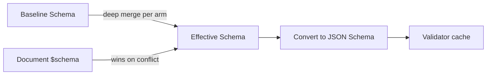

# Schema Resolution and Standalone Documents

How a schema reference finds its file, and how a standalone YAML file declares that it holds a SimplifiedSchema.

## Schema Resolution



The resolution rules:

1. **Inline mapping** at `$schema` — parsed directly as SimplifiedSchema.
2. **String reference** at `$schema` — resolved via `FileReference`, then disambiguated:
   - Parse as YAML.
   - Treat YAML as SimplifiedSchema only when it uses one of the two
     [standalone envelopes](#standalone-schema-documents): `$schema` as the
     sole root key, or `kind: schema` with a `types` mapping.
   - Otherwise treat it as raw JSON Schema, including a document with a
     `$schema` string URI such as
     `https://json-schema.org/draft/2020-12/schema`.
   - `.json` files are always treated as JSON Schema.
3. **YAML sequence** at `$schema` — root union; each arm is resolved by the same rules above.
4. **No `$schema`** — the baseline alone applies; `md schema validate` and `md compose` use the [built-in baseline](../../../../darkmatter/docs/topics/schemas/definition.md#the-built-in-baseline) unless told otherwise. With no baseline either, validation succeeds vacuously and `pretty` mode prints a note saying so (suppressed by `--quiet`).

Path references in `$schema` resolve like implicit file references: a bare path is
tried **from the document's directory first, then the repository root**, while an explicit
`./`/`../` reference resolves from the document's directory only. A bare **name**
(`$schema: claudine.yaml`, no path separator) instead resolves to the first of the
five [schema roots](../../../../darkmatter/docs/topics/schemas/definition.md#schema-roots) that holds that file; write `./claudine.yaml` for a
file beside the document. The same lookup applies to a bare name in an import
(`Name@claudine.yaml`) or `example(claudine.yaml)`. A name no root holds is an
error, which suggests `./claudine.yaml` when a file of that name sits beside the
document. When no root is searched at all (none of the five folders exists,
trigger discovery is off with `--disable schema-triggers`, or `md` is checking a
document outside a repository), a bare name resolves like any other bare path.
No ambient current working directory is read.

Every consumer selects the file through one function,
`simplified_schema::resolve::select_schema_file`, so validation and an
editor's links agree on the file. Its `SchemaFileSelection` reports the
outcome, every location probed in order, and, for a clean miss, the path the
file would be created at: the first schema root for a bare name, else the
reference's first candidate (beside the document for `./x.yaml`). A
malformed, remote, or unresolvable reference offers no path.

```rust
use simplified_schema::resolve::{select_schema_file, SelectionOutcome};

let selection = select_schema_file("claudine.yaml", &document_dir, &roots, &context);
match selection.outcome {
    SelectionOutcome::Found(path) => println!("uses {}", path.display()),
    SelectionOutcome::Missing { creation: Some(path), .. } => println!("create {}", path.display()),
    _ => {}
}
```

Remote (`http://` / `https://`) references are **not supported** in v1 and produce a clear `SchemaError::RemoteUnsupported` directing the user to download the schema locally.

## Standalone Schema Documents

A standalone YAML file can be a SimplifiedSchema authoring document, recognized by **content** — not by filename, glob, or consumer discovery. The library classifier `parse_standalone_schema_document()` recognizes two envelopes:

### Pure Envelope

A YAML mapping with `$schema` and an optional reusable `types` mapping:

```yaml
$schema:
    name: string(suggest(Bob, Mary, Sam))
    age: number(integer; min(0); suggest(21, 30, 40))
```

The `$schema` value is the SimplifiedSchema payload. A mapping payload is usable both as a whole-file schema and as the namespace for `Name@fileref` named imports. A sequence payload is a root-level schema union for whole-file use only (it supplies no named-import namespace).

When `types` is present, it supplies the local namespace and named imports
instead. Its definitions do not become properties of documents using the
exported `$schema`. Local definitions and cross-file imports can be used
together:

```yaml
$schema:
    contacts: person[]
types:
    person:
        name: string(required)
        id: identifier(required)@./shared.yaml
```

Here `person` is defined in this file and `identifier` is imported. A document
using this file has a `contacts` property; it does not gain a `person` property.

### Tagged Envelope

A YAML mapping containing `kind: schema`, a `types` mapping, and an optional
exported `$schema`:

```yaml
kind: schema
types:
    name: string(suggest(Bob, Mary, Sam))
    age: number(integer; min(0); suggest(21, 30, 40))
```

Without an explicit `$schema`, the `types` mapping remains the whole-file
payload as well as the named-import namespace. With `$schema`, only that
export supplies document properties; `types` supplies reusable definitions.

### Categories

A tagged envelope may also declare a `categories:` list beside `types:`. Each
entry is a name, optionally followed by `-> description`; a description may
span lines. Documentation shows categories in list order.

```yaml
kind: schema
categories:
    - Math -> Arithmetic on numbers.
    - Devops
    - |-
        Filesystem ->
        Questions about files and paths.
types:
    min: |-
        function(
            parameters(a: number, b: number);
            returns(number);
            category(Math);
        ) -> Returns the smaller of two numbers.
```

When a file declares `categories:`, every `category(X)` in its `types` must
name a listed category, compared exactly (`math` is not `Math`). Without the
list any name is accepted, and `categories: []` declares that no category is
allowed. A blank name, a repeated name, a non-list `categories`, and an entry
that is not a string are schema-load errors naming the entry, such as
`categories[1]`.

### Whole-File References and Named Imports

A Markdown document references a standalone schema file via `$schema`:

```yaml
---
$schema: ./schemas/person.yaml
name: Bob
age: 30
---
```

Referencing either mapping envelope as a whole validates the document against that mapping's complete object shape. The `Name@fileref` named-import syntax extracts a single named type from the file's mapping payload and inlines it:

```yaml
$schema:
    display-name: name@./schemas/person.yaml
    ages: age[]@./schemas/person.yaml
```

### Malformed Envelopes

Once an envelope is recognized, a missing or malformed payload is a schema-document error (`SchemaError::SchemaDocument`). The library does not silently reinterpret the document as ordinary YAML or raw JSON Schema. For the tagged envelope, `kind: schema` claims the document even when `types` is missing, malformed, or accompanied by top-level keys other than `categories`. A file that is not valid YAML at all (for example one with a duplicate key) is also a schema-document error, `not valid YAML: ...`, rather than an unrecognized file. A definition the grammar rejects keeps the grammar's typed error and its byte range in the document; see [A rejected definition in a schema document](../diagnostics.md#a-rejected-definition-in-a-schema-document).

### Raw JSON Schema

Existing raw JSON Schema reference support remains a distinct validation format. Raw JSON Schema:

- does not provide `suggest(...)`;
- cannot supply a `Name@fileref` named-import namespace;
- does not receive SimplifiedSchema completion or type enforcement; and
- does not enable suggestion discovery from a hand-authored `x-darkmatter-suggest` field.

A raw root `anyOf` is judged with everything beside it. Here `name` is
required whichever arm matches, so `{"kind": "a"}` fails with a
missing-required problem:

```json
{
  "$schema": "https://json-schema.org/draft/2020-12/schema",
  "type": "object",
  "required": ["name"],
  "anyOf": [
    { "properties": { "kind": { "const": "a" } } },
    { "properties": { "kind": { "const": "b" } } }
  ]
}
```

The root's own `properties` apply beside the arm too: a problem on one
carries its `description`, as it does without the union.

A root `unevaluatedProperties` or `unevaluatedItems` sees what **every**
accepting arm evaluated, exactly as a JSON Schema validator does. This schema
accepts `{"name": "Ada"}`, `{"age": 36}`, and `{"name": "Ada", "age": 36}`,
and rejects `{"name": "Ada", "extra": true}`:

```json
{
  "$schema": "https://json-schema.org/draft/2020-12/schema",
  "type": "object",
  "anyOf": [
    { "properties": { "name": { "type": "string" } }, "required": ["name"] },
    { "properties": { "age": { "type": "number" } }, "required": ["age"] }
  ],
  "unevaluatedProperties": false
}
```

A failing value is still reported against its closest arm: the problems
are those of that arm and the root keywords, never a separate failure of the
union.

Boolean arms keep their meaning (`anyOf: [false, false]` rejects every
value). A root `anyOf` that is empty, or has an arm that is neither a schema
object nor a boolean (`anyOf: [7]`), cannot be prepared: validation fails with
`ValidationFailure::Unprepared` holding `SchemaError::BuildValidator`.

A referenced YAML map without either standalone envelope remains raw JSON
Schema even when every property value is a valid SimplifiedSchema type string.
If that complete non-empty map parses as SimplifiedSchema and none of its keys
is a recognized or reserved JSON Schema/custom-vocabulary key, Darkmatter emits
the `dm.schema.missing_simplified_envelope` advisory. The advisory does not
change validation or exit status: the map still constrains nothing as raw JSON
Schema. Wrap the properties under a sole root `$schema:` key, or use
`kind: schema` with a `types:` mapping, to opt into SimplifiedSchema.
