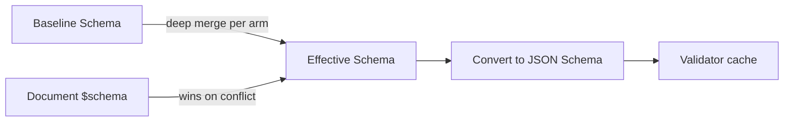
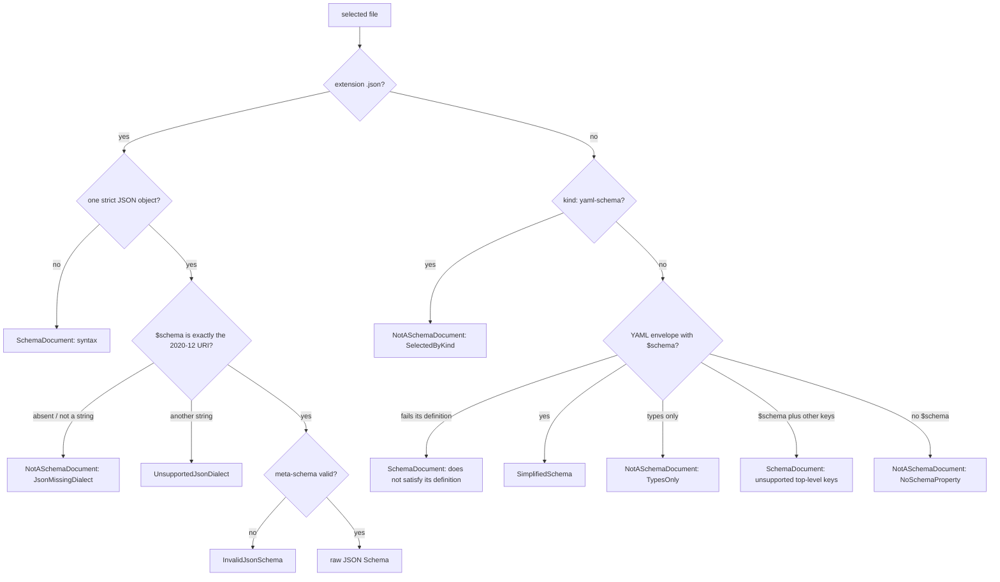
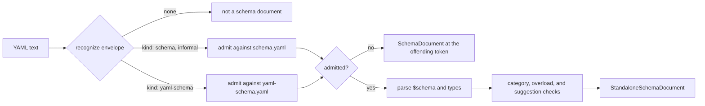

# Schema Resolution and Standalone Documents

How a schema reference finds its file, how a standalone YAML file declares that it holds a SimplifiedSchema (or defines a YAML document kind), and how the library checks that file before reading it.

## Schema Resolution



The resolution rules:

1. **Inline mapping** at `$schema` — parsed directly as SimplifiedSchema.
2. **String reference** at `$schema` — resolved via `FileReference`, then the
   file must be a [schema definition](#what-a-schema-reference-may-target):
   - a `.json` file (any letter case) is a JSON Schema object that declares
     `"$schema": "https://json-schema.org/draft/2020-12/schema"`;
   - any other file is YAML in a [standalone envelope](#standalone-schema-documents)
     that has a top-level `$schema`, other than a
     [`kind: yaml-schema`](#a-yaml-schema-is-selected-by-kind-never-referenced)
     file.
   - Anything else is an error naming the file.
3. **YAML sequence** at `$schema` — root union; each arm is resolved by the same rules above.
4. **No `$schema`** — the baseline alone applies; `md schema validate` and `md compose` use the [built-in baseline](../../../../darkmatter/docs/topics/schemas/definition.md#the-built-in-baseline) unless told otherwise. With no baseline either, validation succeeds vacuously and `pretty` mode prints a note saying so (suppressed by `--quiet`).

Path references in `$schema` resolve like implicit file references: a bare path is
tried **from the document's directory first, then the repository root**, while an explicit
`./`/`../` reference resolves from the document's directory only. A bare **name**
(`$schema: claudine.yaml`, no path separator) instead resolves to the first of the
five [schema roots](../../../../darkmatter/docs/topics/schemas/definition.md#schema-roots) that holds that file; write `./claudine.yaml` for a
file beside the document. The same lookup applies to a bare name in an import
(`Name@claudine.yaml`) or `example(claudine.yaml)`. A name no root holds is an
error, which suggests `./claudine.yaml` when a file of that name sits beside the
document. When no root is searched at all (none of the five folders exists,
trigger discovery is off with `--disable schema-triggers`, or `md` is checking a
document outside a repository), a bare name resolves like any other bare path.
No ambient current working directory is read.

Every consumer selects the file through one function,
`simplified_schema::resolve::select_schema_file`, so validation and an
editor's links agree on the file. Its `SchemaFileSelection` reports the
outcome, every location probed in order, and, for a clean miss, the path the
file would be created at: the first schema root for a bare name, else the
reference's first candidate (beside the document for `./x.yaml`). A
malformed, remote, or unresolvable reference offers no path. See
[Selecting a Schema File](../selecting-schema-files.md) for every outcome and
for inspecting the selected file.

```rust
use simplified_schema::resolve::{select_schema_file, SelectionOutcome};

let selection = select_schema_file("claudine.yaml", &document_dir, &roots, &context);
match selection.outcome {
    SelectionOutcome::Found(path) => println!("uses {}", path.display()),
    SelectionOutcome::Missing { creation: Some(path), .. } => println!("create {}", path.display()),
    _ => {}
}
```

Remote (`http://` / `https://`) references are **not supported** in v1 and produce a clear `SchemaError::RemoteUnsupported` directing the user to download the schema locally.

## What a Schema Reference May Target

A document's `$schema: ./file` (and a schema file that delegates with
`$schema: ./other.yaml`, each file arm of a root union, and a trigger payload)
accepts exactly two kinds of file. Every other file is an error that names it,
so a typo or a stray YAML file can never silently constrain nothing.



| File content | Result |
|---|---|
| YAML with `$schema` (informal, or `kind: schema`) that [satisfies its definition](#admission-checking-an-envelope-against-its-definition) | accepted |
| `kind: yaml-schema`, well formed or not | `NotASchemaDocument` (`SelectedByKind`); [selected by `kind`](#a-yaml-schema-is-selected-by-kind-never-referenced), never referenced |
| `kind: schema` with only `types` | `NotASchemaDocument` (`TypesOnly`); its types still import as `Name@file.yaml` |
| a recognized envelope its definition rejects (`types: [a, b]`, `description: null`, a misspelled `typed:`) | `SchemaDocument` "the `kind: schema` envelope does not satisfy its definition ..." |
| YAML mapping without `$schema` | `NotASchemaDocument` (`NoSchemaProperty`) |
| YAML that is not a mapping, or a JSON value that is not an object | `NotASchemaDocument` (`NotAMapping`) |
| YAML with `$schema` and a key outside `$schema`, `types`, `description`, `categories` (no `kind: schema` or `kind: yaml-schema`) | `SchemaDocument` "unsupported top-level key(s): ..." |
| YAML or JSON that does not parse (duplicate key, trailing content, a second YAML document, JSON5 comments or trailing commas) | `SchemaDocument` with the parser's location |
| JSON object without a string `$schema` | `NotASchemaDocument` (`JsonMissingDialect`) |
| JSON `$schema` other than exactly `https://json-schema.org/draft/2020-12/schema` (including `""` and a trailing `#`) | `UnsupportedJsonDialect` |
| JSON declaring 2020-12 that fails the dialect's meta-schema | `InvalidJsonSchema` |

The meta-schema check runs offline; nothing is fetched. These rules apply only
to a `$schema` target. A named-type import (`Name@file.yaml`) reads any
`kind: schema` or informal envelope, a `types`-only one included, but never a
`kind: yaml-schema` file. Other kinded YAML, such as ordinary data
(`kind: roster`) or a host's own document kinds (Darkmatter's
`kind: schema-trigger`), is never a target either: it fails with one of the
rows above.

### Migrating Raw JSON Schema Written in YAML

A raw JSON Schema written as YAML is no longer a `$schema` target. The error
says so when the file's `$schema` is a `json-schema.org` URI:

```yaml
# schema.yaml: rejected — unsupported top-level key(s): type, properties
$schema: https://json-schema.org/draft/2020-12/schema
type: object
properties:
  title: { type: string }
```

Write it as `schema.json`, declaring the dialect, and point `$schema` at that
file:

```json
{
  "$schema": "https://json-schema.org/draft/2020-12/schema",
  "type": "object",
  "properties": { "title": { "type": "string" } }
}
```

A YAML map of SimplifiedSchema types written without the envelope
(`title: string(required)`) is wrapped under `$schema:` instead.

## Standalone Schema Documents

A standalone YAML file can be a SimplifiedSchema authoring document, recognized by **content** — not by filename, glob, or consumer discovery. The library classifier `parse_standalone_schema_document()` recognizes three envelopes:

| Envelope | Recognized by | Carries | Its definition | A `$schema` target or `Name@file` source? |
|---|---|---|---|---|
| [informal](#informal-envelope) (`StandaloneSchemaEnvelope::Pure`) | a mapping with `$schema` and no key other than `$schema`, `types`, `description`, `categories` | `$schema`, and optionally `types`, `description`, `categories` | `schema.yaml`, judged as if it declared `kind: schema` | yes |
| [`kind: schema`](#kind-schema) (`Tagged`) | `kind: schema` | `$schema`, `types`, or both, and optionally `description`, `categories` | `schema.yaml` | yes; a `types`-only file is an import source only |
| [`kind: yaml-schema`](#kind-yaml-schema) (`YamlSchema`) | `kind: yaml-schema` | `$schema` (required), and optionally `types`, `description`, `categories` | `yaml-schema.yaml` | no: [selected by `kind`](#a-yaml-schema-is-selected-by-kind-never-referenced) |

`StandaloneSchemaEnvelope::kind()` returns the `kind` that claims an
envelope: `Some("schema")`, `Some("yaml-schema")`, or `None` for the informal
one. Before its payload is read, every recognized envelope is
[admitted](#admission-checking-an-envelope-against-its-definition) against its
definition, so a misspelled key or a metadata value of the wrong shape is
reported where it was written.

### Informal Envelope

A YAML mapping with `$schema`, an optional reusable `types` mapping, an
optional `description` string, an optional [`categories`](#categories) list,
and no other key:

```yaml
description: A person record
$schema:
    name: string(suggest(Bob, Mary, Sam))
    age: number(integer; min(0); suggest(21, 30, 40))
```

`description` is text (`""` is allowed). Editors show it when hovering a
`$schema` value that names the file. A number or boolean is read as its text
(`description: 123` reads as `"123"`), the same
[soft conversion](../conversion.md) frontmatter receives; `null`, a list, or a
mapping is rejected. A mapping with any other top-level key is not this
envelope (see [Migrating Raw JSON Schema Written in YAML](#migrating-raw-json-schema-written-in-yaml)).

The `$schema` value is the SimplifiedSchema payload. A mapping payload is usable both as a whole-file schema and as the namespace for `Name@fileref` named imports. A sequence payload is a root-level schema union for whole-file use only (it supplies no named-import namespace).

When `types` is present, it supplies the local namespace and named imports
instead. Its definitions do not become properties of documents using the
exported `$schema`. Local definitions and cross-file imports can be used
together:

```yaml
$schema:
    contacts: person[]
types:
    person:
        name: string(required)
        id: identifier(required)@./shared.yaml
```

Here `person` is defined in this file and `identifier` is imported. A document
using this file has a `contacts` property; it does not gain a `person` property.

### `kind: schema`

A YAML mapping containing `kind: schema` and at least one of an exported
`$schema` and a `types` mapping, plus optionally `description` and
`categories`:

```yaml
kind: schema
description: Reusable person fields
types:
    name: string(suggest(Bob, Mary, Sam))
    age: number(integer; min(0); suggest(21, 30, 40))
```

A `types`-only document is a library: its types import as `Name@file.yaml`,
but a document's `$schema` cannot target it (`NotASchemaDocument`,
`TypesOnly`). With `$schema`, that export supplies document properties and
`types`, when present, supplies reusable definitions; a `kind: schema`
document with only `$schema` behaves like the informal envelope. A document
with neither fails its definition. Category and overload checks apply to a
`types` table only.

A host's global catalog (such as Darkmatter's `darkmatter.yaml`) is an
ordinary `kind: schema` envelope with `$schema` declarations. The host
registers it through its own loader; named by a document's `$schema`, it is
read like any other schema document.

### `kind: yaml-schema`

A `kind: yaml-schema` file defines a YAML document **kind**. Its `$schema` is
the contract every document of that kind must meet, and the `kind` property
of that `$schema` names the kinds the file claims. It carries the same
`description`, `categories`, and `types` namespace as `kind: schema`:

```yaml
kind: yaml-schema
description: A team roster
types:
    member:
        name: string(required)
        role: enum(lead, engineer, designer; required)
$schema:
    kind: literal(roster; required) -> the kind this file defines
    team: string(required)
    members: member[](required)
```

A document such as this one is then a `roster`, judged against that
`$schema`:

```yaml
kind: roster
team: Platform
members:
    - name: Ada
      role: lead
```

`$schema` is required, and it must declare `kind` as a
[`literal(...)` or `enum(...)`](./schema-types.md#narrowing-a-declaration)
that is `required` and admits no `null`; `literal(roster)` without `required`
is rejected. The `types` entries are local names for `$schema`, not
properties of a `roster`.

A `yaml-schema` is a definition for a host to apply by `kind`; the library
does not discover documents or decide which kinds a host serves. To prepare
one that a host compiles into its binary, call
`resolve::prepare_embedded_yaml_schema(path, documents, shipped)`, which
returns the resolved `$schema` and refuses any document that is not a
`yaml-schema` (`NotASchemaDocument`). Read the kinds it claims with
[`claimed_values`](../language-core.md#claimed-values):

```rust
use simplified_schema::claimed_values;
use simplified_schema::embedded::{EmbeddedDocument, ShippedSources};
use simplified_schema::resolve::prepare_embedded_yaml_schema;

const KINDS: &[EmbeddedDocument<'static>] =
    &[EmbeddedDocument { path: "host/kinds/roster.yaml", text: include_str!("roster.yaml") }];

let resolved = prepare_embedded_yaml_schema("host/kinds/roster.yaml", KINDS, ShippedSources::NONE)?;
assert_eq!(claimed_values(&resolved, "kind").unwrap(), ["roster"]);
```

The `SimplifiedSchema` [content and file factories](../simplified-schema-struct.md) load
a `yaml-schema` directly (loading a file is not referencing it), and
`to_simplified_yaml()` writes it back with `kind: yaml-schema`.

#### A `yaml-schema` Is Selected by `kind`, Never Referenced

Naming a `yaml-schema` file anywhere a schema file is referenced is an error:

- as a document's `$schema` target, or the target of a schema file that
  delegates with `$schema: ./other.yaml`;
- as a file arm of a root union;
- as a `Name@file` import source;
- as the `$schema` target of a document a host embeds.

Each fails with `SchemaError::NotASchemaDocument` holding
`NotSchemaReason::SelectedByKind`, even when the `yaml-schema` is itself
malformed, because naming it is the mistake to fix first:

```text
`kinds/roster.yaml` is not a valid schema definition: it is a `yaml-schema`; it is selected by `kind`, not referenced
hint: move shared types into a `kind: schema` file and import them from there
```

Types that a `yaml-schema` and a Markdown schema both need belong in a
`kind: schema` file that each of them imports:

```yaml
# shared/people.yaml
kind: schema
types:
    member:
        name: string(required)
        role: enum(lead, engineer, designer; required)
```

```yaml
# kinds/roster.yaml
kind: yaml-schema
$schema:
    kind: literal(roster; required)
    members: member[]@../shared/people.yaml
```

A host that reads a referenced file itself, such as an editor building an
import catalog, parses it with `resolve::parse_referenced_schema_document(text, path)`,
which applies the same refusal, and
[`inspect_schema_target`](../selecting-schema-files.md#inspecting-the-selected-file)
classifies a `yaml-schema` the same way.

### Categories

Every envelope may also declare a `categories:` list beside `types:`. Each
entry is a name, optionally followed by `-> description`; a description may
span lines. Documentation shows categories in list order.

```yaml
kind: schema
categories:
    - Math -> Arithmetic on numbers.
    - Devops
    - |-
        Filesystem ->
        Questions about files and paths.
types:
    min: |-
        function(
            parameters(a: number, b: number);
            returns(number);
            category(Math);
        ) -> Returns the smaller of two numbers.
```

When a file declares `categories:`, every `category(X)` in its `types` must
name a listed category, compared exactly (`math` is not `Math`). Without the
list any name is accepted, and `categories: []` declares that no category is
allowed. A blank name and a repeated name are schema-load errors naming the
entry, such as `categories[1]`. `categories` must be a list (a single string
is not wrapped into one, and `null` is rejected); a number entry is read as
its text, so `- 5` is the category `5`, while a mapping entry is rejected.

### Whole-File References and Named Imports

A Markdown document references a standalone schema file via `$schema`:

```yaml
---
$schema: ./schemas/person.yaml
name: Bob
age: 30
---
```

Referencing a file whose `$schema` is a mapping, in the informal or
`kind: schema` envelope, validates the document against that mapping's complete object shape. The `Name@fileref` named-import syntax extracts a single named type from the file's `types` table (or, without one, its `$schema` mapping) and inlines it:

```yaml
$schema:
    display-name: name@./schemas/person.yaml
    ages: age[]@./schemas/person.yaml
```

### Admission: Checking an Envelope Against Its Definition

The envelopes are part of the SimplifiedSchema language, so the library
defines them in SimplifiedSchema itself and checks every recognized envelope
against its definition before reading its payload. This is called
**admission**. It applies on every load path: the `SimplifiedSchema`
factories, a `$schema` target, a `Name@file` import, a document a host
embeds, and `parse_standalone_schema_document`.



A file *referenced* as a schema is refused as
[selected by `kind`](#a-yaml-schema-is-selected-by-kind-never-referenced)
before admission when it is a `yaml-schema`.

#### Who Owns Each Definition

| Definition | Defines documents of | Owner |
|---|---|---|
| `simplified-schema/schemas/schema.yaml` | `kind: schema` (and the informal envelope) | this library |
| `simplified-schema/schemas/yaml-schema.yaml` | `kind: yaml-schema`, itself included | this library |
| `darkmatter/schemas/schema-trigger.yaml` | `kind: schema-trigger` | Darkmatter |

The two library definitions are compiled in as
`simplified_schema::envelope::ENVELOPE_DEFINITIONS`, keyed by the virtual
paths `SCHEMA_DEFINITION_PATH` and `YAML_SCHEMA_DEFINITION_PATH`; admission
reads no file. Both are `kind: yaml-schema` documents. This is the definition
of a `yaml-schema`:

```yaml
kind: yaml-schema
description: |-
    The definition of a `kind: yaml-schema` document: a YAML file that defines
    a YAML document kind. Its `$schema` is the contract every document of the
    claimed kind must meet.
$schema:
    kind: literal(yaml-schema; required) -> the document kind that claims this definition
    description: string(non-null) -> what the kind is for
    categories: string[](non-null) -> the category names `category(...)` constraints in `types` may use, each `Name` or `Name -> description`
    $schema: schema(required; property(kind, type-definition(forms(literal, enum); declared-required))) -> the contract for documents of the claimed kind; its `kind` declaration names the kinds claimed
    types: schema(mapping; non-null) -> reusable named types for `$schema`; these names are not document properties
    $constraints: { closed: true }
```

`schema.yaml` has the same keys, with `kind: literal(schema; required)`, as
a root union of two closed arms: the first requires `$schema`, the second
requires `types`, which is how "at least one of `$schema` and `types`" is
written. Each line is one structural rule:

| Rule | Written as |
|---|---|
| no top-level key beyond those listed | `$constraints: { closed: true }` |
| `types` is a mapping, not a list or a single reference | `schema(mapping; non-null)` |
| `description` is text | `string(non-null)` |
| `categories` is a list of text entries | `string[](non-null)` |
| `$schema` and `types` are never an explicit `null` | `non-null`, or `required` |
| a `yaml-schema`'s `$schema` declares a required, non-null `kind` of one or more literal choices | `property(kind, type-definition(forms(literal, enum); declared-required))` |

The definitions' lowered form is loaded from the library's
[shipped artifact](../shipped-artifacts.md) the first time any envelope is
admitted. When that artifact is refused, they are parsed and lowered from
their text without admission instead, with the same result. That they satisfy
themselves (`yaml-schema.yaml` against itself, `schema.yaml` against
`yaml-schema.yaml`) is checked whenever the artifact is generated, not at run
time. Their validators compile on first use into a private validator cache,
never the process-wide one that `simplified_schema::reset_process_caches()`
clears, so a reset does not discard them.

#### Soft Conversion, Never for Declarations

Admission uses [soft validation](../validation.md): a metadata value that
converts without changing its meaning is accepted, exactly as in
frontmatter. `description: 123` is admitted and read as `"123"`, and a
category entry `5` as `"5"`. An explicit `null` is rejected wherever the
definition says `non-null`. The schema declarations themselves, `$schema` and
`types` (mappings, root-union sequences, and reference strings), are never
converted; they reach the SimplifiedSchema parser exactly as authored.

#### Which Defect Is Reported

A rejected envelope is a `SchemaError::SchemaDocument` whose `span` is the
byte range of the offending token: the key itself for an unknown key, and the
first line of a block collection. When an envelope has several defects, one
is reported, in this order:

1. **A problem with the envelope itself**: an unknown key, metadata of the
   wrong shape, or a missing payload. A problem other than a missing
   required key comes first, because a missing `types` is often the result of
   a misspelled `typed:`, and the misspelling is what to fix.
2. **A definition inside `$schema` or `types` that the parser rejects**,
   reported with the parser's own typed error and token span (message prefix
   `invalid SimplifiedSchema payload` or `invalid named types`); see
   [A rejected definition in a schema document](../diagnostics.md#a-rejected-definition-in-a-schema-document).
3. **The carrier's own shape**: `types: null`, or `types: [a, b]`.

```yaml
kind: schema
types:
    - a
    - b
```

```text
the `kind: schema` envelope does not satisfy its definition `simplified-schema/schemas/schema.yaml`: `/types`: the declaration must be a mapping, not a list
```

The envelope is named `` `kind: schema` ``, `` `kind: yaml-schema` ``, or
`informal schema`. See
[An envelope its definition rejects](../diagnostics.md#an-envelope-its-definition-rejects)
for the error's fields.

Once an envelope is recognized, the library does not silently reinterpret a
rejected document as ordinary YAML or raw JSON Schema: `kind: schema` claims
the document even when both `$schema` and `types` are missing or an unknown
key is present. A file that is not valid YAML at all (for example one with a
duplicate key) is also a schema-document error, `not valid YAML: ...`, rather
than an unrecognized file.

#### Running Admission Yourself

`simplified_schema::envelope::admit_envelope_text(text, path)` recognizes
the envelope and judges it, without parsing the payload. It returns
`Ok(None)` when no envelope claims the text, and `Err` when the text is not
YAML:

```rust
use simplified_schema::envelope::admit_envelope_text;

let admission = admit_envelope_text("kind: schema\ndescription: 123\ntypes:\n  age: number\n", "ages.yaml")?
    .expect("a `kind: schema` envelope");
assert!(admission.is_admitted());
assert_eq!(admission.value["description"], "123");
```

`EnvelopeAdmission` holds the `envelope`, the `definition` path it was
judged against, the admitted and converted `value` (an informal envelope's
copy carries no `kind`), its `positions` in the text, and the located
`problems` (each with `line` and `column`), empty when `is_admitted()`.
`PositionMap::byte_range(&problem)` returns the byte range a problem is
reported at. The positions are built only when a coordinate is first
requested, so an admitted envelope that is never asked for one builds none
(see [Diagnostics](../diagnostics.md)).

#### What Admission Does Not Check

The definitions state every structural rule. These checks need the parsed
document and stay in the library's code, after admission:

- each `categories` entry's grammar (`Name` or `Name -> description`, no
  blank name) and repeated categories;
- a `category(...)` naming a category the file does not declare;
- two overloads with one binding contract in `types`;
- [suggestion lints](./types.md#advisory-suggestions-suggest), returned as
  `StandaloneSchemaDocument::suggestion_lints` rather than as errors.

#### Reading a File a Host Already Judged

A host can judge a whole schema file against a definition it chose itself,
for example an edited copy of `schema.yaml` that drops the closed root.
Admitting that file against the compiled definition afterwards would reject
what the chosen definition allowed. For that case
`parse_selected_standalone_schema_document(source, path, accepted)` runs only
the checks above: it skips admission, reads metadata such as `categories`
from `accepted` (the document as the host's definition accepted it), and
ignores keys it does not interpret.
`resolve::prepare_standalone_yaml_schema(document, …)` then prepares a
`yaml-schema` it returned.

```rust
use serde_json::json;
use simplified_schema::parse_selected_standalone_schema_document;

let text = "kind: schema\nnote: hi\ntypes:\n  age: number\n";
let accepted = json!({"kind": "schema", "note": "hi", "types": {"age": "number"}});
assert!(parse_selected_standalone_schema_document(text, "ages.yaml", &accepted)?.is_some());
// The same text loaded directly is admitted, and `note` is refused.
assert!(simplified_schema::parse_standalone_schema_document(text, "ages.yaml").is_err());
# Ok::<(), simplified_schema::SchemaError>(())
```

Everything a file loaded this way imports (`Name@file`) is loaded directly,
so it is still admitted against the compiled definitions.

### Raw JSON Schema

A referenced `.json` file declaring the Draft 2020-12 dialect is a distinct validation format. Raw JSON Schema:

- does not provide `suggest(...)`;
- cannot supply a `Name@fileref` named-import namespace;
- does not receive SimplifiedSchema completion or type enforcement; and
- does not enable suggestion discovery from a hand-authored `x-darkmatter-suggest` field.

A raw root `anyOf` is judged with everything beside it. Here `name` is
required whichever arm matches, so `{"kind": "a"}` fails with a
missing-required problem:

```json
{
  "$schema": "https://json-schema.org/draft/2020-12/schema",
  "type": "object",
  "required": ["name"],
  "anyOf": [
    { "properties": { "kind": { "const": "a" } } },
    { "properties": { "kind": { "const": "b" } } }
  ]
}
```

The root's own `properties` apply beside the arm too: a problem on one
carries its `description`, as it does without the union.

A root `unevaluatedProperties` or `unevaluatedItems` sees what **every**
accepting arm evaluated, exactly as a JSON Schema validator does. This schema
accepts `{"name": "Ada"}`, `{"age": 36}`, and `{"name": "Ada", "age": 36}`,
and rejects `{"name": "Ada", "extra": true}`:

```json
{
  "$schema": "https://json-schema.org/draft/2020-12/schema",
  "type": "object",
  "anyOf": [
    { "properties": { "name": { "type": "string" } }, "required": ["name"] },
    { "properties": { "age": { "type": "number" } }, "required": ["age"] }
  ],
  "unevaluatedProperties": false
}
```

A failing value is still reported against its closest arm: the problems
are those of that arm and the root keywords, never a separate failure of the
union.

Boolean arms keep their meaning (`anyOf: [false, false]` rejects every
value). A root `anyOf` that is empty, or has an arm that is neither a schema
object nor a boolean (`anyOf: [7]`), cannot be prepared: validation fails with
`ValidationFailure::Unprepared` holding `SchemaError::BuildValidator`.

A referenced YAML map without a standalone envelope is not a schema target
(`NotASchemaDocument`, `NoSchemaProperty`), even when every value is a valid
SimplifiedSchema type string. Wrap the properties under a root `$schema:` key
to opt into SimplifiedSchema. The `dm.schema.missing_simplified_envelope`
advisory that once reported such a map remains a public diagnostic code, but
the loader no longer emits it.
