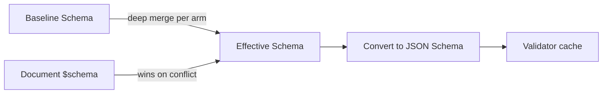
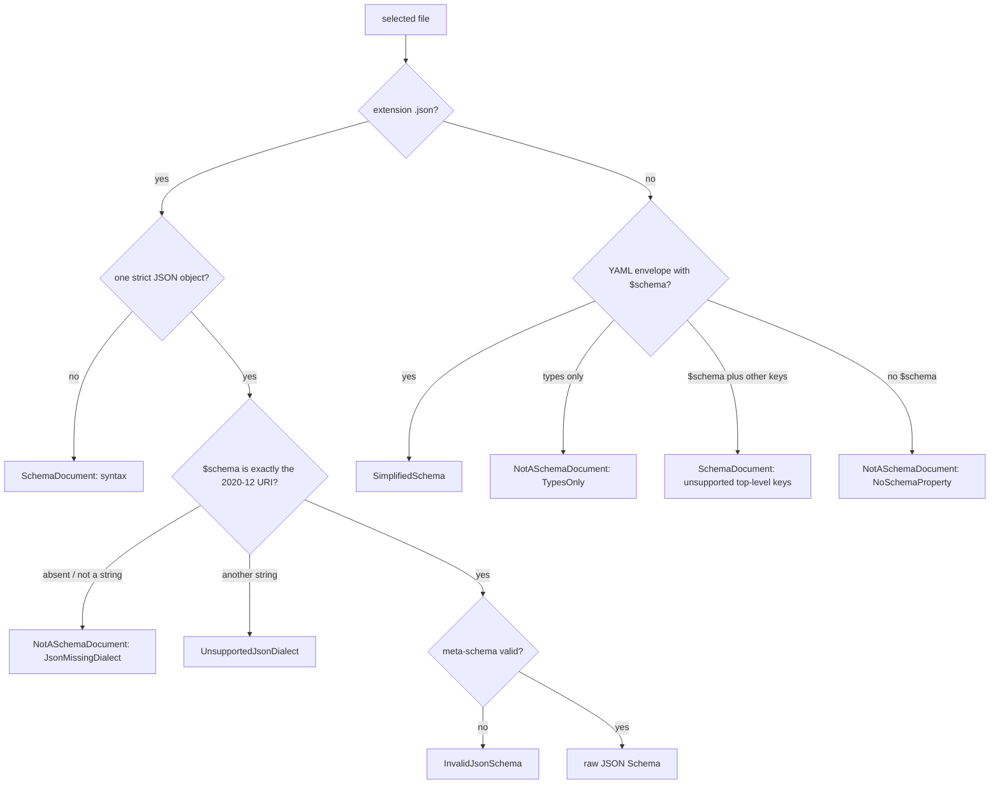

# Schema Resolution and Standalone Documents

How a schema reference finds its file, and how a standalone YAML file declares that it holds a SimplifiedSchema.

## Schema Resolution



The resolution rules:

1. **Inline mapping** at `$schema` — parsed directly as SimplifiedSchema.
2. **String reference** at `$schema` — resolved via `FileReference`, then the
   file must be a [schema definition](#what-a-schema-reference-may-target):
   - a `.json` file (any letter case) is a JSON Schema object that declares
     `"$schema": "https://json-schema.org/draft/2020-12/schema"`;
   - any other file is YAML in a [standalone envelope](#standalone-schema-documents)
     that has a top-level `$schema`.
   - Anything else is an error naming the file.
3. **YAML sequence** at `$schema` — root union; each arm is resolved by the same rules above.
4. **No `$schema`** — the baseline alone applies; `md schema validate` and `md compose` use the [built-in baseline](../../../../darkmatter/docs/topics/schemas/definition.md#the-built-in-baseline) unless told otherwise. With no baseline either, validation succeeds vacuously and `pretty` mode prints a note saying so (suppressed by `--quiet`).

Path references in `$schema` resolve like implicit file references: a bare path is
tried **from the document's directory first, then the repository root**, while an explicit
`./`/`../` reference resolves from the document's directory only. A bare **name**
(`$schema: claudine.yaml`, no path separator) instead resolves to the first of the
five [schema roots](../../../../darkmatter/docs/topics/schemas/definition.md#schema-roots) that holds that file; write `./claudine.yaml` for a
file beside the document. The same lookup applies to a bare name in an import
(`Name@claudine.yaml`) or `example(claudine.yaml)`. A name no root holds is an
error, which suggests `./claudine.yaml` when a file of that name sits beside the
document. When no root is searched at all (none of the five folders exists,
trigger discovery is off with `--disable schema-triggers`, or `md` is checking a
document outside a repository), a bare name resolves like any other bare path.
No ambient current working directory is read.

Every consumer selects the file through one function,
`simplified_schema::resolve::select_schema_file`, so validation and an
editor's links agree on the file. Its `SchemaFileSelection` reports the
outcome, every location probed in order, and, for a clean miss, the path the
file would be created at: the first schema root for a bare name, else the
reference's first candidate (beside the document for `./x.yaml`). A
malformed, remote, or unresolvable reference offers no path. See
[Selecting a Schema File](../selecting-schema-files.md) for every outcome and
for inspecting the selected file.

```rust
use simplified_schema::resolve::{select_schema_file, SelectionOutcome};

let selection = select_schema_file("claudine.yaml", &document_dir, &roots, &context);
match selection.outcome {
    SelectionOutcome::Found(path) => println!("uses {}", path.display()),
    SelectionOutcome::Missing { creation: Some(path), .. } => println!("create {}", path.display()),
    _ => {}
}
```

Remote (`http://` / `https://`) references are **not supported** in v1 and produce a clear `SchemaError::RemoteUnsupported` directing the user to download the schema locally.

## What a Schema Reference May Target

A document's `$schema: ./file` (and a schema file that delegates with
`$schema: ./other.yaml`, each file arm of a root union, and a trigger payload)
accepts exactly two kinds of file. Every other file is an error that names it,
so a typo or a stray YAML file can never silently constrain nothing.



| File content | Result |
|---|---|
| YAML with `$schema` (informal, or `kind: schema`) | accepted |
| `kind: schema` with only `types` | `NotASchemaDocument` (`TypesOnly`); its types still import as `Name@file.yaml` |
| YAML mapping without `$schema` | `NotASchemaDocument` (`NoSchemaProperty`) |
| YAML that is not a mapping, or a JSON value that is not an object | `NotASchemaDocument` (`NotAMapping`) |
| YAML with `$schema` and a key outside `$schema`, `types`, `description`, `categories` (no `kind: schema`) | `SchemaDocument` "unsupported top-level key(s): ..." |
| YAML or JSON that does not parse (duplicate key, trailing content, a second YAML document, JSON5 comments or trailing commas) | `SchemaDocument` with the parser's location |
| JSON object without a string `$schema` | `NotASchemaDocument` (`JsonMissingDialect`) |
| JSON `$schema` other than exactly `https://json-schema.org/draft/2020-12/schema` (including `""` and a trailing `#`) | `UnsupportedJsonDialect` |
| JSON declaring 2020-12 that fails the dialect's meta-schema | `InvalidJsonSchema` |

The meta-schema check runs offline; nothing is fetched. These rules apply only
to a `$schema` target. A named-type import (`Name@file.yaml`) reads any
standalone envelope, a `types`-only one included.

### Migrating Raw JSON Schema Written in YAML

A raw JSON Schema written as YAML is no longer a `$schema` target. The error
says so when the file's `$schema` is a `json-schema.org` URI:

```yaml
# schema.yaml: rejected — unsupported top-level key(s): type, properties
$schema: https://json-schema.org/draft/2020-12/schema
type: object
properties:
  title: { type: string }
```

Write it as `schema.json`, declaring the dialect, and point `$schema` at that
file:

```json
{
  "$schema": "https://json-schema.org/draft/2020-12/schema",
  "type": "object",
  "properties": { "title": { "type": "string" } }
}
```

A YAML map of SimplifiedSchema types written without the envelope
(`title: string(required)`) is wrapped under `$schema:` instead.

## Standalone Schema Documents

A standalone YAML file can be a SimplifiedSchema authoring document, recognized by **content** — not by filename, glob, or consumer discovery. The library classifier `parse_standalone_schema_document()` recognizes two envelopes:

### Pure Envelope

A YAML mapping with `$schema`, an optional reusable `types` mapping, an
optional `description` string, an optional [`categories`](#categories) list,
and no other key:

```yaml
description: A person record
$schema:
    name: string(suggest(Bob, Mary, Sam))
    age: number(integer; min(0); suggest(21, 30, 40))
```

`description` must be a string (`""` is allowed); `null`, a number, a list, or
a mapping is a schema-document error. Editors show it when hovering a
`$schema` value that names the file. A mapping with any other top-level key is
not this envelope (see [Migrating Raw JSON Schema Written in YAML](#migrating-raw-json-schema-written-in-yaml)).

The `$schema` value is the SimplifiedSchema payload. A mapping payload is usable both as a whole-file schema and as the namespace for `Name@fileref` named imports. A sequence payload is a root-level schema union for whole-file use only (it supplies no named-import namespace).

When `types` is present, it supplies the local namespace and named imports
instead. Its definitions do not become properties of documents using the
exported `$schema`. Local definitions and cross-file imports can be used
together:

```yaml
$schema:
    contacts: person[]
types:
    person:
        name: string(required)
        id: identifier(required)@./shared.yaml
```

Here `person` is defined in this file and `identifier` is imported. A document
using this file has a `contacts` property; it does not gain a `person` property.

### Tagged Envelope

A YAML mapping containing `kind: schema` and at least one of an exported
`$schema` and a `types` mapping, plus optionally `description` and
`categories`:

```yaml
kind: schema
description: Reusable person fields
types:
    name: string(suggest(Bob, Mary, Sam))
    age: number(integer; min(0); suggest(21, 30, 40))
```

A `types`-only document is a library: its types import as `Name@file.yaml`,
but a document's `$schema` cannot target it (`NotASchemaDocument`,
`TypesOnly`). With `$schema`, that export supplies document properties and
`types`, when present, supplies reusable definitions; a tagged document with
only `$schema` behaves like the pure envelope. A tagged document with neither
is a schema-document error. Category and overload checks apply to a `types`
table only.

A host's global catalog (such as Darkmatter's `darkmatter.yaml`) is an
ordinary tagged envelope with `$schema` declarations. The host registers it
through its own loader; named by a document's `$schema`, it is read like any
other schema document.

### Categories

Either envelope may also declare a `categories:` list beside `types:`. Each
entry is a name, optionally followed by `-> description`; a description may
span lines. Documentation shows categories in list order.

```yaml
kind: schema
categories:
    - Math -> Arithmetic on numbers.
    - Devops
    - |-
        Filesystem ->
        Questions about files and paths.
types:
    min: |-
        function(
            parameters(a: number, b: number);
            returns(number);
            category(Math);
        ) -> Returns the smaller of two numbers.
```

When a file declares `categories:`, every `category(X)` in its `types` must
name a listed category, compared exactly (`math` is not `Math`). Without the
list any name is accepted, and `categories: []` declares that no category is
allowed. A blank name, a repeated name, a non-list `categories`, and an entry
that is not a string are schema-load errors naming the entry, such as
`categories[1]`.

### Whole-File References and Named Imports

A Markdown document references a standalone schema file via `$schema`:

```yaml
---
$schema: ./schemas/person.yaml
name: Bob
age: 30
---
```

Referencing a file whose `$schema` is a mapping, in either envelope, validates the document against that mapping's complete object shape. The `Name@fileref` named-import syntax extracts a single named type from the file's `types` table (or, without one, its `$schema` mapping) and inlines it:

```yaml
$schema:
    display-name: name@./schemas/person.yaml
    ages: age[]@./schemas/person.yaml
```

### Malformed Envelopes

Once an envelope is recognized, a missing or malformed payload is a schema-document error (`SchemaError::SchemaDocument`). The library does not silently reinterpret the document as ordinary YAML or raw JSON Schema. For the tagged envelope, `kind: schema` claims the document even when both `$schema` and `types` are missing, `types` is malformed, or a top-level key other than `$schema`, `types`, `description`, and `categories` is present. A file that is not valid YAML at all (for example one with a duplicate key) is also a schema-document error, `not valid YAML: ...`, rather than an unrecognized file. A definition the grammar rejects keeps the grammar's typed error and its byte range in the document; see [A rejected definition in a schema document](../diagnostics.md#a-rejected-definition-in-a-schema-document).

### Raw JSON Schema

A referenced `.json` file declaring the Draft 2020-12 dialect is a distinct validation format. Raw JSON Schema:

- does not provide `suggest(...)`;
- cannot supply a `Name@fileref` named-import namespace;
- does not receive SimplifiedSchema completion or type enforcement; and
- does not enable suggestion discovery from a hand-authored `x-darkmatter-suggest` field.

A raw root `anyOf` is judged with everything beside it. Here `name` is
required whichever arm matches, so `{"kind": "a"}` fails with a
missing-required problem:

```json
{
  "$schema": "https://json-schema.org/draft/2020-12/schema",
  "type": "object",
  "required": ["name"],
  "anyOf": [
    { "properties": { "kind": { "const": "a" } } },
    { "properties": { "kind": { "const": "b" } } }
  ]
}
```

The root's own `properties` apply beside the arm too: a problem on one
carries its `description`, as it does without the union.

A root `unevaluatedProperties` or `unevaluatedItems` sees what **every**
accepting arm evaluated, exactly as a JSON Schema validator does. This schema
accepts `{"name": "Ada"}`, `{"age": 36}`, and `{"name": "Ada", "age": 36}`,
and rejects `{"name": "Ada", "extra": true}`:

```json
{
  "$schema": "https://json-schema.org/draft/2020-12/schema",
  "type": "object",
  "anyOf": [
    { "properties": { "name": { "type": "string" } }, "required": ["name"] },
    { "properties": { "age": { "type": "number" } }, "required": ["age"] }
  ],
  "unevaluatedProperties": false
}
```

A failing value is still reported against its closest arm: the problems
are those of that arm and the root keywords, never a separate failure of the
union.

Boolean arms keep their meaning (`anyOf: [false, false]` rejects every
value). A root `anyOf` that is empty, or has an arm that is neither a schema
object nor a boolean (`anyOf: [7]`), cannot be prepared: validation fails with
`ValidationFailure::Unprepared` holding `SchemaError::BuildValidator`.

A referenced YAML map without a standalone envelope is not a schema target
(`NotASchemaDocument`, `NoSchemaProperty`), even when every value is a valid
SimplifiedSchema type string. Wrap the properties under a root `$schema:` key
to opt into SimplifiedSchema. The `dm.schema.missing_simplified_envelope`
advisory that once reported such a map remains a public diagnostic code, but
the loader no longer emits it.
