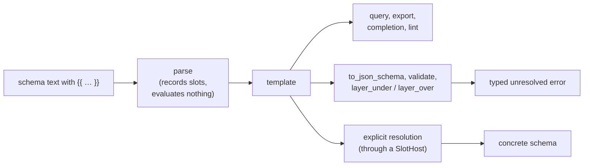

# Slots: Values Supplied by an Expression

Some lists a schema needs are data that lives elsewhere: the operating
systems a project supports, the regions a service runs in. A **slot** lets a
schema take such a value from a `{{ … }}` expression instead of repeating it:

```yaml
kind: schema
$schema:
    os_support: os[](required)
types:
    os: enum(none, {{ load_data("./os.yaml", "string[]") }}; required)
```

A schema with at least one slot is a **template**. Reading, inspecting, and
exporting a template never runs its expressions; only an explicit
resolution step does, and it produces an ordinary schema with every slot
replaced by its value.

The library never evaluates an expression itself. Resolution goes through a
**host** you supply (a [`SlotHost`](#resolving-a-template)): the host decides
whether a slot may run and computes its value, and the library checks that
value and builds the concrete schema. Darkmatter is such a host; its
approval rules and caching are described in Darkmatter's own docs.

## Where a Slot May Be Written

A slot is recognised only where it is a whole value:

| Position | Example | The slot supplies |
| --- | --- | --- |
| an `enum(...)` member | `enum(none, {{ list }})` | zero or more members |
| a `suggest(...)` candidate | `string(suggest(a, {{ list }}))` | zero or more candidates |
| the value of `literal(...)` | `literal({{ revision }})` | the one value |
| `default(...)` | `number(default({{ n }}))` | the default |
| `min(...)`, `max(...)` | `number(min({{ low }}))` | the bound |
| `pattern(...)` | `string(pattern({{ re }}))` | the regular expression |

Rules, each with what happens otherwise:

- **A list slot is one complete element.** After its `}}` comes `,`, `;`, or
  `)`. Slots and literal elements may alternate in any order:
  `enum({{ a }}, b, {{ c }})`. `enum(a, {{ b }} c)` is the grammar error
  "a `{{ … }}` slot must be a complete list element".
- **A value slot is the whole argument.** `default({{ d }} + 1)` or
  `default(a, {{ d }})` is the error "a `{{ … }}` slot must be the whole
  argument".
- **A `{{` that does not start an element is text.** A quoted element is
  always literal (`enum('{{ x }}')` has the member `{{ x }}`), and so is a
  word that only contains braces (`enum(abc{{x}})`).
- **The slot ends where the expression ends.** The closing `}}` is found by
  the expression scanner (`expression::scan::scan_expression_at`), so quotes,
  brackets, commas, and semicolons inside the expression belong to it:
  `enum(a, {{ pick(x, [1, 2], 'a;b') }})` has two elements.
- **The expression must parse.** `{{ x + }}` is a grammar error positioned at
  the offending token inside the slot; an unclosed `{{` is "unterminated
  `{{ … }}` slot"; `{{ }}` is "a `{{ … }}` slot needs an expression".
- **Existing list rules still apply.** `suggest` is allowed on the same types
  as before, and a property definition holds at most one `suggest` list,
  static or not. A `null` default cannot be a slot, and `type-definition` and
  `schema` take no value slots.
- **Duplicates in a list with a slot are kept until resolution**, where the
  first occurrence of each value wins. A list without a slot keeps today's
  rule (a repeated `suggest` candidate is an error).
- A list with no slot is exactly what it was before: an `enum(...)` without a
  slot parses to `Constraint::Members`, a `suggest(...)` to
  `Constraint::Suggest`. Static schemas take no new path.

## What a Template Reports

A template is a valid schema that is not yet concrete. Each operation says
so in a typed way, and none builds a placeholder.



| Operation | On a template |
| --- | --- |
| `SimplifiedSchema::try_from`, file factories | accept it; `is_resolved()` is `false` and `pending_slots()` lists every slot |
| `to_simplified_yaml()` | exports it as authored, each slot written back as `{{ expression }}` |
| `query(..)`, `property(..)`, `named_type(..)` | answer as usual; `TypeDefinition::pending_slots()` lists the type's slots |
| `to_json_schema()`, `layer_under`, `layer_over` | `SimplifiedSchemaError::Unresolved` holding `SchemaError::UnresolvedSlots` |
| `validate_strict`, `validate_soft` | `ValidationFailure::Unprepared` holding `SchemaError::UnresolvedSlots`; no value is judged |
| `to_json_schema_with_definitions` and other lowering | `SchemaError::UnresolvedSlots`, before anything is lowered |
| suggestion queries and completion | offer the literal elements and set `pending: true` |
| `lint_suggestions` | judges literal candidates; none when a value slot (`min`, `pattern`, …) shapes the type |
| `is_subtype` | an `enum` or `literal` with a slot is a subtype of nothing but itself |

```rust
use simplified_schema::{SchemaError, SimplifiedSchema, SimplifiedSchemaError};

let template = SimplifiedSchema::try_from("$schema:\n  os: enum(none, {{ load_data('./os.yaml') }})\n")?;
assert!(!template.is_resolved());
assert_eq!(template.pending_slots()[0].expression, "load_data('./os.yaml')");
assert!(matches!(template.to_json_schema(), Err(SimplifiedSchemaError::Unresolved(_))));
assert!(template.to_simplified_yaml()?.contains("{{ load_data('./os.yaml') }}"));
```

## Positions

Every `Slot` carries two byte ranges: `span`, the whole `{{ … }}`, and
`expression_span`, the trimmed expression. For a schema read by a factory
both point into the document as written, through plain, `'…'`, `"…"`, `|`,
and `>` YAML scalars and a Markdown frontmatter block, without normalizing
line endings. A slot reached through `Name@./other.yaml` points into the file
that defines it.

### An inline `$schema` value

A host that resolves a `$schema` value it already parsed (a Markdown
document's frontmatter, a trigger file's payload, a YAML document's root
`$schema`) passes the text the value was read from, so its slots point into
that file too:

```rust,ignore
use std::sync::Arc;
use simplified_schema::resolve::{AuthoredSchemaValue, InlineOwner, resolve_authored_yaml_schema};

let text: Arc<str> = "---\n$schema:\n  os: enum({{ load_data(\"./os.yaml\", \"string[]\") }})\n---\n".into();
let authored = AuthoredSchemaValue {
    file: Some("/repo/doc.md".into()),
    mapping: 4..text.len() - 4,          // the frontmatter block's YAML
    text: Arc::clone(&text),
};
let value = &serde_yaml_ng::from_str::<serde_yaml_ng::Value>(&text[4..text.len() - 4])?["$schema"];
let result = resolve_authored_yaml_schema(value, InlineOwner::Document, Some(&authored), base_dir, &[], &context, shipped);
// Err(SchemaError::UnresolvedSlots(u)): u.pending's slots now span `text`.
```

The value is located in `mapping` under its `$schema` key and checked
against the parsed value node for node and scalar for scalar; only then are
its spans moved into the file. When the text does not prove the value (it
says something else, or the value comes through a YAML alias), or no text is
given, the spans stay relative to each type string and the template keeps
no text, so a host never reports a guessed position.

The template keeps the text it was resolved from
(`PendingSchema::authored_source()`), and so does a failure built from it
(`SlotResolutionFailure::of_pending`). Either answers `slot_text(&slot)`:
the file a slot was written in and the text its spans index, taken from the
schema files the resolution read (for a slot with an origin) or the authored
value (a document's slots, which have no origin, and a trigger payload's,
whose origin is the trigger file). `None` means no text proves the slot's
place. Nothing is read to answer it.

## Nothing Runs While Parsing

Parsing a slot parses its expression once, to report a syntax error where it
is written. It evaluates nothing and reads nothing: the files a slot names
are not dependencies of the template (they are absent from its
`provenance()`), and querying, exporting, or attempting to lower or validate
a template does no further expression or validator work.

## Resolving a Template

A template is resolved in one of two ways, depending on how you hold it:

- **A `SimplifiedSchema`:** call `resolve_slots(&host)`. It returns a *new*
  concrete schema; the template is unchanged and can be resolved again.
- **A lower-level resolution** (`resolve::resolve_schema`,
  `resolve_yaml_schema` and its variants, `resolve_yaml_schema_owned_by`,
  `prepare_standalone_yaml_schema`, `prepare_yaml_schema_text`): a template
  fails with `SchemaError::UnresolvedSlots` whose `pending` field holds a
  `PendingSchema`. Call `pending.resolve(&host, &SlotRunRequest { context })`
  to get the concrete `ResolvedSchema`.

Lowering on its own (`to_json_schema`, `to_json_schema_with_definitions`),
`resolve_catalog_declaration`, and the embedded preparations cannot resolve
anything: their `UnresolvedSlots` has `pending: None`. An embedded schema
(a build input compiled into a host) refuses slots outright with
`SchemaError::SchemaDocument` "an embedded schema cannot contain `{{ … }}`
slots".

A host implements three methods:

```rust
use serde_json::{Value, json};
use simplified_schema::Slot;
use simplified_schema::slots::{SlotAdmissionError, SlotFailure, SlotHost, SlotRequest};

struct FixedValues;

impl SlotHost for FixedValues {
    // Passive: may this slot run at all? No I/O, no evaluation.
    fn admit(&self, slot: &Slot) -> Result<(), SlotAdmissionError> {
        Ok(())
    }
    // The one effectful step: compute the slot's value.
    fn resolve(&self, request: &SlotRequest<'_>) -> Result<Value, SlotFailure> {
        Ok(json!(["macOS", "Linux"]))
    }
    // Optional: return true to stop (an editor superseding a stale job).
    fn is_canceled(&self) -> bool {
        false
    }
}

let template = simplified_schema::SimplifiedSchema::try_from("$schema:\n  os: enum(none, {{ os_list }})\n")?;
let concrete = template.resolve_slots(&FixedValues)?;
assert!(concrete.validate_strict(&json!({ "os": "Linux" })).is_ok());
assert!(!template.is_resolved());
```

What happens during one resolution:

```mermaid
sequenceDiagram
    participant Caller
    participant Library
    participant Host as SlotHost
    Caller->>Library: resolve_slots(host) / pending.resolve(host, request)
    Library->>Host: admit(slot), for every slot
    Note over Library,Host: any refusal stops here; nothing was evaluated
    Library->>Host: resolve(slot), for every slot (all are attempted)
    Library->>Library: same resolution again, values substituted after import expansion
    Library-->>Caller: concrete schema, or SlotResolutionError
```

- **Every slot is admitted before any is evaluated.** One refusal means none
  runs (`SlotResolutionError::Refused`).
- **Every slot is attempted.** When some fail, each failure is reported
  (`SlotResolutionError::Failed`), each with the host's own error inside a
  `SlotFailure`; `failure.downcast_ref::<HostError>()` gets it back.
- **A slot is evaluated once per resolution,** however many places use the
  named type that holds it. Slots are identified by `SlotKey` (defining
  file, start offset, expression text).
- **A root union's later arms** may hold slots of their own; resolution
  reaches them in turn and asks the host for those too.
- **Nothing is published on failure,** and `is_canceled` is checked before
  each slot and before the result is returned
  (`SlotResolutionError::Canceled`).
- **The result is an ordinary schema.** Its imports, examples, referenced
  files, and probed locations are exactly those of the same schema written
  with the values in place, and it layers and validates like one.

### The exact schema texts are reused

A `PendingSchema` remembers the text of every schema file the first pass
read (`read_sources()`: the entry file and each import, with the bytes
read). Resolution reads those texts again, never the disk, so a file edited
in between cannot mix two versions into one result, and a host can key a
cache on `read_sources()` knowing it describes exactly what was resolved.
`resolve_slots` does the same for the files its schema read. Unsaved editor
texts (`resolve::buffers::with`) in force when the template was built are
kept the same way.

### Resolving only the properties that survive

A host that layers schemas with whole-property replacement can drop the
top-level properties a higher layer redeclares before resolving, so their
slots never run. `pending.without_properties(&names)` returns the template
without those properties and without any stored named type only they reach:
its `slots()` lists what survives, and `resolve` evaluates only those and
returns a schema without the dropped properties. A template left with no slot
resolves with `resolve_without_slots()`, which asks no host.

```rust
// `os` and `arch` both hold slots; a higher layer redeclares `os`.
let surviving = pending.without_properties(&["os".to_string()]);
assert_eq!(surviving.slots().len(), 1);              // only `arch`'s slot
assert_eq!(surviving.omitted_properties(), ["os"]);  // key a cache on this too
let resolved = surviving.resolve(&host, &request)?;  // `os` is not in it
```

- A host that caches resolutions keys on `omitted_properties()` as well as
  `read_sources()` and the slots: dropping a property with no slot leaves the
  slots unchanged but changes the result.
- A root union, or a template that is one arm of one (`is_union_arm()`), is
  returned unchanged: a union keeps a lower layer's property in every arm
  that does not declare it, so no single arm decides.
- `declared_properties()` names the top-level properties a template's whole
  schema declares in every alternative, without evaluating anything: a
  single object's properties, or, for a root-union arm, the names every arm
  of that union declares (inline arms as written, a referenced arm as it
  resolves). It equals what the resolved schema declares in each arm, so a
  host decides what a higher layer replaces the same way before and after
  resolution.

```rust
// `$schema: [{ os: "enum({{ first }})" }, { os: string, title: string }]`
assert!(pending.is_union_arm());
assert_eq!(pending.declared_properties(), ["os"]); // `title` is in one arm only
```

A host that reads a data file for a slot can read it with
`resolve::buffers::read(path)`: inside a `buffers::with` scope it returns an
open editor buffer's text, outside one it is `std::fs::read`.

## Where a Slot Evaluates

`SlotRequest::defining_file` is the schema file the slot was written in
(`Slot::origin`), so `load_data("./os.yaml")` in a type imported from
`nested/types.yaml` reads `nested/os.yaml`:

| The slot was written in | `Slot::origin` |
| --- | --- |
| a schema file (`$schema: ./schema.yaml`, a root-union file arm, a `SimplifiedSchema` read from a file) | that file |
| a named type imported with `Name@./types.yaml` | `types.yaml`, wherever the type is used |
| a schema-trigger file's inline payload | the trigger file |
| a document's inline `$schema` mapping, or in-memory content | `None`: evaluate in the request context's own directory |

The origin is set while imports are expanded, so a template's
`pending_slots()` and `UnresolvedSlots::slots` already show it.

## What a Slot's Value Must Be

The host returns a JSON value. Each position takes one shape; any other is
`SchemaError::SlotResult` at the slot, with a `SlotResultKind` saying what
is wrong, and the whole resolution stops.

| Position | Takes | Becomes | Refused |
| --- | --- | --- | --- |
| `enum(...)` | an array of strings | members | `null`, a scalar, a mapping; an element that is not a string (`WrongShape`) |
| `suggest(...)` | an array of strings, numbers, booleans, `null`s | candidates, read for the list's type like literal ones | `null`, a scalar, a mapping; an array or mapping element (`WrongShape`) |
| `literal(...)` | a string, number, or boolean | the value, its JSON type kept (`5` and `"5"` differ) | `null`, an array, a mapping |
| `default(...)` | any value except `null` | the default | `null` (`WrongShape`); a value the property's type rejects (`Inadmissible`) |
| `min(...)`, `max(...)` | a number | a bound; a non-negative integer where it counts (string length, array items) | a non-number; a count that is negative or fractional |
| `pattern(...)` | a string | the pattern | a non-string; a pattern the cap below refuses (`PatternRejected`) |

List rules:

- each slot's array is flattened one level, in declaration order:
  `enum(a, {{ x }})` with `["b", "c"]` has members `a, b, c`;
- `[]` adds nothing, but a list left with no element at all is
  `SlotResultKind::Empty`, reported at its first slot;
- the first occurrence of each value is kept, across literals and slots:
  `enum(macOS, {{ x }})` with `["macOS", "Linux"]` is `macOS, Linux`;
- a number in a `suggest` list becomes its canonical text (`2.50` is
  `2.5`), and `true`, `false`, `null` their words; the text is then read
  exactly like a literal candidate, so an invalid numeric suggestion is kept
  for linting, not refused;
- a value holding `,`, `;`, `)`, or `{{` stays one value: values are placed
  into the schema as data, never re-parsed as schema text.

Value rules:

- `null` is always a wrong shape, never "no value";
- numbers enter through the library's numeric model (`numeric`), so an
  integer no `f64` holds exactly is refused;
- a slot bound beside an inherited one (`Count(min({{ low }}))` over
  `Count: number(min(3))`) keeps the stricter, as two written bounds do; a
  lower bound above its upper is refused at the later slot;
- a slot default beside another default must equal it, as two written
  defaults must.

### The pattern cap

Patterns are matched with a linear-time engine; only a schema whose
*authored* pattern uses lookaround switches to a backtracking one. Data must
never cause that switch, so a pattern from a slot is refused when it:

- uses lookaround (`(?=`, `(?!`, `(?<=`, `(?<!`) or a backreference (`\1`,
  `\k<name>`);
- is longer than 4096 bytes (`MAX_SLOT_PATTERN_BYTES`);
- does not compile with the linear engine within its default size limit
  (`(?:\w{100}){100}` is too large).

`slots::check_slot_pattern` applies the same test. Authored patterns are
unchanged.

## Whole Types (Planned)

> **Planned:** a slot that supplies a whole property definition
> (`os: {{ load_data("./os-type.yaml", "string") }}`), parsed by the
> ordinary type parser, with imports in the returned type resolved against
> the slot's defining file. It is not accepted today.

## Failures

| Error | When |
| --- | --- |
| `SlotResolutionError::Refused` | the host's `admit` refused one or more slots; each with its `SlotAdmissionError` (code, message, optional span inside the expression) |
| `SlotResolutionError::Failed` | the host's `resolve` failed for one or more slots; each with its `SlotFailure` |
| `SlotResolutionError::Schema` holding `SchemaError::SlotResult` | a value cannot fill its position; `slot.span` is where it is reported, in the text `slot_text(&slot)` names |
| `SlotResolutionError::Schema` holding another `SchemaError` | the schema the values make fails as any schema would |
| `SlotResolutionError::Canceled` | `is_canceled` returned `true` |

