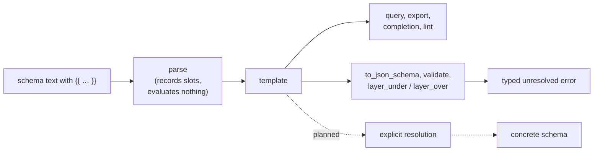

# Slots: Values Supplied by an Expression

Some lists a schema needs are data that lives elsewhere: the operating
systems a project supports, the regions a service runs in. A **slot** lets a
schema take such a value from a `{{ … }}` expression instead of repeating it:

```yaml
kind: schema
$schema:
    os_support: os[](required)
types:
    os: enum(none, {{ load_data("./os.yaml", "string[]") }}; required)
```

A schema with at least one slot is a **template**. Reading, inspecting, and
exporting a template never runs its expressions; only an explicit
resolution step does, and it produces an ordinary schema with every slot
replaced by its value.

> **Planned:** the resolution step itself (evaluating slots through a host
> such as Darkmatter, with approval and caching) is not built yet. Today a
> template can be parsed, inspected, and exported, and every operation that
> needs its values reports it unresolved.

## Where a Slot May Be Written

A slot is recognised only where it is a whole value:

| Position | Example | The slot supplies |
| --- | --- | --- |
| an `enum(...)` member | `enum(none, {{ list }})` | zero or more members |
| a `suggest(...)` candidate | `string(suggest(a, {{ list }}))` | zero or more candidates |
| the value of `literal(...)` | `literal({{ revision }})` | the one value |
| `default(...)` | `number(default({{ n }}))` | the default |
| `min(...)`, `max(...)` | `number(min({{ low }}))` | the bound |
| `pattern(...)` | `string(pattern({{ re }}))` | the regular expression |

Rules, each with what happens otherwise:

- **A list slot is one complete element.** After its `}}` comes `,`, `;`, or
  `)`. Slots and literal elements may alternate in any order:
  `enum({{ a }}, b, {{ c }})`. `enum(a, {{ b }} c)` is the grammar error
  "a `{{ … }}` slot must be a complete list element".
- **A value slot is the whole argument.** `default({{ d }} + 1)` or
  `default(a, {{ d }})` is the error "a `{{ … }}` slot must be the whole
  argument".
- **A `{{` that does not start an element is text.** A quoted element is
  always literal (`enum('{{ x }}')` has the member `{{ x }}`), and so is a
  word that only contains braces (`enum(abc{{x}})`).
- **The slot ends where the expression ends.** The closing `}}` is found by
  the expression scanner (`expression::scan::scan_expression_at`), so quotes,
  brackets, commas, and semicolons inside the expression belong to it:
  `enum(a, {{ pick(x, [1, 2], 'a;b') }})` has two elements.
- **The expression must parse.** `{{ x + }}` is a grammar error positioned at
  the offending token inside the slot; an unclosed `{{` is "unterminated
  `{{ … }}` slot"; `{{ }}` is "a `{{ … }}` slot needs an expression".
- **Existing list rules still apply.** `suggest` is allowed on the same types
  as before, and a property definition holds at most one `suggest` list,
  static or not. A `null` default cannot be a slot, and `type-definition` and
  `schema` take no value slots.
- **Duplicates in a list with a slot are kept until resolution**, where the
  first occurrence of each value wins. A list without a slot keeps today's
  rule (a repeated `suggest` candidate is an error).
- A list with no slot is exactly what it was before: an `enum(...)` without a
  slot parses to `Constraint::Members`, a `suggest(...)` to
  `Constraint::Suggest`. Static schemas take no new path.

## What a Template Reports

A template is a valid schema that is not yet concrete. Each operation says
so in a typed way, and none builds a placeholder.



| Operation | On a template |
| --- | --- |
| `SimplifiedSchema::try_from`, file factories | accept it; `is_resolved()` is `false` and `pending_slots()` lists every slot |
| `to_simplified_yaml()` | exports it as authored, each slot written back as `{{ expression }}` |
| `query(..)`, `property(..)`, `named_type(..)` | answer as usual; `TypeDefinition::pending_slots()` lists the type's slots |
| `to_json_schema()`, `layer_under`, `layer_over` | `SimplifiedSchemaError::Unresolved` holding `SchemaError::UnresolvedSlots` |
| `validate_strict`, `validate_soft` | `ValidationFailure::Unprepared` holding `SchemaError::UnresolvedSlots`; no value is judged |
| `to_json_schema_with_definitions` and other lowering | `SchemaError::UnresolvedSlots`, before anything is lowered |
| suggestion queries and completion | offer the literal elements and set `pending: true` |
| `lint_suggestions` | judges literal candidates; none when a value slot (`min`, `pattern`, …) shapes the type |
| `is_subtype` | an `enum` or `literal` with a slot is a subtype of nothing but itself |

```rust
use simplified_schema::{SchemaError, SimplifiedSchema, SimplifiedSchemaError};

let template = SimplifiedSchema::try_from("$schema:\n  os: enum(none, {{ load_data('./os.yaml') }})\n")?;
assert!(!template.is_resolved());
assert_eq!(template.pending_slots()[0].expression, "load_data('./os.yaml')");
assert!(matches!(template.to_json_schema(), Err(SimplifiedSchemaError::Unresolved(_))));
assert!(template.to_simplified_yaml()?.contains("{{ load_data('./os.yaml') }}"));
```

## Positions

Every `Slot` carries two byte ranges: `span`, the whole `{{ … }}`, and
`expression_span`, the trimmed expression. For a schema read by a factory
both point into the document as written, through plain, `'…'`, `"…"`, `|`,
and `>` YAML scalars and a Markdown frontmatter block, without normalizing
line endings. A slot reached through `Name@./other.yaml` points into the file
that defines it.

## Nothing Runs While Parsing

Parsing a slot parses its expression once, to report a syntax error where it
is written. It evaluates nothing and reads nothing: the files a slot names
are not dependencies of the template (they are absent from its
`provenance()`), and querying, exporting, or attempting to lower or validate
a template does no further expression or validator work.
