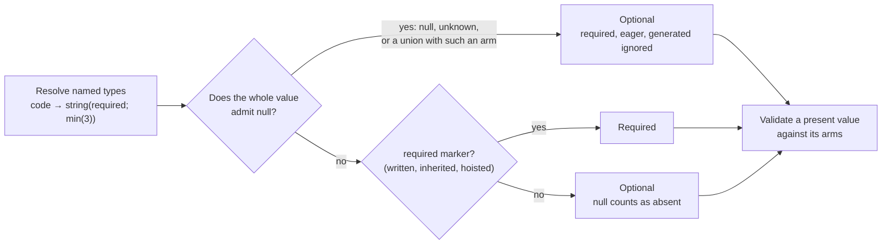
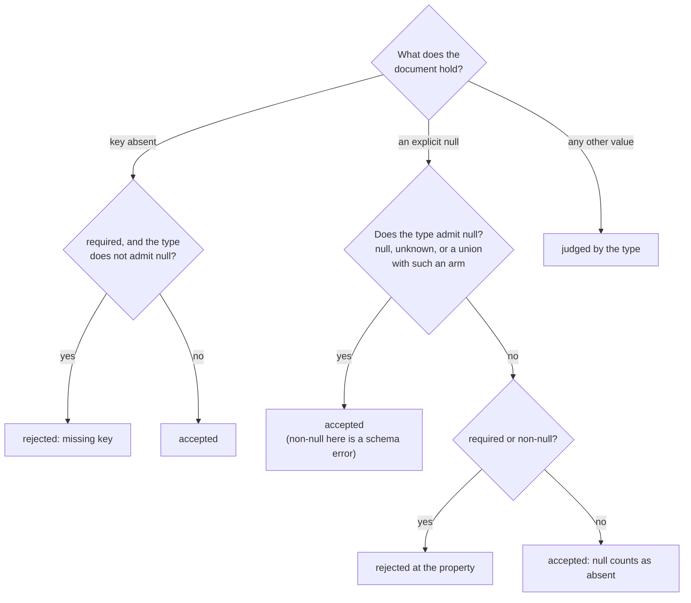

# Types and Constraints

Every property in a SimplifiedSchema is a **type-and-constraint** string. This page lists the types, the constraints each accepts, and how they lower to Draft 2020-12 JSON Schema.

## SimplifiedSchema Grammar

A SimplifiedSchema is a YAML mapping from property names to **type-and-constraint** strings.

```yaml
$schema:
    name: string
    age:  number
```

### Syntax Forms

Every property value follows one of four shapes:

| Form                                       | Example                                              |
|--------------------------------------------|------------------------------------------------------|
| `{type}`                                   | `name: string`                                       |
| `{type}({constraints})`                    | `name: string(required)`                             |
| `{type} -> {description}`                  | `name: string -> The author's full name`             |
| `{type}({constraints}) -> {description}`   | `slug: string(not-empty;required) -> URL slug`       |
| `{ prop: type-expr, ... }`                 | `config: "{ host: string(required), port: number }"` |
| `{ prop: type-expr, ... }[]`               | `entries: "{ foo: string(required) }[]"`             |
| `{type} \| {type}`                         | `id: "string \| number"`                             |
| `tuple([{type}, ...])`                     | `point: "tuple([number, number])"`                   |

- **Whitespace** inside `(...)` and inside `{ ... }` is insignificant. Quote the whole scalar so YAML keeps it as a string when whitespace is present.
- **Multiple constraints** are separated by `;`.
- **Optional by default** — properties are optional unless `required` appears in the constraint list. An optional property also accepts `null` as a sentinel for absent, so a frontmatter value that resolves to `null` validates the same way as a missing key. A property whose type itself admits `null` (`null`, `unknown`, or a union with one of those arms) is always optional, even when it is marked `required`; see [Null-Admitting Properties](#null-admitting-properties). Add `non-null` to keep a property optional but refuse an explicit `null`; see [Non-Null Properties](#non-null-properties).
- **Arrays** are written by appending `[]` to the type. Item constraints sit inside the parens that precede the brackets; constraints on the array itself sit in a second parens after the brackets.
- **Unions** are written with `|` or as a YAML list; both mean the same thing. See [The `|` Operator and Grouping](unions.md#the--operator-and-grouping).
- **Descriptions** (`-> ...`) populate the `description` annotation in the generated JSON Schema. Inside an inline object, a description terminates at the next top-level comma or closing brace (see [Inline Object Literals](objects-and-named-types.md#inline-object-literals)). When a property fails validation, its declared description surfaces at the point of failure — in `md schema validate` (pretty and JSON output) and in compose schema-failure blocks (see [Error Rendering](../../../../darkmatter/docs/topics/schemas/definition.md#error-rendering)).
- **Inline object literals** are an extension of the type-expression grammar. The whole `{ ... }` body is a single string scalar that the string-layer parser recognizes. YAML mapping values at a property position are still errors — quote the mapping as a string to opt into inline object syntax.

```yaml
$schema:
    tags:   string[]                      # optional array of strings
    scores: "number(min(0); max(100))[]"  # each item in 0..=100
```

### Types

For a practical introduction with worked examples, see
[Choosing Schema Types](schema-types.md).

| Type         | Accepts                                                                                                | Notes                                                                                                                                                                           |
|--------------|--------------------------------------------------------------------------------------------------------|---------------------------------------------------------------------------------------------------------------------------------------------------------------------------------|
| `string`     | Any YAML string scalar.                                                                                | Constraints: `min`, `max`, `not-empty`, `pattern`, `suggest`, `default`, `required`.                                                                                              |
| `date`       | ISO-8601 date `YYYY-MM-DD`.                                                                            | JSON Schema `format: date`.                                                                                                                                                     |
| `datetime`   | An ISO 8601 datetime `YYYY-MM-DDThh:mm[:ss[.ms]]` (a space may replace `T`) with an **optional** offset (`Z` or `±HH:MM`); a value with an offset must be RFC 3339, seconds included. | JSON Schema `format: darkmatter-datetime` (the built-in `date-time` requires an offset). See [Custom Vocabulary](../custom-vocabulary.md). |
| `time`       | A time of day `hh:mm`, `hh:mm:ss`, or `hh:mm:ss.ms` with an **optional** offset (`Z` or `±HH:MM`); with an offset, seconds are required (`14:30` is valid, `14:30Z` is not). | JSON Schema `format: darkmatter-time` (the built-in `time` requires an offset). See [Custom Vocabulary](../custom-vocabulary.md). |
| `number`     | Any JSON number; numeric text converts to one ([Type Coercion](../conversion.md#conversion-rules)). | Constraints: `min`, `max`, `integer`, `suggest`, `default`, `required`.                                                                                                         |
| `numberlike` | What `number` accepts: a JSON number **or** numeric text (`"4"`, `" 4 "`, `"+4"`, `"1e3"`, `"1_000"`).          | Compiles to `{ "type": ["number", "string"], "format": "darkmatter-numberlike" }`. The value is validated and kept **exactly as written** (see [Type Coercion](../conversion.md#numberlike-and-boolish-keep-what-was-written)). |
| `boolean`    | Any JSON boolean; a boolean word converts to one ([Type Coercion](../conversion.md#conversion-rules)). | Constraints: `default`, `required`.                                                                                                                                             |
| `boolish`    | What `boolean` accepts: a JSON boolean **or** a boolean word (`true`/`false`, `yes`/`no`, `on`/`off`, `1`/`0`, any case). | Compiles to `{ "type": ["boolean", "string"], "format": "darkmatter-boolish" }`. The value is validated and kept **exactly as written** (see [Type Coercion](../conversion.md#numberlike-and-boolish-keep-what-was-written)). |
| `object`     | Any YAML/JSON object.                                                                                  | No nested-schema authoring in v1 — `object` accepts any shape. Reference an external file for deeper typing.                                                                    |
| `file`       | A file reference parsed via `biscuit-file::FileReference`. Single or array form.                       | Constraints: `eager`, `match(glob, ...)` (each glob a prefixed glob reference such as `^**/*spec*.md`), `required`. **Lazy by default**; `file(eager)` resolves and checks existence (implicit paths from the document directory first, then the repository root; explicit `./`/`../` from the document directory only). Schema-selected file values materialize as absolute native paths at the request boundary; lazy values use the first unprobed candidate. See [Files](#files).        |
| `enum`       | A value from an explicit set.                                                                          | Constraints required — the members are the constraint. See [Enumerations](#enumerations).                                                                                       |
| `literal`    | Exactly one scalar value, of any scalar type.form                                                      | Compiles to JSON Schema `const`. Bare `true`/`2` are typed; quoting forces string. Constraints: `required`, an equal `default`. See [Literals](#literals).                       |
| `url`        | A string parseable as an absolute URL.                                                                 | Constraints: `scheme(...)`, `default`, `required`.                                                                                                                              |
| `email`      | A string in `addr-spec` form.                                                                          | JSON Schema `format: email`.                                                                                                                                                    |
| `yaml`       | A string whose **content** parses as YAML, **or** a native mapping/sequence/scalar coerced to a YAML string. | JSON Schema `format: darkmatter-yaml`. Accepts JSON too (JSON is valid YAML). See [Content-Format Types](objects-and-named-types.md#content-format-types-yaml--json).                              |
| `json`       | A string whose **content** parses as strict JSON, **or** a native value coerced to a JSON string.      | JSON Schema `format: darkmatter-json`. Rejects YAML-only syntax. See [Content-Format Types](objects-and-named-types.md#content-format-types-yaml--json).                                                  |
| `expression` | A string that parses under the Darkmatter expression grammar. Parse-only — never evaluated.            | JSON Schema `format: darkmatter-expression`. The third content-format string type. Native booleans/numbers coerce to their string form. See [Expressions](#expressions).        |
| `type-definition` | A string type expression, native mapping object definition, or non-empty property union.          | Describes one SimplifiedSchema property definition as data. Parse-only; the value is never resolved or normalized. Options: `forms(...)`, `declared-required`, `container`. See [Semantic Meta-Types](#semantic-meta-types).            |
| `schema`     | An inline schema mapping, local schema reference string, or non-empty root union.                       | Describes one complete `$schema` declaration as data. Parse-only; validation checks syntax without reading referenced files. Options: `mapping`, `property(...)`. See [Semantic Meta-Types](#semantic-meta-types).  |
| `unknown`    | Anything, including `null`, or omission. `any` is an equivalent alias.                                  | JSON Schema `{}`. `required` has no effect: `unknown(required)` still accepts `null` and omission. To require a value, use a concrete type, e.g. `unknown[](required)` for a required list. See [`unknown` and `null`](#unknown-and-null). |
| `null`       | Only an explicit `null`, or omission.                                                                  | JSON Schema `{"type": "null"}`. `required` has no effect. Written unquoted (`review: null`, `review: ~`) or as `"null"`. See [`unknown` and `null`](#unknown-and-null). |
| `alphanumeric` | A string of ASCII letters and digits (`[A-Za-z0-9]`), widened or narrowed by type options.          | Options before `;`, constraints after: `alphanumeric(allow-dashes; min(1))`. Lowers to a string `pattern`. Never coerces numbers or booleans. See [Alphanumeric Strings](#alphanumeric-strings). |
| `shell`      | A string that holds a shell command: at least one non-whitespace character. Never parsed or run.       | JSON Schema `format: darkmatter-shell`. Constraints and coercion mirror `expression`. See [Shell Commands](#shell-commands). |
| `tuple`      | A list whose positions each have their own type: `tuple([string, number?, ...boolean[]])`.             | Compiles to `prefixItems`, `minItems`, and `items`. See [Tuples](#tuples).                                                                                                      |
| `function`   | Nothing: a `function(...)` type describes a callable and never validates data.                         | Legal only in a schema file's `types:`; a document schema that reaches one fails to load. See [Function Signatures](unions.md#function-signatures).                                      |

Append `[]` to any type for an array of that type — e.g. `string[]`, `enum(red,green,blue)[]`, `file(match('*.md'))[]`.

`unknown`, `null`, `alphanumeric`, `shell`, `tuple`, and `function` are
built-in keywords, so a bare `shell` always means the built-in type. A local named type that happens
to share one of these names is referenced explicitly as `shell@this` (see
[Local Type References](local-type-references.md)).

### Semantic Meta-Types

`type-definition` and `schema` are Darkmatter's semantic meta-types: they let a
SimplifiedSchema describe its own authored grammar without maintaining a
second JSON meta-schema. The existing Rust parsers remain authoritative.
Compiled JSON Schema delegates to those parsers through
`x-darkmatter-type-definition` and `x-darkmatter-schema`.

A semantic meta-type has two distinct type relationships:

- Its **carrier type** is how the definition is represented in YAML. Both
  meta-types accept string, mapping, and sequence carriers.
- Its **denoted type** is what that authored definition describes. For example,
  the value `string(required)` has carrier type `string`, semantic type
  `type-definition`, and denotes a required string property. A union containing
  `string` and an object definition denotes `string | object`.

`type-definition` accepts exactly one complete property definition: a scalar
type expression, a native mapping object definition, or a non-empty property
union. `schema` accepts exactly one complete document schema declaration: an
inline mapping, a syntactically valid local `FileReference`, or a non-empty
root union of those forms. Remote references and malformed or empty unions are
invalid semantic values.

```yaml
$schema:
    field-definition: type-definition(required)
    document-schema:  schema(required)

field-definition:
    - string(required)
    - nested: number
document-schema: ./schemas/article.yaml
```

Both meta-types are **parse-only**. Validation never loads a reference, expands
an import or example, evaluates an expression, runs composition, or accesses
the network. It also preserves the authored YAML representation: mappings stay
mappings and sequences stay sequences. Actual `$schema` preparation remains a
separate operation that may resolve referenced schema files.

Either meta-type can also narrow which declarations it accepts:
`schema(mapping)` accepts only a mapping, and
`schema(property(kind, type-definition(forms(literal, enum); declared-required)))`
demands that every exported object declare a required `kind` as a literal or
enum, and `type-definition(container)` accepts only a definition of a list,
tuple, object, or dictionary. These options judge the authored declaration, never a document's data;
see [Narrowing a declaration](schema-types.md#narrowing-a-declaration).

#### Source-Aware Presentation Boundary

The semantic parsers operate on YAML values, while DMLS and other diagnostic
consumers additionally require exact source spans. The v1 source-aware grammar
is deliberately capped at these authored presentations:

- plain, single-quoted, and double-quoted scalars, where a plain scalar may
  continue onto more-indented lines;
- literal (`|`, `|-`) and folded (`>`, `>-`) block scalars, the usual way to
  write a multi-line `function(...)` signature;
- block and flow sequences, including a block sequence whose `-` sits at the
  same column as its parent key;
- implicit scalar-key block and flow mappings;
- explicit scalar-key block mapping pairs, including compact mapping items in
  block sequences; and
- mapping-value anchors and scalar aliases used by the shipped schema corpus.

Serializers often produce indentless lists, and editors may wrap plain values
onto continuation lines. Each presentation has the same meaning as its
conventionally indented or single-line equivalent.

**Indentless sequences.** Wherever the grammar accepts a sequence, its items
may sit at the parent key's column. The list ends at the next line at that
column that is not a `- ` item, so `next` below is a sibling definition, not
part of `t`:

```yaml
kind: schema
types:
  t:
  - string
  - number
  next: boolean
```

`t` is the property-level union `[string, number]`. The same holds for a union
nested in a mapping arm, for compact mapping items (`- count: number`), and
after an anchor (`status: &arms` followed by `- number`). Indentation never
changes which values are allowed: an indentless list under `$schema` is a
root-level union, while a list under `types` is still rejected because `types`
must be a mapping.

**Continued plain scalars.** An unquoted value may continue onto lines indented
past its key or `-`. The type expression, its constraints, and its description
can all be split this way:

```yaml
kind: schema
types:
  t: string(min(1);
    max(8)) -> a description long enough that the editor
    wraps it onto another physical line
  next: boolean
```

The schema parser receives the value exactly as YAML decodes it: adjacent
lines join with one space, and their indentation and any trailing comment are
dropped. A blank line between two content lines becomes a line break instead,
so the description below is `first paragraph` and `second paragraph` on two
lines, the same as the quoted `"string(min(3)) -> first paragraph\nsecond
paragraph"`:

```yaml
$schema:
  title: string(min(3)) -> first paragraph

    second paragraph
  next: boolean
```

The value ends at the first line that is not indented past its key (here
`next`) or at a comment line. Folding never makes an invalid expression valid;
`string(min(1);` continued onto `bogus(2))` still has an unknown constraint.

**Ranges.** Source maps and `suggest(...)` candidate spans are byte ranges into
the original file, with its line endings left as authored (LF or CRLF). A token
on a continuation line is ranged on that line, without its indentation. A token
or expression that crosses a line break gets one range from its first authored
byte to its last, with the break and indentation inside it. Editor positions
are a separate step: DMLS converts these byte ranges to the line and column
encoding the editor negotiated (UTF-8 or UTF-16), so a grammar error such as
`bogus` above is underlined on its own line, not across the whole value.

This is a SimplifiedSchema authoring grammar, not a promise to project every
presentation accepted by a general YAML parser. Tags, quoted scalars
continued across lines, complex keys, explicit
flow-mapping keys, directives, and other unlisted YAML presentations are
outside the v1 source-map and DMLS contract; a schema file that uses one fails
to load with `could not project SimplifiedSchema expression spans through YAML
source`. Every non-comment line of a schema value must belong to a presentation
the grammar recognizes, so an unrecognized one fails rather than being skipped.
Frontmatter lookup is more tolerant and also follows tags and quoted
continuations; that does not extend to schema documents. Authors should
prefer ordinary `key: value` mappings. Expanding this closed boundary requires
a separately specified feature; discovering another valid-but-unlisted YAML
spelling is not a production-readiness regression for these meta-types.

#### Semantic Arrays

The ordinary array postfix remains available. `type-definition[]` and
`schema[]` mean arrays of independent semantic values. When one array item is
itself a union, use a nested sequence so the outer sequence remains the
collection boundary.

```yaml
$schema:
    definitions: type-definition[]

definitions:
    - string
    - [number, { nested: boolean }]
```

Only the universal `required`, `non-null`, `eager`, `default(...)`, and
`generated` constraints, and each meta-type's own
[declaration options](schema-types.md#narrowing-a-declaration), apply to these
nominal types. The options judge one declaration, so they are rejected on the
array forms (`schema[](mapping)` is a schema error).
Semantic defaults must themselves parse as the declared artifact. Darkmatter
does not infer either meta-type in `md schema detect`, because a carrier value
does not establish the author's semantic intent. Terminal import syntax still
takes precedence, so `schema@file` and `type-definition@file` remain named-type
imports rather than primitive meta-type declarations.

### Universal Constraints

Every type accepts:

- `required` — the property must be present. Presence may still be deferred at
  stabilized launch so an actor inside the run can supply it; it is mandatory at
  completion. `required` has no effect on a property whose type admits `null`
  (see [Null-Admitting Properties](#null-admitting-properties)).
- `non-null` — the property may be omitted, but a present value is never
  `null`. It is not a presence rule: the property stays optional and out of the
  JSON Schema `required` list. Every type keyword except `null` and `unknown`
  (`any`) accepts it; see [Non-Null Properties](#non-null-properties).
- `eager` — a supplied value is validated at stabilized launch. `eager` is
  timing metadata, not a presence rule: absence is allowed unless `required` is
  also declared. It is not encoded into authored JSON Schema. On a `file` item
  ordinary schema preparation additionally retains the existing existence
  check; the passive phase validator itself checks syntax and presence without
  probing the filesystem.
- `default(value)` — JSON Schema `default`. Darkmatter does **not** mutate documents; downstream tools and detection honor it.
- `category(Name)` — documentation metadata. The name is the text up to `)`,
  trimmed and case-sensitive, and may contain spaces and punctuation
  (`category(Date Arithmetic)`, `category(CI/CD)`). It emits the
  `x-darkmatter-category: Name` annotation and never changes what validates.
  A schema file that declares a [`categories:` list](schema-documents.md#categories) only allows
  the names it lists.
- `generated` — marks a property whose value the **host tool supplies at compose time** (for example the `ctx.*` context values in the Darkmatter base schema). It emits the `x-darkmatter-generated: true` annotation and suppresses the property's static `required` entry, so an authored document validates before the host fills the value in; the typed (non-null) arm is preserved. `datetime(generated; required)` therefore reads "required once generated", not "must be authored".

- `deferred` — a value here that is a `{{ … }}` template is **supplied later**,
  when whatever consumes it renders the template, so schema validation accepts
  it without judging or evaluating it. Every literal value here is still
  judged, and so is everything around the template: an unknown key beside it,
  a missing or extra tuple element, a malformed template (`{{ 1 + }}`). A
  template at a place **not** marked `deferred` is ordinary text and is judged
  against the declared type. It emits the `x-darkmatter-deferred: true`
  annotation on the node it marks (never on an optional property's `null`
  wrapper):

  ```yaml
  $schema:
      on_success: "{ retries: number(integer; deferred) | object(deferred), note: string }[]"
  on_success:
      - retries: "{{ fm.max_retries }}"   # accepted: the template is rendered later
      - retries: 3                         # judged: a literal
      - note: "{{ fm.summary }}"           # judged as text: `note` is not marked
  ```

  Where it is written decides what it marks: `number(deferred)[]` marks each
  item, `number[](deferred)` the list itself, `tuple([number(deferred),
  number])` one slot, and inside a union `a | b` only the alternative that
  carries it (write it on each arm that may be a template). It works the same
  inside a named or [recursive](objects-and-named-types.md#recursive-named-types) type, at every depth.
  It applies to templates nested below a top-level key; a whole top-level
  template follows
  [the shell-deferral contract](../../../../darkmatter/docs/inline/schema-validation.md#the-shell-deferral-contract).
  Raw JSON Schema can mark a node
  the same way by writing `x-darkmatter-deferred: true` on it.

- `operands(<verb>-short)` / `operands(<verb>-long)` — the value is the short
  or long spelling of the Darkmatter lifecycle verb `<verb>` (an expression
  function or side effect). Schema validation reads it as the lifecycle
  parser does (`null`, a positional list, one scalar, or a mapping whose keys
  select one overload) and binds it through the verb's runtime registration,
  whose verdict replaces the type's for those operands: a call the
  registration binds passes even where the type rejects an operand, and one it
  refuses is a positioned problem even where the type accepts it. `{{ … }}`
  operands stay deferred and nothing is evaluated, but a `{{ … }}` span that
  does not parse, anywhere in an operand, is a positioned syntax problem at
  that string even where the type accepts the text
  (`ensure_file: "out/{{ 1 + }}.md"`); it replaces any type problem at the same place, and a stored
  literal token is data, never scanned. A stored literal token is never
  deferred either: the text it holds is bound like any literal, so `abs`
  refuses a token holding `{{ fm.count }}` as it refuses `three`. An unknown
  key, an extra operand, or a bad `no_error` beside the operands is still
  judged by the type. It emits the `x-darkmatter-operands: <verb>-short` annotation on the
  node it marks (never on an optional property's `null` wrapper). The
  lifecycle schema generator writes it on the generated verb types; see
  [the two lifecycle partials](../../../../darkmatter/docs/topics/schemas/definition.md#the-two-lifecycle-partials). The verbs the
  lifecycle parser owns itself (`say` and the other communication verbs,
  `shell`, the directives, `set`) carry it on their hand-written types too.
  They have no registration to bind, so the marker only checks the strings
  the parser reads as templates: `say: "{{ 1 + }}"`,
  `proxy: { target: next.md, with: { n: "{{ 1 + }}" } }`, and
  `set: { n: "{{ 1 + }}" }` are positioned syntax problems, while a `set`
  value written as a whole-value `$( … )` command, `no_error`, and
  `break.code` are not read as templates.

`required` and `eager` are independent axes: `required` decides whether the
property must be present, `eager` decides when a supplied value is validated.
Phase-aware validation derives both recursively from the resolved
SimplifiedSchema without mutating the instance or authored schema:

| Constraint | Launch | Completion |
|------------|--------|------------|
| none | Optional; present values remain type-checked | Optional; present values remain type-checked |
| `eager` | Optional; a present value is validated eagerly | Optional; present values remain type-checked |
| `required` | Optional; present values remain type-checked | Required |
| `required; eager` | Required, and the value is validated eagerly | Required |
| `generated; required` | Optional while the host can supply it | Required |

Missing and explicit `null` both count as absence at these seams. An
eager-only `null` is therefore allowed at both phases, `required; eager`
rejects it at launch, and `required` rejects it at completion. The table holds
for every type except a null-admitting one, which is optional at both phases
whatever its markers: neither `required`, `eager`, nor `generated` makes
`maybe: [string(required; eager), null]` demand a value. Raw JSON Schema
has no phase vocabulary, so its authored `required` behavior remains in force
at launch and completion. Authors who need an actor *inside* the run to produce
a value must therefore use SimplifiedSchema, which is the only surface where
presence and validation timing can differ.

`eager` without `required` is how you say "optional, but resolve and check it
eagerly when supplied": a caller may omit the property, and any value it does
supply must be valid before the provider starts. Write `required; eager` when
omission is itself an error, and plain `required` when an actor inside the run
is expected to produce the value.

Both constraints are derived recursively, so a `required` sub-property of an
inline object is demanded at completion under its full path
(`products.uk_price`), and a property union hoists `eager` from any arm exactly
as it hoists `required` — the constraint governs the property as a whole, while
the selected arm still governs the value. Interactive collection is a
top-level-property UI, so a missing nested property is reported rather than
synthesized.

The same holds at every level of a
[recursive named type](objects-and-named-types.md#recursive-named-types): each property nested
in its definition is timed by its own markers, whatever the timing of the
property that uses the type. With
`item: "{ name: string(required), kids: item[](required) }"`, a `name` missing
five levels down is accepted at launch and reported at completion, and one
`item` definition serves `now: item(required; eager)` and
`later: item(required)` alike; only the two properties differ.

### Null-Admitting Properties

Use a null-admitting type when a whole value may be left out even though the
type you reuse says `required`. A property is **null-admitting** when its
whole value is typed:

- `null`, or `unknown` (alias `any`), without `[]`; or
- a union, written at the property or through a named union reference, with a
  `null` or `unknown` arm.

A null-admitting property is never required. A `required` written on it,
inherited from a named type, or hoisted from another union arm has no effect,
and neither `eager` nor `generated` restores presence. This is how you make
an optional variant of a required named type:

```yaml
kind: schema
types:
    code: string(required; min(3))
    record: "{ code: code }"        # record.code is required (inherited)
    draft_code: [code, null]        # optional: null, omitted, or a valid code
```

The other arms keep their constraints for non-null values, so a property
typed `draft_code@./types.yaml` accepts `null`, omission, and `abc`, and
rejects `ab`.

The decision is made in this order:



Named references are resolved first, so a reference to a type defined as
`[code, null]` is optional wherever it is used. Null admission is decided
before the ordinary optional-property `null` wrapper is added; otherwise every
optional concrete type would look null-admitting and could never be required.

The rule concerns the **whole value**, not its items or fields:

| Declaration | Missing or `null` | Notes |
|---|---|---|
| `unknown(required)`, `null(required)` | accepted | `required` has no effect |
| `[string(required; min(3)), null]` | accepted | `ab` is still rejected |
| `unknown[](required)` | rejected | a list is required; its items may be anything, including `null` |
| `null[](required)` | rejected | a list is required; every item must be `null` |
| `"{ note: null, id: string }(required)"` | rejected | a nullable field leaves its object required |

The same calculation governs validation, generated JSON Schema, trigger
matching, composition's optional-property materialization, and launch and
completion validation. A null-admitting property lowers to its bare fragment
(`{}` or `{"type": "null"}`, or the union's arms) and is never placed in the
parent's `required` list.

Raw JSON Schema is unaffected: a property listed in its authored `required`
array is required even when its schema is `{}` or `{"type": "null"}`.

A host may apply its own policy to an invalid optional value. Claudine, for
example, drops an invalid optional value with a warning instead of failing, so
`c: ab` against `c: [string(required; min(3)), null]` is dropped by Claudine
while `md schema validate` reports it.

### Non-Null Properties

Use `non-null` when a property may be left out but must never be written as
an explicit `null`. An ordinary optional property treats `null` as absent;
`non-null` refuses it, while still allowing the key to be omitted:

```yaml
$schema:
    name: string(non-null)           # omit it, or give text; never null
    tags: string[](non-null)         # omit it, or give a list; never null
    meta:                            # the block spelling on an object property
        note: string
        $constraints:
            non-null: true
    both: string(required; non-null) # accepted; `required` already refuses null
```

| Declaration | Key absent | `name: null` | `name: Ada` |
| --- | --- | --- | --- |
| `name: string` | accepted | accepted (null counts as absent) | accepted |
| `name: string(required)` | rejected | rejected | accepted |
| `name: string(non-null)` | accepted | rejected | accepted |
| `name: string(required; non-null)` | rejected | rejected | accepted |
| `name: string \| null`, `name: unknown` | accepted | accepted | accepted |
| `name: null \| string(non-null)` | schema error | schema error | schema error |

Whether an explicit `null` is accepted depends on the declaration, in this
order:



- **Spellings.** `non-null` sits in either constraint list of a list type, and
  both mark the list property: `string[](non-null)` and `string(non-null)[]`
  mean the same thing. A `null` *item* is still judged by the item type, so
  both reject `["a", null]` at `/tags/1`. On an object property the block flag
  `$constraints: { non-null: true }` means the same as the postfix
  `"{ note: string }(non-null)"`. It takes no arguments.
- **Null-admitting types are schema errors.** `non-null` cannot mark a value
  that admits null: `null | string(non-null)`, `[string(non-null), null]`,
  `unknown(non-null)`, `any(non-null)`, and `null(non-null)` fail to load with
  *`non-null` cannot mark a type that admits null*. A named type is checked
  after it resolves, so `Opt(non-null)` fails when `Opt` is `string | null` or
  `unknown`, and is accepted when `Opt` is `string | number`. A list of a
  nullable type is never itself null, so `(null | string)[](non-null)` is
  accepted.
- **Empty values are values.** `""`, `[]`, and `{}` are judged by the type,
  never read as `null` or as absent.
- **Validation.** Strict and soft validation both reject the `null` at the
  property's pointer (`/name`). For a type with a JSON Schema `type`, the
  problem is a type mismatch; for an `enum` or a property-level union, which
  lower without a top-level `type`, it is a constraint violation, exactly as
  for the `required` spelling. Soft validation never converts the `null`: it
  is not turned into the text `"null"`, nor read as a missing key (see
  [Conversion Rules](../conversion.md#conversion-rules)).
- **Lowering.** A non-null property lowers to its bare fragment, without the
  optional-property `null` wrapper, and stays out of the parent's `required`
  list:

  ```json
  { "properties": {
      "name":  { "type": "string" },
      "plain": { "anyOf": [{ "type": "null" }, { "type": "string" }] } } }
  ```

  Here `name` is `string(non-null)` and `plain` is an ordinary `string`. A
  third-party validator therefore enforces `non-null` without any custom
  vocabulary.
- **Subtyping** treats `non-null` as it treats `required`: a presence marker
  outside the type relation (see [Subtyping](subtyping.md)).

### Numeric Constraints (`number`)

| Constraint   | Effect                          | JSON Schema             |
|--------------|---------------------------------|-------------------------|
| `min(n)`     | Inclusive minimum.              | `minimum`               |
| `max(n)`     | Inclusive maximum.              | `maximum`               |
| `integer`    | Whole numbers below 2^64 in magnitude. | `type: integer` and `x-darkmatter-integer: true` |
| `default(n)` | Default value.                  | `default`               |
| `required`   | Property is required.           | parent `required` entry |

Numbers written in a schema (`min`, `max`, `default`, and the values of
`literal` and `enum`) must be numbers Darkmatter can hold exactly. A whole
number that a 64-bit float cannot represent, an infinite value, or a non-zero
value that would round to zero fails to load, with the reason:

```yaml
$schema:
    a: number(min(1.5))                    # fine; a fraction takes the nearest value
    b: number(default(9007199254740993))   # error: cannot be represented exactly
    c: number(max(inf))                    # error: not finite
    d: number(min(1e-400))                 # error: a non-zero value would become 0
```

### String Constraints (`string`)

| Constraint     | Effect                                                                                            | JSON Schema             |
|----------------|---------------------------------------------------------------------------------------------------|-------------------------|
| `min(n)`       | Minimum length (Unicode code points).                                                             | `minLength`             |
| `max(n)`       | Maximum length.                                                                                   | `maxLength`             |
| `not-empty`    | Disallow empty / all-whitespace.                                                                  | `pattern: "\\S"`        |
| `pattern(re)`  | ECMA-262 regex compiled with `jsonschema::PatternOptions::regex()` (ReDoS-safe, linear-time).     | `pattern`               |
| `default(s)`   | Default string.                                                                                   | `default`               |
| `required`     | Property is required.                                                                             | parent `required` entry |

A value must satisfy every pattern. When an atom has more than one pattern-producing constraint (for example `not-empty` with a `pattern(...)`, or several `pattern(...)` constraints), each lowers to its own `allOf` entry instead of a single `pattern` keyword.

### Date / Time Constraints

`date`, `datetime`, and `time` accept `default(s)` (ISO string) and `required`. The type itself emits the corresponding `format` with format-assertion enabled.

### Advisory Suggestions (`suggest`)

`suggest(...)` provides representative completion candidates for `string` and `number` properties. Unlike `enum(...)`, suggestions are **advisory** — a document value is valid when it satisfies the underlying type and constraints, whether or not it appears in the suggestion list. DMLS uses valid suggestions for frontmatter value completion.

```yaml
$schema:
    color: string(suggest(red, green, "blue gray"))
    port: number(integer; suggest(80, 443))
    ratio: number(min(0); max(1); suggest(0.25, 0.5, 1))
    tags: string(suggest(alpha, beta))[]
    retries: number(integer; suggest(1, 2, 3))[]
```

#### Eligibility

`suggest(...)` is available only on exact `string` and `number` types and on `alphanumeric`. `number(integer)` remains eligible because `integer` is a constraint on `number`. Array forms (`string[]`, `number[]`) are eligible — their candidates describe individual elements, not whole arrays.

`suggest(...)` is not available on `numberlike`, `date`, `datetime`, `time`, `url`, `email`, `boolean`, `boolish`, `enum`, `unknown`, `null`, `object`, `file`, `shell`, `expression`, or raw JSON Schema.

On `alphanumeric` the check is stricter: every candidate must be a valid value of the type, or the schema fails to load (see [Alphanumeric Strings](#alphanumeric-strings)). Everywhere else an invalid candidate is only linted.

#### Cardinality

A complete property definition may contain at most one `suggest(...)` constraint. A second occurrence is a structural grammar error. This restriction applies across all atoms of a property-level union:

```yaml
# INVALID: two suggest(...) across union atoms
$schema:
    value: [string(suggest(a)), string(suggest(b))]
```

Each property declaration in a separate root-level schema-union arm is an independent complete property definition and may carry its own suggestion list.

`suggest()` with no candidates is a structural grammar error.

#### Argument Grammar

Candidate arguments reuse the existing SimplifiedSchema argument delimiter, quoting, and escaping grammar — the feature introduces no new string literal syntax. The parser retains the exact source span and decoded text for every candidate.

#### String Interpretation

Every syntactically valid argument to `string(suggest(...))` is interpreted as a string. Bare spellings that resemble numbers, booleans, or null are still strings. Quotes delimit and escape; they do not create a distinct candidate type. So `12` and `"12"` are the same interpreted string candidate.

#### Number Interpretation

Bare and quoted arguments to `number(suggest(...))` are interpreted using the **simple decimal** syntax:

```text
optional `-` + one or more digits + optional (`.` + one or more digits)
```

The syntax accepts leading zeros and canonicalizes them. It does not accept exponent notation (`1e3`), a leading plus sign (`+1`), a missing integer portion (`.5`), a missing fractional portion (`5.`), or leading/trailing whitespace.

A simple decimal becomes a JSON number only when its canonical decimal text survives conversion to the supported JSON numeric model and canonical JSON serialization with the same exact value (lossless canonical round-trip equality). For example, `3`, `"3"`, `003`, and `3.0` all have canonical decimal text `3` and interpret to the same numeric candidate `3`. `-0` canonicalizes to `0`.

A simple decimal outside the lossless representation boundary is retained as its exact canonical decimal JSON string — it is invalid metadata that DMLS warns about and omits from completion, but it never blocks schema loading or validation.

An argument whose decoded text does not use simple decimal syntax (e.g. `many`) is also retained as its decoded JSON string for linting and diagnostics — it is not a schema-load error.

#### Uniqueness

Candidates must be unique after target-directed interpretation. A duplicate is a structural grammar error ranged at the later argument, including duplicates created by leading-zero, trailing-fractional-zero, quoted/bare, or negative-zero normalization.

#### Generated Annotation

Darkmatter preserves interpreted suggestions in generated JSON Schema using the custom `x-darkmatter-suggest` annotation. Authors never write this field — they write only `suggest(...)`.

```yaml
$schema:
    score: number(min(0); max(100); suggest(-1, 50, 101))
```

generates:

```json
{
  "type": "number",
  "minimum": 0,
  "maximum": 100,
  "x-darkmatter-suggest": [-1, 50, 101]
}
```

The annotation preserves interpreted candidate order and scalar values. It is never lowered to the standard JSON Schema `examples` annotation and is distinct from Darkmatter's `example(...)` artifact and `x-darkmatter-example` annotation. Raw JSON Schema may contain a field with the same spelling, but Darkmatter and DMLS do not discover suggestions from raw JSON Schema.

#### Candidate Linting

The Darkmatter library owns candidate checking via `lint_suggestions()` — a structured, typed, span-bearing lint API. Each interpreted candidate is checked against its target schema (the non-null scalar or array-item fragment, with `x-darkmatter-suggest` excluded).

In a union, the target is the property's effective type at the place the candidate is inserted, not just the arm that stores the list: a candidate is valid when **any** alternative there accepts it. Scalar alternatives share one place and the element alternatives of array forms (`string[]`, or the arms of a `U[]` list) share another, so an element arm never vouches for a scalar candidate. The failure reason reported is the storing arm's own. An unresolved named reference cannot vouch for a candidate until the schema is resolved.

```yaml
$schema:
    # `large` is kept: the second arm accepts it. `huge` is linted.
    size: ["string(pattern(^small$); suggest(small, large, huge))", "string(pattern(^large$))"]
```

Applicable number constraints include `min`, `max`, and `integer`; applicable string constraints include `minLength`, `maxLength`, `not-empty`, and `pattern`. `required`, `default`, `generated`, and `example(...)` do not constrain a candidate.

Invalid candidates produce structured lint problems (not schema-load errors) with decoded text, interpreted value, failure reason, and exact source span. Schema resolution, validator construction, frontmatter validation, and composition all continue uninterrupted. See `SuggestionLintProblem` and `SuggestionLintReason` in the library API.

#### Completion Query

DMLS reads suggestions from the SimplifiedSchema representation via `suggestions_for_path()`. This returns lint-valid candidates in declaration order, prefixed-filtered, with YAML-safe insertion text (double-quoted strings, canonical numbers). Invalid candidates are omitted; valid siblings are retained. See `SuggestionItem` and `SuggestionQuery` in the library API.

### Boolean Constraints

`boolean` and `boolish` accept `default(b)` and `required`.

### Enumerations

`enum` requires a positional comma list of members; other constraints follow after a `;`. Members with whitespace, commas, parentheses, or `;` must be single-quoted.

```yaml
$schema:
    color:  enum(red,green,blue; required)
    status: "enum(draft, published, archived; default(draft))"
    spaced: "enum('a, b', 'c; d')"
```

### Literals

`literal(value)` types a property whose value must **equal exactly one scalar**. It compiles to JSON Schema `const`, replaces the single-member-enum workaround (`kind: enum(spec)`), and makes discriminated unions first-class.

```yaml
$schema:
    kind:     literal(spec)                     # string literal
    version:  literal(2; required)              # number literal + constraint
    archived: literal(false)                    # boolean literal
    note:     "literal('a, b'; default('a, b'))"  # quoted value (protects , ; )
```

- Exactly **one** positional value, lexed with the same rules as enum members: a bare token or a single-/double-quoted string. Quoting protects `,`, `;`, and `)`.
- Constraints follow after `;`, exactly like `enum(a, b; required)`.
- `literal()` with no value is a `SchemaError` (*literal requires a value*). Two or more positional values is a `SchemaError` whose message points you at `enum(...)`.

#### Value Typing

The positional value is lexed as a YAML-style scalar, so the literal's JSON type mirrors how YAML would type the frontmatter value being validated:

| Authored                                | Typed as |
|-----------------------------------------|----------|
| bare `true` / `false`                   | boolean  |
| bare integer / float (numberlike-shaped) | number   |
| any other bare token                    | string   |
| quoted (`'2'`, `"true"`)                | string   |

`version: 2` in a document therefore satisfies `literal(2)` without coercion gymnastics, and quoting opts out (`literal('2')` matches the string `"2"`, not the number `2`). Number detection reuses the existing numberlike-shape test — no scientific notation, no leading-zero octal surprises; anything that fails the shape test is text.

A **bare `null`** is rejected with an actionable error (*quote it or drop the key*): optional properties already accept `null`, so a null literal is always an authoring mistake. To declare a property that must be `null` or absent, use the [`null` type](#unknown-and-null).

#### Constraints

| Constraint  | Allowed | Notes                                                                                                          |
|-------------|---------|----------------------------------------------------------------------------------------------------------------|
| `required`  | yes     | Enforces presence and equality.                                                                                |
| `default(v)` | yes     | Schema-load lint: `v` must equal the literal value, else `SchemaError` — a default that violates its own `const` is always a bug. |
| `suggest(...)` | no   | Completion is implied by the value itself.                                                                     |
| everything else (`min`, `pattern`, …) | no | Nothing to constrain beyond identity.                                                            |

A non-`required` literal accepts missing/`null` through the standard optional-nullable wrapper; otherwise the value must equal the literal.

#### JSON Schema Emission

`literal(spec)` → `{ "const": "spec" }`; `literal(2)` → `{ "const": 2 }`. The array form `literal(x)[]` is **allowed** and places the `const` under `items`, so every item must equal the value — grammatically uniform with every other type, niche but well-defined.

#### Coercion

The literal implies its scalar type, so conversion treats it like the corresponding primitive: a document value `"2"` against `literal(2)` converts to the number `2`; `"yes"` against `literal(true)` converts to the boolean `true`; a number or boolean against a string literal converts to its text (`2` against `literal('2')` becomes `"2"`) and is then compared. A converted value that does not equal the literal is an error, and `$(...)`-pending values wait for expansion (see [Type Coercion](../conversion.md#type-coercion)).

#### Relationship to `enum`

`literal(x)` validates **identically to `enum(x)` for string values**. Keep using `enum` for "one of N strings"; reach for `literal` when you mean "exactly this value, of any scalar type" — including non-string discriminants (`version: 2`) that `enum` cannot express. Single-member enums keep working; there is no deprecation.

#### Trigger Matches

`literal` is a pure value-equality constraint (no I/O), so it is permitted in [schema-trigger](../../../../darkmatter/docs/topics/schemas/definition.md#repository-trigger-schemas) match expressions. `kind: literal(spec)` is the idiomatic trigger discriminant, replacing the older `enum(spec)` spelling.

### Expressions

`expression` types a **string that must parse under the Darkmatter expression grammar**. It is the third member of the content-format string-type family alongside [`yaml` / `json`](objects-and-named-types.md#content-format-types-yaml--json), and it is **parse-only** — never evaluated, no I/O, no shell, no function execution.

```yaml
$schema:
    when:  expression                           # bare
    guard: expression(required)                 # with constraints
    hooks: "{ on-error: expression, on-done: expression }"
```

- A plain keyword type with no positional value — parses exactly like `string`.
- There is **no** parameterized form: `expression(…)` with a positional value is rejected, because there is only one expression grammar to select.

#### Semantics

A bare `expression` validates when the string parses under the Darkmatter expression grammar, the one grammar every surface uses (`{{ }}` interpolation, `when="..."` conditions, lifecycle `when:`). So `when: expression` accepts `is_agent() && os == "macos"` and `length(items || []) > 0` alike.

Validation checks **parseability only**:

- **No evaluation, ever** — the same passivity contract as `yaml` / `json` content-format validation.
- **Unknown identifiers are not schema errors.** Identifier resolution (frontmatter keys, `ctx.*`, `env.*`) is a compose-time concern. DMLS layers richer advisory diagnostics on top inside the editor.

#### JSON Schema Emission and Constraints

Emits `{ "type": "string", "format": "darkmatter-expression" }`, backed by a pure parse check. Constraint applicability, optional-nullability, and the `$()` / `{{ }}` pending-value deferral rules mirror `yaml` / `json` exactly: it permits the universal `required`, `default(...)`, and `generated` constraints plus array constraints when suffixed with `[]`; string constraints and `suggest(...)` are rejected. A `default(...)` value must itself parse as an expression, or the schema fails to load.

#### Coercion

`when: true` and `retries: 3` are valid degenerate expressions that YAML types as boolean/number before the validator sees them. The coercion pass serializes native boolean and number scalars to their canonical literal string forms (`true` → `"true"`, `3` → `"3"`), the same native-value-accepted-then-serialized behavior `yaml`/`json` already have. Number spelling canonicalizes through YAML's reading (`3.10` → `"3.1"`); quoting preserves exact spelling. **Mappings and sequences do not coerce — they are type mismatches.**

#### Consumer Layering

The type ships in Darkmatter; consumers adopt it in their own schemas. Claudine's extension baseline retypes `when: string` → `when: expression` with zero Claudine-specific code in Darkmatter, then DMLS lights up schema-driven expression completion, hover, and diagnostics inside those frontmatter values.

### `unknown` and `null`

`unknown` names "any value at all"; `null` names "deliberately absent". Both
admit `null`, so both are always optional (see
[Null-Admitting Properties](#null-admitting-properties)).

```yaml
$schema:
    payload: unknown            # any value, null, or omitted
    legacy:  any                # the same type, spelled with its alias
    review:  null               # only null, or omitted
    spec:    [file, null]       # a file reference, null, or omitted
```

**`unknown`** accepts every value: a string, number, boolean, mapping,
sequence, or `null`, and omission. It lowers to the empty JSON Schema `{}`.
`any` parses to the same type and is never written back: serialization, `md
schema about`, and DMLS hover all say `unknown` and list `any` as its alias.
Values keep their native types, including nested `null`s; `unknown` performs
no coercion. Because it accepts everything, `unknown(required)` cannot demand
that a key be present. Use a concrete type for that, such as
`agent: string(required)` or `steps: unknown[](required)`. "Anything except
`null`" is a union of the accepted types:
`value: [string(required), number, boolean, object, "unknown[]"]`.
`unknown(non-null)` is a schema error, because `unknown` admits `null` (see
[Non-Null Properties](#non-null-properties)).

An expression variable that no frontmatter key, caller input, or schema
property declares is of type `unknown`. A function argument with this type
cannot be proven incompatible before execution. DMLS can warn about that
uncertainty when `expressions.strict` is enabled; ordinary composition does
not reject it on that basis. The actual value must still satisfy the function
at runtime. See [Expression Type Checking](../../../../darkmatter/docs/topics/darkmatter-expressions.md).

**`null`** accepts an explicit `null` or omission and rejects every other
value. It lowers to `{"type": "null"}`.

- At a type position (a property, a union arm, a nested property, or a named
  type), the YAML null scalars `null`, `Null`, `NULL`, and `~`, an empty
  value (`review:`), an empty sequence item (`-`), and the string `"null"` all
  mean the `null` type. A quoted empty string `""` is a string, not a null
  spelling, so `d: ""` is still the grammar error *expected a type name*.
- `null(required)` is legal and behaves exactly like `null`; `null(non-null)`
  is a schema error.
- A `default(...)` on `null` must itself be `null`. `null(default(1))` fails
  to load, with the error ranged on `1`.
- `null` is a property type only. An empty root (`$schema:` with no value), a
  `null` arm of a root union, and `literal(null)` remain errors.
- Serialization writes the explicit `"null"` type string, never an empty
  YAML value.

`null` is how a [root union](unions.md#root-level-unions) excludes a key from an arm.

### Alphanumeric Strings

`alphanumeric` is a string made of ASCII letters and digits (`[A-Za-z0-9]`).
Type options widen or narrow that character set. No option is on by default.

```yaml
$schema:
    slug: alphanumeric(allow-dashes; min(1); max(40))
    path: alphanumeric(allow-slashes, allow-periods, block-double-periods, block-leading-slash)
    name: alphanumeric(leading-alpha, allow-underscores)
    code: alphanumeric(min(1))       # no options; constraints only
```

Options are written first, separated by commas; ordinary constraints follow
the `;`, as with `enum` members.

| Option | Effect |
|---|---|
| `allow-dashes` | also allows `-` |
| `allow-underscores` | also allows `_` |
| `allow-slashes` | also allows `/` (never `\`) |
| `allow-periods` | also allows `.` |
| `allow-whitespace` | also allows the ASCII space (U+0020); never tabs, newlines, or other Unicode whitespace |
| `block-double-periods` | the value may not contain `..` |
| `block-leading-dash` | the first character may not be `-` |
| `block-leading-slash` | the first character may not be `/` |
| `leading-alpha` | the first character must be an ASCII letter |

- **Grammar.** Options are a closed set. An unknown option, a repeated
  option, an option with arguments, and an option after the `;` are grammar
  errors. A list with no `;` that holds no option is read as constraints
  (`alphanumeric(min(1))`, `alphanumeric(required)`); a list with no `;` that
  mixes options and constraints is an error whose message shows the
  `alphanumeric(allow-dashes; min(1))` form. An option on another type
  (`string(allow-dashes)`) is an error too.
- **Empty values.** The empty string is accepted unless `min(1)` or
  `not-empty` excludes it. The leading-character options only constrain a
  first character when there is one.
- **Canonical form.** An option that cannot change the accepted values is
  redundant and dropped: `block-double-periods` without `allow-periods`,
  `block-leading-dash` without `allow-dashes` or with `leading-alpha`, and
  `block-leading-slash` without `allow-slashes` or with `leading-alpha`. The
  remaining options are ordered as in the table, whatever the authored order.
  Identity, serialization, `md schema about`, DMLS hover, and the
  [subtype relation](subtyping.md#subtype-relation-is_subtype) all use the canonical
  form, so `alphanumeric(block-leading-dash)` serializes as `alphanumeric`.
- **Constraints.** After the `;`: `min(n)` and `max(n)` (characters),
  `not-empty`, `pattern(re)`, `suggest(...)`, `default(...)`, `example(...)`,
  and the universal `required`, `generated`, and `eager`. Every pattern
  applies: the option pattern, each `pattern(...)`, and `not-empty`.
- **Defaults and suggestions must be valid values.** A `default(...)` or
  `suggest(...)` value that the type rejects fails the schema load, without
  coercion. `alphanumeric(default(12))` fails because `12` is a number; write
  `default('12')`. The check's validator comes from the shared
  [validator cache](../../../../darkmatter/docs/topics/schemas/definition.md#validator-cache), keyed on the type's complete
  constraints, so 100 imports of one type compile it once; each value is
  still judged on every load.
- **No coercion.** A native number or boolean is a type mismatch, never
  converted to text: `n: 3` fails against `n: alphanumeric`. In a union, the
  other arms keep their own coercion, so `[alphanumeric, string]` still turns
  `3` into `"3"` through the `string` arm.
- **Host-independent.** The type does not establish that a value is a safe
  path or a safe shell argument; quoting and path policy belong to the code
  that uses the value.

**Named types.** Options are part of a named type's identity. A use site may
add ordinary constraints, and may repeat the exact option set, but any other
option set is a `SchemaError::ConstraintConflict`, never a widening.
Options are compared after canonicalization, so equivalent spellings agree:

```yaml
kind: schema
types:
    slug: alphanumeric(allow-dashes)
    a: slug(max(10))                     # ok: constraints only
    b: slug(allow-dashes; max(10))       # ok: the same option set
    c: slug(allow-periods)               # error: a different option set
```

The error names both declarations: the definition's option group and the use
site.

**JSON Schema.** The type lowers to a string with a linear-time `pattern`
that encodes exactly the canonical options and checks the whole value, plus
two annotations that record the type identity for JSON consumers. The
annotations do not validate anything. `alphanumeric(allow-dashes,
block-leading-dash; min(1))` lowers to:

```json
{
  "type": "string",
  "minLength": 1,
  "pattern": "^(?:[A-Za-z0-9][A-Za-z0-9\\-]*)?$",
  "x-darkmatter-type": "alphanumeric",
  "x-darkmatter-options": ["allow-dashes", "block-leading-dash"]
}
```

`x-darkmatter-options` is `[]` for the base type. When a user `pattern(...)`
or `not-empty` is also present, each pattern becomes its own `allOf` entry,
so none overwrites another.

### Shell Commands

`shell` types a string that is a shell command. It joins `expression`,
`yaml`, and `json` in the content-format family. Its job is type identity: a
schema can say "this value is a shell command", and a union of action types
can include or exclude it.

```yaml
$schema:
    build: shell(required)          # e.g. `cargo build --release`
    hooks: shell[](min(1))
```

- **Validation.** A value must contain at least one non-whitespace character
  (Unicode whitespace). There is **no shell-syntax check**: Darkmatter's own
  `$( … )` and `::shell` grammar is narrower than the system shell that a host
  such as Claudine runs (`sh -c` or `cmd /C`), so no single parser is right
  for every host. `ls | wc -l; echo done` is valid; `"   "` is not.
- **Passive.** Validation never runs, approves, or reads anything.
- **Constraints, coercion, and pending values mirror `expression`.**
  `required`, `default(...)`, `generated`, `eager`, `example(...)`, and array
  constraints after `[]` are allowed; string constraints and `suggest(...)`
  are rejected. Native booleans and numbers coerce to their text
  (`shell: true` → `"true"`); mappings and sequences are type mismatches. A
  `default(...)` is converted to text the same way and must contain a
  non-whitespace character; a `null`, list, or mapping default fails to load.
  An authored whole-value `$( … )` or `{{ … }}` is deferred as on
  `expression`, while data that merely contains that syntax is validated as
  text.
- **JSON Schema.** `shell` lowers to
  `{"type": "string", "format": "darkmatter-shell"}`. Every Darkmatter
  validator registers and asserts that format. A consumer of exported JSON
  Schema must enforce the custom format itself; a validator that ignores
  unknown formats accepts any string, including a blank one.

A lifecycle-style schema can allow a shell action under one event and not
another by typing each event as a list of a different action union. Action
alternatives are closed inline objects with a required action key, so an
object that mixes an allowed action with a `shell` key, or an empty `{}`, is
rejected as well:

```yaml
# actions.yaml
kind: schema
types:
    say_action: "{ say: string(required) }"
    set_action: "{ set: object(required) }"
    shell_action: "{ shell: shell(required) }"
    initialize_action: [say_action, set_action]
    start_action: [say_action, set_action, shell_action]
```

```yaml
$schema:
    initialize: initialize_action[]@./actions.yaml
    start: start_action[]@./actions.yaml
```

With this schema `start: [{shell: echo hi}]` is valid and
`initialize: [{shell: echo hi}]` is reported by `md schema validate`,
composition, and DMLS. An opaque `object` or `unknown` alternative would
accept a shell action anyway, so do not add one. This is authoring
validation only: a host that must never run a shell during an event, as
Claudine refuses during `initialize`, still enforces that ban at run time,
including for shell-valued `set` and `$(...)` forms that a schema does not
see as a `shell` key.

### Files

The `file` type wraps a `FileReference` string and is **lazy by default**. A bare
`file` value is valid as long as it **parses as a `FileReference`** — the reference
is never resolved against the filesystem, so a syntactically valid path to a
not-yet-created output file passes. This is the right default for prompt authoring,
where a property often names a file the run is about to *produce*.

Add `eager` to opt into existence checking. When a value is supplied,
`file(eager)` requires that:

1. The string parses as a `FileReference`.
2. The reference resolves to an existing filesystem entry **at validation time**.

Relative paths in an eager check resolve like implicit file references: a bare path
(`spec.md`, `notes/spec.md`) is tried **from the prompt document's directory first,
then the repository root**, while an explicit `./`/`../` path resolves from the
document directory only. This is the same order `$schema` file references and the expression
path (`file_exists`/`frontmatter`) use. Every eager check resolves through the request's
file-resolution context; a document with no path of its own (a string or stdin) resolves
from that context's directory. No ambient current working directory is read.

`match(globs)` shapes path completion: it decides which candidates a tool offers.
In a single schema it only suggests paths, so an existing file outside the
configured globs still validates. In a root union, it is also an arm constraint:
an existing file outside an arm's declared glob rules that arm out. This holds
when the other arms declare the same glob, a different glob, or no glob.

Each `match(...)` is one **group**: a path must match one of the group's
positive globs and none of its `!` exclusions. Repeating `match(...)`, which
usually happens when a [named type](objects-and-named-types.md#merging-use-site-constraints) is reused
with another `match`, adds a group, and a path must satisfy every group:
`file(match('*.md'); match('guide*'))` admits `guide-intro.md` but neither
`notes.md` nor `guide.txt`. An exclusion stays inside its own group.

Each glob is a **glob reference**: an optional `!` (exclude), an optional
file-reference prefix, then the glob. The prefix says where the glob starts,
so one schema can mean the same files from any launch directory:

| Prefix | Example | Judged from |
|---|---|---|
| _(none)_ | `**/*spec*.md`, `*.md` | the value's directory, then the repository root |
| `./` | `./docs/*.md` | the value's directory only |
| `../` | `../shared/*.md` | the parent of the value's directory only |
| `&` | `&fixes/**/spec.md` | the repository root only |
| `^` | `^**/*spec*.md` | the package, the package area, then the repository root |
| `@` | `@prompts/*.md` | the launch directory's package, package area, and repository root, then home |
| `~/` | `~/notes/**/*.md` | your home folder |
| absolute | `/srv/specs/*.md` | that folder |
| `vault:` | `vault:journal/**/*.md` | each configured vault root |
| `{{VAR}}` | `{{SPECS_DIR}}/*.md` | the folder the variable names; its value is literal text, never glob syntax |
| `!` | `!&**/_completed/**` | excludes what the rest of the pattern, with its own prefix, matches |

- **The value's directory** is the launch directory for a value a caller
  supplies (`md compose doc.md spec=…`, a completion, a chooser) and the
  document's folder for a value written in the frontmatter, so a bare, `./`,
  or `../` pattern can mean two different places. Use `&`, `^`, or `@` when a
  pattern must mean one place for both.
- **Nearest root.** A file is judged only relative to the first of a
  pattern's folders that contains it, so `match(**/*spec*.md, !fixes/**)`
  launched from `pkg/` rejects `pkg/fixes/x/spec.md` and the repository
  root's `fixes/y/spec.md` alike.
- **File-name view.** A pattern with no `/` after its prefix (`*.md`,
  `^*.md`, `!_*.md`) also matches a file's bare name at any depth, so
  `match(*.md, !_*.md)` rejects `docs/_draft.md`.
- `*` stays within one path segment and `**` crosses segments; matching is
  case-sensitive on every OS.
- A pattern that is not a glob reference is a schema definition error naming
  the property and pattern: `%…` (a glob already recurses), a URL, an
  invalid glob, or a list of only `!` exclusions.

A prefixed pattern means the same files wherever `md` runs. Here `journal`
offers Markdown from every configured vault except its templates, and `spec`
offers spec files from anywhere in the repository:

```yaml
$schema:
    journal: "file(match('vault:journal/**/*.md', '!vault:journal/_templates/**'))"
    spec:    "file(eager; match('&**/features/**/spec.md'))"
```

```yaml
$schema:
    - kind: "literal(feature)"
      spec: "file(required; eager; match(**/features/**/spec.md))"
    - kind: "literal(fix)"
      spec: "file(required; eager; match(**/fixes/**/spec.md))"
      severity: "string(required)"
```

| Frontmatter | Result |
|---|---|
| `spec: fixes/x/spec.md` | the `feature` arm is ruled out; the `fix` arm applies and asks for `severity` |
| `spec: features/x/spec.md` | the `feature` arm applies |
| `kind: fix`, `spec: features/x/spec.md` | invalid: the only arm `kind` allows rejects the path |

The same rule applies when both arms declare `match(**/fixes/**/spec.md)`:
`kind: fix` with `spec: features/x/spec.md` is invalid. It also applies when
only the `fix` arm declares `spec` with that glob, or when the other arm is a
referenced raw JSON Schema. In each case, `kind: fix` with an existing
`fixes/x/spec.md` is valid; the raw arm may separately accept other values.

The rules:

- Each simplified arm in a root union enforces its own declared glob, including
  beside an arm written as raw JSON Schema. The raw arm follows its own schema;
  it may still accept a value the simplified arm rejects.
- The glob is enforced in two places: on a property of the arm whose type is
  `file` or `file[]` (written directly or through a named type that is just
  that file), and on every file inside a
  [recursive named type](local-type-references.md) the arm uses, at every
  depth and wherever in the arm the type is used. Any other file in the arm
  only suggests: a file alternative of a union (`file(match(…)) | number`,
  also through a named type), a file inside an inline object, a dictionary
  value, a tuple slot, or a list of a union. That holds as well for a file
  inside a [shared named type](objects-and-named-types.md#shared-named-types) used twice: it suggests,
  exactly as the copied type did, while a recursive type the shared type
  uses is still enforced. Outside a root union every glob only suggests.

  ```yaml
  $schema:
      - node: "file(match('./notes/*.md')) | { children: node[] }"
        tree: node                                 # enforced, at every depth
        main: "file(match('./notes/*.md'))"        # enforced
        either: "file(match('./notes/*.md')) | number" # suggests only
        meta: "{ path: file(match('./notes/*.md')) }"  # suggests only
      - kind: "literal(other)"
  ```
- Only an **existing** file is judged. A value that names no file yet (a lazy
  output path, a partial a chooser is about to complete, a value still holding
  `{{ … }}` or `$(…)`) never rules an arm out; existence is `eager`'s job.
- The path is judged from the value's directory, as above: a caller-supplied
  value from the launch directory, which is where completion walks the glob,
  so what completion offers, the arm accepts; a document-authored value from
  the document's folder. Each is resolved from that same origin. In a
  `file[]`, every item must match.
- Coercion, which runs without a request, judges only an existing absolute
  path against the bare and absolute patterns (by its full path), so a
  `./`, `&`, `^`, or `@` pattern cannot steer how a sibling value is coerced.

When a schema arm selects `file(eager)`, validation probes the candidate plan and
materializes the winning **absolute native path**. A lazy `file` value materializes
the plan's first lexically normalized absolute candidate without probing it; recursive
lazy references are rejected because they have no single path shape without I/O.
String-typed properties, remote URLs, absent/`null` optionals, and values still
holding `$(...)` or unresolved `{{ ... }}` are not materialized. Markdown
presentation uses the portable sidecar while expressions and lifecycle state retain
the native identity.
See [Schema Validation — Eager-`file` value normalization](../../../../darkmatter/docs/inline/schema-validation.md#schema-selected-file-value-materialization)
for the full contract.

Caller-originated eager-file overrides retain a resolved absolute native path in
effective frontmatter because their identity belongs to the caller's captured
launch area, not the document. Markdown body interpolation uses a separate
portable presentation value for direct variables and static member/index
selections. Path operations, comparisons, and lifecycle state continue to read
the native effective value.

```yaml
$schema:
    review:      "file(eager; required; match('**/*review*.md'))"   # must be supplied and must exist
    spec:        "file(eager; match('**/*spec*.md'))"                # optional; must exist when supplied
    plan:        "file"                                              # lazy: may be a future output path
    doc:         "file(match('*.doc', '*.pdf', '*.md', '*.txt'))"   # lazy + completion hints
    source_code: "file(match('src/**/*.rs', '!src/**/test_*.rs'))"
    images:      "file(eager; match('*.png', '*.jpg'))[](min(1))"   # each item must exist
```

`eager` is universal. Array placement determines ownership:
`file(eager)[]` applies the eager existence check to each present item, while
`file[](eager)` applies eager timing to the array property itself and leaves the
items lazy. Neither placement makes the property required — declare `required`
independently, and prefer `file[](required; eager)` when the array must be
present and eagerly validated. `match(...)` still applies per item, both to
completion and, in a root union, to the arm's verdict.

### URLs

| Constraint           | Effect                                              |
|----------------------|-----------------------------------------------------|
| `scheme(a, b, ...)`  | Restrict to one of the listed schemes (lowercased). |
| `default(s)`         | Default URL.                                        |
| `required`           | Property is required.                               |

```yaml
$schema:
    homepage:  "url(scheme(https))"
    canonical: "url(required)"
```

### Emails

`email` accepts `default(s)` and `required`; the type emits JSON Schema `format: email` with assertion enabled.

### Array Constraints

Place item constraints inside the parens **before** `[]`; place constraints on the array itself in a second parens **after** `[]`.

```yaml
$schema:
    # required array of 1..=5 unique lowercase tags
    tags: "string(pattern(^[a-z][a-z0-9-]*$))[](min(1); max(5); unique; required)"
```

| Constraint        | Effect                                       | JSON Schema      |
|-------------------|----------------------------------------------|------------------|
| `min(n)`          | Minimum number of items.                     | `minItems`       |
| `max(n)`          | Maximum number of items.                     | `maxItems`       |
| `unique`          | All items must be distinct.                  | `uniqueItems`    |
| `required`        | Array property is required (not items).      | parent `required` |
| `non-null`        | Array property may be omitted but is never `null` (not items). Also read from the item parens: `string(non-null)[]` is the same. | no `null` wrapper |
| `default(value)`  | Default for the array property.              | `default`        |

The `default(...)` argument is read as a scalar, like every other constraint
argument, so `default([a])` stores the string `"[a]"`, not a one-item list. A
list-valued default cannot be written in the type-expression grammar today.

To make a list whose items may each take one of several shapes, group the
options and add `[]` (`steps: "(string | number)[](min(1))"`), or name the
union and reference it with `[]`: `steps: step[](min(1))`, where `step` is a
union-typed named type. Both are the same list. See
[Named Union References](unions.md#named-union-references).

### Tuples

A tuple is a list whose positions have their own types. Each position is
required unless it ends in `?`, and at most one final `...T[]` spread accepts
any number of further values of `T`:

```yaml
$schema:
    point: "tuple([number, number])"                 # exactly two numbers
    range: "tuple([date, date?])"                     # one date, or two
    row:   "tuple([string, ...number[]]; required)"   # a label, then any numbers
    none:  "tuple([])"                                # only []
```

- Positions go **required, then optional (`?`), then at most one spread**.
  Two spreads, a spread before another position, `?` on a spread, and a
  required position after an optional one are schema-load errors.
- A spread must be a list type (`...number[]`, `...(string | number)[]`);
  `...number` is an error.
- Positions are unnamed: `tuple([x: number])` is an error.
- A position may be a union. Group it before `?`: `(string | number)?`, since
  `string | number?` is ambiguous and rejected.
- A position's type describes the value itself. An optional position may be
  left out, but a supplied `null` must match its type: `tuple([number?])`
  accepts `[]` and `[1]` and rejects `[null]`; `tuple([(number | null)?])`
  accepts all three.
- Constraints on the tuple follow its element list inside the same
  parentheses, after `;`. A tuple property is optional like any other.

A tuple compiles to standard JSON Schema: `prefixItems` for the positions,
`minItems` for the required ones, and `items` for what may follow (`false` for
a fixed length, the spread's item schema otherwise):

```json
{ "type": "array",
  "prefixItems": [{ "type": "number" }, { "type": "number" }],
  "minItems": 2,
  "items": false }
```
