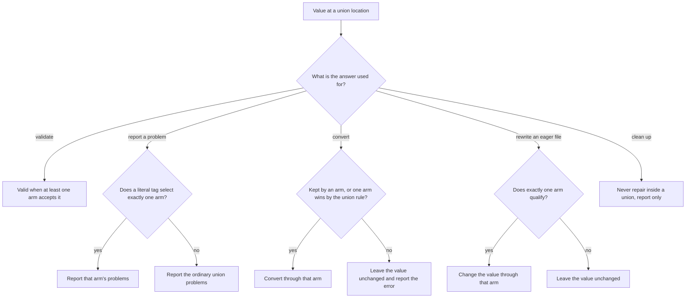

# Unions and Function Signatures

A property can accept several shapes. This page covers property and root unions, the `|` operator, named union references, discriminated unions, and `function(...)` signatures.

## Unions

### Property-Level Unions

Any property value may be a YAML sequence of type expressions to declare an `anyOf` union. The property matches if at least one arm does.

```yaml
$schema:
    foo:
      - string
      - number

    status:
      - "enum(draft, published, archived)"
      - "number(integer; min(0))"
      - unknown

    # accepts a positive number or a CSS-length string
    width:
      - "number(min(0))"
      - "string(pattern(^\\d+(px|%)$))"
```

**Hoisting.** `required`, `eager`, and `default(...)` are property-level — they
are extracted from whichever arm declares them and applied to the property as a
whole. `required` on any arm makes the property required, unless another arm
is `null` or `unknown` (see [Null-Admitting Properties](types.md#null-admitting-properties));
`eager` on any arm makes a supplied value launch-validated without requiring it. Convention is to
place them on the first arm. Differing
`default(...)` values on multiple arms is a compile-time error.

```yaml
$schema:
    title:
      - "string(required; not-empty)"  # required hoisted; not-empty stays on this arm
      - "number"
```

Arm-level constraints stay arm-local. Arm descriptions (`-> ...`) annotate that arm in the generated JSON Schema.

A property-level union may mix a `literal` arm with any other atom — something `enum` cannot do, because `enum` members are homogeneous strings:

```yaml
$schema:
    width: [literal(auto), "number(min(1))"]   # the keyword `auto` or a positive number
```

### The `|` Operator and Grouping

`|` writes a union inside one type expression, which is how a union appears
where a YAML list cannot: a tuple position, a function parameter or return
type, or an inline object property. `id: "string | number"` is exactly the
same definition as `id: [string, number]` and compiles to the same `anyOf`.

`[]` binds tighter than `|`, and parentheses group, as in TypeScript:

```yaml
$schema:
    one:  "string | number[]"     # a string, or a list of numbers
    many: "(string | number)[]"   # a list whose items are strings or numbers
```

`(string | number)[]` is the same list as `t[]` for a named type
`t: [string, number]`, and compiles to one array whose `items` is the
`anyOf`. A trailing `-> description` describes the last option; to describe
each option, use the YAML list form. An option of a YAML list union is one
type, so `[string | number, boolean]` is an error: list each option instead.
A file reference in `Name@file` ends at `|`, so a path cannot contain `|`.

## Function Signatures

A `function(...)` type describes a callable: what it takes, what it returns,
and how it is documented. It is **description-only**. It never validates
data and produces no JSON Schema. It belongs in a schema file's `types:`
mapping, and may be nested in another function's parameter or return type
or in a tuple position. A document schema that reaches a function, directly
or through a named reference, union, list, tuple, or object property, fails
to load with an error naming the property path.

```yaml
kind: schema
types:
    min: |-
        function(
            parameters(a: number, b: number);
            returns(number);
            category(Math);
            example(min(3, 5) => 3);
            example(min("pear", 5) => error);
        ) -> Returns the smaller of two numbers.
```

`parameters(...)` and `returns(...)` are required; the rest are optional.
Constraints are separated by `;`, and a trailing `;` before `)` is allowed.

| Constraint | Meaning |
|---|---|
| `parameters(name: T, ...)` | The arguments, in order. `parameters(void)` for none. |
| `returns(T)` | The value returned on success; any type, including a union. |
| `category(Name)` | The documentation category (see [Categories](schema-documents.md#categories)). |
| `narrows(name: T; kind)` / `narrows(name; kind)` | What a guard call proves about one argument (see [Narrowing facts](#narrowing-facts)). Optional; at most one. |
| `fallible` | The function can fail even when its arguments are valid. A function whose only failure is a wrong argument is not fallible: such a call never reaches it (see [Type Coercion](../conversion.md#function-calls-bind-then-compute)). |
| `example(call => result)` | An inline example; repeatable (see below). |
| `example(./file.yaml)` | An example file, as on any type. |

**Parameters.** `name: T` is required, `name?: T` may be omitted, and
`...name: T` collects zero or more remaining arguments, each of type `T`.
Required parameters come first, then optional ones, then at most one rest
parameter, which cannot carry `?`. Names must be unique; they are
documentation and never change which calls bind. `void` stands alone, and
`parameters()` is an error. Omission is not null: `age?: number` may be left
out but rejects `null`, while `age?: number | null` allows both.

**Inline examples.** `example(CALL => RESULT)` shows a call and its expected
result. `CALL` is a Darkmatter function-call expression. `RESULT` is a
literal (`3`, `"3"`, `[1, 2]`, `{a: 1}`, `null`, `true`) or the word `error`.
An inline example is executable: tests run the call and compare the result
structurally, so `3` is not `"3"` and the key order of an object does not
matter. Add `; display-only: REASON` for an example that cannot run reliably
in a test, such as one that needs the network or the clock; it is shown in
documentation and never run. A result that spans several lines uses the file
form instead, whose file holds the call as `invocation` and the result as
`returns`:

```yaml
types:
    ping: |-
        function(
            parameters(address: string, timeout?: number);
            returns(boolean | null);
            category(Network);
            fallible;
            example(ping("192.168.1.1", 250) => true; display-only: needs network);
        ) -> Sends one ICMP echo to an IP address.
    as_line_separated: |-
        function(
            parameters(list: any[] | null);
            returns(string | null);
            category(List Formatting);
            example(./function-examples/as_line_separated.yaml);
        ) -> Joins a list into newline-separated text.
```

```yaml
# function-examples/as_line_separated.yaml
kind: example
invocation: 'as_line_separated(["a", "b", "c"])'
returns: |-
    a
    b
    c
```

### Narrowing facts

A predicate used as a guard (`when="file_exists(log)"`, `a ? b : c`) can tell
the analyzer what its result proves about an argument. The `narrows` clause
declares that fact in the signature, so the catalog is the one place it is
written:

```yaml
types:
    file_exists: |-
        function(
            parameters(path: unknown | null);
            returns(boolean);
            narrows(path: file; true-implies);
            category(Filesystem);
        ) -> Returns true when the file exists.
    is_empty: |-
        function(
            parameters(x: unknown | null);
            returns(boolean);
            narrows(x; false-implies);
        ) -> Returns true for null, empty text, and empty collections.
```

| Form | True result | False result |
|---|---|---|
| `narrows(x: T; true-implies)` | `x` is suitable for `T` | nothing |
| `narrows(x: T; true-iff)` | `x` has type `T` | `T` is removed from `x` |
| `narrows(x: T; false-implies)` | nothing | `x` is suitable for `T` |

Omitting the type gives a presence-only fact: `true-implies` excludes `null`
when the result is true, `false-implies` when it is false, and `true-iff` on
the true side while keeping only `null` on the false side.

A call proves its fact only when the design-time call check accepts it; a
call with the wrong argument count, or with an argument no value of its type
can bind, proves neither side (see
[Darkmatter Expressions](../../../../darkmatter/docs/topics/darkmatter-expressions.md#where-a-predicates-facts-come-from)).

Rules:

- **Ordering.** The clause may appear anywhere among the clauses, separated
  by `;` like the others. It names one parameter exactly as declared; the
  `: T` operand is optional, and omitting it means "present" (not `null`),
  never "nonempty" or "truthy".
- **Boolean returns.** The function must return `boolean`; the clause on any
  other return type is an error.
- **Targets.** `T` is a single self-contained type: a union and a named
  reference are rejected, and so is a named type anywhere inside `T` (in an
  object member, a dictionary value, a tuple position, a union arm, or a
  grouped array such as `(Name | string)[]`), because a fact is applied
  without the definitions of the schema that declared it. `{a: string}` and
  `tuple([string])` are valid one-way targets; `{a: Name}` and
  `tuple([Name])` are not. `true-iff` is limited to `null` and the bare
  families (`string`, `number`, `boolean`, `object`, `unknown[]`), because
  only those have a false side that can be described. A refinement or a
  constrained type (`file`, `string(min(3))`, `enum(a, b)`) is a one-way
  target only. An array of a grouped union, `(string | number)[]`, is one
  array type and a valid one-way target. The parameter cannot be a rest
  parameter or one the function does not declare.
- **Overloads.** Every overload must declare the same fact, or none may:
  the same parameter at the same position, the same implication, and the
  same target (compared by meaning, not spelling). A disagreement is an
  error naming both overloads, with both locations: different facts are
  reported at the later overload's clause, and a missing fact at the
  declaring clause, each with the other overload as a related location (see
  [DMLS schema support](../../../../darkmatter/docs/topics/schemas/dmls-schema-support.md#definitions-with-two-locations)).
  A second `narrows` clause on one function is reported at its keyword, with
  the first clause as the related location.
- **One set of rules.** Every reader applies these rules the same way:
  parsing a schema, the `type-definition` and `schema` meta-types, editor
  diagnostics, host catalog loading, and function registration. A
  declaration a schema accepts is one a host can register.
- **Original argument.** The fact is about the value as the caller wrote it,
  not a coerced copy: `is_number("4")` is `false` even though `"4"` would
  convert. Negative narrowing is limited to what can be described: removing
  `string` from a `string | number` leaves `number`, but a false
  `true-implies` never removes anything.
- **Description-only.** The clause validates no data, changes no binding,
  runs no handler, and is read without calling the function. A document
  schema that reaches a `function(...)` with a `narrows` clause fails to load
  like any other function.

**Overloads.** A function with several signatures is a union of `function(...)`
types, written as a YAML list or with `|`. Two overloads whose parameters bind
exactly the same calls are a schema-load error. Parameter names, descriptions,
examples, categories, `fallible`, return types, `any` versus `unknown`, and
the order of union options do not make two signatures different; a local
named type is compared by its definition:

```yaml
kind: schema
types:
    pr_list:
        - "function(parameters(count: number(integer; min(1))); returns(string[]))"
        - "function(parameters(query: object); returns(string[]))"
        # error if added: binds the same calls as the first overload
        # - "function(parameters(n: number(min(1); integer)); returns(object))"
```

### Named Union References

A union written once as a [named type](objects-and-named-types.md#cross-file-named-type-imports-namefile)
can be reused, marked required, described, or turned into a list at each place
that references it. This is how you declare a list whose items may each take a
different shape, such as "a non-empty list whose entries are each a rule
string or a rule mapping".

```yaml
# types.yaml
kind: schema
types:
    step:
      - "string -> A shell command"
      - "{ run: string(required), cwd: string }"
```

```yaml
$schema:
    setup: step@./types.yaml                              # the union, optional
    main:  "step(required)@./types.yaml -> The main step" # the union, required
    steps: "step[](min(1); unique)@./types.yaml"          # a non-empty list of distinct steps
```

The bare (`step[]`), `@this` (`step[]@this`), and cross-file
(`step[]@./types.yaml`) forms of a reference behave identically.

#### What a reference may add

| Use site | Meaning |
|---|---|
| `U` | The union, inlined: its arms become the property's arms. |
| `U(required)`, `U(generated)`, `U(eager)`, or a combination | The union, with the marker applied to the property as a whole, exactly as on a [property-level union](#property-level-unions). `eager` does not imply `required`. |
| `U -> text` | The union, described as a whole. Each arm keeps its own description. |
| `U[]` | A list whose every item is one of `U`'s arms. Each item is judged on its own and may match a different arm. |
| `U[](min(n); max(n); unique; required; generated; eager)` | That list, with the constraints applied to the list itself. `default(...)` and `example(...)` are accepted after `[]` as on [any other array](types.md#array-constraints). |
| `U(required)[]`, `U(generated)[]`, `U(eager)[]`, or with a list after `[]` too | Exactly the same list as the marker written after `[]`: `step(eager)[]` and `step[](eager)` are one schema. The markers belong to the property, so their side of `[]` does not matter. |

Anything else is rejected with `SchemaError::UnionReference`, rather than being
copied into every arm. The error names the property, the union, what was
rejected (a `SchemaUnionRejection`), and where the union is defined; DMLS
reports the same error at the reference.

| Rejected use site | Why | `SchemaUnionRejection` |
|---|---|---|
| `U(max(10))`, `U(pattern(^a))`, `U(unique)`, `U(default(x))`, `U(max(2))[]` | A value constraint without `[]`, or before it, would have to apply to every arm. Put it on the arms instead. | `Constraint { keyword, array_level: false }` |
| `U[](pattern(^a))`, `U[](integer)` | After `[]`, only list constraints apply. | `Constraint { keyword, array_level: true }` |
| `U[]` where an arm is already a list, such as `[string[], number]` | Checked after imported and nested union arms are expanded, so an array arm behind an import is caught too. | `ArrayArm { arm }` |
| `U[]` where an arm carries a scalar `default(...)` | A scalar default cannot become the list's default; see [Defaults](#defaults-on-named-union-references). | `ScalarDefault { arm, value }` |

```text
p: constraint `max` cannot apply to a union-typed type (named type `choice`)
```

A named type that is itself a postfixed union reference is still a union, so
references to it take exactly these postfixes and rejections. It keeps its own
markers and description; with `[]`, its markers apply to the list:

```yaml
# types.yaml
kind: schema
types:
    step: [string, number]
    required_step: step(required)   # still union-typed
```

```yaml
$schema:
    steps: "required_step[](min(1))@./types.yaml"  # a required, non-empty list
    bad:   "required_step(max(2))@./types.yaml"    # rejected: Constraint { keyword: "max", .. }
```

A list *inside* an object arm is fine: `[string, "{ tags: string[] }"]` may be
referenced as `U[]`, because no arm's outer value is a list.

For an unnamed union, group the alternatives before adding `[]`:
`(string | number)[](min(1))`. It uses the same array-of-union representation
as a named `U[]`; see [The `|` Operator and Grouping](#the--operator-and-grouping).
The reference-specific restrictions above describe modifiers on a named type.

#### Item versus container scope

An arm's constraints describe one item; constraints after `[]` describe the
list. They never merge, even when they share a keyword:

```yaml
# types.yaml
kind: schema
types:
    choice: ["string(required; min(3))", number]
```

```yaml
$schema:
    list: "choice[](max(2))@./types.yaml"
```

- `min(3)` stays on the string arm: each string item needs at least three
  characters. It does not become the list's minimum item count.
- `max(2)` follows `[]`, so the list holds at most two items.
- `required` on the arm is a presence marker, so it hoists to `list`, which is
  required.

#### Presence and timing

- `required` and `generated` declared on any arm hoist to the property that
  holds the reference, whether that property is the union (`U`, `U(eager)`) or
  a list of it (`U[]`), just as they do for a property-level union. Markers
  written at the use site add to them. A union with a `null` or `unknown` arm
  is the exception: `U` and `U(required)` stay optional (see
  [Null-Admitting Properties](types.md#null-admitting-properties)), while `U[]` is a
  list and keeps its markers.
- `generated` keeps its [usual meaning](types.md#universal-constraints): it adds the
  `x-darkmatter-generated` annotation and removes the property from the static
  `required` list. It supplies no value.
- `eager` written at the use site (`U(eager)`, `U(eager)[]`, or `U[](eager)`)
  is property timing: a supplied value is validated at launch. An arm's
  `eager` also times the property that holds the reference, whether that is
  the union or a list of it, as on a property-level union. With
  `choice: ["string(required; eager)", number]`, both `p: choice` and
  `p: choice[]` must be supplied at launch.
- Neither `eager` on the reference nor an eager sibling arm turns a lazy
  `file` arm into `file(eager)`.
  An arm already declared `file(eager)` keeps its existence check either way.
- Fields of an object arm keep their own `required`, `generated`, and `eager`.

#### Defaults on named union references

- Without `[]`, an arm's `default(...)` hoists to the property as on any
  property-level union.
- With `[]`, an arm's default could only become the list's default. A scalar
  default cannot, so the declaration fails with `ScalarDefault`, naming the
  arm and the value. The default is neither dropped nor wrapped in a one-item
  list. Because the grammar reads every `default(...)` argument as a scalar
  (see [Array Constraints](types.md#array-constraints)), any arm default fails this
  way.
- A `default(...)` written after `[]` at the use site lowers exactly as on any
  other array.
- A caller constructing schema definitions through the Rust API can supply
  an actual JSON array as an arm's default. That array becomes the containing
  list's default. Multiple inherited and use-site defaults must be equal;
  conflicting defaults fail schema preparation. This does not add a
  list-valued default spelling to the authoring grammar.
- Darkmatter never inserts a default value into a document.

#### Lowering

A list of a union lowers to an array whose `items` is the union's `anyOf`.
Nested unions flatten into one `anyOf`, and arm order and arm descriptions are
kept. Items get no automatic `null` wrapper: an item accepts `null` only when
an authored arm admits it, such as `null` or `unknown`. An optional property
wraps the whole array in the usual `anyOf: [{ type: null }, …]`, so a missing or `null` property is
allowed independently of whether an item arm admits `null`. A use-site description sits on that
wrapper. The `content_policy` property of the
[example below](#example-a-content-policy-list) lowers to:

```json
{
  "anyOf": [
    { "type": "null" },
    {
      "type": "array",
      "minItems": 1,
      "items": { "anyOf": [ { "type": "string", "pattern": "^Evergreen$" },
                            …,
                            { "type": "object", "properties": { "rule": { "anyOf": [ … ] }, "action": { … } },
                              "required": ["rule", "action"], "additionalProperties": false } ] }
    }
  ]
}
```

When `U` does not itself admit null, `U(required)` lowers to the union's
`anyOf` without an optional-property wrapper and puts the property in the
parent's `required` list. Null-admitting unions follow the
[presence exception](types.md#null-admitting-properties) above. A nested arm that
carries its own postfix flattens exactly like a bare one, so coercion, literal-discriminant
selection, and error reporting see one list of alternatives:

- its `required`, `generated`, and `eager` markers belong to the containing
  property, as an arm's own presence markers do. `[pair(required), boolean]`
  makes the property required, and a reference `choice[]` to that union makes
  the list required.
  `eager` sets the property's timing only: a `file` arm of `pair` stays lazy
  unless `pair` itself says `file(eager)`;
- its `-> description` describes each of its arms that has no description of
  its own.

```yaml
pair: [string, number]
choice: ["pair(required) -> a label", boolean]
# choice lowers to one anyOf, with no null arm:
#   [{type: string, description: a label}, {type: number, description: a label}, {type: boolean}]
```

In the typed model, a bare `U` stays a `PropertyDef::Union`. A postfixed
reference becomes one `PropertyAtom` whose `ty` is `TypeExpr::Union(arms)`,
with `is_array` set for `U[]`. Use `schemas::flattened_alternatives` to list
the leaf alternatives of either form.

#### Example: a content policy list

A content-policy style schema whose policies may be short strings or
`{ rule, action }` mappings. The [built-in baseline](../../../../darkmatter/docs/topics/schemas/definition.md#the-built-in-baseline)
types `content_policy` this way, importing Content Policy's shipped schema:

```yaml
# content-policy.yaml
kind: schema
types:
    short_form:
      - string(pattern(^Evergreen$))
      - string(pattern(^TimeSensitive$))
      # … one pattern arm each for ValidFor(…), ValidUntil(…), and FileChanged(…)
    long_form:
        rule: short_form(required)
        action: enum(refresh, archive, remove; required)
    policy: [short_form, long_form]
```

```yaml
$schema:
    content_policy: "policy[](min(1))@./content-policy.yaml"
```

| `content_policy` value | Result | Why |
|---|---|---|
| `[ValidFor(3mo), {rule: ValidUntil(2027-01-01), action: archive}]` | valid | Each item matches an arm; items may match different arms. |
| missing, or `null` | valid | The property is optional. |
| `[null]` | invalid | Items have no `null` arm. |
| `ValidFor(3mo)` | invalid | A single string is not a list. |
| `[]` | invalid | `min(1)` |
| `[Duration(3mo)]` | invalid | No arm matches. |
| `[{action: archive}]` or `[{rule: null, action: archive}]` | invalid | `rule` is required in `long_form`. |
| `[{rule: ValidFor(3mo), action: delete}]` | invalid | `delete` is not an `action` member. |

### Discriminated Unions

When the arms of a union are inline objects that each carry a `literal`-typed **discriminant** key, the union becomes a genuine tagged union. Both `md schema validate` diagnostics and DMLS editor behavior narrow to the single matched arm.

```yaml
$schema:
    event:
      - "{ kind: literal(created), path: file(required) }"
      - "{ kind: literal(deleted), reason: string }"
```

Given a document with `kind: created`, validation reports only the `created` arm's missing/unknown/type problems instead of the full `anyOf` noise, and DMLS sibling-key completion offers only that arm's keys.

Validation narrows the same way wherever the union sits: a property, each item of an array of a union (`events: event[]`, where every item selects its own arm), or a field nested inside an object. Narrowing changes only which problems are reported. A value that another arm accepts is still valid, and a union location with no problems is never narrowed.

A problem's description is looked up through union arms as well. For `/events/1/path`, the lookup descends into the `items` alternatives, takes the arm the item's tag selects (or, without one, every arm that declares `path`), and reads that field's description. When several arms declare the field with different descriptions and no tag picks one, the problem carries no description rather than a guessed one.

An arm is selected **only when** all of the following hold:

- the same discriminant key is present as a `literal` in **at least two** arms,
- the instance contains that key with an authored value, and
- exactly **one** arm's typed literal equals the instance value.

Equality is **type-sensitive**: a typed `2` does not select an arm tagged `'2'`. If multiple discriminant keys qualify, they must all select the same arm. For an absent, unknown, duplicate, or conflicting discriminant, validation and completion fall back to the normal merged/union behavior — narrowing never guesses an arm from a partial or ambiguous match. Schemas without literal discriminants keep byte-identical `anyOf` diagnostics.

### Choosing an Arm: Reporting versus Changing Data

Several parts of Darkmatter ask "which arm does this value belong to?" at a
union location: a property union, an item of a `U[]` list, or a field nested
inside either. How much evidence each needs depends on what it does with the
answer. Explaining a problem may lean on a heuristic such as the closest arm;
changing stored data may not.



| Consumer | Picks an arm when | Otherwise |
|---|---|---|
| Validation | It never needs to: the value is valid when any arm accepts it. | — |
| Problem reporting | A literal tag selects one arm ([Discriminated Unions](#discriminated-unions)). A root union also reports its closest arm. | The ordinary union report. |
| Conversion (validation and compose) | An arm accepts the value as written; otherwise exactly one arm is reachable, or the number-over-boolean or JSON-over-YAML tie-breaker settles it ([Choosing a Union Option](../conversion.md#choosing-a-union-option)). Arm order never matters. | The value is left as written; a tie no tie-breaker settles is an error naming each reading. |
| Eager-`file` rewriting (compose) | Exactly one arm that contains an eager `file`, as the value itself or as a field of an object arm, accepts the value ([Files](types.md#files)). | The value is left unchanged. |
| Cleanup (`md clean`) | Never inside a union, even when a tag would identify the arm. | Problems are reported and the value is left unchanged; no key is deleted. Values outside the union keep cleanup's usual repair rules. |
| Editor completion and hover | Completion: a literal tag selects one arm. Hover: exactly one arm accepts the value. | Every applicable alternative is offered or listed. |

The same rules apply to every item of a `U[]` list, judged on its own, so
neighboring items can select different arms. Closest-arm scoring only ever
explains a failure: it never decides which arm converts, rewrites, or cleans
a value.

### Root-Level Unions

The root `$schema` may itself be a YAML sequence. Each arm is a complete object schema and the document is valid if it matches at least one arm. Arms may be inline SimplifiedSchema mappings or string file references.

```yaml
---
$schema:
  - ./schemas/post.yaml     # arm 0: file reference (SimplifiedSchema)
  - ./schemas/page.yaml     # arm 1: file reference (JSON Schema is fine too)
  - title: string           # arm 2: inline SimplifiedSchema
    body:  string
---
```

The effective schema is `{ "anyOf": [arm0, arm1, ...] }`. **Baseline merging is applied to each arm independently** — a baseline declares the fields every arm inherits.

**Root unions are inclusive.** A document is valid when it matches **one or
more** arms. A root mapping is open, so a property an arm does not declare is
unconstrained in that arm (unless the arm is
[closed](objects-and-named-types.md#closed-roots-closed)). This schema accepts a `schema` file, a `review`
file, or both, and rejects a document with neither:

```yaml
$schema:
  - schema: file(required)
  - review: file(required)
```

To accept **exactly one**, exclude the other key in each arm with the
[`null` type](types.md#unknown-and-null). The excluded key may be omitted or `null`,
so this schema rejects both files and neither:

```yaml
$schema:
  - schema: file(required)
    review: null
  - review: file(required)
    schema: null
```

Pattern-key dictionaries and explicit raw JSON Schema restrictions inside an
arm still apply.

When validation fails against a root union, Darkmatter reports the **closest-matching arm** — the one producing the fewest problems — and prefixes problems with the arm index. JSON output carries an `arm_index` field on every problem.
