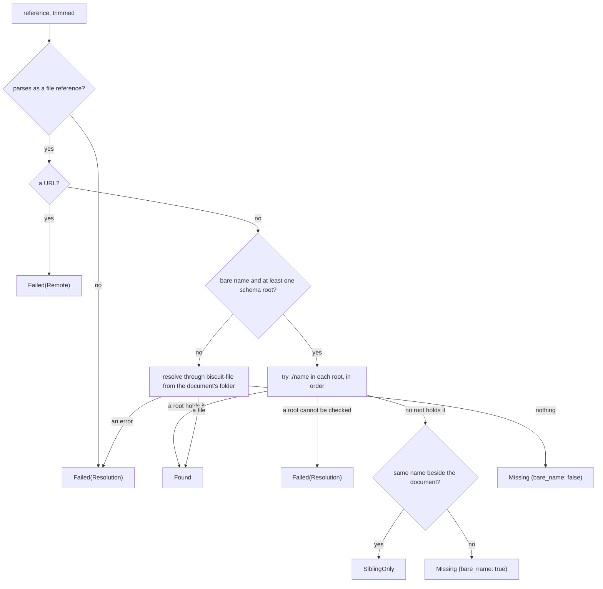

# Selecting a Schema File

A `$schema` value, a named-type import (`Name@file.yaml`), an
`example(file.yaml)` constraint, and a host's trigger payload all name a
schema file the same way. Validation, an editor's document links, and
go-to-definition must agree on which file that is, so every one of them asks
the same function: `simplified_schema::resolve::select_schema_file`. A second
function, `inspect_schema_target`, then tells an editor whether the selected
file is one a `$schema` may point at, without validating anything.

Use these when you build a tool that needs to know *which file* a reference
means, or *what it would mean* if the file existed, rather than the resolved
schema itself. To build a schema, use the [`SimplifiedSchema`
object](./schema-object.md) or the `resolve` module's resolvers, which call
the selector for you.

## Selecting the file

```rust
use simplified_schema::resolve::{select_schema_file, SelectionOutcome};

// `document_dir` is the folder of the document that wrote the reference;
// `roots` the schema-root folders, in search order.
let selection = select_schema_file("person.yaml", &document_dir, &roots, &context);
match &selection.outcome {
    SelectionOutcome::Found(path) => println!("uses {}", path.display()),
    SelectionOutcome::Missing { creation: Some(path), .. } => println!("would create {}", path.display()),
    SelectionOutcome::SiblingOnly { suggestion, .. } => println!("did you mean {suggestion}?"),
    _ => println!("cannot resolve {}", selection.reference),
}
```

The selector takes the authored reference, the referencing document's
folder, the schema roots, and the request's `biscuit_file`
`FileResolutionContext`. The library never discovers schema roots itself;
the host supplies them (Darkmatter, for example, passes its five
[schema roots](../../../darkmatter/docs/topics/schemas/definition.md#schema-roots)).

Which rule applies depends on the reference's form:



- A **bare name** is one path component with no `./`, no `../`, no magic
  prefix, and no recursive `%` (`person.yaml`, not `./person.yaml` or
  `shared/person.yaml`). `resolve::is_bare_name` answers that question for a
  parsed `biscuit_file::FileReference`, so a caller can word its own
  messages the same way.
- The **first root that holds the name wins**, and later roots are not
  probed. A root that cannot be checked fails the selection instead of
  letting a later root's file win.
- **Every other form**, and a bare name when no schema root was supplied,
  resolves through `biscuit-file` from the document's folder. `./x.yaml`
  is looked up beside the document only; an implicit path such as
  `shared/x.yaml` tries the document's folder and then the repository root.
- **Selection reads no file's contents.** A file that exists is `Found` even
  when it is malformed, so an editor can still open it for repair. Whether it
  is a valid schema is the loader's question, or `inspect_schema_target`'s.
- Without the `file` [Cargo feature](./features.md), every local reference is
  `Failed(Resolution)` holding `FileReferenceError::ResolutionUnavailable`.

### What the selection reports

`SchemaFileSelection` has three fields:

| Field | Holds |
| --- | --- |
| `reference` | the authored reference, trimmed |
| `outcome` | a `SelectionOutcome` (below) |
| `attempted` | every location probed, in probe order, each kept at its first occurrence, up to and including the selected file; absent locations are included and paths are lexical, not canonical |

| `SelectionOutcome` | Meaning | Path offered |
| --- | --- | --- |
| `Found(path)` | the existing file the reference names | `path` |
| `Missing { bare_name, creation }` | nothing exists at any probed location; `bare_name` is `true` only when the schema roots were searched | `creation`: `{first root}/{name}` for a bare name, else the reference's first planned candidate (beside the document for `./x.yaml`); `None` when the reference plans none |
| `SiblingOnly { sibling, suggestion, creation }` | a bare name no root holds, while a file of that name is beside the document; `suggestion` is `./name` | `creation`, in the first root; `sibling` is the file the author probably meant |
| `Failed(SelectionFailure)` | `Remote` for a URL (never fetched), or `Resolution` holding the `FileReferenceError` (a malformed reference, a missing anchor, a boundary violation, or a location that could not be checked) | none |

The creation path is where a missing file *would* go; the selector never
creates a file or folder. An editor can link to it so that following an
unresolved `$schema` opens the right place for a new file.

For example, with schema roots `/team/schemas` and `/repo/schemas`, a
document in `/repo/docs/` writing `$schema: person.yaml`, and no
`person.yaml` anywhere:

```text
outcome:   Missing { bare_name: true, creation: Some("/team/schemas/person.yaml") }
attempted: ["/team/schemas/person.yaml", "/repo/schemas/person.yaml"]
```

`attempted` is also recorded into every running `resolve::observed::collect`
frame, so a caller whose later resolution fails still learns which
locations to watch: a file appearing at any of them can change the result.

### Unsaved editor buffers

An editor can run a resolution over the texts it has not saved. Build a
`resolve::buffers::SourceBuffers` snapshot (path to text) and call the
resolver inside `resolve::buffers::with(&snapshot, || ...)`. Inside it, every
schema source the resolver reads (a `$schema` target, a `Name@file` import,
an `example(file)`, and a file an error's spans are re-read from) comes from
the snapshot when it holds that path, and a probed location with no file but
an open buffer is `Found`:

```rust
let mut open = SourceBuffers::default();
open.insert(Path::new("/repo/contract.yaml"), Arc::from("$schema:\n  owner: number\n"));
// `./contract.yaml` selects the buffer even before it is saved.
let resolved = buffers::with(&open, || resolve_yaml_schema(&reference, base_dir, &ctx, ShippedSources::NONE));
```

Outside `with`, resolution reads only the disk. The snapshot is plain
`Send + Sync` data, applies to the calling thread only, and is restored when
`with` returns, so the host captures it once per preparation and may run
that preparation on any thread.

### As an error

`SchemaFileSelection::into_result()` turns the selection into the same
`Result<PathBuf, SchemaError>` the resolver reports, and is how validation
consumes it:

| Outcome | Error |
| --- | --- |
| `Found(path)` | `Ok(path)` |
| `Missing` | `SchemaError::NoMatch { reference, bare_name }` |
| `SiblingOnly` | `SchemaError::BareNameSiblingExists { reference, suggestion }` |
| `Failed(Remote)` | `SchemaError::RemoteUnsupported` |
| `Failed(Resolution(source))` | `SchemaError::Unresolved { reference, source }` |

Every error carries the trimmed reference. See
[Diagnostics](./diagnostics.md#error-model) for the variants.

## Inspecting the selected file

`inspect_schema_target(path, bytes)` classifies bytes the caller already
read with the same rules the referenced-file loader applies, so an
explanation in an editor cannot disagree with validation about the format.
It performs no I/O.

```rust
use simplified_schema::resolve::inspect_schema_target;

let inspection = inspect_schema_target(&path, &std::fs::read(&path)?);
match inspection.classification {
    Ok(()) => {
        if let Some(description) = &inspection.description {
            println!("{description}");
        }
        for line in inspection.lines.unwrap_or_default() {
            println!("    {line}");
        }
    }
    Err(error) => println!("not a schema: {error}"),
}
```

| Field | Holds |
| --- | --- |
| `format` | `SchemaTargetFormat::Json` for a `.json` extension in any case, otherwise `Yaml`, decided exactly as the loader decides |
| `classification` | `Ok(())` when the file is an accepted `$schema` target; otherwise the loader's own error for it, such as `NotASchemaDocument` (including `SelectedByKind` for a `kind: yaml-schema` file), an envelope that fails its definition, or `UnsupportedJsonDialect` (see [what a reference may target](./language/schema-documents.md#what-a-schema-reference-may-target)), or `SchemaDocument` "not UTF-8 text" for undecodable bytes |
| `description` | the top-level string `description`, trimmed, when the file is accepted and it is not blank |
| `lines` | the authored definition when the file is accepted, one entry per line: the YAML document's `$schema` value with its shared indentation removed, or the whole JSON document; line endings are normalized and a final newline is not a line |

Given this accepted file:

```yaml
description: A person record
$schema:
    name: string(required)
    age: number(min(0))
```

`description` is `Some("A person record")` and `lines` is
`["name: string(required)", "age: number(min(0))"]`.

An accepted classification proves the file's format only. A `$schema` that
names a file which imports a missing type is still `Ok(())` here and fails
when the schema is resolved.

### A file that is selected but never a target

Selection and classification are separate questions. A `kind: yaml-schema`
file, which defines a YAML document kind, is `Found` like any other existing
file, but it is never a `$schema` target, a root-union file arm, or a
`Name@file` import source: a host applies it to documents by their `kind`.
`inspect_schema_target`, and every loader that follows a reference, classify
it as `NotASchemaDocument` with `NotSchemaReason::SelectedByKind`, even when
its envelope is malformed:

```text
`kinds/roster.yaml` is not a valid schema definition: it is a `yaml-schema`; it is selected by `kind`, not referenced
hint: move shared types into a `kind: schema` file and import them from there
```

Put types that a `yaml-schema` and a Markdown schema share in a
`kind: schema` file and import them from both; see
[`kind: yaml-schema`](./language/schema-documents.md#kind-yaml-schema). A
`types`-only `kind: schema` file is the opposite case: a valid import source,
but not a `$schema` target (`TypesOnly`).

A host that reads a referenced file's text itself, such as an editor
listing the types a `Name@file` import could name, parses it with
`resolve::parse_referenced_schema_document(text, path)`, which applies the
same refusal, so its catalog cannot offer a `yaml-schema`'s types.
