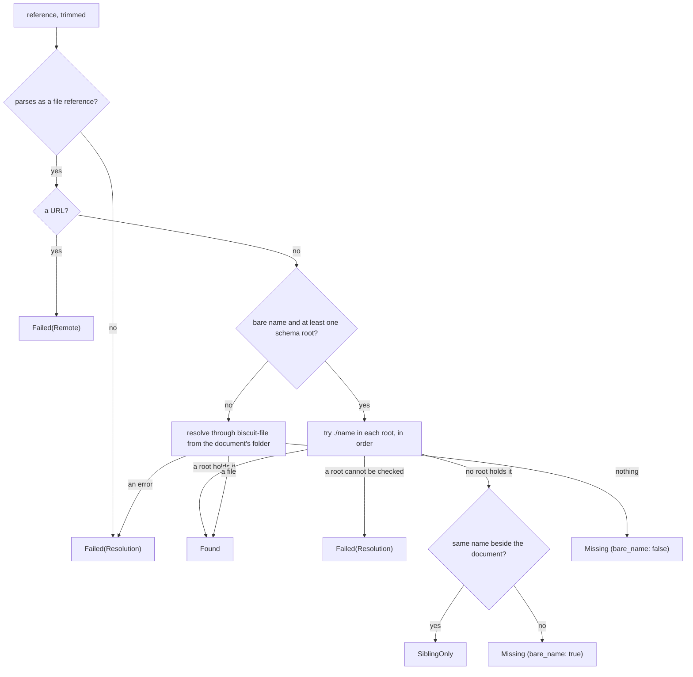

# Selecting a Schema File

A `$schema` value, a named-type import (`Name@file.yaml`), an
`example(file.yaml)` constraint, and a host's trigger payload all name a
schema file the same way. Validation, an editor's document links, and
go-to-definition must agree on which file that is, so every one of them asks
the same function: `simplified_schema::resolve::select_schema_file`. A second
function, `inspect_schema_target`, then tells an editor whether the selected
file is one a `$schema` may point at, without validating anything.

Use these when you build a tool that needs to know *which file* a reference
means, or *what it would mean* if the file existed, rather than the resolved
schema itself. To build a schema, use the [`SimplifiedSchema`
object](simplified-schema-struct.md) or the `resolve` module's resolvers, which call
the selector for you.

## Selecting the file

```rust
use simplified_schema::resolve::{select_schema_file, SelectionOutcome};

// `document_dir` is the folder of the document that wrote the reference;
// `roots` the schema-root folders, in search order.
let selection = select_schema_file("person.yaml", &document_dir, &roots, &context);
match &selection.outcome {
    SelectionOutcome::Found(path) => println!("uses {}", path.display()),
    SelectionOutcome::Missing { creation: Some(path), .. } => println!("would create {}", path.display()),
    SelectionOutcome::SiblingOnly { suggestion, .. } => println!("did you mean {suggestion}?"),
    _ => println!("cannot resolve {}", selection.reference),
}
```

The selector takes the authored reference, the referencing document's
folder, the schema roots, and the request's `biscuit_file`
`FileResolutionContext`. The library never discovers schema roots itself;
the host supplies them (Darkmatter, for example, passes its five
[schema roots](../../../darkmatter/docs/topics/schemas/definition.md#schema-roots)).

Which rule applies depends on the reference's form:



- A **bare name** is one path component with no `./`, no `../`, no magic
  prefix, and no recursive `%` (`person.yaml`, not `./person.yaml` or
  `shared/person.yaml`). `resolve::is_bare_name` answers that question for a
  parsed `biscuit_file::FileReference`, so a caller can word its own
  messages the same way.
- The **first root that holds the name wins**, and later roots are not
  probed. A root that cannot be checked fails the selection instead of
  letting a later root's file win.
- **Every other form**, and a bare name when no schema root was supplied,
  resolves through `biscuit-file` from the document's folder. `./x.yaml`
  is looked up beside the document only; an implicit path such as
  `shared/x.yaml` tries the document's folder and then the repository root.
- **Selection reads no file's contents.** A file that exists is `Found` even
  when it is malformed, so an editor can still open it for repair. Whether it
  is a valid schema is the loader's question, or `inspect_schema_target`'s.
- Without the `file` [Cargo feature](./features.md), every local reference is
  `Failed(Resolution)` holding `FileReferenceError::ResolutionUnavailable`.

### What the selection reports

`SchemaFileSelection` has three fields:

| Field | Holds |
| --- | --- |
| `reference` | the authored reference, trimmed |
| `outcome` | a `SelectionOutcome` (below) |
| `attempted` | every location probed, in probe order, each kept at its first occurrence, up to and including the selected file; absent locations are included and paths are lexical, not canonical |

| `SelectionOutcome` | Meaning | Path offered |
| --- | --- | --- |
| `Found(path)` | the existing file the reference names | `path` |
| `Missing { bare_name, creation }` | nothing exists at any probed location; `bare_name` is `true` only when the schema roots were searched | `creation`: `{first root}/{name}` for a bare name, else the reference's first planned candidate (beside the document for `./x.yaml`); `None` when the reference plans none |
| `SiblingOnly { sibling, suggestion, creation }` | a bare name no root holds, while a file of that name is beside the document; `suggestion` is `./name` | `creation`, in the first root; `sibling` is the file the author probably meant |
| `Failed(SelectionFailure)` | `Remote` for a URL (never fetched), `Resolution` holding the `FileReferenceError` (a malformed reference, a missing anchor, a boundary violation, or a location that could not be checked), or `Bundle` holding the refusal of a [bundle scope](#resolving-inside-a-bundle) | none |

The creation path is where a missing file *would* go; the selector never
creates a file or folder. An editor can link to it so that following an
unresolved `$schema` opens the right place for a new file.

For example, with schema roots `/team/schemas` and `/repo/schemas`, a
document in `/repo/docs/` writing `$schema: person.yaml`, and no
`person.yaml` anywhere:

```text
outcome:   Missing { bare_name: true, creation: Some("/team/schemas/person.yaml") }
attempted: ["/team/schemas/person.yaml", "/repo/schemas/person.yaml"]
```

`attempted` is also recorded into every running `resolve::observed::collect`
frame, so a caller whose later resolution fails still learns which
locations to watch: a file appearing at any of them can change the result.

### Unsaved editor buffers

An editor can run a resolution over the texts it has not saved. Build a
`resolve::buffers::SourceBuffers` snapshot (path to text) and call the
resolver inside `resolve::buffers::with(&snapshot, || ...)`. Inside it, every
schema source the resolver reads (a `$schema` target, a `Name@file` import,
an `example(file)`, and a file an error's spans are re-read from) comes from
the snapshot when it holds that path, and a probed location with no file but
an open buffer is `Found`.

An open buffer is a match at its own place in the search order, exactly as
a saved file there would be. For `lib/types.yaml` written in `/repo/doc/`,
an open buffer at `/repo/doc/lib/types.yaml` (the first candidate) is
selected even when `/repo/lib/types.yaml` (the repository fallback) exists
on disk, and `attempted` ends at the buffer: the fallback is never probed,
and a host that approves each probe is never asked about it. A bare name
stops at the first schema root holding a file or a buffer the same way. A
file on disk at a location wins there, and its buffer supplies its text. A
recursive (`%`) reference searches only the disk.

```rust
let mut open = SourceBuffers::default();
open.insert(Path::new("/repo/contract.yaml"), Arc::from("$schema:\n  owner: number\n"));
// `./contract.yaml` selects the buffer even before it is saved.
let resolved = buffers::with(&open, || resolve_yaml_schema(&reference, base_dir, &ctx, ShippedSources::NONE));
```

Outside `with`, resolution reads only the disk. The snapshot is plain
`Send + Sync` data, applies to the calling thread only, and is restored when
`with` returns, so the host captures it once per preparation and may run
that preparation on any thread.

### Reading each file once across resolutions

Each resolution call reads the files it needs once, but two separate calls
read a file they share twice. A host operation that runs several resolutions
(one per global of a catalog, or a baseline, a trigger, and a document
`$schema` for one completion) can wrap them in
`resolve::buffers::with_reads_retained(|| ...)`: inside it, the first read of
a file from the disk is kept and every later read of that path in the scope
gets the same bytes. A scope started inside another joins it, and nothing is
kept after the outermost one returns. To read a file it will then resolve
(to recognize a catalog, say), the host calls `resolve::buffers::read_to_string`,
which reads the way the resolver does:

```rust
let resolved = buffers::with_reads_retained(|| {
    let text = buffers::read_to_string(&path)?; // opened here
    let first = resolve_yaml_schema(&ctx_reference, base_dir, &ctx, ShippedSources::NONE)?;
    let second = resolve_yaml_schema(&current_reference, base_dir, &ctx, ShippedSources::NONE)?;
    Ok((text, first, second)) // a file both references import was opened once
});
```

A retained scope ends with its host operation. A host whose work spans many
operations and threads, such as a dry run that checks one document in
several passes, keeps one `resolve::buffers::SharedReads` for the whole run
instead. Put it in force on a thread with
`resolve::buffers::enter_shared_reads(reads.clone())` (or run a closure under
`with_shared_reads`): every file the resolver reads from the disk there is
opened once for the whole `SharedReads`, and later reads, from any thread
that holds a clone, get the first read's bytes. A host reads its own
sources the same way with `SharedReads::read(path)`, which returns the bytes
and the modification time from one open (`ReadSource`). A failed read is
not kept. Guards still run first, so a path a guard refuses is refused even
when the shared reads already hold it:

```rust
let reads = buffers::SharedReads::default();
let first = buffers::with_shared_reads(&reads, || resolve_yaml_schema(&reference, base_dir, &ctx, ShippedSources::NONE));
let again = buffers::with_shared_reads(&reads, || resolve_yaml_schema(&reference, base_dir, &ctx, ShippedSources::NONE));
// the schema file was opened once; both resolutions saw the same bytes
```

A host can also keep work it derives from those bytes for the life of the
observation: `SharedReads::memo::<T>()` returns the observation's one `T`
(made on first request, shared by every clone), and
`resolve::buffers::shared_reads_alone()` returns the `SharedReads` in force
only while every schema read on the thread comes from it (no guard or bundle
scope, no editor buffer), which is when that work is still what a fresh
resolution would produce. Darkmatter keeps its prepared effective schemas
this way.

`resolve::buffers::open_source(path)` is that one open, for a reader with no
`SharedReads`. A test can count how often it ran with
`work_counters::source_opens(path)` (`work-counters` feature), and a host's
test build can log every open with `resolve::buffers::observe_opens`.

A host that must approve each file before it is read (Darkmatter's schema
slots, whose reads need a grant) wraps the resolution in
`resolve::buffers::guarded(guard, || ...)`. The guard is asked with each path
before it is read, from an open buffer or the disk, at any import depth.
When it answers `false` the file is not read, and the read fails as
`std::io::ErrorKind::PermissionDenied`, which the resolver reports like any
unreadable file. Probing which candidate exists is not a read and is never
asked. `resolve::buffers::unguarded(|| ...)` suspends every guard for work the
host judges another way.

```rust
let only_types: buffers::ReadGuard = Rc::new(move |path: &Path| path == allowed);
let resolved = buffers::guarded(only_types, || resolve_yaml_schema(&reference, base_dir, &ctx, ShippedSources::NONE));
// a `$schema` or import other than `allowed` failed as unreadable, unopened
```

### Resolving inside a bundle

A host can ship schema files as a *bundle*: a folder of files plus a list of
its members, each with bytes the host has already read and checked (for
example against a digest in a manifest). While such a bundle is being
prepared, nothing outside it may influence the result: not a file someone
edited on disk after the check, not an editor buffer, not a schema root, and
not a file that happens to sit in the folder without being listed.

Build a `resolve::bundle::BundleSources` from the bundle root and the checked
bytes, keyed by bundle-relative path written with `/`, then run the
resolution inside `resolve::bundle::with(&sources, || ...)`:

```rust
use simplified_schema::resolve::bundle::{self, BundleSources};

// `bytes` is a BTreeMap<String, Arc<[u8]>>: "schemas/shared.yaml" -> its bytes.
let sources = BundleSources::on_disk(&bundle_root, bytes)?; // an installed bundle
// let sources = BundleSources::embedded("claudine", bytes)?; // compiled into a binary

let trigger = sources.path_of("schemas/composition.yaml").expect("a listed member");
let (resolved, reads) = bundle::with(&sources, || {
    resolve_yaml_schema(&reference, trigger.parent().unwrap(), &ctx, shipped)
});
// reads.served: members whose bytes were used; reads.attempted: every location a
// reference resolved to; reads.missing: the unlisted ones inside the bundle
```

Inside the scope the bundle decides every reference first, before any
location is probed or any file is opened. This covers `$schema` file targets
(including a trigger's `$schema: ./payload.yaml`), `Name@file` imports,
`$extends` and `...spread` operands, `example(file)` constraints, and the
imports of a [template type](language/slots.md)'s returned definition:

| The reference | Result |
| --- | --- |
| `./x.yaml` or `../x.yaml` that lands on a listed member | served from that member's checked bytes, never from the disk or a buffer |
| `./x.yaml` that lands inside the bundle on an unlisted path | refused (`BundleRefusal::Unlisted`) without reading it; the path is added to `reads.missing` |
| `../../x.yaml` that lands above the bundle root | refused (`BundleRefusal::Escapes`) |
| a bare name (`x.yaml`), `&x`, `^x`, `@x`, `~/x`, `%./x`, an absolute path | refused (`BundleRefusal::NotRelative`): a bundle copied to another machine cannot rely on search roots, home, or where it was installed |
| `https://…` | `SchemaError::RemoteUnsupported`, never fetched |
| a host's built-in name, such as `Name@darkmatter:lifecycle` | resolved from the host's `ShippedSources` as always; built-ins are trusted inputs outside the bundle |

A relative reference is resolved from the folder of the file that wrote it,
so `base@../base.yaml` written in `schemas/lib/derived.yaml` names
`schemas/base.yaml`. A refusal is `SchemaError::BundleBoundary`, naming the
reference, the bundle, and the location it resolved to; inside an imported
file it is wrapped in `SchemaError::ReferencedSchema` naming that file.

An `example(./ex.yaml)` that names a listed member is also refused
(`BundleRefusal::ExampleMember`) when that member is a standalone
`kind: example` document, which a bundle may not carry. Any other member
still faces the normal example envelope check, so it fails as
`SchemaError::InvalidExample`.

Resolving a file's `$schema` follows only the declarations it uses. To hold
a whole member to the bundle, also run `resolve::check_declared_types(text,
path, &ctx, shipped)` inside the scope. It checks every declaration of the
file's `types` table, used or not: each import, `$extends`, spread, union
arm, and `Name@this` chain resolves, and each `example(…)` file is selected
(not read). Run it after the member envelope
(`member_envelope::admit_member`) admitted the file: it judges no shape of
`types` the envelope owns. A file without `types`, or with a blank or
`null` one (which the envelope admits only for a `kind: yaml-schema`
definition), passes, and no template is evaluated:

```rust
// `optional: Options@./options.yaml` in `types`, used by nothing, unlisted
let (checked, _) = bundle::with(&sources, || resolve::check_declared_types(&text, &path, &ctx, shipped));
assert!(checked.is_err()); // SchemaError::BundleBoundary, BundleRefusal::Unlisted
```

An installed bundle's members keep their real paths under the bundle folder,
so diagnostics and `reads.missing` name files a host can watch. An embedded
bundle uses the virtual root `<name>` (`<claudine>/schemas/shared.yaml`),
which names no host file and is never looked up on the disk. Both follow the
same rules.

The scope is independent of a host's template read gate
(`slots::TemplateReads`): a template type's returned import must be a listed
member *and* be admitted by the gate. A template met inside the scope keeps
the bundle: `PendingSchema::verified_bundle()` returns it, and
`PendingSchema::resolve` re-enters it for the schema built from the slot
values, even when it is called after `with` returned. A reference a slot
returned that the bundle refuses is reported at that slot
(`SlotResolutionError::Refused`). A host that caches resolutions keys them
on `BundleSources::revision()`, which is a digest of the member bytes unless
the host set its own with `with_revision`:

```rust
let (met, _) = bundle::with(&sources.with_revision(revision), || resolve_template());
// later, outside any scope: the returned `Owner@./types.yaml` still reads
// the verified bytes, and `Owner@./unlisted.yaml` is refused at its slot
let resolved = pending.resolve(&host, &request);
```

The scope also governs reads a host
makes through `resolve::buffers::read`, so run a slot's own data-file reads
outside it. `BundleSources` is plain `Send + Sync` data; the scope applies to
the calling thread and is restored when `with` returns.

### As an error

`SchemaFileSelection::into_result()` turns the selection into the same
`Result<PathBuf, SchemaError>` the resolver reports, and is how validation
consumes it:

| Outcome | Error |
| --- | --- |
| `Found(path)` | `Ok(path)` |
| `Missing` | `SchemaError::NoMatch { reference, bare_name }` |
| `SiblingOnly` | `SchemaError::BareNameSiblingExists { reference, suggestion }` |
| `Failed(Remote)` | `SchemaError::RemoteUnsupported` |
| `Failed(Resolution(source))` | `SchemaError::Unresolved { reference, source }` |
| `Failed(Bundle(boundary))` | `SchemaError::BundleBoundary { reference, boundary }` |

Every error carries the trimmed reference, and a `site` the resolver fills
with the declaration that wrote it (`None` from a direct selection; see
[Where a definition failure points](./diagnostics.md#where-a-definition-failure-points)). See
[Diagnostics](./diagnostics.md#error-model) for the variants.

Selection can succeed and the file still be refused for the way the
declaration uses it: a types-only library named as a `$schema` target, a
`yaml-schema`, `namespace-schema`, or `schema-trigger` file named anywhere,
or a root-union schema named in a `Name@file` import. That refusal
(`NotASchemaDocument` with a role reason, `UnsupportedJsonDialect`, a
reference cycle) carries the same `site`, the declaration that named the
file, so a host points at the line to change rather than at a file that is
fine on its own. For example, `w: title@./composition.trigger.yaml` is
refused with reason `TriggerEnvelope` at `w`. A file that fails on its own
content (it does not parse, or is no schema at all) has no site.

## Inspecting the selected file

`inspect_schema_target(path, bytes)` classifies bytes the caller already
read with the same rules the referenced-file loader applies, so an
explanation in an editor cannot disagree with validation about the format.
It performs no I/O.

```rust
use simplified_schema::resolve::inspect_schema_target;

let inspection = inspect_schema_target(&path, &std::fs::read(&path)?);
match inspection.classification {
    Ok(()) => {
        if let Some(description) = &inspection.description {
            println!("{description}");
        }
        for line in inspection.lines.unwrap_or_default() {
            println!("    {line}");
        }
    }
    Err(error) => println!("not a schema: {error}"),
}
```

| Field | Holds |
| --- | --- |
| `format` | `SchemaTargetFormat::Json` for a `.json` extension in any case, otherwise `Yaml`, decided exactly as the loader decides |
| `classification` | `Ok(())` when the file is an accepted `$schema` target; otherwise the loader's own error for it, such as `NotASchemaDocument` (including `SelectedByKind` for a `kind: yaml-schema` file), an envelope that fails its definition, or `UnsupportedJsonDialect` (see [what a reference may target](./language/schema-documents.md#what-a-schema-reference-may-target)), or `SchemaDocument` "not UTF-8 text" for undecodable bytes |
| `description` | the top-level string `description`, trimmed, when the file is accepted and it is not blank |
| `lines` | the authored definition when the file is accepted, one entry per line: the YAML document's `$schema` value with its shared indentation removed, or the whole JSON document; line endings are normalized and a final newline is not a line |

Given this accepted file:

```yaml
description: A person record
$schema:
    name: string(required)
    age: number(min(0))
```

`description` is `Some("A person record")` and `lines` is
`["name: string(required)", "age: number(min(0))"]`.

An accepted classification proves the file's format only. A `$schema` that
names a file which imports a missing type is still `Ok(())` here and fails
when the schema is resolved.

### A file that is selected but never a target

Selection and classification are separate questions. A `kind: yaml-schema`
file, which defines a YAML document kind, is `Found` like any other existing
file, but it is never a `$schema` target, a root-union file arm, or a
`Name@file` import source: a host applies it to documents by their `kind`.
`inspect_schema_target`, and every loader that follows a reference, classify
it as `NotASchemaDocument` with `NotSchemaReason::SelectedByKind`, even when
its envelope is malformed:

```text
`kinds/roster.yaml` is not a valid schema definition: it is a `yaml-schema`; it is selected by `kind`, not referenced
hint: move shared types into a `kind: schema` file and import them from there
```

Put types that a `yaml-schema` and a Markdown schema share in a
`kind: schema` file and import them from both; see
[`kind: yaml-schema`](./language/schema-documents.md#kind-yaml-schema). A
`types`-only `kind: schema` file is the opposite case: a valid import source,
but not a `$schema` target (`TypesOnly`).

A host that reads a referenced file's text itself, such as an editor
listing the types a `Name@file` import could name, parses it with
`resolve::parse_referenced_schema_document(text, path)`, which applies the
same refusal, so its catalog cannot offer a `yaml-schema`'s types.
