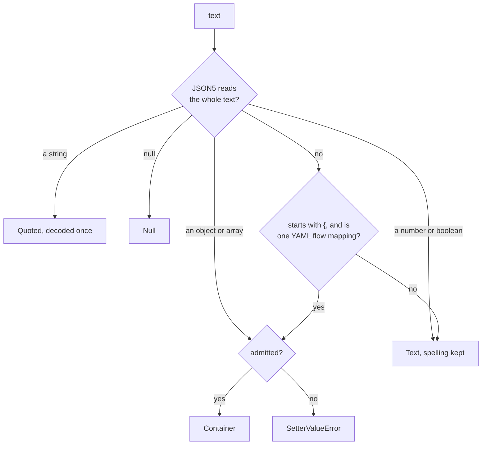

# Setter Values

`SetterValue` reads a value someone typed on a command line, as in `md set doc.md count 5` or `md compose doc.md count=5`. Use it when a host accepts a value as text and has a schema that may say what the value should be. It reads in two steps, because `1.10` is only a number once something says so.

```rust
use serde_json::json;
use simplified_schema::SetterValue;
use simplified_schema::coercion::Shape;

let value = SetterValue::parse("1.10")?;
assert_eq!(value.bind(Some(&Shape::text())), json!("1.10"));
assert_eq!(value.bind(Some(&Shape::number())), json!(1.1));
assert_eq!(value.bind(None), json!(1.1));
```

Which document and schema apply, and what happens to the result, stay the host's decision. The rules as a person meets them are in [Command-Line Values](../../../darkmatter/docs/cli/index.md#command-line-values).

## Reading the form: `parse`

`SetterValue::parse` looks only at the text.



| Text | Result |
|---|---|
| `1.10`, `true`, `Alice`, `[x, y]`, `{{ title }}` | `Text { raw }`, spelled as written |
| `"Alice"` | `Quoted("Alice")` |
| `null` | `Null` |
| `{a: 1}`, `[1, 2]`, `{ max-width: 50 }`, `{foo}` | `Container` |
| (empty) | `Text` with no text, which binds to the empty string |

JSON5 goes first because YAML would read `{a:1}` as a key named `a:1`. The YAML step accepts exactly one flow mapping. A tag, an anchor, an alias, or a block document is not one, so it stays text, and nothing in a value ever runs.

Falling back to text is only for syntax. A parsed container that cannot be admitted fails, because the author plainly wrote structure:

| Value | Error |
|---|---|
| `{a:1,a:2}`, in JSON5 or YAML | `SetterValueError::DuplicateKey` |
| `{a:NaN}`, `{a:9007199254740993}`, a number that underflows | `SetterValueError::Number`, from the [numeric model](./foundations.md#numbers-numeric) |

## Reading through a type: `bind`

`SetterValue::bind(declared)` returns the final `serde_json::Value`. The host looks up the declared [`Shape`](./conversion.md) for the value's place, if it has one.

| Form | Under a declared type | With no declaration, or `unknown` |
|---|---|---|
| `Text` | the [conversion engine](./conversion.md), as text: `1.10` under `string` is `"1.10"`, `5` under `number` is `5`, `02134` under `numberlike` stays text | a guess from its JSON5 reading: `5` is `5`; a number admission would refuse stays text |
| `Quoted` | that string, unconverted; validation judges it as it judges authored `"5"` | that string |
| `Null` | null; validation decides whether the type allows it | null |
| `Container` | converted field by field | as parsed |

- A value that does not fit is returned unconverted, so schema validation is what reports it.
- Under `boolish`, which keeps a boolean as it was sent, an unquoted `true` or `false` becomes that boolean, while `On` stays text.
- `bind` adds no text-to-container conversion, so text under an object type stays text and fails validation.
- A container's numbers have already lost their spelling: `{version:1.10}` gives `"1.1"` under a nested `string`. Quote it, or use a path to that one field.
