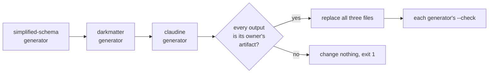
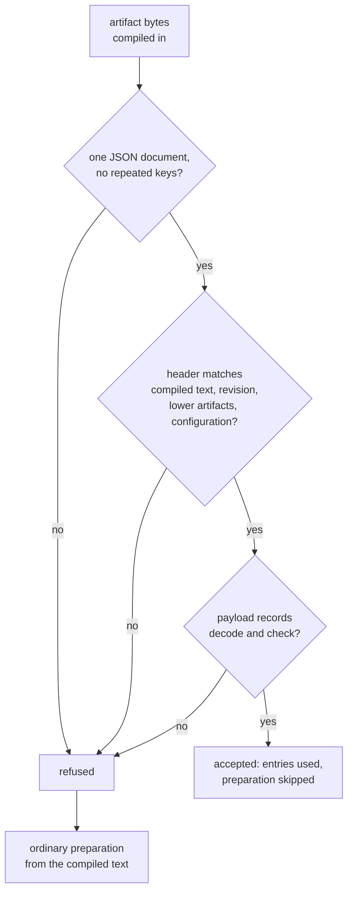
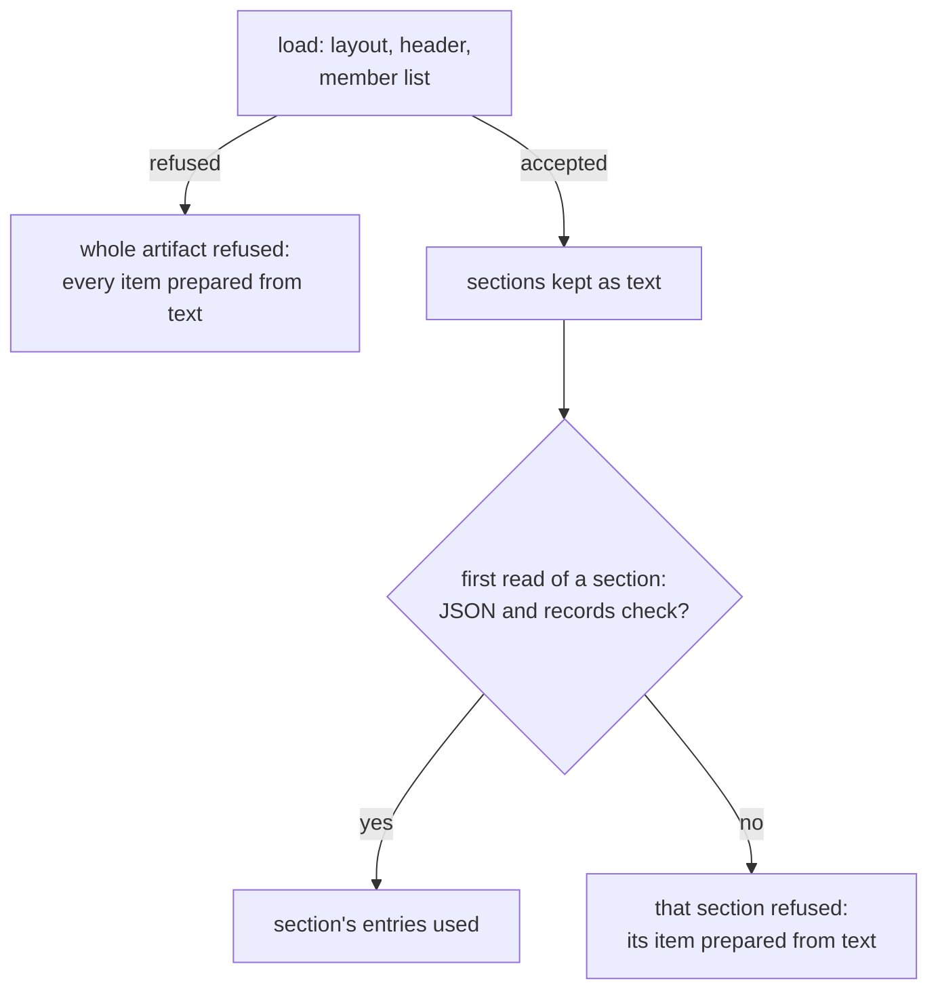
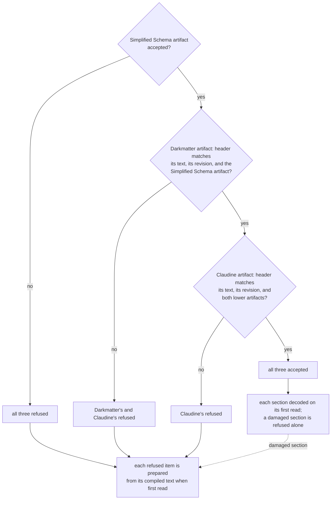

# Shipped Artifacts

Some schema text is compiled into a binary with `include_str!`: Simplified
Schema's own envelope definitions (`schemas/schema.yaml` and
`schemas/yaml-schema.yaml`), and the shipped schemas of the crates built on
it. Every process used to parse, admit, and lower that text again on first
use, even though the result can only change when the text or the code that
prepares it changes.

A **shipped artifact** is a checked-in JSON file holding that prepared form.
At run time the owning crate loads the artifact instead of preparing the
text, after proving that the artifact describes exactly the text compiled
into this binary. A stale or damaged artifact is never trusted: the crate
prepares the text as it always did, so results never depend on whether the
artifact is current. Only the startup cost does.

This page covers what an artifact holds, how to regenerate one, the
freshness test that tells you when to, and what happens at run time when an
artifact is refused. The module is `simplified_schema::shipped`.

## What you need to do

When you edit a shipped YAML file, or change code that parses, admits, or
lowers it, regenerate the artifacts from the repository root and commit them
with your change:

```sh
just shipped-schemas
```

It lists each artifact whose bytes changed. For example, after an edit to
`darkmatter/schemas/partials/fm.yaml`:

```text
regenerated darkmatter/lib/generated/shipped.json
regenerated claudine/lib/generated/shipped.json
```

Claudine's artifact changes too because it is built over Darkmatter's (see
[What the root command does](#what-the-root-command-does)). When nothing
changed, the command prints `every shipped artifact is current`.

### When the freshness test fails

Each crate's L1 suite has a `shipped_artifact_is_fresh` test. It prepares
the compiled text from scratch, encodes the result, and compares it byte for
byte with the checked-in file. When they differ it fails with the command to
run:

```text
`simplified-schema/lib/generated/shipped.json` is stale (first difference at line 9); regenerate it with `just shipped-schemas`
```

The fix is always the same: run `just shipped-schemas` from the repository
root and commit the files it regenerated. Never edit an artifact by hand. A
hand edit cannot match fresh generation, so the freshness test keeps
failing, and at run time the edited artifact is refused and its items are
prepared from text.

Within this area, `just shipped-schemas` regenerates only Simplified Schema's
artifact, and `just shipped-schemas --check` reports whether it is current
without writing anything.

### What the root command does

Three crates ship an artifact, each prepared over the ones below it:
Simplified Schema's, Darkmatter's, and Claudine's. A change to a lower
crate's sources therefore changes every artifact above it too. The root
`just shipped-schemas` runs `scripts/shipped_schemas.py`, which regenerates
all three as one step:



1. It runs each crate's `shipped_schemas` example with no flags, in
   dependency order. Each example prepares its whole chain from the current
   text and prints its artifact, without reading any checked-in artifact,
   so it works even when those are stale or damaged.
2. It checks every output in memory: JSON, one final line feed, the right
   owner, and the lower owners listed as dependencies.
3. Only then does it write each output beside its file and rename it into
   place. If any generator fails or any output is wrong, none of the three
   files changes.
4. It runs each example with `--check`, which rebuilds over the new files
   and proves every artifact is accepted and current.

A crate area's own `just shipped-schemas` (`--write` by default) refuses to
write when a lower artifact is stale and names the root command instead. For
example, `just shipped-schemas` in `darkmatter/` after an edit to a Simplified
Schema envelope definition stops with:

```text
error: the compiled-in `simplified-schema/lib/generated/shipped.json` is stale, so `darkmatter/lib/generated/shipped.json` cannot be checked or written over it; regenerate every artifact with `just shipped-schemas` from the repository root
```

### When CI runs the freshness tests

CI runs a package's tests when its own source changes. An artifact also
depends on other packages' files, so each higher owner's
`shipped_artifact_is_fresh` names those files in its body (with
`include_str!`/`include_bytes!`), and its manifest lists the other
packages' preparation code under `[package.metadata.ci.tests]
source-inputs`. A change to any of them then adds one Linux L1 run of just
that test (see `docs/cicd/test-inputs.md` at the repository root). For
example, editing `darkmatter/lib/src/markdown/schemas/catalog.rs` runs
Darkmatter's whole suite and Claudine's `shipped_artifact_is_fresh` alone.

| Changed file | Also runs |
| --- | --- |
| a Simplified Schema envelope YAML, preparation file, or its artifact | Darkmatter's and Claudine's freshness tests |
| Content Policy's editor schema | Darkmatter's and Claudine's freshness tests |
| a Darkmatter shipped YAML, preparation file, or its artifact | Claudine's freshness test |

### When to bump the preparation revision

Each owning crate has a preparation revision (Simplified Schema's is
`shipped::registry::PREPARATION_REVISION`). Increment it whenever you change
what preparation produces without changing any shipped text: a lowering
rule, an admission check, a record's shape. The revision is in the header,
so an artifact generated before the change is refused rather than trusted,
and the freshness test fails until you regenerate. The root
`just shipped-schemas` regenerates the artifacts built over this one too.

Why the revision matters: the header proves an artifact matches the
compiled **text**, but it cannot see the **code** that prepared it. Suppose
you change how `number(integer)` lowers to JSON Schema, and Darkmatter's
baseline uses it. No YAML file changed, so every source digest in
Darkmatter's old artifact still matches, and without a new revision a build
that has not been regenerated yet would accept that artifact and serve the
old lowering. Increment Darkmatter's revision and that build refuses the
artifact and prepares from text instead, with the new code. The rule is to
increment the revision of each owner whose payload the change alters;
`just shipped-schemas` lists which artifacts changed.

| You changed | Increment | Then |
| --- | --- | --- |
| only shipped YAML text | nothing; the source digests already differ | `just shipped-schemas` |
| how shipped text is prepared (lowering, admission, resolution, a check) | the `PREPARATION_REVISION` of each owner whose payload changes | `just shipped-schemas` |
| the shape of a record an owner stores | that owner's `PREPARATION_REVISION` (Claudine's records embed Darkmatter's trigger-payload record, so a change there bumps both) | `just shipped-schemas` |
| what `merge_baseline` produces | `resolve::MERGE_ALGORITHM_REVISION` | update the pinned values in `lib/tests/l1/schema_identities.rs` |
| what a phase projection produces | `phase::PROJECTION_REVISION` | update the pinned values in `lib/tests/l1/schema_identities.rs` |
| the canonical JSON hashed for a validator key, or the `judges_files` rule | `validate::CANONICAL_IDENTITY_REVISION` | `just shipped-schemas` (stored digests of the old revision are refused) |

The owners' preparation revisions are `shipped::registry::PREPARATION_REVISION`
here, `darkmatter::markdown::schemas::shipped::PREPARATION_REVISION`, and
`claudine::composition::schema::shipped::PREPARATION_REVISION`. The merge and
projection revisions are not stored in any artifact: they are folded into the
validator-cache keys of merged schemas (see
[Stored validator-cache digests](#stored-validator-cache-digests)), so that a
merge or projection that changed is never served a validator compiled for
the old result.

## What an artifact holds

An artifact is one JSON object with a `header` and a `payload`. The header
is pretty-printed; each member of the payload is compact JSON on its own
line; the file ends with one line feed:

```json
{
"header": {
  "wire_version": 1,
  "owner": "simplified-schema",
  "preparation_revision": 1,
  "sources": [
    {
      "identity": "simplified-schema/schemas/schema.yaml",
      "digest": "24ea8b08f42922ce"
    },
    …
  ],
  "dependencies": [],
  "configuration": []
},
"payload": {
"definitions":[{"identity":"simplified-schema/schemas/schema.yaml","json_schema":{…}}, …]
}
}
```

The layout keeps two things cheap. A diff of a regenerated artifact shows
which header field or which payload member changed, line by line, and a
loader can find each payload member without scanning the JSON of the others
(see [Deferred sections](#deferred-sections)). Payloads are large: Darkmatter's
is about 1.8 MB, and indenting it would quadruple both its size and the time
to scan it.

| Header member | Meaning |
| --- | --- |
| `wire_version` | The artifact format; this library reads version `1` only. |
| `owner` | The crate the artifact belongs to. |
| `preparation_revision` | The owner's revision when the artifact was generated (at least 1). |
| `sources` | Every compiled-in text the preparation read: its repository-relative path and the xxHash-64 digest of its exact bytes, as sixteen lowercase hex digits. Sorted by path. |
| `dependencies` | Every lower artifact the preparation was built over: its owner, revision, and the digest of its bytes. Sorted by owner. |
| `configuration` | Any `[key, value]` setting that changes preparation. Sorted by key. |

The payload is the owner's own record type. Simplified Schema's holds one
lowered JSON Schema per envelope definition. Payloads keep authored order
(properties, named types, definitions) because consumers observe it; only
the header's lists are sorted. Artifacts hold no host path, timestamp, or
machine-sized integer, so the same bytes are produced on every OS.

The owners and their artifacts, in dependency order:

| Owner | Artifact | Built over |
| --- | --- | --- |
| `simplified-schema` | `simplified-schema/lib/generated/shipped.json` | nothing |
| `darkmatter` | `darkmatter/lib/generated/shipped.json` | `simplified-schema` |
| `claudine` | `claudine/lib/generated/shipped.json` | `simplified-schema`, `darkmatter` |

## How an artifact is loaded



`shipped::accept` runs these checks in order and either returns an
`AcceptedArtifact` or a `Refusal`. `shipped::load_or_prepare` wraps it with
the owner's ordinary preparation as the fallback. Acceptance is all or
nothing: one bad record refuses the whole artifact, and no entry of a refused
artifact is ever used.

### Deferred sections

An owner whose payload is large reads it with `shipped::accept_deferred`
instead. Loading then checks the layout, the header, and the payload's
member list (every member the owner expects, no other, none twice) and
nothing else: each member stays text, a `Section`, until a consumer first
reads it. `Section::get` then checks that member's JSON (repeated keys
included), decodes it, and validates its records, once per process.



A section refused on first read refuses only itself; the owner prepares that
one item from text, and the other sections still serve. This keeps a
process's cost proportional to what it reads: `md compose` on a plain
document decodes Darkmatter's catalog and baseline sections, never its
function catalog. The refusal names the section's JSON pointer
(`/payload/functions/descriptors/0/order`) and its line and column in the
artifact. A deferred artifact must be in the exact layout above, which the
generator writes; one re-indented by hand is `MalformedArtifact`.

A refusal carries a `FallbackReason`, the JSON pointer of the offending
member when known, and the parser's line and column:

| Reason | Example |
| --- | --- |
| `MissingArtifact` | no bytes were supplied |
| `MalformedArtifact` | not UTF-8, not JSON, a repeated key, content after the document, a JSON5 comment, a member of the wrong type, a zero revision, a digest that is not sixteen lowercase hex digits |
| `UnsupportedWireVersion` | `"wire_version": 2` |
| `PreparationRevisionMismatch` | the owner's revision changed since generation |
| `SourceMismatch` | a compiled-in text changed, or a source was added or removed |
| `DependencyMismatch` | a lower artifact changed, changed revision, or was itself refused |
| `ConfigurationMismatch` | a preparation setting differs |
| `UnusableRecord` | the artifact belongs to another owner, or a record breaks an invariant (a duplicate or misplaced entry) |

A refusal is not an error for users: nothing is printed or returned to them,
and validation behaves exactly as it does with an accepted artifact. With the
test-only `work-counters` feature, each acceptance, refusal reason, and
runtime preparation of shipped text is counted, which is how tests prove that
an accepted artifact really replaced the preparation.

A lower artifact that is refused refuses every artifact built over it, even
when the higher artifact's header still matches the lower artifact's bytes:
an artifact is only as trustworthy as what it was prepared from.

### Across the three owners

A `claudine` process uses all three artifacts. Each owner loads its own the
first time something reads it, and its header check includes the state of
the artifacts below it:



`md` and DMLS stop at Darkmatter's artifact; they never read Claudine's.

### What a fallback costs

A fallback never changes a result, only the time it takes to get it. The
refused item is prepared exactly as it was before artifacts existed, with
every check. How much that costs depends on the item. Measured on an Apple
M4 Max in a debug build, reading Claudine's prepared trigger bundle from its
section takes about 180 ms, and preparing the same bundle from text takes
about 630 ms (25 ms and 100 ms in a release build). A stale artifact
therefore shows up as a slower `claudine` start and slower tests, never as
a different verdict. When a suite slows down after you edited shipped YAML,
check that you ran `just shipped-schemas`.

The library's own artifact is loaded the first time any envelope is admitted.
Its definitions' validators are still compiled on first use; the artifact
holds lowered schemas, never compiled validators.

### Stored validator-cache digests

Finding a compiled validator in the cache normally means serializing the
schema to canonical JSON and hashing it, which costs as much as a large
schema is long. An artifact can store that digest beside a lowered schema as
a `CanonicalDigestRecord`, computed once at generation:

```json
"digest": { "revision": 1, "digest": "9ad01b57acd8b1fb", "judges_files": false }
```

`revision` is the canonical identity revision it was computed under; a
record from another revision is refused (`UnusableRecord`) and that member is
prepared from text, where the digest is computed again. `judges_files` says
whether the schema reads a file context (see the validator cache in
Darkmatter's schema definition topic). Darkmatter stores one for its
baseline, and every prepared trigger payload carries one (Claudine's bundle
records do); a host then builds the
validator key of a merged schema from those digests without serializing it
(`validate::LayeredIdentity`).

## Fresh generation

Generation must not trust yesterday's artifact, so it prepares everything
from the current text along the whole dependency chain. `FreshLower::prepare`
parses and lowers the envelope definitions without consulting the artifact
or the process registry, checks that each definition is admitted by its own
definitions, and encodes the result. A host passes
`PreparationMode::Uncached(&fresh)` to the `*_with_mode` entry points
(`prepare_embedded_schema_with_mode`, `parse_standalone_schema_document_with_mode`,
`admit_envelope_text_with_mode`, and the others) so its own preparation
admits against those fresh definitions and parses every shipped partial
instead of reading a memo or a prepared table.

The generator for this library's artifact is an example program:

```sh
cargo run -p simplified-schema --example shipped_schemas            # print fresh bytes
cargo run -p simplified-schema --example shipped_schemas -- --check  # fail if stale or refused
cargo run -p simplified-schema --example shipped_schemas -- --write  # replace the file
```

`--check --artifact <path>` checks another file and reports where it is
refused. `--write` validates the fresh bytes before replacing the file
through a temporary sibling, so a failed generation leaves the old artifact
in place. Errors go to stderr; stdout carries only artifact bytes.

## Prepared named types for a host namespace

A host that reserves a namespace for its shipped partials
(`ShippedSources`, for example Darkmatter's `Name@darkmatter:<stem>`) can
attach its artifact's parsed named-type tables with
`ShippedSources::with_prepared`. The resolver asks for a partial's table
before parsing its text, and uses it only when the `ShippedSources` carries
exactly the documents the tables were prepared from. A caller that builds its
own `ShippedSources` with different text under the same paths gets ordinary
parsing, and `ShippedSources::new` alone never consults a table.

```rust
use simplified_schema::embedded::ShippedSources;
use simplified_schema::shipped::{PreparedNamedTypes, PreparedSourcesDescriptor};

static TABLES: std::sync::OnceLock<PreparedNamedTypes> = std::sync::OnceLock::new();
static DESCRIPTOR: PreparedSourcesDescriptor = PreparedSourcesDescriptor { owner: "host", provider: || TABLES.get() };
// `DOCUMENTS` is the host's `&'static [EmbeddedDocument<'static>]` table.
const SHIPPED: ShippedSources = ShippedSources::new("host:", "host/partials", DOCUMENTS).with_prepared(&DESCRIPTOR);
```

`PreparedNamedTypes` can only be built inside an artifact's acceptance, so a
table served this way always comes from an accepted artifact.
