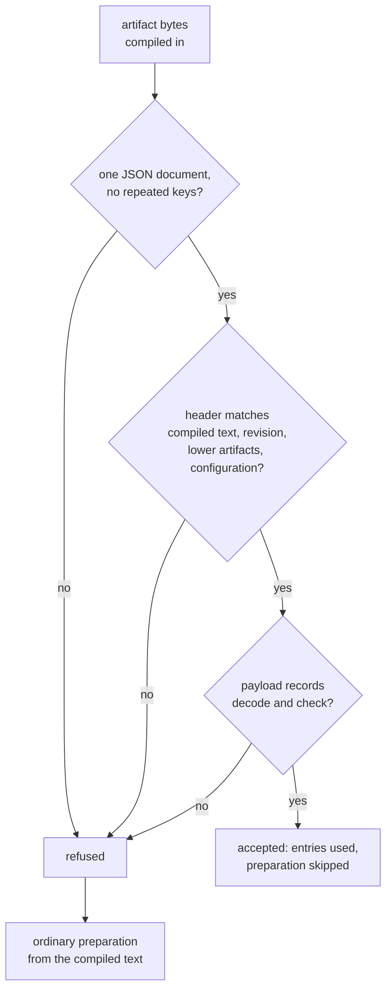

# Shipped Artifacts

Some schema text is compiled into a binary with `include_str!`: Simplified
Schema's own envelope definitions (`schemas/schema.yaml` and
`schemas/yaml-schema.yaml`), and the shipped schemas of the crates built on
it. Every process used to parse, admit, and lower that text again on first
use, even though the result can only change when the text or the code that
prepares it changes.

A **shipped artifact** is a checked-in JSON file holding that prepared form.
At run time the owning crate loads the artifact instead of preparing the
text, after proving that the artifact describes exactly the text compiled
into this binary. A stale or damaged artifact is never trusted: the crate
prepares the text as it always did, so results never depend on whether the
artifact is current. Only the startup cost does.

This page covers what an artifact holds, how to regenerate one, the
freshness test that tells you when to, and what happens at run time when an
artifact is refused. The module is `simplified_schema::shipped`.

## What you need to do

When you edit a shipped YAML file, or change code that parses, admits, or
lowers it, regenerate the artifacts from the repository root:

```sh
just shipped-schemas
```

Each crate's L1 suite has a `shipped_artifact_is_fresh` test. It prepares
the compiled text from scratch, encodes the result, and compares it byte for
byte with the checked-in file. When they differ it fails with the command to
run:

```text
`simplified-schema/lib/generated/shipped.json` is stale (first difference at line 9); regenerate it with `just shipped-schemas`
```

Within this area, `just shipped-schemas` regenerates only Simplified Schema's
artifact, and `just shipped-schemas --check` reports whether it is current
without writing anything.

### When to bump the preparation revision

Each owning crate has a preparation revision (Simplified Schema's is
`shipped::registry::PREPARATION_REVISION`). Increment it whenever you change
what preparation produces without changing any shipped text: a lowering
rule, an admission check, a record's shape. The revision is in the header,
so an artifact generated before the change is refused rather than trusted,
and the freshness test fails until you regenerate. Then regenerate the
artifacts built over this one too: the root `just shipped-schemas` does all
of them in dependency order.

## What an artifact holds

An artifact is one JSON object with a `header` and a `payload`, written with
two-space indentation and one final line feed:

```json
{
  "header": {
    "wire_version": 1,
    "owner": "simplified-schema",
    "preparation_revision": 1,
    "sources": [
      { "identity": "simplified-schema/schemas/schema.yaml", "digest": "24ea8b08f42922ce" },
      { "identity": "simplified-schema/schemas/yaml-schema.yaml", "digest": "d3c3ff207ca0cd96" }
    ],
    "dependencies": [],
    "configuration": []
  },
  "payload": { "definitions": [ … ] }
}
```

| Header member | Meaning |
| --- | --- |
| `wire_version` | The artifact format; this library reads version `1` only. |
| `owner` | The crate the artifact belongs to. |
| `preparation_revision` | The owner's revision when the artifact was generated (at least 1). |
| `sources` | Every compiled-in text the preparation read: its repository-relative path and the xxHash-64 digest of its exact bytes, as sixteen lowercase hex digits. Sorted by path. |
| `dependencies` | Every lower artifact the preparation was built over: its owner, revision, and the digest of its bytes. Sorted by owner. |
| `configuration` | Any `[key, value]` setting that changes preparation. Sorted by key. |

The payload is the owner's own record type. Simplified Schema's holds one
lowered JSON Schema per envelope definition. Payloads keep authored order
(properties, named types, definitions) because consumers observe it; only
the header's lists are sorted. Artifacts hold no host path, timestamp, or
machine-sized integer, so the same bytes are produced on every OS.

The owners and their artifacts, in dependency order:

| Owner | Artifact | Built over |
| --- | --- | --- |
| `simplified-schema` | `simplified-schema/lib/generated/shipped.json` | nothing |
| `darkmatter` | `darkmatter/lib/generated/shipped.json` (**planned**) | `simplified-schema` |
| `claudine` | `claudine/lib/generated/shipped.json` (**planned**) | `simplified-schema`, `darkmatter` |

## How an artifact is loaded



`shipped::accept` runs these checks in order and either returns an
`AcceptedArtifact` or a `Refusal`. `shipped::load_or_prepare` wraps it with
the owner's ordinary preparation as the fallback. Acceptance is all or
nothing: one bad record refuses the whole artifact, and no entry of a refused
artifact is ever used.

A refusal carries a `FallbackReason`, the JSON pointer of the offending
member when known, and the parser's line and column:

| Reason | Example |
| --- | --- |
| `MissingArtifact` | no bytes were supplied |
| `MalformedArtifact` | not UTF-8, not JSON, a repeated key, content after the document, a JSON5 comment, a member of the wrong type, a zero revision, a digest that is not sixteen lowercase hex digits |
| `UnsupportedWireVersion` | `"wire_version": 2` |
| `PreparationRevisionMismatch` | the owner's revision changed since generation |
| `SourceMismatch` | a compiled-in text changed, or a source was added or removed |
| `DependencyMismatch` | a lower artifact changed, changed revision, or was itself refused |
| `ConfigurationMismatch` | a preparation setting differs |
| `UnusableRecord` | the artifact belongs to another owner, or a record breaks an invariant (a duplicate or misplaced entry) |

A refusal is not an error for users: nothing is printed or returned to them,
and validation behaves exactly as it does with an accepted artifact. With the
test-only `work-counters` feature, each acceptance, refusal reason, and
runtime preparation of shipped text is counted, which is how tests prove that
an accepted artifact really replaced the preparation.

A lower artifact that is refused refuses every artifact built over it, even
when the higher artifact's header still matches the lower artifact's bytes:
an artifact is only as trustworthy as what it was prepared from.

The library's own artifact is loaded the first time any envelope is admitted.
Its definitions' validators are still compiled on first use; the artifact
holds lowered schemas, never compiled validators.

## Fresh generation

Generation must not trust yesterday's artifact, so it prepares everything
from the current text along the whole dependency chain. `FreshLower::prepare`
parses and lowers the envelope definitions without consulting the artifact
or the process registry, checks that each definition is admitted by its own
definitions, and encodes the result. A host passes
`PreparationMode::Uncached(&fresh)` to the `*_with_mode` entry points
(`prepare_embedded_schema_with_mode`, `parse_standalone_schema_document_with_mode`,
`admit_envelope_text_with_mode`, and the others) so its own preparation
admits against those fresh definitions and parses every shipped partial
instead of reading a memo or a prepared table.

The generator for this library's artifact is an example program:

```sh
cargo run -p simplified-schema --example shipped_schemas            # print fresh bytes
cargo run -p simplified-schema --example shipped_schemas -- --check  # fail if stale or refused
cargo run -p simplified-schema --example shipped_schemas -- --write  # replace the file
```

`--check --artifact <path>` checks another file and reports where it is
refused. `--write` validates the fresh bytes before replacing the file
through a temporary sibling, so a failed generation leaves the old artifact
in place. Errors go to stderr; stdout carries only artifact bytes.

## Prepared named types for a host namespace

A host that reserves a namespace for its shipped partials
(`ShippedSources`, for example Darkmatter's `Name@darkmatter:<stem>`) can
attach its artifact's parsed named-type tables with
`ShippedSources::with_prepared`. The resolver asks for a partial's table
before parsing its text, and uses it only when the `ShippedSources` carries
exactly the documents the tables were prepared from. A caller that builds its
own `ShippedSources` with different text under the same paths gets ordinary
parsing, and `ShippedSources::new` alone never consults a table.

```rust
use simplified_schema::embedded::ShippedSources;
use simplified_schema::shipped::{PreparedNamedTypes, PreparedSourcesDescriptor};

static TABLES: std::sync::OnceLock<PreparedNamedTypes> = std::sync::OnceLock::new();
static DESCRIPTOR: PreparedSourcesDescriptor = PreparedSourcesDescriptor { owner: "host", provider: || TABLES.get() };
// `DOCUMENTS` is the host's `&'static [EmbeddedDocument<'static>]` table.
const SHIPPED: ShippedSources = ShippedSources::new("host:", "host/partials", DOCUMENTS).with_prepared(&DESCRIPTOR);
```

`PreparedNamedTypes` can only be built inside an artifact's acceptance, so a
table served this way always comes from an accepted artifact.
