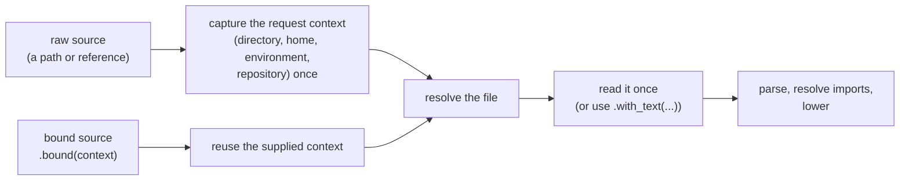

# The `SimplifiedSchema` Struct

> [SimplifiedSchema](simplified-schema/lib/src/schema/mod.rs)

The `SimplifiedSchema` struct provides the focus for this schema and the functionality surrounding it. You can:

- Build it from text or a file
- validate values
- layer other schemas on top or under it
- ask it about it's types
- export it

is the one object most callers need. Build it from text
or a file, then validate values, layer other schemas into it, ask it about
its types, and export it. There is no compile step to call: the first
validation prepares the schema, and later validations reuse that work.

```rust
use serde_json::json;
use simplified_schema::SimplifiedSchema;

let person = SimplifiedSchema::try_from("$schema:\n  name: string(required)\n  age: number(min(0); integer)\n")?;

// Inspect before anything is compiled.
assert_eq!(person.query("age")?.unwrap().type_text(), "number(min(0);integer)");

// Validate as many values as you like through the same object.
assert!(person.validate_strict(&json!({ "name": "Ada", "age": 36 })).is_ok());
let soft = person.validate_soft(&json!({ "name": "Ada", "age": "36" }))?;
assert_eq!(*soft.value, json!({ "name": "Ada", "age": 36 }));
```

`examples/validate_person.rs` is a runnable version
(`cargo run -p simplified-schema --example validate_person`).

## Building a schema

| Call | Reads | Context |
| --- | --- | --- |
| `SimplifiedSchema::try_from(text)` | the text only | none: no file is opened, nothing is captured |
| `try_from_yaml(source)` | one standalone schema YAML file | captured once (raw) or supplied (bound) |
| `try_from_markdown(source)` | one Markdown file's frontmatter `$schema` | same |
| `try_from_json_schema(source)` | one raw JSON Schema file | same |
| `SimplifiedSchema::resolve(source).await` | one file, loader chosen by extension | same |

The file factories need the default `file` feature.

### Content: `TryFrom<&str>`

The text is document content, never a path. It is classified by its schema
structure:

- Markdown opening with a `---` frontmatter block: the frontmatter's `$schema`.
  The body is never read as schema.
- A standalone schema document: root `$schema` (with optional `types`,
  `description`, and `categories`), `kind: schema` with `$schema`, `types`,
  or both, or `kind: yaml-schema`. Loading a `yaml-schema` here is a direct
  load, not a reference, so it is accepted even though no `$schema` may name
  one (see [Standalone Schema Documents](./language/schema-documents.md#standalone-schema-documents)).
  Each envelope must first satisfy its
  [definition](./language/schema-documents.md#admission-checking-an-envelope-against-its-definition).
- A raw JSON Schema: a mapping whose `$schema` is a `json-schema.org` dialect
  URI.

Anything else is `SimplifiedSchemaError::MissingSchema`: ordinary YAML, a
YAML scalar (including a string that looks like a file path), Markdown
without `$schema`. A malformed definition is `SimplifiedSchemaError::Schema`
holding a `SchemaError::SchemaDocument` that keeps the grammar's own error and
its byte range in the text you passed
([details](./diagnostics.md#a-rejected-definition-in-a-schema-document));
a malformed fence (`----`) is
`SimplifiedSchemaError::Frontmatter`.

```rust
// A file-looking string is content, and not a schema.
assert!(matches!(
    SimplifiedSchema::try_from("./person.yaml"),
    Err(SimplifiedSchemaError::MissingSchema { .. })
));
```

A reference to another file inside content (`owner: Person@./people.yaml`,
`$schema: ./other.yaml`, a root-union file arm, `example(./x.md)`) is kept as
parsed. The schema can be inspected and exported, but it cannot be prepared
for validation without that file, so validation returns
`ValidationFailure::Unprepared` whose error is `SchemaError::Unresolved`
(cause `FileReferenceError::ResolutionUnavailable`). Load the schema with a
file factory to follow such references.

### Files: one argument, raw or bound

Every file factory takes one `SchemaSource`, converted from a `&Path`,
`PathBuf`, `&str`/`String` (a file reference such as `./schema.yaml` or
`~/schemas/a.yaml`), or a `biscuit_file::FileReference`.



- **Raw.** The factory captures a new request context once, at entry, before
  it resolves the path or reads anything. Imports, `example(...)` files, and
  `file(eager)` values all resolve from that snapshot, so changing the
  process directory, home, or environment afterwards does not move them.
- **Bound.** `SchemaSource::from(path).bound(context)` uses a context the
  caller already captured (a host's request context) and captures nothing.
- **Supplied text.** `.with_text(buffer)` gives the file's current contents,
  such as an editor's unsaved buffer. The file is not read; the path still
  names the schema's origin and anchors its relative references.

```rust
let source = SchemaSource::from(Path::new("/work/schemas/draft.md"))
    .bound(request_context)
    .with_text(unsaved_buffer);
let schema = SimplifiedSchema::try_from_markdown(source)?;
```

Relative references resolve from the schema file's own directory. The result
owns everything it needs: `provenance()` reports its path, the files its
imports and examples read, the schema files it referenced, every location
probed (found or not), and advisories, so a cache can invalidate it when any
of them changes.

An `http://` or `https://` source or reference is
`SchemaError::RemoteUnsupported`; schema loading is local only.

Errors: `MissingFile`, `Read`, `Reference` (a malformed or unresolvable
reference), `Context` and `Discovery` (capturing a raw source's context
failed), `MissingSchema`, `Frontmatter`, and `Schema`.

## Validating

`validate_strict` and `validate_soft` behave exactly as on a prepared schema
(see [Strict and Soft Validation](./validation.md)): strict judges the value
as written, soft converts first, and an accepted value is borrowed from the
input unless soft validation converted it.

The object prepares itself on first validation and keeps that preparation
until a layering call changes the definition. A schema that cannot be
prepared (a function-typed property has no JSON Schema form, or content that
names another file) fails every validation with
`ValidationFailure::Unprepared`, carrying the one shared error.

A schema built from content has no file context. Its `file(eager)` and
`match(...)` checks cannot run, so a value that fails only those is
`ValidationFailure::UnavailableCheck`, not invalid data.

`select("Person")` turns an object named type into a schema of its own, for
a catalog such as `kind: schema` with `types: { Person: … }`.

## Layering

```rust
receiver.layer_under(&[&baseline, &extension, &trigger])?;  // receiver wins
receiver.layer_over(&[&overrides])?;                        // incoming wins
receiver.as_base(&baseline)?;          // layer_under with one schema
receiver.override_with(&overrides)?;   // layer_over with one schema
```

- The incoming list runs from low to high priority: a later schema wins a
  property two of them declare.
- `layer_under` keeps every property the receiver declares;
  `layer_over` lets every incoming property replace the receiver's.
- A declaration is replaced whole, never intersected: the existing resolver
  merge (`resolve::merge_baseline`) does the work, with its restrictions (a
  lower layer must be a plain object schema, not a root union).
- [Closure](./language/objects-and-named-types.md#closed-roots-closed)
  follows the winning layer and is never copied from a lower one. The merged
  root is closed exactly when the higher-priority side is closed: the
  receiver for `layer_under`, the incoming schemas for `layer_over`. A
  closed lower layer is accepted, and its properties are merged, but it does
  not close the result. On a closed result, every property merged in from
  any layer counts as declared.

| Receiver `s0` | `s0.layer_under(&[&s1, &s2])` `timeout` | `s0.layer_over(&[&s1, &s2])` `timeout` |
| --- | --- | --- |
| declares only `name` | `string` (from `s2`) | `string` |
| also declares `timeout: boolean` | `boolean` | `string` |

(`s1` declares `timeout: number`, `s2` declares `timeout: string`.)

| Receiver | Incoming | `layer_under` result | `layer_over` result |
| --- | --- | --- | --- |
| closed | open | closed | open |
| open | closed | open | closed |

Each call is atomic. It stages the merge in its own working data and commits
with one assignment; on `Err` the receiver's definition, revision, and
prepared state are exactly as before. In a chain
(`a.layer_under(..)?.layer_over(..)?`) a failed later call leaves the earlier
successful ones in place. The sources are only borrowed and never change, and
the returned `&mut Self` is the receiver.

A successful change bumps `revision()` and drops the prepared state, so the
next validation sees the new definition. A call that adds nothing (every
incoming property is shadowed) changes nothing and keeps the preparation.
The file context that judges `file(...)` values stays the receiver's.

## Inspecting types

`query(path)` finds the type at a schema path. It is passive: it never reads
data or evaluates anything, borrows the schema, and follows recursive types
one level per step rather than expanding them.

| Path | Means |
| --- | --- |
| `settings.timeout` | `timeout` inside `settings` |
| `people[0].name` | `name` in an element of the `people` list |
| `coords[1]` | position 1 of the `coords` tuple (past the last element: the spread's type) |
| `settings["a.b"]` or `settings['a.b']` | the key `a.b`, dot included |

`Ok(None)` means no such type: the empty path, an undeclared key, or a step
the type does not have. A path that does not parse is a `PathSyntaxError`.
`query_steps(&[PathStep::Key(..), PathStep::Index(..)])` takes segments
directly, and `property(key)` looks up one literal top-level key.

A property that several root-union arms declare is answered with the union
of their types; this is the same answer editors get for completion.

The answer is a `TypeDefinition`: its declaration (`def()`), canonical text
(`type_text()`), description, whether it is required, its alternatives, and,
for a `function(...)` type, a `FunctionView` with the parameters (names,
order, types, optional and rest markers), return type, `fallible`, examples,
`narrows(...)` fact, and description. `properties()` lists every top-level
property in merged order; `named_type(name)` reads the schema's `types`
table as authored.

## Exporting

- `to_json_schema()` returns the lowered Draft 2020-12 JSON Schema that
  validation uses (shared, not copied). A function-typed property has no JSON
  Schema form; the export fails with the lowerer's located error.
- `to_simplified_yaml()` writes the schema back as one SimplifiedSchema
  document in its authored envelope (a `yaml-schema` keeps
  `kind: yaml-schema`). Named types are written by name, so a
  recursive type stays a finite reference graph, and parsing the export gives
  the same schema. Nested objects are written as block mappings and property
  unions as YAML lists, so pattern keys, `$constraints`, and each arm's
  description survive.

Some schemas have no SimplifiedSchema form, and the YAML export refuses them
with `SimplifiedSchemaError::ExportUnsupported` rather than dropping
anything: raw JSON Schema (there is no reverse converter), a layered schema
whose lower layers are root unions or raw JSON Schema or whose copied
properties refer to that layer's named types, and an inline object with
pattern keys inside a type string.
