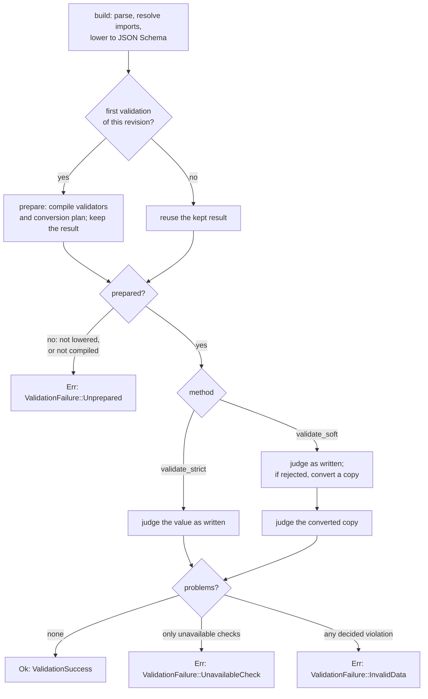
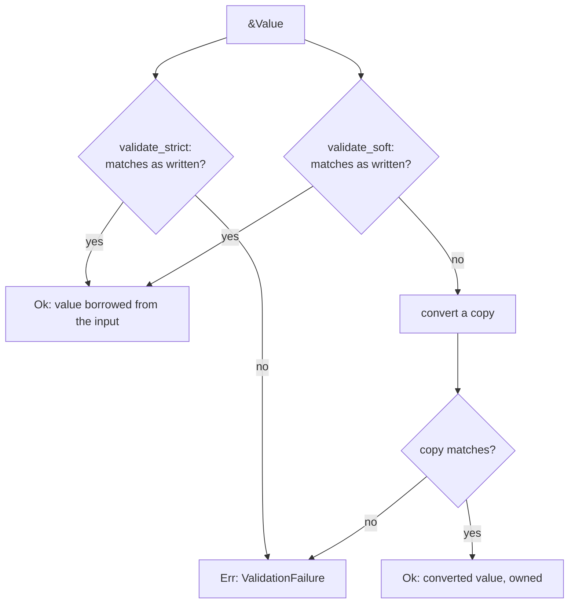

# Strict and Soft Validation

The [`SimplifiedSchema` object](simplified-schema-struct.md) has both methods and
prepares itself; this page describes the contract they share, and the
lower-level `Prepared` schema they run on.

Compile a lowered schema once into a `Prepared` schema, then judge as many
`serde_json::Value`s with it as you like. Pick the method by what you want
done with a value that is almost right:

- `validate_strict` accepts a value only if it already matches the schema's
  types and constraints. Nothing is converted.
- `validate_soft` first applies the conversion engine's rules (the string
  `"4"` becomes the number `4` for a `number` property), then judges the
  result.

```rust
use std::sync::Arc;
use biscuit_file::FileResolutionContext;
use serde_json::json;
use simplified_schema::{Prepared, parse_yaml_schema, to_json_schema};

let yaml: serde_yaml_ng::Value = serde_yaml_ng::from_str("v: number").unwrap();
let schema = to_json_schema(&parse_yaml_schema(&yaml).unwrap()).unwrap();
let prepared = Prepared::new(Arc::new(schema), None, FileResolutionContext::new("/work")).unwrap();

let input = json!({ "v": "4" });
assert!(prepared.validate_strict(&input).is_err());
let accepted = prepared.validate_soft(&input).unwrap();
assert_eq!(*accepted.value, json!({ "v": 4 }));
assert_eq!(input, json!({ "v": "4" })); // the input is never changed
```

## From schema to verdict

A `SimplifiedSchema` does its work in two stages. Building it parses the
text, resolves its named types and imports, and lowers it to JSON Schema; a
definition that cannot be lowered is kept as an error rather than failing the
build. The first validation then prepares it: it compiles the validators
(through a process-wide cache shared by equal schemas) and the conversion
plan. That preparation, or its error, is kept and reused by every later
validation until a layering call changes the definition.



A `Prepared` built directly with `Prepared::new` starts at the "prepare"
step: you lower and compile once yourself, and an error is returned from
`Prepared::new` instead of being kept.

## What each method returns

Both take the value by reference and return
`Result<ValidationSuccess<'input>, ValidationFailure>`.



`ValidationSuccess` holds `value`, a `Cow<'input, Value>`, and `advisories`,
the schema's non-fatal findings (`Prepared::with_advisories`). The value is
borrowed from the input whenever it was accepted as written, so validating
never copies the input; it is owned only when soft validation converted it
(`is_converted()`).

| Schema | Value | `validate_strict` | `validate_soft` |
| --- | --- | --- | --- |
| `number` | `4` | accepted, borrowed | accepted, borrowed |
| `number` | `"4"` | rejected | accepted, owned `4` |
| `number(integer)` | `"2.5"` | rejected | rejected: conversion never repairs a constraint |
| `string \| number` | `"4"` | accepted as the string, borrowed | accepted as the string, borrowed |
| `string(non-null)` | `null` | rejected at the property | rejected the same way: `null` is never converted or read as absent |
| a [closed](./language/objects-and-named-types.md#closed-roots-closed) root declaring `name` | `{ "name": "Ada", "extra": 1 }` | rejected: unknown key `extra` | rejected the same way |

Soft conversion is exactly the existing engine's: nested values in mappings
and lists convert, a union keeps the first arm that accepts the value as
written before converting, and number text the numeric model cannot hold
exactly (`"9007199254740993"`) fails with that reason in its message.

Both methods judge presence and nullness alike. An explicit `null` at a
property that is `required` or [`non-null`](./language/types.md#non-null-properties)
is reported at that property under either method, because soft validation
never converts a `null`. See
[Non-Null Properties](./language/types.md#non-null-properties) for when `null`
is rejected.

## Failures

A `ValidationFailure` never holds a value, converted or not. It holds every
structured `ValidationProblem` found (code, instance path, schema path,
missing or unknown key, file-reference cause), and says which kind of
failure it is:

- `InvalidData`: at least one problem is a decided violation of the schema.
- `UnavailableCheck`: every problem comes from a check the schema requires
  and this build cannot run, so the value was neither accepted nor shown to
  be invalid. Without the default `file` feature, resolving a `file(eager)`
  value and a `match(...)` glob are such checks; malformed file-reference
  syntax is still judged. `ValidationProblem::is_unavailable_check` marks
  each such problem, including beside a decided violation. A
  `SimplifiedSchema` built from in-memory content has no file context, so in
  every build its `file(eager)` and `match(...)` checks are unavailable in
  the same way.
- `Unprepared`: the schema could not be prepared, so no value was judged.
  It holds the shared `SchemaError` (`error`): the schema has a
  function-typed property, `jsonschema` rejected its lowered form, or it is
  content that names a file it cannot read. `problems()` is empty. `Prepared`
  never returns it; a `SimplifiedSchema` does.

```rust
match prepared.validate_soft(&value) {
    Ok(success) => use_value(success.value),
    Err(ValidationFailure::InvalidData { problems }) => report(problems),
    Err(ValidationFailure::UnavailableCheck { problems }) => cannot_check(problems),
    Err(other) => report(other.into_problems()),
}
```

## How a host maps onto these

Darkmatter's exact validation (`EffectiveSchema::validate_raw`) is the
strict operation and its ordinary validation (`EffectiveSchema::validate`) is
the soft one; both are compiled from the same `CompiledValidators`. Darkmatter
keeps its own entry points, which add what only a host knows: pending
`{{ … }}` templates, lifecycle-verb operands, and source positions.
