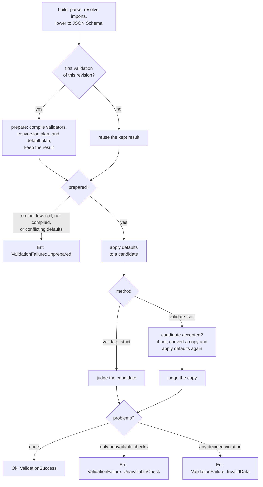
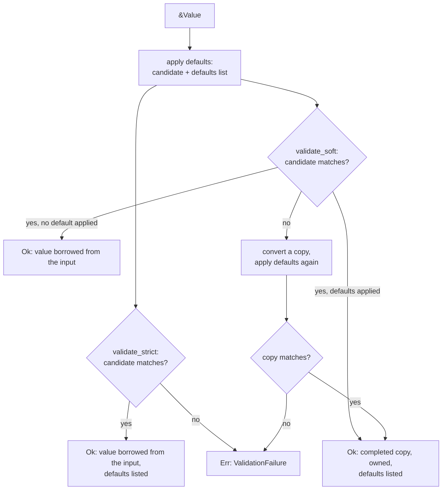

# Strict and Soft Validation

The [`SimplifiedSchema` object](simplified-schema-struct.md) has both methods and
prepares itself; this page describes the contract they share, and the
lower-level `Prepared` schema they run on.

Compile a lowered schema once into a `Prepared` schema, then judge as many
`serde_json::Value`s with it as you like. Pick the method by what you want
done with a value that is almost right:

- `validate_strict` accepts a value only if it already matches the schema's
  types and constraints. Nothing is converted.
- `validate_soft` first applies the conversion engine's rules (the string
  `"4"` becomes the number `4` for a `number` property), then judges the
  result.

Both methods run two separate steps. **Applying defaults** fills each
missing or `null` property that declares a `default(...)`; it is the only
step that sets a value. **Validation** then judges the completed value
against the schema and sets nothing. Strict validation reports the defaults
it applied without changing your value; soft validation returns a copy that
holds them. See [Applying defaults](#applying-defaults).

```rust
use std::sync::Arc;
use biscuit_file::FileResolutionContext;
use serde_json::json;
use simplified_schema::{Prepared, parse_yaml_schema, to_json_schema};

let yaml: serde_yaml_ng::Value = serde_yaml_ng::from_str("v: number").unwrap();
let schema = to_json_schema(&parse_yaml_schema(&yaml).unwrap()).unwrap();
let prepared = Prepared::new(Arc::new(schema), None, FileResolutionContext::new("/work")).unwrap();

let input = json!({ "v": "4" });
assert!(prepared.validate_strict(&input).is_err());
let accepted = prepared.validate_soft(&input).unwrap();
assert_eq!(*accepted.value, json!({ "v": 4 }));
assert_eq!(input, json!({ "v": "4" })); // the input is never changed
```

## From schema to verdict

A `SimplifiedSchema` does its work in two stages. Building it parses the
text, resolves its named types and imports, and lowers it to JSON Schema; a
definition that cannot be lowered is kept as an error rather than failing the
build. The first validation then prepares it: it compiles the validators
(through a process-wide cache shared by equal schemas), the conversion plan,
and the default plan (every default the schema declares, read once). That
preparation, or its error, is kept and reused by every later validation
until a layering call changes the definition.



A `Prepared` built directly with `Prepared::new` starts at the "prepare"
step: you lower and compile once yourself, and an error (including
conflicting defaults) is returned from `Prepared::new` instead of being kept.

## What each method returns

Both take the value by reference and return
`Result<ValidationSuccess<'input>, ValidationFailure>`.



`ValidationSuccess` holds `value`, a `Cow<'input, Value>`; `advisories`,
the schema's non-fatal findings (`Prepared::with_advisories`); and
`defaults`, the defaults applied, as `AppliedDefault { path, value }` in
walk order. Strict validation always returns the input itself, borrowed,
even when it applied defaults: the caller decides whether to write them in.
Soft validation returns the input borrowed when nothing changed, and an
owned copy when it converted a value, applied a default, or both
(`is_modified()`). An empty `defaults` means the value passed without any
default.

| Schema | Value | `validate_strict` | `validate_soft` |
| --- | --- | --- | --- |
| `number` | `4` | accepted, borrowed | accepted, borrowed |
| `number` | `"4"` | rejected | accepted, owned `4` |
| `number(integer)` | `"2.5"` | rejected | rejected: conversion never repairs a constraint |
| `string \| number` | `"4"` | accepted as the string, borrowed | accepted as the string, borrowed |
| `n: number(required)` | `{ "n": null }` | rejected at `n`: `null` is not a number | rejected the same way: `null` is never converted |
| a [closed](./language/objects-and-named-types.md#closed-roots-closed) root declaring `name` | `{ "name": "Ada", "extra": 1 }` | rejected: unknown key `extra` | rejected the same way |
| `retries: number(default(3))` | `{ "retries": null }` | accepted, borrowed, `defaults` lists `retries = 3` | accepted, owned `{ "retries": 3 }`, same `defaults` |

Soft conversion is exactly the existing engine's: nested values in mappings
and lists convert, a union keeps the first arm that accepts the value as
written before converting, and number text the numeric model cannot hold
exactly (`"9007199254740993"`) fails with that reason in its message.

When soft validation fails, its problems describe a copy in which every value
that converts on its own is converted, every value that fails stays as
written, and every unexpected key or tuple element is kept. So only real
problems are reported: with `rows: "{ name: string, port: number }[]"`, the
value `[{ name: a, port: "8080" }, { name: b, port: "1", extra: z }]` fails
with one problem, the unknown key `extra` at `/rows/1`, and nothing about the
`"8080"` and `"1"` cells. That copy is used only for the report; the failure
carries no value, and write-back keeps `rows` as written.

## Missing keys, `null`, and `required`

A mapping can leave a key out or write it with the value `null`. For
reading, defaults, and type checks those are the same value: `null`. Only
`required` tells them apart, because it asks whether the key was **written**.
A written `null` meets that contract and must then satisfy the property's
type; a missing key does not, unless a default supplies it.

These are the outcomes for a property `n`, under strict and soft validation
alike (defaults are applied first):

| Declaration | Key missing | `n: null` | `n: 5` |
| --- | --- | --- | --- |
| `n: number` | valid; reads as `null` | valid; stays `null` | valid |
| `n: number(default(3))` | valid; default `3` applied | valid; default `3` applied | valid; `5` wins |
| `n: number(required)` | error: required key missing | error: `null` is not a number | valid |
| `n: number(required; default(3))` | valid; default `3` applied | valid; default `3` applied | valid; `5` wins |
| `n: null(required)`, `n: unknown(required)` | error: required key missing | valid | `null(required)`: error; `unknown(required)`: valid |
| `n: [number(required), null]` | error: required key missing | valid | valid |

- **A written value always wins.** `0`, `false`, `""`, `[]`, and `{}` are
  values, never replaced by a default.
- **Validation never adds keys.** With no applicable default, `{}` stays
  `{}` and `{ "n": null }` stays `{ "n": null }`. An undeclared key stays
  undeclared even when its value is `null`, so a closed object still
  rejects it.
- **A type that admits `null` changes the value check, not presence.**
  `null`, `unknown`, and a union with such an arm accept a written `null`;
  their `required` marker, written, inherited, or hoisted from another arm,
  still demands the key. See
  [Null-admitting properties](./language/types.md#null-admitting-properties).
- **The same rule holds at every depth**: inside nested objects, objects in
  lists, and resolved named types. A required key missing inside an object is
  reported at that object's pointer (`/owner` for `owner.note`).

Function arguments and tuple positions are positional and keep their own
rule: an optional argument or position (`name?: T`, `tuple([number,
number?])`) may be left out, but a written `null` there needs a type that
admits `null`, and nothing is inserted for an omitted position.

```yaml
$schema:
    range: "tuple([number, number?])"
    open:  "tuple([number, (number | null)?])"
# range: [1]        valid: the optional position is left out
# range: [1, null]  error: null is not a number
# open:  [1, null]  valid: the position admits null
```

## Applying defaults

Applying defaults builds the candidate that validation judges. It fills a
property from its `default(...)` when the value is missing or `null`,
whether or not the property is `required`, and reports each default it
applied.

```rust
use serde_json::json;
use simplified_schema::SimplifiedSchema;

let schema = SimplifiedSchema::try_from("$schema:\n  name: string(required)\n  retries: number(default(3))\n")?;
let input = json!({ "name": "Ada", "retries": null });

// Strict: the input itself, plus the defaults applied to the candidate.
let strict = schema.validate_strict(&input).unwrap();
assert!(!strict.is_modified());
assert_eq!(strict.defaults[0].path.to_string(), "retries");

// Soft: an owned copy with the default in place.
let soft = schema.validate_soft(&input).unwrap();
assert_eq!(*soft.value, json!({ "name": "Ada", "retries": 3 }));
# Ok::<(), simplified_schema::SimplifiedSchemaError>(())
```

Validation never changes your value, so a caller that keeps the strict
result and wants the defaults written inserts them itself from `defaults`;
soft validation has already done so. Neither method touches the input.

Which values are filled:

| Declaration | Value | Result |
| --- | --- | --- |
| `n: number(default(3))` | `{}` or `{ "n": null }` | `n = 3` applied |
| `n: number(required; default(3))` | `{}` or `{ "n": null }` | `n = 3` applied; the default also meets `required` |
| `n: number(default(null))` | `{}` or `{ "n": null }` | nothing applied; the value stays as written |
| `n: unknown(required; default(null))` | `{}` | `n = null` inserted and reported |
| the same | `{ "n": null }` | nothing applied: the key is already written |
| `meta: "{ a: number(default(1)) }"` | `{ "meta": {} }` or `{ "meta": { "a": null } }` | `meta.a = 1` applied |
| the same | `{}` or `{ "meta": null }` | nothing applied: `meta` has no default, so nothing below it is created |
| `meta: "{ a: number(default(1)) }(default({}))"` | `{}` | `meta = {}`, then `meta.a = 1` |
| `rows: "{ on: boolean(default(true)) }[]"` | `{ "rows": [{}, { "on": false }, { "on": null }] }` | `rows.0.on`, then `rows.2.on` |

The rules behind the table:

- **A child needs its parent.** A default inside an object applies only when
  the object exists. A missing or `null` parent with no default of its own is
  left as it is, and its own `required` (if any) is validation's question.
  A parent filled from its own default is first checked against its complete
  definition, required children included, and then its children's defaults
  are applied too, so validating the result again changes nothing.
- **A `null` default stops.** On an optional property `default(null)` does
  nothing. On a required property whose type admits `null`, it inserts a
  missing key as `null` and reports it; a written `null` is left alone. A
  required `number(required; default(null))` fails as an invalid default
  when a value needs it.
- **Positions are never inserted.** List items and tuple positions are never
  created from a default; objects inside existing items are completed.
- **Order is stable.** Properties are visited in declaration order and list
  items by ascending index, parents before their children. Each path is
  reported once. A key containing `.` is spelled with `\.` in the path's
  text (`a\.b`); `path.segments()` holds the key as written.
- **A default is checked when it is used.** It must satisfy every property
  definition that declares it, constraints and nested required children
  included, without conversion or file access. A default that does not is a
  schema error, not a problem with the value: validation fails with
  `ValidationFailure::Unprepared` holding `SchemaError::InvalidDefault`,
  whose `pointer` is the JSON Pointer of the `default` keyword in the lowered
  JSON Schema (for example `/properties/n/default`). A default no value needs
  is never judged, so an optional property's broken default surfaces only
  when a document leaves that property unset.
- **Defaults never expand forever.** A default whose value keeps creating
  another defaulted parent (a type whose `next` defaults to `{}` of the same
  type) fails with `SchemaError::RecursiveDefault`, naming the path where it
  repeats and the `default` keyword. Recursive types without such a default
  are filled at every depth the value has.
- **One default per property, decided before any value.** Defaults are
  collected from every schema that can describe a location: a named type,
  `allOf` members, and every arm of a union, without choosing an arm. Equal
  defaults count as one. Different defaults for one property at one location
  fail when the schema is lowered or prepared, whether or not any value would
  use them: `SchemaError::ConflictingDefaults` for object arms (a root union,
  an object union, or raw JSON Schema), and a `SchemaError::Convert` naming
  the property for the arms of a property-level union; see
  [Defaults in unions](./language/unions.md#defaults-in-unions).
- **Matching uses the completed value.** Union arms, discriminants, a root's
  sibling assertions, and key counts (`min-keys`, `maxProperties`) judge the
  candidate after defaults are applied. A default that one arm declares
  fills the property whichever arm then matches, and a closed arm that does
  not declare the property rejects it.
- **A pending default stays pending.** `default({{ n }})` is a
  [slot](./language/slots.md); until it is resolved, validation fails with
  `SchemaError::UnresolvedSlots` as for any template. Applying defaults never
  evaluates an expression or reads a file.
- **Soft validation applies defaults twice.** It applies defaults, converts,
  and then applies any default the converted value now reaches, so
  `{ "meta": { "n": "4" } }` against
  `meta: "{ a: number(default(1)), n: number }"` becomes
  `{ "meta": { "n": 4, "a": 1 } }`.

A raw JSON Schema's `default` keyword is applied exactly like
`default(...)`: an optional property with `"default": 3` that a value leaves
unset or `null` becomes `3`. Its assertions and `required` arrays are used as
written; a raw property gains no `null` wrapper.

### Applying defaults in a host

A host that compiles its own validators applies defaults through the same
engine, never a second walk of its own. `simplified_schema::defaults` holds
it:

- `DefaultPlan::compile(schema, &cache)` reads a lowered or raw JSON Schema
  once. It fails with `ConflictingDefaults`, or with `RecursiveDefault`
  (whose `path` is `None`) for a `$ref` chain that loops without describing
  a child value. `DefaultPlan::for_identity(identity, &schema, &cache)`
  keeps one plan per `SchemaIdentity` for the process, and
  `DefaultPlan::is_empty()` says the schema declares no default.
- `prepare_defaults(&plan, value, &templates)` returns a
  `DefaultPreparation { candidate, defaults }`; `candidate` is borrowed
  exactly when `defaults` is empty. Values at or below a path in
  `templates` (`coerce::NestedTemplates`) are pending and are not filled.

```rust
use std::borrow::Cow;
use std::sync::Arc;
use serde_json::json;
use simplified_schema::SimplifiedSchema;
use simplified_schema::coerce::NestedTemplates;
use simplified_schema::defaults::{DefaultPlan, prepare_defaults};
use simplified_schema::validate::ValidatorCache;

let lowered = SimplifiedSchema::try_from("$schema:\n  n: number(default(3))\n")?.to_json_schema()?;
let plan = DefaultPlan::compile(Arc::clone(&lowered), &ValidatorCache::new())?;
let input = json!({ "n": null });

let prepared = prepare_defaults(&plan, Cow::Borrowed(&input), &NestedTemplates::default())?;
assert_eq!(*prepared.candidate, json!({ "n": 3 })); // judge this with your validators
# Ok::<(), Box<dyn std::error::Error>>(())
```

### Exported JSON Schema does not apply defaults

`to_json_schema` keeps a required property in its object's `required`
array and writes each default as the standard `default` keyword. In JSON
Schema, `default` is only an annotation: it fills nothing. A third-party
validator given the exported schema therefore differs from this library:

| Declaration | Value | This library | A plain JSON Schema validator |
| --- | --- | --- | --- |
| `n: number(required; default(3))` | `{}` | valid, `n = 3` applied | rejected: `n` is missing |
| `n: number(default(3))` | `{ "n": null }` | valid, `n = 3` applied | valid, but `n` stays `null` |

Both read `required` the same way (the key must be written); only the
filling step is missing. Write the value explicitly when data must also
pass an external validator, or apply defaults with this library first.

## Failures

A `ValidationFailure` never holds a value, converted or not. It holds every
structured `ValidationProblem` found (code, instance path, schema path,
missing or unknown key, file-reference cause), and says which kind of
failure it is:

- `InvalidData`: at least one problem is a decided violation of the schema.
- `UnavailableCheck`: every problem comes from a check the schema requires
  and this build cannot run, so the value was neither accepted nor shown to
  be invalid. Without the default `file` feature, resolving a `file(eager)`
  value and a `match(...)` glob are such checks; malformed file-reference
  syntax is still judged. `ValidationProblem::is_unavailable_check` marks
  each such problem, including beside a decided violation. A
  `SimplifiedSchema` built from in-memory content has no file context, so in
  every build its `file(eager)` and `match(...)` checks are unavailable in
  the same way.
- `Unprepared`: the schema could not be prepared, so no value was judged.
  It holds the shared `SchemaError` (`error`): the schema has a
  function-typed property, `jsonschema` rejected its lowered form, it is
  content that names a file it cannot read, or it declares conflicting
  defaults. `problems()` is empty. `Prepared` returns it only for a default
  the value needed that is invalid (`InvalidDefault`) or expands without end
  (`RecursiveDefault`), since `Prepared::new` already refused conflicting
  defaults; a `SimplifiedSchema` also returns it for the other causes. A
  [template](./language/slots.md) fails this way with
  `SchemaError::UnresolvedSlots` until `resolve_slots` gives a concrete
  schema to validate against.

```rust
match prepared.validate_soft(&value) {
    Ok(success) => use_value(success.value),
    Err(ValidationFailure::InvalidData { problems }) => report(problems),
    Err(ValidationFailure::UnavailableCheck { problems }) => cannot_check(problems),
    Err(other) => report(other.into_problems()),
}
```

## How a host maps onto these

Darkmatter's exact validation (`EffectiveSchema::validate_raw`) is the
strict operation and its ordinary validation (`EffectiveSchema::validate`) is
the soft one; both are compiled from the same `CompiledValidators`. Darkmatter
keeps its own entry points, which add what only a host knows: pending
`{{ … }}` templates, lifecycle-verb operands, and source positions.
