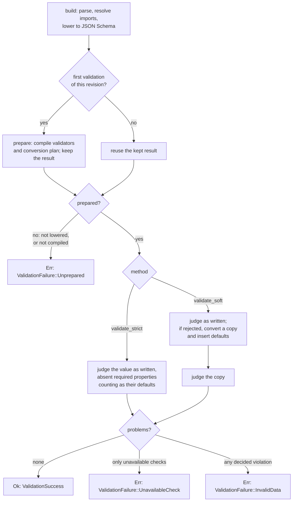
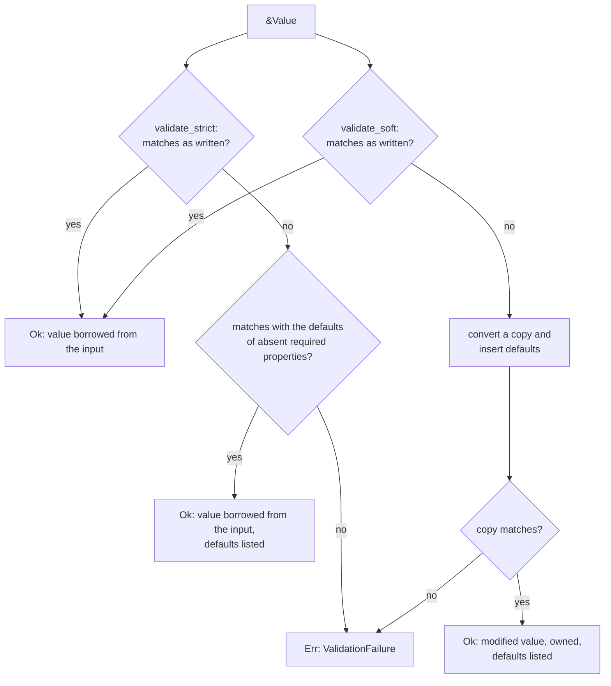

# Strict and Soft Validation

The [`SimplifiedSchema` object](simplified-schema-struct.md) has both methods and
prepares itself; this page describes the contract they share, and the
lower-level `Prepared` schema they run on.

Compile a lowered schema once into a `Prepared` schema, then judge as many
`serde_json::Value`s with it as you like. Pick the method by what you want
done with a value that is almost right:

- `validate_strict` accepts a value only if it already matches the schema's
  types and constraints. Nothing is converted.
- `validate_soft` first applies the conversion engine's rules (the string
  `"4"` becomes the number `4` for a `number` property), then judges the
  result.

Both accept an absent `required` property that declares a `default(...)`:
the default stands in for the missing value, and the success lists it (see
[Required properties with a default](#required-properties-with-a-default)).

```rust
use std::sync::Arc;
use biscuit_file::FileResolutionContext;
use serde_json::json;
use simplified_schema::{Prepared, parse_yaml_schema, to_json_schema};

let yaml: serde_yaml_ng::Value = serde_yaml_ng::from_str("v: number").unwrap();
let schema = to_json_schema(&parse_yaml_schema(&yaml).unwrap()).unwrap();
let prepared = Prepared::new(Arc::new(schema), None, FileResolutionContext::new("/work")).unwrap();

let input = json!({ "v": "4" });
assert!(prepared.validate_strict(&input).is_err());
let accepted = prepared.validate_soft(&input).unwrap();
assert_eq!(*accepted.value, json!({ "v": 4 }));
assert_eq!(input, json!({ "v": "4" })); // the input is never changed
```

## From schema to verdict

A `SimplifiedSchema` does its work in two stages. Building it parses the
text, resolves its named types and imports, and lowers it to JSON Schema; a
definition that cannot be lowered is kept as an error rather than failing the
build. The first validation then prepares it: it compiles the validators
(through a process-wide cache shared by equal schemas) and the conversion
plan. That preparation, or its error, is kept and reused by every later
validation until a layering call changes the definition.



A `Prepared` built directly with `Prepared::new` starts at the "prepare"
step: you lower and compile once yourself, and an error is returned from
`Prepared::new` instead of being kept.

## What each method returns

Both take the value by reference and return
`Result<ValidationSuccess<'input>, ValidationFailure>`.



`ValidationSuccess` holds `value`, a `Cow<'input, Value>`; `advisories`,
the schema's non-fatal findings (`Prepared::with_advisories`); and
`defaults`, the defaults the verdict relied on. The value is borrowed from
the input whenever it was accepted as written, and always after strict
validation, so validating never copies the input; it is owned only when soft
validation converted a value, inserted a default, or both (`is_modified()`).
An empty `defaults` is an unconditional pass.

| Schema | Value | `validate_strict` | `validate_soft` |
| --- | --- | --- | --- |
| `number` | `4` | accepted, borrowed | accepted, borrowed |
| `number` | `"4"` | rejected | accepted, owned `4` |
| `number(integer)` | `"2.5"` | rejected | rejected: conversion never repairs a constraint |
| `string \| number` | `"4"` | accepted as the string, borrowed | accepted as the string, borrowed |
| `string(non-null)` | `null` | rejected at the property | rejected the same way: `null` is never converted or read as absent |
| a [closed](./language/objects-and-named-types.md#closed-roots-closed) root declaring `name` | `{ "name": "Ada", "extra": 1 }` | rejected: unknown key `extra` | rejected the same way |
| `retries: number(required; default(3))` | `{}` | accepted, borrowed, `defaults` lists `retries = 3` | accepted, owned `{ "retries": 3 }`, same `defaults` |

Soft conversion is exactly the existing engine's: nested values in mappings
and lists convert, a union keeps the first arm that accepts the value as
written before converting, and number text the numeric model cannot hold
exactly (`"9007199254740993"`) fails with that reason in its message.

When soft validation fails, its problems describe a copy in which every value
that converts on its own is converted, every value that fails stays as
written, and every unexpected key or tuple element is kept. So only real
problems are reported: with `rows: "{ name: string, port: number }[]"`, the
value `[{ name: a, port: "8080" }, { name: b, port: "1", extra: z }]` fails
with one problem, the unknown key `extra` at `/rows/1`, and nothing about the
`"8080"` and `"1"` cells. That copy is used only for the report; the failure
carries no value, and write-back keeps `rows` as written.

Both methods judge presence and nullness alike. An explicit `null` at a
property that is `required` or [`non-null`](./language/types.md#non-null-properties)
is reported at that property under either method, because soft validation
never converts a `null`. See
[Non-Null Properties](./language/types.md#non-null-properties) for when `null`
is rejected.

## Required properties with a default

A `required` property whose definition has a `default(...)` satisfies its
contract when it is absent. Validation judges the value with the default in
place and reports each default it used as an `AppliedDefault { path, value }`
in `ValidationSuccess::defaults`.

```rust
use serde_json::json;
use simplified_schema::SimplifiedSchema;

let schema = SimplifiedSchema::try_from("$schema:\n  name: string(required)\n  retries: number(required; default(3))\n")?;
let input = json!({ "name": "Ada" });

// Strict: the input itself, plus the defaults the verdict relied on.
let strict = schema.validate_strict(&input).unwrap();
assert!(!strict.is_modified());
assert_eq!(strict.defaults[0].path.to_string(), "retries");

// Soft: an owned copy with the default inserted.
let soft = schema.validate_soft(&input).unwrap();
assert_eq!(*soft.value, json!({ "name": "Ada", "retries": 3 }));
# Ok::<(), simplified_schema::SimplifiedSchemaError>(())
```

Strict validation never changes the value, so a caller that wants the
defaults applied inserts them itself; soft validation has already done so.

Which absent properties are filled:

| Declaration | Value | Result |
| --- | --- | --- |
| `n: number(required; default(3))` | `{}` | passes; `n = 3` reported |
| `n: number(required; default(3))` | `{ "n": null }` | rejected: an explicit `null` is present and judged by the type |
| `n: number(default(3))` (optional) | `{}` | passes; nothing filled, the default stays metadata |
| `n: [number(required; default(3)), null]` (null-admitting) | `{}` | passes; nothing filled, the property is optional |
| `meta: "{ a: number(required; default(1)) }"` | `{ "meta": {} }` | passes; `meta.a = 1` reported |
| the same | `{}` | passes; `meta` is optional, so nothing below it is filled |
| `rows: "{ on: boolean(required; default(true)) }[]"` | `{ "rows": [{}, { "on": false }, {}] }` | passes; `rows.0.on`, then `rows.2.on` |

The rules behind the table:

- **A child needs its parent.** A default inside an object applies only when
  the object exists. A missing parent is the parent's own question: it is
  reported missing, or filled from its own default when it has one.
- **Order is stable.** Properties are visited in declaration order and list
  items by ascending index, parents before their children. Each path is
  reported once. A key containing `.` is spelled with `\.` in the path's
  text (`a\.b`); `path.segments()` holds the key as written.
- **A default is validated before it is used.** It must satisfy the
  property's complete definition, constraints and nested required children
  included, without conversion or file access. A default that does not is a
  schema error, not a problem with the value: validation fails with
  `ValidationFailure::Unprepared` holding `SchemaError::InvalidDefault`,
  whose `pointer` is the JSON Pointer of the `default` keyword in the lowered
  JSON Schema (for example `/properties/n/default`). A default that is never
  needed is not judged.
- **Unions are judged per arm.** For a union, each arm completes the value
  with its own defaults and the complete result is judged against that arm,
  discriminants and the root's sibling assertions included. A value some
  arm accepts as written uses no default. When several arms succeed, equal
  results count as one; different results fail with
  `SchemaError::AmbiguousDefaults`, which names the union's pointer and the
  arms, rather than picking whichever arm comes first.

  ```yaml
  $schema:
    - kind: literal(post; required)
      title: string(required; default(untitled))
    - kind: literal(page; required)
      slug: string(required; default(home))
  ```

  `{ kind: page }` passes with `slug = home`: the `post` arm's result is
  rejected by its `kind`. Without the `kind` properties, `{}` would be
  ambiguous.
- **A pending default stays pending.** `default({{ n }})` is a
  [slot](./language/slots.md); until it is resolved, validation fails with
  `SchemaError::UnresolvedSlots` as for any template.
- **Soft validation does both.** It inserts defaults, converts, and then
  inserts any default the converted value now needs (a union arm the
  conversion made reachable), so `{ "meta": { "n": "4" } }` against
  `meta: "{ a: number(required; default(1)), n: number }"` becomes
  `{ "meta": { "n": 4, "a": 1 } }`.

Exported JSON Schema is unchanged: the property stays in `required`, and
`default` is only an annotation there. A third-party JSON Schema validator
therefore rejects the same value as missing the property; accepting it is a
SimplifiedSchema rule that only this crate and its hosts apply.

A host that compiles its own validators calls the same walk:
`simplified_schema::defaults::prepare_defaults(json_schema, value, templates,
validators, cache)` returns a `DefaultPreparation { candidate, defaults }`
for it to judge.

## Failures

A `ValidationFailure` never holds a value, converted or not. It holds every
structured `ValidationProblem` found (code, instance path, schema path,
missing or unknown key, file-reference cause), and says which kind of
failure it is:

- `InvalidData`: at least one problem is a decided violation of the schema.
- `UnavailableCheck`: every problem comes from a check the schema requires
  and this build cannot run, so the value was neither accepted nor shown to
  be invalid. Without the default `file` feature, resolving a `file(eager)`
  value and a `match(...)` glob are such checks; malformed file-reference
  syntax is still judged. `ValidationProblem::is_unavailable_check` marks
  each such problem, including beside a decided violation. A
  `SimplifiedSchema` built from in-memory content has no file context, so in
  every build its `file(eager)` and `match(...)` checks are unavailable in
  the same way.
- `Unprepared`: the schema could not be prepared, so no value was judged.
  It holds the shared `SchemaError` (`error`): the schema has a
  function-typed property, `jsonschema` rejected its lowered form, or it is
  content that names a file it cannot read. `problems()` is empty. `Prepared`
  returns it only for a default the value needed that is invalid or
  ambiguous (see above); a `SimplifiedSchema` also returns it for the
  other causes. A
  [template](./language/slots.md) fails this way with
  `SchemaError::UnresolvedSlots` until `resolve_slots` gives a concrete
  schema to validate against.

```rust
match prepared.validate_soft(&value) {
    Ok(success) => use_value(success.value),
    Err(ValidationFailure::InvalidData { problems }) => report(problems),
    Err(ValidationFailure::UnavailableCheck { problems }) => cannot_check(problems),
    Err(other) => report(other.into_problems()),
}
```

## How a host maps onto these

Darkmatter's exact validation (`EffectiveSchema::validate_raw`) is the
strict operation and its ordinary validation (`EffectiveSchema::validate`) is
the soft one; both are compiled from the same `CompiledValidators`. Darkmatter
keeps its own entry points, which add what only a host knows: pending
`{{ … }}` templates, lifecycle-verb operands, and source positions.
