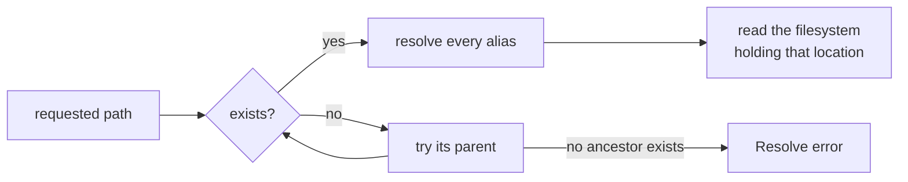

# Available space at a path

Ask how many bytes you can write where a file is about to go:

```rust
use sniff::filesystem::space::available_space;
use std::path::Path;

let reading = available_space(Path::new(".git/worktrees/app/journal.jsonl"))?;
if reading.available_bytes < needed {
    eprintln!(
        "{} needs {needed} bytes; {} has {}",
        reading.requested.display(),
        reading.measured.display(),
        reading.available_bytes
    );
}
```

`available_space` takes one native reading of the filesystem that holds the
path. It spawns no subprocess and does not inventory storage devices, so it
is cheap enough to call before every large write. For a list of the host's
disks and their kinds, use the hardware report instead; that one is far more
expensive (it runs `diskutil` on macOS) and its mount list is not a reliable
way to find the filesystem holding an arbitrary path.

## Which filesystem is measured



- **The path need not exist.** A missing leaf, or several missing levels, is
  measured at its nearest existing ancestor, which is where it would be
  created. `reading.measured` says which location was read.
- **Aliases are resolved, not matched as text.** A symlinked, junctioned, or
  firmlinked ancestor is followed to the location it names, and a volume
  mounted beneath another reports its own space. A store under
  `~/repo/.git` on an external volume through a symlink reads the external
  volume, not the home volume its spelling suggests.
- **Only a missing component climbs.** If an ancestor exists but cannot be
  resolved (for example permission denied, or a symlink loop), the reading
  fails rather than measuring a higher directory that could be on a
  different filesystem.

## What the number means

`available_bytes` is the space the **calling user** can write: POSIX
`f_bavail` times the fragment size on macOS and Linux, and the caller's
quota-aware figure from `GetDiskFreeSpaceExW` on Windows. It excludes blocks
reserved for the superuser, so it can be smaller than the filesystem's total
free space, and it can be zero.

**A reading is not a reservation.** Another process, a quota change, or an
allocation failure can still make the next write fail. Check first to refuse
early with a clear message, and still handle a disk-full error when you
write.

## Errors

| Error | When |
| --- | --- |
| `SpaceError::Resolve { path, source }` | No ancestor of `path` exists, or one exists but cannot be resolved |
| `SpaceError::Reading { path, measured, source }` | The location resolved, but its filesystem would not report its space |

Both name the requested path, and the source error says why. A reading that
fails is not "zero bytes available": a caller deciding whether a write fits
should treat it as "cannot tell" and say so.

## Work counters

Under a performance collector a reading records one
`filesystem.space.readings` and one `filesystem.io.canonicalizations` per
level it resolved (one more `filesystem.io.metadata_probes` on Windows, where
the call needs a directory). It never records `process.spawns`.
