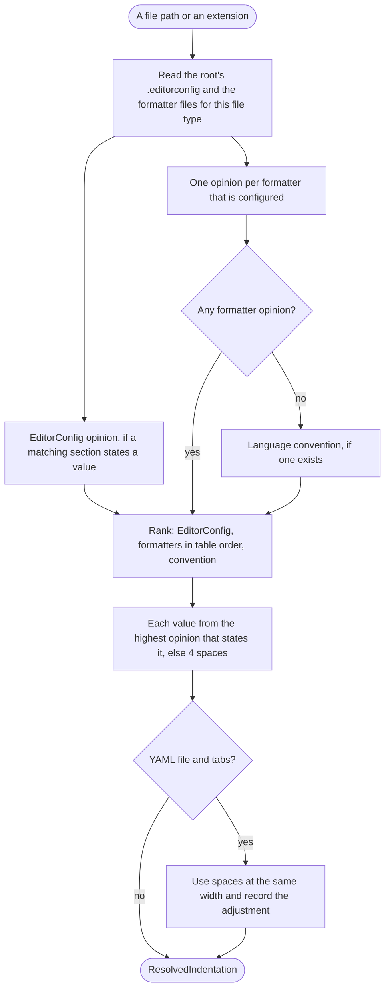

# Indentation resolution

Sniff can tell you which indentation a repository wants for a file, and where
that answer came from. A program that writes files, such as a tool that
generates a YAML configuration, asks Sniff and hands the answer to its writer,
so the generated file matches the project around it.

```rust
use sniff::filesystem::indentation::resolve_for_path;
use std::path::Path;

let resolved = resolve_for_path(Path::new("config/app.yaml"))?;
println!("{} x {:?}", resolved.indent, resolved.indent_using); // 4 x Spaces
let yaml = biscuit_file::to_yaml_string(&value, resolved.indentation())?;
```

The file does not need to exist yet. The answer is always usable: when nothing
in the repository states a preference, it is four spaces.

## Where the answer comes from

Sniff reads settings only at the root of the Git worktree that contains the
file. Each source that applies to the file is an **opinion**. Opinions are
ranked in this order:

1. the root `.editorconfig`;
2. each supported formatter configured for the file's type, in the order of
   the [formatter table](#supported-formatters);
3. a built-in convention for languages whose formatter is fixed (`gofmt`,
   `rustfmt`, PEP 8, and a few more). A convention applies only when no
   formatter gave an opinion.

The first opinion is the **authority**; the rest are **alternative
authorities**. Style (spaces or tabs) and width (columns per level) are
resolved separately: each comes from the highest-ranked opinion that states
it. Four spaces fill in whatever no opinion states. That fallback is never an
opinion itself, and it is the authority only when there are no opinions.



**Consensus** is `true` when every opinion agrees on each value it states. An
opinion that states only a style agrees with any width. Disagreement is not an
error: it tells you a later formatter run may reindent what you wrote.

For example, with this `.editorconfig` and a `biome.json` that only configures
linting:

```ini
[*]
indent_style = space
indent_size = 4
```

a TypeScript file resolves to four spaces from EditorConfig. Biome is an
alternative authority stating tabs, its documented default, so `consensus` is
`false`:

```yaml
indent_using: space
indent: 4
authority:
    source: editorconfig
    path: .editorconfig
    via: ["*"]
    indent_using: space
    indent: 4
alt_authorities:
    - source: biome
      path: biome.json
      via: []          # no indentation keys: Biome's defaults
      indent_using: tab
      indent: 2
consensus: false
skipped: []
```

## The API

All of it lives in `sniff::filesystem::indentation`. `Indentation` and
`IndentStyle` are biscuit-file's types, re-exported, so the result goes
straight into biscuit-file's YAML writer.

| Call | Use it when |
| ---- | ----------- |
| `resolve_for_path(path)` | You know the destination file. Sniff finds the worktree and reads only what that file type needs. |
| `resolve_for_extension(base, "yaml")` | You know only the file type. The file is treated as if it sat at the root of the worktree containing `base`. |
| `resolve_summary(base)` | You want every file type's answer for one worktree. |
| `RepoIndentation::load(root)` | You resolve many files in one worktree. It reads every supported file once; its `resolve_for_path`, `resolve_for_extension`, and `summary` then read nothing. |
| `normalize_extension(input)` | You accept an extension from a user and want the same validation Sniff applies. |

```rust
use sniff::filesystem::indentation::RepoIndentation;

let snapshot = RepoIndentation::load(repo_root)?;
for path in &paths_to_write {
    let indentation = snapshot.resolve_for_path(path)?.indentation();
    // …write the file
}
```

### What a result holds

`ResolvedIndentation` serializes to JSON with snake_case keys:

| Field | Meaning |
| ----- | ------- |
| `indent_using` | `space` or `tab`, after any format adjustment. |
| `indent` | Columns per level, 1 through 255. |
| `authority` | The top opinion, or `{ source: default, via: [], indent_using: space, indent: 4 }` when there is none. |
| `alt_authorities` | The other opinions, in rank order. |
| `consensus` | Whether the opinions agree, computed before any adjustment. |
| `adjustment` | Present only when a format overrode the style (see [YAML forbids tabs](#yaml-forbids-tabs)). |
| `skipped` | Files or settings Sniff could not use, each with `path`, optional `key`, and `reason`. |

Each opinion has `source` (`editorconfig`, `rustfmt`, `prettier`, `biome`,
`deno`, `dprint`, `oxfmt`, `ruff`, `tombi`, `taplo`, `yamlfmt`, `stylua`,
`clang-format`, `swift-format`, `rubocop`, `csharpier`, `convention`, or
`default`), `path` (absent for a convention or the default), `via`, and the
values it states. `via` lists the EditorConfig sections, the formatter keys
read, or the convention's name. A value the opinion does not state is left
out of the JSON. Every path is relative to the worktree and written with `/`
on every platform, so output is identical everywhere.

`ResolvedIndentation::indentation()` returns the `Indentation` to pass to a
writer.

### Errors

Problems with configuration files are never errors. A file that cannot be read
or parsed, or a setting with a bad value, is listed in `skipped` and resolution
continues with the next source. The calls return an error only when they
cannot identify the destination or its worktree:

- `resolve_for_path` with a path that names no file (`/`), or whose existing
  ancestor is a regular file;
- an extension that fails `normalize_extension`;
- a `RepoIndentation` path query with a relative path, or one outside the
  snapshot's worktree;
- a Git discovery failure other than "not a repository" (for example, an
  untrusted repository).

A writer that shows its output to a person should fall back to
`Indentation::default()` on such an error and report the reason.

## Paths, worktrees, and file types

- **New files.** For a path that does not exist yet, Sniff finds the worktree
  from the nearest existing ancestor and still matches the full path, so
  `generated/new/config.yaml` matches a `[generated/**.yaml]` section.
- **Symlinks.** Directories are resolved to their real location; the file name
  is used as given. Pass the path you will actually write.
- **Worktrees.** A linked worktree reads its own root. A nested Git repository
  is its own worktree for `resolve_for_path` and the other free functions. A
  `RepoIndentation` snapshot does not look for nested repositories: load a
  separate snapshot for one.
- **Outside a worktree.** Nothing is read from disk. A language convention
  still applies (a `.go` file is tabs anywhere), and everything else gets
  four spaces.
- **File type.** The file type is the lowercase text after the last `.` in the
  file name. It selects formatter rows and conventions. Conventions can also
  match whole file names (`Makefile`, `makefile`, `GNUmakefile`) and suffixes
  (`.tftest.hcl`, `.tfmock.hcl`, `.tfquery.hcl`), but only in path lookups.

### Extension lookups

An extension lookup (`resolve_for_extension`, `RepoIndentation::resolve_for_extension`)
has no real path, so it applies only rules that depend on the extension alone:

- EditorConfig `[*]` and suffix sections such as `[*.yaml]` or
  `[*.{yaml,yml}]`, matched against the name `file.<ext>`. File-name sections
  (`[Makefile]`) and directory sections (`[docs/**.md]`) are skipped.
- Prettier and oxfmt override entries whose `files` and `excludeFiles` are all
  suffix patterns. An entry with any file-name or directory pattern is skipped
  as a whole.

An extension may have one leading dot. After it, it must start with an ASCII
letter or digit, followed by ASCII letters, digits, `_`, `+`, or `-`. `yaml`,
`.yaml`, and `c++` are valid; `..yaml`, `a.b`, and `-x` are not. File-type
selection ignores ASCII case (`YAML` selects the YAML formatters), while
EditorConfig section matching stays case-sensitive.

### The summary

`resolve_summary` and `RepoIndentation::summary` return
`{ default, overrides, skipped }`:

- `default` applies only the generic EditorConfig sections (`[*]`, `[**]`) and
  the fallback, so it can differ from four spaces;
- `overrides` maps each extension whose style or width differs from `default`
  to its full result, sorted by extension. The extensions considered are every
  one in the formatter and convention tables, plus those EditorConfig names
  with a literal suffix (`[*.rs]`, `[*.{yaml,yml}]`; not `[*.t?ml]`);
- `skipped` collects the diagnostics of every query, including extensions that
  match `default`, without repeating one with the same path, key, and reason.

Outside a worktree the summary is the fallback with no overrides.

## EditorConfig

Sniff reads only the worktree root's `.editorconfig`, never a parent's or a
subdirectory's. It shares the parser behind
`sniff::filesystem::formatting::detect_formatting`.

A section matches the worktree-relative path, written with `/`. A pattern
without a `/` matches at any depth (`[*.rs]` matches `src/lib.rs`), and a
leading `/` anchors a pattern at the root. Matching is case-sensitive and
follows the [EditorConfig glob rules](https://spec.editorconfig.org/):

| Pattern | Matches |
| ------- | ------- |
| `*` | any characters except `/` |
| `**` | any characters, `/` included; `a/**/b` also matches `a/b` |
| `?` | one character except `/` |
| `[abc]`, `[a-z]`, `[!abc]` | one character in, or not in, the set |
| `{js,ts}` | either alternative; alternatives can nest |
| `{1..10}`, `{-5..5}` | an integer in that inclusive range |
| `\*` | a literal `*` (any character can be escaped) |

`{single}` with no comma is literal text. An empty pattern, a trailing `\`, or
a range bound too large for a 64-bit integer is reported in `skipped`, and
that section matches nothing.

Matching sections are merged from top to bottom, one property at a time:

| Settings after merging | Result |
| ---------------------- | ------ |
| `indent_style = space`, `indent_size = 2` | 2 spaces |
| `indent_style` only | that style; the width comes from the next opinion |
| a numeric `indent_size` only | that width; the style comes from the next opinion |
| `indent_size = tab` | `tab_width` if set, else the next opinion's width; the style is resolved on its own |
| `indent_style = tab` and no `indent_size` | `tab_width` if set, else the next opinion's width |
| a numeric `indent_size` and a different `tab_width` | `indent_size` |

- `unset` clears an earlier value, so lower sources can supply it.
- A width must be a plain integer from 1 through 255 (`04`, `+4`, and `4.0` are
  rejected). An invalid value is reported with its line and section, and the
  earlier valid value stays.
- A key written twice in one section takes the later value.
- `via` lists, in file order, the matching sections that set or cleared an
  indentation property.
- EditorConfig gives an opinion only when the merged settings state a style or
  a width.

## Supported formatters

Each row gives at most one opinion. Sniff checks the files in the order
listed and uses the first one that is readable, parses, and configures the
formatter. A shared manifest counts only when it has the formatter's key:
`package.json` needs `prettier`, `pyproject.toml` needs `[tool.ruff]` or
`[tool.tombi]`. Any other listed file counts as soon as it exists, even when
it states no indentation; then the formatter's defaults apply, so a
`biome.json` that only configures linting still means tabs.

| File types | Files, in order | Settings read | Default |
| ---------- | --------------- | ------------- | ------- |
| `rs` | `.rustfmt.toml`, `rustfmt.toml` | `hard_tabs`, `tab_spaces` | 4 spaces |
| `js` `jsx` `ts` `tsx` `mjs` `cjs` `mts` `cts` `json` `jsonc` `json5` `yaml` `yml` `md` `mdx` `css` `scss` `less` `graphql` `gql` `html` `vue` | `package.json` (`prettier`), `package.yaml` (`prettier`), `.prettierrc`, `.prettierrc.json`, `.prettierrc.yaml`, `.prettierrc.yml`, `.prettierrc.json5`, `.prettierrc.toml` | `useTabs`, `tabWidth`, matching `overrides[].options` | 2 spaces |
| `js` … `cts`, `json` `jsonc` `css` `graphql` `gql` | `biome.json`, `biome.jsonc`, `.biome.json`, `.biome.jsonc` | `formatter.{enabled,indentStyle,indentWidth}` and the language's block (`javascript`, `json`, `css`, `graphql`) | tabs, width 2 |
| `js` … `cts`, `json` `jsonc` `yaml` `yml` `md` `css` `scss` `sass` `less` `html` `vue` | `deno.json`, `deno.jsonc` | `fmt.useTabs`, `fmt.indentWidth` (legacy `fmt.options.*` where the flat key is absent) | 2 spaces |
| `js` … `cts`, `json` `jsonc` | `dprint.json`, `dprint.jsonc`, `.dprint.json`, `.dprint.jsonc` | `useTabs`, `indentWidth`, and the `typescript` or `json` block | 2 spaces |
| `js` … `cts`, `json` `jsonc` `json5` `yaml` `yml` `toml` `md` `mdx` `css` `scss` `less` `graphql` `gql` `html` `vue` | `.oxfmtrc.json`, `.oxfmtrc.jsonc` | `useTabs`, `tabWidth`, matching `overrides[].options` | 2 spaces |
| `py` `pyi` | `.ruff.toml`, `ruff.toml`, `pyproject.toml` (`tool.ruff`) | `indent-width`, `format.indent-style` | 4 spaces |
| `toml` | `.tombi.toml`, `tombi.toml`, `.config/tombi.toml`, `pyproject.toml` (`tool.tombi`) | `format.rules.indent-style`, `format.rules.indent-width` | 2 spaces |
| `toml` | `.taplo.toml`, `taplo.toml` | `formatting.indent_string` | 2 spaces |
| `yaml` `yml` | `.yamlfmt`, `.yamlfmt.yaml`, `.yamlfmt.yml`, `yamlfmt.yaml`, `yamlfmt.yml` | `formatter.indent` | 2 spaces |
| `lua` `luau` | `stylua.toml`, `.stylua.toml` | `indent_type`, `indent_width` | tabs, width 4 |
| `c` `h` `cc` `cpp` `cxx` `hh` `hpp` `hxx` `m` `mm` `proto` | `.clang-format`, `_clang-format` | `IndentWidth`, `UseTab`, `BasedOnStyle` | LLVM: 2 spaces |
| `swift` | `.swift-format` | `indentation`, `tabWidth` | 2 spaces |
| `rb` `rake` `gemspec` `ru` | `.rubocop.yml`, `.config/.rubocop.yml`, `.config/rubocop/config.yml` | `Layout/IndentationStyle.EnforcedStyle`, `Layout/IndentationWidth.Width` | 2 spaces |
| `cs` `csx` | `.csharpierrc`, `.csharpierrc.json`, `.csharpierrc.yaml` | `useTabs`, `indentSize` | 4 spaces |

### How each file is parsed

| Files | Parsed as |
| ----- | --------- |
| `.json` files and `.swift-format` | strict JSON: no comments or trailing commas |
| `.jsonc` and `.json5` files | JSON5, which also accepts JSONC |
| `.toml` files | TOML |
| `.yaml`/`.yml` files and `.yamlfmt` | one YAML document; a second document is an error |
| `.clang-format`, `_clang-format` | every document of a YAML stream |
| `.prettierrc`, `.csharpierrc` | strict JSON when the first non-space character is `{` or `[`, otherwise YAML |

In every format a repeated key makes the file unparseable; JSON and JSON5
duplicates are found before any value is built, so the last one can never win
silently. Values keep their native types: `tabWidth: "2"` is a string, not a
width. A YAML file that is empty or holds only comments states no settings.

### Choosing values

- **Booleans and widths.** `useTabs`-style keys must be booleans. Widths must
  be integers from 1 through 255; `2.0`, `"2"`, `0`, and `null` are rejected.
- **Style words.** Each formatter's own spelling, compared exactly: Biome,
  Ruff, and Tombi use `space`/`tab`; StyLua `Spaces`/`Tabs`; RuboCop
  `spaces`/`tabs`.
- **Tabs and width.** With tabs, the width is the formatter's width setting,
  or its default. Tombi's `indent-width` counts spaces only, so tabs take its
  default width.
- **Taplo** `indent_string`: only spaces gives that many spaces; only tabs
  gives tabs at the default width; anything else is rejected.
- **swift-format** `indentation` is exactly one of `{"spaces": N}` or
  `{"tabs": N}`. Tabs give a width of N × `tabWidth` (default 8).
- **clang-format** `UseTab: Never` means spaces; `ForIndentation`,
  `ForContinuationAndIndentation`, `AlignWithSpaces`, and `Always` mean tabs.
  The document with no `Language` applies first, then the document for the
  file's language (`ObjC` for `m`/`mm`, `Proto` for `proto`, `Cpp` otherwise),
  then the `BasedOnStyle` preset: `LLVM`, `Google`, `Chromium`, `Mozilla`, and
  `GNU` indent 2; `WebKit` and `Microsoft` indent 4. Preset names ignore case.
  Any other preset, including `InheritParentConfig`, is reported and LLVM's
  defaults apply. A repeated language document is reported and the first one
  is used. A file with documents only for other languages gives no opinion.
- **Layers.** Biome's language block over its `formatter` block, dprint's
  plugin block over its globals, Deno's flat keys over `fmt.options`: each
  property falls through to the layer below when the higher one leaves it
  unset or sets it invalidly.

### Prettier and oxfmt overrides

`overrides` is a list of `{ files, excludeFiles?, options }` entries, applied
in file order; a later entry's value wins per property. An entry applies when
the file matches one of its `files` patterns and none of its `excludeFiles`.
Patterns are matched against the worktree-relative path; a pattern without a
`/` matches the file name at any depth.

`files` and `excludeFiles` each take a non-empty glob or a non-empty list of
non-empty globs. An entry without `files`, with an invalid glob field (one bad
element spoils the field), or whose `options` is not a mapping is reported and
ignored; the other entries still apply. An empty `overrides` list applies
nothing.

### When a file gives no opinion

| Situation | Outcome |
| --------- | ------- |
| A later file in the same row also exists | Reported as shadowed by the selected file. |
| The selected file cannot be read or parsed | Reported; the next file in the row is tried. |
| The formatter's section has the wrong type (`"prettier": 42`, `ruff = 3` under `[tool]`) | Reported; the next file is tried. |
| `formatter.enabled` is `false` in Biome (the language's own switch wins over the global one) | No opinion; later files are still shadowed. |
| `package.json` names a shared preset (`"prettier": "@company/config"`) | Reported; no opinion; later files are shadowed. |
| Only an executable config exists (`.prettierrc.js`, `prettier.config.ts`, `oxfmt.config.ts`, and the other `js`/`cjs`/`mjs`/`ts`/`cts`/`mts` forms) | Reported; Sniff never runs it, so no opinion. It is reported even beside a readable file. |
| An inheritance key (`extends` in Biome and dprint, `inherit_from`/`inherit_gem` in RuboCop) | Reported; the file's own values and the defaults apply. |
| A path-override key (`overrides` in Biome, dprint, CSharpier, and Tombi; Taplo `[[rule]]`) | Reported and not applied. |
| A setting has an invalid value, or is `null` | Reported with its key; that property falls back. |

When no formatter in the table gives an opinion, the language convention
applies, if the file type has one.

## Built-in conventions

| File types | Convention (`via`) | Indentation |
| ---------- | ------------------ | ----------- |
| `go` | `gofmt` | tabs, width 8 |
| `rs` | `rustfmt` | 4 spaces |
| `py` `pyi` | `PEP 8` | 4 spaces |
| `zig` | `zig fmt` | 4 spaces |
| `dart` | `dart format` | 2 spaces |
| `ex` `exs` | `mix format` | 2 spaces |
| `tf` `tfvars`; paths ending `.tftest.hcl`, `.tfmock.hcl`, `.tfquery.hcl` | `terraform fmt` | 2 spaces |
| `elm` | `elm-format` | 4 spaces |
| `gleam` | `gleam format` | 2 spaces |
| `mk`; files named `Makefile`, `makefile`, `GNUmakefile` | `make` | tabs, width 8 |

An extension lookup for `hcl` does not select the Terraform convention: only a
path ending in one of its suffixes does.

## Format constraints

### YAML forbids tabs

YAML cannot be indented with tabs. For `yaml` and `yml` files, when ranking
selects tabs Sniff reports spaces at the same width and records:

```json
"adjustment": { "requested": "tab", "reason": "yaml_forbids_tabs" }
```

The opinions keep their own values, and `consensus` is computed before the
adjustment. biscuit-file's YAML writer applies the same conversion when a
caller passes tabs directly. Markdown frontmatter uses the Markdown file's
settings, converted the same way by the writer.

### Make recipes

A Makefile reports the project's general indentation, using the `make`
convention only when nothing else applies. Sniff does not force tabs: a
recipe line needs Make's recipe prefix (a tab by default), and a writer that
generates recipes must add it itself.

## Performance

A lookup reads each distinct file at most once, however many rows share it
(`package.json`, `deno.json`, `pyproject.toml`), and reads independent files
in parallel. Results never depend on the order reads finish. A single lookup
reads `.editorconfig` and only the files its type's rows list; a
`RepoIndentation` reads all of them once, and its queries read nothing.
Parsed files are counted by the `filesystem.indentation.config_parses` work
counter, alongside the usual `filesystem.io.*` counters.

## The command line

`sniff repo indent <ext>` prints one extension's result, and
`sniff repo indent` prints the summary. Both take `-b/--base <DIR>` and
`--json`, whose output is exactly the serialized `ResolvedIndentation` or
`IndentationSummary` described above. `sniff repo --json` carries the same
summary under `indent`. See [`sniff repo indent`](../cli/repo_indent.md) for
the output and the extension rules.

```text
$ sniff repo indent rs
4 spaces  (.editorconfig [*], [*.rs])
also: rustfmt.toml tab_spaces  4 spaces
consensus: yes
```
