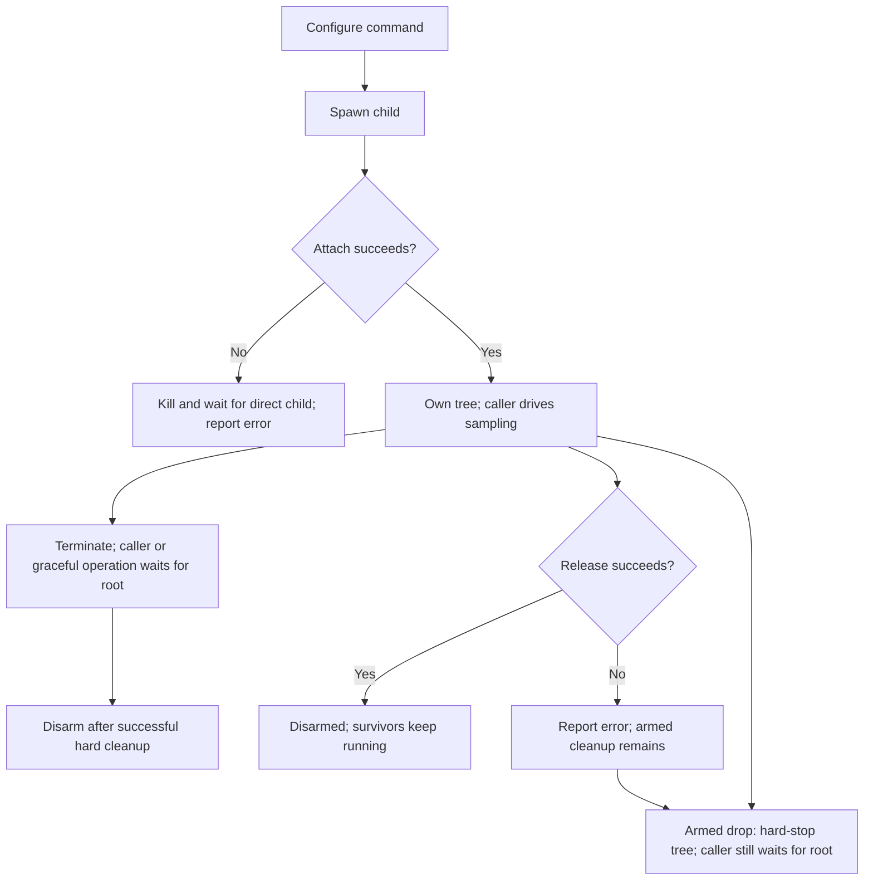
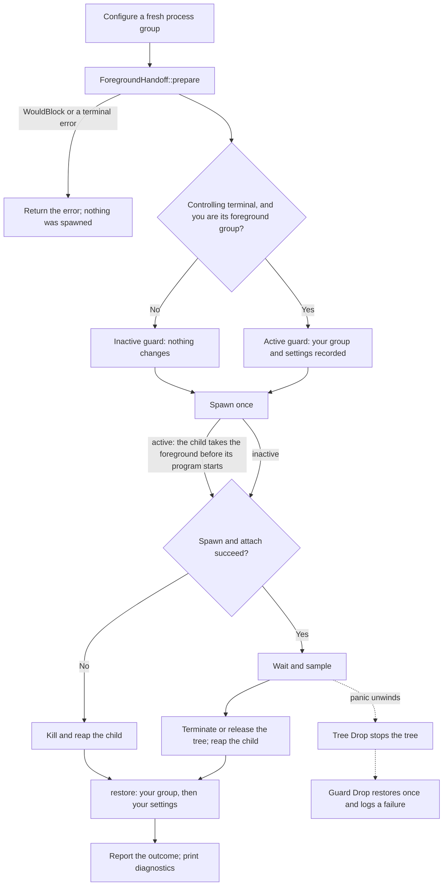

# Process trees

A command you start often starts commands of its own: a shell runs a
pipeline, `make` runs compilers, an installer runs a build hook. When you stop
waiting for the command, because it timed out, the user pressed Ctrl-C, or a
sibling task failed, killing only the process you spawned leaves those
descendants running. A leftover descendant keeps working after you reported
the command as stopped, and if it inherited the command's stdout or stderr it
holds that pipe open, so a reader waiting for end-of-file never finishes.

`sniff::process::ProcessTree` owns a spawned child **and every process it
starts**, so you can stop all of them together, or deliberately let them keep
running. It is the one implementation of this in the repository; Sniff's own
probes, Darkmatter, and Claudine all use it.

The owner is deliberately small. You keep the `std::process::Child`, its
pipes, and your wait loop. The owner sets the command up before it starts,
watches for descendants while you wait, and stops or releases them when you
are done. It starts no thread and takes over no I/O.

## The lifecycle at a glance



Every owned command goes through the same three steps: **configure** the
`Command`, **spawn** it, and **attach** an owner to the child. From then on
the tree ends in one of three ways: you **terminate** it, you **release** it,
or the owner is **dropped** while still armed and terminates it as a
backstop.

## Configure, spawn, attach

```rust
use std::process::Command;

use sniff::process::{ProcessTree, TreeConfig, WINDOWS_CREATE_NO_WINDOW};

let mut command = Command::new("sh");
command.args(["-c", "make all"]);
TreeConfig::process_group()
    .windows_creation_flags(WINDOWS_CREATE_NO_WINDOW)
    .configure(&mut command);

let mut child = command.spawn()?;
let mut tree = match ProcessTree::attach(&child) {
    Ok(tree) => tree,
    Err(error) => {
        // On Windows the child may still be suspended: never leave it.
        let _ = child.kill();
        let _ = child.wait();
        return Err(error);
    }
};
```

Rules for these steps:

- **Configure before `spawn`, attach right after it.** Attach before you start
  pipe readers, register cancellation callbacks, or do anything else that can
  fail. There is no way to attach to a child that was not configured, or to a
  child you have already reaped.
- **If attaching fails, kill and wait for the child yourself.** Attachment
  returns the operating system's error and never falls back to "own only the
  direct child". On Windows a child whose attachment failed may still be
  suspended, so skipping the kill would leave a frozen process behind.
- **Choose an isolation mode** (it matters on Unix only):

  | Constructor | Unix effect | Use it when |
  | --- | --- | --- |
  | `TreeConfig::process_group()` | the child leads a new process group and keeps your session and terminal | the command may use your terminal (an editor, a shell task); pair it with a [`ForegroundHandoff`](#handing-the-terminal-to-an-interactive-child) when it reads the keyboard |
  | `TreeConfig::session()` | the child leads a new session, and so a new group, with no controlling terminal | the command must never touch your terminal (a login-shell query) |

- **Pass Windows creation flags through the config**, for example
  `WINDOWS_CREATE_NO_WINDOW` or `WINDOWS_CREATE_NEW_PROCESS_GROUP`.
  `Command::creation_flags` *replaces* the previous value, so calling it after
  `configure` would silently drop the flag the owner needs. The flags are
  ignored on Unix.
- **Register your own `pre_exec` hooks after `configure`.** A hook then runs
  after the child already has its new group. To give the child the terminal,
  do not write a `tcsetpgrp` hook of your own: use
  [`ForegroundHandoff`](#handing-the-terminal-to-an-interactive-child), which
  also restores the terminal afterwards.

On Windows, `configure` adds `CREATE_SUSPENDED`. `attach` creates a Job
Object that kills its members when it is closed, assigns the suspended child
to it, and only then lets the child's first thread run. A process the child
starts is therefore in the Job before it runs a single instruction. On Unix,
`attach` checks that the child really leads its own process group and rejects
a child in someone else's group.

## Who waits for the root

Two words are easy to confuse here:

- **Terminating** a process stops it.
- **Reaping** a process collects the exit status of a direct child that has
  exited. Only its parent can do that, and until it does the exited child
  stays in the process table.

You always reap the direct child with `Child::wait` (or `try_wait`). The owner
never does it for you, with one exception: `terminate_gracefully` is handed
the `Child` and waits for it. The owner's `Drop` holds no `Child`, so it
cannot reap anything. Descendants other than the direct child are reaped by
the operating system once their own parent exits.

## Sampling and immediate cleanup

On Unix, a descendant can leave the process group (for example by calling
`setsid`). The owner finds such processes by **sampling**: it records the
child's descendants, with their start times, from the process table. Call
`sample()` on every iteration of your wait loop. It is cheap: the first
recording is due 250 ms after attachment and later ones no more often than
that, so most calls only read the clock. On Windows it does nothing, because
the Job already contains every descendant.

```rust
use std::time::Duration;

use sniff::process::CleanupScan;

let status = loop {
    if let Some(status) = child.try_wait()? {
        break status;
    }
    if timed_out() {
        if let Err(error) = tree.terminate(CleanupScan::Always) {
            tracing::warn!(%error, "could not stop the command's background processes");
            let _ = child.kill();
        }
        break child.wait()?;
    }
    tree.sample();
    std::thread::sleep(Duration::from_millis(10));
};

if let Err(error) = tree.terminate(CleanupScan::WhenObserved) {
    tracing::warn!(%error, "could not stop the command's background processes");
}
```

`terminate` hard-stops the group and every recorded descendant that is still
the process that was recorded (Unix), or the whole Job (Windows). Its
`CleanupScan` argument says whether to scan the process table once more when
no sample has recorded anything yet:

| `CleanupScan` | Scans when nothing was recorded? | Use it after |
| --- | --- | --- |
| `WhenObserved` | no | a normal completion |
| `Always` | yes | a timeout, a cancellation, or a wait error |

So a short command that finishes successfully costs **no** process-table scan
at all, while an interrupted one is always checked. If samples did record
descendants, cleanup refreshes and checks them either way.

After a successful `terminate` the owner is **disarmed**: calling it again,
or dropping the owner, does nothing. That matters on Unix, where signaling a
numeric group ID again after the root was reaped could reach an unrelated
group that reused the ID. An already empty Unix group counts as success.

## Graceful cleanup

```rust
use std::time::Duration;

let termination = tree.terminate_gracefully(Duration::from_secs(2), &mut child);
if let Err(error) = termination.cleanup {
    tracing::warn!(%error, "could not stop the command's whole process tree");
}
let status = termination.status?; // the direct child's exit status
```

On Unix, `terminate_gracefully` first scans the process table once and
records every descendant still linked to the direct child, as a sample would
(the scan also learns the direct child's identity if no sample has run yet).
It then sends `SIGTERM` to the group and the recorded descendants, gives the
direct child up to the grace period to exit, and hard-stops whatever is left,
even if the direct child exited first and a descendant that ignored `SIGTERM`
had left the group and was reparented when the child exited. Finally it waits
for the direct child. Windows
has no graceful signal for a whole tree, so it terminates the Job at once and
ignores the grace period. If the hard stop fails, the direct child is killed
before it is waited for.

`TreeTermination` keeps the two results apart (`status` and `cleanup`), so a
cleanup failure never hides or replaces the child's exit status.

## Releasing a tree

Sometimes the descendants should outlive the command. A GUI editor's command
line client (`code --wait`, for example) can start the editor's main window as
a descendant and exit when the file is closed; that window belongs to the user.

```rust
match tree.release() {
    Ok(()) => {}
    Err(error) => {
        // Windows only: the tree is terminated when the owner is dropped.
        warnings.push(format!(
            "Windows could not keep the editor running after the edit; it was closed: {error}"
        ));
    }
}
```

On Unix, `release` disarms the owner and forgets its recordings; it signals
nothing and never fails. On Windows it first clears the Job's kill-on-close
setting and only then closes the Job. If clearing fails, `release` returns
the error and the owner is dropped **still armed**, so the tree is terminated:
`release` never reports success while closing the Job would kill the window.

## The `Drop` backstop

An owner dropped while still armed (neither terminated successfully nor
released) hard-stops the tree as a best effort. It does not wait for a grace
period, does not panic, and cannot report an error. It is a backstop for early
returns and panics, not a substitute for explicit cleanup: you still wait for
the direct child yourself.

`Drop` runs on an ordinary scope exit and while a panic unwinds. It does
**not** run when the process aborts, is killed, or calls `std::process::exit`.
On Windows the Job still terminates its members when the operating system
closes the last handle; on Unix nothing cleans up in that case.

## Handing the terminal to an interactive child

An owned child on Unix leads a process group of its own. That is what lets
the owner stop the whole tree, but it collides with how a terminal shares
itself between processes, so an interactive command (an editor, a prompt, a
nested agent session) needs one more step: `sniff::process::ForegroundHandoff`.

### Why a fresh group cannot use the terminal by itself

Three terms explain the problem:

- A **controlling terminal** is the terminal a session of processes is
  attached to. A process reaches its own through `/dev/tty`, whatever its
  stdin, stdout, and stderr point at.
- The terminal has exactly one **foreground process group**. Only that group
  may read the keyboard, and only that group receives the signals the keyboard
  generates, such as `SIGINT` from Ctrl-C.
- Every other group of the session is a **background group**. If one reads
  the terminal, the kernel stops it with `SIGTTIN`.

A child configured with `TreeConfig::process_group()` starts in a new,
background group. Without a handoff it is stopped the first time it reads a
key, and a Ctrl-C you type goes to your process instead of to it. A
`ForegroundHandoff` makes the child's group the foreground group for as long
as the child runs, then gives the terminal back: your group as the foreground
group, and the terminal settings (`termios`: echo, line editing, raw mode)
exactly as you had them, because an editor that crashes in raw mode would
otherwise leave them broken. The handoff holds terminal state only; the tree
keeps containment, termination, and release.

### A complete launch

```rust
use std::io;
use std::process::{Command, ExitStatus};
use std::time::Duration;

use sniff::process::{CleanupScan, ForegroundHandoff, ProcessTree, TreeConfig};

/// Runs an interactive command as an owned tree that holds the terminal.
fn run_interactive(command: &mut Command) -> io::Result<ExitStatus> {
    TreeConfig::process_group().configure(command); // 1. a fresh group
    // 2. Before spawning. Declared here, outside `run_owned`, so the guard
    //    outlives the tree: on unwind the tree is stopped first.
    let mut handoff = ForegroundHandoff::prepare(command)?;
    let outcome = run_owned(command);
    let restored = handoff.restore(); // 5. before any output of your own
    match outcome {
        Ok(status) if status.success() => restored.map(|()| status),
        other => {
            if let Err(error) = restored {
                tracing::warn!(%error, "could not restore the terminal");
            }
            other
        }
    }
}

fn run_owned(command: &mut Command) -> io::Result<ExitStatus> {
    let mut child = command.spawn()?; // 3. spawn once…
    let mut tree = match ProcessTree::attach(&child) {
        Ok(tree) => tree, //               …and attach at once
        Err(error) => {
            let _ = child.kill();
            let _ = child.wait();
            return Err(error);
        }
    };
    let status = loop {
        // 4. your wait loop (see "Sampling and immediate cleanup")
        if let Some(status) = child.try_wait()? {
            break status;
        }
        tree.sample();
        std::thread::sleep(Duration::from_millis(10));
    };
    if let Err(error) = tree.terminate(CleanupScan::WhenObserved) {
        tracing::warn!(%error, "could not stop the command's background processes");
    }
    Ok(status)
}
```

To let the descendants outlive the command, call `tree.release()` in place of
`terminate`, exactly as without a handoff. Timeouts and cancellation work as
described in [Sampling and immediate cleanup](#sampling-and-immediate-cleanup)
and [Graceful cleanup](#graceful-cleanup).



### Rules

- **Order matters.** Prepare after configuring the fresh group and before
  spawning. The child takes the foreground itself, in the moment between
  starting and executing its program, so its first read cannot race the
  transfer. A command not configured to lead a fresh group fails to spawn
  with `InvalidInput`; `TreeConfig::session()` does not work either, because a
  new session has no controlling terminal to take.
- **Spawn once, while the guard lives.** A prepared command spawned a second
  time, or after its guard is dropped, moves the foreground to a group the
  guard no longer restores from.
- **Declare the guard before the tree.** Rust drops locals in reverse order,
  so when a panic unwinds your function the tree's armed cleanup runs first
  and the terminal is restored afterwards. The guard never waits on a process:
  reaping stays with you.
- **Restore explicitly, before your own output.** Call `restore()` once the
  tree is finished or released and the child is reaped, and before you print
  diagnostics, run callbacks, or start the next command. Until then your
  process is in the background, and writing a prompt or reading a key would
  be stopped by the terminal.

### Inactive guards

`prepare` changes nothing, and returns a guard whose `is_active()` is
`false`, in two cases:

- **No controlling terminal**: a CI runner, a daemon, a process started by
  `setsid`.
- **Your process is a background job**: started with `&`, or suspended and
  resumed with `bg`. A background job must not take the terminal from the
  group that has it.

An inactive guard launches the command unchanged, and `restore()` returns
`Ok(())` without touching anything. Redirecting stdin does not make the guard
inactive: the handoff opens `/dev/tty`, not stdin. Whether to hand the
terminal to a child whose stdin is a file or a pipe is your choice;
Darkmatter, for example, prepares a handoff only for an editor that inherits
stdin.

`/dev/tty` is opened without acquiring a controlling terminal (`O_NOCTTY`)
and closed in the child when it executes its program, so the child never
inherits the descriptor.

**Native Windows** has no foreground group. Its guard is always inactive, and
console and Job Object behavior are exactly as without a handoff: a terminal
child shares your console, and a Ctrl-C typed there reaches both of you.
WSL2 is Linux and takes the Unix path.

### One handoff at a time

A terminal has one foreground group, so a process can hand it to only one
child at a time. While an active guard exists, another `prepare` anywhere in
the same process returns `io::ErrorKind::WouldBlock` with the message
"another terminal foreground handoff is active in this process", before
anything is spawned. The claim is released when the first guard is
restored, or dropped (including during a panic). An inactive guard claims
nothing.

### Who receives Ctrl-C

While the child holds the foreground, the keyboard belongs to it:

- **A typed Ctrl-C goes to the child's group, not to your process.** Your
  `SIGINT` handler does not run. You learn of the interrupt only from the
  child's exit status: it died of `SIGINT`, or, if it is a shell that lost
  its own child to `SIGINT`, it exited with `130` (`128 + SIGINT`).
- **A command that ignores `SIGINT` keeps the terminal** until it exits.
  Pressing Ctrl-C again does not reach your process.
- **A signal sent to your process directly still reaches it**, for example
  `kill -INT <your pid>`. Use that, or your own cancellation path, to stop
  a child that will not exit.

Once the terminal is restored, Ctrl-C reaches your process again.

### Restoration

`restore()` puts back your foreground group and then your terminal settings.

- **It attempts both** even when the first fails, and returns the first
  error.
- **Settings are applied immediately** (`TCSANOW`), without waiting for
  pending output to drain, since a stopped or wedged reader may never drain
  it.
- **It blocks `SIGTTOU` on the calling thread only** while it works. Your
  process is still in the background at that point, and the kernel would
  otherwise stop it for changing the terminal. The process-wide signal
  disposition is never changed, so other threads and your own handlers are
  unaffected.
- **It is idempotent.** After a successful restore, or for an inactive guard,
  it returns `Ok(())` and changes nothing. After a failure the guard stays
  armed.
- **`Drop` is the backstop.** A guard dropped before a successful restore
  tries once more, reports a failure through `tracing`, and never panics.
  Like the tree's `Drop`, it does not run after an abort, a force-exit, or
  `std::process::exit`, which leave the terminal as the child had it.

**Error priority.** The command's own result comes first. A failure earlier
in the launch (spawning, attaching, waiting) is the error you report, and a
restoration failure after it is logged. A restoration failure after a
command that otherwise succeeded fails the launch: a terminal left in the
child's hands or in raw mode is not a success.

## Handling errors

Cleanup is secondary to the outcome you are reporting. Log a cleanup error,
fall back to `Child::kill` for the direct child, and keep the original result:
a timeout stays a timeout, a cancellation stays a cancellation, and an exit
status is never replaced by a cleanup failure. Treat an `attach` error as a
spawn failure: kill and wait for the child, then return the error.

## Guarantees and limits

**Windows**

- After `attach` succeeds there is no escape window: every process the child
  creates the usual way starts inside the Job, and terminating the Job stops
  all of them.
- If the host already runs you inside a Job that forbids assigning the child
  to a new one, `attach` fails. That is a failure, not a weaker mode; each
  caller treats it like any other spawn failure.

**Unix (macOS, Linux, WSL2)**

- Cleanup reaches the members of the owned process group plus every recorded
  descendant, even one that later left the group.
- A descendant that forks, leaves the group, and is reparented after its
  parent exits, all **between two samples** (or between the last sample and
  the cleanup scan), was never recorded and escapes.
  Closing that gap needs a Linux cgroup, a process-global subreaper, or a
  supervising process, none of which this library sets up.
- Recorded descendants and the original root are checked against their
  recorded start time before they are walked for more descendants or
  signaled, so a recycled process ID is skipped. The check is best effort: a
  process ID can still be reused between the check and the signal.
- A process group ID can be reused once the root has been reaped. Disarming
  after a successful cleanup keeps the owner from signaling it again, but a
  final group signal sent after the caller reaped the root carries that small
  risk.
- On macOS a process forked at the same moment as the group kill can miss the
  signal, so the hard kill repeats until the group is empty, for at most
  250 ms. That limit bounds the cleanup; it is not a grace period. Linux and
  WSL2 send the group kill once.

**Everywhere**

- Only descendants are owned. A GUI server or service that was already
  running and that the command merely asked to do work (an editor window
  reused by `code --wait`, a background daemon) is not part of the tree and is
  never stopped.

## Caller policies

Each caller chooses its own isolation mode, grace period, and what to do when
the command finishes:

| Caller | Isolation (Unix) | Windows flags | When the command finishes | When it is stopped |
| --- | --- | --- | --- | --- |
| Sniff detection probes and program installation | process group | none | `terminate(WhenObserved)` | timeout or wait error: `terminate(Always)` |
| Darkmatter login-shell queries | session | `CREATE_NO_WINDOW` | `terminate(WhenObserved)` | timeout or wait error: `terminate(Always)` |
| Darkmatter editor (tree ownership on) | process group, plus a handoff for a terminal editor that inherits stdin | none (shares the console) | `release()`; a Windows failure becomes a warning and the edit still succeeds | cancellation or wait error: `terminate_gracefully` with a 2 s grace |
| Claudine sequence shell tasks | process group | `CREATE_NEW_PROCESS_GROUP` | `terminate(WhenObserved)` | timeout, Ctrl-C, sibling failure, or runaway output: `terminate_gracefully` with a 250 ms grace |
| Claudine lifecycle commands | process group, plus a handoff for every command | `CREATE_NEW_PROCESS_GROUP` | `terminate(WhenObserved)` | cancellation (an interrupt Claudine receives, or a sibling failure): `terminate_gracefully` with a 250 ms grace |

Both callers that hand over the terminal restore it before reporting
anything, and follow the [error priority](#restoration) above. A Claudine
lifecycle command that holds the terminal receives a typed Ctrl-C itself;
when it ends by `SIGINT` (or exits 130), Claudine treats the run as
interrupted once the tree is stopped and the terminal is restored. Without
the foreground, a `SIGINT` end is an ordinary signal exit and 130 an ordinary
exit code.
