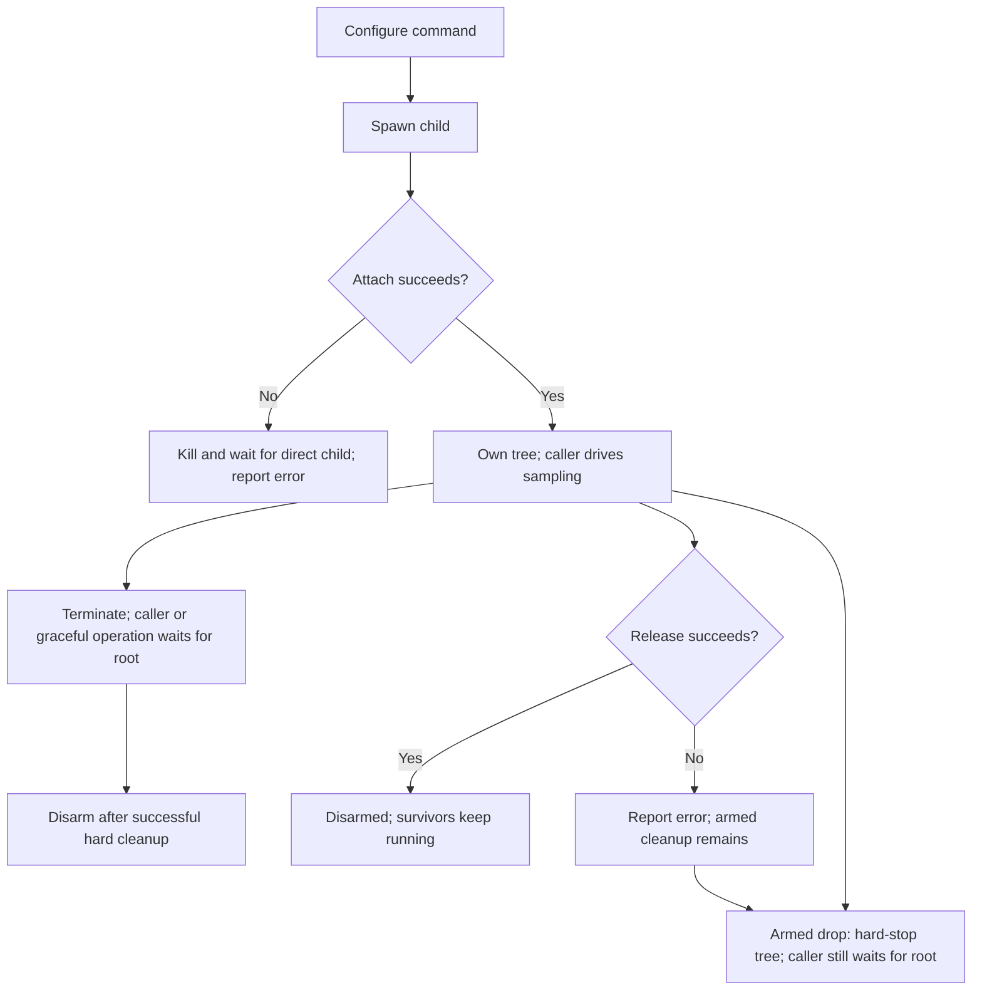

# Process trees

A command you start often starts commands of its own: a shell runs a
pipeline, `make` runs compilers, an installer runs a build hook. When you stop
waiting for the command, because it timed out, the user pressed Ctrl-C, or a
sibling task failed, killing only the process you spawned leaves those
descendants running. A leftover descendant keeps working after you reported
the command as stopped, and if it inherited the command's stdout or stderr it
holds that pipe open, so a reader waiting for end-of-file never finishes.

`sniff::process::ProcessTree` owns a spawned child **and every process it
starts**, so you can stop all of them together, or deliberately let them keep
running. It is the one implementation of this in the repository; Sniff's own
probes, Darkmatter, and Claudine all use it.

The owner is deliberately small. You keep the `std::process::Child`, its
pipes, and your wait loop. The owner sets the command up before it starts,
watches for descendants while you wait, and stops or releases them when you
are done. It starts no thread and takes over no I/O.

## The lifecycle at a glance



Every owned command goes through the same three steps: **configure** the
`Command`, **spawn** it, and **attach** an owner to the child. From then on
the tree ends in one of three ways: you **terminate** it, you **release** it,
or the owner is **dropped** while still armed and terminates it as a
backstop.

## Configure, spawn, attach

```rust
use std::process::Command;

use sniff::process::{ProcessTree, TreeConfig, WINDOWS_CREATE_NO_WINDOW};

let mut command = Command::new("sh");
command.args(["-c", "make all"]);
TreeConfig::process_group()
    .windows_creation_flags(WINDOWS_CREATE_NO_WINDOW)
    .configure(&mut command);

let mut child = command.spawn()?;
let mut tree = match ProcessTree::attach(&child) {
    Ok(tree) => tree,
    Err(error) => {
        // On Windows the child may still be suspended: never leave it.
        let _ = child.kill();
        let _ = child.wait();
        return Err(error);
    }
};
```

Rules for these steps:

- **Configure before `spawn`, attach right after it.** Attach before you start
  pipe readers, register cancellation callbacks, or do anything else that can
  fail. There is no way to attach to a child that was not configured, or to a
  child you have already reaped.
- **If attaching fails, kill and wait for the child yourself.** Attachment
  returns the operating system's error and never falls back to "own only the
  direct child". On Windows a child whose attachment failed may still be
  suspended, so skipping the kill would leave a frozen process behind.
- **Choose an isolation mode** (it matters on Unix only):

  | Constructor | Unix effect | Use it when |
  | --- | --- | --- |
  | `TreeConfig::process_group()` | the child leads a new process group and keeps your session and terminal | the command may use your terminal (an editor, a shell task) |
  | `TreeConfig::session()` | the child leads a new session, and so a new group, with no controlling terminal | the command must never touch your terminal (a login-shell query) |

- **Pass Windows creation flags through the config**, for example
  `WINDOWS_CREATE_NO_WINDOW` or `WINDOWS_CREATE_NEW_PROCESS_GROUP`.
  `Command::creation_flags` *replaces* the previous value, so calling it after
  `configure` would silently drop the flag the owner needs. The flags are
  ignored on Unix.
- **Register your own `pre_exec` hooks after `configure`.** A hook that hands
  the terminal to the child (for example `tcsetpgrp`) then runs after the
  child already has its new group.

On Windows, `configure` adds `CREATE_SUSPENDED`. `attach` creates a Job
Object that kills its members when it is closed, assigns the suspended child
to it, and only then lets the child's first thread run. A process the child
starts is therefore in the Job before it runs a single instruction. On Unix,
`attach` checks that the child really leads its own process group and rejects
a child in someone else's group.

## Who waits for the root

Two words are easy to confuse here:

- **Terminating** a process stops it.
- **Reaping** a process collects the exit status of a direct child that has
  exited. Only its parent can do that, and until it does the exited child
  stays in the process table.

You always reap the direct child with `Child::wait` (or `try_wait`). The owner
never does it for you, with one exception: `terminate_gracefully` is handed
the `Child` and waits for it. The owner's `Drop` holds no `Child`, so it
cannot reap anything. Descendants other than the direct child are reaped by
the operating system once their own parent exits.

## Sampling and immediate cleanup

On Unix, a descendant can leave the process group (for example by calling
`setsid`). The owner finds such processes by **sampling**: it records the
child's descendants, with their start times, from the process table. Call
`sample()` on every iteration of your wait loop. It is cheap: the first
recording is due 250 ms after attachment and later ones no more often than
that, so most calls only read the clock. On Windows it does nothing, because
the Job already contains every descendant.

```rust
use std::time::Duration;

use sniff::process::CleanupScan;

let status = loop {
    if let Some(status) = child.try_wait()? {
        break status;
    }
    if timed_out() {
        if let Err(error) = tree.terminate(CleanupScan::Always) {
            tracing::warn!(%error, "could not stop the command's background processes");
            let _ = child.kill();
        }
        break child.wait()?;
    }
    tree.sample();
    std::thread::sleep(Duration::from_millis(10));
};

if let Err(error) = tree.terminate(CleanupScan::WhenObserved) {
    tracing::warn!(%error, "could not stop the command's background processes");
}
```

`terminate` hard-stops the group and every recorded descendant that is still
the process that was recorded (Unix), or the whole Job (Windows). Its
`CleanupScan` argument says whether to scan the process table once more when
no sample has recorded anything yet:

| `CleanupScan` | Scans when nothing was recorded? | Use it after |
| --- | --- | --- |
| `WhenObserved` | no | a normal completion |
| `Always` | yes | a timeout, a cancellation, or a wait error |

So a short command that finishes successfully costs **no** process-table scan
at all, while an interrupted one is always checked. If samples did record
descendants, cleanup refreshes and checks them either way.

After a successful `terminate` the owner is **disarmed**: calling it again,
or dropping the owner, does nothing. That matters on Unix, where signaling a
numeric group ID again after the root was reaped could reach an unrelated
group that reused the ID. An already empty Unix group counts as success.

## Graceful cleanup

```rust
use std::time::Duration;

let termination = tree.terminate_gracefully(Duration::from_secs(2), &mut child);
if let Err(error) = termination.cleanup {
    tracing::warn!(%error, "could not stop the command's whole process tree");
}
let status = termination.status?; // the direct child's exit status
```

On Unix, `terminate_gracefully` sends `SIGTERM` to the group and the recorded
descendants, gives the direct child up to the grace period to exit, then
hard-stops whatever is left, even if the direct child exited first and a
descendant ignored `SIGTERM`. Finally it waits for the direct child. Windows
has no graceful signal for a whole tree, so it terminates the Job at once and
ignores the grace period. If the hard stop fails, the direct child is killed
before it is waited for.

`TreeTermination` keeps the two results apart (`status` and `cleanup`), so a
cleanup failure never hides or replaces the child's exit status.

## Releasing a tree

Sometimes the descendants should outlive the command. A GUI editor's command
line client (`code --wait`, for example) can start the editor's main window as
a descendant and exit when the file is closed; that window belongs to the user.

```rust
match tree.release() {
    Ok(()) => {}
    Err(error) => {
        // Windows only: the tree is terminated when the owner is dropped.
        warnings.push(format!(
            "Windows could not keep the editor running after the edit; it was closed: {error}"
        ));
    }
}
```

On Unix, `release` disarms the owner and forgets its recordings; it signals
nothing and never fails. On Windows it first clears the Job's kill-on-close
setting and only then closes the Job. If clearing fails, `release` returns
the error and the owner is dropped **still armed**, so the tree is terminated:
`release` never reports success while closing the Job would kill the window.

## The `Drop` backstop

An owner dropped while still armed (neither terminated successfully nor
released) hard-stops the tree as a best effort. It does not wait for a grace
period, does not panic, and cannot report an error. It is a backstop for early
returns and panics, not a substitute for explicit cleanup: you still wait for
the direct child yourself.

`Drop` runs on an ordinary scope exit and while a panic unwinds. It does
**not** run when the process aborts, is killed, or calls `std::process::exit`.
On Windows the Job still terminates its members when the operating system
closes the last handle; on Unix nothing cleans up in that case.

## Handling errors

Cleanup is secondary to the outcome you are reporting. Log a cleanup error,
fall back to `Child::kill` for the direct child, and keep the original result:
a timeout stays a timeout, a cancellation stays a cancellation, and an exit
status is never replaced by a cleanup failure. Treat an `attach` error as a
spawn failure: kill and wait for the child, then return the error.

## Guarantees and limits

**Windows**

- After `attach` succeeds there is no escape window: every process the child
  creates the usual way starts inside the Job, and terminating the Job stops
  all of them.
- If the host already runs you inside a Job that forbids assigning the child
  to a new one, `attach` fails. That is a failure, not a weaker mode; each
  caller treats it like any other spawn failure.

**Unix (macOS, Linux, WSL2)**

- Cleanup reaches the members of the owned process group plus every recorded
  descendant, even one that later left the group.
- A descendant that forks, leaves the group, and is reparented after its
  parent exits, all **between two samples**, was never recorded and escapes.
  Closing that gap needs a Linux cgroup, a process-global subreaper, or a
  supervising process, none of which this library sets up.
- Recorded descendants and the original root are checked against their
  recorded start time before they are walked for more descendants or
  signaled, so a recycled process ID is skipped. The check is best effort: a
  process ID can still be reused between the check and the signal.
- A process group ID can be reused once the root has been reaped. Disarming
  after a successful cleanup keeps the owner from signaling it again, but a
  final group signal sent after the caller reaped the root carries that small
  risk.
- On macOS a process forked at the same moment as the group kill can miss the
  signal, so the hard kill repeats until the group is empty, for at most
  250 ms. That limit bounds the cleanup; it is not a grace period. Linux and
  WSL2 send the group kill once.

**Everywhere**

- Only descendants are owned. A GUI server or service that was already
  running and that the command merely asked to do work (an editor window
  reused by `code --wait`, a background daemon) is not part of the tree and is
  never stopped.

## Caller policies

Each caller chooses its own isolation mode, grace period, and what to do when
the command finishes:

| Caller | Isolation (Unix) | Windows flags | When the command finishes | When it is stopped |
| --- | --- | --- | --- | --- |
| Sniff detection probes and program installation | process group | none | `terminate(WhenObserved)` | timeout or wait error: `terminate(Always)` |
| Darkmatter login-shell queries | session | `CREATE_NO_WINDOW` | `terminate(WhenObserved)` | timeout or wait error: `terminate(Always)` |
| Darkmatter editor (tree ownership on) | process group, then the terminal is handed to the editor | none (shares the console) | `release()`; a Windows failure becomes a warning and the edit still succeeds | cancellation or wait error: `terminate_gracefully` with a 2 s grace |
| Claudine sequence shell tasks and isolated lifecycle commands | process group | `CREATE_NEW_PROCESS_GROUP` | `terminate(WhenObserved)` | timeout, Ctrl-C, sibling failure, or runaway output: `terminate_gracefully` with a 250 ms grace |
| Claudine lifecycle commands sharing your terminal (Unix only) | **not owned** | — | — | the direct child only |

The last row is a deliberate exception. When Claudine runs a lifecycle command
in the foreground of your terminal on Unix, the command must stay in
Claudine's process group: a new group is not the terminal's foreground group,
so the command would be stopped by the terminal the first time it read input.
Until a terminal handoff is added for that path, cancelling such a command
stops only the direct child. On Windows these commands are owned like every
other lifecycle command.
