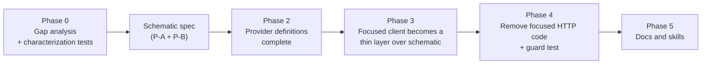

---
$schema:
    status: |-
        enum(
            draft-spec,
            finalized-spec,
            planned,
            implemented,
            review-findings,
            human-in-the-loop,
            completed,
            on-hold,
            abandoned
        ) -> an indicator of progress for this specification
    reviewed: boolean -> indicates whether the specification file has been reviewed by another agent from the one which created the spec
    clarified: boolean -> indicates whether the specification was built -- _in part_ -- with the 'clarify.md' prompt
    implemented: boolean -> indicates whether this spec's plan has been implemented
status: draft-spec
reviewed: false
clarified: false
implemented: false
related:
    - 2026-09-27-list-freshness-ux
    - 2026-10-09-more-pr-support
human_review: true
---

# One HTTP stack for git providers: schematic

## Decision

Every HTTP interaction with a git provider (GitHub, GitLab, Gitea/Forgejo,
Bitbucket) goes through the clients generated by `schematic`. Sniff does not
own a second, hand-written HTTP stack for the same providers.

The July 2026 decision to add `FocusedProviderClient` as a raw-`reqwest` client
beside the schematic adapters was a mistake. It was made for real needs
(below), but it met them by building a parallel stack instead of improving the
shared one. The needs are met by improving schematic, so that every library in
the monorepo gets the same solid, reusable provider clients.

Schematic can cover 100% of what the focused client does. Where it cannot
today, schematic is changed. That cost is accepted.

## Problem

Sniff has two implementations of the same provider operations:

| | Schematic adapters | `FocusedProviderClient` |
|---|---|---|
| Files | `sniff/lib/src/remote/{github,gitlab,gitea,bitbucket,provider}.rs` (about 3,200 lines) | `sniff/lib/src/remote/focused.rs` (about 2,500 lines), `blocking.rs`, `check_status.rs` |
| HTTP | the generated `schematic_schema` clients | hand-written `reqwest` calls and per-provider path tables |
| Callers | the `sniff` CLI, sniff L1 tests | `worktree`, `darkmatter`, the blocking lookups in sniff |
| Operations | repository report, documents, tree, PR list | PR list, PR by id, PR by URL, branch head, CI jobs, check status, discovery |

Consequences:

1. **Duplication.** PR listing and its per-provider path knowledge exist twice.
   Any provider API change must be made in both.
2. **A fix to one stack does not reach the other.** Credential order, error
   mapping, and pagination rules differ between them.
3. **Every new capability lands in the wrong place.** Check status (batched
   GitHub GraphQL) was added to `focused.rs` in 2026-10 because that is where
   the callers are, deepening the split.
4. **Other libraries cannot reuse it.** The behavior that makes the focused
   client trustworthy (below) is locked inside sniff.
5. **Stale docs.** `sniff/lib/src/remote/mod.rs` still says the module uses
   schematic "for all HTTP operations", which has been untrue for the focused
   path since July.

The history shows drift, not a ruling: no spec says schematic cannot do the
job. Spike S1 of `2026-09-24-ux-improvements` (worktree) chose the focused
client on the day, and the implementation log records it as a deviation from a
spec that asked for schematic. The later `2026-09-27-list-freshness-ux` spec
also expected schematic endpoints and schematic credential mappings, and the
code went into `focused.rs` anyway.

## What the focused client does that schematic must do

These are the capabilities the focused client was built for. Each becomes a
requirement on schematic. "Verified" means read in the source on 2026-10-09;
the Phase 0 gap analysis re-verifies each row and confirms the three the
investigation did not check.

| # | Capability | Focused client today | Schematic today |
|---|---|---|---|
| R1 | **Errors keep their evidence.** A non-2xx response reaches the caller with status, headers, and body, so 403 can be classified (rate limited via `x-ratelimit-remaining`, insufficient scope, or not-found-or-not-permitted) and 429 can carry `Retry-After`. | `send` classifies while headers are available (`focused.rs`, `forbidden`). | `request` returns `Err` before the caller sees headers; `ApiError` carries only `status` and `body` (`schematic/schema/src/shared.rs`, `github/client.rs`). Verified. |
| R2 | **Per-call not-found policy.** One call treats 404 as "absent", another as an error. | `NotFound::{Absent, Error}`. | A 404 maps to a fixed "Not found". Verified for GitHub; GitLab, Gitea, and Bitbucket not diffed. |
| R3 | **Credential evidence.** Which credential each request was actually sent with (anonymous, or the variable name, including host-bound `SNIFF_{PROVIDER}_{HOST}_TOKEN`) is recorded per request and available to the caller. Names only, never values. | `SentWith` / `SentLog`. | The client resolves env variables internally and does not report which one it used. The sniff adapters retry anonymously (`unauthenticated_client()`), which makes evidence ambiguous. Verified. |
| R4 | **Credential order and scope are data.** The first set, nonempty variable wins; a host-bound variable overrides a provider variable; a token is never sent to a different host. | `credentials::provider_token`, `CredentialScope`. | `env_auth` has its own order, which spike S1 found would "get GitHub's order and Bitbucket's variable wrong". Verified in the spike; confirm in Phase 0. |
| R5 | **Redirects never carry credentials.** Redirects are denied (or revalidated against the exact host policy) per request. | `Policy::none()` on every request. | reqwest's default policy, configurable only by passing a custom `reqwest::Client`. Verified. |
| R6 | **Exact-host policy.** The endpoint host must equal the remote's host (and scheme/port for self-managed servers) before a credential is attached. | `provider_endpoint_allowed`. | Not found in schematic. Inference. |
| R7 | **One deadline per operation.** All requests of one lookup (pages, enrichment) share a monotonic budget; the remaining time becomes each request's timeout. | `with_deadline`, `run_with_deadline`. | A fixed 30 s per-request timeout. Verified. |
| R8 | **Complete lists.** A list walks every page up to a bound (`MAX_PAGES` 20 of `PAGE_SIZE` 100) following `Link` headers, and an incomplete walk is an error, never a partial or empty answer. | Implemented. | Stage-1 adapters read one page (GitHub 30, GitLab 20, Bitbucket first page); pagination generates an empty marker trait with no methods (2026-07-31 review, §6.4). Verified. |
| R9 | **Filters sniff needs.** Open PRs filtered by head/source branch and state; `per_page`. | Implemented. | The generated request types lack head and source-branch filters (`schematic/schema/src/github/requests.rs`, `gitlab/requests.rs`). Verified in the spike. |
| R10 | **Item identity.** PR source repository, source branch, and head SHA, including fork detection. | Implemented in the focused mapping. | Response types exist; whether they carry every field is unchecked. Confirm in Phase 0. |
| R11 | **GraphQL.** A `POST /graphql` call (GitHub.com `api.github.com/graphql`; self-hosted `/api/graphql` beside a `/api/v3/` base) with variables, sharing R1 to R7. | `check_statuses` in `focused.rs`. | No GraphQL surface in schematic. A single `POST` endpoint with a JSON body is expressible. Batching (up to 100 PRs per request, aliases, variables, partial-error handling) stays in the sniff consumer, which is domain logic. Inference. |
| R12 | **Self-managed hosts.** Base URL is chosen at runtime after exact-host consent, keeping the configured scheme and port; discovery probes a neutral host anonymously. | `FocusedProviderClient::discover`. | Base URL can be overridden (`with_client_and_base_url`). Discovery is not a schematic concern; it stays in sniff and only supplies the base URL. |

## Prerequisites in schematic

Both of the following land before the sniff migration starts. They are specs
in the schematic area, written and implemented first; this spec does not
duplicate their content.

### P-A. Items from the 2026-07-31 macro review

`schematic/reviews/2026-07-31-macro-review` is a review, not a planned spec,
but it is the record of the known API-quality fixes in schematic and nothing in
`schematic/features` or a `fixes` directory is active. These items from its
ranked list (§9) and defect ledger (§10) are prerequisites because the
migration depends on them:

| Review item | Why the migration needs it |
|---|---|
| §9.6 / §5.2 typed error responses (status to schema map, or `errors: Vec<(u16, Schema)>`) | R1: errors that keep their evidence |
| §6.4 pagination (an empty marker trait today; `fetch_all_pages` documented but absent) | R8: complete lists |
| §9.3 turn silent drops into `validate_api` errors | the migration must not trade the focused client's typed errors for silent drops |
| §10 #5 `ApiKeyParam` clients never send the key | R4: credential handling is data and honored |
| §9.12 typed convenience methods; the unchecked `request<T>` hole (§6.5) | consumers call typed methods, not `request::<WrongType>` |
| §9.4 / §10 #16 un-ignore `generated_code_compiles` | regenerated provider clients must be compiled by a normal run |
| §10 #2 `generate --api <one>` deletes the other clients | the migration regenerates provider clients repeatedly |
| §9.5 streaming and response `content_type` | not required for providers; listed only so it is not mistaken for a gap |

The review's other items (builders, typed schema references, OpenAPI bridge,
WebSocket) are not prerequisites.

### P-B. Runtime gaps the review did not record

Verified on 2026-10-09 and absent from the review: R1 (errors discard headers),
R3 (no credential evidence), R5 (redirect policy), R6 (host policy), R7
(shared deadline), R2 (per-call not-found policy), and R11 (GraphQL surface).
They are added to the review as a dated addendum so one document lists them,
and become requirements of the schematic spec that carries P-A.

### Shape of the change (decided here, detailed in the schematic spec)

- The generated client gains a **request-hooks / policy** seam: a caller
  supplies a redirect policy, an endpoint-host check, and a per-request
  deadline, so no consumer needs its own `reqwest::Client` to get them.
- Errors become a typed value carrying status, selected headers, and body, and
  every non-2xx reaches the caller as that type, never an opaque string.
- The client reports, per request, what credential it sent as a **sent log**
  of variable names (never values), and exposes the env-resolution order as
  data a consumer can inspect and override.
- A call can declare how it treats 404 (error or absent).
- The anonymous-retry behavior is explicit and opt-in per call, never implicit.

## Design of this fix

### 1. One provider layer

`FocusedProviderClient` becomes a thin layer over the schematic clients, then
is removed once nothing needs it. Sniff's public blocking API
(`open_pull_requests`, `open_pull_requests_with_status`, `branch_head`,
`pull_request_for_branch`, `credential_env`, and the rest of `blocking.rs`)
keeps its signatures: `worktree` and `darkmatter` do not change. The rule for
the end state:

- No `reqwest` import in `sniff/lib/src/remote` outside tests.
- No provider path table in sniff. Paths live in schematic definitions only.
- Provider facts (path, filters, pagination, field names) live in
  `schematic-definitions`; sniff keeps domain logic (batching, status
  classification, identity matching, credential-order policy as data fed to
  schematic, discovery consent).

### 2. A cross-provider abstraction

Schematic's individual provider implementations are the definite part of this
work. Whether schematic also provides a cross-provider abstraction (one
"open pull requests / branch head / check status" interface over the four
providers) is the author's open question, recorded below. The seam is designed
so that either answer is cheap:

- The normalized types already in sniff (`PrSummary`, `PrCheckStatus`,
  `PrState`, `ApiFlavor`, `RequestCredentials`) are the starting vocabulary.
- If the abstraction moves into schematic, it is a layer **above** the
  generated clients (a trait plus normalized types), not a change to them, so
  the migration does not depend on it.
- If it stays in sniff, sniff keeps it as a layer over schematic's clients.

### 3. Characterization before change

Before any code moves, pin the focused client's observable contract with tests
that run against the existing stand-in servers and recorded fixtures (never a
live provider), so the migration proves equivalence instead of assuming it:

- credential selection order and host-bound precedence, per provider;
- no credential sent across a redirect or to another host;
- 401, 403 (each of the three classes), 404 (both policies), 429, 5xx, and
  transport failures map to the same typed errors;
- the sent log content for anonymous, keyed, and host-bound requests;
- one deadline across several pages and enrichment batches;
- a complete list across pages, and an incomplete walk failing rather than
  returning a partial list;
- the check-status GraphQL batches, partial errors, and rate-limit behavior as
  the in-flight `2026-10-09-more-pr-support` feature defines them.

The same tests must pass before and after each phase.

### 4. A guard against regrowth

Add a sniff test, in the style of `claudine-cli/tests/l1/dispatch_inventory.rs`,
that fails when a provider HTTP client or provider path table appears in
`sniff/lib/src` outside the schematic-backed layer. The migration is not done
until it is green with an empty allowlist.

## Phases

0. **Gap analysis and characterization tests.** Re-verify every row of the
   table (R1 to R12), including the three not yet diffed (GitLab, Gitea, and
   Bitbucket error mapping; the filters on each provider; response fields for
   identity). Write the characterization tests above against the current code.
   Output: a verified list that the schematic spec adopts.
1. **Schematic spec and implementation** (P-A and P-B). A schematic-area spec,
   written from the verified list, implemented and reviewed before Phase 2.
2. **Provider definitions complete** in `schematic-definitions`: PR list with
   head/source-branch/state filters and `per_page`, PR by id, branch head (exists
   from `630ce1cda`), CI jobs, and a GitHub `POST` GraphQL endpoint; regenerate
   `schematic-schema`.
3. **Migrate the focused client.** Re-implement each operation of
   `FocusedProviderClient` over the generated clients one operation at a time,
   starting with PR list, keeping the characterization tests green at each step.
   The check-status work already staged for `2026-10-09-more-pr-support` moves
   with it; that feature is not blocked and ships on the current code first.
4. **Remove** `focused.rs`'s HTTP code and the duplicated adapter paths; turn
   on the guard test; delete the stale module doc.
5. **Docs and skills.**

## Out of scope

- A schematic-wide redesign (the review's §5b "vocabulary v2": status-
  discriminated responses as the type of `Endpoint::response`, WebSocket/REST
  unification, polymorphic bodies from hand-written definitions). The error
  work above uses the additive variant (`errors: Vec<(u16, Schema)>`).
- Providers other than GitHub, GitLab, Gitea/Forgejo, and Bitbucket.
- Changing the public signatures of `sniff::remote::blocking`.
- Streaming responses.

## Documentation to update

- Sniff `docs/` pages for the remote layer and the sniff skill
  (`remote-and-repository.md`): one HTTP stack, where behavior now lives.
- `sniff/lib/src/remote/mod.rs` module docs (stale today).
- Schematic docs and skill for the new client policy, error, and sent-log
  contract; `schematic/docs` pages for each new definition.
- `sniff/docs/dependencies.md` only if a dependency changes (`reqwest` leaves
  sniff's direct dependencies if nothing else uses it).
- The worktree skill's `list-remote.md` credential-evidence references, if the
  names or paths they cite move.

## Acceptance

- The Phase 0 characterization tests pass unchanged against the migrated code.
- `sniff/lib/src/remote` has no direct HTTP client and no provider path table;
  the guard test is green with an empty allowlist.
- `worktree`, `darkmatter`, and the `sniff` CLI build and pass their tests with
  no signature change in `sniff::remote::blocking`.
- A second library can obtain the same behavior (typed errors, sent log,
  redirect and host policy, deadline, complete lists) from schematic alone,
  demonstrated by a schematic-level test that does not depend on sniff.
- No live-network tests. Tests use the existing stand-in servers and fixtures.

## Open questions

1. **Does the cross-provider abstraction live in schematic?** Recommendation:
   decide after Phase 1, with the verified list in hand. If more than one
   library needs the normalized "open PRs / branch head / check status" view,
   it belongs in schematic as a layer above the generated clients. Until then
   it stays in sniff.
2. **Where does the `ApiKeyParam` and sent-log design land if schematic must
   stay free of vendor knowledge?** The review (§4.4) already flags vendor
   names leaking into the neutral layer. Credential-order policy is data
   supplied by the consumer, not code in schematic.
3. **GraphQL in schematic definitions.** Defining `POST /graphql` as one
   endpoint is expected to work. Confirm the generator supports a variables
   body whose shape is chosen per call.
