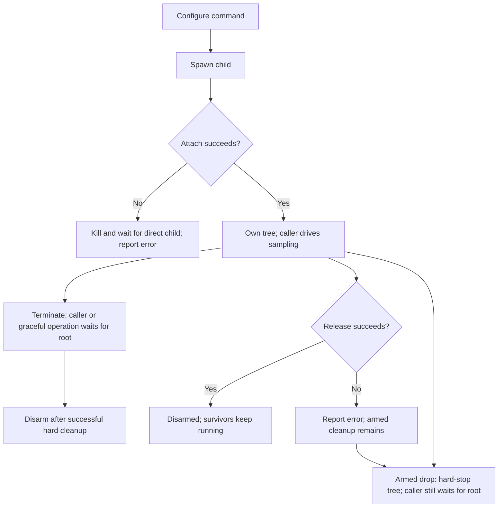

# One shared process tree, with race-free Windows assignment

## Why this exists

Three packages each implement ownership of a spawned child and the processes
it starts. Ownership lets cancellation stop background work as well as the
direct child, and prevents a leftover process from keeping an output pipe open
indefinitely.

| Implementation | Used by | Windows assignment | Capabilities to retain |
|---|---|---|---|
| Darkmatter's [private `ProcessTree`](../../../darkmatter/lib/src/process_tree.rs) | [editor launcher](../../../darkmatter/lib/src/editor/launch.rs) and [login-shell query launcher](../../../darkmatter/lib/src/markdown/compose/shell_expansion/launcher.rs) | Spawned running, then assigned: a descendant started before assignment escapes the Job | Graceful stop; release so a GUI editor's window survives |
| Claudine's [private `ProcessTree`](../../../claudine/lib/src/composition/sequence/task/shell.rs) | Sequence shell tasks and isolated lifecycle commands | Spawned suspended, assigned, then resumed | Termination on `Drop`; repeated group killing on macOS to catch concurrent forks |
| Sniff's [private `process_tree` module](../../lib/src/process.rs) | Detection probes and package-manager/install commands | Spawned suspended, assigned, then resumed | Remembers observed Unix descendants with start times, including those later reparented after creating their own session |

A Windows Job Object is a kernel-managed group of processes. Assigning the root
before allowing it to execute ensures its descendants inherit membership. In
Darkmatter today, an editor helper started before assignment survives Ctrl-C
or a sibling failure. Its comments accept this window and explain that closing
it requires finding the suspended child's initial thread; the other two
implementations already do that.

The review of `2026-11-14-edit-action` surfaced this duplication and gap.

## Author rulings (2026-11-14)

*(Wording revised in review and confirmed by the author, 2026-11-14.)*

- **One implementation, race-free on Windows, in `sniff`.** Sniff is already a
  dependency of both Darkmatter and Claudine, so sharing introduces no cycle
  or new crate.
- **Delete the duplicate implementations.** Consumers call Sniff directly;
  they retain their own deadlines, output handling, and terminal policies.
- **Publish one canonical document** stating the shared rules. OS and consumer
  documentation links to it and retains only caller-specific behavior.

## Scope and dependency

Expose the shared owner through Sniff's existing public `process` module.
Migrate the three implementations above, including the isolated lifecycle
command path that shares Claudine's current owner. Keep Sniff's timeout and
pipe-draining helpers private. The existing `depends-on` frontmatter entry,
`2026-11-14-concise-message-clamp`, remains the sequencing dependency; this
fix does not redesign error-message delivery.

**Reviewer's note:** sharing containment does not mean giving every command
the same terminal or completion policy. A login-shell probe must have no
controlling terminal, a terminal editor needs foreground access, and a GUI
editor's remaining window must survive a completed wait. The design below
keeps those differences explicit so removing duplication does not break them.

Provider-session supervision in Claudine's CLI, including its existing Windows
Job policy, is outside this migration. Sniff's public
[`configure_detached_child`](../../lib/src/process.rs), used for intentionally
unbounded children, also retains its contract. Neither is a duplicate to remove
merely because it creates a process group or a Job. No new subprocess framework,
process-global signal handler, Linux cgroup, or subreaper is introduced.

## Shared API contract

The public owner is the union of the three capability sets. Its documentation
must distinguish terminating a process from reaping it: reaping means waiting
for an exited direct child to collect its status. A tree owner attached by
reference cannot reap that child from its destructor, and ordinary Unix callers
cannot wait for arbitrary grandchildren.

### Configure, spawn, and attach

- Provide public command configuration and fallible attachment returning
  `std::io::Result<ProcessTree>`, with the owner under `sniff::process`.
  Configuration happens before `Command::spawn`; attachment is the next
  operation after a successful spawn, before readers, cancellation callbacks,
  or other fallible setup. No running-child attachment mode is supported on
  Windows.
- On Unix, support both a fresh process group and a fresh session. The latter
  also establishes a fresh group and is needed by Darkmatter's login-shell
  probes. Apply exactly one of these modes: calling `process_group(0)` before
  `setsid` would make the child a group leader and prevent `setsid` succeeding.
  Preserve caller-supplied terminal handoff hooks after group setup.
- On Windows, add `CREATE_SUSPENDED`, create a Job with kill-on-close, assign
  the child, and resume its initial thread only after assignment succeeds.
  Own every Job, snapshot, and thread handle immediately and close it once.
  Do not enable Job breakaway or make the Job handle inheritable.
- Make Windows creation flags an explicit configuration input, combined with
  `CREATE_SUSPENDED` in one place. Rust's `creation_flags` setter replaces the
  previous value: independent setters must not lose suspension or the caller's
  `CREATE_NO_WINDOW`/`CREATE_NEW_PROCESS_GROUP` choice. Editors keep the shared
  console; Claudine's isolated shells keep their new-group flag; probes keep
  their existing no-window behavior. Callers must not overwrite these flags
  after tree configuration.
- Attachment verifies Unix group ownership rather than blindly trusting any
  supplied PID. Reject a live root in a foreign group and invalid group IDs.
  Retain Claudine's handling of a prepared child that exited before attachment:
  macOS can return `ESRCH` before it is reaped. The API requires the caller to
  have configured this command and not yet reaped the child; this requirement
  also makes that fast-exit case meaningful.
- If configuration, Job creation, assignment, thread lookup, or resumption
  fails, return the underlying error. Never resume without successful
  assignment or fall back to killing only the root as a successful ownership
  mode. Before resume, a Windows failure leaves the child suspended or already
  terminated by closing an assigned Job. Every caller kills and waits for the
  direct child on attachment failure. Close all intermediate handles too.

This low-level API leaves the `Child`, its pipes, and its wait loop with the
caller. It does not start a supervisor thread or take over I/O. Its usage
examples must show the attachment-failure cleanup, not just the successful path.

### Observe Unix descendants without adding work to short commands

Expose a sampling operation for the caller's wait loop. The shared owner
controls when work is due: no process-table refresh at attachment, the first
sample after the existing 250 ms interval, and subsequent samples no more often
than that interval. Calling the operation on every wait-loop iteration is
cheap when no sample is due. Windows sampling does no work.

Retain observed descendants with their process start times, so a process seen
before its parent exits remains addressable after reparenting, even if it has
called `setsid` or changed groups. Validate recorded identities **before using
them as roots for another descendant walk**, as well as before signaling them;
a recycled PID must not make an unrelated tree eligible for cleanup. Record
the original root's start time in the same snapshots when available. After
the root is reaped, use its PID as a traversal root only if that stored identity
still matches; missing or unverifiable roots are skipped. Do not add an
attachment-time scan to obtain this identity. This is best-effort identity
checking, not an atomic guarantee against reuse between an observation and a
signal.

Keep Sniff's existing final-scan policy explicit in the shared API: interrupted
or failed commands request a cleanup scan even if no sample ran; a normal
completion with no observed descendants skips it. If observations exist,
cleanup refreshes and checks them. Thus a short successful probe still performs
zero process-table scans. Callers that own a tree must use a polling wait loop
to drive sampling, including the editor path that currently uses blocking
`wait` when it has no cancellation callback. Unowned launches may keep blocking
waits. Do not add a background worker or a process scan per poll.

### Terminate, release, and drop

| Operation | Contract |
|---|---|
| Immediate termination | Hard-stop the owned group/Job and validated descendants. Accept the final-scan policy described above. Return cleanup errors; an already absent Unix group is success. The caller still kills the direct child as a fallback if needed and waits for it. |
| Graceful termination | Accept a grace duration and the direct `Child`. On Unix, send `SIGTERM` to the group and validated observed descendants, poll up to the grace deadline, then hard-stop remaining owned processes even if the root exited first. On Windows, terminate the Job immediately. Fall back to `Child::kill` if tree termination fails before waiting for the direct child, and report cleanup/wait errors. |
| `release(self)` | Return `std::io::Result<()>`. On Unix, disarm cleanup and discard observations without signaling. On Windows, first clear kill-on-close, then disarm and close the Job. If clearing fails, return an error and retain normal cleanup during destruction; never claim success while closing a still-armed Job kills the GUI window. |
| `Drop` while armed | Best-effort hard termination, without a graceful wait or panic. Close owned handles. The caller remains responsible for waiting for the direct child; this is a cleanup backstop, not a claim that grandchildren were reaped. |

After successful explicit hard cleanup, disarm the owner so dropping it does
not signal a numeric process-group ID again after the caller waits for the
root. Repeated explicit cleanup on that owner is a no-op. If explicit cleanup
fails, retain the destructor's best-effort backstop. A released owner never
terminates members on drop.

Preserve Claudine's bounded macOS repeated group kill, used to catch a child
forked concurrently with a group signal. Its existing 250 ms limit is a cleanup
bound, not a new grace period. Linux/WSL2 keep their existing path. Do not
promote Sniff's current claim that group signaling is atomic with forks on
all Unix systems into the new public contract: Claudine's macOS implementation
already contains the counterexample and mitigation.

Keep cleanup errors visible without losing the original failure. Callers
retain their existing spawn/isolation, timeout, cancellation, and wait-error
categories; a secondary cleanup failure must not turn cancellation into
success or replace its exit status. An editor release failure does not fail the edit (author ruling,
2026-11-14): the file was edited, so the action succeeds and the stack
continues, with a warning such as "Windows could not keep the editor running
after the edit; it was closed". Under `--deny all` that warning blocks like
any other. `release` itself still returns the error to its caller. Destructors cannot return errors and remain best-effort.

## Consumer integration

Each caller uses the shared mechanisms with its existing completion policy:

| Consumer | Launch and wait policy | Completion and cancellation policy |
|---|---|---|
| Sniff detection and install commands | Own group on Unix; suspended Job start on Windows; existing deadlines and concurrent readers; drive sampling | Terminate remaining members on success, timeout, or wait error, then settle readers. Preserve bounded Unix pipe draining despite escaped descendants. |
| Darkmatter login-shell queries | New session on Unix; no console window on Windows; existing bounded output and deadline; drive sampling | Terminate remaining members even when the shell exits successfully; retain the bounded EOF wait. |
| Darkmatter editor with tree ownership enabled | Own group plus existing Unix terminal foreground handoff and restoration; shared Windows console; drive sampling | A completed editor wait, including a nonzero exit, releases the tree as today; cancellation or wait failure uses the existing graceful duration. A release failure is a warning; the edit still succeeds. |
| Claudine sequence shell tasks and isolated lifecycle commands | Own group on Unix; existing Windows new-group flags plus suspension; drive sampling | Preserve each caller's grace duration, cancellation checks, runaway-output cap, error categories, and teardown-before-reader-settlement order. Drop remains a hard-stop backstop. |

Darkmatter launches with tree ownership disabled remain unowned. Claudine's
Unix lifecycle-command path that shares the host's foreground terminal also
retains its existing direct-child-only cancellation policy. Moving that path
to a fresh group would stop interactive input unless a foreground handoff were
added, which is outside this fix. Document this caller exception rather than
claiming every lifecycle command owns a tree. The follow-up
`2026-11-14-foreground-tree-handoff` closes it (author ruling, 2026-11-14).

Delete Darkmatter's private module and Claudine's local owner, thread-resume,
and isolation implementations; replace Sniff's nested private implementation
with the public shared implementation. Caller code may choose modes and perform
terminal handoff, but may not duplicate Job management, group setup, descendant
tracking, or termination. Existing dependency edges suffice. Remove dependency
features only if no other code in that package needs them, and update dependency
documentation if manifests change.

## Guarantees and limits

- **Windows:** after successful attachment, descendants created through normal
  child creation inherit the Job before they run. There is no spawn-to-assignment
  escape window. Hosts whose enclosing Job forbids assignment fail ownership
  explicitly; the OS skill's provider-specific fallback must not become a
  blanket rule for this API.
- **Unix:** group members and validated observed descendants are cleanup
  targets. A descendant that forks, leaves the group, and becomes reparented
  before any sample links it to the tree can escape. Leaving the group after
  being observed does not by itself lose it. Retain Sniff's deterministic test
  demonstrating the unobserved escape and its fixture cleanup.
- **Unix numeric identity:** the accepted group-ID reuse window remains when
  the caller has already reaped the root before a final group signal. Start-time
  checks reduce individual-PID reuse risk but cannot make observation and
  signaling atomic. Do not claim the shared API removes these residuals.
- **Ownership boundary:** a pre-existing GUI server or external service asked
  to do work is not a descendant merely because the command contacted it.
  Release deliberately allows owned survivors to continue. `Drop` runs on
  ordinary scope exit and panic unwinding, not after process abort, forced
  host termination, or `process::exit`; it cannot promise Unix cleanup then.

## Documentation

Create `sniff/docs/topics/process-trees.md`, written for a developer new to the
repository. Explain the operations and limits above, with compact examples of
configuration/attachment, sampling and immediate cleanup, graceful cleanup, and
release. Show who waits for the root and how errors are handled. Include a
Mermaid lifecycle diagram showing configure → spawn → attach → owned, the
failure cleanup path, and the terminate / release / drop endings.

Update Sniff's library overview and README with a short entry linking to the
new topic. Update the `process` module documentation: it will no longer be
public only for detached-child configuration. Keep detailed rules in the topic.

Link to it from `.claude/skills/os/SKILL.md`, `.claude/skills/os/windows.md`,
`.claude/skills/sniff/` (including its architecture reference),
`.claude/skills/darkmatter/`, and `.claude/skills/claudine/` where process
ownership is described. Update Darkmatter's edit and shell-query docs and
Claudine's lifecycle/sequence cancellation docs. Remove claims in current docs,
skills, and source comments that accept the Windows assignment window or
promise unconditional Unix containment. Preserve caller-specific console and
foreground exceptions. Historical specs stay unchanged.

If caller-facing documentation changes, update the affected caller-skill
sources under each area's `docs/use-skills/` and publish them with that area's
`just publish-skills`; do not edit installed user-scope skills directly. Docs
link to the canonical topic, never to this spec.

## Verification

Use the test toolkit and existing package recipes. A controlled subprocess test
is L1 even when it exercises an OS API; OS selection alone does not make it
L2. Use bounded readiness markers rather than fixed sleeps, and give every
fixture its own cleanup guard, including the intentionally escaped process.

- Move or extend existing Sniff tests for normal completion, timeout, root
  exit before descendants, large output, quiet/session-detached descendants,
  and the known between-samples escape. Add focused coverage for the shared
  immediate, graceful, release, and armed-drop operations; release must leave
  a controlled descendant alive and the fixture must then clean it up.
- Exercise Windows assignment-before-resume ordering and injected failures in
  Job setup, assignment, thread lookup/resume, and release. Confirm failures
  leave no suspended direct child or leaked handle after caller cleanup. A
  real helper that spawns a descendant immediately verifies inherited Job
  membership and termination; ordering/failure tests must not depend on winning
  a scheduling race.
- Cover Unix fast exit at attachment, rejection of a foreign group, graceful
  cleanup when the root exits but a descendant ignores `SIGTERM`, recorded PID
  reuse before traversal, and suppression of repeated cleanup after disarming.
  Use injected process observations for reuse and sample scheduling: verify
  zero scans before the first interval and no Windows scans without timing a
  benchmark. Retain the macOS repeated-kill behavior in the existing
  background-descendant cleanup tests; add a focused regression only if those
  tests do not exercise it.
- Run the existing Darkmatter editor cancellation, SIGTERM-ignoring descendant,
  GUI-client survival, and shell-query cleanup tests, plus Claudine's sequence
  shell and lifecycle-command tests. Keep their behavioral assertions; adapt
  private test hooks if removal of the local implementations requires it.
- Exercise existing terminal-foreground coverage for editors and login-shell
  probes. Use the existing L2 recipe and harness when a real terminal is needed;
  no terminal or browser may gain focus. Do not launch an actual GUI editor to
  prove release.
- Run `just test` in each affected package area and the affected terminal tests
  through `just test-l2`. Check Sniff with no features enabled (no `reqwest`),
  and Darkmatter's consumer build (`sniff` with `features = ["remote"]`), so
  this public local API adds no HTTP dependency requirement. Obtain
  macOS, Linux, native Windows, and WSL2 evidence through the existing recipes
  and evidence-reuse rules. Use the OS skill for matching rigs; an SSH host
  whose enclosing Job rejects assignment is failure-path evidence, not proof
  of successful containment. Record missing evidence explicitly.
- Search the three migrated implementations and their callers to confirm tree
  setup, Job assignment/resume, and termination are delegated to Sniff. Search
  current docs/skills for stale assignment-window claims. Do not require one
  `CreateJobObjectW` or `process_group(0)` occurrence across the repository:
  provider supervision, detached-child setup, and tests have separate uses.

Performance verification is structural: retain the deferred 250 ms sampling,
zero scans for short successful probes, no Windows process-table sampling, and
bounded existing cleanup/reader waits. No benchmark or performance spike is
required for this consolidation.

## Open Questions

None. The review resolves integration details within the author rulings above;
it does not expand containment to unrelated provider-session supervision or
promise to close the documented Unix escape windows.
