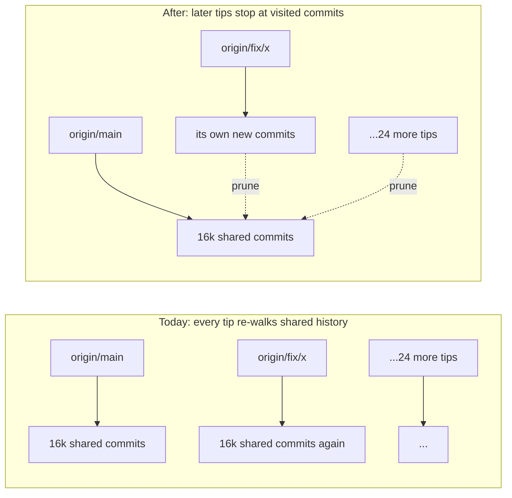

# Commit linking walks each remote's history once, inside the measured request

## Why this exists

`sniff repo git-status` takes about **3.5 s** on the Linux build host's
checkout of this monorepo. Everything except linking finishes in 0.15 s:

| Command (Linux build host, 2026-11-20) | Wall clock |
|---|---|
| `sniff repo git-status --json` | 0.15 s |
| `sniff repo git-status --history 0` | 0.15 s |
| `sniff repo git-status` (also `--compact`, `--plain`) | ~3.5 s |
| `sniff repo recent-commits` (text or `--json`) | 1.45 s |
| `git status` | 0.03 s |

Three gdb stack samples taken during the slow run all point to the same
place. The text renderer calls `commit_links_at`
(`cli/src/output/filesystem/mod.rs`, `build_git_status_items`), which runs
`link_commits` → `link_commits_from_snapshot` → `walk_ancestry`, and the time
goes into decoding commits from the pack (`gix_pack::data::File::decode_entry`
under `gix::revision::walk`).

Three conditions combine on this host:

1. **The commits being linked are on no remote-tracking ref.** `HEAD` was 12
   commits ahead of `origin/main`, so none of the 10 displayed commits were
   contained. `CommitLink::remote` can only be `Some(false)` after *every*
   remote tip has been walked to the root, so the early stop never fires.
2. **Each remote tip is walked independently.** The checkout has 26
   remote-tracking branches that share most of their history. Summing
   `git rev-list --count` over each tip gives **342,614** commit visits, but
   the union of all tips is only **16,682** commits, so about 20× of the work
   is repeated. The 5,000,000-visit `COMMIT_VISIT_BUDGET` never limits it.
3. **The repository has no commit-graph file** (`.git/objects/info/` is
   absent), so every visit inflates a commit object. In a throwaway shared
   clone, adding a commit-graph cut link time from about 2.9 s to about
   1.5 s. That is a real gain, but the smaller of the three factors and
   outside Sniff's control.

The macOS laptop the author compares against is fast, most likely because its
branch is usually pushed, so a target is found on the first tip and the walk
stops. This was not measured on that host.

A second defect hides the first. `--perf` on the slow run reported a
**137 ms** total. Link resolution runs in the CLI's renderer, outside the
collected detection pass, so neither its time nor its `git.commit_visits`
appear in the report. The CLI skill's rule that business logic lives in the
library, with the CLI only reporting it, is broken in the same place.

## Scope

In scope:

- `link_commits_from_snapshot` (`lib/src/filesystem/git/commit_links.rs`)
  and the `walk_ancestry` helper it uses
  (`lib/src/filesystem/git/remote_refresh.rs`). Every linker caller
  benefits: `commit_links_at`, `commit_browser_url` (`repo commit` style
  lookups in `cli/src/commands/mod.rs`), and `RecentCommits`
  (`recent_commits/collect.rs`).
- Moving `git-status` commit linking out of the renderer and into the
  library's detection pass.
- Documentation and skill updates listed under [Documentation](#documentation).

Out of scope:

- **The `--deep` containment walk** in `remote_refresh.rs` (the
  `walk_ancestry` loop that fills `CommitInfo::remotes`). It records *every*
  containing remote, not only the first, so pruning at commits an earlier
  tip has already visited would drop remotes from its answer. It has the same
  repeated-work shape, and fixing it needs a different algorithm
  (propagating per-remote membership through one walk). It is not on the
  default path, so it is left as is.
- Writing a commit-graph or changing Git configuration on the user's behalf.
  Sniff only reads repositories here.
- Generation-number cutoffs (see [Open Questions](#open-questions)).

## Change 1: one shared visited set across tip walks

### Rule

Within one `link_commits_from_snapshot` call, a commit visited by any
earlier tip's walk is not visited again by a later tip's walk. The later walk
**prunes** at that commit: neither it nor its ancestors are queued.

### Why the result is unchanged

Tips are walked in preferred order (preferred remote first, its default
branch first, then the others alphabetically), and the first containing tip
decides `winners`. Suppose a later tip *B* reaches a commit *X* that an
earlier tip *A* already visited. If *A*'s walk finished, then *A* visited
everything reachable from *X*. Any target in that history was already found
and credited to *A*'s remote, which outranks *B*'s. A target that *A* never
reached is not reachable from *X*, so pruning cannot hide it. Results stay
identical to today's whenever every walk finishes.

### The guard for walks that did not finish

Pruning relies on the earlier walk having visited everything below the
pruned commit. Two endings break that:

- `AncestryWalkEnd::Failed`: an ancestor could not be read, so the commits
  below it were never visited. After a failed walk, **later walks must not
  prune**. Either clear the shared set or stop consulting it for the rest of
  the call. The call is already `incomplete`, so undetermined targets stay
  `remote: None`. This keeps a later tip able to find, and correctly
  attribute, a target that the failed walk missed.
- `AncestryWalkEnd::OverBudget` already ends the call (`break`), so nothing
  more is needed.
- `AncestryWalkEnd::Stopped` happens only when every target is determined,
  which also ends the call.

### Mechanism

`walk_ancestry` gains a way to skip commits. The recommended shape is an
optional `&mut HashSet<gix::ObjectId>` (or a small `VisitedSet` wrapper)
passed through to gix's `Platform::selected(filter)`, which gix 0.90 calls
before queueing each commit. The filter returns `false` for an id that is
already in the set. Each commit the walk yields is inserted into the set and
counted as today. Commits that are filtered out are neither yielded nor
counted, so `git.commit_visits` shows the work actually done. The
`remote_refresh.rs` caller passes no set and keeps its current behavior.

The tip itself goes through the same check: a tip already in the set (for
example, a feature branch whose tip is an ancestor of `origin/main`, or two
refs naming the same commit) starts no walk. Check this explicitly, because
the tip is the walk's starting point, and starting points may not go through
gix's `selected` filter.

`use_commit_graph(Some(true))` and the `ByCommitTime` newest-first ordering
stay as they are. Pruning depends only on reachability, not on order.

### Expected effect

On this host's checkout, `link_commits_from_snapshot` visits at most the
16,682 commits in the union of all remote tips, down from about 342,614.
`git-status` and `recent-commits` should drop to roughly their `--json` /
`--history 0` time plus one pass over the history (a few hundred
milliseconds without a commit-graph). That target is measured in
[Verification](#verification), not assumed.

## Change 2: link commits inside the detection request

### Rule

The CLI renderer makes no Git calls. Commit links for `git-status` are
computed by the library during the detection pass, under the request's
performance collector, using the remote-tracking `RefSnapshot` the request
already observes instead of a second `trusted_discover` and ref read.

### Shape

- `GitInfo::recent` entries (`CommitInfo`, `lib/src/filesystem/git/types.rs`)
  carry their link. The recommended form is an optional `link: CommitLink`
  field, populated only when the request asks for it. See the open question
  on JSON exposure.
- A `GitRequest` / `GitMetadataRequest` flag requests commit links. The
  `git-status` plan in `cli/src/commands/mod.rs` sets it for text output.
  Whether JSON output sets it depends on the JSON-exposure ruling. Under
  the serialized-plan compatibility rule (`metadata: None` derives legacy
  behavior), a plan without the field requests no links.
- The paths that replace `git.recent` after detection (`--package`,
  `--branch <other>`, `--worktree`) must link their replacement commits
  through the library as well. The recommended way is for each library entry
  point they call (`commits_for_path_at`, `commits_for_branch_at`,
  `GitRepo::recent_commits`) to accept the same flag or return linked
  commits. Linking stays out of the CLI.
- `build_git_status_items` reads `commit.link` and no longer calls
  `commit_links_at`. A missing link renders the SHA unlinked, as a failed
  lookup does today.

### Effect on `--perf`

Once linking runs inside the request, `sniff repo git-status --perf` reports
the linking time under `filesystem.git` (or a dedicated stage) and includes
its `git.commit_visits`. The slow case above then shows up in the report.

## Documentation

- `sniff/docs/cli/repo_git-status.md`: the commit-line section says
  containment is decided "per commit by the library (`commit_links_at`)".
  Change it to say that links are resolved during detection from the
  remote-tracking refs the request already read, and that each remote's
  history is walked once per request. If JSON exposure is approved, document
  the new `recent[].link` field in the JSON section.
- `sniff/docs/topics/repo/recent-commits.md`: if it describes link cost or
  walk order, state the visited-set rule there too.
- `.claude/skills/sniff/performance.md`: add the rule "one visited set per
  linking call, no pruning after a failed walk". Record that linking time
  counts in `--perf` for `git-status`.
- A short note for users in `repo_git-status.md` under performance: a
  repository without a commit-graph file decodes every visited commit from
  its packs, and `git commit-graph write --reachable` (kept current by
  `git config fetch.writeCommitGraph true` or `git maintenance start`)
  roughly halves the cost of linking. This is a user action, not Sniff
  behavior.

## Verification

### Tests (L1, in `commit_links.rs` `mod tests`)

1. **Shared history is visited once.** Build a chain of *M* commits. Point
   *K* remote-tracking branches at tips that each add a few commits on top of
   it, then link a target that no remote contains. Assert
   `git.commit_visits` ≤ the number of distinct commits reachable from the
   tips (not *K* × *M*), and assert `remote: Some(false)`.
2. **Preferred-remote attribution is unchanged.** The existing
   `origin_wins_over_other_remotes_that_also_contain_the_commit`,
   `alphabetical_non_upstream_wins_without_origin_and_upstream_is_last`,
   `stale_tips_are_walked_after_the_default_branch_finds_the_targets`, and
   `a_shared_branch_snapshot_links_like_a_fresh_one_without_a_ref_walk`
   tests pass unmodified.
3. **A pruned path cannot hide a target.** Tip *A* (preferred) and tip *B*
   share a base. The target lies only on *B*'s side branch, which *A* does
   not contain. Assert the result is `Some(true)` with *B*'s remote URL.
4. **No pruning after a failed walk.** Using whatever corruption fixture
   produces `AncestryWalkEnd::Failed` (a missing parent object), arrange for
   the failing walk to come first. Assert that a target reachable from a
   later tip through the commits that failed to read is still credited to
   that later tip.
5. **Duplicate and ancestor tips start no walk.** Two remote refs name the
   same commit, and a third names an ancestor of it. Assert the visit count
   equals the commits reachable from the first tip.
6. `budget_exhaustion_leaves_undetermined_targets_null_not_false` and
   `budget_spent_on_one_remote_leaves_later_remotes_unwalked` still pass.
   Their visit arithmetic may need updating if they counted re-walked
   commits; any change must be justified in the implementation log.

### Tests (CLI)

7. `repo git-status --perf` on a fixture with an unpushed commit and at least
   one remote-tracking branch reports a nonzero `git.commit_visits` (it
   reports none today because linking runs outside collection).
8. Commit hyperlinks in `git-status` text output are unchanged on the
   existing fixtures, including `--package`, `--branch`, and `--worktree`.

### Measurement (manual, recorded in the implementation log)

On the Linux build host's monorepo checkout, with an unpushed `HEAD`, no
commit-graph, and about 26 remote-tracking branches, record before and after
wall-clock time and `git.commit_visits` for `sniff repo git-status`,
`sniff repo git-status --perf --json`, and `sniff repo recent-commits`. The
fix is accepted when `git-status` text output is within 0.5 s of
`git-status --json` on that host.

### Gates

`just test` and `just lint` in `sniff/`, plus
`cargo clippy -p sniff --all-targets -- -D warnings` and the same for
`sniff-detection-cli`.

## Open Questions

1. **Expose links in `--json`?** Change 2 puts `CommitLink` on `CommitInfo`.
   Serializing it adds `recent[].link` to `git-status --json` and the
   aggregate `sniff repo --json`, and it makes JSON pay for linking, which
   stays fast after Change 1 but is not free. *Recommendation:* serialize it
   (skip when absent) and request it for `git-status` text and JSON alike, so
   both outputs come from one observation. The alternative is to request it
   for text only and mark the field `#[serde(skip)]`.
2. **Generation-number cutoff.** With a commit-graph, a walk could stop below
   the lowest generation number among the targets, which would make the
   unpushed case close to free. Commit timestamps cannot be used for this
   (`skewed_timestamps_do_not_hide_an_ancestor`), and repositories without a
   commit-graph get no benefit. *Recommendation:* leave it out of this fix and
   revisit only if the measurement above misses its target.
