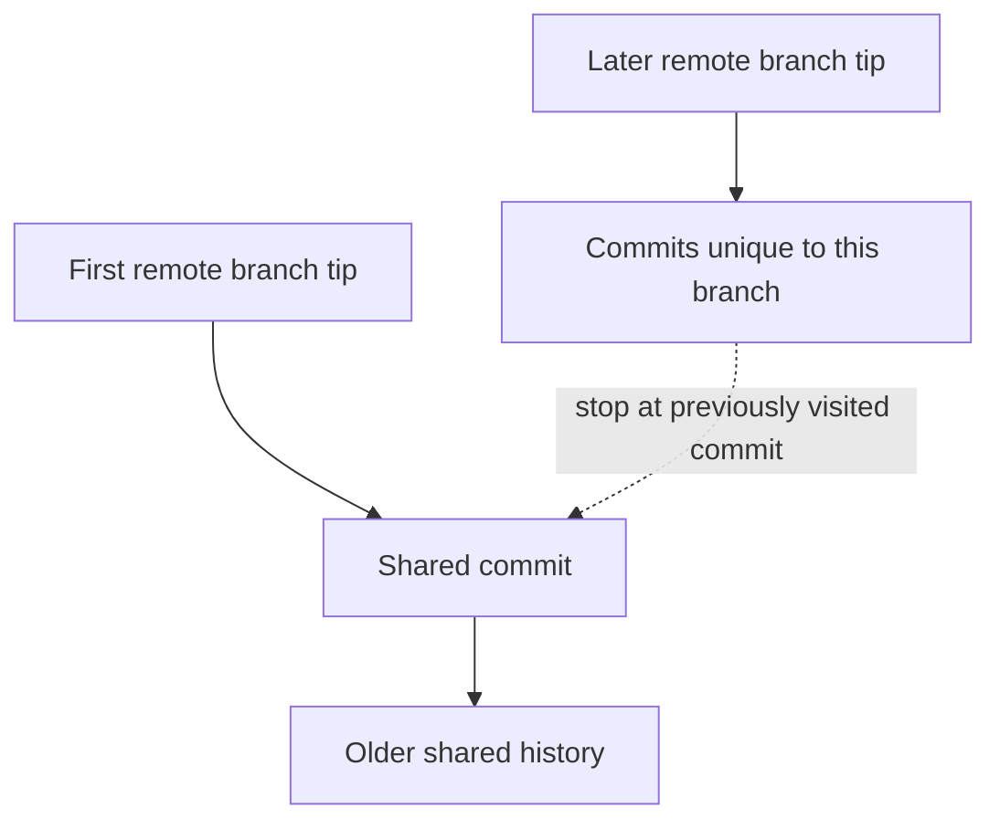

# Reuse shared Git history when resolving commit links

## Why this exists

On the Linux build host's checkout of this monorepo, the text status report
spent most of its time finding commit links. The JSON and zero-history reports
show how much time the rest of the command took.

| Command (Linux build host, 2026-11-20) | Wall clock |
|---|---|
| `sniff repo git-status --json` | 0.15 s |
| `sniff repo git-status --history 0` | 0.15 s |
| `sniff repo git-status` (also `--compact`, `--plain`) | ~3.5 s |
| `sniff repo recent-commits` (text or `--json`) | 1.45 s |
| `git status` | 0.03 s |

Three debugger samples showed the text report spending time decoding packed Git
objects while checking the last-known state of remote branches. None of the
10 displayed commits was in a locally recorded remote branch. In that case,
Sniff must check all those branches before reporting that a commit is absent.
Walking the 26 branch tips separately visits **342,614** commits in total.
Their combined history contains only **16,682** distinct commits.

The checkout had no commit-graph file, Git's optional index of commit ancestry.
Adding one in a throwaway shared clone reduced link time from about 2.9 s to
about 1.5 s in that sample. Avoiding repeated visits helps checkouts with or
without the index.

The slow status command reported only **137 ms** with `--perf`. The
`sniff-detection-cli` status renderer calls
[`commit_links_at`](../../cli/src/output/filesystem/mod.rs) after Sniff takes
its performance snapshot. That lookup opens the repository again, reads
its refs again, and leaves the linking time and visits out of the report.

## Scope

- Share ancestry work across all remote-tracking tips in one call to the
  `sniff` library's [commit linker](../../lib/src/filesystem/git/commit_links.rs).
  This benefits status, recent commits, the aggregate commit reports, and
  single-commit lookups such as `sniff repo hash`.
- Resolve status links as part of the measured request, before formatting
  the report. Cover the default, compact, package, package-area, branch, and
  linked-worktree views.
- Keep the separate deep containment walk used with `--refresh-remotes`.
  It fills the complete list of containing remotes for each commit. A shared
  set that skips repeat visits would lose those memberships. Keep its existing
  branch limit and refresh behavior.
- Keep linking local and read-only. Creating or maintaining a commit-graph
  stays a Git operation. Generation-number cutoffs are outside this fix.
  They need an existing commit-graph, which the motivating checkout lacks.

## Share visits across remote-tracking tips

The `sniff` library's [commit linker](../../lib/src/filesystem/git/commit_links.rs)
keeps the existing priority. Walk `origin` first, then other remotes
alphabetically, with `upstream` last. For each remote, walk the branch named by
its local remote-tracking `HEAD` first when present, then its other branches
alphabetically. The first walk that finds a target still determines its remote
and browser URL, including when that remote has no known browser URL.

During a call, record the IDs yielded by the walk. Once a tip's walk finishes,
its visited commits can serve as stopping points for later tips. At such a
point, the earlier walk already examined the history below it. Any target in
that history already has a winning remote, and the later tip's unique history
still gets examined.

Use the Git walk's selection filter so a rejected commit is skipped before its
parents are queued. Skip a tip already covered by a completed walk before
constructing a new walk. Keep commit-graph support and newest-first traversal.
Use a read-only view of the earlier visits for the filter and a separate buffer
for the current tip's visits if needed to satisfy the iterator's borrowing
rules. Publish those visits only after completion. The set lives for this
linking call and grows with the number of counted visits, up to the existing
budget. With a single tip, use the existing walk directly because no later
tip can reuse its visits. The `sniff` library's [ancestry walker](../../lib/src/filesystem/git/remote_refresh.rs)
continues to serve deep containment without shared pruning.

### Incomplete walks and shallow clones

- An unreadable commit can leave some of the current tip's history unexplored.
  Keep the matches already found, discard the shared set, and run subsequent
  tips with the existing independent walks. A later match still establishes
  containment. A target that remains unfound after any failed walk stays
  undetermined.
- Exhausting the visit budget stops the linking pass. Stop early as before
  when all targets have been found. Only a completed walk can supply stopping
  points to a later tip.
- Shallow clones use the shared set like any other repository. Git records
  the shallow boundary once per repository (`.git/shallow`), so every walk
  that reaches a commit sees the same parents for it, and a completed walk's
  visits remain valid stopping points. A walk that fails at a missing parent
  falls back as described above. Keep today's shallow-history results and
  errors.

Keep the five-million-visit budget across the entire linking call and the
existing meaning of `git.commit_visits`. Each successfully yielded commit
consumes one visit. Skipped commits consume zero. Sharing visits may let a
request prove containment or absence where it previously ran out of budget.
A complete search with no match still gives `remote: false`, including when
there are no remote-tracking tips. An incomplete search with no match gives
`remote: null`. Keep input order and duplicate target handling. These answers
describe locally available history as of the last recorded remote refs.

## Resolve status links before rendering

Use a focused library operation to prepare the final status report and, when
requested, associate link results with the full IDs in its final
`recent` list. Keep the extra link data alongside the status report so this
fix can reuse the existing `sniff` library
[`CommitInfo`](../../lib/src/filesystem/git/types.rs) records, which carry
history and are constructed by other callers. Keep existing detection plans,
presets, and public history entry points compatible. The existing
`sniff` library [filesystem observation](../../lib/src/filesystem/mod.rs)
already retains the open repository for the request. Reuse that handle and
carry the captured refs through the status operation. Reuse the existing
history readers and their decoration logic.

1. Request remote-tracking tips in the same
   `sniff` library [ref snapshot](../../lib/src/filesystem/git/remote_refresh.rs)
   used for other status facts when links are needed. Decorations alone do
   not populate that snapshot's remote-tip list. This matters for detached
   HEAD, where there is no current branch to trigger remote tracking
   collection. When `--refresh-remotes` is explicit, use the same
   post-refresh refs as the rest of status. Treat an unavailable linking
   input as an unlinked report. Existing status and history read errors
   still propagate as before.
2. Resolve the final commit list before invoking the linker. Keep the current
   selection precedence. A package or package area selects path history. A
   different branch replaces it and clears working-tree changes. A selected
   worktree then supplies its own history and working-tree changes. Preserve
   selector validation, package/area intersection, count limits, and report
   ordering. A bare `--branch` or the current branch keeps the current history
   selection. Reuse the original ref snapshot for the current repository's
   history and links. For a linked worktree, use the handle already opened
   for that selection, preserving its effective configuration and ref view.
   Reuse shared refs where the effective view is the same. If the selected
   worktree needs a different ref observation, use it for both its history
   and its links.
3. Link only the entries the report will display. Make one linking pass at
   most, even when selectors are combined. An empty display or
   `--history 0` skips linking. This is independent of path history's
   existing zero-count behavior. Request links for ordinary and compact
   terminal reports. Explicit `--plain` already strips the hyperlinks, so
   skip resolving them. Focused JSON stays unlinked (see
   [Author rulings](#author-rulings-2026-11-20)). The aggregate JSON report already collects link data in its
   separate commit-family reports and keeps that behavior and shape.
4. Pass the captured URLs into
   [`build_git_status_items`](../../cli/src/output/filesystem/mod.rs) in
   `sniff-detection-cli`, which formats commit lines using the existing
   terminal components. A missing URL displays the short hash without a
   hyperlink. Keep output order, visible text, and terminal fallback
   behavior. Rendering needs no repository access.

Run status preparation and linking under the same request performance
collector. When scoped history is prepared after initial detection, take the
final report snapshot after that preparation and use it for all output.
Use a dedicated stage such as `filesystem.git.commit_links` and retain the
existing ancestry visit counter. That counter also includes history selection
and other Git walks, so a nonzero value alone cannot demonstrate that linking
was measured. Keep JSON stdout as one complete value, with the existing
embedded performance report and human-readable diagnostic on stderr when
`--perf` is supplied.

## Documentation

- Update [the status command guide](../../docs/cli/repo_git-status.md).
  The Sniff README is an overview and does not describe link lookup, so it
  needs no change. Explain that the terminal report
  resolves links locally during collection, when link output is requested.
  The previously documented renderer lookup will be obsolete. State that
  focused JSON carries no links and point scripts to `recent-commits --json`.
- Update [the recent-commits guide](../../docs/topics/repo/recent-commits.md)
  and the [Sniff architecture skill](../../../.claude/skills/sniff/architecture.md)
  to describe shared visits across remotes, the fallback after a failed walk,
  and why shallow clones need no separate path.
- Update the [Sniff performance skill](../../../.claude/skills/sniff/performance.md)
  with the linking stage, when the status performance snapshot is taken,
  and what the shared visit counter measures.

## Verification

### Library tests

Use small local fixtures. Test the linker independently from status history
so the visit counter measures only containment work.

1. Give multiple remote tips a shared base and unique commits. With a target
   absent from every tip, assert exactly one visit per distinct reachable
   commit and `remote: false`. Set a test budget just large enough for the
   combined history, so repeated work would leave the answer undetermined.
   Include duplicate tips and a tip that is an ancestor of the preferred tip.
2. Check that the preferred remote still wins for shared targets and that a
   target on a later tip's unique history goes to that later remote. Retain
   existing coverage for remote order, default branch priority, skewed commit
   timestamps, reused ref snapshots, and exhausted visit budgets.
3. Exercise a walk that visits a shared commit and then fails before finishing
   its parents. Use a deterministic walk seam if needed to arrange those
   events. Verify that a later walk can revisit that commit and find a target
   missed by the first walk, and that another unfound target stays
   undetermined. A permanently missing object alone cannot demonstrate that
   a later walk can reach through the skipped point.
4. On a shallow clone fixture with several remote tips sharing history,
   assert that shared-visit linking returns the same results as independent
   walks, and that it visits fewer commits.
   Cover linking through the captured ref snapshot with detached HEAD, and
   confirm that a missing snapshot cannot turn into a false absence claim.

### Command tests

- Use the Sniff CLI fixture with one contained commit and one unpushed
  commit. Check association of URLs with final commit IDs for the default
  view, compact mode, package and package-area history, a different branch,
  and a selected worktree. Exercise selector precedence and verify that an
  entry removed from the final list gets no link. Check presence and absence
  of URLs in the render input or markup at the renderer boundary. Piped
  stdout hides hyperlinks and can only establish the text fallback.
- Prove that a text `--perf` report includes the linking stage and the
  additional visits from the fixture's known remote history. Compare
  equivalent linked and unlinked requests and assert the visit delta.
  Exercise a scoped selection so an early performance snapshot would fail
  the test. Assert one ref enumeration and one initial repository discovery
  for the ordinary case, including detached HEAD, and no Git acquisition
  during rendering.
- Verify that `--history 0` and `--plain` incur no linking visits. Check
  that focused JSON (with and without `--perf`) does no linking work and
  keeps its shape,
  and keep existing aggregate and recent-commits JSON parity tests.

### Performance check

Take a quick before-and-after sample of `sniff repo git-status --perf` on
the Linux build host using the motivating checkout state or a comparable
unpushed branch in that checkout. Record wall time and reported visits in
the implementation log. The earlier total omitted the work, so compare
wall time across versions and use the isolated linker test to establish
visit savings. Use the sample to check that the reported linking stage
accounts for the formerly hidden time. The existing commit-graph sample
already establishes its effect on this checkout.

The fix is accepted when, in that checkout state, terminal
`sniff repo git-status` finishes within 0.5 s of
`sniff repo git-status --json`. At the measured cost of roughly 10 µs per
visit without a commit-graph, a single pass over the 16,682 distinct commits
fits comfortably inside that margin.

### Gates

Run `just test` and `just lint` in `sniff/`, plus
`cargo clippy -p sniff --all-targets -- -D warnings` and the same command
for `sniff-detection-cli`. Keep fixture tests portable across macOS, Linux,
native Windows, and WSL2.

## Author rulings (2026-11-20)

1. **Focused status JSON keeps its current shape.** `sniff repo git-status
   --json` gains no `recent[].link` field and does no link work, so JSON
   status stays on the fast path. Scripts that need containment or URLs use
   `sniff repo recent-commits --json`. A later additive field remains possible
   if a consumer needs links alongside status's exact history selection.
2. **Shallow clones get no separate path.** The shallow boundary is
   repository-wide, so shared visits stay valid. The failed-walk fallback
   covers a walk that stops at a missing parent, and library test 4 asserts
   that shared and independent walks agree on a shallow fixture.
