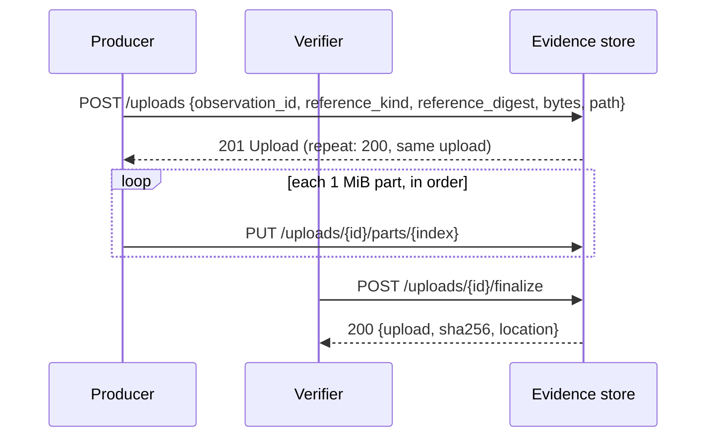
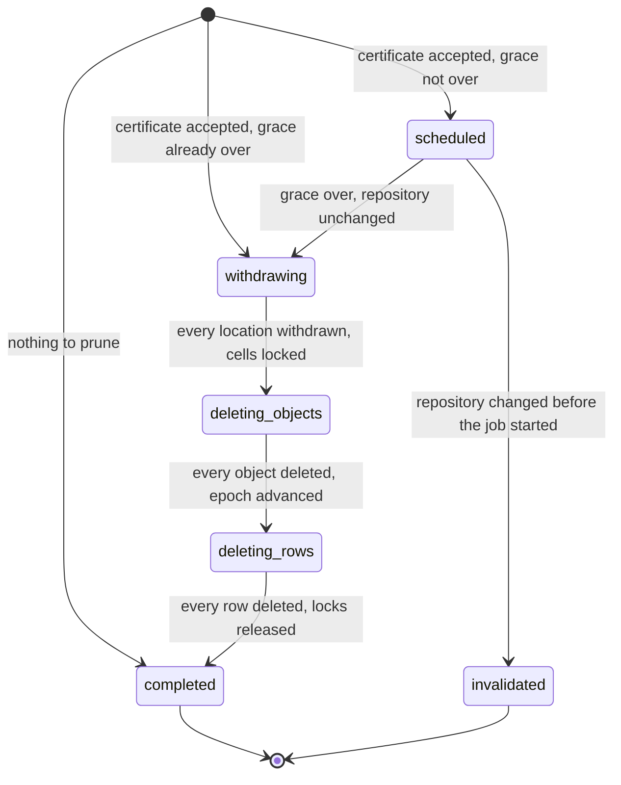
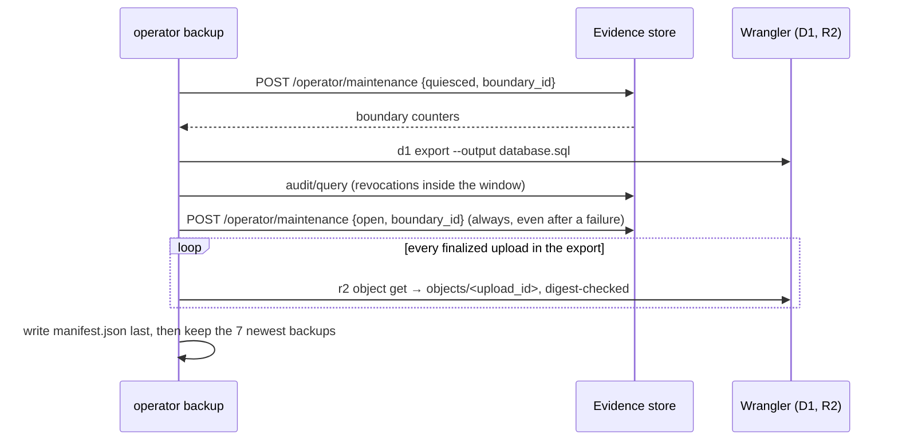

# Evidence store API contract

This directory is the machine-readable contract of the evidence store's HTTP
API. The evidence store is a private Cloudflare Worker that records test
_observations_ (one attempt to run one `{package, environment, gate}` cell) in
a D1 database and keeps their report and proof files in a private R2 bucket.
Nothing here is Worker code; the Worker and its tools are checked against these
documents.

| Path | What it is |
| --- | --- |
| `openapi.yaml` | OpenAPI 3.1 description of every route, request, response, and error. `x-roles` on each operation lists the roles allowed to call it; top-level `x-limits` lists every bound. |
| `schemas/*.schema.json` | Strict JSON Schemas (draft 2020-12) for the files the service and its tools read: `service-config`, `credential-grant`, `ingest-config`, `resume-state`, and `backup-manifest`. |
| `examples/<operationId>.request.json` / `.response.json` | One example per operation. `GET` operations have only a response; the two binary bodies (`putUploadPart` request, `fetchObject` response) have no JSON example. |
| `examples/error.<code>.json` | Example error bodies. |

The constants these documents publish live in `src/contracts/api.ts`;
`tests/node/api-contract.test.ts` fails when the two drift. Run it with:

```sh
pnpm exec vitest run --project node tests/node/api-contract.test.ts
```

## Routes and the role matrix

Repository routes live under `/v1/repos/{repository_id}`, where
`repository_id` is the repository's stable numeric GitHub ID (a slug can
change; the ID cannot). Operator routes live under `/v1/operator`. A request
under any version other than `v1` answers `unsupported_api_version`.

A _role_ is a permission a credential holds on a repository:

- **reader** reads evidence, snapshots, change feeds, and stored files
- **producer** submits collections and uploads the files they reference
- **verifier** checks bytes: it finalizes uploads and records report locations
- **retention-verifier** certifies which superseded evidence may be pruned
- **operator** registers repositories, manages credentials, reads the audit trail, controls maintenance mode, and recovers interrupted jobs

| Operation | Method and path | reader | producer | verifier | retention-verifier | operator |
| --- | --- | :-: | :-: | :-: | :-: | :-: |
| `ingestCollection` | `POST /collections` | | ✓ | | | |
| `exportCollection` | `GET /collections/{collection_id}` | ✓ | | ✓ | ✓ | |
| `getObservation` | `GET /observations/{observation_id}` | ✓ | | ✓ | ✓ | |
| `queryHistory` | `POST /history/query` | ✓ | | ✓ | ✓ | |
| `getSnapshot` | `GET /snapshot` | ✓ | | ✓ | ✓ | |
| `appendLocation` | `POST /locations` | | | ✓ | | |
| `queryChanges` | `POST /changes/query` | ✓ | | ✓ | ✓ | |
| `createUpload` | `POST /uploads` | | ✓ | ✓ | | |
| `putUploadPart` | `PUT /uploads/{upload_id}/parts/{index}` | | ✓ | ✓ | | |
| `finalizeUpload` | `POST /uploads/{upload_id}/finalize` | | | ✓ | | |
| `fetchObject` | `GET /objects/{observation_id}/{reference_kind}/{reference_digest}` | ✓ | | ✓ | ✓ | |
| `submitRetentionCertificate` | `POST /retention/certificates` | | | | ✓ | |
| `getRetentionJob` | `GET /retention/jobs/{job_id}` | | | | ✓ | ✓ |
| `publishEvaluation` | `POST /evaluations` | | | | | |
| `registerRepository` | `POST /v1/operator/repositories` | | | | | ✓ |
| `issueCredential` | `POST /v1/operator/credentials` | | | | | ✓ |
| `revokeCredential` | `POST /v1/operator/credentials/{credential_id}/revoke` | | | | | ✓ |
| `listAudit` | `POST /v1/operator/audit/query` | | | | | ✓ |
| `setMaintenance` | `POST /v1/operator/maintenance` | | | | | ✓ |
| `getMaintenance` | `GET /v1/operator/maintenance` | | | | | ✓ |
| `recoverJobs` | `POST /v1/operator/jobs/recover` | | | | | ✓ |

A producer can stage file bytes but never vouch for them: only a verifier
finalizes an upload or records a location. **Evaluation publication is
disabled.** `POST /evaluations` has no allowed role and answers 403
`evaluation_publication_disabled` to every caller until a trusted verifier and
its policy exist.

## Limits

Every limit is applied before anything is written. A collection or retry
chain is never split to fit: an oversized one is rejected whole.

| Limit | Value |
| --- | --- |
| JSON request body | 1 MiB |
| One observation, canonical bytes | 128 KiB |
| Observations per collection | 256 |
| Reachable heads per history query | 256 |
| Page size | 100 by default, at most 256 records and 1 MiB encoded |
| Upload part | 1 MiB, sent in order |
| Uploaded object | 64 MiB |
| Unfinished upload expiry | 24 hours (staging bytes removed after 48 hours) |
| Cursor expiry | 24 hours |
| Change-feed tombstones kept | 30 days |
| Location verification valid for | 24 hours |
| Grace before pruning superseded evidence | 14 days |
| Credential lifetime | 90 days; rotate at day 60; at most 7 days of overlap |
| OIDC clock tolerance | 60 seconds |
| Rate per credential | 60 mutations and 300 reads per minute; operators 30 mutations per minute |

## Errors

Every failure answers with one body shape:

```json
{
  "error": {
    "code": "identity_conflict",
    "message": "observation already recorded with different canonical bytes or collection context",
    "location": "/collection/observations/0",
    "retryable": false,
    "retry_after_ms": null
  },
  "request_id": "…"
}
```

`location` is a JSON pointer into the request, or `null`. Error bodies and logs
never contain credentials or report bytes. Clients retry only `retryable`
errors (429, 503) and network failures: at most five attempts, with jittered
backoff capped at 30 seconds, honoring a longer `Retry-After` up to 60 seconds.

| Code | HTTP | Retryable | When |
| --- | :-: | :-: | --- |
| `invalid_input` | 400 | no | The request breaks the schema or an evidence rule, or uploaded bytes do not match their reference. |
| `invalid_cursor` | 400 | no | A cursor was altered or belongs to another query or repository. |
| `unsupported_api_version` | 400 | no | The path names an API version other than `v1`. |
| `unauthenticated` | 401 | no | The bearer token is missing, malformed, expired, or revoked, or the OIDC token fails verification. |
| `denied` | 403 | no | The credential lacks the role or repository for this operation, the repository is not in the service configuration's allowlist, or a verified OIDC token comes from an untrusted workflow, ref, event, owner, or pull-request context. |
| `evaluation_publication_disabled` | 403 | no | Any call to `POST /evaluations`. |
| `not_found` | 404 | no | Unknown repository or ID, or an object that is not currently available. |
| `identity_conflict` | 409 | no | An existing ID (observation, location event, upload part, certificate, repository owner) is resubmitted with different content. |
| `stale_snapshot` | 409 | no | A supplied snapshot belongs to an older store generation or is no longer current for a certificate. |
| `snapshot_pruned` | 409 | no | Pruning has happened since the snapshot was captured. |
| `cursor_expired` | 409 | no | The cursor is older than 24 hours, or a change-feed `after_sequence` lies before the stream's replay horizon (tombstones older than 30 days have been expired). Start from a fresh snapshot. |
| `collection_pruned` | 410 | no | A collection export would be missing pruned members. |
| `size_limit` | 413 | no | A bound in the limits table is exceeded. |
| `unpageable_record` | 413 | no | One record alone exceeds the page's byte bound. |
| `rate_limited` | 429 | yes | Per-credential request rate exceeded. |
| `quota_exhausted` | 429 | yes | The request would push a free-tier allowance past its 80% refusal threshold. |
| `unavailable` | 503 | yes | A platform failure, a missing or invalid service configuration, GitHub's OIDC signing keys could not be fetched, the store is quiesced for maintenance, or a retention job is deleting in the cell the write touches; never reported as an empty success. |

## Uploading and fetching files

An observation names its report and proof files by path and SHA-256 digest
but carries no bytes. To store those bytes, a producer or verifier uploads
them in three steps, and only a verifier can make them retrievable:



1. **Open.** `createUpload` binds the upload to one observation and one file
   it references: a report by `path` and `sha256` (and `bytes` must equal the
   report's recorded length), or `{package}-{gate}.expected.json` /
   `{package}-{gate}.completion.json` by the proof's digest. A file the
   observation does not reference answers 400; more than 64 MiB answers 413,
   and the observation stays recorded either way.
2. **Send parts.** Every part is exactly 1 MiB except the last, which carries
   the remainder; a zero-byte file has no parts. Each part is stored as its own
   private object (`staging/{upload_id}/{index}-{sha256}`); resending a part
   with the same bytes is harmless, and with different bytes answers 409.
3. **Finalize (verifier only).** The store joins the parts into the final
   object while checking its length and SHA-256 against the reference. An
   expected listing or completion record must also be strict JSON bound to
   the observation: a listing by package, gate, environment, and target; a
   completion record by package, gate, and environment, plus head, run, and
   attempt when the producer is `hosted` (a seed or rig run proves each cell
   on its own same-tree commit, so its head is not compared). A
   mismatch rejects the upload (400) and deletes the joined object; open a new
   upload to try again. Success appends one `verified` `object` location
   event; repeating `finalize` returns the same result and adds nothing.

Finalization proves the bytes are intact. It never claims that the tests the
files describe passed or covered anything.

`GET /objects/{observation_id}/{reference_kind}/{reference_digest}` (the
digest percent-encoded) streams the newest finalized object whose newest
object location event is `verified`, with `Content-Length` and
`X-Content-SHA256`. Recording a `withdrawn` or `unavailable` event for its
`object` locator through `POST /locations` denies later fetches; one already
streaming completes. The 24-hour validity of a verification does not apply to
objects held in the store's own bucket.

Uploads left open expire after 24 hours (a late part or finalize answers
404). The daily run (see "The daily run" below) removes the staged parts of
expired and rejected uploads 48 hours after the upload was opened, and leftover
parts of finalized ones.

### Storage budget

The store runs inside Cloudflare's free tier, so it reserves capacity before it
accepts bytes. Opening an upload reserves the upload's `bytes` of live R2
storage and `part_count + 1` R2 write operations for the current month. If the
reservation, plus everything already reserved, plus the account's measured
usage outside this service, would pass 80% of an allowance, `POST /uploads`
answers 429 `quota_exhausted` with a `Retry-After` and records nothing:

```json
{ "error": { "code": "quota_exhausted", "location": null, "retryable": true, "retry_after_ms": 3600000, "message": "…" } }
```

A refusal never deletes or evicts existing evidence, and collection ingestion
is never refused for capacity, so a failure is always recorded; only its bytes
wait. Finalizing an upload commits its reservation; a rejected, expired, or
pruned upload releases its storage (its write operations stay counted for the
month, because they were spent). The daily run reports usage of each allowance
and logs an alert, numbers only, at 70%.

## Retention

Evidence is kept for as long as reuse or an audit can read it, not forever.
For each `{package, environment, gate}` cell the store keeps:

- the newest observations nothing supersedes, such as the current passing run;
- every failure or same-head pass/fail conflict that nothing has resolved;
- every observation a release cites (a _release pin_).

An observation that something newer supersedes (a pass on a descendant commit,
or a failed attempt whose retry passed) is _pruned_, with its report locations
and stored bytes, 14 days after it was first certified as superseded. The
grace keeps recent failure reports available for debugging flaky tests.

The store never decides on its own what is superseded. A **retention
verifier**, a separately provisioned credential with the `retention-verifier`
role, submits a _certificate_ and the store checks it. No such credential is
provisioned in production yet, so nothing is pruned there; tests use an
isolated verifier.

### Submitting a certificate

A certificate names the exact snapshot it was computed from (`GET /snapshot`),
and for each cell every stored observation, the ones to keep, and why each of
the others is superseded:

```json
{
  "certificate_id": "7d1e5c3b-2a49-4f86-b0c1-e2d3f4a5b6c7",
  "snapshot": { "repository_id": "873451209", "generation": "e661…", "retention_epoch": 3, "evidence_revision": 1842, "observation_event_watermark": 1207, "location_event_watermark": 655 },
  "cells": [{
    "package": "biscuit-hash", "environment": "ubuntu-latest", "gate": "L1",
    "candidate_ids": ["b054…", "bb87…"],
    "retained_ids": ["b054…"],
    "supersessions": [{
      "superseded_id": "bb87…", "superseded_by_id": "b054…",
      "evidence": { "kind": "strict-ancestry", "ancestor_head": "8726…", "descendant_head": "9f2e…" }
    }]
  }],
  "verifier_policy": { "name": "rusty-biscuit-reuse", "version": "1", "digest": "8234…" },
  "release_pins": [{ "release": "biscuit-hash-v0.4.0", "observation_ids": ["b054…"] }]
}
```

`POST /retention/certificates` checks everything before it writes anything:

| Check | Refusal |
| --- | --- |
| The snapshot is the repository's current one. | 409 `stale_snapshot` (another generation, or anything written since); 409 `snapshot_pruned` (a prune since); 400 for a value ahead of the store. |
| `candidate_ids` is exactly the cell's stored observations. | 409 `stale_snapshot` for an ID the store lacks ("missing store data") or a stored ID left out. |
| `retained_ids` is a nonempty subset of the candidates, and every other candidate is the `superseded_id` of an edge. An observation nothing supersedes must be kept. | 400 |
| Each edge joins two different candidates of this cell, and the edges have no cycle. | 400 |
| `strict-ancestry` names the two observations' stored heads, and they differ. The store cannot see Git history, so ancestry itself is the verifier's claim; a same-head pair is a conflict, never a supersession. | 400 |
| `retry` is a chain from the superseded to the superseding observation in which each observation's stored `retry_of` names the previous one. | 400 |
| Release pins name stored observations, and no pinned observation is pruned. | 400 |

Supersession is never inferred from arrival time or from what a producer
claims. An accepted certificate answers 202 with its job; resending the same
`certificate_id` with the same content (key order and whitespace aside)
answers 200 with the same job, and with different content 409
`identity_conflict`. A certificate that prunes nothing records its pins and a
job that is already `completed`. Pins are stored once however often they are
resent.

### The prune job

`GET /retention/jobs/{job_id}` (retention verifier or operator) shows a job's
state and progress counters. The daily run advances each job in small batches:



- **scheduled** waits until `not_before_ms`: 14 days after the _first_ time any
  certificate certified each member as superseded. A later certificate for the
  same observation does not restart the grace. If anything was written to the
  repository after the certificate's snapshot, the job is `invalidated` and
  the verifier certifies again. Because the grace is counted from the first
  certification, that later certificate's grace is usually already over: its
  job starts (`withdrawing`) as it is accepted, while its snapshot is still
  current, so later writes cannot invalidate it.
- **withdrawing** appends a `withdrawn` event for every location of every
  member whose newest event is not already `withdrawn`, signed by the
  certificate's verifier. From then on no reader can fetch the bytes.
- The job then **locks** each affected cell: until it finishes, a new
  observation, upload, or non-withdrawal location event in that cell answers
  503 `unavailable` (retryable, `retry_after_ms` 60000) and records nothing.
- **deleting-objects** deletes each member's stored objects and staged parts.
  Objects are stored per upload, so another observation's identical bytes are
  a separate object and stay fetchable.
- **deleting-rows** first advances the repository's `retention_epoch`, then
  deletes the members' locations, uploads, and observations. Each deleted
  observation and location leaves a `pruned` tombstone in its change feed. A
  snapshot or cursor taken before the epoch moved answers 409
  `snapshot_pruned`; a collection that lost a member answers 410
  `collection_pruned`.

Every batch is idempotent and the state is stored, so a run cut short at any
point is finished by the next one. Bytes are made unreachable before they are
deleted and rows are deleted last, so no row ever advertises bytes that are
gone. No route, operator or otherwise, can delete evidence outside a job:
database triggers refuse it, and there is no SQL endpoint.

### Change-feed tombstones

`pruned` tombstones are kept for 30 days. The daily run then deletes them,
together with the older change events of the same pruned observation or
location row, and moves the stream's _replay horizon_ up to the newest
deleted tombstone (it never moves back). A change query resuming before the
horizon answers 409 `cursor_expired`: start again from a fresh snapshot.

### The daily run

The Worker's scheduled handler runs once a day and skips everything while the
store is quiesced for a backup. In order, it:

1. expires uploads left open for 24 hours, releases their reserved storage,
   and removes old staging bytes;
2. advances retention jobs;
3. expires 30-day-old tombstones and advances both replay horizons;
4. reports storage and operation usage against each free-tier allowance.

## Credentials

Hosts (laptops and test rigs) authenticate with a bearer token sent as
`Authorization: Bearer ebt_<credential_id>.<secret>`.

- The secret is 256 random bits. The `credential_id` is public and appears in
  audit records; the secret never does.
- The service stores only the SHA-256 digest of the secret, so a database or
  backup copy cannot be turned back into a working token.
- `issueCredential` returns the token exactly once. The operator CLI writes it to
  an owner-only file and never prints it, passes it on a command line, or logs
  it. Unattended consumers read it from that file.
- Each credential names its repositories and roles. An empty list of either
  denies everything.
- Credentials expire after 90 days. Rotate at day 60 by issuing a replacement
  that names the old one in `replaces`; the old one then expires within 7 days.
- Revocation is checked against the primary database on every request, so it
  takes effect immediately, also while the store is quiesced for maintenance.
  Revoking never rewrites past evidence.
- Operator credentials are created only by the Wrangler bootstrap and are never
  issued through the API.
- A grant on a repository that is not in the service configuration's
  `repositories` allowlist is inert: the request is denied.

The operator commands run from `tools/evidence-store` (use absolute paths,
because the recipe runs from that directory):

```sh
# Once per environment: mint the operator token into a new owner-only file and
# insert its digest through Wrangler (needs CLOUDFLARE_API_TOKEN and
# CLOUDFLARE_ACCOUNT_ID; never logs in interactively).
just operator bootstrap --env development --label ken-laptop --token-file /abs/operator.token

# Register a repository by the stable IDs GitHub reports for it (needs GITHUB_TOKEN or GH_TOKEN).
just operator register --endpoint https://… --token-file /abs/operator.token --slug owner/name

# Issue a host credential from a grant file (schemas/credential-grant.schema.json);
# the token is written to the grant's secret_file and never printed.
just operator issue --endpoint https://… --token-file /abs/operator.token --grant /abs/rig-linux-01.grant.json

just operator revoke --endpoint https://… --token-file /abs/operator.token --credential <id> --reason "decommissioned"
```

## Maintenance, backup, and restore

This section covers how to take a consistent backup, check it, restore it into
separate resources, and finish interrupted work. All of it runs through
`just operator` from `tools/evidence-store`, with absolute paths, and never
prompts: every input is checked before anything changes.

### Maintenance mode and the backup boundary

_Quiescing_ pauses every write. While the store is quiesced, every mutation
route (ingestion, uploads, locations, retention certificates, repository
registration, credential issue, `recoverJobs`) answers 503 `unavailable`
(retryable, `retry_after_ms` 60000) and records nothing. A write that passed
that check just before the quiesce is refused by the database itself and also
answers 503, so every write is either acknowledged before the quiesce or not
at all. Reads, the audit trail, refusal auditing, credential revocation, and
the maintenance route itself keep working.

`POST /v1/operator/maintenance` with `{"mode": "quiesced", "boundary_id": …}`
answers each repository's counters (generation, retention epoch, evidence
revision, and both watermarks), read after the quiesce committed. Those
counters are the **backup boundary**: a backup exported while quiesced
contains every write acknowledged before it.

```sh
just operator maintenance --endpoint https://… --token-file /abs/operator.token --mode quiesced --reason "schema change"
just operator maintenance --endpoint https://… --token-file /abs/operator.token --mode open
```

A second quiesce for another `boundary_id` answers 409, and `open` with a
`boundary_id` reopens only that quiesce, so a backup never reopens maintenance
that someone else started. `GET /v1/operator/maintenance` reads the state.

### Taking a backup

```sh
# Needs CLOUDFLARE_API_TOKEN and CLOUDFLARE_ACCOUNT_ID for Wrangler.
just operator backup --endpoint https://… --token-file /abs/operator.token \
  --env development --destination /abs/evidence-backups
```



Each backup is a directory `<destination>/<backup_id>/` holding
`database.sql`, `objects/<upload_id>` for every object a finalized upload
references (keys come from the exported database, not a bucket listing, and
every copy is checked against the upload's SHA-256), and `manifest.json`
(`schemas/backup-manifest.schema.json`), written last. The manifest records
the boundary, the source resources, the schema's migration number, every
repository's counters, file digests, objects that were missing or corrupt in
the live bucket, uploads still open at the boundary (pending, never
acknowledged), retention job state, credential digests and grants (the
database holds no bearer secrets, so a backup holds none), and revocations
made while quiesced. A directory without a manifest is an incomplete backup
and is removed when the backup fails. Each backup keeps the seven newest
complete backups in the destination and removes older ones, which is also how
pruned bytes leave backups after their seven-day window. Run it daily.

`just operator verify-backup --backup /abs/evidence-backups/<backup_id>`
checks the manifest strictly and every file's size and SHA-256, prints a JSON
report, and exits 1 on any problem. Objects already missing when the backup
was taken are reported, not counted as problems.

### Restoring

```sh
just operator restore --backup /abs/evidence-backups/<backup_id> \
  --source-env development --dest-env restore-test \
  --dest-token-file /abs/restored-operator.token \
  --dest-endpoint https://… --replay /abs/state.json --replay /abs/other-state.json \
  --report /abs/recovery-report.json
```

Restore writes only to isolated resources. It refuses, before running
anything, a destination environment equal to the source, and any destination
whose D1 database name, D1 database ID, or R2 bucket equals the source's or
the one the backup recorded (the checked-in `wrangler.jsonc` shares
placeholder IDs, so a real deployment's IDs must be set first). It then
verifies the backup and refuses a destination database that is not empty: a
restore needs a newly created database with no migrations applied.

The restore then:

1. puts every backed-up object into the destination bucket;
2. loads the export in the order tables → rows → indexes → triggers,
   whatever order the export used, so no trigger fires on a restored row;
3. still quiesced: rotates every repository's `generation` (so every
   pre-restore cursor, snapshot, and evaluation is rejected) and audits
   `restore.generation`; revokes the restored operator credentials and writes
   a new operator token to `--dest-token-file` (owner-only); re-applies
   revocations recorded inside the backup window; appends an `unavailable`
   location event for every object the backup lacks, so no row advertises
   missing bytes; and expires uploads that were pending at the boundary;
4. sets a new `CURSOR_HMAC_KEY` with `wrangler secret put`, fed through stdin;
5. reopens the store;
6. for each `--replay` resume state (`schemas/resume-state.schema.json`),
   classifies its acknowledged observation IDs as **recovered** (in the
   backup), **replayed** (absent, and resubmitted from the collection retained
   beside the state, with its original IDs, to `--dest-endpoint`), or
   **unrecoverable** (absent, with no intact retained collection).

The JSON recovery report (stdout, or `--report`) lists those IDs, the missing
objects, the expired pending uploads, the new generations, the new operator
credential ID, and the boundary. It never claims zero loss from the backup
alone: without `--replay` inputs, loss after the boundary is reported as
unknown. Repository IDs, observation IDs, and other immutable IDs are
preserved. Host credentials keep working (their digests are restored);
revocations made on the source after the backup reopened are not known to the
restore and must be repeated against the restored service. Replayed proof
uploads are staged again and need `just evidence-finalize` with a verifier
token; the report prints the command. A failed database load leaves the
destination unusable: drop and recreate it before retrying.

### Recovering interrupted jobs

```sh
just operator recover-jobs --endpoint https://… --token-file /abs/operator.token
```

calls `POST /v1/operator/jobs/recover`, which expires stale open uploads,
advances every unfinished retention job by bounded, idempotent batches, and
releases cell locks still held by finished jobs, then prints what it did.
Rerunning it is always safe.

### Rolling back a deployment

A rollback restores a compatible prior Worker build with
`wrangler rollback --env <env>` (or `wrangler versions deploy`). Migrations
are never reversed: a rolled-back build must work with the current schema.
When a schema change itself must be undone, restore the last backup taken
before it into isolated resources as above; the generation rotation makes
every cursor and snapshot from the abandoned schema invalid.

## GitHub Actions (OIDC)

A workflow authenticates with its short-lived GitHub OIDC token, sent as a
bearer token; there is no exchange for a long-lived credential. The service
accepts it only when all of these hold:

- issuer `https://token.actions.githubusercontent.com` and audience
  `rusty-biscuit-evidence-store`;
- a valid signature, and expiry and not-before within 60 seconds;
- a numeric `repository_id` and `repository_owner_id` that match a registered
  repository;
- a workflow, ref, and event that match an entry in the service configuration's
  `trusted_workflows`; the workflow path is taken from the `workflow_ref` claim.

Fork and pull-request contexts are always refused, and an empty allowlist
denies every token. A token that fails signature, issuer, audience, or
time checks answers 401 `unauthenticated`; a valid token whose context is not
trusted answers 403 `denied`. The only initial entry is
`.github/workflows/evidence-store-demo.yml` on `refs/heads/main` for
`workflow_dispatch`, granting producer and reader. OIDC identities never
receive verifier, retention-verifier, or operator.
