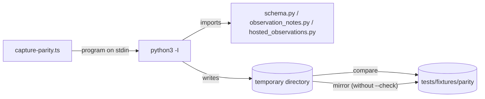

# Evidence contract inventory

The evidence store accepts the same JSON documents the repository's CI tooling
already writes: version-2 _receipts_ (one pre-push run's results) and version-3
_observation collections_ (immutable per-cell results published as Git notes).
The rules for those documents live in Python, in `scripts/ci/schema.py` and
`scripts/ci/observation_notes.py`. The TypeScript contract in `src/contracts/`
must answer exactly as the Python does: the same accept/reject decision, the
same canonical bytes, and the same SHA-256 identities.

This page is the map between the two. Use it to:

- find which Python check governs a field, and what input shapes it accepts;
- find the frozen _parity case_ that pins that behavior, so a TypeScript test
  can compare against it;
- see which legacy shapes the Python accepts on purpose, so the port does not
  "fix" them;
- find the robustness case that exercises each shape against the port, and the
  few places where the port departs from the Python on purpose.

Line numbers refer to `scripts/ci/schema.py` unless another file is named. They
drift as the file changes; the function name is the stable reference.

## Parity fixtures

A _parity fixture_ is a recorded question-and-answer pair: an input exactly as
written (raw bytes, so number spellings such as `1E+5` survive), and what the
real Python answered for it. They live in `tests/fixtures/parity/`, indexed by
`manifest.json`.

### Regenerating and checking

```sh
# Re-run the Python and rewrite tests/fixtures/parity/ (deterministic).
pnpm --dir tools/evidence-store exec tsx cli/capture-parity.ts

# Re-run the Python and only compare; exits 1 and names each differing file.
pnpm --dir tools/evidence-store exec tsx cli/capture-parity.ts --check
```

`cli/capture-parity.ts` contains the Python program as a string and pipes it to
`python3 -I` (isolated mode: no user site-packages, no `PYTHON*` variables). The
program imports the real modules from `scripts/ci/`, writes every answer into a
fresh temporary directory, and the TypeScript side then mirrors that directory
onto `tests/fixtures/parity/`. Nothing else is written. `HOME` and
`USERPROFILE` point at a temporary directory so that `~` in a receipt's
`report_dir` expands the same way on every machine, and `GIT_DIR` points at a
missing directory so no Git command can read this repository.



`tests/node/parity-fixtures.test.ts` checks the fixture set without any port:
the manifest lists exactly the files present, every recorded identity is the
SHA-256 of its canonical file, collection ids are sorted, canonical files are
pure ASCII, and, when `python3` is on `PATH`, `--check` passes (about one
second). Without `python3` that test is reported as skipped with the reason in
its name.

### Case kinds

Every manifest entry has `name`, `kind`, `files` (every file the case owns),
and usually a `note`. The remaining fields depend on the kind:

| Kind | Question it answers | Recorded answer |
|---|---|---|
| `canonical` | What are the canonical bytes of this JSON text? | `canonical` (a `.canonical` file, no trailing newline) and `identity` (SHA-256 hex of those bytes) |
| `loader` | Does the strict loader accept these bytes? | `accepts`; on rejection `stage` (`decode` or `parse`), `exception`, and `error` (Python's message); on acceptance `canonical_text` |
| `collection` | What is this real-shape v3 collection's identity? | `canonical`, `identity`, `observation_ids` (recomputed from content), `problems` (always `[]`), and `source` (which Python producer built it) |
| `receipt-adapter` | What v3 collection does this v2 receipt adapt to? | `home` (directory to use as `HOME`, holding the report files), `receipt_problems`, and either the adapted collection (`canonical`, `identity`, `observation_ids`, `problems`) or `error` |
| `validator` | What problems does the validator report? | `target` (`collection` or `receipt`), `problems` (exact strings), `codes` (the text before the first `:` of each), `valid`; or `exception` when the Python validator crashes |

Inputs that the loader accepts are stored as `.json`; inputs it rejects are
stored as `.txt`, byte for byte (some are deliberately invalid UTF-8). Validator
inputs are stored in canonical form, and their problems were computed by
re-loading that stored text, so the file alone reproduces the answer.

To reproduce a `receipt-adapter` case, set `HOME` (and `USERPROFILE` on
Windows) to the case's `<name>.home` directory and adapt `<name>.json`. Report
paths in the receipt resolve under the expanded `report_dir`. Error messages
that contain the temporary home have it replaced by the literal `$HOME`.

## Shared validator groups

The port tests each input shape once per _shared validator_ (one reusable check
applied to many fields), then wires each field to it with one positive and one
negative case. The Python helpers behind each group:

| Group | Python helpers | What it decides |
|---|---|---|
| **Strict object/version** | `_keys` (1233), `is_version` (2638), the version branches of `validate_receipt` (2670) and `validate_collection` (2970) | Value is an object; required keys present; no unknown keys; `schema_version` is exactly the integer (not `3.0`, not `true`) |
| **String/enum/identity** | `_member` (1251), `_sha` (1257), `_IDENTITY.fullmatch` (`[0-9a-f]{8,64}`), report `sha256` regex `[0-9a-f]{64}` (2935), nonempty-string checks | Enumerations, 40-hex Git object IDs, 8-64 hex identities, 64-hex report digests, nonempty strings |
| **Lists and members** | `_str_list` (1263), report and observation loops in `validate_observation` (2818) and `validate_collection` | List of strings; each element validated; per-list emptiness rules |
| **Numeric/boolean/counts** | `_counts` (3150), `exit_code`/`duration_s`/`bytes`/`attempt` checks | Integer versus float versus boolean; non-negative bounds; count sum |
| **Graph/context** | `observation_identity` (2806), sort/duplicate/retry checks in `validate_collection` (2996-3033), `_cell_key` (3036), duplicate-cell check in `validate_receipt` (2714-2724) | Content ids, sorted unique ids, retry targets in the same cell, no cycles, conflicting receipt cells |

### Early returns that hide later problems

The Python stops at certain points, so a port that reports "more" problems is
not at parity:

- `validate_collection` returns after the version check, after `_keys`, after a
  non-list `observations`, and after any per-observation problem (sorting and
  retry links are only checked when every observation is valid).
  Case: `v-graph-invalid-member-hides-graph`.
- `validate_observation` returns after `_keys` problems and after a non-hex
  `observation_id`. Case: `v-observation-unknown-key`, `v-observation-id-not-hex`.
- `validate_receipt` returns after the version check, after `_keys`, and after
  an empty or non-list `cells`.
- `receipt_cell_problems` does **not** stop after `_keys`, but stops when
  `package` is not a nonempty string or `gate` is not a string. Case:
  `v-cell-missing-package`.
- A report's `_keys` problems do not stop its field checks, so one empty report
  object yields both "missing field" and "must be a string" problems. Case:
  `v-report-empty-object`.

## Field inventory

Each table lists the field, whether it is required, the shapes the Python
accepts, the governing check, its shared validator group, the frozen cases that
cover it, and the extra robustness shapes the port is tested with. "Controls"
means the `v-control-*`, `v-receipt-control`, and `collection-*` cases, which all
pass.

Every frozen case runs through the port in `tests/node/contracts-parity.test.ts`
(one test per manifest entry, plus a guard that the count per kind matches the
manifest). Every shape in the "Port robustness" column is a test in
`tests/node/contracts-robustness.test.ts`, which edits a frozen control once
and asserts the problem code and its JSON-pointer location through
`parseCollection`, `parseReceipt`, or `adaptReceipt`.

### Collection (`COLLECTION_FIELDS`, `validate_collection` 2970)

| Field | Req | Accepted shapes | Check | Group | Frozen cases | Port robustness |
|---|---|---|---|---|---|---|
| (document) | | object | `_keys` 2979/2985 | Strict object | `v-collection-array`, `-null`, `-empty-object`, `-unknown-key` | string and number documents |
| `schema_version` | yes | integer `3` only | `is_version` 2980 | Strict object | `v-collection-version-float`, `-true`, `-string`, `-null`, `-2` | large integer `3` spelled `3e0` (float, rejected) |
| `environment` | yes | one of `ENVIRONMENTS` | `_member` 2988 | String/enum | `v-collection-environment-unknown`, `-int`, `-missing-environment` | empty string, null |
| `head`, `tree` | yes | 40 lowercase hex | `_sha` 2991 | String/enum | `v-collection-head-short`, `-head-uppercase`, `-tree-null` | 41 characters, integer |
| `observations` | yes | list, possibly empty | 2994, members via `validate_observation` | Lists | `collection-empty`, `v-collection-observations-null`, `-object`, `-observation-null`, `-observation-scalar`, `-observations-all-invalid`, `-observation-empty-object` | mixed valid and invalid members |
| (ids) | | unique, sorted ascending | 2997-3011 | Graph | `v-graph-duplicate-id`, `v-graph-unsorted` | three-member partial sort |

### Observation (`OBSERVATION_FIELDS`, `validate_observation` 2818)

| Field | Req | Accepted shapes | Check | Group | Frozen cases | Port robustness |
|---|---|---|---|---|---|---|
| (document) | | object, no unknown keys | `_keys` 2824 | Strict object | `v-observation-unknown-key`, `-missing-base`, `-missing-id` | |
| `observation_id` | yes | string matching `[0-9a-f]{8,64}` and equal to `observation_identity` | 2828, 2832 | String/identity, Graph | `v-observation-id-not-hex`, `-uppercase`, `-int`, `-mismatch` | 7 and 65 characters |
| `retry_of` | no | when present, `[0-9a-f]{8,64}` string, not the observation's own id, naming a member of the same cell | 2836-2842, 3012-3033 | String/identity, Graph | `collection-retry-chain`, `v-retry-of-null`, `-not-hex`, `-int`, `v-graph-retry-absent`, `-across-cells`, `-across-test-filter`, `-same-cell`, `-self`, `-cycle` | retry to an 8-character prefix (structurally valid, absent) |
| `producer` | yes | object | `_keys` 2854 | Strict object | see Producer | |
| `base` | yes | 40 lowercase hex | `_sha` 2843 | String/enum | `v-base-short`, `-null` | |
| `scope_identity` | yes | `str(value)` matches `[0-9a-f]{8,64}` | 2844 | String/identity | `v-scope-identity-short`, `-uppercase`, `-int-digits` (valid), `-float`, `-true`, `-null` | integer with fewer than 8 digits |
| `completion` | yes | `complete`, `interrupted`, `partial` | `_member` 2846 | String/enum | `v-completion-unknown`, `-null` | |
| `cell` | yes | a receipt cell | `receipt_cell_problems` 2922 | Strict object | see Receipt cell | |
| `proof` | no | object; forbidden for `hook`; required for other kinds unless the cell outcome is `fail` | 2890-2917 | Strict object | see Proof | |
| `reports` | yes | list; may be empty unless the cell is `complete` with a string `report` | 2924-2967 | Lists | `v-reports-null`, `-string`, `-empty-complete`, `-all-invalid`, `-mixed`, `collection-incomplete`, `v-partial-no-reports` | |
| `features` | no | any string, including `""` | 2849 | String | `collection-features-variants`, `v-features-empty`, `-value`, `-null`, `-list` | |

### Producer (`OBSERVATION_PRODUCER_FIELDS`, 2853-2888)

| Field | Req | Accepted shapes | Check | Group | Frozen cases | Port robustness |
|---|---|---|---|---|---|---|
| (object) | yes | object | `_keys` 2854 | Strict object | `v-producer-null`, `-string`, `-empty-object`, `-unknown-key` | |
| `kind` | yes | `hook`, `rig`, `hosted`, `seed` | `_member` 2860 | String/enum | `v-producer-kind-unknown`, `-null`, controls for each kind | |
| `host` | yes | object | `_keys` 2863 | Strict object | see Observation host | |
| `workflow` | hosted only | string (any, including empty) | 2871-2883 | String | `v-hosted-missing-workflow`, `-workflow-int` | empty string (valid) |
| `run_id` | hosted only | string (any) | 2871-2883 | String | `v-hosted-missing-run-id`, `-run-id-int`, `v-hook-with-run-id` | empty string (valid) |
| `attempt` | hosted only | integer >= 1 (not boolean, not float) | 2885 | Numeric | `v-hosted-missing-attempt`, `-attempt-zero`, `-negative`, `-float`, `-true`, `-string` | integer beyond 2^53 (valid) |
| `seed_id` | seed only | string (any) | 2871-2883 | String | `collection-seed`, `v-seed-missing-seed-id`, `-seed-id-int` | |

### Observation host (`OBSERVATION_HOST_FIELDS`, 2863-2870)

| Field | Req | Accepted shapes | Check | Group | Frozen cases | Port robustness |
|---|---|---|---|---|---|---|
| (object) | yes | object | `_keys` 2863 | Strict object | `v-host-null`, `-empty-object`, `-unknown-key` | |
| `os`, `kernel` | yes | nonempty string | 2865 | String | `v-host-os-empty`, `v-host-kernel-int` | null |
| `label` | no | string (empty allowed) | 2868 | String | `v-host-label-int`, `collection-unicode` | empty string |
| `report_dir` | no | string; must be nonempty when any report has store `host-dir` | 2868, 2946-2954 | String, Graph | `v-host-report-dir-int`, `-empty`, `-absent`, `v-hosted-artifact-no-report-dir` | |

### Proof (`OBSERVATION_PROOF_FIELDS`, 2890-2917)

| Field | Req | Accepted shapes | Check | Group | Frozen cases | Port robustness |
|---|---|---|---|---|---|---|
| (object) | see Observation | object | `_keys` 2904 | Strict object | `v-proof-null`, `-empty-object`, `-unknown-key`, `v-hook-with-proof`, `v-rig-without-proof`, `v-hosted-without-proof`, `v-seed-without-proof`, `v-rig-fail-without-proof` (valid) | |
| `nextest_version`, `target`, `expected_listing_digest` | yes | nonempty string, **any** characters | 2906 | String | `v-proof-target-int`, `-missing-target`, `-digest-empty`, `v-proof-digest-not-hex` (valid) | |
| `completion_record_digest` | when the cell passed | nonempty string, any characters | 2906, 2911-2917 | String | `v-pass-without-completion-digest`, `v-fail-without-completion-digest` (valid), `collection-rig`, `collection-hosted-fail` | empty string |

### Report (`OBSERVATION_REPORT_FIELDS`, 2928-2967)

| Field | Req | Accepted shapes | Check | Group | Frozen cases | Port robustness |
|---|---|---|---|---|---|---|
| (object) | | object | `_keys` 2929 | Strict object | `v-report-null`, `-empty-object`, `-unknown-key` | |
| `path` | yes | nonempty string, never interpreted | 2932 | String | `v-report-path-empty`, `-int`, `collection-unicode` | |
| `sha256` | yes | exactly 64 lowercase hex | 2934 | String/identity | `v-report-sha256-not-hex`, `-uppercase`, `-short` | |
| `bytes` | yes | integer >= 0 (not boolean, not float) | 2938 | Numeric | `v-report-bytes-negative`, `-zero` (valid), `-float`, `-true`, `-string` | integer beyond 2^64 (valid) |
| `store` | yes | `host-dir` or `artifact` | `_member` 2940 | String/enum | `v-report-store-unknown`, `-null`, `collection-hosted-pass` | |
| (cell report cited) | | a `complete` cell's string `report` equals some report `path` | 2955-2966 | Graph | `v-reports-empty-complete`, `v-report-path-empty` | |

### Receipt (`RECEIPT_FIELDS`, `validate_receipt` 2670)

| Field | Req | Accepted shapes | Check | Group | Frozen cases | Port robustness |
|---|---|---|---|---|---|---|
| (document) | | object | `_keys` 2679/2692 | Strict object | `v-receipt-null`, `-empty-object`, `-unknown-key` | |
| `schema_version` | yes | integer `2`; integer `1` reports `v1-requires-exact-tree` | `is_version` 2680-2690 | Strict object | `v-receipt-v1`, `-version-float`, `-version-true`, `-version-3`, `-missing-version`, `adapter-v1-receipt` | |
| `environment` | yes | one of `ENVIRONMENTS` | `_member` 2696 | String/enum | `v-receipt-environment-unknown` | |
| `base`, `head`, `tree` | yes | 40 lowercase hex | `_sha` 2699 | String/enum | `v-receipt-tree-short` | |
| `scope_identity` | yes | `str(value)` matches `[0-9a-f]{8,64}` | 2701 | String/identity | `v-receipt-scope-identity-int-digits` (valid) | short string |
| `completion` | yes | `complete`, `interrupted`, `partial` | `_member` 2703 | String/enum | `v-receipt-completion-unknown` | |
| `host` | yes | object with exactly `os`, `kernel`, `report_dir`; values never type-checked | `_keys` 2706 | Strict object | `v-receipt-host-null`, `-missing-report-dir`, `-unknown-key`, `-os-int` (valid) | |
| `cells` | yes | nonempty list of receipt cells; identical duplicates allowed, differing duplicates conflict | 2708-2724 | Lists, Graph | `v-receipt-cells-empty`, `-null`, `-cell-null`, `-cells-all-invalid`, `-identical` (valid), `-conflicting`, `adapter-v2-empty-cells` | |

### Receipt cell (`RECEIPT_CELL_FIELDS`, `receipt_cell_problems` 2728)

Shared by a receipt's `cells` and an observation's `cell`. Most cases go
through an observation; the receipt cases above prove the receipt wiring.

| Field | Req | Accepted shapes | Check | Group | Frozen cases | Port robustness |
|---|---|---|---|---|---|---|
| (object) | | object | `_keys` 2734 | Strict object | `v-cell-null`, `-empty-object`, `-unknown-key` | |
| `package` | yes | nonempty string | 2736-2741 | String | `v-cell-missing-package`, `-package-empty`, `-package-int` | |
| `gate` | yes | string, then one of `GATES` | 2740, `_member` 2753 | String/enum | `v-cell-gate-int`, `-gate-unknown` | |
| `outcome` | yes | `pass`, `fail` | `_member` 2754 | String/enum | `v-cell-outcome-unknown` | |
| `exit_code` | yes | any integer (not boolean, not float) | 2759 | Numeric | `v-exit-code-float`, `-true`, `-null`, `-negative` (valid) | |
| `completion` | yes | `complete`, `interrupted`, `partial` | `_member` 2755 | String/enum | `v-cell-completion-unknown` | |
| `counts` | yes | see Counts | `_counts` 2756 | Numeric | see Counts | |
| `duration_s` | yes | integer or float >= 0, not boolean | 2762 | Numeric | `v-duration-float` (valid), `-negative`, `-true`, `-string`, `-null` | `-0.0` (valid) |
| `gate_input_identity` | yes | `str(value)` matches `[0-9a-f]{8,64}` | 2757 | String/identity | `v-cell-gate-input-identity-null`, `-int-digits` (valid) | |
| `backends` | yes | list of strings, empty allowed | `_str_list` 2771 | Lists | `v-backends-null`, `-string`, `-int-element`, `-all-invalid`, `-missing` | |
| `report` | yes | string (empty allowed) | 2769 | String | `v-cell-report-int` | empty string |
| `failed_tests` | no | list of at most 20 strings; absent means `[]` | 2781-2788 | Lists | `v-failed-tests-null`, `-empty`, `-int-element`, `-20`, `-21` | |
| `failure_detail_truncated` | no | any value | 2790-2804 | Numeric/boolean | `v-complete-fail-truncated`, `-truncated-false`, `-truncated-string`, `v-truncated-on-pass` | |
| (failure detail) | | a `complete` `fail` needs nonempty `failed_tests` or a truthy `failure_detail_truncated` | 2789-2804 | Graph | `v-complete-fail-no-detail`, `v-interrupted-fail-no-detail` (valid) | `partial` fail without detail (valid) |
| `build` | no | object `{key, digest}` when present; null is an error | 2772-2780 | Strict object | see Build | |
| `test_filter` | no | nonblank string on an `L1` cell | 2744-2752 | String | `v-cell-test-filter-l1` (valid), `-blank`, `-l2` | integer |

### Counts (`COUNT_FIELDS`, `_counts` 3150)

| Field | Req | Accepted shapes | Check | Group | Frozen cases | Port robustness |
|---|---|---|---|---|---|---|
| (object) | yes | object; unknown keys **accepted** | 3151 | Numeric | `v-counts-null`, `-list`, `-empty-object`, `-unknown-key` (valid) | |
| `total`, `passed`, `failed`, `skipped`, `errored` | yes | present; an `int` (including `bool`) must be >= 0; `total` must equal the sum of the four parts | 3153-3170 | Numeric | `v-counts-missing-total`, `-negative`, `-sum-mismatch`, `-float` (valid), `-bool` (valid), `-total-string`, `-part-string` (crash), `-part-null` (crash) | |

### Build (`RECEIPT_BUILD_FIELDS`, 2772-2780)

| Field | Req | Accepted shapes | Check | Group | Frozen cases | Port robustness |
|---|---|---|---|---|---|---|
| (object) | | object with exactly `key`, `digest` | `_keys` 2774 | Strict object | `v-build-null`, `-valid`, `-unknown-key` | |
| `key`, `digest` | yes | `str(value)` matches `[0-9a-f]{8,64}` | 2776 | String/identity | `v-build-key-not-hex`, `-key-int-digits` (valid) | digest missing |

## Canonical form and identity

`canonical` (1209) is `json.dumps(document, sort_keys=True,
separators=(",", ":"))` with Python's default `ensure_ascii=True` and
`allow_nan=True`. `identity` (1218) is the lowercase SHA-256 hex of the UTF-8
encoding of that text. `observation_identity` (2806) is the identity of the
observation without its `observation_id` key; a collection's identity is the
identity of the whole canonical collection.

| Rule | Example input | Canonical output | Case |
|---|---|---|---|
| Keys sort by Unicode code point, not UTF-16 unit | keys U+FB01 and U+1F600 | U+FB01 first | `unicode-key-order`, `unicode-key-order-escaped` |
| Lone surrogates sort as code points | keys U+D800, U+E000, U+10000 | that order (UTF-16 order would put U+10000 second) | `unicode-key-order-surrogates` |
| Every non-ASCII character is escaped in lowercase hex; astral characters become a surrogate pair | `café` (raw UTF-8) | `caf\u00e9` | `non-ascii-values`, `top-level-string` |
| Lone surrogate escapes are kept | `"\ud800"` | `"\ud800"` | `lone-surrogates` |
| Control characters use `\b \f \n \r \t`, otherwise `\u00XX`; DEL (0x7F) is escaped | raw DEL | `\u007f` | `control-characters` |
| `/` is never escaped; `\/` in input becomes `/` | `a\/b` | `a/b` | `slash-and-quote` |
| Integer tokens keep every digit; `-0` becomes `0` | `18446744073709551617` | same | `large-integers` |
| Float tokens are re-printed with Python `repr(float)`: shortest round-trip digits, `.0` on integral values, exponent form below `1e-4` or from `1e16`, exponent written `e+XX`/`e-XX` with at least two digits | `1e5`, `1.5e-7`, `1e16` | `100000.0`, `1.5e-07`, `1e+16` | `floats` |
| Float precision is IEEE double | `9007199254740993.0` | `9007199254740992.0` | `floats` |
| Overflowing floats become infinities and are written as non-JSON tokens (the port's loader refuses them; see Departures) | `1e400` | `Infinity` | `float-overflow` |
| Underflowing floats become zero, keeping the sign | `-1e-400` | `-0.0` | `float-underflow` |

## Strict loader

`loads_strict` (2647) wraps `json.loads` and refuses duplicate keys (at any
depth) and the constants `NaN`, `Infinity`, and `-Infinity`. Python's
`json.loads` itself refuses trailing data, raw control characters in strings,
and a leading byte order mark. Every caller in `scripts/ci/` first decodes bytes
with strict UTF-8 (`read_text(encoding="utf-8")` or `bytes.decode("utf-8")`,
never `utf-8-sig`), so invalid UTF-8 is a decode error before parsing.

| Behavior | Cases |
|---|---|
| Rejected: duplicate key, nested duplicate key | `loader-duplicate-key`, `loader-duplicate-key-nested` |
| Rejected: trailing data, second document (same line or next line) | `loader-trailing-garbage`, `loader-concatenated`, `loader-concatenated-newline` |
| Rejected: `NaN`, `Infinity`, `-Infinity` | `loader-nan`, `loader-nan-nested`, `loader-infinity`, `loader-negative-infinity` |
| Rejected: BOM, blank, whitespace-only | `loader-bom`, `loader-blank`, `loader-whitespace-only` |
| Rejected at decode: invalid, overlong, surrogate-encoding, truncated UTF-8 | `loader-invalid-utf8`, `loader-overlong-utf8`, `loader-encoded-surrogate`, `loader-truncated-utf8` |
| Rejected: JSON5/YAML syntax and malformed numbers | `loader-single-quotes`, `loader-trailing-comma`, `loader-comment`, `loader-yaml`, `loader-leading-zero`, `loader-plus-sign`, `loader-bare-fraction`, `loader-dangling-point`, `loader-raw-control`, `loader-invalid-escape`, `loader-unterminated`, `loader-uppercase-literal` |
| Accepted: surrounding whitespace, raw DEL, raw U+2028, lone surrogate escape, escaped NUL, scalar top-level document | `loader-trailing-whitespace`, `loader-leading-whitespace`, `loader-raw-del`, `loader-raw-line-separator`, `loader-lone-surrogate-escape`, `loader-nul-escape`, `loader-top-level-scalar` |

## Receipt adaptation (version 2 to version 3)

`observation_notes.receipt_observations` (`observation_notes.py` 117) with its
defaults is the hook adapter, and `collection_of` (190) wraps its output:

1. The receipt must pass `validate_receipt`; otherwise the adapter raises with
   the first problem (`adapter-v2-empty-cells`, `adapter-v1-receipt`). The
   port lists every problem instead (see Departures).
2. `report_dir` is expanded with `Path.expanduser` on the submitting host. Only
   cells whose own `completion` is `complete` have their report read and
   digested; other cells get `reports: []` and their report file is never
   opened (`adapter-hook-v2`, whose interrupted cell's report does not exist).
   A missing report is an error (`adapter-v2-missing-report`).
3. Each observation gets `producer: {kind: "hook", host: <the receipt host,
   verbatim>}`, so `report_dir` keeps its unexpanded `~` spelling; the receipt's
   `base`, `scope_identity`, and receipt-level `completion`; the cell unchanged;
   and report references `{path: cell.report, sha256, bytes, store: "host-dir"}`.
   No `proof`, no `run_id`, and no `features` key (an empty feature string is
   dropped, not written as `""`).
4. Observations are sorted by id and the collection is validated. Two identical
   receipt cells pass `validate_receipt` but adapt to the same id twice, so
   `collection_of` refuses them (`adapter-v2-identical-cells`).
5. A `report_dir` of exactly `~` and report paths with subdirectories and
   spaces work (`adapter-hook-v2-bare-home`).

The rig, seed, and hosted collections show the other producers' shapes:
`collection-rig` is the tail of `record_rig_cell` (kind `rig` with proof,
features, and `run_id`); `collection-seed` reuses that path and adds
`seed_id` (no producer writes `seed_id` today); `collection-hosted-pass` and
`collection-hosted-fail` come from the real
`hosted_observations.build_observation`.

## Intentional defaults and legacy acceptances

The port must keep each of these; tightening any of them would reject evidence
the Python accepts.

| Behavior | Where | Case |
|---|---|---|
| `failed_tests` absent means `[]`; present-but-null is an error | 2781 | `v-failed-tests-null`, controls |
| `str()` coercion before the identity regex lets a non-string pass when its Python string form is 8-64 lowercase hex: an integer of 8+ decimal digits passes for `scope_identity`, `gate_input_identity`, and build `key`/`digest`; `null` (`"None"`), `true` (`"True"`), and floats (`"12345678.0"`) fail | 2701, 2757, 2777, 2844 | `v-scope-identity-int-digits`, `v-receipt-scope-identity-int-digits`, `v-cell-gate-input-identity-int-digits`, `v-build-key-int-digits`, `v-scope-identity-float`, `-true`, `-null` |
| Proof digests are any nonempty string; only report `sha256` must be hex | 2906, 2934 | `v-proof-digest-not-hex` |
| A failing observation of any non-hook kind may omit `proof`; a failing proof may omit `completion_record_digest` | 2896-2917 | `v-rig-fail-without-proof`, `v-fail-without-completion-digest`, `collection-hosted-fail` |
| `features: ""` is valid and has a different identity from an absent `features` | 2849 | `collection-features-variants`, `v-features-empty` |
| `observations: []` is a valid collection; `cells: []` is an invalid receipt | 2994, 2708 | `collection-empty`, `v-receipt-cells-empty` |
| Incomplete observations need no reports | 2955 | `collection-incomplete`, `v-partial-no-reports` |
| `failure_detail_truncated` is never type-checked; any truthy value excuses missing detail, and it is accepted on a pass | 2790-2804 | `v-complete-fail-truncated-string`, `v-truncated-on-pass` |
| `counts` accepts unknown keys, floats, and booleans (booleans are integers and sum as 1/0) | 3150-3170 | `v-counts-unknown-key`, `v-counts-float`, `v-counts-bool` |
| A string `counts.total` is reported as a sum mismatch whose message prints both values the same way (`total is 10 but its parts sum to 10`) | 3165 | `v-counts-total-string` |
| Receipt `host` values are never type-checked (only its keys) | 2706 | `v-receipt-host-os-int` |
| Any integer `exit_code` is valid, including negative ones | 2759 | `v-exit-code-negative` |
| A collection's `environment` only labels messages; observations and cells are not checked against it | 2997 | `v-collection-environment-cell-label` |
| Optional producer fields (`run_id`, `workflow`, `attempt`, `seed_id`) are allowed on any kind | 2880-2888 | `v-hook-with-run-id` |
| A `test_filter` is part of a cell's identity for retry purposes | `_cell_key` 3036 | `v-graph-retry-across-test-filter` |
| A retry cycle cannot be built from valid content ids (each id would have to hash the other); the id check fires first, but the cycle check must still exist | 3026-3032 | `v-graph-retry-cycle` |
| A self-retry is reported only when `retry_of` is otherwise well formed | 2836-2842 | `v-graph-retry-self` |
| Problem messages embed Python `repr` text (`'linux'`, `None`, `True`, `3.0`, lists as `['a', 'b']`) and the first 12 characters of `str(observation_id)` | `_member`, `_sha`, labels | all `validator` cases |

## Departures from the Python

The port answers where the Python crashes, and refuses one value the Python
accepts. Each departure is asserted by name in the tests.

| Python behavior | Port behavior | Why | Test |
|---|---|---|---|
| `1e400` (any float lexeme beyond the double range) loads as `inf` and canonicalizes to `Infinity` | `loadStrict` refuses it as `nonfinite-number`, located at the number | Nonfinite values are rejected; `Infinity` is not JSON. Underflow (`-1e-400`) still loads and canonicalizes to `-0.0` | `float-overflow` parity case; loader shapes |
| A string, null, list, or object count part makes `_counts` raise `TypeError` | One `malformed-receipt` problem per non-numeric part: `{label} counts.{part} must be a number`, located at that part; the sum is skipped | A validator must answer, not crash | `v-counts-part-string`, `v-counts-part-null`; list part |
| An integer count part beyond the double range summed with a float part raises `OverflowError` | `malformed-receipt` problem located at the part being added | Same | int too large to add to a float |
| A list or object `package` or `gate` in a receipt cell makes the duplicate-cell check raise (unhashable key) | The cell's own problems are reported; that cell is left out of the conflict check | Same; the cell is already rejected | (by construction) |
| A list or object producer `kind` makes the required-field lookup raise | The `kind` problem is reported and no hosted/seed fields are required | Same | (by construction) |
| A non-string receipt `host.report_dir` makes the adapter's `Path()` raise `TypeError` | `adaptReceipt` reports `malformed-receipt` at `/host/report_dir` | Same | non-string report_dir |
| The adapter raises with only the first receipt problem, or the first unreadable report | `adaptReceipt` lists every receipt problem, or every unreadable report (code `report-unavailable`, at `/cells/{i}/report`), and produces nothing | All problems are located | malformed receipt; unreadable reports |
| `Path.expanduser` resolves `~user` from the password database | The Node reader reports `~user` as unreadable rather than guessing | No portable lookup | another user's home |
| `json.loads` accepts nesting up to about 10,000 levels | `loadStrict` refuses nesting deeper than 1,000 (`syntax`) | Bounded recursion cannot overflow the stack | nesting past `MAX_DEPTH` |

An integer of more than 4300 digits is refused as `syntax`; this is parity, not
a departure, because Python 3.12's integer-conversion limit makes `json.loads`
raise there too.

Collection problems found while adapting (two identical cells, a receipt host
whose `os` is not a string) keep the Python message and are located on the
receipt: a cell field at `/cells/{i}/...`, a host field at `/host/...`, and
anything else about an observation at `/cells/{i}`.

## Service requests and configuration

The evidence contract above covers what producers submit. The service also
reads its own request bodies (queries, location events, operator requests),
the service configuration (`SERVICE_CONFIG`), and the operator CLI's grant
file. They all go through the same strict loader, so duplicate keys, trailing
content, a BOM, blank input, nonfinite numbers, and invalid UTF-8 are refused
the same way. Field shapes are decided once, in `src/requests.ts`
(`tests/node/requests.test.ts` walks every shape), the configuration loader in
`src/config.ts` (`tests/node/service-config.test.ts`), and the credential
request validator in `src/credential-request.ts`, shared by
`POST /v1/operator/credentials` and the grant file
(`tests/node/credential-request.test.ts`).

Every invalid shape is a 400 `invalid_input` (or, for configuration, a 503 to
every request) located at the field's JSON pointer. An explicit `null` for an
optional field is refused, never read as absent. Arrays are never filtered:
one invalid element refuses the request. These are the only defaults:

| Field | Absent means |
|---|---|
| `page_size` (history, changes, audit, export) | 100 |
| `after_sequence` (changes) | the stream origin (0); refused with 409 `cursor_expired` once the stream's replay horizon is above 0 |
| `snapshot` (history, changes) | the service captures the current snapshot |
| `verification_method` (location event) | nothing; it is required exactly when `kind` is `verified` |
| `expires_in_days` (credential request, grant file) | 90 |
| `replaces` (credential request) | no rotation |
| audit query filters | no filter |

Empty collections are deliberate values, never "unrestricted":

- an empty `reachable_heads` is a successful empty history;
- empty `repository_ids` or `roles` on a credential, and an empty
  configuration `repositories` or `trusted_workflows` list, deny everything.

## Uploaded proof documents

When a verifier finalizes an expected-listing or completion-record upload,
the service loads the bytes with the same strict loader and runs the checks
in `src/contracts/proofs.ts`. These are ports of the *structural* part of
the Python checks only:

| Python | Ported | Not ported |
|---|---|---|
| `schema.validate_completion_record` | all of it: version before field set, required and unknown fields, `run`/`package` nonempty strings, `attempt` a positive integer (never a bool or float), `environment`/`gate` vocabularies, `head` SHA, `complete: true`, `reports` a string list | nothing |
| `hosted_observations._completion_record` | binding of `package`, `environment`, `gate`, and `head` to the observation; `run` and `attempt` only for a hosted producer that records them; a nonempty `nextest_version` | nothing else exists |
| `completion.manifest_problems` | object, `schema_version`, required and unknown fields, `environment`, `tier` (against the cell's gate), `target` (against `proof.target`), nonempty `nextest_version`, and the cell package's listing fields | `selection_problems` and `declared_problems`, which need the resolved plan |
| `local_evidence._proof_problem` | the SHA-256 against the proof digest and the `{package}-{gate}` file names | the host-directory lookup, which only the submitting host can do |

A proof that fails these checks is rejected (400 `invalid_input`, upload
`rejected`, observation untouched). A proof that passes is stored for byte
integrity only: finalization never claims test coverage, and no
plan-dependent check runs in the service. Problem messages name fields and
the observation's own values, never content from the uploaded document.
Their tests are in `tests/node/proofs.test.ts` (each field shape once per
validator) and `tests/service/uploads.test.ts` (wiring).

## Ingestion CLI inputs

`cli/ingest.ts` reads its flags, the token file, the input bundle, the
`--proof-dir` files, and on resume its own state file. The bundle and the
state file go through the shared strict loader; state fields are checked
with located errors (`tests/node/ingest.test.ts` walks absent, null, wrong
type, wrong element, and empty once, plus the loader's document shapes).
Every one of these is read before the first network request. The only
defaults: an absent `--proof-dir` means no uploads, and a not-yet-acknowledged
state reports zero accepted observations in its summary.

## Retention certificates

`src/retention.ts` reads a certificate (at most `request_json_bytes`) through
the shared strict loader and the `src/requests.ts` field readers. No field is
optional: explicit `null`, unknown keys, and wrong types are 400 at the
field's JSON pointer, and arrays are never filtered.

- `certificate_id` (UUID), `snapshot` (all six `Snapshot` fields as integer
  tokens; `repository_id` must be the path's), `cells` (`[]` is valid),
  `verifier_policy` (`name`, `version` nonempty; `digest` SHA-256 hex), and
  `release_pins` (`[]` is valid).
- Each cell: `package` (nonempty), `environment` and `gate` (enums),
  `candidate_ids` (unique observation IDs; empty only when the store holds
  none for the cell), `retained_ids` (unique, at least one), `supersessions`
  (`[]` is valid).
- Each edge: `superseded_id`, `superseded_by_id`, and `evidence`, either
  `{kind:"strict-ancestry", ancestor_head, descendant_head}` (40-hex heads) or
  `{kind:"retry", chain}` (at least two unique IDs); each kind's keys are
  closed.
- Each pin: `release` (nonempty, unique within the certificate) and
  `observation_ids` (unique; `[]` is valid).

Intentional defaults: a certified cell with no stored observations is an
empty stored set; a missing capacity baseline counts as zero outside usage,
and a reservation sum with no rows counts as zero; an empty prune set makes a
job that is `completed` at once with `not_before_ms` equal to the submission
time; the job runner's batch budget defaults to 400 batches per run.
`tests/service/retention.test.ts` walks absent, null, wrong type, and empty
once through the shared readers, then one invalid shape per other field, plus
one strict-loader wiring case (duplicate key) and the size bound.

## Backup manifest and recovery commands

The backup manifest (`api/schemas/backup-manifest.schema.json`) is read only
by `src/backup-manifest.ts`, through the shared strict loader and the
`src/requests.ts` readers. It is `format_version` 1 and holds:

- `backup_id` (32 hex, also the backup directory's name), `created_at_ms`,
  `boundary` (`boundary_id` equal to `backup_id`, `quiesced_at_ms`,
  `resumed_at_ms` not before it), `source` (`environment`,
  `d1_database_name`, `d1_database_id`, `r2_bucket`), `migration` (1–9999),
  and `database` (`file`, `sha256`, `bytes`);
- the required lists `repositories`, `objects`, `missing_objects` (reason
  `absent` or `digest-mismatch`), `pending_uploads`, `retention_jobs`,
  `credentials` (digests only; `revoked_at_ms` present exactly when revoked),
  `grants`, and `window_revocations`. Every list may be empty and is never
  filtered: one bad element refuses the manifest.

Unknown keys, explicit nulls, duplicate keys, and trailing content are
refused at their JSON pointer (exit 2). File paths must be relative segments
that do not start with a dot. `tests/node/recovery.test.ts` walks the field
shapes once (29 cases) plus the loader wiring; `tests/node/recovery-cli.test.ts`
spawns one control and two malformed manifests.

The recovery commands take only flags; `restore --replay` may repeat and
requires `--dest-endpoint`, and `--dest-token-file` and `--report` must not
already exist. Intentional defaults:

- maintenance: an absent `reason` records `"operator maintenance"`; an absent
  `boundary_id` means "no boundary", and two such quiesces are the same one;
  `recover-jobs` accepts an empty body or `{}`;
- `--config` defaults to the package's `wrangler.jsonc`; `restore --label`
  defaults to `restored-operator`, with the standard 90-day expiry;
- objects already missing at backup time are reported, not verification
  failures; rotation keeps seven backups and skips invalid directories with a
  warning;
- replay drops uploads whose local file no longer matches its digest and
  counts them in `uploads_not_replayed`.

## Not captured, and why

- **An absolute `report_dir` in an adapter case.** Every frozen adapter case uses
  `~`, because an absolute path into a temporary directory would change the
  observation id on every run. The port's own tests should adapt a receipt
  whose `report_dir` is an absolute temporary path and compare against a
  Python run made in the same test, or assert the shape only.
- **An absolute or `..` report path.** `Path(report_dir) / cell.report` lets an
  absolute `report` replace the directory entirely, and `..` walks out of it;
  the Python reads whatever that names. The fixtures do not exercise this
  because it reads outside the temporary home. **The port preserves it**: the
  Node reader joins without normalizing or confining the path, because a
  historic receipt's paths name what its host actually retained. The robustness
  tests cover an absolute `report_dir`, an absolute report path, and a `..`
  report path against a temporary directory, asserting shape only.
- **Windows home expansion.** The capture sets both `HOME` and `USERPROFILE`, but
  was run on macOS; Python on Windows expands `~` from `USERPROFILE` only.
- **Platform-specific error text.** `adapter-v2-missing-report` records the
  POSIX `[Errno 2] No such file or directory` message; Windows words it
  differently. Ports should compare the leading sentence only.
- **Hosted inputs built by test helpers.** The hosted cases use the plan and the
  staged files from `scripts/ci/test_hosted_observations.py`
  (`HostedFixture.plan` and `stage_cell`), and replace only
  `local_evidence.revision`, which would otherwise ask Git for the checked-out
  commit. A change to those helpers changes the hosted cases' ids, and
  `--check` reports it.
- **Size limits, page bounds, and service configuration.** These are store
  rules with no Python counterpart.
