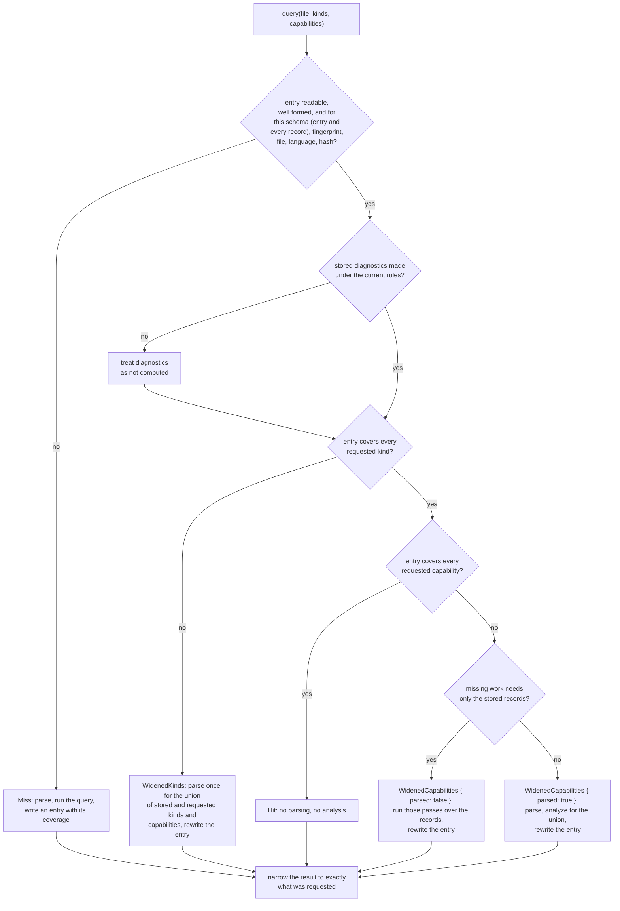

# Tree Hugger's Persistent Symbol Cache

`hug` keeps one cache entry per source file on disk, so a second run over
unchanged files reads the stored analysis instead of parsing again. This page
describes what is stored, when an entry is used, how it is widened and
replaced, and which damaged entries are refused.

The same cache is available to library callers as
`tree_hugger::cache::SymbolCache`.

## Using the cache

From the CLI there is nothing to do: every scanning command (`symbols`,
`functions`, `types`, `classes`, `imports`, `lint`) uses the cache unless you
pass `--no-cache`, which neither reads nor writes it.

```sh
hug --json symbols src/lib.rs            # cold: parses, analyzes, writes the entry
hug --json symbols src/lib.rs            # warm: reads the entry, parses nothing
hug --json symbols --no-cache src/lib.rs # never touches the cache
```

The output of all three runs is byte-for-byte identical. Each command asks
only for its own kinds and capabilities (`functions` for functions, methods
and constructors; `classes` adds containment; `lint` adds diagnostics;
`--json-full` asks for every capability), and the file's one entry widens as other commands need more,
so after `hug symbols`, `hug functions` is a complete hit.

Cache use and cache failures print nothing unless `--verbose` is given: an
entry that cannot be read is recomputed, and a write that fails is ignored.
With `--verbose`, `hug` prints each such failure and ends with one stats
line:

```text
cache: src/lib.rs: malformed entry: expected value at line 1 column 1
cache: 15 hits, 1 partial hits, 1 misses; parsed 2 files, 2 definition captures, 0 diagnostics runs
```

A file that simply has no entry yet is counted as a miss but not listed.
Under `--no-cache` the stats line starts `cache: disabled;`, and a
`--prelude` run adds `, N reused in this run` for files analyzed once for
the prelude and reused by the scan.

From the library, read the file once with `SourceFile` and hand it to the
cache with a `SymbolQuery`:

```rust
use tree_hugger::cache::{CacheLookup, PersistentCache, SymbolCache};
use tree_hugger::{Capability, SourceFile, SymbolKindV2, SymbolQuery};

let cache = SymbolCache::new(PersistentCache::default_cache("my-project", true));
let query = SymbolQuery::new()
    .kinds([SymbolKindV2::Function, SymbolKindV2::Method])
    .capabilities([Capability::Containment]);
let cached = cache.query(SourceFile::read("src/lib.rs")?, &query)?;
if cached.lookup == CacheLookup::Hit {
    // nothing was parsed or analyzed
}
let records = cached.result.index.symbols;
```

`cached.result` is exactly what `SourceFile::query` returns for the same
query without a cache. `cached.lookup` says how the entry was used, and
`cached.write_error` holds a failed write, if any.

## Where entries live

Entries are JSON files under the system temporary directory:

```text
<temp>/tree-hugger/cache/<project id>/<first two key characters>/<key>.json
```

`<project id>` is the package root with path separators, `:`, spaces and dots
replaced by `_`. `<temp>` comes from `TMPDIR` (`TMP`/`TEMP` on Windows), which
is how the CLI tests isolate the cache. Old entries are never deleted by
`hug`; clearing the directory is always safe.

## One entry per file

The entry's **key** is a digest of a fixed `symbols` tag and four things:

1. the file's [identity](#file-identity), with `\` written as `/`
2. the xxHash of the file's text, computed from the same bytes that are
   parsed (the file is read once)
3. the language, when it was forced with `--language`; otherwise
   `detected`
4. the **records fingerprint** (below)

Nothing about the request is in the key. `hug functions` and `hug lint` over
the same unchanged file use the same entry; the entry records what it holds,
and each command takes what it needs from it. Editing the file changes its
hash, so the next run uses a new key and the old entry is never read again.

### File identity

A file can be named many ways: `src/lib.rs`, `./src/../src/lib.rs`, its
absolute path, a symlink to it, or (on macOS) `/var/…` and `/private/var/…`
for the same temporary file. All of them are one file, so they must share
one entry, and `--prelude` must find the analysis it already made under
whatever name the scan lists the file. `SourceFile` therefore reads the file
through the name it is given and then analyzes it under its **identity**,
which `tree_hugger::file_identity` computes:

- the path made absolute, with `.`, `..` and every symlink resolved
  (`std::fs::canonicalize`), and on Windows written in its ordinary
  `C:\…` form rather than `\\?\C:\…`, with long names in place of 8.3
  short names;
- if the path cannot be resolved (the file vanished after it was read), the
  path made absolute against the working directory, unresolved.

```text
src/lib.rs                  ┐
./src/../src/lib.rs         │
/repo/src/lib.rs            ├──> identity /repo/src/lib.rs ──> one key, one entry
lib_link.rs -> src/lib.rs   ┘
```

**Symlinks share their target's identity.** A symlink and the file it points
to are analyzed, cached and reported as the target: the same entry, the same
records, the same `file_path` and the same IDs. Language detection reads the
identity too, so a symlink named `script` that points at `script.rs` is Rust.

Errors still use the name you gave: a missing or unreadable file is
`TreeHuggerError::Io` for that spelling, with the same error kind as before,
and an undetectable language names it as well. The file's bytes are read
once, through that spelling; resolving the identity reads no file contents.

**IDs follow the identity.** A record's stable key and ID are built from the
path as analyzed, which is the identity, so one file in one checkout has the
same IDs whichever spelling named it. They are not equal across checkouts in
different directories, since the identity is absolute.

The same identity is used everywhere `hug` compares files:

- `scanner::collect_files` returns identities, so a file named twice under
  different spellings, or named and also matched by a glob, is analyzed and
  listed once;
- `hug` resolves its working directory to its identity before deriving the
  scan, Git and package roots, so they are spelled like the files beneath
  them and paths display relative to them;
- the `--prelude` reuse map is keyed by identity;
- `GodFiles` reports paths relative to its root's identity.

Reports never show the identity directly: JSON paths are projected relative
to the scan root and terminal paths relative to the Git root
([symbol-reports.md](./symbol-reports.md)).

Every digest is BLAKE3 from `biscuit-hash` over a canonical encoding:
`canonical_digest` writes each field as its byte length, `:` and its bytes,
so `["a|b", "c"]` and `["a", "b|c"]` can never collide.

## The fingerprint

The records fingerprint is a `PassFingerprint` computed from what decides a
file's records, imports, exports and every analysis pass but diagnostics:

| Input | Where it comes from | Changes when |
|---|---|---|
| schema version | `SchemaVersion::V4_0` | the record shape changes |
| implementation version | crate version and `EXTRACTOR_REVISION` (`0.1.0+rev.6`) | extraction code changes |
| grammar identity | the compiled grammar: name, declared version (if any), ABI, node-kind, field and parse-state counts | a grammar crate is upgraded |
| grammar ID | the grammar variant (`typescript` or `tsx`, …) | the file's grammar variant differs |
| query text | the effective `locals`, `imports` and `references` query text, with inherited vendored queries and overlays resolved | a `.scm` file the analysis compiles changes |

A change to Rust extraction code cannot be seen in query text, so
`EXTRACTOR_REVISION` must still be bumped with any change to extracted
records, including a repair on an unreleased branch.

Diagnostics depend on more inputs, which only diagnostics use. They have
their own fingerprint, stored **inside** the entry rather than in the key:

| Input | Changes when |
|---|---|
| the records fingerprint inputs | as above |
| `lint` and `comments` query text | a lint pattern or the ignore-comment query changes |
| built-in rule metadata (ID, version, category, default severity, confidence, languages, default enablement, experimental flag of every rule) | a rule is added or its metadata changes |
| `experimental_semantics` | `hug lint --experimental-semantics` is toggled |

Stored diagnostics with a different diagnostics fingerprint are treated as
not computed: a symbol listing is still served from the entry, and a request
that needs diagnostics recomputes them and rewrites the entry. Lint policy
(`--deny`, `--warn`, `--allow`, `--strict`) and external adapters such as
Oxlint run after the cache and are not inputs.

The query text is an injectable input
(`SymbolCache::with_query_text`, `FingerprintInputs::with_query_text`), so a
test can change one query's text and watch the entry stop matching without
rebuilding the crate.

## What an entry holds

```json
{
  "schema_version": { "major": 4, "minor": 0 },
  "fingerprint": "<records fingerprint digest>",
  "file": "src/lib.rs",
  "language": "Rust",
  "source_hash": "<xxHash>",
  "covered_kinds": "all",
  "completed_capabilities": ["declarations", "containment", "references"],
  "diagnostics_fingerprint": null,
  "records": [ ... ],
  "imports": [ ... ],
  "exports": [ ... ],
  "diagnostics": []
}
```

- `covered_kinds` is the string `"all"` or a non-empty list of symbol kinds
  in ascending order, such as `["Function", "Method"]`. An empty list is
  never written and never read as "all".
- `completed_capabilities` lists the
  [capabilities](./symbol-schema-design.md) whose results the entry holds, in
  ascending order and closed under prerequisites, so it always contains
  `declarations`.
- `diagnostics_fingerprint` is `null` exactly when `diagnostics` is not
  among the capabilities, and then `diagnostics` is empty.
- `records` holds every record of the covered kinds, after the entry's
  passes ran. `file` is the path exactly as analyzed (the file's identity),
  since the records repeat it.

An entry is internally consistent by construction, and the reader checks it:
an entry whose contents contradict its coverage is refused.

## How a lookup is decided



The passes that work from stored records alone are the docs pass, the
semantic pass (when references are stored) and containment (when every kind
is stored, since a member's owner can be of any kind). References and
diagnostics need the syntax tree, so they parse the file; the definitions
query runs again with them, because binding and semantic lint consume its
live result.

For example, over one unchanged `lib.rs`:

| Run | Entry before | Outcome | Entry after |
|---|---|---|---|
| `functions` (functions, methods, constructors; declarations) | none | Miss | those kinds; `declarations` |
| `types` with containment | function kinds | WidenedKinds (one parse) | function and type kinds; `declarations`, `containment` |
| `functions` again | as above | Hit | unchanged |
| `types` with containment and references | as above | WidenedCapabilities, one parse | same kinds; adds `references` |

And over a file whose entry covers every kind with `declarations` only, a
request for structured docs runs just the docs pass over the stored records
(WidenedCapabilities, no parse) and rewrites the entry with both.

Every result is **narrowed** to the request before it is returned: kinds that
were not asked for are dropped, and relations, semantics, parsed docs,
export targets, diagnostics and each record's `provenance.parse_pass` are
reduced to what the requested passes produce. A narrow request served from a
wide entry is therefore identical to an uncached run of the narrow request.

## Writes are atomic

`PersistentCache::put` writes the new entry to `<key>.<process>.<n>.tmp` in
the entry's directory and renames it over `<key>.json`. A reader sees the old
entry or the complete new one, never a partial write. When two processes
write the same entry at once, the last rename wins; that is safe because
every entry, whichever survives, is complete and its coverage matches its
contents. A failed write removes its temporary file and leaves the previous
entry in place.

## Which damaged entries are served

The reader takes an entry only when it is valid JSON with no trailing
content, has every entry field with the right type and no field twice or
unknown, and matches the request (schema, fingerprint, file, language and
source hash). Anything else is a `CacheMiss` with its reason, and the file is
recomputed: never an empty result. `CacheMiss::Malformed` carries the
decoder's message, which names the field and tells an absent field
(`missing field`) from an explicit `null` (`invalid type: null`).

### Schema versions

An entry is served only when its own `schema_version` **and the
`schema_version` of every record in it** are exactly the current version
(4.0). The records are returned as stored, inside an index that claims the
current version, and the cache never translates between versions, so a
different minor version is a miss just like a different major one: an older
minor lacks fields the current version adds, and a newer one carries fields
this reader would drop. One record of another version is enough to make the
whole entry a `CacheMiss::Mismatched("record schema version")`; the file is
analyzed again and the entry rewritten, and the stale entry is never widened.

For example, an entry written as 4.0 whose `instance_method` record was edited
to `"schema_version": {"major": 3, "minor": 0}` (or `{"major": 4, "minor": 1}`)
is recomputed; the output equals an uncached run.

### Entry fields

No entry-level field has a default:

| Entry field | absent | `null` | wrong type | one bad element | every element bad | empty | duplicate key | trailing content |
|---|---|---|---|---|---|---|---|---|
| `covered_kinds` | miss | miss | miss | miss | miss | miss (`[]` is not "all") | miss | miss |
| `completed_capabilities` | miss | miss | miss | miss | miss | miss | miss | miss |
| `schema_version`, `fingerprint`, `source_hash` | miss | miss | miss | miss | miss | miss | miss | miss |
| `file`, `language` | miss | miss | miss | miss | miss | miss (`""` is another file or no language) | miss | miss |
| `diagnostics_fingerprint` | miss | miss (contradicts `diagnostics`) | miss | miss | miss | diagnostics recomputed | miss | miss |
| `records` | miss | miss | miss | miss | miss | **served**: no records of the covered kinds | miss | miss |
| `imports`, `exports`, `diagnostics` | miss | miss | miss | miss | miss | **served**: the file has none | miss | miss |

For a version object, "one bad element" and "every element bad" mean one or
both of `major` and `minor` hold a non-number. A well-formed version other
than 4.0 is a miss, as described above.

A kind list must also be in ascending order with no repeats, and a
capability list closed under prerequisites. A record of a kind the entry
does not cover is refused.

### Record fields

Inside a record, a field accepts exactly the shapes its schema type allows:
optional values and defaulted collections accept their defaults, and
everything else refuses the entry.

| Record field | Served when | Public result |
|---|---|---|
| `identity.container_kind` | absent or `null` | no container kind |
| `modifiers` | absent or `[]` | no modifiers (not `static`) |
| `identity.keyword` | absent, `null` or `""` | no keyword, or the empty keyword |
| `source.declaration_text` | absent, `null` or `""` | no text, or the empty text |
| `source.signature_text` | absent, `null` or `""` | no header, or the empty header |
| `relations.implements` | absent or `[]` | empty list |
| `kind_data.data.fields` (type data) | absent or `[]` | empty field list |
| field data `visibility` | absent or `null` | Unknown access |

`schema_version`, `kind`, `visibility.level`, `kind_data.kind_data_type` and
field data `is_static` are required: absent, `null`, `""` or `{}` refuses the
entry, and a record `schema_version` other than exactly 4.0 refuses it too.
For all thirteen record fields, a wrong type (`123`, or an array holding a wrong
element), a duplicate key and invalid JSON refuse the entry. For example, an
entry whose method record carries `"modifiers": null` is recomputed, while one
with no `modifiers` key reports that method as an instance method.

A stored diagnostic's metadata omits `is_enabled_by_default` and
`requires_experimental_semantics` when they are `false`; an absent key reads
as `false`.

The CLI test `cache_robustness` in `cli/tests/symbols/` pins both tables, and
the incompatible 3.0 and 4.1 versions on the entry and on a record, by editing
an entry `hug --json-full symbols` wrote, one cell at a time.

## What is not cached

- Parse trees: a widened entry parses the file again.
- `--prelude` resolution (its files' analyses are reused within one run, and
  each analysis goes through the cache like any other), and external lint
  adapters such as Oxlint.
- Anything across files: each entry describes one file.

`InProcessCache` and `InMemorySymbolCache` remain in the library for callers
that want an in-memory map, but `hug` no longer uses them: each file is
visited once per run, so they only added copies.

## Tests

| Behavior | Test |
|---|---|
| Every fixture: cold miss, warm complete hit with no parse, equal to uncached | `lib/tests/l1/symbols_cache.rs` `every_fixture_is_a_complete_warm_hit_equal_to_an_uncached_run` |
| A wide entry narrowed to any request equals the uncached request | `projected_results_equal_uncached_queries`, `projected_results_over_multi_equal_uncached_queries` |
| Widening by capabilities and by kinds; the third narrow run is a hit | `widening_capabilities_runs_only_the_missing_passes`, `widening_kinds_reextracts_once_for_the_union` |
| Query text, extractor revision, forced language, schema, rules and settings each miss | `each_key_input_and_stored_identity_decides_a_miss` |
| A record of another schema version (2.0, 3.0, 4.1, 5.0) misses for the same and a wider request, never widened | `incompatible_record_schema_versions_are_misses_never_served_or_widened` |
| Corrupt entries, absent vs `null` reasons, kind-list shapes | `a_corrupt_entry_is_a_miss_and_is_replaced`, `absent_and_null_entry_fields_report_different_reasons`, `covered_kind_lists_are_served_only_in_canonical_form` |
| Concurrent writers (threads and processes) | `concurrent_writers_leave_a_readable_entry_whose_coverage_matches`, `cli/tests/symbols/cache_lookup.rs`, `lib/tests/l1/cache_tests.rs` |
| Entry and record field shapes | `cli/tests/symbols/cache_robustness.rs` |
| Old extractor revisions and records of other schema versions are never served | `cli/tests/symbols/cache_upgrade.rs` |
| Relative, absolute, `.`/`..`, symlinked-file and symlinked-directory spellings read under one identity, key, record set and entry; missing files keep the given spelling | `lib/tests/l1/file_identity.rs` |
| The CLI shares one entry across spellings, lists a file once, and `--prelude` reuses it under any spelling | `cli/tests/symbols/spelling.rs`, `cli/tests/symbols/prelude.rs` `prelude_reuse_holds_for_every_spelling_of_an_explicit_file` |
