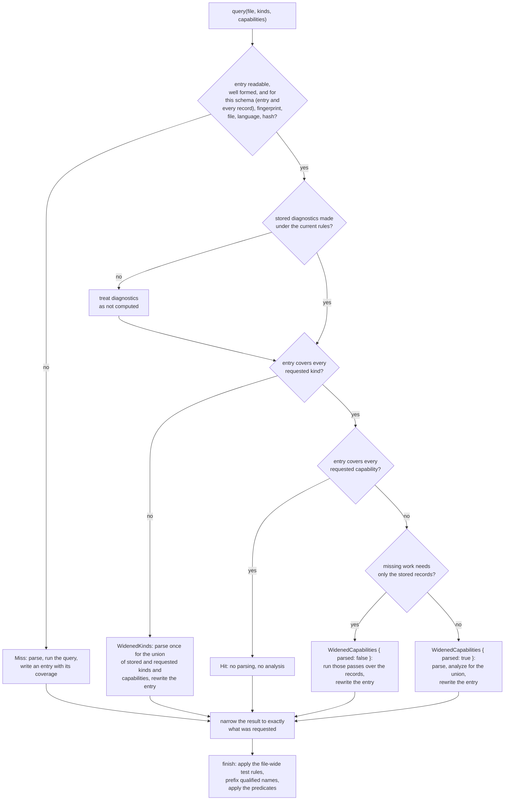

# Tree Hugger's Persistent Symbol Cache

`hug` keeps one cache entry per source file on disk, so a second run over
unchanged files reads the stored analysis instead of parsing again. This page
describes what is stored, when an entry is used, how it is widened and
replaced, and which damaged entries are refused.

The same cache is available to library callers as
`tree_hugger::cache::SymbolCache`.

## Using the cache

From the CLI there is nothing to do: every scanning command (`symbols`,
`functions`, `types`, `classes`, `imports`, `lint`) uses the cache unless you
pass `--no-cache`, which neither reads nor writes it.

```sh
hug --json symbols src/lib.rs            # cold: parses, analyzes, writes the entry
hug --json symbols src/lib.rs            # warm: reads the entry, parses nothing
hug --json symbols --no-cache src/lib.rs # never touches the cache
```

The output of all three runs is byte-for-byte identical. Each command asks
only for its own kinds and capabilities (`functions` for functions, methods
and constructors; `classes` adds containment; `lint` adds diagnostics;
`--json-full` asks for every capability), and the file's one entry widens as other commands need more,
so after `hug symbols`, `hug functions` is a complete hit.

Cache use and cache failures print nothing unless `--verbose` is given: an
entry that cannot be read is recomputed, and a write that fails is ignored.
With `--verbose`, `hug` prints each such failure and ends with one stats
line:

```text
cache: src/lib.rs: malformed entry: expected value at line 1 column 1
cache: 15 hits, 1 partial hits, 1 misses; parsed 2 files, 2 definition captures, 0 diagnostics runs
```

A file that simply has no entry yet is counted as a miss but not listed.
Under `--no-cache` the stats line starts `cache: disabled;`, and a
`--prelude` run adds `, N reused in this run` for files analyzed once for
the prelude and reused by the scan.

From the library, read the file once with `SourceFile` and hand it to the
cache with a `SymbolQuery`:

```rust
use tree_hugger::cache::{CacheLookup, PersistentCache, SymbolCache};
use tree_hugger::{Capability, SourceFile, SymbolKindV2, SymbolQuery};

let cache = SymbolCache::new(PersistentCache::default_cache("my-project", true));
let query = SymbolQuery::new()
    .kinds([SymbolKindV2::Function, SymbolKindV2::Method])
    .capabilities([Capability::Containment]);
let cached = cache.query(SourceFile::read("src/lib.rs")?, &query)?;
if cached.lookup == CacheLookup::Hit {
    // nothing was parsed or analyzed
}
let records = cached.result.index.symbols;
```

`cached.result` is exactly what `SourceFile::query` returns for the same
query without a cache. `cached.lookup` says how the entry was used, and
`cached.write_error` holds a failed write, if any.

## Where entries live

Entries are JSON files under the system temporary directory:

```text
<temp>/tree-hugger/cache/<project id>/<first two key characters>/<key>.json
```

`<project id>` is the name a library caller passes to
`PersistentCache::default_cache`; `hug` always uses `hug`, whatever directory
it runs from. The key already names the file by its
[identity](#file-identity), so a file reached from two scan roots (say
`tree-hugger/` and `tree-hugger/lib/`) shares one entry, and the second run
is a hit:

```text
cd tree-hugger     && hug --json symbols lib/src/symbol.rs   # miss: writes the entry
cd tree-hugger/lib && hug --json symbols src/symbol.rs       # hit: same entry, same IDs
```

Nothing about the scan root reaches the stored records: JSON paths are made
relative to it after the lookup ([symbol-reports.md](./symbol-reports.md)),
and so is the file prefix of a qualified name
([Qualified names](./symbol-kinds-and-visibility.md#qualified-names)); neither
it nor a library caller's `NamingContext` is a key input. Since neither
changes a stored record, keying on them would only split one file's analysis
into several identical entries, and the IDs, which are built from the in-file
name, would be the same in all of them. A query's predicates (scope,
visibility, names, flags, signature shape) are applied to the result after the
lookup too: the entry always holds every record of its covered kinds under
its in-file name, and a predicate only adds the kinds and capabilities it
reads to what the lookup must cover. `<temp>` comes from `TMPDIR`
(`TMP`/`TEMP` on Windows), which is how the CLI tests isolate the cache. Old entries are never deleted by
`hug`; clearing the directory is always safe.

## One entry per file

The entry's **key** is a digest of a fixed `symbols` tag and four things:

1. the file's [identity](#file-identity), with `\` written as `/`
2. the xxHash of the file's text, computed from the same bytes that are
   parsed (the file is read once)
3. the language, when it was forced with `--language`; otherwise
   `detected`
4. the **records fingerprint** (below)

Nothing about the request is in the key. `hug functions` and `hug lint` over
the same unchanged file use the same entry; the entry records what it holds,
and each command takes what it needs from it. Editing the file changes its
hash, so the next run uses a new key and the old entry is never read again.

### File identity

A file can be named many ways: `src/lib.rs`, `./src/../src/lib.rs`, its
absolute path, a symlink to it, or (on macOS) `/var/…` and `/private/var/…`
for the same temporary file. All of them are one file, so they must share
one entry, and `--prelude` must find the analysis it already made under
whatever name the scan lists the file. `SourceFile` therefore reads the file
through the name it is given and then analyzes it under its **identity**,
which `tree_hugger::file_identity` computes:

- the path made absolute, with `.`, `..` and every symlink resolved
  (`std::fs::canonicalize`), and on Windows written in its ordinary
  `C:\…` form rather than `\\?\C:\…`, with long names in place of 8.3
  short names;
- if the path cannot be resolved (the file vanished after it was read), the
  path made absolute against the working directory, unresolved.

```text
src/lib.rs                  ┐
./src/../src/lib.rs         │
/repo/src/lib.rs            ├──> identity /repo/src/lib.rs ──> one key, one entry
lib_link.rs -> src/lib.rs   ┘
```

**Symlinks share their target's identity.** A symlink and the file it points
to are analyzed, cached and reported as the target: the same entry, the same
records, the same `file_path` and the same IDs. Language detection reads the
identity too, so a symlink named `script` that points at `script.rs` is Rust.

Errors still use the name you gave: a missing or unreadable file is
`TreeHuggerError::Io` for that spelling, with the same error kind as before,
and an undetectable language names it as well. The file's bytes are read
once, through that spelling; resolving the identity reads no file contents.

**IDs follow the identity.** A record's stable key and ID are built from the
path as analyzed, which is the identity, and the declaration's in-file
qualified name, so one file in one checkout has the same IDs whichever
spelling named it and whichever scan root reached it. They are not equal across checkouts in
different directories, since the identity is absolute.

**IDs follow the kind and the qualified name.** The stable key is
`{language}::{file}::{kind}::{qualified name}::{ordinal}`, so an extractor
change that reclassifies a declaration gives its record a new ID, and so does
one that changes a name segment above it. When an extractor revision began
reporting Python `__init__` as a Constructor instead of a Method, its ID
changed; a constructor parameter kept its own, because its kind and
qualified name (`C.__init__.value`) did not change. Records that did not
change keep their IDs, including the members of a namespace that became a
record of its own (`App\inside` stays `App\inside`). Old IDs are never
kept as aliases: anything that stored an ID across an extractor upgrade must
look it up again.

The same identity is used everywhere `hug` compares files:

- `scanner::collect_files` and `collect_selected_files` (which adds the
  files `hug --file` names) return identities, so a file named twice under
  different spellings, or named and also matched by a glob, is analyzed and
  listed once;
- `hug` resolves its working directory to its identity before deriving the
  scan, Git and package roots, so they are spelled like the files beneath
  them and paths display relative to them;
- the `--prelude` reuse map is keyed by identity;
- `GodFiles` reports paths relative to its root's identity.

Reports never show the identity directly: JSON paths are projected relative
to the scan root and terminal paths relative to the Git root
([symbol-reports.md](./symbol-reports.md)).

Every digest is BLAKE3 from `biscuit-hash` over a canonical encoding:
`canonical_digest` writes each field as its byte length, `:` and its bytes,
so `["a|b", "c"]` and `["a", "b|c"]` can never collide.

## The fingerprint

The records fingerprint is a `PassFingerprint` computed from what decides a
file's records, imports, exports and every analysis pass but diagnostics:

| Input | Where it comes from | Changes when |
|---|---|---|
| schema version | `SchemaVersion::CURRENT` (5.0) | the record shape or meaning changes |
| implementation version | crate version and `EXTRACTOR_REVISION` (`0.1.0+rev.36`) | extraction code changes |
| grammar identity | the compiled grammar: name, declared version (if any), ABI, node-kind, field and parse-state counts | a grammar crate is upgraded |
| grammar ID | the grammar variant (`typescript` or `tsx`, …) | the file's grammar variant differs |
| query text | the effective `locals`, `imports` and `references` query text, with inherited vendored queries and overlays resolved | a `.scm` file the analysis compiles changes |

A change to Rust extraction code cannot be seen in query text, so
`EXTRACTOR_REVISION` must still be bumped with any change to extracted
records, including a repair on an unreleased branch and a change to a
[cyclomatic counting rule](./cyclomatic-complexity.md), which changes the
numbers reported for unchanged source. After a bump, every
entry written by the earlier revision is a miss and is recomputed on first
use; nothing is migrated.

Diagnostics depend on more inputs, which only diagnostics use. They have
their own fingerprint, stored **inside** the entry rather than in the key:

| Input | Changes when |
|---|---|
| the records fingerprint inputs | as above |
| `lint` and `comments` query text | a lint pattern or the ignore-comment query changes |
| built-in rule metadata (ID, version, category, default severity, confidence, languages, default enablement, experimental flag of every rule) | a rule is added or its metadata changes |
| `experimental_semantics` | `hug lint --experimental-semantics` is toggled |

Stored diagnostics with a different diagnostics fingerprint are treated as
not computed: a symbol listing is still served from the entry, and a request
that needs diagnostics recomputes them and rewrites the entry. Lint policy
(`--deny`, `--warn`, `--allow`, `--strict`) and external adapters such as
Oxlint run after the cache and are not inputs.

The query text is an injectable input
(`SymbolCache::with_query_text`, `FingerprintInputs::with_query_text`), so a
test can change one query's text and watch the entry stop matching without
rebuilding the crate.

## What an entry holds

```json
{
  "schema_version": { "major": 5, "minor": 0 },
  "fingerprint": "<records fingerprint digest>",
  "file": "src/lib.rs",
  "language": "Rust",
  "source_hash": "<xxHash>",
  "covered_kinds": "all",
  "completed_capabilities": ["declarations", "containment", "references"],
  "diagnostics_fingerprint": null,
  "records": [ ... ],
  "imports": [ ... ],
  "exports": [ ... ],
  "diagnostics": [],
  "occurrences": [],
  "reference_coverage": []
}
```

- `covered_kinds` is the string `"all"` or a non-empty list of symbol kinds
  in ascending order, such as `["Function", "Method"]`. An empty list is
  never written and never read as "all".
- `completed_capabilities` lists the
  [capabilities](./symbol-schema-design.md) whose results the entry holds, in
  ascending order and closed under prerequisites, so it always contains
  `declarations`.
- `diagnostics_fingerprint` is `null` exactly when `diagnostics` is not
  among the capabilities, and then `diagnostics` is empty.
- `occurrences` and `reference_coverage` hold the whole file's
  [reference evidence](./references.md) when `occurrences` is among the
  capabilities, and are empty otherwise; under that capability
  `reference_coverage` always starts with the file-level region. Both keys
  are required, and so is every key inside them: unlike the public index,
  the entry writes an absent owner or ID as `null` and an empty candidate or
  reason list as `[]` (see [Reference evidence](#reference-evidence)).
- `records` holds every record of the covered kinds, after the entry's
  passes ran. `file` is the path exactly as analyzed (the file's identity),
  since the records repeat it.

An entry is internally consistent by construction, and the reader checks it:
an entry whose contents contradict its coverage is refused.

## How a lookup is decided



The passes that work from stored records alone are the docs pass, the
semantic pass (when occurrences are stored: the reference edges alone
cannot tell a proven self-call from a same-named one) and containment (when every kind
is stored, since a member's owner can be of any kind, and the file is
neither Rust nor Swift: a Rust impl member's owner is its impl's resolved
self type and a Swift extension member's the extension's resolved owner,
which no record retains, see [Declared Type Relations](./type-relations.md#rust-impls)).
References, occurrences,
diagnostics, flags and metrics need the syntax tree (attributes, the
declaration's parameter list), so they parse the file; the definitions query
runs again with them, because binding and semantic lint consume its live
result. A flag-only widening, such as `hug --json` after a terminal listing,
is therefore a partial hit that parses once, never a miss.

For example, over one unchanged `lib.rs`:

| Run | Entry before | Outcome | Entry after |
|---|---|---|---|
| `functions` (functions, methods, constructors; declarations) | none | Miss | those kinds; `declarations` |
| `types` with containment | function kinds | WidenedKinds (one parse) | function and type kinds; `declarations`, `containment` |
| `functions` again | as above | Hit | unchanged |
| `types` with containment and references | as above | WidenedCapabilities, one parse | same kinds; adds `references` |

And over a file whose entry covers every kind with `declarations` only, a
request for structured docs runs just the docs pass over the stored records
(WidenedCapabilities, no parse) and rewrites the entry with both.

Every result is **narrowed** to the request before it is returned: kinds that
were not asked for are dropped, and relations, occurrences and coverage,
semantics, parsed docs, export targets, diagnostics, flags, metrics and each
record's
`provenance.parse_pass` are reduced to what the requested capabilities
produce. A narrow request served from a
wide entry is therefore identical to an uncached run of the narrow request.

Only then is the result **finished** (`SymbolQueryResult::finish`, the same
step an uncached query ends with): every qualified name that is not
namespace-rooted gets the query's prefix, and the query's predicates drop the
records they do not match. The entry is written before this step, so it holds
in-file names and every record of its covered kinds:

```text
entry record:         "qualified_name": "Square::area"
scan root repo/:      src/shapes.rs#Square::area
scan root repo/src/:  shapes.rs#Square::area        (same entry, a Hit, same ID)
```

### Test flags: source facts are stored, file-wide rules are not

`visibility.is_test` has two kinds of input, and only one of them is in the
cache:

| Input | Example | Stored in the entry? |
|---|---|---|
| A test attribute on the declaration | Rust `#[test]`, Java `@Test`, C# `[Fact]` | yes |
| Rust `#[cfg(test)]` / `#![cfg(test)]` containment | `mod tests { fn helper() {} }` | yes |
| A test file name | Go `*_test.go`, Python `test_*.py`, JS/TS `*.spec.ts` | no |
| A Rust file below its package's `tests/` | `tests/sample.rs` with a `Cargo.toml` above it | no |

The first two come from the source, which the key hashes. The Rust package
rule depends on which directory above the file holds the nearest
`Cargo.toml`, and that can change while the file and its entry do not: add a
manifest above an unchanged `tests/sample.rs` and its declarations become
tests; add `tests/Cargo.toml` and `tests/` becomes a package of its own, so
they stop being tests. A stored flag would keep the old answer on every hit.
So `finish` applies the file-wide rules to every flagged result, cached or
not, before the predicates (`--tests-only`, `--exclude-tests`) read the flag:

```text
entry record (tests/sample.rs):  "is_test": false     (no attribute, no cfg(test))
no Cargo.toml above:             helper  is_test false   (Hit)
Cargo.toml added at the root:    helper  is_test true    (Hit, same entry)
tests/Cargo.toml added too:      helper  is_test false   (Hit, same entry)
```

The same split holds for a finished result reused through
`SymbolQueryResult::narrowed` (what `hug --prelude` does): `finish` remembers
which records only the file-wide rule made tests, and every later `finish`
first undoes exactly that before deciding the rule again. A record whose
source marks it a test stays one; a record only the old layout marked follows
the new one:

```text
tests/probe.rs: pub fn helper() {}  #[test] fn marked() {}
result made under Cargo.toml:        helper true   marked true
Cargo.toml removed, then narrowed:   helper false  marked true   (= fresh query)
```

A result already filtered by `--tests-only`/`--exclude-tests` lost the records
the old decision dropped, so it narrows only while that decision still holds;
otherwise `narrowed` returns `None` and the caller analyzes the file again.

The name rules depend only on the path, which is a key input, so storing them
would be correct; they are applied after lookup with the Rust rule because
they are one classification. The rule costs one file-name check and, for
Rust, one `Cargo.toml` probe per directory above the file, once per result.

## Writes are atomic

`PersistentCache::put` writes the new entry to `<key>.<process>.<n>.tmp` in
the entry's directory and renames it over `<key>.json`. A reader sees the old
entry or the complete new one, never a partial write. When two processes
write the same entry at once, the last rename wins; that is safe because
every entry, whichever survives, is complete and its coverage matches its
contents. A failed write removes its temporary file and leaves the previous
entry in place.

## Which damaged entries are served

The reader takes an entry only when it is valid JSON with no trailing
content, has every entry field with the right type and no field twice or
unknown, and matches the request (schema, fingerprint, file, language and
source hash). Anything else is a `CacheMiss` with its reason, and the file is
recomputed: never an empty result. `CacheMiss::Malformed` carries the
decoder's message, which names the field and tells an absent field
(`missing field`) from an explicit `null` (`invalid type: null`).

### Schema versions

An entry is served only when its own `schema_version` **and the
`schema_version` of every record in it** are exactly the current version
(5.0). The records are returned as stored, inside an index that claims the
current version, and the cache never translates between versions, so a
different minor version is a miss just like a different major one: an older
minor lacks fields the current version adds, and a newer one carries fields
this reader would drop. One record of another version is enough to make the
whole entry a `CacheMiss::Mismatched("record schema version")`; the file is
analyzed again and the entry rewritten, and the stale entry is never widened.

For example, an entry written as 5.0 whose `instance_method` record was edited
to `"schema_version": {"major": 3, "minor": 0}` (or the previous
`{"major": 4, "minor": 3}`) is recomputed; the output equals an uncached run.
An entry written before 4.1 also lacks `metrics.lines`, one written before
4.3 lacks `metrics.cyclomatic`, and one written before 5.0 lacks
`occurrences` and `reference_coverage`, any of which refuses it on its own
(see [Record fields](#record-fields)). Schema 5.0 changed what the reference
summaries mean (they come from scoped occurrences, so a 4.3 entry's
`references` may name the wrong same-named declaration), which is why an
older entry is never served even where its shape would read.

### Entry fields

No entry-level field has a default:

| Entry field | absent | `null` | wrong type | one bad element | every element bad | empty | duplicate key | trailing content |
|---|---|---|---|---|---|---|---|---|
| `covered_kinds` | miss | miss | miss | miss | miss | miss (`[]` is not "all") | miss | miss |
| `completed_capabilities` | miss | miss | miss | miss | miss | miss | miss | miss |
| `schema_version`, `fingerprint`, `source_hash` | miss | miss | miss | miss | miss | miss | miss | miss |
| `file`, `language` | miss | miss | miss | miss | miss | miss (`""` is another file or no language) | miss | miss |
| `diagnostics_fingerprint` | miss | miss (contradicts `diagnostics`) | miss | miss | miss | diagnostics recomputed (one parse; output as uncached) | miss | miss |
| `records` | miss | miss | miss | miss | miss | **served**: no records of the covered kinds | miss | miss |
| `imports`, `exports`, `diagnostics` | miss | miss | miss | miss | miss | **served**: the file has none | miss | miss |

For a version object, "one bad element" and "every element bad" mean one or
both of `major` and `minor` hold a non-number. A well-formed version other
than 5.0 is a miss, as described above.

A kind list must also be in ascending order with no repeats, and a
capability list closed under prerequisites. The records must agree with that
coverage, or the entry is refused (`CacheMiss::Inconsistent`):

- a record of a kind the entry does not cover;
- a `metrics` facet, or a `true` `is_test` or `is_deprecated`, in an entry
  that does not list `metrics` or `flags`: without the capability those
  fields mean "not computed", so this cache never wrote such a value;
- a record without a `metrics` facet in an entry that lists `metrics`.

For example, an entry listing `["declarations"]` whose `deprecated_api` record
says `"is_deprecated": true` is recomputed, and the output says `false`.

### Reference evidence

The public `Occurrence` and `ReferenceCoverage` leave out an absent owner or
ID and an empty candidate or reason list, and read a missing key as empty.
The entry cannot rely on that: an entry claiming `occurrences` whose
`candidates` key was lost would read as "no candidates". So the entry writes
every key, and its reader requires every key and refuses an unknown one:

```json
{
  "owner": { "id": "<id>", "name": "module_function", "qualified_name": "module_function" },
  "owner_span": { "start": { "line": 2, "column": 1 }, "end": { "line": 2, "column": 56 }, "start_byte": 40, "end_byte": 95 },
  "target": { "id": "<id>", "name": "helper", "qualified_name": null },
  "candidates": [],
  "span": { "start": { "line": 2, "column": 45 }, "end": { "line": 2, "column": 51 }, "start_byte": 84, "end_byte": 90 },
  "kind": "Call",
  "confidence": "Scoped"
}
```

Each field's shapes, in an entry that lists `occurrences`:

| Evidence field | absent | `null` | wrong type | one bad element | every element bad | empty | duplicate key | trailing content |
|---|---|---|---|---|---|---|---|---|
| `occurrences` | miss | miss | miss | miss | miss | miss when a record keeps an edge an occurrence made; **served** for a file with none | miss | miss |
| `reference_coverage` | miss | miss | miss | miss | miss | miss (the file region is required) | miss | miss |
| occurrence `confidence` | miss | miss | miss | miss | miss | miss | miss | miss |
| occurrence `target.id` | miss | miss when the occurrence made an edge | miss | miss | miss | miss | miss | miss |
| occurrence `candidates` | miss | miss | miss | miss | miss | miss for `NameOnly` | miss | miss |
| occurrence `span` | miss | miss | miss | miss | miss | miss | miss | miss |
| occurrence `owner` | miss | miss for a named owner | miss | miss | miss | miss | miss | miss |
| coverage `reasons` | miss | miss | miss | miss | miss | miss for a `Limited` region | miss | miss |

Well-formed evidence is then checked against the source, itself, the
capability claim and the records (`CacheMiss::Inconsistent`). Each of these
refuses the entry:

- evidence in an entry that does not list `occurrences`, or no coverage in
  one that does;
- a first region that is not the whole file with no owner;
- a span past the source, off a character boundary or ending before it
  starts, or whose line and column are not those of its byte offsets
  (one-based line, one-based byte column); an empty occurrence span; an
  occurrence outside its owner's region;
- an occurrence whose `target.name` is not the source text at its span;
- an occurrence whose owner and owner span are not one of the coverage
  regions, or an owner or candidate whose name and qualified name are not
  its stored record's;
- `Scoped` with candidates; `NameOnly` with a target ID, no candidates, a
  candidate without an ID or a repeated one; `Unresolved` with either;
- occurrences out of their canonical order or repeated; coverage out of
  order; reasons that are not ascending and distinct, or present on a
  `Complete` region or missing from a `Limited` one;
- a record's in-file `references` or `referenced_by` edge with no `Scoped`
  occurrence that made it, or `is_recursive: Yes` with no `Scoped` call of
  the record itself.

For example, an entry whose `helper` call lost its target ID is recomputed:
`module_function`'s record still references `helper`, and no occurrence
says so. What these checks cannot see without parsing is an occurrence
removed while nothing derived from it remains (a call with no in-file
target). The entry's key includes the source hash, so an entry is only ever
read for the text it was written from.

### Record fields

Inside a record, a field accepts exactly the shapes its schema type allows:
optional values and defaulted collections accept their defaults, and
everything else refuses the entry.

| Record field | Served when | Public result |
|---|---|---|
| `identity.container_kind` | absent or `null` | no container kind |
| `modifiers` | absent or `[]` | no modifiers (not `static`, not `async`, none written) |
| `attributes` | absent or `[]` | no attributes |
| attribute `value` | absent or `null` | no argument list |
| attribute `name`, attribute `value`, `Custom` modifier `value` | `""` | the empty string, as written |
| `identity.keyword` | absent, `null` or `""` | no keyword, or the empty keyword |
| `source.declaration_text` | absent, `null` or `""` | no text, or the empty text |
| `source.signature_text` | absent, `null` or `""` | no header, or the empty header |
| `type_info.generic_params`, `type_info.constraints`, `relations.extends`, `relations.implements`, `relations.unclassified_bases` | absent or `[]` | empty list |
| generic parameter `constraints` | absent or `[]` | empty list |
| generic parameter `default`, `variance` | absent or `null` | no value |
| relation target `id`, `qualified_name`, `source_span` | absent or `null` | no value |
| generic parameter `name`, relation target `name` | `""` | empty string |
| generic parameter `position` | `0` | first position |
| relation target `source_span` members (`start.line`, `start.column`, `end.line`, `end.column`, `start_byte`, `end_byte`) | `0` | the stored `0`, as written |
| `kind_data.data.fields` (type data) | absent or `[]` | empty field list |
| field data `visibility` | absent or `null` | Unknown access |
| `metrics.parameters`, `metrics.has_docs`, `metrics.lines`, `metrics.cyclomatic` | `null` | the metric is unsupported (`cyclomatic`: unavailable) for that declaration |
| `metrics.lines` | `0` | an empty body span (distinct from `null`) |

`schema_version`, `kind`, `scope`, `identity.qualified_name`,
`identity.is_namespace_rooted`, `visibility.level`, `visibility.is_test`,
`visibility.is_deprecated`, `kind_data.kind_data_type` and field data
`is_static` are required: absent, `null`, `""` (an unknown scope, an empty
qualified name) or `{}` refuses the entry, and a record `schema_version`
other than exactly 5.0 refuses it too. In an entry that lists `metrics`, the
`metrics` facet is required in the same way (absent, `null`, `{}` or a member
of the wrong type refuses it), and so is each of its four keys (absent
refuses, so a 4.0 facet without `lines` or a 4.2 facet without `cyclomatic`
is never read as `null`; only `null` is served). `lines` and `cyclomatic`
are `u32`s: `"3"`, `3.5`, `-1`, `4294967296`, `true`, `{}` and `[]` refuse the entry, and `4294967295` is served. For every tested record field, a wrong type (`123`, or `"123"` for a number, or an array holding a wrong
element), a duplicate key and invalid JSON refuse the entry. For example, an
entry whose method record carries `"modifiers": null` is recomputed, while one
with no `modifiers` key reports that method as an instance method.

Inside the `attributes` and `modifiers` lists, an attribute's `name` and a
modifier's `type` tag are required, and so is a `Custom` modifier's `value`:
absent, `null`, a wrong type, a duplicate key or trailing invalid JSON
refuses the entry, and so does an empty tag, which names no modifier. For
example, an entry whose `final class` stores `{"type": "Custom"}` with no
`value` is recomputed, while one whose `@Marker("x")` attribute lost its
`value` is served as `@Marker` with no arguments. The permanent CLI matrix
has one column per member, with both a `Custom` and a fixed-tag (`Static`)
modifier.

Generic parameter `name`, `kind` and `position` and relation target `name`
are required. Their absence or `null` refuses an entry. A null collection,
a wrongly typed element, a duplicate key or trailing invalid JSON also
refuses the entry. Empty optional strings are served literally; an empty
parameter kind is rejected. The permanent CLI matrix includes every nested
generic field and relation-target field, plus the three relation lists.

A relation target's `source_span` may be absent or `null`, but a stored span
needs all six members as unsigned integers. A missing member, `null`, a
string, an array, a duplicate member or trailing invalid JSON refuses the
entry; `{}` refuses it too. `0` is served as written: the reader checks the
type, not that a position is one-based. For example, an `extends` target
whose span lost `end_byte` is recomputed. The byte members matter to the
report: `hug --signatures full` compares them with the owner's declaration
span to decide whether a Swift conformance is already in the header. The
matrix has one column per member.

A stored diagnostic's metadata omits `is_enabled_by_default` and
`requires_experimental_semantics` when they are `false`; an absent key reads
as `false`.

The CLI test `cache_robustness` in `cli/tests/symbols/` pins these tables,
and incompatible versions on the entry and on a record, by editing an entry
`hug --json-full symbols` wrote, one cell at a time.

## What is not cached

- Parse trees: a widened entry parses the file again.
- `--prelude` resolution (its files' analyses are reused within one run, and
  each analysis goes through the cache like any other), and external lint
  adapters such as Oxlint.
- Anything across files: each entry describes one file.

`InProcessCache` and `InMemorySymbolCache` remain in the library for callers
that want an in-memory map, but `hug` no longer uses them: each file is
visited once per run, so they only added copies.

## Tests

| Behavior | Test |
|---|---|
| Every fixture: cold miss, warm complete hit with no parse, equal to uncached | `lib/tests/l1/symbols_cache.rs` `every_fixture_is_a_complete_warm_hit_equal_to_an_uncached_run` |
| A wide entry narrowed to any request equals the uncached request | `projected_results_equal_uncached_queries`, `projected_results_over_multi_equal_uncached_queries` |
| Widening by capabilities and by kinds; the third narrow run is a hit | `widening_capabilities_runs_only_the_missing_passes`, `widening_kinds_reextracts_once_for_the_union` |
| Query text, extractor revision, forced language, schema, rules and settings each miss | `each_key_input_and_stored_identity_decides_a_miss` |
| A record of another schema version (2.0, 3.0, 4.0, 4.1, 4.2, 4.3, 5.1, 6.0) misses for the same and a wider request, never widened | `incompatible_record_schema_versions_are_misses_never_served_or_widened` |
| Corrupt entries, absent vs `null` reasons, kind-list shapes | `a_corrupt_entry_is_a_miss_and_is_replaced`, `absent_and_null_entry_fields_report_different_reasons`, `covered_kind_lists_are_served_only_in_canonical_form` |
| A metrics facet or a set flag without its capability, or a record without metrics under `metrics`, is `Inconsistent`; a flags-and-metrics entry serves a flags-only request | `covered_kind_lists_are_served_only_in_canonical_form`, `flags_and_metrics_are_served_only_under_their_capabilities` |
| A filtered, prefixed query writes in-file names and every record; another scan root is a Hit with the same IDs | `lib/tests/l1/symbols_query_filters.rs` `predicates_and_prefixes_never_reach_the_cache_entry` |
| Concurrent writers (threads and processes) | `concurrent_writers_leave_a_readable_entry_whose_coverage_matches`, `cli/tests/symbols/cache_lookup.rs`, `lib/tests/l1/cache_tests.rs` |
| Entry and record field shapes | `cli/tests/symbols/cache_robustness.rs` |
| Attribute `name`/`value` and modifier `type`/`Custom` `value` shapes, from real Java extraction | `cache_robustness::attribute_and_modifier_members_are_served_or_recomputed_per_shape` |
| Reference evidence: every shape of every evidence field, each inconsistent edit, and a file with no occurrences served | `cache_robustness::reference_evidence_is_served_only_when_consistent` |
| An entry from before schema 5.0 (revision 30, no evidence keys) is recomputed under both keys | `cache_upgrade::entry_from_extractor_revision_thirty_is_not_served_after_the_scoped_references_bump` |
| Widening an entry by `metrics` parses once and walks each measured callable once; every `cyclomatic` value, `null` included, is stored, and a warm request is a `Hit` that walks nothing | `complexity_is_stored_once_and_served_on_warm_hits` |
| Old extractor revisions and records of other schema versions are never served | `cli/tests/symbols/cache_upgrade.rs` |
| A kind-narrowed entry never claims complete coverage; widening to every kind and capability, then a warm `Hit` with zero work counters, equals an uncached run | `deferred_kind_entries_never_claim_complete_coverage_and_warm_hits_do_no_work` |
| A reclassified record gets the ID of its new kind; unchanged records and namespace members keep theirs | `reclassified_records_get_new_ids_and_unrelated_ids_stay` |
| Relative, absolute, `.`/`..`, symlinked-file and symlinked-directory spellings read under one identity, key, record set and entry; missing files keep the given spelling | `lib/tests/l1/file_identity.rs` |
| The CLI shares one entry across spellings, lists a file once, and `--prelude` reuses it under any spelling | `cli/tests/symbols/spelling.rs`, `cli/tests/symbols/prelude.rs` `prelude_reuse_holds_for_every_spelling_of_an_explicit_file` |
