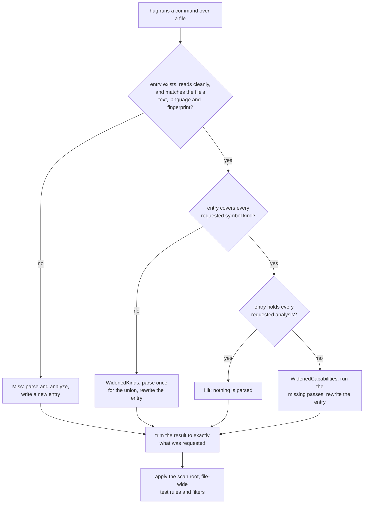

# Tree Hugger's Persistent Symbol Cache

`hug` keeps one cache entry per source file on disk, so a second run over
unchanged files reads the stored analysis instead of parsing the files again.
You do not have to do anything to use it, the output never depends on it, and
deleting it is always safe.

```console
$ hug --verbose functions src/shapes.rs
  - public method area(self) -> f64 [in type Square] src/shapes.rs:4:5
  - public function helper() -> u32 src/shapes.rs:7:1
cache: 0 hits, 0 partial hits, 1 misses; parsed 1 files, 1 definition captures, 0 diagnostics runs

$ hug --verbose functions src/shapes.rs
  - public method area(self) -> f64 [in type Square] src/shapes.rs:4:5
  - public function helper() -> u32 src/shapes.rs:7:1
cache: 1 hits, 0 partial hits, 0 misses; parsed 0 files, 0 definition captures, 0 diagnostics runs
```

The first run parses the file and writes its entry (a **miss**); the second
finds the entry and parses nothing (a **hit**). This page explains how to use
and clear the cache, where entries live, and when an entry is used, widened
or replaced. Two detail pages go further:

- [Entry Format and Fingerprint](./cache-design/entry-format.md): what an
  entry's key is made of, how a file's identity is decided, what invalidates
  an entry, and every field an entry holds.
- [Damaged Entries](./cache-design/robustness.md): exactly which edited,
  truncated or outdated entries are still served and which are recomputed.

## Using the cache

From the CLI there is nothing to do: every command that analyzes source
(`symbols`, `functions`, `types`, `classes`, `imports`, `lint` and `refs`)
uses the cache unless you pass `--no-cache`, which neither reads nor writes
it. `god-files` only measures file sizes and does not use it.

```sh
hug --json symbols src/lib.rs            # cold: parses, analyzes, writes the entry
hug --json symbols src/lib.rs            # warm: reads the entry, parses nothing
hug --json symbols --no-cache src/lib.rs # never touches the cache
```

The output of all three runs is byte-for-byte identical. The cache only saves
work; it never changes an answer.

Cache use and cache failures print nothing unless `--verbose` is given (it
goes before the command, as above). An entry that cannot be read is
recomputed, and a write that fails is ignored. With `--verbose`, `hug` prints
each such failure on stderr and ends with one stats line:

```text
cache: src/shapes.rs: malformed entry: expected value at line 1 column 1
cache: 0 hits, 0 partial hits, 1 misses; parsed 1 files, 1 definition captures, 0 diagnostics runs
```

A **partial hit** is an entry that held part of what the command needed and
was widened (see [When an entry is used](#when-an-entry-is-used)). A file
that simply has no entry yet is counted as a miss but not listed. Under
`--no-cache` the stats line starts `cache: disabled;`, and a `--prelude` run
adds `, N reused in this run` for files analyzed once for the prelude and
reused by the scan.

### From the library

The same cache is available to library callers as
`tree_hugger::cache::SymbolCache`. Read the file once with `SourceFile` and
hand it to the cache with a `SymbolQuery`:

```rust
use tree_hugger::cache::{CacheLookup, PersistentCache, SymbolCache};
use tree_hugger::{Capability, SourceFile, SymbolKindV2, SymbolQuery};

let cache = SymbolCache::new(PersistentCache::default_cache("my-project", true));
let query = SymbolQuery::new()
    .kinds([SymbolKindV2::Function, SymbolKindV2::Method])
    .capabilities([Capability::Containment]);
let cached = cache.query(SourceFile::read("src/lib.rs")?, &query)?;
if cached.lookup == CacheLookup::Hit {
    // nothing was parsed or analyzed
}
let records = cached.result.index.symbols;
```

`cached.result` is exactly what `SourceFile::query` returns for the same
query without a cache. `cached.lookup` says how the entry was used (`Hit`,
`WidenedCapabilities`, `WidenedKinds` or `Miss` with its reason), and
`cached.write_error` holds a failed write, if any.

## Where entries live

Entries are JSON files under the system temporary directory:

```text
<temp>/tree-hugger/cache/<project id>/<first two key characters>/<key>.json
```

For example, on macOS:

```text
/var/folders/…/T/tree-hugger/cache/hug/1e/1eb72f5a44d45540b7f2f814fb6b0e62d857c00a3fb319ef90c16eb9a2b8ab90.json
```

- `<temp>` is the system temporary directory: `TMPDIR` on macOS and Linux
  (`/tmp` when it is unset), `TMP` or `TEMP` on Windows. Pointing `TMPDIR`
  elsewhere gives a run a private cache, which is how the CLI tests isolate
  it.
- `<project id>` is the name a library caller passes to
  `PersistentCache::default_cache`. `hug` always uses `hug`, whatever
  directory it runs from.
- `<key>` is a digest of the file and of everything that decides its
  analysis (see [One entry per file](#one-entry-per-file)).

### Clearing the cache

`hug` never deletes old entries, so the directory grows as files change.
Clearing it is always safe; the next run simply parses again:

```sh
rm -rf "${TMPDIR:-/tmp}/tree-hugger/cache/hug"          # macOS, Linux, WSL
```

```powershell
Remove-Item -Recurse -Force "$env:TEMP\tree-hugger\cache\hug"   # Windows
```

## One entry per file

Each file has one entry, whatever command asked for it. The entry's **key**
is a digest of four things:

1. the file's [identity](#file-identity), its one canonical path;
2. a hash of the file's text;
3. the language, when it was forced with `--language`;
4. a **fingerprint** of everything else that decides the file's records: the
   schema version, the Tree Hugger version and extractor revision, the
   compiled grammar, and the text of the queries the analysis runs.

So an entry goes stale in exactly two ways: the file is edited, or Tree
Hugger is upgraded in a way that changes what it extracts. Either one gives
the next run a new key, and the old entry is never read again. Nothing is
migrated. [Entry Format and Fingerprint](./cache-design/entry-format.md#the-fingerprint)
lists every fingerprint input.

Nothing about the request is in the key. `hug functions` and `hug lint` over
the same unchanged file use the same entry: the entry records which symbol
kinds and which analysis results it holds, and each command takes what it
needs from it.

Nothing about where you run `hug` from is in the key either. A file reached
from two scan roots shares one entry, and the second run is a hit:

```sh
cd tree-hugger     && hug --json symbols lib/src/symbol.rs   # miss: writes the entry
cd tree-hugger/lib && hug --json symbols src/symbol.rs       # hit: same entry, same IDs
```

Paths in JSON output are made relative to the scan root after the lookup
([Symbol Reports](./symbol-reports.md)), and so is the file prefix of a
qualified name
([Qualified names](./symbol-kinds-and-visibility/scope-and-qualified-names.md#qualified-names)). The
filters a command applies (scope, visibility, names, test flags, signature
shape) also run after the lookup, so the entry always holds every record of
the kinds it covers.

### File identity

A file can be named many ways: `src/lib.rs`, `./src/../src/lib.rs`, its
absolute path, a symlink to it, or (on macOS) `/var/…` and `/private/var/…`
for the same temporary file. All of them are one file, so they share one
entry. Tree Hugger reads the file through the name you give and then
analyzes it under its **identity**: the path made absolute, with `.`, `..`
and every symlink resolved.

```text
src/lib.rs                  ┐
./src/../src/lib.rs         │
/repo/src/lib.rs            ├──> identity /repo/src/lib.rs ──> one key, one entry
lib_link.rs -> src/lib.rs   ┘
```

What this means in practice:

- **A symlink is reported as its target**: the same entry, the same records,
  the same `file_path` and the same IDs. Language detection reads the
  identity too, so a symlink named `script` that points at `script.rs` is
  Rust.
- **A file is listed once**, even when you name it twice under different
  spellings, or name it and also match it with a glob.
- **IDs follow the identity.** A declaration's ID is built from its file's
  identity, so it is the same whichever spelling or scan root reached the
  file. Because the identity is absolute, IDs differ between two checkouts
  in different directories.
- **Errors use the name you gave.** A missing file is reported under your
  spelling, not the resolved one.

The identity is never shown directly: JSON paths are relative to the scan
root and terminal paths relative to the Git root. The Windows spelling rules,
what happens when a path cannot be resolved, and what changes a
declaration's ID are in
[Entry Format and Fingerprint](./cache-design/entry-format.md#file-identity).

## When an entry is used

A lookup has one of four outcomes:

| Outcome | When | Work done |
|---|---|---|
| **Hit** | the entry holds every requested symbol kind and analysis result | none |
| **WidenedCapabilities** (partial hit) | it holds every requested kind, but not every requested analysis (references, diagnostics, docs, …) | the missing passes only; a parse when they need the syntax tree |
| **WidenedKinds** (partial hit) | it lacks a requested kind | one parse for the union of what is stored and what is requested |
| **Miss** | there is no entry, or it is outdated or damaged | a full parse and analysis |

Every outcome but a hit rewrites the entry, and a widened entry holds the
union of the old and the new work. That is why the cache keeps paying off as
you run different commands over the same files: after `hug symbols`,
`hug functions` is a complete hit.



For example, over one unchanged `shapes.rs`:

| Run | Entry before | Outcome | Entry after |
|---|---|---|---|
| `hug functions` | none | Miss | functions, methods, constructors |
| `hug functions` | as above | Hit | unchanged |
| `hug types` | function kinds | WidenedKinds (one parse) | function and type kinds |
| `hug functions` | as above | Hit | unchanged |

The last two steps of the flow are what keep cached and uncached output
identical. A result is first **narrowed**: kinds and analysis results that
were not asked for are dropped, so a narrow request served from a wide entry
equals an uncached run of the narrow request. It is then **finished**: the
scan root's prefix is added to qualified names, the rules that make a file a
test file are applied, and the command's filters drop the records they do
not match. Because the entry is written before this step, it never depends
on the scan root or the filters.

[How a Lookup Is Decided](./cache-design/lookup.md) gives the full decision,
which analysis passes can widen an entry without parsing, and why test flags
are partly stored and partly decided after every lookup.

## Writes are atomic

A new entry is written to a temporary file next to it and renamed over
`<key>.json`. A reader sees the old entry or the complete new one, never a
partial write. When two processes write the same entry at once, the last
rename wins; that is safe because every entry, whichever survives, is
complete and describes exactly what it holds. A failed write removes its
temporary file and leaves the previous entry in place.

## Damaged and outdated entries

An entry is used only when it is valid JSON of exactly the expected shape,
was written for the current schema version, and is consistent with itself
and with the file's text. Anything else is a miss with a reason, and the file
is analyzed again: a damaged entry is never served as an empty or partial
result.

```text
cache: src/shapes.rs: malformed entry: expected value at line 1 column 1
cache: src/shapes.rs: entry for a different record schema version
cache: src/shapes.rs: inconsistent entry: <what disagreed>
```

[Damaged Entries](./cache-design/robustness.md) lists, field by field, which
shapes are served and which are recomputed.

## What is not cached

- Parse trees: a widened entry that needs the syntax tree parses the file
  again.
- `--prelude` resolution (each prelude file's analysis goes through the cache
  like any other and is reused within one run), and external lint adapters
  such as Oxlint.
- Lint policy (`--deny`, `--warn`, `--allow`, `--strict`), which is applied
  after the cache.
- Anything across files: each entry describes one file.

`InProcessCache` and `InMemorySymbolCache` remain in the library for callers
that want an in-memory map, but `hug` does not use them: each file is visited
once per run, so they would only add copies.

## Related pages

- [Entry Format and Fingerprint](./cache-design/entry-format.md): the key,
  file identity, the fingerprint and the fields of an entry.
- [How a Lookup Is Decided](./cache-design/lookup.md): the full lookup,
  widening, narrowing and test flags.
- [Damaged Entries](./cache-design/robustness.md): which damaged entries are
  served, and the tests that pin them.
- [Symbol Reports](./symbol-reports.md): the commands that read the cache and
  their output.
- [Symbol Records](./symbol-records.md): the records an entry
  stores.
