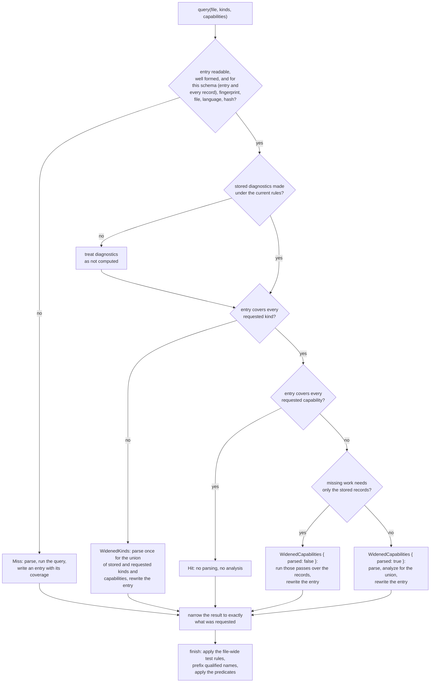

# How a Lookup Is Decided

Part of [Tree Hugger's Persistent Symbol Cache](../cache-design.md).

The [entry page](../cache-design.md#when-an-entry-is-used) gives the four
outcomes of a lookup. This page gives the full decision, which analysis
passes can widen an entry without parsing the file, how a result is narrowed
and finished, and how test flags survive a change of package layout.

## The decision

A request names the symbol **kinds** it wants (functions, types, …) and the
**capabilities** it needs: the analysis results beyond the declarations
themselves, such as containment, references, docs, flags, metrics and
diagnostics ([The File Index](../symbol-records/file-index.md#capabilities)). Each
command asks only for its own: `functions` for functions, methods and
constructors; `classes` adds containment; `lint` adds diagnostics;
`--json-full` asks for every capability.



## Widening without a parse

Some passes work from the stored records alone, so adding them to an entry
is a `WidenedCapabilities { parsed: false }`:

- the docs pass;
- the semantic pass, when occurrences are stored (the reference edges alone
  cannot tell a proven self-call from a same-named one);
- containment, when every kind is stored (a member's owner can be of any
  kind) and the file is neither Rust nor Swift. A Rust impl member's owner is
  its impl's resolved self type and a Swift extension member's the
  extension's resolved owner, which no record retains (see
  [Declared Type Relations](../type-relations.md#rust-impls)).

References, occurrences, diagnostics, flags and metrics need the syntax tree
(attributes, the declaration's parameter list), so they parse the file; the
definitions query runs again with them, because binding and semantic lint
consume its live result. A flag-only widening, such as `hug --json` after a
terminal listing, is therefore a partial hit that parses once, never a miss.

For example, over one unchanged `lib.rs`:

| Run | Entry before | Outcome | Entry after |
|---|---|---|---|
| `functions` (functions, methods, constructors; declarations) | none | Miss | those kinds; `declarations` |
| `types` with containment | function kinds | WidenedKinds (one parse) | function and type kinds; `declarations`, `containment` |
| `functions` again | as above | Hit | unchanged |
| `types` with containment and references | as above | WidenedCapabilities, one parse | same kinds; adds `references` |

And over a file whose entry covers every kind with `declarations` only, a
request for structured docs runs just the docs pass over the stored records
(WidenedCapabilities, no parse) and rewrites the entry with both.

## Narrowing

Every result is **narrowed** to the request before it is returned: kinds that
were not asked for are dropped, and relations, occurrences and coverage,
semantics, parsed docs, export targets, diagnostics, flags, metrics and each
record's `provenance.parse_pass` are reduced to what the requested
capabilities produce. A narrow request served from a wide entry is therefore
identical to an uncached run of the narrow request.

## Finishing

Only then is the result **finished** (`SymbolQueryResult::finish`, the same
step an uncached query ends with): every qualified name that is not
namespace-rooted gets the query's prefix, and the query's predicates drop the
records they do not match. The entry is written before this step, so it holds
in-file names and every record of its covered kinds:

```text
entry record:         "qualified_name": "Square::area"
scan root repo/:      src/shapes.rs#Square::area
scan root repo/src/:  shapes.rs#Square::area        (same entry, a Hit, same ID)
```

## Test flags: source facts are stored, file-wide rules are not

`visibility.is_test` has two kinds of input, and only one of them is in the
cache:

| Input | Example | Stored in the entry? |
|---|---|---|
| A test attribute on the declaration | Rust `#[test]`, Java `@Test`, C# `[Fact]` | yes |
| Rust `#[cfg(test)]` / `#![cfg(test)]` containment | `mod tests { fn helper() {} }` | yes |
| A test file name | Go `*_test.go`, Python `test_*.py`, JS/TS `*.spec.ts` | no |
| A Rust file below its package's `tests/` | `tests/sample.rs` with a `Cargo.toml` above it | no |

The first two come from the source, which the key hashes. The Rust package
rule depends on which directory above the file holds the nearest
`Cargo.toml`, and that can change while the file and its entry do not: add a
manifest above an unchanged `tests/sample.rs` and its declarations become
tests; add `tests/Cargo.toml` and `tests/` becomes a package of its own, so
they stop being tests. A stored flag would keep the old answer on every hit.
So `finish` applies the file-wide rules to every flagged result, cached or
not, before the predicates (`--tests-only`, `--exclude-tests`) read the flag:

```text
entry record (tests/sample.rs):  "is_test": false     (no attribute, no cfg(test))
no Cargo.toml above:             helper  is_test false   (Hit)
Cargo.toml added at the root:    helper  is_test true    (Hit, same entry)
tests/Cargo.toml added too:      helper  is_test false   (Hit, same entry)
```

The same split holds for a finished result reused through
`SymbolQueryResult::narrowed` (what `hug --prelude` does): `finish` remembers
which records only the file-wide rule made tests, and every later `finish`
first undoes exactly that before deciding the rule again. A record whose
source marks it a test stays one; a record only the old layout marked follows
the new one:

```text
tests/probe.rs: pub fn helper() {}  #[test] fn marked() {}
result made under Cargo.toml:        helper true   marked true
Cargo.toml removed, then narrowed:   helper false  marked true   (= fresh query)
```

A result already filtered by `--tests-only`/`--exclude-tests` lost the records
the old decision dropped, so it narrows only while that decision still holds;
otherwise `narrowed` returns `None` and the caller analyzes the file again.

The name rules depend only on the path, which is a key input, so storing them
would be correct; they are applied after lookup with the Rust rule because
they are one classification. The rule costs one file-name check and, for
Rust, one `Cargo.toml` probe per directory above the file, once per result.

## Related pages

- [Tree Hugger's Persistent Symbol Cache](../cache-design.md): the entry page.
- [Entry Format and Fingerprint](./entry-format.md): the key and the fields of
  an entry.
- [Damaged Entries](./robustness.md): which damaged entries are served.
- [Deprecation and test flags](../symbol-kinds-and-visibility/documentation-flags-and-metrics.md#deprecation-and-test-flags): how test
  flags are decided.
