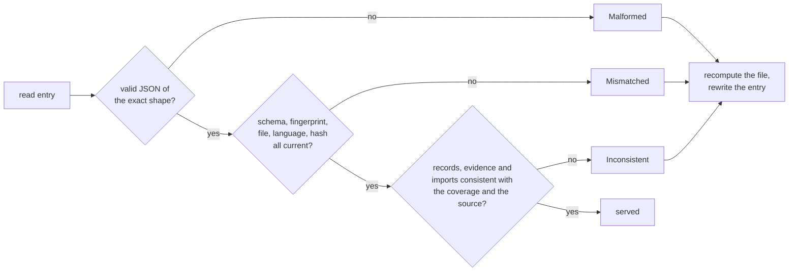

# Damaged Entries

Part of [Tree Hugger's Persistent Symbol Cache](../cache-design.md).

A cache entry is a JSON file in a temporary directory, so it can be truncated
by a crash, edited by hand, or left behind by an older version of Tree
Hugger. This page lists exactly which of those entries are still served and
which are recomputed. The short version: **an entry is served only when it
is exactly what the current version would have written, apart from a few
optional fields; anything else is a miss, and the file is analyzed again.**
A damaged entry never yields an empty or partial result.

```console
$ echo garbage > "$TMPDIR/tree-hugger/cache/hug/1e/1eb72f5a….json"
$ hug --verbose functions src/shapes.rs
cache: src/shapes.rs: malformed entry: expected value at line 1 column 1
  - public method area(self) -> f64 [in type Square] src/shapes.rs:4:5
  - public function helper() -> u32 src/shapes.rs:7:1
cache: 0 hits, 0 partial hits, 1 misses; parsed 1 files, 1 definition captures, 0 diagnostics runs
```

## How an entry is checked

The reader takes an entry only when it is valid JSON with no trailing
content, has every entry field with the right type and no field twice or
unknown, and matches the request (schema, fingerprint, file, language and
source hash). It then checks that the entry agrees with itself and with the
file's text. Each refusal is a `CacheMiss` with its reason:

| Reason | Printed as | Example |
|---|---|---|
| `Unreadable` | `unreadable entry: …` | the file exists but cannot be read |
| `Malformed` | `malformed entry: …` | invalid JSON, a duplicate key, a field absent, `null` or of the wrong shape |
| `Mismatched` | `entry for a different …` | a record of another schema version |
| `Inconsistent` | `inconsistent entry: …` | a record of a kind the entry does not claim to cover |

`CacheMiss::Malformed` carries the decoder's message, which names the field
and tells an absent field (`missing field`) from an explicit `null`
(`invalid type: null`). A missing entry is `Absent`, which `--verbose` counts
but does not list.



The tables below say, for each field, what happens to each damaged shape. The
columns are: the key **absent**; the value **`null`**; a **wrong type**;
**one bad element** or **every element bad** in a list; an **empty** value
(`[]`, `""`, `0`, `{}`); a **duplicate key**; and **trailing content** after
the JSON. They are pinned by the CLI test `cache_robustness`
(`cli/tests/symbols/cache_robustness.rs`), which edits an entry
`hug --json-full symbols` wrote, one cell at a time.

## Schema versions

An entry is served only when its own `schema_version` **and the
`schema_version` of every record in it** are exactly the current version
(5.1). The records are returned as stored, inside an index that claims the
current version, and the cache never translates between versions, so a
different minor version is a miss just like a different major one: an older
minor lacks fields the current version adds, and a newer one carries fields
this reader would drop. One record of another version is enough to make the
whole entry a `CacheMiss::Mismatched("record schema version")`; the file is
analyzed again and the entry rewritten, and the stale entry is never widened.

For example, an entry whose `instance_method` record was edited to
`"schema_version": {"major": 3, "minor": 0}` (or `{"major": 4, "minor": 3}`,
or `{"major": 5, "minor": 0}`) is recomputed; the output equals an uncached run.
An entry written before 4.1 also lacks `metrics.lines`, one written before
4.3 lacks `metrics.cyclomatic`, and one written before 5.0 lacks
`occurrences` and `reference_coverage`, any of which refuses it on its own
(see [Record fields](#record-fields)). Schema 5.0 changed what the reference
summaries mean (they come from scoped occurrences, so a 4.3 entry's
`references` may name the wrong same-named declaration), which is why an
older entry is never served even where its shape would read.

## Entry fields

No entry-level field has a default:

| Entry field | absent | `null` | wrong type | one bad element | every element bad | empty | duplicate key | trailing content |
|---|---|---|---|---|---|---|---|---|
| `covered_kinds` | miss | miss | miss | miss | miss | miss (`[]` is not "all") | miss | miss |
| `completed_capabilities` | miss | miss | miss | miss | miss | miss | miss | miss |
| `schema_version`, `fingerprint`, `source_hash` | miss | miss | miss | miss | miss | miss | miss | miss |
| `file`, `language` | miss | miss | miss | miss | miss | miss (`""` is another file or no language) | miss | miss |
| `diagnostics_fingerprint` | miss | miss (contradicts `diagnostics`) | miss | miss | miss | diagnostics recomputed (one parse; output as uncached) | miss | miss |
| `records` | miss | miss | miss | miss | miss | **served** when no stored evidence names a record (a file with no records of the covered kinds); miss when name-only evidence of an every-kind entry names records the list no longer holds | miss | miss |
| `imports` | miss | miss | miss | miss | miss | served for a genuinely empty producer inventory; miss when a populated inventory loses any binding | miss | miss |
| `exports`, `diagnostics` | miss | miss | miss | miss | miss | **served**: the file has none | miss | miss |

For a version object, "one bad element" and "every element bad" mean one or
both of `major` and `minor` hold a non-number. A well-formed version other
than 5.1 is a miss, as described above.

A kind list must also be in ascending order with no repeats, and a
capability list closed under prerequisites. The records must agree with that
coverage, or the entry is refused (`CacheMiss::Inconsistent`):

- a record of a kind the entry does not cover;
- a `metrics` facet, or a `true` `is_test` or `is_deprecated`, in an entry
  that does not list `metrics` or `flags`: without the capability those
  fields mean "not computed", so this cache never wrote such a value;
- a record without a `metrics` facet in an entry that lists `metrics`.

For example, an entry listing `["declarations"]` whose `deprecated_api` record
says `"is_deprecated": true` is recomputed, and the output says `false`.

## Record fields

Inside a record, a field accepts exactly the shapes its schema type allows:
optional values and defaulted collections accept their defaults, and
everything else refuses the entry.

| Record field | Served when | Public result |
|---|---|---|
| `identity.container_kind` | absent or `null` | no container kind |
| `modifiers` | absent or `[]` | no modifiers (not `static`, not `async`, none written) |
| `attributes` | absent or `[]` | no attributes |
| attribute `value` | absent or `null` | no argument list |
| attribute `name`, attribute `value`, `Custom` modifier `value` | `""` | the empty string, as written |
| `identity.keyword` | absent, `null` or `""` | no keyword, or the empty keyword |
| `source.declaration_text` | absent, `null` or `""` | no text, or the empty text |
| `source.signature_text` | absent, `null` or `""` | no header, or the empty header |
| `type_info.generic_params`, `type_info.constraints`, `relations.extends`, `relations.implements`, `relations.unclassified_bases` | absent or `[]` | empty list |
| generic parameter `constraints` | absent or `[]` | empty list |
| generic parameter `default`, `variance` | absent or `null` | no value |
| relation target `id`, `qualified_name`, `source_span` | absent or `null` | no value |
| generic parameter `name`, relation target `name` | `""` | empty string |
| generic parameter `position` | `0` | first position |
| relation target `source_span` members (`start.line`, `start.column`, `end.line`, `end.column`, `start_byte`, `end_byte`) | `0` | the stored `0`, as written |
| `kind_data.data.fields` (type data) | absent or `[]` | empty field list |
| field data `visibility` | absent or `null` | Unknown access |
| `metrics.parameters`, `metrics.has_docs`, `metrics.lines`, `metrics.cyclomatic` | `null` | the metric is unsupported (`cyclomatic`: unavailable) for that declaration |
| `metrics.lines` | `0` | an empty body span (distinct from `null`) |

`schema_version`, `kind`, `scope`, `identity.qualified_name`,
`identity.is_namespace_rooted`, `visibility.level`, `visibility.is_test`,
`visibility.is_deprecated`, `kind_data.kind_data_type` and field data
`is_static` are required: absent, `null`, `""` (an unknown scope, an empty
qualified name) or `{}` refuses the entry, and a record `schema_version`
other than exactly 5.1 refuses it too. In an entry that lists `metrics`, the
`metrics` facet is required in the same way (absent, `null`, `{}` or a member
of the wrong type refuses it), and so is each of its four keys (absent
refuses, so a 4.0 facet without `lines` or a 4.2 facet without `cyclomatic`
is never read as `null`; only `null` is served). `lines` and `cyclomatic`
are `u32`s: `"3"`, `3.5`, `-1`, `4294967296`, `true`, `{}` and `[]` refuse the entry, and `4294967295` is served. For every tested record field, a wrong type (`123`, or `"123"` for a number, or an array holding a wrong
element), a duplicate key and invalid JSON refuse the entry. For example, an
entry whose method record carries `"modifiers": null` is recomputed, while one
with no `modifiers` key reports that method as an instance method.

Inside the `attributes` and `modifiers` lists, an attribute's `name` and a
modifier's `type` tag are required, and so is a `Custom` modifier's `value`:
absent, `null`, a wrong type, a duplicate key or trailing invalid JSON
refuses the entry, and so does an empty tag, which names no modifier. For
example, an entry whose `final class` stores `{"type": "Custom"}` with no
`value` is recomputed, while one whose `@Marker("x")` attribute lost its
`value` is served as `@Marker` with no arguments. The permanent CLI matrix
has one column per member, with both a `Custom` and a fixed-tag (`Static`)
modifier.

Generic parameter `name`, `kind` and `position` and relation target `name`
are required. Their absence or `null` refuses an entry. A null collection,
a wrongly typed element, a duplicate key or trailing invalid JSON also
refuses the entry. Empty optional strings are served literally; an empty
parameter kind is rejected. The permanent CLI matrix includes every nested
generic field and relation-target field, plus the three relation lists.

A relation target's `source_span` may be absent or `null`, but a stored span
needs all six members as unsigned integers. A missing member, `null`, a
string, an array, a duplicate member or trailing invalid JSON refuses the
entry; `{}` refuses it too. `0` is served as written: the reader checks the
type, not that a position is one-based. For example, an `extends` target
whose span lost `end_byte` is recomputed. The byte members matter to the
report: `hug --signatures full` compares them with the owner's declaration
span to decide whether a Swift conformance is already in the header. The
matrix has one column per member.

A stored diagnostic's metadata omits `is_enabled_by_default` and
`requires_experimental_semantics` when they are `false`; an absent key reads
as `false`.

The CLI test `cache_robustness` in `cli/tests/symbols/` pins these tables,
and incompatible versions on the entry and on a record, by editing an entry
`hug --json-full symbols` wrote, one cell at a time.

## Reference evidence

The public `Occurrence` and `ReferenceCoverage` leave out an absent owner or
ID and an empty candidate or reason list, and read a missing key as empty.
The entry cannot rely on that: an entry claiming `occurrences` whose
`candidates` key was lost would read as "no candidates". So the entry writes
every key, and its reader requires every key and refuses an unknown one:

For `use other::external;` followed by
`fn module_function() { helper(); external(); }`, the stored occurrence of
`external` is:

```json
{
  "owner": { "id": "5d5dc860…", "name": "module_function", "qualified_name": "module_function" },
  "owner_span": { "start": { "line": 2, "column": 1 }, "end": { "line": 2, "column": 47 }, "start_byte": 21, "end_byte": 67 },
  "target": { "id": null, "name": "external", "qualified_name": null },
  "path_start_byte": null,
  "import_span": { "start": { "line": 1, "column": 12 }, "end": { "line": 1, "column": 20 }, "start_byte": 11, "end_byte": 19 },
  "import_start_byte": 11,
  "candidates": [],
  "span": { "start": { "line": 2, "column": 34 }, "end": { "line": 2, "column": 42 }, "start_byte": 54, "end_byte": 62 },
  "kind": "Call",
  "confidence": "Scoped"
}
```

Its target has no ID because it is bound to an import, not to a declaration
in the file; `import_span` and `import_start_byte` record which import (see
[Selected import provenance](#selected-import-provenance)). The occurrence
of `helper` has the same shape with `helper`'s ID and the two import fields
`null`.

`path_start_byte` exists only in the cache entry (the public `Occurrence` has
no such field). It is the byte offset where the occurrence's written path
starts, and `null` exactly when `target.qualified_name` is `null`. For
`other::external();` at the start of a line, the occurrence of `external`
stores `"qualified_name": "other::external"` and the offset of `o`. The two
fields repeat one fact, so editing either one alone is detected. That is
the point: from the source alone, a `null` path that was never written
cannot be told apart from a deleted one. Rust macro token trees, a leading
`::` and JavaScript spread all put punctuation before unqualified names, so
no text scan can decide it.

Each field's shapes, in an entry that lists `occurrences`:

| Evidence field | absent | `null` | wrong type | one bad element | every element bad | empty | duplicate key | trailing content |
|---|---|---|---|---|---|---|---|---|
| `occurrences` | miss | miss | miss | miss | miss | miss when a record keeps an edge an occurrence made; **served** for a file with none | miss | miss |
| `reference_coverage` | miss | miss | miss | miss | miss | miss (the file region is required) | miss | miss |
| occurrence `confidence` | miss | miss | miss | miss | miss | miss | miss | miss |
| occurrence `target.id` | miss | miss when the occurrence made an edge | miss | miss | miss | miss | miss | miss |
| ownerless occurrence `target.id` | miss | miss when no import or other binding of the name is written | miss | miss | miss | miss | miss | miss |
| occurrence `candidates` | miss | miss | miss | miss | miss | miss for `NameOnly` | miss | miss |
| occurrence `span` | miss | miss | miss | miss | miss | miss | miss | miss |
| occurrence `owner` | miss | miss for a named owner | miss | miss | miss | miss | miss | miss |
| occurrence `owner_span` | miss | miss | miss | miss | miss | miss | miss | miss |
| coverage `owner` | miss | miss for a region owning occurrences | miss | miss | miss | miss | miss | miss |
| coverage `state` | miss | miss | miss | miss | miss | miss | miss | miss |
| coverage `reasons` | miss | miss | miss | miss | miss | miss for a `Limited` region | miss | miss |
| coverage `span` | miss | miss | miss | miss | miss | miss | miss | miss |
| unqualified occurrence `target.qualified_name` (`helper()`) | miss | **served** (no path is written) | miss | miss | miss | miss (`""`) | miss | miss |
| qualified occurrence `target.qualified_name` (`box.size()`, `other.thing()`, `other::external()`) | miss | miss (disagrees with `path_start_byte`) | miss | miss | miss | miss (`""`) | miss | miss |
| unqualified occurrence `path_start_byte` | miss | **served** (no path is written) | miss | as wrong type | as wrong type | miss (`0`) | miss | miss |
| qualified occurrence `path_start_byte` | miss | miss (disagrees with the path) | miss | as wrong type | as wrong type | miss (`0`) | miss | miss |
| occurrence `kind` | miss | miss | miss | as wrong type | as wrong type | miss (`""`) | miss | miss |
| a point's `line` and `column` in an owner span and a coverage span | miss | miss | miss | as wrong type | as wrong type | miss (`0`) | miss | miss |
| every leaf of an owner, target or candidate reference (`id`, `name`, `qualified_name`) and of a span (`start_byte`, `end_byte`, `start`, `end`, and a point's `line` and `column`) | miss | miss | miss | as wrong type | as wrong type | miss (`""`, `0`, `{}`) | as the parent's | as the parent's |

The two `target.qualified_name` rows are the written path: `null` for a name
written without a qualifier, else the source text from the qualifier through
the name. A present empty string is never a written path.

Well-formed evidence is then checked against the source, itself, the
capability claim and the records (`CacheMiss::Inconsistent`). Each of these
refuses the entry:

- evidence in an entry that does not list `occurrences`, or no coverage in
  one that does;
- a first region that is not the whole file with no owner;
- a span past the source, off a character boundary or ending before it
  starts, or whose line and column are not those of its byte offsets
  (one-based line, one-based byte column); an empty occurrence span; an
  occurrence outside its owner's region;
- an occurrence whose `target.name` is not the source text at its span;
- an occurrence whose `target.qualified_name` (its written path) is not
  `null` and is not the source text that ends where the occurrence ends and
  is longer than the name: `"Other::h"` stored for a source that writes
  `Self::h()`, `""`, or the bare name, is refused;
- an occurrence whose written path and `path_start_byte` disagree, in every
  language and whether or not the target's record is stored: one is `null`
  and the other is not, or the start is not where the path starts. Setting
  `"other::external"` to `null` alone, or its start to `null` alone, is
  refused;
- an occurrence whose owner and owner span are not one of the coverage
  regions, or not the innermost region around it (regions are syntax
  nodes, so they nest, and a reference belongs to the nearest one);
- an owner, candidate or reference-summary entry whose name and qualified
  name are not its stored record's;
- an ID (occurrence target, candidate, occurrence or region owner,
  `references`/`referenced_by` entry) that names no stored record, unless
  the entry omits a kind that record could have (see below): an every-kind
  entry omits nothing, so `"000…0"` (well formed, but no declaration's ID)
  is refused anywhere in its evidence;
- an ID anywhere in the evidence or a record that is not a generated
  declaration ID (64 lowercase hex digits), so `"bogus"` is refused even
  where it names no stored record;
- a `Scoped` target ID or a candidate ID naming a stored record whose name
  is not the written name (`f` written, `g`'s ID stored);
- `Scoped` with candidates; `NameOnly` with a target ID, no candidates, a
  candidate without an ID, a repeated one or one named other than the
  written name; `Unresolved` with either;
- in a language without binding rules (every language but Rust, TypeScript
  and JavaScript): any `Scoped` occurrence, a region not limited by
  `unsupported_language` (or, in Rust/TS/JS, a region that is), a
  `NameOnly` occurrence missing a stored record of its name, an
  `Unresolved` one while a stored record has its name, and, in an
  every-kind entry, a candidate that is not a record of its name;
- a `Scoped` occurrence with no target ID whose name is written nowhere
  else in the source: such an occurrence is bound to an import or to a
  binding no record reports (a `for` or `catch` variable, a pattern, a
  named function expression's own name), and each of those writes the name
  at a place that is neither a record's name nor an occurrence;
- a repeated coverage region (same owner and span, or one owner twice);
  a region owned by a stored record that is not a function, method or
  constructor; a stored callable whose own region does not match its
  `source.body_span`: a callable with a body (an empty one included) has a
  region even when it has no occurrences, and one without a body (a trait
  or interface signature) has none. This holds in every language: a Python
  or Lua body read as a run of statements, and a Lua body with no
  statements, still owns the callable's region. That region must contain
  the stored `body_span` (it need not equal the declaration span: a C or
  C++ record keeps only its declarator, while its region is the whole
  definition), so a region shrunk to the callable's name is refused;
- occurrences out of their canonical order or repeated; coverage out of
  order; reasons that are not ascending and distinct, or present on a
  `Complete` region or missing from a `Limited` one;
- `NameOnly` candidates out of declaration order (each stored candidate
  record's name position, then its ID; candidates whose records the entry
  omits are not compared, since their positions are unknown);
- a `references`, `referenced_by` or `dependencies` list that repeats an
  edge (the same ID, or for an import the same name and qualified name), or
  whose edges are not in the order of the first occurrence that made each:
  the owner's first `Scoped` occurrence of a target ID, and for
  `referenced_by` each owner's first `Scoped` occurrence of the record. An
  import edge's occurrence is one of the owner's `Scoped` occurrences of
  that name without an ID; the entry does not store which one (a binding no
  record reports has the same shape), so the list is accepted when some
  choice of those occurrences is in order;
- a record's in-file `references` or `referenced_by` edge with no `Scoped`
  occurrence that made it; a `Scoped` occurrence between two stored records
  whose `references`/`referenced_by` edge is missing; a `dependencies`
  entry with an ID, missing from `references`, or with no `Scoped`
  occurrence of its name and no ID owned by the record; a `references`
  entry without an ID that is not a dependency;
- a `semantics` facet that the stored occurrences, coverage, imports and
  references do not produce (the reader recomputes it the way the semantic
  pass does, so `is_recursive: No` on a `Limited` region or beside a
  `Scoped` self-call, or `Unknown` on a complete region with no candidate
  call, is refused), or any `semantics` value in an entry that does not
  list `semantics`.

A kind-narrowed entry keeps evidence that names declarations it omits (a
functions-only entry stores `new C()` with `C`'s ID). An ID naming no stored
record is therefore accepted only where the entry omits a kind its record
could have, and every ID is always checked for its generated form:

| ID | Accepted without a stored record when |
| --- | --- |
| occurrence target, candidate, `references` entry | the entry omits any kind |
| occurrence or region owner, `referenced_by` entry | the entry omits `Function`, `Method` or `Constructor` (an owner is always one) |

So a functions-only entry (all three callable kinds) still refuses a region
owned by an ID no stored record has, while a `Function`-only entry accepts a
region owned by a method it omits. A `null` ID is not an ID: an import
target or a binding no record reports stays `null` in any entry.

For example, an entry whose `helper` call lost its target ID is recomputed:
`module_function`'s record still references `helper`, and no occurrence
says so. An ownerless `f();` whose ID is replaced by `g`'s is recomputed
because `g` is not the written name, and one whose ID becomes `null` is
recomputed because no import or other binding writes `f`. What these checks
cannot see without parsing is an occurrence or an anonymous region removed
while nothing derived from it remains (a call with no in-file target), a
`Scoped` occurrence without an ID whose name is written elsewhere for an
unrelated reason, and the order of candidates whose records the entry
omits. A coordinated edit that sets both a written path and its
`path_start_byte` to `null` is also out of scope: like any forgery that edits
every field repeating one fact (an occurrence and the summaries derived from
it, say), it leaves an entry consistent with itself. The entry's key
includes the source hash, so an entry is only ever read for the text it was
written from.

## Selected import provenance

Each stored occurrence records which import it is bound to, if any, in two
required, nullable fields: `import_span` (the span of the imported name) and
`import_start_byte` (its start, repeated so that editing one alone is
detected). Both are `null` for local or uncertain references. Nonnull spans must identify the exact import name and
agree with its start offset, target name, confidence and absent target ID.
Dependency summaries must equal the selected imports in first-occurrence
order. A separate import with the same alias cannot stand in for the selected
one. An entry written before schema 5.1 has neither field and is
recomputed.

In the tables below, each cell edits one field of an entry `hug` wrote.
**H** means the edited entry is still a valid hit; **M** means it is a miss and
the file is recomputed, with the same public output as an uncached run. The
"local-binding null control" is an occurrence bound to a local declaration,
whose two provenance fields are legitimately `null`. A dash marks a shape the
field cannot take (it is not a list).

| Shape | `import_span` | `import_start_byte` | `import_span.start` | `import_span.end` |
|---|---|---|---|---|
| Selected-import control | H | H | H | H |
| Local-binding null control | H | H | — | — |
| Absent | M | M | M | M |
| Explicit null | M for import; H for local | M for import; H for local | M | M |
| Wrong whole type | M | M | M | M |
| Wrong one/every element | — | — | — | — |
| Empty object/list/string | M | M | M | M |
| Duplicate key | M | M | M | M |
| Trailing invalid content | M | M | M | M |
| Valid-shaped contradictory linkage | M | M | M | M |

| Shape | `import_span.start_byte` | `import_span.end_byte` | `import_span.start.line` | `import_span.start.column` | `import_span.end.line` | `import_span.end.column` |
|---|---|---|---|---|---|---|
| Selected-import control | H | H | H | H | H | H |
| Absent | M | M | M | M | M | M |
| Explicit null | M | M | M | M | M | M |
| Wrong whole type | M | M | M | M | M | M |
| Wrong one/every element | — | — | — | — | — | — |
| Empty object/list/string | M | M | M | M | M | M |
| Duplicate key | M | M | M | M | M | M |
| Trailing invalid content | M | M | M | M | M | M |
| Zero | H only at actual byte zero | H only at actual byte zero | M | M | M | M |

Provenance objects and scalar coordinates have no element shapes. Each nested
span is checked against the selected import's full span; changing a leaf to a
well-typed but incorrect coordinate is a miss. A wrong-scope import link with
both span and start changed is still rejected when its selected original
contradicts the owner's dependencies. The checks are consistency checks,
like the written-path checks above, rather than a second lexical analysis of
arbitrarily coordinated cache forgeries.

## Stored import evidence

A cache hit validates the stored imports before it serves anything. The
entry reader requires every import name, name span, and symbol object;
all span objects require both byte bounds and both one-based points. Unknown
fields, duplicate keys, invalid elements, and trailing content are malformed.
Imports have no external symbol ID or symbol source span. The symbol name and
alias binding must agree with the captured source name. Name coordinates must
identify that written token, including raw and escaped identifier spelling.

Optional metadata may genuinely be absent or null: `use a;` has no source,
alias, or original name; a TypeScript entity alias has no module source; a
C# predefined-type alias has no original identifier. A required `import_inventory`
witness is a BLAKE3 digest of the canonical grammar-produced complete import
list, including nullable metadata, exact name/statement geometry, and ordering.
The writer computes it before projection; the reader compares it with decoded
imports before serving any capability. Losing one grouped binding, adding a
record at a declaration token, changing a module, or extending a statement
range disagrees with the retained witness and causes recomputation. These checks
also cover Python future imports and Rust extern-crate aliases whose producers
emit no statement span. They do not parse a tree on warm hits or semantic
widening. The ten import-producing languages use the same strict reader; C,
C++, Lua, Perl, Bash, and Zsh reject any populated import inventory because
their shipped import queries have no captures.

The tables below come from the test corpus `symbols_cache_imports`: entries
written by `hug` for all ten import-producing languages, plus Rust, Scala and
PHP grouped imports and a C# generic alias, each edited one field at a time.
After each edit the test checks the public imports and coordinates against
independently expected values, then that the rewritten entry is a hit.
**H** means Hit, **M** means Miss and recomputation, and **N** means a
genuinely optional `null` or absent value is a hit while a lost meaningful
fact is a miss. Source-consistent inventory and statement-boundary
edits are M, including grouped-member loss and coordinated byte/point edits
extending either end of a statement. Each table is one part of the same JSON matrix.

| Shape | `imports` | `name` | `alias` | `source` | `span` | `statement_span` | `symbol` |
|---|---|---|---|---|---|---|---|
| Unedited positive control | H | H | H | H | H | H | H |
| Absent | M | M | N | N | M | N | M |
| Explicit null | M | M | N | N | M | N | M |
| Wrong whole type | M | M | M | M | M | M | M |
| Wrong one/every element | M | — (not a list) | — (not a list) | — (not a list) | — (not a list) | — (not a list) | — (not a list) |
| Empty | H for genuine empty; M for recognized deleted binding | M | M | M | M | M | M |
| Duplicate key | M | M | M | M | M | M | M |
| Trailing invalid content | M | M | M | M | M | M | M |
| Well-typed contradictory fact | M | M | M | M | M | M | M |

| Shape | `symbol.name` | `symbol.qualified_name` | `symbol.id` | `symbol.source_span` |
|---|---|---|---|---|
| Unedited positive control | H | H | H | H |
| Absent | M | N | H | H |
| Explicit null | M | N | H | H |
| Wrong whole type | M | M | M | M |
| Wrong one/every element | — (not a list) | — (not a list) | — (not a list) | — (not a list) |
| Empty | M | M | M | M |
| Duplicate key | M | M | M | M |
| Trailing invalid content | M | M | M | M |
| Well-typed contradictory fact | M | M | M | M |

| Shape | `span.start_byte` | `span.end_byte` | `span.start` | `span.end` | `span.start.line` | `span.start.column` | `span.end.line` | `span.end.column` |
|---|---|---|---|---|---|---|---|---|
| Unedited positive control | H | H | H | H | H | H | H | H |
| Absent | M | M | M | M | M | M | M | M |
| Explicit null | M | M | M | M | M | M | M | M |
| Wrong whole type | M | M | M | M | M | M | M | M |
| Wrong one/every element | — (not a list) | — (not a list) | — (not a list) | — (not a list) | — (not a list) | — (not a list) | — (not a list) | — (not a list) |
| Empty | H if unchanged zero byte; M otherwise | H if unchanged zero byte; M otherwise | M | M | M | M | M | M |
| Duplicate key | M | M | M | M | M | M | M | M |
| Trailing invalid content | M | M | M | M | M | M | M | M |
| Well-typed contradictory fact | M | M | M | M | M | M | M | M |

| Shape | `statement_span.start_byte` | `statement_span.end_byte` | `statement_span.start` | `statement_span.end` | `statement_span.start.line` | `statement_span.start.column` | `statement_span.end.line` | `statement_span.end.column` |
|---|---|---|---|---|---|---|---|---|
| Unedited positive control | H | H | H | H | H | H | H | H |
| Absent | M | M | M | M | M | M | M | M |
| Explicit null | M | M | M | M | M | M | M | M |
| Wrong whole type | M | M | M | M | M | M | M | M |
| Wrong one/every element | — (not a list) | — (not a list) | — (not a list) | — (not a list) | — (not a list) | — (not a list) | — (not a list) | — (not a list) |
| Empty | H if unchanged zero byte; M otherwise | H if unchanged zero byte; M otherwise | M | M | M | M | M | M |
| Duplicate key | M | M | M | M | M | M | M | M |
| Trailing invalid content | M | M | M | M | M | M | M | M |
| Well-typed contradictory fact | M | M | M | M | M | M | M | M |

Numeric leaves also receive independently invalid zero and out-of-source
values, and a string as the wrong-type edit. A zero start byte that is already
the producer's correct bound remains H. A duplicate complete import record is
M. Optional fields receive fabricated strings on genuinely null controls;
well-typed invented 64-character external IDs and copied symbol source spans
are M. Genuine empty controls include side-effect imports, empty Rust lists,
Scala hidden selectors, Rust opaque macro token trees, PHP trait use and using
declarations, and import-like text inside strings or regular expressions.

The producer witness removes the approximate source lexer: regexes, extended
literal delimiters, and comment nesting follow the actual pinned grammar on
cold analysis, and need no reinterpretation on a warm hit. Independent strict
shape, source-name geometry, capture order, unsupported-language inventory,
and selected-import dependency checks still run. The witness is an integrity
check, not authentication: a coordinated rewrite of facts and every witness
cannot be distinguished without reanalysis, the existing all-witness boundary.

The shared lexical corpus exercises all 16 languages. Its public-cache tests
assert error-free source, independently expected imports and metadata through
six serving stages, then delete real imports or invent source-aligned ones and
require recomputation. Shipped CLI tests check imports, complete indexes and
all reference directions in JSON and text, including unchanged zero-parse
hits. Regex context, Swift extended delimiters, C# quote runs and each
language's comment boundaries are grammar facts, never warm-cache heuristics.

| Shape | `import_inventory` |
|---|---|
| Tool-produced control | H |
| Absent, null, wrong type, empty or changed digest | M |
| Duplicate key or trailing invalid content | M |

## Where the tests are

Each behavior on this page and on the other cache pages is pinned by a test:

| Behavior | Test |
|---|---|
| Every fixture: cold miss, warm complete hit with no parse, equal to uncached | `lib/tests/l1/symbols_cache.rs` `every_fixture_is_a_complete_warm_hit_equal_to_an_uncached_run` |
| A wide entry narrowed to any request equals the uncached request | `projected_results_equal_uncached_queries`, `projected_results_over_multi_equal_uncached_queries` |
| Widening by capabilities and by kinds; the third narrow run is a hit | `widening_capabilities_runs_only_the_missing_passes`, `widening_kinds_reextracts_once_for_the_union` |
| Query text, extractor revision, forced language, schema, rules and settings each miss | `each_key_input_and_stored_identity_decides_a_miss` |
| A record of another schema version (2.0, 3.0, 4.0, 4.1, 4.2, 4.3, 5.0, 5.2, 6.0) misses for the same and a wider request, never widened | `incompatible_record_schema_versions_are_misses_never_served_or_widened` |
| Corrupt entries, absent vs `null` reasons, kind-list shapes | `a_corrupt_entry_is_a_miss_and_is_replaced`, `absent_and_null_entry_fields_report_different_reasons`, `covered_kind_lists_are_served_only_in_canonical_form` |
| A metrics facet or a set flag without its capability, or a record without metrics under `metrics`, is `Inconsistent`; a flags-and-metrics entry serves a flags-only request | `covered_kind_lists_are_served_only_in_canonical_form`, `flags_and_metrics_are_served_only_under_their_capabilities` |
| A filtered, prefixed query writes in-file names and every record; another scan root is a Hit with the same IDs | `lib/tests/l1/symbols_query_filters.rs` `predicates_and_prefixes_never_reach_the_cache_entry` |
| Concurrent writers (threads and processes) | `concurrent_writers_leave_a_readable_entry_whose_coverage_matches`, `cli/tests/symbols/cache_lookup.rs`, `lib/tests/l1/cache_tests.rs` |
| Entry and record field shapes | `cli/tests/symbols/cache_robustness.rs` |
| Attribute `name`/`value` and modifier `type`/`Custom` `value` shapes, from real Java extraction | `cache_robustness::attribute_and_modifier_members_are_served_or_recomputed_per_shape` |
| Reference evidence: every shape of every evidence field, each inconsistent edit (wrong, malformed and lost target IDs with and without an owner, repeated and missing regions, owners past the innermost region, missing edges and dependencies, recomputed semantics), legitimate no-ID import and unreported-binding targets and a file with no occurrences served | `cache_robustness::reference_evidence_is_served_only_when_consistent` |
| A kind-narrowed entry referencing omitted declarations is a `Hit`; its retained records are still checked, and an owner ID naming no record is refused unless a callable kind is omitted; in an every-kind entry a target, candidate, owner or summary ID naming no record is refused; a callable's region matches its body (empty TS, Python and Lua bodies, a bodiless Rust trait method); a language without binding rules must hold exactly its name lookup | `lib/tests/l1/symbols_cache.rs` `stored_evidence_is_checked_against_what_the_entry_retains` |
| The re-export report: every shape of every report field (state, limits, each entry name, qualifier, import span and span leaf, the import marker, the capability list) from a real entry; well-typed inconsistencies (state against language or limits, spans outside the file, entries or limits out of order, form against names, an import site that is no import, a deleted positive report, an evidence-less capability); a narrow entry is widened, never read as empty | `cache_robustness::complete_reexport_report_fields::*` and `limited_reexport_report_fields::*` (one test per field column), `complete_reexport_inconsistencies_are_refused::*`, `limited_reexport_inconsistencies_are_refused::*` and `not_applicable_language_is_complete_only_as_not_applicable::*` (one test per case), `every_reexport_matrix_row_has_a_generated_test`, `an_entry_without_reexports_is_widened_not_read_as_empty`, `a_duplicated_or_trailing_reexport_member_is_refused_and_recomputed` |
| Every leaf of the evidence's references and spans: each shape a miss equal to an uncached run | `cache_robustness::reference_evidence_reference_leaves_are_served_only_when_consistent`, `reference_evidence_span_leaves_are_served_only_when_consistent` |
| In all 16 languages' primary fixtures (plus two same-named callables and one reference, and for Scala a callable with no occurrences), a named callable's region shrunk to its name, an invented written path and reversed candidates are misses naming their refusal, with output equal to the unedited entry's (an actual hit equal to an uncached run); a fabricated summary edge is refused in the 13 languages without binding rules | `cache_robustness::retained_geometry_written_paths_and_candidate_order_are_checked_in_every_language` |
| In Rust, TypeScript and JavaScript, each summary list (`references`, `referenced_by`, `dependencies`), the candidates, occurrences, coverage and reasons duplicated or reversed, and a member call's written path emptied or lost, or an unqualified one emptied, is a miss naming its refusal with the unedited output | `cache_robustness::summary_and_evidence_list_edits_are_recomputed_in_every_resolving_language` |
| In all 16 languages (Rust's minimal `other::external()` and `crate::outer_module`, `other.external()`, `fmt.Sprint`, `self.assigned_through_self`, `com.example`, `Example.Symbols`, `o.external()`, `gnu::deprecated`, `Other.external()`, `$this->privateField`, Perl `R4::r4f` and `R4->r4f`), a written path set to `null`, or only its `path_start_byte`, is a miss whose recomputed output keeps the path and equals the unedited hit; a Bash/Zsh path command keeps its whole spelling in the name (no path, a hit) | `cache_robustness::deleted_written_paths_are_recomputed_in_every_language` |
| Every shape of a qualified nonmember path (`other::external`) and of its `path_start_byte` | `cache_robustness::a_qualified_nonmember_path_and_its_start_are_served_only_unedited` |
| A deleted written path is recomputed in complete, narrowed (member records omitted) and projected results, then hit with the path; an entry without `path_start_byte` keys is malformed | `lib/tests/l1/symbols_cache.rs` `a_deleted_written_path_is_recomputed_in_complete_narrowed_and_projected_results`, `an_occurrence_without_a_stored_path_start_is_malformed` |
| `hug refs g --callees` (text and JSON) after a deleted written path shows `other::external`, then hits | `refs::a_deleted_written_path_is_recomputed_for_callees` |
| The same rules at the library, with exact refusals, including an edge retaining its selected actual import despite a preceding same-named loop binding (served) and a methods-omitted entry (omitted candidates' order unchecked; an omitted member's deleted path or start refused; a path and start deleted together served, the coordinated-forgery limit; summary order still checked) | `lib/tests/l1/symbols_cache.rs` `stored_evidence_geometry_paths_and_order_are_checked` |
| A warm `hug refs --callees` over an entry whose `Self::h` path was changed to `Other::h` prints `Self::h` in text and JSON, then hits | `refs::a_stored_written_path_the_source_does_not_write_is_recomputed` |
| In all 16 languages' primary fixtures, an every-kind entry with a phantom coverage owner, a phantom candidate, a phantom ownerless target (Rust/TS/JS), a phantom named-owner target (Rust/TS/JS) or an empty named callable's region removed (every language but Scala, whose fixture has none) is a miss equal to an uncached run; the unedited entry is a hit | `cache_robustness::every_kind_evidence_identities_name_retained_declarations_in_every_language` |
| An entry from before schema 5.0 (revision 30, no evidence keys) is recomputed under both keys | `cache_upgrade::entry_from_extractor_revision_thirty_is_not_served_after_the_scoped_references_bump` |
| Widening an entry by `metrics` parses once and walks each measured callable once; every `cyclomatic` value, `null` included, is stored, and a warm request is a `Hit` that walks nothing | `complexity_is_stored_once_and_served_on_warm_hits` |
| Old extractor revisions and records of other schema versions are never served | `cli/tests/symbols/cache_upgrade.rs` |
| A kind-narrowed entry never claims complete coverage; widening to every kind and capability, then a warm `Hit` with zero work counters, equals an uncached run | `deferred_kind_entries_never_claim_complete_coverage_and_warm_hits_do_no_work` |
| A reclassified record gets the ID of its new kind; unchanged records and namespace members keep theirs | `reclassified_records_get_new_ids_and_unrelated_ids_stay` |
| Relative, absolute, `.`/`..`, symlinked-file and symlinked-directory spellings read under one identity, key, record set and entry; missing files keep the given spelling | `lib/tests/l1/file_identity.rs` |
| The CLI shares one entry across spellings, lists a file once, and `--prelude` reuses it under any spelling | `cli/tests/symbols/spelling.rs`, `cli/tests/symbols/prelude.rs` `prelude_reuse_holds_for_every_spelling_of_an_explicit_file` |

## Related pages

- [Tree Hugger's Persistent Symbol Cache](../cache-design.md): the entry page.
- [Entry Format and Fingerprint](./entry-format.md): what a well-formed entry
  holds.
- [How a Lookup Is Decided](./lookup.md): what happens to an entry that is
  served.
- [Scope-Aware References](../references.md): what the reference evidence
  means.
