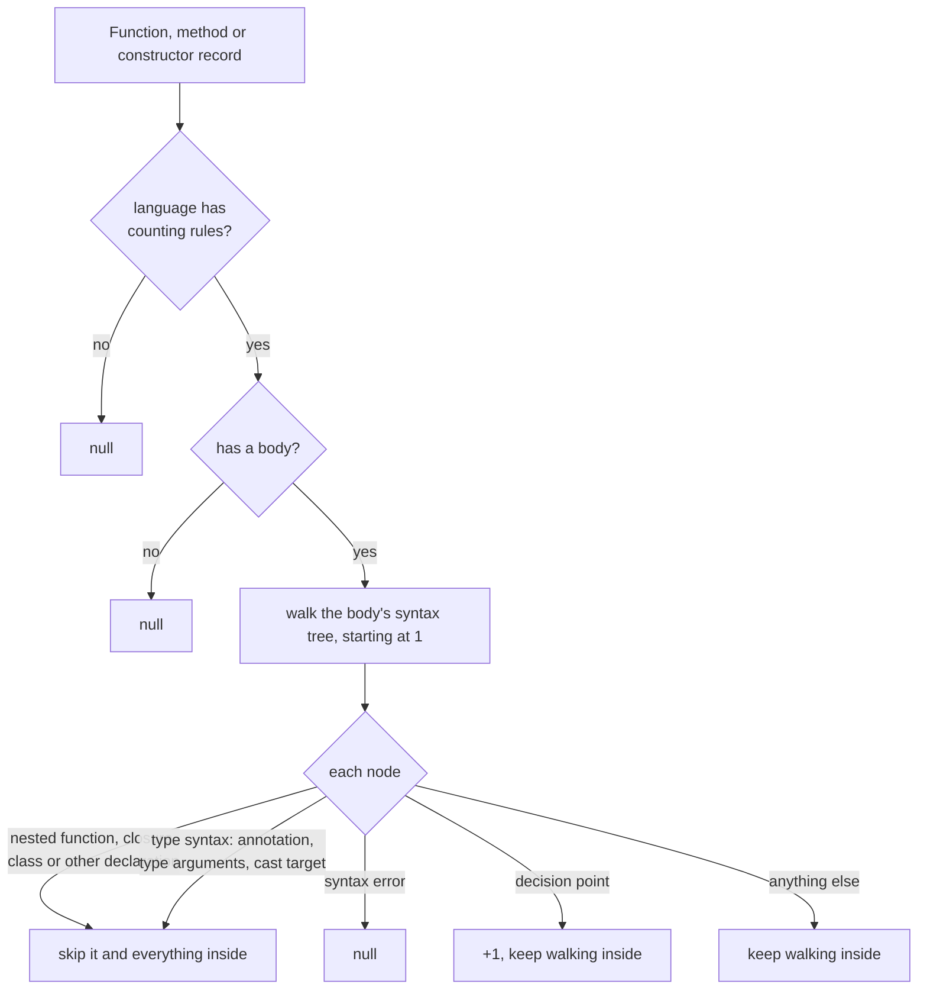

# Cyclomatic Complexity

Every function, method and constructor record can carry
`metrics.cyclomatic`: a count of the independent decisions written in its
body. Use it to find callables that branch a lot, without a compiler and
without running diagnostics.

```bash
hug --json-full functions src/report.ts \
  | jq -c '.indexes[].symbols[] | {name: .identity.name, metrics}'
```

```json
{"name":"classify","metrics":{"parameters":2,"has_docs":false,"lines":6,"cyclomatic":4}}
```

for this function:

```ts
export function classify(n: number, strict: boolean): string {
  if (n < 0 && strict) {              // `if` +1, `&&` +1
    return "negative";
  }
  return n === 0 ? "zero" : "positive"; // ternary +1
}                                     // 1 + 3 = 4
```

In the library, ask for `Capability::Metrics`; the value is on
`record.metrics.cyclomatic` (`Option<u32>`):

```rust
let query = SymbolQuery::new().capabilities([Capability::Metrics]);
let result = SourceFile::read("src/report.ts")?.query(&query)?;
```

## Reading the value

| Value | Meaning |
|---|---|
| a number (`1` or more) | the callable's body was measured; `1` is a body with no decisions, including an empty one |
| `null` | no value can be given for this declaration (see [When the value is `null`](#when-the-value-is-null)); it is **never** zero and never "not computed" |
| no `metrics` key at all | the query did not ask for metrics |

A `null` cyclomatic does not affect the other metrics: `parameters`,
`has_docs` and `lines` keep their own values. Where to find the key:

- `hug --json-full` (every declaration command) includes it on every record;
- `hug --json` and `--jsonl` include it only when a selector already reads
  metrics (`--undocumented`, `--min-params`); otherwise their records carry
  no `metrics` facet;
- `--stats` and the terminal listings show no complexity;
- the library includes it whenever the query has `Capability::Metrics`
  (`SymbolQuery::complete_index()` has it).

A cached result carries the same value as a fresh one, `null` included, so a
language without counting rules is not re-analyzed on every run.

## How it is counted

The value is **1 plus one for each decision point** in the callable's own
body. The body is the same text as the record's `source.body_span` and
`metrics.lines` (see
[Body lines](./symbol-kinds-and-visibility/documentation-flags-and-metrics.md#body-lines)):
a block, or an expression body such as `(k) => k ? 1 : 2`.



The rules read the parsed syntax tree, never the source text, so a decision
spelled inside a comment or a string adds nothing:

```js
function lookAlikes(a, b = a ? 1 : 2) { // a parameter default is not body
  /* if (a) && b */                     // a comment
  const s = "a ? b : c";                // a string
  return `${s} || if`;                  // template text
}                                       // cyclomatic = 1
```

### What counts, in every supported language

| Adds 1 | Adds 0 |
|---|---|
| each `if`, including each `else if` | a plain `else` |
| each loop that tests a condition (`while`, `for`, `do … while`, `for … in`/`of`) | a loop that never tests one (Rust `loop`, JS `for (;;)`) |
| each ternary `c ? a : b` | `return`, `break`, `continue`, `throw` and labels |
| each short-circuit operator `&&`, `\|\|` (and `??` in JS/TS) | bitwise and other operators (`&`, `\|`, `+=`, `&=`) |
| each arm of a `match`/`switch` that is not the default | the default arm |
| each guard on an arm | grouped labels or patterns beyond the first: one arm is one decision |
| each exception handler (`catch`) | `finally` |

A chain of operators counts each operator: `a && b || c` adds 2.

### Type syntax never adds

A type written inside the body is not code that runs: type annotations, type
arguments (a Rust turbofish `make::<…>()` or TypeScript `f<…>()`), and the
target of a cast, assertion or `satisfies` add nothing, whatever they
contain. The value beside the type still counts, so writing a type inline
instead of naming it never changes the total.

```rust
fn typed(a: bool) {
    let _x: [u8; if true { 1 } else { 2 }]   // a type's array length: 0
        = [0; if a { 1 } else { 2 }];        // a value's repeat length: +1
}                                            // cyclomatic = 2
```

```ts
function typed(a: boolean) {
  let x: { [a ? 1 : 2]: string };          // annotation: 0
  return (a ? x : null) as { [a ? 1 : 2]: string }; // operand +1, target 0
}                                          // cyclomatic = 2
```

A syntax error inside such a type still makes the value `null`: the type is
part of the body.

### Rust

```rust
fn arms(x: Option<i32>) -> i32 {
    match x {
        Some(1) | Some(2) => 1,   // arm +1 (the or-pattern is one arm)
        Some(n) if n > 3 => 2,    // arm +1, guard +1
        _ => 3,                   // last arm: the default, 0
    }
}                                 // cyclomatic = 4
```

| Form | Adds | Example → total |
|---|---|---|
| `if`, `else if`, `if let` | 1 each | `if a {} else if !a {} else {}` → 3 |
| `if let … && …` (let chain) | 1 per `&&` | `if let Some(v) = x && a {}` → 3 |
| `let … else` | 1 | `let Some(y) = x else { return };` → 2 |
| `while`, `while let`, `for` | 1 each | `while a {} for _ in 0..3 {}` → 3 |
| `loop` | 0 | `loop { break; }` → 1 |
| `&&`, `\|\|` | 1 each | `a && b \|\| !a` → 3 |
| `match` arms | 1 per arm **except the last** | `match x { true => 1, false => 2 }` → 2 |
| arm guard `if …` | 1 | see the example above |
| `?` | 0 | `g()?; Ok(())` → 1 |
| `async { }`, `unsafe { }`, labeled `'l: { }` and inline `const { }` blocks | counted as part of the function | `let f = async { if a {} };` → 2 |
| types: `let` annotations, cast targets (`as …`), generic arguments | 0 | `let _x: [u8; if true { 1 } else { 2 }];` → 1 |
| an array's repeat length | counted, it is a value | `[0; if true { 1 } else { 2 }]` → 2 |

A `match` must cover every case, so its last arm is its default whatever its
pattern: a two-arm `match` scores the same as `if`/`else`.

Not part of the function's own count: closures (`|k| …`), nested `fn`
items, and `struct`, `enum`, `union`, `trait`, `impl`, `mod`, `type`,
`extern` blocks, `macro_rules!` definitions, and `const` and `static` items
declared inside the body (they are evaluated at compile time, not on each
call).

### JavaScript

```js
function cases(a) {
  switch (a) {
    case 1:           // grouped with `case 2`: one arm
    case 2: break;    // arm +1
    case 3: return;   // arm +1
    default: break;   // default: 0
  }
}                     // cyclomatic = 3
```

| Form | Adds | Example → total |
|---|---|---|
| `if`, `else if` | 1 each | `if (a) {} else if (b) {} else {}` → 3 |
| `for (…; cond; …)` | 1 | `for (let i = 0; i < 3; i++) {}` → 2 |
| `for (;;)`, `for (init;; step)` | 0 | `for (;;) { break; }` → 1 |
| `for … in`, `for … of`, `while`, `do … while` | 1 each | all four once → 5 |
| ternary | 1 | `(k) => k ? 1 : 2` → 2 |
| `&&`, `\|\|`, `??` | 1 each | `(a && b \|\| c) ?? d` → 4 |
| `&&=`, `\|\|=`, `??=` | 1 each | `a &&= b; a \|\|= b; a ??= b; a += 1;` → 4 |
| optional chaining `?.` | 0 | `o?.x?.y` → 1 |
| `switch` arms | 1 per arm other than `default`; labels sharing one body are one arm; a group with `default` anywhere in it adds nothing | `default: case 1: break;` → 1 |
| `catch` | 1 | `try {} catch (e) {} finally {}` → 2 |
| decisions in template substitutions and JSX expressions | counted | `` `${a ? 1 : 2}` `` → 2; `<div>{a && <b />}</div>` → 2 |
| object literal values | counted, they run right there | `return { p: a ? 1 : 2 }` → 2 |

Consecutive labels that share one body are one arm, wherever `default`
sits among them: a `default` anywhere in the group makes the whole group the
default arm, so it adds nothing. A `default` with a body of its own ends its
group, and a final label with no body is still an arm. Comments between
labels do not split a group.

```js
function groups(x) {
  switch (x) {
    default:          // `default` heads the group:
    case 1: break;    // the whole group adds 0
    case 2:           // grouped with `case 3`: one arm
    case 3: break;    // arm +1
    case 4:           // last label, no body: arm +1
  }
}                     // cyclomatic = 3
```

Not part of the function's own count: nested function declarations and
expressions, generators, arrow functions, methods (including an object
literal's methods, getters and setters) and classes, class field
initializers included.

### TypeScript

TypeScript uses every JavaScript rule above. Type syntax never adds:

| Form | Adds | Example → total |
|---|---|---|
| a type-level conditional `T extends U ? X : Y` | 0, it is a type, not a ternary | `let x: T extends string ? 1 : 2;` → 1 |
| `as`, `satisfies`, non-null `!` | 0 | `(a as number) ?? (b! satisfies number)` → 2 (the `??`) |
| type annotations, including `typeof` queries | 0 | `let x: { [a ? 1 : 2]: string };` → 1 |
| type arguments, `as`/`satisfies`/`<T>x` targets | 0 | `f<{ [a ? 1 : 2]: string }>()` → 1; `{} as { [a ? 1 : 2]: string }` → 1 |

Also not part of the function's own count: `interface`, `type` alias,
`enum`, `class` and `abstract class` declarations and `namespace`/`module`
blocks declared inside the body.

### Nested callables and types

A nested function, closure or class is skipped by the enclosing function,
and a nested callable that is a record gets its own value. Skipping does not
depend on what the query selected: a query that returns only `outer` still
reports 1.

```ts
function outer(a: boolean) {                    // outer = 1
  function inner(): void { if (a) {} }          // inner = 2
  const arrow = (): boolean => a || !a;         // arrow = 2
  class C {
    x = a ? 1 : 2;                              // a field initializer: in neither
    private m(): void { while (a) {} }          // m = 2
  }
}
```

An ordinary call never adds the callee's complexity, even an immediately
called arrow function.

## When the value is `null`

| Situation | Example |
|---|---|
| the record is not a function, method or constructor | a class, a field, a variable |
| the callable has no body | a Rust trait method without a default, a TS `abstract m(): void;` or overload signature |
| the language has no counting rules | every language except Rust, JavaScript and TypeScript: Go, Python, Java, C#, C, C++, Swift, Scala, PHP, Perl, Bash, Zsh and Lua |
| a syntax error or a missing token inside the counted body | `function broken(a) { if (a) { let x = ; } }` |
| the total does not fit in 32 bits | (no realistic source) |

A syntax error elsewhere does not matter: an error inside a nested function
makes only that function `null`, and the function around it and any sibling
keep their values. An error inside a Rust macro call in the body does make
the body `null`, because the macro's arguments are part of it.

## Limits

The value describes the code as written. It is a syntax measurement:

- **No macro expansion.** A Rust macro call's arguments are tokens, not
  syntax, so `m!(if a {} && b)` adds 0. Code a macro generates is not seen.
- **No conditional compilation.** `#[cfg(…)]` and similar are not
  evaluated; every written branch counts.
- **No reachability.** Code after a `return` still counts; a condition that
  is always true still adds 1.
- **No callees.** A call adds nothing for the function it calls.
- **Embedded languages are text.** SQL, regular expressions or HTML inside a
  string add nothing.
- **Nested type initializers belong to no function.** A field initializer
  inside a nested class (`x = a ? 1 : 2`) is not counted in the enclosing
  function or in any method.

## When the rules change

A change to a counting rule changes the reported numbers for unchanged code.
Every such change raises the library's extractor revision, which is part of
the [cache fingerprint](./cache-design/entry-format.md#the-fingerprint), so
cached values computed under the old rules are recomputed rather than mixed
with new ones. The record schema version does not change with a counting
rule; it changes only when the shape of a record does. The `cyclomatic` key
exists in records of schema 4.3 and later.

## Related pages

- [Documentation, Flags and Metrics](./symbol-kinds-and-visibility/documentation-flags-and-metrics.md):
  the other metrics on a record, and how the body is measured.
- [Symbol Reports](./symbol-reports.md): the commands and JSON reports that
  carry `metrics`.
- [Tree Hugger's Persistent Symbol Cache](./cache-design.md): how cached
  values stay in step with the rules.
