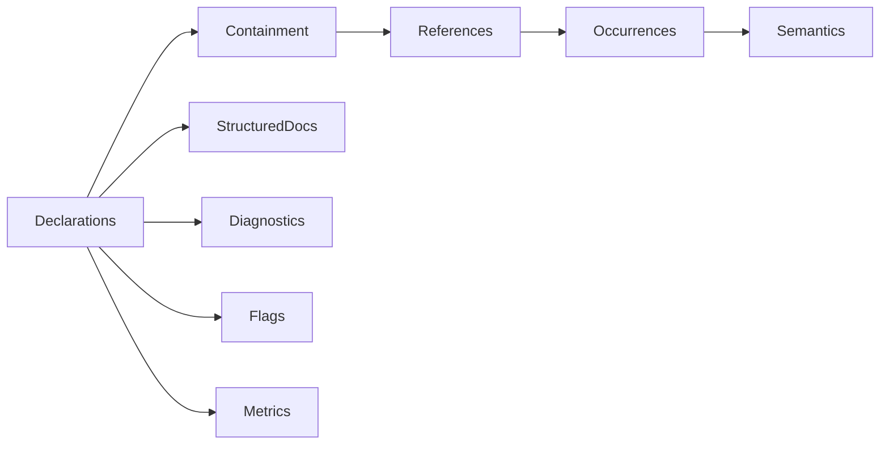

# Using the Tree Hugger Library

The `tree-hugger` crate reads source files in 16 languages and tells you what
they declare: functions, types, fields, constants and the rest, each with its
kind, location, container, visibility and signature. It also lists a file's
imports, exports and references, reports lint and syntax diagnostics, and
finds files that have grown too large. The [`hug` CLI](./cli.md) is built on
it; anything `hug` shows, a Rust program can compute with this library.

This page shows how to add the crate, read a file and list its symbols, and
then introduces each part of the API. Detail pages go deeper:

- [Diagnostics](./library/diagnostics.md): lint rules, rule policy, ignore
  comments, builtins and dead code.
- [The `SymbolInfo` Model](./library/symbol-info.md): the simpler symbol
  type returned by `TreeFile::symbols()` and how it relates to records.

## Quick start

The crate is not published to crates.io. Depend on it from Git (or by path
inside this repository); it uses the 2024 edition, so it needs Rust 1.85 or
later:

```toml
[dependencies]
tree-hugger = { git = "https://github.com/yankeeinlondon/rusty-biscuit" }
# inside this repository: tree-hugger = { path = "../tree-hugger/lib" }
```

The library is imported as `tree_hugger`. Given this file:

```rust
// src/shapes.rs
use std::fmt;

/// A point on a plane.
pub struct Point {
    pub x: f64,
    pub y: f64,
}

impl Point {
    /// Distance from the origin.
    pub fn norm(&self) -> f64 {
        (self.x * self.x + self.y * self.y).sqrt()
    }
}

impl fmt::Display for Point {
    fn fmt(&self, f: &mut fmt::Formatter<'_>) -> fmt::Result {
        write!(f, "({}, {})", self.x, self.y)
    }
}

pub fn origin() -> Point {
    Point { x: 0.0, y: 0.0 }
}
```

this program lists every symbol it declares:

```rust
use tree_hugger::{TreeFile, TreeHuggerError};

fn main() -> Result<(), TreeHuggerError> {
    let file = TreeFile::new("src/shapes.rs")?; // reads, detects Rust, parses
    for symbol in file.symbols()? {
        println!("line {:<3} {} {}", symbol.range.start_line, symbol.kind, symbol.qualified_name);
    }
    Ok(())
}
```

```text
line 4   type Point
line 5   field Point::x
line 6   field Point::y
line 11  method Point::norm
line 11  parameter Point::norm::self
line 17  method Point::fmt
line 17  parameter Point::fmt::self
line 17  parameter Point::fmt::f
line 22  function origin
```

Symbols come back in source order. Lines are 1-based. `qualified_name`
joins the enclosing declarations with the language's own separator (`::`
here, `.` in Java or Python). Parameters and anything inside a function body
are symbols too, with the `Local` scope; the next sections show how to leave
them out.

## Two views of a symbol

The library describes a symbol in one of two shapes:

| Type | What it is | Returned by |
|------|------------|-------------|
| `SymbolInfo` | A flat struct: name, kind, range, container, visibility, signature, type metadata | `TreeFile::symbols()`, `exported_symbols()`, `local_symbols()` |
| `SymbolRecord` | The full schema record, with a stable ID, relations, docs, attributes, modifiers, flags and metrics | `TreeFile::symbol_records()`, every `SymbolQuery` result |

Use `SymbolInfo` for a quick listing. Use `SymbolRecord` for anything else:
it is what `hug --json` prints, it carries every fact Tree Hugger extracts,
and it is the shape the [cache](#the-persistent-cache) stores. Records are
described field by field in [Symbol Records](./symbol-records.md); the
`SymbolInfo` fields and the conversion between the two are in
[The `SymbolInfo` Model](./library/symbol-info.md).

Both use the same 19 kinds (`SymbolKind` and `SymbolKindV2` have identical
variants): `Function`, `Method`, `Constructor`, `Type`, `TypeAlias`, `Class`,
`Interface`, `Enum`, `EnumVariant`, `Trait`, `Module`, `Namespace`,
`Variable`, `Parameter`, `Field`, `Property`, `Macro`, `Constant` and
`Unknown`. Which declaration becomes which kind in each language is in
[Symbol Kinds, Visibility and `static`](./symbol-kinds-and-visibility.md).

## `TreeFile` and `SourceFile`

There are two ways in, and they differ in when the file is parsed:

- **`TreeFile`** is a parsed file. `TreeFile::new(path)` reads, detects the
  language and parses in one step, then offers every analysis as a method.
  It is the simplest choice when you will analyze the file anyway.
- **`SourceFile`** is a file that has been read and hashed but not parsed.
  `SourceFile::read(path)` gives you the text, language and content hash;
  `parse()` turns it into a `TreeFile`, and `query()` parses and runs a
  [`SymbolQuery`](#selective-analysis-with-symbolquery). The cache takes a
  `SourceFile`, so it can answer from a stored entry without parsing at all.

```rust
use tree_hugger::{ProgrammingLanguage, SourceFile, TreeFile};

let source = SourceFile::read("src/lib.rs")?;
println!("{} {}", source.language(), source.hash());
let file: TreeFile = source.parse()?;          // consumes the SourceFile

// Force a language instead of detecting it from the extension:
let header = TreeFile::with_language("include/api.h", Some(ProgrammingLanguage::Cpp))?;
```

A file's path is its **identity**: the absolute path with `.`, `..` and
symlinks resolved. Every spelling of one file (`src/lib.rs`,
`./src/../src/lib.rs`, a symlink to it) gives the same `path()`, the same
records and the same symbol IDs. Errors still name the path you passed.

Methods on `TreeFile`:

| Method | Returns |
|--------|---------|
| `symbols()` | Every declaration as `SymbolInfo` |
| `exported_symbols()` / `local_symbols()` | The declarations the file exports, and the rest |
| `imported_symbols()` | The file's imports |
| `referenced_symbols()` | Every identifier use, by name only |
| `reference_evidence()` | Scope-aware reference occurrences and their coverage |
| `symbol_records()` | Every declaration as a `SymbolRecord` (declarations only) |
| `symbol_index_v2()` | The complete `FileSymbolIndex`: every pass, diagnostics included |
| `query(&SymbolQuery)` | Only what the query asks for |
| `diagnostics()`, `lint_diagnostics()`, `syntax_diagnostics()`, `dead_code()` | See [Diagnostics](#diagnostics) |

## Selective analysis with `SymbolQuery`

Most callers need a few kinds and a little analysis, not everything. A
`SymbolQuery` says which kinds you want and which **capabilities** (units of
analysis work) must run, and Tree Hugger does no more than that:

```rust
use tree_hugger::{Capability, SourceFile, SymbolKindV2, SymbolQuery};

let query = SymbolQuery::new()
    .kinds([SymbolKindV2::Function, SymbolKindV2::Method])
    .capabilities([Capability::Containment]);   // also fill parent/container/members
let result = SourceFile::read("src/shapes.rs")?.query(&query)?;

for record in &result.index.symbols {
    println!("{:?} {}", record.kind, record.identity.qualified_name);
}
// Method shapes.rs#Point::norm
// Method shapes.rs#Point::fmt
// Function shapes.rs#origin
```

A query result's qualified names start with a file prefix (`shapes.rs#`),
so names from different files stay distinct. By default it is the path from
the file's own directory. `scan_root` (shown below) makes it relative to
another directory, and `naming_context` replaces it with a module path such
as `crate::shapes::`.

`SymbolQuery::new()` selects every kind with only `Declarations`, the cheap
parse that every query includes. Adding a capability adds its prerequisites:



The query can also filter and name the records it returns. These
**predicates** run after analysis, so they never change what is computed or
cached:

```rust
use tree_hugger::{NamePattern, SymbolQuery, SymbolScope, VisibilityLevel};

let query = SymbolQuery::new()
    .scopes([SymbolScope::Item, SymbolScope::Member]) // drop parameters and locals
    .visibility(VisibilityLevel::Public)
    .exclude_tests(true)                               // turns on Capability::Flags
    .name(NamePattern::new("parse"))                   // smart case: parseWidth, ParseError
    .scan_root(".");                                   // names read `src/lib.rs#Parser::parse`
```

With no `scopes` call every scope is kept, so unlike `hug symbols` a query
returns parameters and locals unless you ask for `Item` and `Member` only.
A predicate asks for the work it reads: `exclude_tests`, `tests_only` and
`deprecated` add `Capability::Flags`, `undocumented` and `min_params` add
`Capability::Metrics`, and the signature predicates (`returns`,
`param_type`, `min_params`, `is_async`) narrow the kinds to functions,
methods and constructors.

A result says what it holds: `completed_capabilities` lists what ran, and
`selected_kinds` is `None` when every kind was selected. A field filled by a
capability you did not request keeps its default, which means **not
computed**: without `Flags`, `is_test` is `false` everywhere; without
`Metrics`, `metrics` is `None`; without `Diagnostics`, `index.diagnostics`
is empty even for a file full of problems. `result.narrowed(&narrower)`
answers a narrower query from a result you already have, without parsing
again, or returns `None` when it cannot. The `_retaining` forms
(`SourceFile::query_retaining`, `SymbolCache::query_retaining`) also hand
the `SourceFile` back, for a caller that needs the exact source text only
for some results.

[The File Index](./symbol-records/file-index.md#querying-from-the-library)
is the complete reference for queries: every capability and the pass it
runs, kind selection, every predicate, name patterns, naming contexts and
result reuse.

## The persistent cache

`SymbolCache` keeps one entry per file on disk and answers a query from it
without parsing when the entry already holds the requested kinds and
capabilities. A narrower query is served from a wider entry, and a wider
query widens the entry in place. It is the cache `hug` uses.

```rust
use tree_hugger::cache::{CacheLookup, PersistentCache, SymbolCache};
use tree_hugger::{SourceFile, SymbolQuery};

let cache = SymbolCache::new(PersistentCache::default_cache("my-project", true));
let cached = cache.query(SourceFile::read("src/lib.rs")?, &SymbolQuery::new())?;
if cached.lookup == CacheLookup::Hit {
    // nothing was parsed or analyzed
}
let records = cached.result.index.symbols;
```

`cached.result` is exactly what `SourceFile::query` returns for the same
query, so the cache never changes an answer. Cache trouble is never an
error: an unusable entry is a `CacheLookup::Miss` with its reason, and a
failed write is reported in `cached.write_error` while the result is still
complete. `default_cache(project_id, enabled)` stores entries under the
system temporary directory (`<temp>/tree-hugger/cache/<project_id>`);
`PersistentCache::open(dir, enabled)` picks another directory, and
`enabled = false` turns the cache off. Keys, invalidation and the entry
format are in [Tree Hugger's Persistent Symbol Cache](./cache-design.md).

## Imports, exports and references

```rust
let file = TreeFile::new("src/shapes.rs")?;

for import in file.imported_symbols()? {
    // `use std::fmt;` -> name "fmt", source Some("std")
    println!("{} from {:?}", import.name, import.source);
}
let exported = file.exported_symbols()?;     // here: `Point` and `origin`
```

An `ImportSymbol` has the local `name`, the `original_name` and `alias` when
the import renames, and the `source` module. Its `is_reexport` flag is
`true` for an import that a `syntax` or `declared` entry of the file's
re-export report forwards (Rust `pub use`, `pub(crate) use`, a TypeScript
`export { x }` of an import, a Python `from m import a as a`), in every
language the report covers; a Rust `pub(self) use` is not a re-export. An
import that is only exposed at runtime (a Python import with no `__all__`)
is not flagged. `TreeFile::reexports()` returns the report itself. Exports come from export
syntax (Rust `pub` at module level, JavaScript `export`, and so on), not
from a `Public` visibility level: `Point::norm` above is public but not
exported. The same imports and exports are on every query result as
`index.imports` and `index.exports`.

For references, prefer **reference evidence** over the older name-only
`referenced_symbols()`. Each occurrence names its owner (the enclosing
function), whether it is a `Call` or a `Usage`, and a confidence: `Scoped`
(one proven declaration), `NameOnly` (same-named candidates, none proven) or
`Unresolved`. Rust, TypeScript and JavaScript resolve through lexical scopes;
other languages report occurrences with `Limited` coverage.

```rust
use tree_hugger::{Capability, Confidence, SymbolQuery};

let evidence = file.reference_evidence()?;
let scoped = evidence.occurrences.iter().filter(|o| o.confidence == Confidence::Scoped).count();

// The same lists, kept in a query result:
let query = SymbolQuery::new().capabilities([Capability::Occurrences]);
let index = SourceFile::read("src/shapes.rs")?.query(&query)?.index;
// index.occurrences, index.reference_coverage
```

With `Capability::References` the occurrences become edges on each record
(`relations.references`, `dependencies`, `referenced_by`). The rules,
coverage reasons and per-language support are in
[Scope-Aware References](./references.md); declared base types
(`relations.extends`, `relations.implements`) are in
[Declared Type Relations](./type-relations.md).

## Diagnostics

```rust
use tree_hugger::TreeFile;

let file = TreeFile::new("src/main.rs")?;
for d in file.try_diagnostics()? {
    println!("{}:{} {:?} {:?} {}", d.range.start_line, d.range.start_column,
             d.kind, d.rule, d.message);
}
```

`diagnostics()` combines lint (pattern rules such as `dbg-macro`), semantic
(such as `unused-import` and `dead-code`) and syntax diagnostics. Each
infallible method has a `try_` form: the plain form returns an empty list
when an analysis stage fails, the `try_` form returns the error, so use it
when "no diagnostics" must mean the file is clean.

The library reports every rule it can find. Deciding which rules are on, and
at what severity, is the caller's job; `hug` does it with `RuleRegistry` and
`rule_registry::apply_policy`. The rule list, policy, ignore comments
(`// tree-hugger-ignore: unwrap-call`), builtins and dead-code detection are
in [Diagnostics](./library/diagnostics.md).

## God files

`god_files::GodFiles` finds files large enough to be worth splitting, the
analysis behind [`hug god-files`](./cli.md#god-files):

```rust
use tree_hugger::god_files::{GodFiles, RiskBand};

let scan = GodFiles::new("src");               // no I/O yet
for analysis in scan.analysis() {              // parses only the candidates
    if analysis.risk == RiskBand::High {
        println!("{} ({} effective lines)", analysis.relative_path.display(), analysis.effective_sloc);
        for hint in &analysis.refactor_hints {
            println!("  {hint:?}");
        }
    }
}
```

Size is **effective SLOC**: physical lines minus blank and comment-only
lines. A file is a `Moderate` candidate from 400 and `High` from 1,000;
results come high-risk first, then largest first. `candidates()` returns
just the files with at least 400 physical lines, found by counting newlines
without parsing. Both are computed once and kept. Each `GodAnalysis` also
holds the largest symbol blocks, top-level symbol count, a kind histogram,
nesting depth, import fan-out, TODO/FIXME count and comment density. A scan
that cannot list the directory returns no candidates rather than an error.

## Packages

`TreePackage` collects the supported source files under a package root:

```rust
use tree_hugger::TreePackage;

let mut package = TreePackage::new(".")?;      // must be inside a Git repository
println!("{} files, mostly {}", package.source_files.len(), package.language);
let modules = package.modules();               // Rust module names; empty for other languages
```

The root is the nearest directory with a package manifest (`Cargo.toml`,
`package.json` and the like) below the Git root. Without a language
override the package is polyglot and `language` is the most common one;
`TreePackageConfig { language, ignores }` with `TreePackage::with_config`
restricts it to one language or adds exclusion globs.

## Error handling

Every fallible call returns `Result<_, TreeHuggerError>`. The variants a
caller usually meets:

| Variant | When |
|---------|------|
| `Io { path, source }` | The file cannot be read or is not UTF-8 |
| `UnsupportedLanguage { path }` | No supported language matches the path |
| `ParseFailed { path }` | Tree-sitter produced no tree at all |
| `GitRootNotFound { path }` / `NoSourceFiles { path }` | `TreePackage` found no repository, or no source files |
| `TooManyGenericParameters { path, symbol, count }` | A declaration writes more than 65,536 generic parameters |
| `MissingQuery`, `QueryError`, … | An internal query failed to load or compile; a bug, not a property of your file |

A syntax error in the file is **not** an error: Tree-sitter recovers, the
rest of the file is still analyzed, and the problem appears as a syntax
diagnostic. `TreeHuggerError` implements `std::error::Error` (via
`thiserror`), so it works with `?`, `anyhow` and `miette`.

## Related pages

- [The File Index](./symbol-records/file-index.md): passes, capabilities and the full `SymbolQuery` reference
- [Diagnostics](./library/diagnostics.md): rules, policy and ignore comments
- [The `SymbolInfo` Model](./library/symbol-info.md): the simpler symbol type
- [Symbol Records](./symbol-records.md): every field of a `SymbolRecord`
- [Symbol Kinds, Visibility and `static`](./symbol-kinds-and-visibility.md): per-language rules
- [Scope-Aware References](./references.md): occurrences and confidence
- [Tree Hugger's Persistent Symbol Cache](./cache-design.md): keys, entries and invalidation
- [Using the `hug` CLI](./cli.md): the command-line interface built on this library
