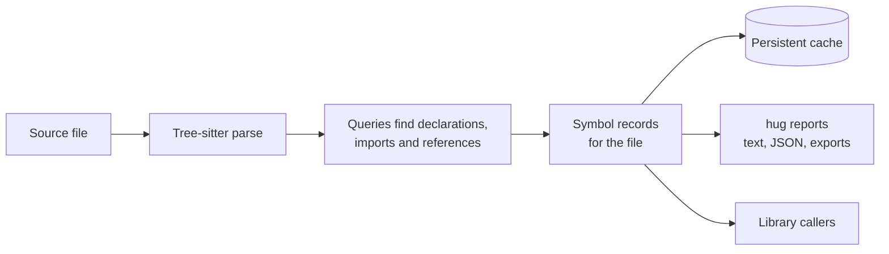

# Tree Hugger Overview

Tree Hugger reads source code in 16 languages and tells you what it declares
and how those declarations relate. It ships as a Rust library (`tree-hugger`)
and a command-line tool built on it (`hug`). Start here: this page explains
what Tree Hugger does, the handful of ideas everything else builds on, and
which page to read next.

## A first look

Given this Rust file:

```rust
// shapes.rs
pub struct Point { pub x: f64 }

impl Point {
    /// Distance from the origin.
    pub fn norm(&self) -> f64 { self.x.abs() }
}

pub fn far(p: &Point) -> bool { p.norm() > 10.0 }
```

`hug symbols` lists every declaration, with its visibility, kind, signature,
container and location:

```text
$ hug --plain symbols
  - public struct Point { x: f64 } shapes.rs:1:1
  - public field x [in type Point] shapes.rs:1:24
  - public method norm(self) -> f64 [in type Point] shapes.rs:5:5
  - public function far(p: &Point) -> bool shapes.rs:8:1
```

`hug refs` asks who refers to one declaration, and says how sure it is:

```text
$ hug --plain refs norm --callers
Callers of public method norm(self) -> f64 [in type Point] shapes.rs:5:5
…
Name-only suggestions (same name, not proven to refer to this declaration)
  shapes.rs#far 8:1
    - Call p.norm 8:35 — NameOnly, candidates: shapes.rs#Point::norm
```

`p.norm()` is a method call on a value whose type Tree Hugger does not infer,
so the call is offered as a *suggestion* rather than claimed as a proven
reference. Tree Hugger never reports more certainty than the source supports.

The same facts are available as JSON (`hug --json …`) and from Rust
(`TreeFile::new("shapes.rs")?.symbols()?`).

## What it is for

- **Exploring an unfamiliar codebase**: list the types, functions and members
  of a package, filtered by kind, visibility, container or name.
- **Tooling and scripts**: export declarations as JSON, JSON Lines, TSV,
  Markdown or a ctags file, with stable IDs.
- **Review and maintenance**: report only the files changed since a branch,
  find undocumented or deprecated declarations, measure cyclomatic
  complexity, and find files that have grown too large.
- **Diagnostics**: lint and syntax checks across all supported languages.

Tree Hugger works from syntax alone. It does not compile code, resolve types
across files or run a language server, so it is fast and works on any file it
can parse, and its answers are deliberately limited to what the syntax
proves.

## How it works



1. **Parsing.** Each file is parsed with [Tree-sitter](https://tree-sitter.github.io/),
   which produces a syntax tree for any of the 16 languages: Rust, TypeScript,
   JavaScript, Go, Python, Java, C#, C, C++, Swift, Scala, PHP, Perl, Bash,
   Zsh and Lua.
2. **Queries.** Small Tree-sitter query files per language (many adapted from
   Neovim's) mark where declarations, imports and references are written.
   See [Tree-sitter Queries](./queries.md).
3. **Records.** Every declaration becomes one **symbol record**. The records
   for a file, together with its imports and references, form the file's
   index.
4. **Reuse.** The result is stored in a per-file cache, so a second run over
   an unchanged file does no parsing at all.

## Core ideas

These five ideas appear throughout the rest of the documentation.

### Symbol records

A symbol record describes one declaration: its **kind** (function, method,
class, field, enum variant, …), its name and in-file **qualified name**
(`shapes.rs#Point::norm`), its **container**, its **visibility**, its
signature, and optional facts such as documentation, metrics and relations to
other declarations. Every record has a stable **ID** derived from where and
what it is.

The CLI's JSON and the library return the same records. See
[Symbol Records](./symbol-records.md) for the format and
[Symbol Kinds, Visibility and `static`](./symbol-kinds-and-visibility.md) for
what each kind and visibility level means in each language.

### Analysis is selective

Tree Hugger computes only what a request needs. Listing functions does not
resolve references or run lint rules; asking for references does. In the
library this is a `SymbolQuery` naming the kinds and **capabilities** wanted
(declarations, containment, references, occurrences, semantics, structured
docs, diagnostics, and so on). See [Using the Library](./library.md).

### References are file-local and graded

Every name use Tree Hugger finds is an **occurrence**, with a
**confidence**: `Scoped` (proven by the language's scope rules), `NameOnly`
(a same-named declaration exists, but the binding is not proven) or
`Unresolved`. Resolution stays within one file, and full scope rules exist
for Rust, TypeScript and JavaScript. See
[Scope-Aware References](./references.md).

### Declared relations

Type records list the base types their declarations write
(`extends`/`implements`), and a base gets an ID only when it provably names
one declaration in the same file. See
[Declared Type Relations](./type-relations.md).

### Re-exports

A file's forwarding statements (`pub use`, `export ... from`, Python `__all__`,
Go aliases and more) are reported with an honest coverage state, so an empty
list is only a negative when the report says it is complete. See
[Re-exports](./reexports.md).

### The cache

`hug` keeps one cache entry per source file, keyed by the file's path and
contents and by the analyzer version, so results are reused only when nothing
that affects them has changed. A damaged entry is recomputed, never served.
See [The Persistent Symbol Cache](./cache-design.md).

## Where to go next

| I want to… | Read |
|------------|------|
| Use the `hug` command line | [Using the `hug` CLI](./cli.md) |
| Understand `functions`, `types`, `symbols` and `classes` in depth | [Symbol Reports](./symbol-reports.md) |
| Find callers, callees and usages | [Scope-Aware References](./references.md) |
| Call Tree Hugger from Rust | [Using the Library](./library.md) |
| Read or consume the JSON records | [Symbol Records](./symbol-records.md) |
| Know what a kind, visibility or `static` flag means per language | [Symbol Kinds, Visibility and `static`](./symbol-kinds-and-visibility.md) |
| Understand base-type lists | [Declared Type Relations](./type-relations.md) |
| Find what a file re-exports, in any language | [Re-exports](./reexports.md) |
| Use complexity metrics | [Cyclomatic Complexity](./cyclomatic-complexity.md) |
| Understand or clear the cache | [The Persistent Symbol Cache](./cache-design.md) |
| Change or add a language's queries | [Tree-sitter Queries](./queries.md) |
| Run or write tests | [Testing](./testing.md) |
| See what changed between versions | [Release Notes](./release-notes.md) |
| See the crates Tree Hugger depends on | [Dependencies](./dependencies.md) |

Background research (Tree-sitter, nvim-treesitter, symbol models, prelude
patterns) is kept separately under [`research/`](./research/); it explains
why, not how Tree Hugger behaves today.
