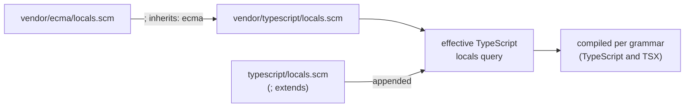

# Tree-sitter Queries

Everything Tree Hugger reports about a file starts with a **Tree-sitter
query**: a small pattern file (`.scm`) that is matched against the file's
syntax tree. A pattern names the nodes it cares about, and a **capture** (a
`@name` written after a node) labels each match. Tree Hugger turns those
labels into declarations, imports, references and diagnostics.

This page explains which query files exist for each language, how a capture
becomes a symbol, and why most declaration queries are copied (vendored) from
[nvim-treesitter](https://github.com/nvim-treesitter/nvim-treesitter) and how
that copy is tracked. Read it before adding a language or changing what a
language reports.

## An example

Take this Rust file:

```rust
pub enum Shape {
    Circle(f64),
}

pub fn area(shape: &Shape) -> f64 {
    match shape {
        Shape::Circle(r) => 3.14 * r * r,
    }
}
```

Three patterns from Rust's declaration query, `queries/vendor/rust/locals.scm`,
match it:

```scheme
(enum_item
  name: (type_identifier) @local.definition.enum) @local.definition.enum.context

(enum_variant
  name: (identifier) @local.definition.enum_variant)

(function_item
  name: (identifier) @local.definition.function) @local.definition.function.context
```

Each `@local.definition.<kind>` capture marks a declared name, and its suffix
chooses the symbol's kind. `hug` lists what came out:

```text
$ hug symbols --plain --all-scopes
  - public enum Shape { Circle(f64) } src/lib.rs:1:1
  - public enum variant Circle [in enum Shape] src/lib.rs:2:5
  - public function area(shape: &Shape) -> f64 src/lib.rs:5:1
  - parameter shape src/lib.rs:5:13
  - variable r src/lib.rs:7:23
```

The parameter and the `r` binding come from other patterns in the same file.
Everything else on each row (visibility, container, signature) is read from
the declaration's own syntax node after the query has found it; see
[Symbol Kinds, Visibility and `static`](./symbol-kinds-and-visibility.md).

## The query files

Every language has up to four query files under `tree-hugger/lib/queries/`.
Each drives one part of the analysis:

| File | What it finds | Used by |
|---|---|---|
| `locals.scm` | Declarations (`@local.definition.*`), imports (`@local.definition.import`), lexical scopes (`@local.scope`) and name references (`@local.reference`) | Symbol records, `hug imports`, [scope-aware references](./references.md) |
| `references.scm` | Every identifier that is used rather than declared (`@reference`) | Occurrences and references |
| `lint.scm` | Code patterns worth flagging, captured as `@diagnostic.<rule-id>` (for example `@diagnostic.unwrap-call`) | `hug lint` |
| `comments.scm` | Comment nodes (`@comment`) | `tree-hugger-ignore` directives in `hug lint` |

The files are laid out like this:

```txt
lib/queries/
├── vendor/                 # locals.scm for every language
│   ├── rust/locals.scm
│   ├── ecma/locals.scm     # shared by JavaScript and TypeScript
│   ├── php_only/locals.scm # inherited by PHP
│   └── …                   # one directory per language
├── javascript/             # Tree Hugger's own files for one language
│   ├── comments.scm
│   ├── lint.scm
│   ├── locals.scm          # overlay on the vendored query (JS and TS only)
│   └── references.scm
└── …
```

`vendor/` holds the declaration queries, one per language plus the two shared
bases `ecma` and `php_only`. Each language directory holds the three queries
Tree Hugger wrote itself, and JavaScript and TypeScript also carry a
`locals.scm` *overlay* that adds patterns to the vendored one.

The 16 languages are Rust, TypeScript, JavaScript, Go, Python, Java, C#, C,
C++, Swift, Scala, PHP, Perl, Bash, Zsh and Lua. A language's directory is
named by its query name: `c_sharp` for C# and `cpp` for C++.

Two practical consequences for anyone editing a query:

- **Queries are compiled into the library.** The `.scm` text is embedded in
  the binary at build time, so a change takes effect only after a rebuild.
- **Query text is part of the cache key.** The
  [persistent cache](./cache-design.md) keys each entry on the effective text
  of the queries that produced it, so a changed query re-analyzes every file
  of that language once, with no manual cache clearing.

## How a capture becomes a symbol

The suffix after `@local.definition.` names the symbol's kind:

| Capture | Kind |
|---|---|
| `@local.definition.function` | Function |
| `@local.definition.method` | Method |
| `@local.definition.constructor` | Constructor |
| `@local.definition.type` | Type |
| `@local.definition.type_alias` | TypeAlias |
| `@local.definition.class` | Class |
| `@local.definition.interface` | Interface |
| `@local.definition.enum` | Enum |
| `@local.definition.enum_variant` | EnumVariant |
| `@local.definition.trait` | Trait |
| `@local.definition.module` | Module |
| `@local.definition.namespace` | Namespace |
| `@local.definition.field` | Field |
| `@local.definition.property` | Property |
| `@local.definition.var` | Variable |
| `@local.definition.parameter` | Parameter |
| `@local.definition.macro` | Macro |
| `@local.definition.constant` (or `.const`) | Constant |
| `@local.definition.import` | an import, not a symbol |
| `@local.definition.associated` | nothing; marks a name that is not a declaration of its own |

Three more rules complete the picture:

- A capture ending in `.context`, such as `@local.definition.enum.context`,
  marks the whole declaration node around the name. It is where Tree Hugger
  reads the signature, visibility and documentation from, and it never names
  a symbol of its own.
- A bare `@local.definition` is a Variable.
- Any other suffix produces the kind `Unknown`. No construct in the test
  fixtures reports `Unknown`, so seeing it means a query uses a capture name
  this table does not know.

The query decides *that* a name is declared and roughly what it is; some
kinds are refined afterwards from the node itself (for example a Rust `fn`
inside an `impl` becomes a Method). The per-language results are listed in
[Symbol Kinds, Visibility and `static`](./symbol-kinds-and-visibility/kinds-and-containers.md#kinds).

## How a language's declaration query is assembled

A `locals.scm` file can build on another one through a **modeline**, a
comment on its first lines:

- `; inherits: <name>` puts the named vendored query's patterns first.
  JavaScript and TypeScript inherit `ecma`, PHP inherits `php_only`, and C++
  inherits `c`. Inheritance can chain, and a query is never included twice.
- `; extends` (used only by the overlays in `javascript/` and `typescript/`)
  appends the overlay's patterns to the language's vendored query instead of
  replacing it.



The resulting text is compiled once per grammar and reused. TypeScript has
two grammars (`.ts` and `.tsx`), and each gets its own compiled copy, since
node types differ between them.

## Vendored from nvim-treesitter

nvim-treesitter maintains `locals.scm` queries for most languages: patterns
for scopes, definitions and references that many editors already depend on.
Reusing them gives Tree Hugger well-tested declaration patterns instead of
writing 16 from scratch. (For background on how nvim-treesitter organizes its
queries, see the research note
[nvim-treesitter as an abstraction layer](./research/nvim-treesitter.md).)

The copies are not verbatim:

- **Captures are renamed.** Upstream's `@definition.*` and `@reference.*`
  become `@local.definition.*` and `@local.reference.*` in every vendored
  file.
- **Patterns are corrected or added where upstream was wrong or silent for
  Tree Hugger's purpose.** Examples: Rust gains bodyless trait methods,
  `static`, `union` and associated `type` patterns; C and C++ stop treating
  every use of `struct S` as a declaration; Python's default parameters
  declare only their name, not the default value; Go captures a blank
  import's `_`; Java, C#, PHP, Scala and Rust import patterns capture only the
  name an import actually binds.
- **Perl is Tree Hugger's own.** nvim-treesitter has no Perl `locals.scm`, so
  `vendor/perl/locals.scm` was written for tree-sitter-perl 1.1.2. It captures
  named subs, `package` statements and blocks, and `my`/`our`/`state`
  variables.

Lua, Bash and Zsh carry only the capture renaming.

### Provenance

Every query Tree Hugger can load has a **provenance** record saying where it
came from and how it was changed. The library exposes it:

```rust
use tree_hugger::ProgrammingLanguage;
use tree_hugger::queries::{QueryKind, query_provenance};

let prov = query_provenance(ProgrammingLanguage::Rust, QueryKind::Locals).unwrap();
println!("{} {} {}", prov.source_project, prov.upstream_revision, prov.translation_status);
// nvim-treesitter 0.10.4 multiple-changes
for note in &prov.notes {
    println!("- {note}");   // one line per change made to the upstream query
}
```

| Field | Vendored `locals.scm` | Perl `locals.scm` | Tree Hugger's own queries |
|---|---|---|---|
| `source_project` | `nvim-treesitter` | `tree-hugger` | `tree-hugger` |
| `upstream_revision` | `0.10.4` | the crate version | the crate version |
| `upstream_path` | `queries/<lang>/locals.scm` in nvim-treesitter | same as `local_path` | same as `local_path` |
| `local_path` | `queries/vendor/<lang>/locals.scm` | `queries/vendor/perl/locals.scm` | `queries/<lang>/<kind>.scm` |
| `license` | `Apache-2.0` | `AGPL-3.0-only` | `AGPL-3.0-only` |
| `translation_status` | `captures-renamed`, or `multiple-changes` when patterns changed too | `original` | `original` |

`notes` lists, in plain sentences, every change made to a vendored query
beyond the renaming. Those notes are the record of *why* a vendored file
differs from upstream: when you change a vendored query, add a note. A test
checks that every language whose vendored query was changed records its
changes.

Every query Tree Hugger writes itself carries the repository's license,
`AGPL-3.0-only`. A vendored query keeps its upstream license, `Apache-2.0`,
even after Tree Hugger changes it; a test checks both for every record.

`all_query_provenance()` returns the records for every language and query
kind at once.

### Predicate compatibility

Queries can filter matches with **predicates** such as `(#eq? @name "unwrap")`.
nvim-treesitter's queries are written for Neovim's query runtime, which
supports predicates that the Tree-sitter Rust runtime used by Tree Hugger does
not. `CompatibilityRegistry` classifies each one:

| Status | Predicates | Meaning |
|---|---|---|
| native | `#eq?`, `#match?`, `#lua-match?`, `#any-of?`, `#contains?`, `#any-contains?`, `#set!`, `#offset!` | Works the same in both runtimes |
| requires a hook | `#has-parent?`, `#is?`, `#has-ancestor?`, `#not-has-ancestor?` | Would need a post-processing step |
| unsupported | `#make-range!`, `#strip!` | Cannot be used |

No post-processing hook exists today, so a vendored pattern that relies on a
"requires a hook" predicate is rewritten instead. The Java import patterns are
an example: upstream filtered with `#has-ancestor?`, which the runtime does
not enforce, so the vendored version matches the import path directly.
`find_unsupported_predicates` and `find_hook_predicates` scan query text for
these predicates.

### Refreshing a vendored query

Each vendored query's provenance records the nvim-treesitter revision it was
taken from (`upstream_revision`, `0.10.4` today). Nothing compares it with
upstream automatically. To refresh a vendored query, compare it with the
upstream file at the revision recorded in its provenance and at the new one,
carry over Tree Hugger's changes (the provenance `notes` list them), and
update the recorded revision in `lib/src/queries/provenance.rs`.

`QueryInventory` complements the provenance records with a static list of
the captures each upstream suite (`locals`, `highlights`, `injections`,
`folds`, `indents`) offers per language, flagging the ones Tree Hugger
reuses. Only `locals` is
vendored today.

## Changing a query

1. Edit the `.scm` file. For a vendored `locals.scm`, add a provenance note
   in `lib/src/queries/provenance.rs` describing the change.
2. Add or extend a fixture that exercises the new pattern; see
   [Testing Tree Hugger](./testing.md).
3. Run `just test` from `tree-hugger/`. Every query of every language is
   compiled by the tests, so a syntax error or unknown node type fails there
   rather than at run time.

## Related pages

- [Symbol Kinds, Visibility and `static`](./symbol-kinds-and-visibility.md):
  what each language reports once its query has run
- [Scope-Aware References](./references.md): how `@local.scope` and the
  reference captures are used
- [Using the `hug` CLI](./cli.md): `hug lint` and ignore directives
- [Testing Tree Hugger](./testing.md)
- [nvim-treesitter as an abstraction layer](./research/nvim-treesitter.md)
  (research background)
