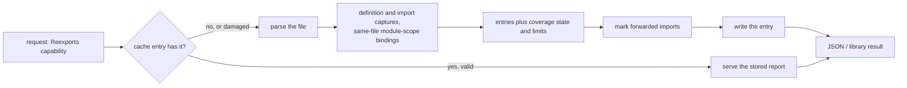

# Re-exports

A **re-export** is a statement that makes a name from another module part of
this file's public interface. Tree Hugger reports every re-export it can prove
from the file alone, in all 16 supported languages, and says honestly where
it cannot judge a file.

```typescript
import { a } from "./a";
export { a };                     // import, then export
export { parse as read } from "./parser";
export * from "./util";
```

```console
$ hug --json-full symbols index.ts
```

The file's index then carries a `reexports` report with three entries, and the
import of `a` has `"reexported": true`.

## Asking for the report

| Surface | How |
|---|---|
| CLI | `--json-full` prints the complete index, which includes `reexports` and `imports[].reexported`. `--json`, `--jsonl` and the text listings do not compute it. |
| Library, direct | `TreeFile::reexports()` always computes it. |
| Library, selective | `SymbolQuery::new().capabilities([Capability::Reexports])`. Its only prerequisite is `Declarations`, so no reference, semantic or diagnostic work runs. |
| Library, consumers | `ImportSymbol::is_reexport` (from `imported_symbols()`) and the `unused-import` exemption read the same report. |

`FileSymbolIndex::reexports` is `None` (the JSON key is absent) exactly when
`completed_capabilities` lacks `reexports`. Absent means *not computed*, never
*nothing found*.



Extraction reads only the analyzed file. It never opens the module a statement
forwards from, so a missing dependency changes nothing. (Rust `--prelude`
resolves a package's prelude module on purpose; that is a separate feature
and its records are marked synthetic.)

## Reading a report

```json
{ "coverage": { "state": "complete", "limits": [] },
  "entries": [ { "form": "named", "evidence": "syntax",
                 "exported_name": "read", "original_name": "parse",
                 "source": "./parser", "...": "…" } ] }
```

Every key is always written, including `null`, `[]` and `false`.

| Entry field | Meaning |
|---|---|
| `form` | `named` (one name), `wildcard` (every public name of `source`), `namespace` (a whole module under `exported_name`), `module` (`source` is the file's whole interface), `value_copy` (a new binding initialized from an import; identity is not preserved) |
| `evidence` | `syntax`: dedicated forwarding syntax. `declared`: a convention tooling treats as an explicit interface (Python `__all__`, Perl Exporter lists, CommonJS, a Lua returned table, a Go value copy). `exposed`: runtime exposure with no declaration (a public Python import in a module without `__all__`) |
| `exported_name` / `original_name` / `local_name` | the name callers import / the name in the source / the same-file binding the forward goes through |
| `source` | the module or path as written; `null` when the file states none (C# `TypeForwardedTo`) |
| `excluded_names` | names a wildcard excludes (Scala `x as _`) |
| `scope`, `restriction` | enclosing module or namespace; written visibility restriction such as `crate` |
| `type_only`, `conditional` | `export type {..}`; under a `cfg`, `#if`, `if`/`try` or build constraint (never evaluated) |
| `caveats` | `mutable_binding`, `source_unresolved`, `fallback_lookup`, `unstable_feature`, `inferred_package_name`, `givens_only` |
| `import_span` | the span of the import this entry forwards, when it forwards one |
| `span`, `statement_span` | the specifier, and the whole statement |

Entries are in source order. Captures of one site collapse into one entry;
distinct sites exposing the same name stay separate.

### Evidence and the import marker

An import's `reexported` is `true` only when a `syntax` or `declared` entry
forwards that exact import. `exposed` entries never set it, so a plain unused
Python import is still reported by `unused-import`. Read `reexported` only
next to a present `reexports`; it is `false` everywhere when the report was
not computed.

## Coverage: when an empty list is a negative

| `coverage.state` | Meaning |
|---|---|
| `complete` | no limit applies; an empty `entries` list means the file forwards nothing the language supports |
| `limited` | `limits` lists why; entries may be missing, so an empty list proves nothing |
| `not_applicable` | decided by language: Java, C, Bash, Zsh, PHP have no forwarding construct |

| Limit reason | Cause |
|---|---|
| `parse_error` | a syntax error contains or directly follows a forwarding statement (unrelated errors do not limit) |
| `grammar_gap` | forwarding syntax the pinned grammar cannot represent, such as C++20 module files (limited over the whole file) |
| `computed_export_list` | an export list not built from literals (Python `__all__ = names()`) |
| `cross_file_export_list` | an export list extended from another module |
| `rebound_binding` | a forwarded name or table is reassigned |
| `shadowed_global` | `require`, `module`, `exports` or `import` is shadowed |
| `dynamic_forwarding` | `Object.assign`, spreads, Lua `module()`, custom Perl `import` |
| `unexpanded_macro` | a Rust macro body that may contain `pub use` |

The report always describes the whole file. Kind filters, predicates and the
scan root never change it.

## What each language reports

Constructs not listed are not reported.

| Language | Reported | Limits and caveats | Not reported |
|---|---|---|---|
| Rust | `pub use` and restricted forms (`pub(crate)`, `pub(super)`, `pub(in path)`): `named`; glob: `wildcard`; `pub extern crate x [as y]`: `namespace`; `cfg` sets `conditional` | `unexpanded_macro` | `pub(self) use`, `use` inside function bodies |
| JavaScript | `export {..} from`, `export *`, `export * as ns`, default specifiers, import-then-export, `export default <import>` (`syntax`); CommonJS `module.exports = require()` (`module`) and `exports.x = require().x` (`named`), both `declared` | `parse_error`, `shadowed_global`, `dynamic_forwarding`, `rebound_binding` | local exports (see `exports`) |
| TypeScript | the JavaScript forms; `type` sets `type_only`; `export =` of an import (`module`); `export import A = B.C` for an imported `B` | `parse_error` / `grammar_gap` for `export type *` and `export import … = require()` | `export as namespace` |
| Python | names in a literal `__all__` bound by a module-level import, redundant aliases (`import x as x`) and `from m import *` (`declared`); other public module-level imports (`exposed`); `import a.b` exposes `a` as `namespace` | `computed_export_list`, `cross_file_export_list`, `rebound_binding` | function or class-local imports, `__future__`, underscore names |
| Go | `type X = pkg.Y` (`named`, `syntax`); package-level `var`/`const X = pkg.Y` (`value_copy`, `declared`); exported names only; a `//go:build` line sets `conditional` | `mutable_binding`, `inferred_package_name` | defined types, embedding, plain/blank/dot imports |
| Perl | names in literal `@EXPORT`, `@EXPORT_OK`, `%EXPORT_TAGS` bound by `use Mod qw(..)` in the same package with an Exporter marker (`named`, `declared`) | `computed_export_list`, `dynamic_forwarding`, `rebound_binding`, `grammar_gap` for qualified `@Pkg::EXPORT` | locally defined subs |
| Lua | `return require("m")` (`module`); a returned table or `M.x = <import-derived>; return M` (`named`), `declared` | `shadowed_global`, `rebound_binding`, `dynamic_forwarding` | table assignments without a final `return M` |
| Swift | `@_exported import M` (`wildcard`); `@_exported import struct M.T` (`named`); caveat `unstable_feature`; `#if` sets `conditional` | none | `public import`, plain `import` |
| Scala 3 | `export` selectors: `named` (renames), `*`/`_` as `wildcard` with `excluded_names`, `given` as `wildcard` with `givens_only` | `parse_error` for modified or annotated `export`, `grammar_gap` for multi-clause `export a.b, c.d.{e}` | Scala 2 |
| C++ | namespace-scope `using ns::x;` (`named`); `using namespace ns;` (`wildcard`, `fallback_lookup`); `scope` is the namespace | `grammar_gap` for module files, `parse_error` for `using typename` and multi-name `using` | type aliases, class-member `using`, `#include` |
| C# | `[assembly: TypeForwardedTo(typeof(N.T))]` (`named`, `exported_name` `N.T`, `source` `null`, `source_unresolved`) | none | all `using` forms |
| Java, C, Bash, Zsh, PHP | nothing: `not_applicable` | none | `requires transitive`, `#include`, `source`, `export -f`, `autoload`, `use`, `include`/`require`, `class_alias` |

## Scope and reachability limits

- Only module-scope bindings in the same file are followed; Tree Hugger does
  not check that the forwarded name exists in `source`.
- Reachability from a package root (is this module itself public?) is not
  decided; `restriction` only echoes what was written.
- Conditions (`cfg`, `#if`, build constraints, `if`/`try`) are recorded as
  `conditional`, never evaluated.

## Caching

The report is stored in the symbol cache with the capability. A narrower
entry is widened by computing the report; a wider entry is narrowed back
without re-parsing. A cache hit always equals a fresh run. A stored report
that is internally inconsistent, or that disagrees with its capability list
or import markers, is refused and recomputed. See
[Cache Design](./cache-design.md).

## See also

- [Symbol Records](./symbol-records.md): where `reexports` sits in the file index
- [Using the Library](./library.md) and [Using the `hug` CLI](./cli.md)
- [Diagnostics](./library/diagnostics.md): the `unused-import` exemption
